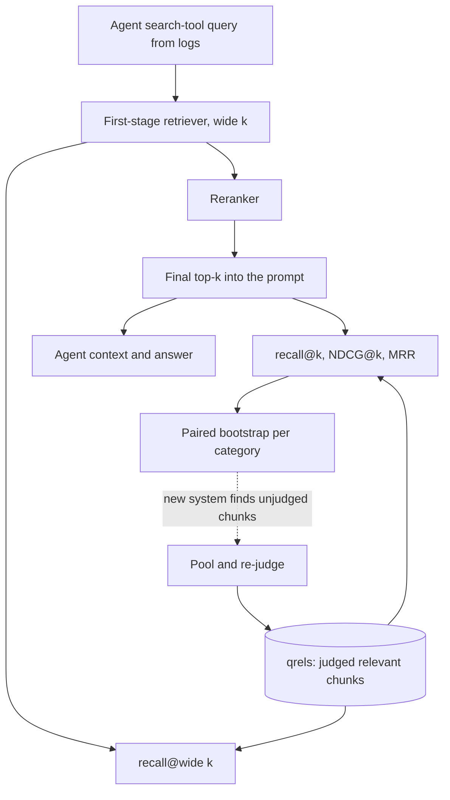

## TL;DR
An agent's answer is only as good as what its search or memory tool returns, so score the retriever
alone: recall@k (did evidence get in?), MRR (first hit how high?), NDCG (graded ranking right?).
Matching k to the context budget matters more than formulas.

## For agent builders
- **Why it matters for agents.** When a RAG agent answers wrongly, the first question is whether the
  evidence ever reached it. Retrieval metrics answer that in seconds without an LLM call, so they run
  on every change to chunking, embeddings or the search tool.
- **Where it shows up in your stack.** The search or memory-lookup tool your agent calls (a vector store
  such as pgvector or Qdrant, hybrid search, a reranker), retriever evaluators in eval tools such as
  LangSmith, Ragas or Braintrust, and a qrels file versioned next to the index config.
- **What you control.** Which queries you evaluate (the agent's own logged search-tool arguments, not
  only user questions), k per tool call, how many search calls a run may make, and how relevance is
  judged.
- **What you can skip.** Exotic IR metrics. recall@k at the first stage and NDCG or MRR at the final k,
  with paired intervals, cover the decisions an agent team makes.

## Why it exists
- **A wrong RAG answer has two suspects.** The retriever did not surface the evidence, or the generator
  mishandled evidence that was there. An end-to-end answer score cannot tell them apart, so it cannot tell
  you what to fix. Retrieval evaluation isolates the first suspect.
- **It is cheap.** No LLM call is needed, so a change to chunking, embedding model, hybrid weights or
  filters can be scored on hundreds of queries in seconds and run on every commit.
- **The naive alternatives fail.** Eyeballing a few queries does not scale and misses regressions.
  Similarity scores are not relevance and are not comparable across models or even across queries.
- **Threshold precision and recall fail too,** because the consumer is a model reading a *ranked* top-k
  list: a relevant chunk at rank 3 helps, the same chunk at rank 40 does not exist. Metrics must be
  rank-aware and cut off at the k the generator actually receives.
- **Three metrics, three questions.** Did everything needed get in (recall@k)? How quickly does the list
  reach something useful (MRR)? Is the ordering right when some passages are more relevant (NDCG)? Which
  is primary depends on what sits downstream.

## How it works
### Ingredients: queries and relevance judgments
- **A query set that resembles production traffic,** including the short, ambiguous and multi-part
  queries real users send.
- **qrels:** for each query, the set of relevant chunks or documents. Relevance can be binary or graded
  (0–3).
- **Sources of qrels:**
  1. golden question–answer pairs where the answer's source passage is known;
  2. SME labeling;
  3. LLM-assisted labeling with a human audit;
  4. **pooling:** merge the top results of several systems and judge them, so no system is penalised for
     finding something the labelers never looked at.
- **Judge at the granularity the retriever returns,** because document-level labels applied to
  chunk-level retrieval mark the wrong chunk of the right document as a hit.

### The metrics at a glance
| Metric | Formula | Answers | Use as |
|---|---|---|---|
| recall@k | relevant items in top k ÷ all relevant items | did the evidence get in? | primary for the first stage |
| hit rate@k | 1 if any relevant item in top k | did *something* relevant get in? | equals recall@k with one relevant item |
| precision@k | relevant items in top k ÷ k | how much of the context is noise? | cost and distractor check |
| MRR | mean of 1 / rank of first relevant item | how high was the first hit? | single-citation or top-heavy generators |
| NDCG@k | DCG@k / IDCG@k | is the graded ranking right? | rerankers, graded judgments |

### recall@k
- **Formula:** recall@k = |relevant ∩ top-k| / |relevant|, and precision@k = |relevant ∩ top-k| / k.
- **Averaged over queries.** It is the primary first-stage metric because the generator can ignore an
  irrelevant passage but cannot recover a missing one.
- **Convention 1:** if a query has more relevant items than k, recall@k cannot reach 1, so either choose
  k above the typical number of relevant items or report R-precision.
- **Convention 2:** when each query has exactly one relevant item, recall@k equals **hit rate@k**, which
  is what many RAG dashboards actually compute under the name recall.
- **precision@k** measures how much of the context window is noise, which matters for cost and for the
  generator's sensitivity to distractors.

### MRR
- **Per query:** reciprocal rank = 1 / (rank of the first relevant item), or 0 if none appears in the
  top k. MRR is the mean.
- **Steep reward:** rank 1 scores 1, rank 2 scores 0.5, rank 3 scores 0.33.
- **Use it when one good hit is enough and position matters,** such as showing one citation or when the
  generator attends mostly to the first passages.
- **Blind spot:** it ignores everything after the first hit, so it says nothing about queries that need
  several passages.

### NDCG@k
Discounted cumulative gain sums the relevance of each result with a position discount:

```
DCG@k  = Σ_{i=1..k} gain(rel_i) / log2(i + 1)
NDCG@k = DCG@k / IDCG@k        (IDCG = DCG of the ideal ordering of the same judgments)
```

- **gain** is either rel_i itself or 2^rel_i − 1; the latter emphasises highly relevant items.
- **The log discount** exists because position matters with diminishing weight, smoother than MRR's
  1/rank cliff.
- **The normalisation** exists so queries with many relevant items do not dominate the average and every
  query scores in [0, 1].
- **The standard for graded judgments and for comparing rankers;** IR benchmarks such as BEIR report
  NDCG@10.

### Picking k and splitting stages
1. **Set k to the number of passages the generator receives** after any reranking, because that is where
   missing evidence becomes a wrong answer.
2. **Evaluate a two-stage pipeline twice:** the first-stage retriever at a larger k (what the reranker has
   to work with) scored by recall, and the reranker at the final k scored by NDCG or MRR.
3. **Find the knee:** raising k raises recall but costs tokens and adds distractors, so measure answer
   quality against k.

### When retrieval is a tool the agent calls
In agentic RAG the model decides when to search, writes the query itself, and may search several
times per run. That changes what you evaluate.

| Question | Metric | Why |
|---|---|---|
| Is the retriever good on the queries it actually gets? | recall@k on logged search-tool arguments | the agent rewrites user questions; its queries are shorter and differ from what a human labeler would type |
| Did the run as a whole collect the evidence? | run-level recall: relevant items in the union of all search results in the run | a later search can recover what an earlier one missed |
| Did the agent search when it needed to? | share of evidence-needing tasks with at least one search call | an agent that answers from memory has recall 0 by construction |
| Is it searching wastefully? | search calls per run and duplicate results across calls | each call costs latency and context tokens |

- **Keep both query sets:** user questions (end-to-end behaviour) and the agent's own queries (the
  retriever in isolation), so a regression can be attributed to query writing or to the index.
- **Memory stores are retrievers too.** A long-term memory lookup is scored the same way, with qrels
  saying which stored memories should come back for a turn.

### Statistical hygiene
- **Paired bootstrap over queries:** compare two systems on the same queries and report intervals, because
  means on a few dozen queries move by several points on resampling.
- **Segment by query type,** because an average of 0.85 can hide a category at 0.3.

## Diagram
The agent's search tool is a two-stage pipeline with two evaluations against the same qrels: recall at
the wide first-stage k, and ranking quality at the final k that reaches the agent's context.



## Examples
### All three metrics for one query, worked by hand
Relevant chunks are c3 (grade 2, the policy clause that answers the question) and c7 (grade 1, a related
FAQ entry).

```python
import math

def recall_at_k(ranked, relevant, k):
    return len(set(ranked[:k]) & set(relevant)) / len(relevant)

def reciprocal_rank(ranked, relevant, k):
    for i, d in enumerate(ranked[:k], start=1):
        if d in relevant:
            return 1.0 / i
    return 0.0

def ndcg_at_k(ranked, grades, k):
    """grades: {doc_id: relevance grade}; anything missing is grade 0."""
    dcg = sum(grades.get(d, 0) / math.log2(i + 1) for i, d in enumerate(ranked[:k], start=1))
    ideal = sorted(grades.values(), reverse=True)[:k]
    idcg = sum(g / math.log2(i + 1) for i, g in enumerate(ideal, start=1))
    return dcg / idcg if idcg else 0.0

ranked = ["c1", "c3", "c5", "c7", "c2"]          # retriever output, best first
grades = {"c3": 2, "c7": 1}
relevant = list(grades)
print("recall@3 =", recall_at_k(ranked, relevant, 3))          # 0.5   (c7 sits at rank 4)
print("recall@5 =", recall_at_k(ranked, relevant, 5))          # 1.0
print("RR       =", reciprocal_rank(ranked, relevant, 5))      # 0.5   (first hit at rank 2)
print("NDCG@5   = %.3f" % ndcg_at_k(ranked, grades, 5))       # 0.643
# Average each metric over the query set; compare two systems with a paired bootstrap over queries.
```

| Quantity | Calculation | Value |
|---|---|---|
| DCG@5 | 2 / log2(3) + 1 / log2(5) ≈ 1.262 + 0.431 | 1.693 |
| IDCG@5 (c3 first, c7 second) | 2 / log2(2) + 1 / log2(3) ≈ 2 + 0.631 | 2.631 |
| NDCG@5 | 1.693 / 2.631 | ≈ 0.643 |

- **recall@5 is perfect and MRR is 0.5, yet NDCG shows the ranking is far from ideal:** an irrelevant
  chunk occupies the top slot and the second relevant item is pushed to rank 4.
- **If the generator receives three passages,** recall@3 is the number that predicts the wrong answer.

### Is the new retriever actually better? Paired bootstrap (runnable)
Pure Python. Per-query recall@5 for 40 queries under the baseline and a hybrid-search variant; resample
the per-query *differences*, so query difficulty cancels out.

```python
import random

def paired_bootstrap(a, b, n_boot=10000, seed=0):
    """a, b: per-query scores for the same queries. Returns mean(b - a) and a 95% interval."""
    rng, d = random.Random(seed), [y - x for x, y in zip(a, b)]
    means = sorted(sum(rng.choices(d, k=len(d))) / len(d) for _ in range(n_boot))
    return sum(d) / len(d), means[int(0.025 * n_boot)], means[int(0.975 * n_boot)]

# recall@5 per query for 40 queries: baseline vs hybrid search
base   = [1, 1, 0.5, 1, 0, 1, 1, 0.5, 1, 1] * 4
hybrid = [1, 1, 1,   1, 0, 1, 1, 0.5, 1, 1] * 3 + [1, 1, 0.5, 1, 0, 1, 0.5, 0.5, 1, 1]
print("baseline %.3f  hybrid %.3f" % (sum(base) / 40, sum(hybrid) / 40))
print("diff %.3f, 95%% CI (%.3f, %.3f)" % paired_bootstrap(base, hybrid))
# baseline 0.800  hybrid 0.825
# diff 0.025, 95% CI (-0.025, 0.075)
```

| Reading | Conclusion |
|---|---|
| +2.5 points of recall@5 | looks like a win on a dashboard |
| interval includes 0 | not distinguishable from no change on 40 queries |
| next step | add queries (or check the category that improved) before switching |

### Agent scenario: per-call versus run-level recall from a trace
A research agent made three `search_docs` calls in one run. The task's qrels say d1, d4 and d9 are
needed. Score each call on the agent's own query, then the union the run collected.

```python
def recall(ids, relevant):
    return len(set(ids) & relevant) / len(relevant)

relevant = {"d1", "d4", "d9"}
calls = [  # (query the agent wrote, top-5 ids the tool returned), taken from the trace
    ("refund policy enterprise",        ["d2", "d1", "d7", "d3", "d5"]),
    ("enterprise plan refund exception", ["d4", "d8", "d1", "d6", "d2"]),
    ("refund policy enterprise 2024",   ["d10", "d11", "d1", "d12", "d13"]),
]
for q, ids in calls:
    print(f"{q:34s} recall@5 = {recall(ids, relevant):.2f}")
seen = [d for _, ids in calls for d in ids]
print(f"run-level recall = {recall(seen, relevant):.2f}, "
      f"duplicate share = {1 - len(set(seen)) / len(seen):.2f}")
# refund policy enterprise           recall@5 = 0.33
# enterprise plan refund exception   recall@5 = 0.67
# refund policy enterprise 2024      recall@5 = 0.33
# run-level recall = 0.67, duplicate share = 0.20
```

| Reading | Action |
|---|---|
| d9 never retrieved by any call | the evidence is missing for this run whatever the agent does next: check indexing and whether d9 matches the agent's phrasing |
| Call 3 repeats call 1 with a year appended | wasted call; 20% of the results the agent read were duplicates |
| Run-level recall 0.67 | the answer can at best be partly grounded; faithfulness checks will show the gap |

## Production patterns
- **Retrieval eval as a CI gate.** Version the qrels file next to the index config, compute recall at the
  first-stage k and NDCG at the final k on every change to embeddings, chunking, filters or hybrid
  weights, and block the merge when the paired-bootstrap lower bound shows a drop. Monitor per-category
  recall, not just the mean.
- **Eval queries from the agent's own tool calls.** Export the arguments of logged search-tool calls
  from production traces, judge their results, and keep them as a second query set beside user
  questions. Monitor the gap between recall on user questions and on agent queries; a widening gap
  points at query writing, not the index.
- **Run-level retrieval metrics on agent traces.** For each eval run, compute recall over the union of
  all search results and count search calls and duplicate results. Monitor run-level recall and calls
  per run together, so a fix that adds searches is visible as a cost.
- **Pool and re-judge on every retriever swap.** Merge the top results of old and new systems, send
  unjudged items to SMEs or an LLM labeler with a human-audited slice, and add them to the qrels. Monitor
  the share of top-k results that are unjudged; a high share means the numbers are unreliable.
- **Span-based qrels that survive re-chunking.** Store relevance as document id plus character span, and
  map spans onto chunks by overlap whenever chunking changes. Monitor the share of qrels that map to no
  chunk after a re-index.
- **Choose k from a sweep, not a guess.** Run answer-quality evals at several final k values and pick the
  knee; record the chosen k in config with the eval that justified it. Monitor prompt tokens per request
  and answer quality together.
- **Deduplicate before the top-k cut.** Collapse near-duplicate chunks (same source, high overlap) so
  copies do not crowd out distinct evidence. Monitor the count of distinct sources per top-k.

## Trade-offs
- **Completeness vs ordering.** recall@k is the right target for a first-stage retriever but is blind to
  ordering and to noise; when the generator is sensitive to position or distractors, add NDCG and
  precision@k.
- **Simplicity vs coverage.** MRR is easy to explain and rewards getting the top slot right, but it
  ignores everything after the first hit; for multi-hop questions that need several passages, use
  recall@k or NDCG instead.
- **Information vs labeling cost.** NDCG uses graded relevance, which is more informative but costlier to
  label and has lower annotator agreement than binary labels; with a small labeling budget, binary
  judgments and recall are safer.
- **Recall vs tokens.** A larger k raises recall but adds tokens and distractors; once answer quality
  stops improving with k, the extra recall is paying for nothing.
- **Scale vs bias.** LLM-generated qrels scale far beyond SME labeling but can over-credit passages that
  merely repeat the query's terms; when the retriever under test is lexical, audit a human-labeled slice
  before trusting them.

## Pitfalls
- **Incomplete qrels, with unjudged chunks counted as irrelevant.** Symptom: a new retriever that finds
  different but valid passages scoring *lower*. Fix: pooling and re-judging its top results.
- **Eval queries written by reading the chunks.** Symptom: near-perfect offline recall and poor results
  on real user phrasing. Fix: queries from logs and tickets.
- **Document-level labels with chunk-level retrieval.** Symptom: "relevant document retrieved" while the
  chunk that reached the generator lacks the answer. Fix: judge chunks or spans.
- **Reporting only the mean.** Symptom: average recall of 0.85 with short or ambiguous queries at 0.3.
  Fix: segment by query type.
- **Changing chunk size and comparing recall@k against the old qrels.** Symptom: numbers that are not
  comparable because the unit of relevance changed. Fix: re-map or re-judge.
- **Evaluating only on user questions when the agent writes its own queries.** Symptom: good offline
  recall, yet traces show the search tool returning little of use. Fix: add the logged search-tool
  arguments as an eval query set.
- **Near-duplicate chunks in the index.** Symptom: a top-k full of copies, recall of distinct relevant
  items stalling while precision looks fine. Fix: deduplicate.

## When to use
- **Run it on every change** to the embedding model, chunking, index, hybrid weights, reranker or
  metadata filters.
- **Reach for it first whenever an agent's answers are wrong,** because "was the evidence present?" is
  the cheapest question to answer; check the trace's search calls before the prompt.
- **Track** recall at the first-stage k and NDCG or MRR at the final k, with paired intervals and a
  per-category breakdown.
- **Build the query set from real traffic,** on the order of a few hundred queries (illustrative),
  stratified by type.
- **Interviews:** define the three metrics, say which one you would make primary and why, and explain how
  you would construct the judgments.

## Role lens
- **Engineer:** Keeps the qrels file and the metrics script in CI so an embedding-model swap that drops
  recall@20 blocks the merge, and traces failed queries to chunking, embedding or filtering.
- **Architect:** Sets the retrieval target at the k the context budget allows and designs the two-stage
  pipeline, recall-oriented first stage and precision-oriented reranker, that the metrics map onto.
- **FDE:** Builds the query set from the customer's search logs and tickets, has their SMEs judge
  relevance, and uses recall@k to show whether a failure is "not indexed" or "not found".

## Check yourself
**Q:** A customer's RAG assistant answers about 30% of questions wrongly. Before touching prompts, what
retrieval evaluation would you set up, which metric would you look at first, and how would you read it?
**A:** Build one to three hundred queries from real tickets and have SMEs mark the relevant chunks, then
run the current pipeline and compute recall at the k that actually reaches the generator, plus recall at
a larger k for the first stage. If recall@k is low, retrieval is the bottleneck, and the failures sort
into three buckets with different fixes: the passage is not in the index (ingestion), it is indexed but
ranked low (embedding, chunking, hybrid weighting), or it is filtered out (metadata or ACL rules). If
recall@k is high and answers are still wrong, the generator or faithfulness is the problem. MRR and NDCG
then say whether a reranker is worth adding. Every comparison between pipeline variants runs on the same
queries with a paired bootstrap.

## Interview questions
### Which retrieval metric would you make primary for a first-stage retriever, and why?
- **recall@k at the k the reranker or generator receives,** because the generator can ignore a
  distractor but cannot recover a passage that never arrived.
- **Not MRR,** which stops at the first hit and says nothing about multi-passage questions.
- **Add NDCG at the final k** once a reranker exists, since ordering then matters.

### Offline recall@5 is 0.95, but users say answers lack the evidence they need. What do you check?
- **The query set:** queries written by reading chunks inflate recall; rebuild from search logs and
  tickets.
- **Label granularity:** document-level labels can count the wrong chunk of the right document as a hit.
- **Filters and permissions in production:** metadata or ACL filters active live but not offline remove
  passages before the top-k cut.

### Your agent calls a search tool several times per run. How do you evaluate retrieval?
- **Score the tool on the queries it actually gets:** logged search-tool arguments, judged against
  qrels, at the k the tool returns into context.
- **Score the run as a whole:** recall over the union of all results in the run, plus whether the agent
  searched at all on tasks that needed evidence.
- **Track the cost side:** search calls per run and duplicate results, so a gain in run-level recall
  bought with twice the calls is visible.

### How would you pick k for a RAG agent's search tool?
- **Start from the context budget:** k is the number of passages the generator actually receives after
  reranking.
- **Sweep it:** measure answer quality at several k; recall keeps rising but answer quality flattens or
  drops as distractors and tokens grow.
- **Pick the knee** and record the eval that justified it, so the choice is revisited when models change.

### You have no labeled data for a new customer. How do you build qrels in a week?
- **Take a few hundred real queries** from logs or tickets, stratified by type.
- **Pool candidates** from two or three retrievers (lexical, dense, hybrid) and judge the union, so no
  system is penalised for unjudged finds.
- **Use an LLM labeler with an SME-audited slice** to scale, checking especially that it does not
  over-credit passages that merely repeat query terms.

### A hybrid-search change lifts mean recall@5 from 0.800 to 0.825 on 40 queries. Do you ship?
- **Not on that evidence alone:** a paired bootstrap gives a 95% interval of roughly −0.025 to +0.075,
  which includes no change.
- **Look per category:** if the gain is concentrated where users struggle, it may still be worth a larger
  test.
- **Add queries** to narrow the interval, because means on a few dozen queries move by several points on
  resampling.

## Quiz
### Q: Each query has one relevant chunk; the retriever ranks it first for half the queries and fourth for the rest, with k = 5. What are recall@5 and MRR?
- [ ] recall@5 = 1.0 and MRR = 1.0
- [ ] recall@5 = 0.5 and MRR = 0.625
- [x] recall@5 = 1.0 and MRR = 0.625
- [ ] recall@5 = 1.0 and MRR = 0.5
> The relevant chunk is always within the top 5, so recall@5 is 1.0. Reciprocal ranks are 1 and 0.25,
> averaging to 0.625; MRR exposes the ordering problem that recall@5 hides.

### Q: You are evaluating a reranker with graded relevance labels and several relevant passages per query. Which metric fits best?
- [ ] MRR
- [ ] Hit rate@k
- [x] NDCG@k
- [ ] precision@1
> NDCG is the only one of the four that uses relevance grades and credits every relevant item with a
> position discount; MRR and hit rate stop at the first hit, and precision@1 looks at one slot.

### Q: A new embedding model lowers recall@10 from 0.82 to 0.74 on your qrels, but SMEs reviewing its results say they look better. What is the most likely explanation?
- [ ] The SMEs are biased toward novelty
- [ ] The new model is genuinely worse and the SMEs are wrong
- [x] The qrels are incomplete: the new model surfaces relevant chunks that were never judged and are counted as irrelevant; pool its results and re-judge
- [ ] k = 10 is too small to measure a dense retriever
> Judgments made from the old system's results cannot credit passages only the new system finds. Pooling
> the top results of both systems and judging the union is the standard remedy.
