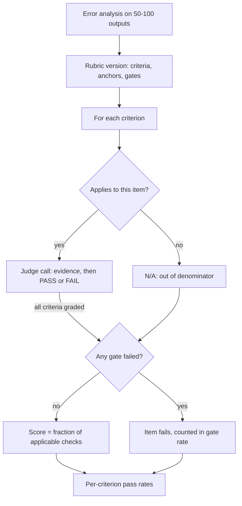

## TL;DR
A rubric turns "is this good?" into specific, observable criteria with defined levels, so two graders (or
a human and an LLM judge) score alike. Build it from failure modes, prefer binary checks, gate
catastrophic criteria, and version it.

## Why it exists
- **Unanchored scores measure the grader.** Ask three engineers to rate a support-bot answer from 1 to
  10 and you get 6, 8 and 9. They rarely disagree about the answer; they disagree about what a 7 means.
- **Noise sets the smallest detectable improvement.** If scores wobble by two points between graders, a
  real half-point gain between prompt versions is invisible.
- **LLM judges do the same.** "Rate the quality" produces compressed, run-to-run varying scores, because
  the judge fills in unstated criteria, in practice length, confidence and formatting.
- **A longer instruction does not fix it.** "Consider accuracy, completeness and tone" still leaves every
  level boundary undefined: what separates a 6 from a 7 on "completeness"? Observable anchors are what let
  a second grader, or a model, reproduce the first grader's score.
- **It is the shared definition of "good".** Product, subject-matter experts and engineering agree on it,
  so disagreements surface early as edits to a criterion instead of later as arguments about a number. In
  forward-deployed work it often ends up in the statement of work as the acceptance test.

## How it works
### Anatomy of a rubric
- **Criteria:** the dimensions you judge (correctness, completeness, groundedness, format compliance,
  tone, safety).
- **Levels with behavioural anchors** per criterion. Anchors describe the output, not the grader's feeling.
- **An aggregation rule** that combines them.

| Anchored (usable) | Unanchored (not usable) |
|---|---|
| Correctness: 0 = contains a factual error that changes the conclusion; 1 = minor inaccuracy that does not affect the conclusion; 2 = no errors | poor / fair / good |
| "Every factual claim is supported by a quoted span from the retrieved context" (checkable) | "well grounded" (not checkable) |

- **The test:** the anchored version can be applied by someone who has never met you.
- **Criteria must be independent and single-barreled.** "Accurate and complete" is two criteria; an
  answer that is accurate but incomplete splits graders down the middle, and you lose which half failed.

### Analytic vs holistic
| | Analytic | Holistic |
|---|---|---|
| What it does | scores each criterion and combines them (sum, weighted sum, or fraction passed) | assigns one overall level with a descriptor per level |
| Best for | diagnosis, because a regression is attributable to a dimension; LLM judges, because "is X present?" is easier than "how good is this overall?" | speed for humans; a single preference signal, such as pairwise comparison |

Most production evals use analytic rubrics with a holistic sanity check.

### Gating criteria
- **Some failures must not be averaged away:** a fabricated citation, a leaked secret, an unsafe instruction.
- **Mark them as gates:** failing any gate makes the overall result a fail regardless of the rest.
- **Because:** an arithmetic mean over criteria is exactly how a 4-out-of-5 answer with a made-up policy
  number ships.

### Applicability and the denominator
- **Many criteria apply only to some items.** "Escalates when the request is out of scope" means nothing
  for an in-scope question; "cites the refund clause" means nothing for a password reset.
- **Give them an explicit N/A outcome** with its own trigger condition, and exclude N/A from the denominator.
- **Scoring N/A as a pass inflates the score with free points:** passing 2 of 3 real checks plus 3
  inapplicable ones reports 5/6 instead of 2/3, and hides the criterion's true pass rate, which should be
  computed only over items where it applied.
- **Scoring N/A as a fail** does the opposite.
- **Decide applicability first**, via the judge or the item's metadata, because "did it escalate?" is
  ambiguous when escalation was never warranted.

### Weighting
- **Weighted sums hide trade-offs.** With weights 0.5 on correctness and 0.1 on tone, a tone regression
  is invisible in the headline, and arguments about weights are really arguments about priorities that
  should be explicit.
- **The usual pattern:**
  1. gates for what must never happen;
  2. an unweighted fraction of the remaining checks for the trend line;
  3. per-criterion pass rates for decisions.
- **Reach for weights only** when a single scalar must rank many variants, and report the per-criterion
  numbers next to it.

### Binary beats Likert
- **Prefer yes/no checks over 1–5 scales.** A five-level scale has four boundaries to disagree on; a
  binary check has one, so raw inter-annotator agreement and judge–human agreement are typically higher.
- **Caveat:** when a binary criterion almost always passes, chance-corrected agreement (kappa) can still
  be low, so read it alongside the pass rate.
- **Need granularity? Add more binary criteria**, not more levels. The score, fraction of checks passed,
  is directly interpretable.
- **Genuinely continuous quantities** (how well a summary fits a length budget) get a three-level
  anchored scale, rarely more.

### Where criteria come from
1. **Not from a brainstorm.** Read 50–100 real outputs.
2. **Cluster the failures.**
3. **Turn each recurring failure into a criterion with a negative anchor.** This is error analysis
   feeding the rubric, and why rubrics evolve: as the failure mix changes, criteria are added and retired.

Two layers work well:
- **Global rubric** applied to every item.
- **Item-specific checks** stored with each golden example ("must state the refund window is 30 days",
  "must not recommend a competitor"). They are the most reliable thing an LLM judge can apply, because
  they reduce judgment to presence or absence.

### Calibration and versioning
1. **Pilot** with two or more annotators on 30–50 items and compute agreement per criterion.
2. **Low agreement on a criterion means ambiguous anchors**, not bad annotators; rewrite and re-pilot.
3. **Add one exemplar output per level per criterion** so graders can pattern-match.
4. **Freeze a version.** Scores are only comparable within a rubric version, so changing a criterion
   mid-experiment invalidates the before/after.

### Rubrics inside an LLM judge
- **Put the rubric verbatim in the judge prompt** and use structured output.
- **Ask for quoted evidence per criterion before the verdict**, because looking for a quote forces the
  judge to check rather than pattern-match the tone.
- **One call per criterion for the highest-stakes criteria:** a single call over twelve criteria tends to
  rubber-stamp the later ones.
- **Validate the judge per criterion against human labels.** Judges are usually excellent on format
  compliance and weak on domain correctness, so you may keep humans on some criteria and automate the rest.

## Diagram
How one graded item becomes a score: applicability first, gates before aggregation, and N/A kept out of
the denominator. The top two boxes are how the rubric itself is built and frozen; the gate check runs
once per item, after every applicable criterion has been graded.



## Examples
### Rubric as data, one judge call per criterion, gate before aggregation
Item-specific criteria are attached to the golden item and skipped for items that do not declare them.

```python
RUBRIC = {
    "no_fabricated_citation": {"gate": True, "check":
        "Every cited source ID appears in the provided context. FAIL if any citation is absent."},
    "answers_question": {"gate": False, "check":
        "The response directly answers the user's question within its first two sentences."},
    "grounded": {"gate": False, "check":
        "Every factual claim in the response is supported by a quoted span from the context."},
    "refund_window_stated": {"gate": False, "item_specific": True, "check":
        "The response states that the refund window is 30 days."},
}

PROMPT = """You are grading ONE criterion of a support-bot answer.
Context:
{context}

Question: {question}
Response: {response}
Criterion: {check}
Quote the evidence from the response and context (or write NONE), then output exactly PASS or FAIL on the last line."""

def grade(item, response, llm):
    """item = {'context':..., 'question':..., 'criteria': [item-specific criterion names]}"""
    results = {}
    for name, c in RUBRIC.items():
        if c.get("item_specific") and name not in item["criteria"]:
            continue
        out = llm(PROMPT.format(context=item["context"], question=item["question"],
                                response=response, check=c["check"]))
        results[name] = out.strip().splitlines()[-1].strip() == "PASS"
    gates_failed = [n for n, r in results.items() if RUBRIC[n]["gate"] and not r]
    if gates_failed:
        return 0.0, results, gates_failed          # a gate failure zeroes the score
    return sum(results.values()) / len(results), results, []   # skipped criteria never enter the denominator

# A response citing "DOC-9" when the context only holds DOC-1..DOC-4 returns (0.0, {...}, ['no_fabricated_citation'])
# even if it answers the question, is otherwise grounded and states the 30-day window.
```

- **Log the per-criterion results**, because "grounded dropped from 94% to 81% after the prompt change"
  is actionable and "average score dropped 0.04" is not.

### Aggregating a batch with N/A and gates (runnable)
Pure Python. `None` means the criterion did not apply; gate failures are reported as their own rate.

```python
from collections import defaultdict

def aggregate(graded, gates):
    """graded: one dict per item, criterion -> True / False / None (None = N/A)."""
    per = defaultdict(lambda: [0, 0])          # criterion -> [passes, applicable]
    item_scores, gate_fails = [], 0
    for g in graded:
        applied = {k: v for k, v in g.items() if v is not None}
        for k, v in applied.items():
            per[k][0] += v; per[k][1] += 1
        if any(applied.get(k) is False for k in gates):
            gate_fails += 1; continue             # report gate failures separately
        rest = [v for k, v in applied.items() if k not in gates]
        item_scores.append(sum(rest) / len(rest) if rest else 1.0)
    return ({k: f"{p}/{n}" for k, (p, n) in per.items()},
            gate_fails / len(graded), round(sum(item_scores) / len(item_scores), 2))

graded = [
    {"no_fabrication": True,  "answers": True,  "grounded": True,  "escalates": None},
    {"no_fabrication": True,  "answers": True,  "grounded": False, "escalates": None},
    {"no_fabrication": False, "answers": True,  "grounded": True,  "escalates": None},
    {"no_fabrication": True,  "answers": False, "grounded": True,  "escalates": False},
]
print(aggregate(graded, gates={"no_fabrication"}))
# ({'no_fabrication': '3/4', 'answers': '3/4', 'grounded': '3/4', 'escalates': '0/1'}, 0.25, 0.61)
```

| Reported number | N/A excluded (correct) | N/A scored as pass |
|---|---|---|
| "escalates" pass rate | 0/1: the only out-of-scope item was mishandled | 3/4 = 75%, looks healthy |
| Gate failure rate | 25%, shown on its own | hidden inside an average |

## Production patterns
- **Rubric in version control next to the dataset.** Store criteria, anchors and exemplars as a YAML or
  JSON file, tag a version, and write that version into every eval result row. Monitor that comparisons
  only ever join results with the same rubric version.
- **Per-criterion dashboards, gate rate separate.** Chart each criterion's pass rate over its applicable
  items plus the gate-failure rate, rather than one blended score. Alert when a gate rate moves at all or
  a criterion drops beyond its bootstrap interval.
- **One judge call per high-stakes criterion.** Run gates and domain-correctness checks as separate,
  parallel judge calls with structured PASS/FAIL output; batch low-stakes format checks into one call.
  Monitor judge–human agreement per criterion after any batching change.
- **Item-specific "must mention" lists from SMEs.** Store must-state and must-not-state facts on each
  golden item, and have the judge check presence or absence. Monitor list staleness by re-reviewing items
  when the product or policy they reference changes.
- **Quarterly rubric review from error analysis.** Sample fresh production outputs, cluster failures not
  covered by any criterion, and add or retire criteria in a new version. Monitor the share of complaints
  that map to no criterion.

## Trade-offs
- **Diagnosis vs grader time.** Analytic rubrics give per-criterion diagnosis but cost more grader time
  per item; a holistic rubric is the better choice when you only need a fast overall preference, as in a
  pairwise arena.
- **Agreement vs gradation.** Binary criteria raise agreement but lose gradation; when the judged quantity
  is inherently continuous, a short anchored scale beats forcing a yes/no.
- **Reliability vs SME cost.** Item-specific checklists are the most reliable for LLM judges, but they
  cost SME time per golden item and go stale when the product or policy changes; with a large or
  fast-moving golden set, lean on the global rubric.
- **Precision vs novelty.** A detailed rubric constrains the judge to the failures you already know
  about, so it misses novel failure modes; pair it with periodic open-ended error analysis on fresh
  production samples.
- **Safety vs readable trends.** Gating criteria protect against catastrophic ships but make the headline
  score lumpy; report gate failure rate and the non-gated score separately so trends stay readable.

## Pitfalls
- **Double-barreled criteria** such as "accurate and complete". Symptom: annotators split on items that
  are accurate but incomplete, and agreement on that criterion collapses. Fix: split it.
- **Anchors that describe grader feelings** ("excellent", "adequate") instead of output features.
  Symptom: scores drift between annotators and across weeks for the same outputs. Fix: rewrite each
  anchor as an observable property of the output.
- **Averaging over a gate.** Symptom: an answer with a fabricated citation scores 0.8 and passes the
  release threshold. Fix: gates override the average.
- **Editing the rubric mid-experiment.** Symptom: an "improvement" that disappears when both arms are
  regraded with the same version. Fix: freeze a version per experiment.
- **Scoring inapplicable criteria as passes.** Symptom: "escalates when out of scope" reports a 97% pass
  rate although the system mishandles most of the few out-of-scope items. Fix: explicit N/A.
- **Twelve criteria in one judge call.** Symptom: later criteria agree with humans far less than the same
  criteria graded in isolation. Fix: split high-stakes criteria into their own calls.
- **Treating the rubric as finished.** Symptom: a green eval dashboard while production complaints
  describe a failure mode no criterion covers. Fix: periodic error analysis.

## When to use
- **Use when** a human or model scores free-form output: chat answers, summaries, generated documents,
  agent reports.
- **Avoid when** the task has an executable oracle; run the tests.
- **Start with** three to six criteria drawn from error analysis, binary where possible, with a gating
  subset.
- **Measure** per-criterion inter-annotator agreement and judge–human agreement before relying on it.
- **Day to day,** the rubric lives in the judge prompt and the annotation guidelines and changes under
  version control.
- **Interviews:** "how would you evaluate a summarisation feature?" is a rubric question: criteria,
  observable anchors, gates, pilot, agreement, versioning.

## Role lens
- **Engineer:** Encodes the rubric as data, grades one criterion per judge call, and logs per-criterion
  results so a regression points at a dimension instead of a number.
- **Architect:** Owns which criteria are gating for a release, how rubric versions are tied to eval
  dataset versions, and how the rubric maps onto contractual acceptance criteria.
- **FDE:** Co-writes the rubric with the customer's SMEs in a labeling session, so the definition of done
  is shared before anyone argues about whether the model is "good enough".

## Check yourself
**Q:** A customer says the bot's answers "should be high quality". Turn that into a rubric an LLM judge
can apply, and explain how you would know the rubric itself is any good.
**A:** Collect 50 real transcripts and the SMEs' complaints, cluster the failures, and write one binary
observable criterion per failure: answers the question asked, no claim unsupported by the context, cites
a document, correct policy figures, escalates when out of scope, no fabricated references. Mark
fabrication and unsafe advice as gates. Write one example per outcome per criterion. Pilot with two SMEs
on 40 items and compute per-criterion kappa; rewrite any criterion with low agreement, because that is
an anchor problem. Then run the judge per criterion and compare it with the SME majority; automate the
criteria where judge agreement is near SME–SME agreement, keep humans on the rest, and freeze a rubric
version so future scores are comparable.

## Interview questions
### What makes a rubric criterion usable, and why does "rate quality 1–10" fail?
- **A usable criterion is observable and single-barreled:** someone who has never met you can apply it
  and reach the same verdict, because the anchor describes the output, not a feeling.
- **"Rate quality 1–10" leaves every boundary undefined,** so graders disagree about what a 7 means and
  LLM judges fill the gap with length, confidence and formatting.
- **The result is noise larger than real improvements,** which hides a half-point gain between prompts.

### Agreement on one criterion is low while the rest are fine. How do you debug it?
- **Treat it as an anchor problem first,** not an annotator problem, since the same people agree
  elsewhere.
- **Read the disagreed items side by side:** look for a double-barreled criterion ("accurate and
  complete"), an unclear applicability condition, or a missing level example.
- **Fix and re-pilot:** split the criterion, add an explicit N/A trigger or item-specific must-mention
  lists, then re-measure per-criterion kappa on 30–50 items.

### When would you choose a holistic rubric or a weighted score over an analytic, unweighted one?
- **Holistic** when you only need a fast overall preference, such as a pairwise arena, and diagnosis per
  dimension is not the goal.
- **Weighted scalar** only when one number must rank many variants; report per-criterion rates beside it,
  because weights hide trade-offs such as a tone regression under a 0.1 weight.
- **Never weight a gate:** fabricated citations or leaked secrets override any average.

### How would you roll out a rubric for an LLM judge on a live product without breaking trend lines?
- **Version it with the dataset** and write the rubric version into every result row, because scores
  are only comparable within a version.
- **Regrade the baseline** with the new version before comparing, so an "improvement" is not a rubric
  change.
- **Validate per criterion against SME labels** and automate only criteria where judge agreement is close
  to SME–SME agreement; keep humans on the rest.

### What does N/A handling change in the reported numbers?
- **Scoring N/A as pass inflates scores:** 2 of 3 real checks plus 3 inapplicable ones reports 5/6
  instead of 2/3.
- **It also hides rare-case failures:** an escalation criterion that applies to few items can show 97%
  while most of those few items fail.
- **So compute each criterion's pass rate only over items where it applied,** and decide applicability
  before grading.

## Quiz
### Q: Why prefer several binary criteria over a single 1–10 "quality" score?
- [ ] LLM judges cannot output numeric scores reliably
- [x] Each binary check has one decision boundary, so graders and judges agree more, and the per-criterion result says what failed
- [ ] Binary scores are easier to average into a percentage
- [ ] A 1–10 scale takes longer to grade than ten binary checks
> Agreement drops with every extra level boundary, and a single overall number hides which dimension
> regressed. The averaging convenience is real but is not the reason the practice exists.

### Q: An answer passes 4 of 5 criteria but cites a document that is not in the context. Under a well-designed rubric, what is the outcome?
- [ ] It scores 0.8 and passes the usual threshold
- [ ] It scores 0.8 but is flagged for later review
- [x] It fails outright, because fabricated citations are a gating criterion that overrides the average
- [ ] The citation criterion is double-weighted, giving roughly 0.67
> Gates exist precisely so a catastrophic failure cannot be averaged away by otherwise good behaviour;
> a weighted average still lets the answer ship if the other criteria are strong.

### Q: Per-criterion agreement shows "completeness" at kappa 0.25 while every other criterion is above 0.7. What is the most likely cause and the first fix?
- [ ] The annotators are unreliable and should be replaced
- [x] The criterion's anchors are ambiguous for these items; add item-specific "must mention" lists or sharper anchors, then re-pilot
- [ ] Completeness is subjective, so drop the criterion
- [ ] Switch completeness to a 1–10 scale to capture nuance
> Low agreement isolated to one criterion points at that criterion's definition. Annotators agree fine
> elsewhere, so replacing them or widening the scale would not fix the ambiguity.
