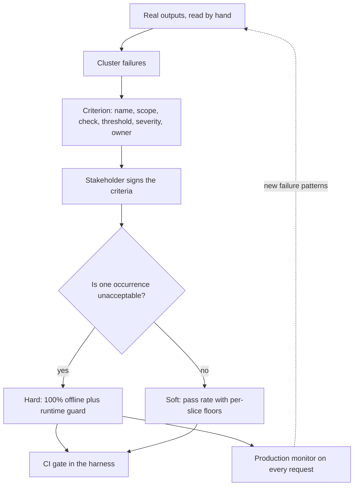

## TL;DR
Acceptance criteria turn "the model should work well" into checkable statements about one task's
outputs (format, content, correctness, edge cases, latency, cost), each with a threshold and scope.
Generic scores cannot say whether that task is safe to ship.

## Why it exists
- **Without a definition, every review restarts.** Ask three people whether the new summarizer is "good
  enough" and you get three answers from three anecdotes. The eval measures whatever was easiest to
  compute, and the release is decided by whoever is most confident.
- **Software solved this decades ago.** Acceptance criteria and acceptance tests derived from
  requirements. LLM features regressed to intuition because their outputs looked too fuzzy to specify.
- **Generic scores do not transfer.** A BLEU value, a 4.2/5 helpfulness rating or a leaderboard rank
  cannot tell you whether a contract-clause extractor is safe to ship; only criteria derived from that
  task's actual failure modes can.
- **One "rate this 1 to 10" judge score fails three ways.**
  - *Hides which property failed:* a drop from 8.1 to 7.6 is not actionable.
  - *Averages catastrophic with cosmetic:* a system that leaks a customer address in 1% of outputs and
    is otherwise perfect scores 99%.
  - *Untethered from the task:* the same prompt scores well on a task it is unsuited for.
- **Criteria are specific, decomposed and thresholded,** and together form the contract between the
  people building the feature and the people who will live with it:
  - "Output is valid JSON matching the schema, 100% of items": a hard constraint anyone can check.
  - "Priority correct on at least 90% of golden items overall and at least 85% in every category": a
    soft constraint with a per-slice floor.
  - "No output contains a phone number or email address, 100%": a safety criterion that must never
    average away.

## How it works
### Derive criteria from failures, not from the armchair
1. **Sample real outputs:** production or pilot responses, read and categorized by hand (error
   analysis).
2. **Cluster the failures:** "wrong priority when the ticket mentions an outage", "summary over 60
   words", "invented order numbers".
3. **Turn each cluster into a criterion** plus a handful of golden items.

- **Why not write them first:** criteria written before looking at outputs tend to restate the prompt
  ("the summary should be concise and helpful") and miss what actually breaks.

### The kinds of criteria
| Kind | Examples | How it is checked |
|---|---|---|
| **Structural** | Valid JSON, matches schema, required fields present, length bounds, language | Deterministic, cheap, every item |
| **Content constraints** | Must include a citation, a disclaimer, the order id from the input; must not include PII, competitor names, instructions the user did not ask for | Mostly deterministic: regex or lookup against the input |
| **Correctness** | Matches label or reference; field-level precision/recall for extraction; unit tests for code; claims supported by retrieved context for RAG | Graders against golden labels |
| **Behavioural** | Refuses out-of-scope requests, asks a clarifying question on ambiguous input, escalates when confidence is low | Dedicated golden slices built for those behaviours |
| **Consistency** | Same answer on a paraphrase; same classification when irrelevant fields change | Metamorphic checks |
| **Operational** | p95 latency, cost per request, token budget | Measured by the harness alongside quality, *because* a quality gain that doubles cost is a different decision |

### Hard versus soft, and thresholds per slice
- **Hard criteria are 100%.** A single violation blocks the release, *because* the cost of one
  occurrence is unacceptable (PII leak, invalid output that crashes a downstream parser).
- **Soft criteria are statistical.** A pass-rate threshold on the golden dataset with a floor per slice,
  *because* an overall 92% can be a 60% on the slice the biggest customer uses.
- **Thresholds come from the business and the baseline:** what error rate the downstream human reviewer
  can absorb, not round numbers.

### Two statistical facts that shape thresholds
1. **"100%" on a finite set is weaker than it sounds.** Zero violations in *n* items only bounds the true
   rate: the 95% upper bound is about 3/*n* (the "rule of three"). A PII check that passes all 300
   golden items is consistent with a leak rate of up to 1%.
   - So a hard criterion needs two layers: an offline gate, plus a runtime guard (a validator, a
     redaction step, a schema check with retry) on every production request, because the eval alone can
     never certify "never".
2. **"Never worse than baseline" must be a non-inferiority margin,** such as "no slice more than 3 points
   below the baseline on the same items".
   - *Because* strict "never worse" on a noisy measurement blocks harmless changes by chance: with no true
     effect, each slice lands below its baseline close to half the time (ties aside). With several
     slices checked, most harmless changes fail somewhere.

- **Size the slice behind each floor.** A floor of 85% on a slice of 40 items carries an interval of
  roughly ±11 points, so the gate needs more items in that slice or a looser floor it can resolve.

### Writing one down
Each criterion has six fields:

| Field | Example |
|---|---|
| Name | `no_pii_in_summary` |
| Scope | All items, or a slice or condition |
| Check | A function, or rubric text for a judge |
| Threshold | 100%, or a pass rate with slice floors |
| Severity | Blocking or warning |
| Owner | The person who can change it |

- **Express the check as code wherever possible,** *because* prose criteria drift from what the grader
  actually tests. Where a judge is needed, the rubric text is versioned with the grader.
- **Signed before building.** The criteria document is what the stakeholder or customer signs before
  the build starts, so "done" is defined up front rather than negotiated at demo time.

### Where criteria live
One definition, used in four places, keeps offline, gate and online views consistent:
1. **Graders** in the eval harness.
2. **Gates** in CI (hard criteria and soft thresholds).
3. **Production monitors** for checks cheap enough to run online (schema, PII, length).
4. **Headings** of the release report.

## Diagram
Criteria come out of error analysis, split into hard and soft, and one definition feeds the offline
gate and the runtime guard alike.



## Examples
### Criteria for support-ticket triage, as checks
Each check returns the criterion name, a pass flag and a severity. The gate blocks on any hard failure
and on soft pass rates below their floors, overall and per category.

```python
import json, re
from collections import defaultdict

ALLOWED = {"billing", "refund", "shipping", "cancel", "other"}
# crude on purpose: also flags ISO dates and long order ids; use a real PII detector in production
PII = re.compile(r"\b[\w.+-]+@[\w-]+\.\w+\b|\b\+?\d[\d\s().-]{8,}\d\b")

def checks(ticket: dict, raw_output: str, label: dict):
    try:
        out = json.loads(raw_output)
    except json.JSONDecodeError:
        out = None
    yield ("valid_json", isinstance(out, dict), "hard")   # a bare string or list is not a valid record
    if not isinstance(out, dict): return                  # generator: report the failure, then stop
    yield ("category_in_set", out.get("category") in ALLOWED, "hard")
    yield ("no_pii_in_summary", not PII.search(out.get("summary", "")), "hard")
    yield ("summary_max_40_words", len(out.get("summary", "").split()) <= 40, "soft")
    yield ("outage_is_p1", out.get("priority") == "P1" if "outage" in ticket["text"].lower() else True, "hard")
    yield ("category_correct", out.get("category") == label["category"], "soft")
    yield ("priority_correct", out.get("priority") == label["priority"], "soft")

FLOORS = {"category_correct": 0.90, "priority_correct": 0.85, "summary_max_40_words": 0.95}
SLICE_FLOOR_DISCOUNT = 0.05            # each category may sit up to 5 points under the overall floor

def gate(results):                     # results: [(slice, [(name, passed, severity), ...]), ...]
    hard_fail, tally = [], defaultdict(lambda: defaultdict(list))
    for slc, rows in results:
        for name, ok, sev in rows:
            if sev == "hard" and not ok: hard_fail.append((slc, name))
            tally[name]["all"].append(ok); tally[name][slc].append(ok)
    verdict = {"blocking": hard_fail, "soft": {}}
    for name, floor in FLOORS.items():
        for slc, oks in tally[name].items():
            rate, need = sum(oks) / len(oks), floor - (0 if slc == "all" else SLICE_FLOOR_DISCOUNT)
            verdict["soft"][f"{name}/{slc}"] = (round(rate, 3), rate >= need)
    verdict["ship"] = not hard_fail and all(ok for _, ok in verdict["soft"].values())
    return verdict
```

- **Intended behaviour:** a single ticket whose summary contains an email address blocks the release
  regardless of the 94% category accuracy. The criteria encode which failures may average and which
  may not.

### What can a clean run actually prove? Sizing hard criteria and slice floors
Pure Python; the numbers below match the statistical facts above.

```python
import math

def zero_violation_upper(n):              # rule of three: 95% upper bound when 0 of n items violate
    return 3 / n

def exact_upper(n, conf=0.95):            # exact (Clopper-Pearson) bound for 0 of n: 1 - (1-conf)^(1/n)
    return 1 - (1 - conf) ** (1 / n)

def half_width(p, n, z=1.96):             # normal-approximation 95% half-width of a slice pass rate
    return z * math.sqrt(p * (1 - p) / n)

def items_for(p, hw, z=1.96):             # slice size needed for a given half-width
    return math.ceil(z * z * p * (1 - p) / hw**2)

print(f"PII clean on 300 items -> leak rate could be up to {zero_violation_upper(300):.1%} "
      f"(exact {exact_upper(300):.2%})")
print(f"items to bound a leak rate below 0.1%: {math.ceil(3 / 0.001)}")
print(f"floor 85% on 40 items: +/-{half_width(0.85, 40):.0%}")
print(f"items for +/-5 points at 85%: {items_for(0.85, 0.05)}")
# PII clean on 300 items -> leak rate could be up to 1.0% (exact 0.99%)
# items to bound a leak rate below 0.1%: 3000
# floor 85% on 40 items: +/-11%
# items for +/-5 points at 85%: 196
```

| Question | Answer | Consequence |
|---|---|---|
| Does 0/300 PII violations prove "never"? | No: up to ~1% is consistent | Add a runtime redaction guard |
| Offline items to bound leaks below 0.1% | ~3,000 | Usually impractical; the runtime guard is the real control |
| Is an 85% floor on 40 items meaningful? | ±11 points | Grow the slice toward ~200 items, or loosen the floor |

## Production patterns
- **Criteria-as-code registry.** Keep every criterion (name, scope, check, threshold, severity, owner)
  in one module that the harness, the CI gate and the online monitor all import. Monitor for graders
  that exist in the harness but not in the registry, and the reverse.
- **Runtime guard for every hard criterion.** Validate structured output against its schema on each
  request (for example Pydantic's `model_validate_json`) with one bounded retry, and run PII redaction
  before the response leaves the service. Monitor guard trigger rate and retry rate per route.
- **Non-inferiority gate per slice.** Gate on "no slice more than 3 points below baseline on the same
  items" instead of "never worse". Monitor how often the gate blocks changes later shown harmless; a
  high rate means the margin is too tight for the slice sizes.
- **Versioned, signed criteria.** Store the criteria document next to the graders, bump its version on
  any change, and record that version in each run manifest and release report. Monitor drift between
  the signed version and the version the gate ran.
- **Cheap checks on 100% of live traffic.** Run schema, PII and length checks online and page on any
  hard violation; sample expensive judge-based criteria. Monitor violation counts per criterion per
  day.

## Trade-offs
- **Decomposed criteria vs maintenance.** They make failures actionable and gates precise, but a long
  list costs grader maintenance and can become a checklist nobody re-derives when the task changes.
- **Hard 100% vs flaky blocks.** Hard criteria protect against unacceptable outputs, but each needs a
  deterministic check; making a judgment call "hard" produces flaky blocks from judge noise.
- **Per-slice floors vs slice size.** They catch regressions the average hides, but each slice needs
  enough golden items for its floor to mean anything; a floor on a slice of eight items is theatre.
- **Early criteria vs discovered failures.** Writing criteria before building defines "done" and aligns
  stakeholders, but criteria frozen too early miss failure modes only seen after real outputs exist;
  revise them after error analysis.

## Pitfalls
- **Criteria that paraphrase the prompt** ("output should be accurate and helpful"). Symptom: a judge
  that passes almost everything and a release meeting that still argues from anecdotes.
- **One aggregate quality score as the only gate.** Symptom: a rare catastrophic failure (PII, a
  fabricated refund) ships inside a high overall score.
- **Round-number thresholds** instead of the downstream cost of errors. Symptom: a gate that blocks
  harmless regressions and passes harmful ones.
- **No operational criteria.** Symptom: a quality improvement that triples latency, discovered by users
  rather than by the eval.
- **Criteria in a document while graders drift.** Symptom: a passing eval for a behaviour the document
  says is forbidden.
- **No per-slice floors.** Symptom: a merged change raised the average by regressing the one category
  the enterprise customer cares about.
- **A clean offline run taken as proof a hard criterion holds.** Symptom: the first real violation
  arrives weeks after launch on an input pattern the golden set never contained, with no runtime guard.

## When to use
- **Timing:** write criteria for any LLM feature before committing to a delivery date; revise them after
  the first error analysis on real outputs.
- **Hard:** wherever a single bad output is unacceptable and a deterministic check exists.
- **Soft with slice floors:** for correctness and quality. **Always** add latency and cost limits.
- **Measure** them in the harness, enforce them in CI and, where cheap, monitor them online.
- **Most valuable in forward-deployed work,** where the customer's sign-off on criteria makes "done"
  unambiguous.
- **Interviews:** given a task, write its criteria. The strong answer separates hard from soft, names
  slices, ties thresholds to downstream cost, and includes an operational limit.

## Role lens
- **Engineer:** Implements each criterion as a grader, keeps rubric text versioned with the judge, and
  wires hard and soft gates into the pull-request pipeline.
- **Architect:** Owns the policy for which criteria are blocking, how thresholds are justified, and how
  the same criteria flow from offline gates into production monitors.
- **FDE:** Writes the criteria with the customer's experts from their real failures, gets sign-off
  before building, and reports against those criteria at every milestone.

## Check yourself
**Q:** You are asked to define acceptance criteria for a system that drafts replies to customer emails
for a human agent to approve. Walk through how you would derive and structure them.
**A:** I would first read a few hundred real drafts and categorize failures: wrong facts about the
order, promises the company cannot keep, tone problems, missing required disclaimers, length. Each
cluster becomes a criterion. Hard, 100%: no PII beyond what the customer already sent, no refund or
discount promised unless the policy tool returned one, required legal footer present, valid structured
output for the agent UI. Soft, with thresholds: factual claims about the order grounded in the fetched
record on at least 97% of golden items, tone rated acceptable by a calibrated judge on at least 95%,
never below 90% for any language slice. Operational: p95 under a few seconds, bounded cost per draft.
I would get the support lead to sign the list, encode every check as a grader, and gate releases on it.

## Interview questions
### What are task-specific acceptance criteria, and why not use one overall quality score?
- **Definition:** checkable statements about one task's outputs, covering format, content, correctness,
  edge cases, latency and cost, each with a threshold, a scope and a severity.
- **Why not one score:** a single judge rating hides which property failed and averages catastrophic
  with cosmetic, so a 1% PII leak inside an otherwise perfect system still scores 99%.
- **They are a contract** between the builders and the people who live with the feature, so "done" is
  defined before the demo.

### Write acceptance criteria for an invoice field extractor that feeds an accounting system.
- **Hard, 100%:** output is valid JSON matching the schema, because a parse failure breaks the
  downstream import; amounts are numeric; currency is from an allowed set.
- **Soft with floors:** field-level precision and recall per field against golden labels, with a
  floor per vendor or document-layout slice, sized so each slice has enough items.
- **Operational:** p95 latency and cost per document within budget, measured in the same harness run.

### Your PII check passes all 300 golden items. Can you tell the customer the system never leaks PII?
- **No.** Zero violations in *n* items bounds the true rate at about 3/*n* (the rule of three), so 300
  clean items are consistent with up to 1%.
- **Bounding it below 0.1%** offline would need about 3,000 items, which is usually impractical.
- **So the real control is a runtime guard** (redaction or a validator on every request) plus the
  offline gate, and the claim is "guarded on every request", not "proven never".

### When is a strict "never worse than baseline" gate a bad idea?
- **On noisy soft criteria:** with no true effect, each slice lands below its baseline close to half
  the time, so with several slices most harmless changes fail somewhere.
- **Use a non-inferiority margin instead,** such as "no slice more than 3 points below baseline on the
  same items".
- **Keep strictness for hard criteria** with deterministic checks; making a judgment call hard produces
  flaky blocks from judge noise.

### A gate keeps blocking on a slice of 40 items. What do you do?
- **Check whether the floor is resolvable:** at 85% on 40 items the 95% interval is roughly ±11
  points, so ordinary run-to-run noise can push a healthy slice under the floor.
- **Grow the slice** toward about 200 items for ±5 points, or loosen the floor to what the slice can
  resolve.
- **Confirm the threshold's origin:** it should come from the downstream cost of errors and the
  baseline, not a round number.

## Quiz
### Q: Why should "no personal data in the output" be a hard criterion rather than a soft one with a 99% threshold?
- [ ] Soft criteria cannot be checked deterministically
- [x] A single occurrence is unacceptable, so the failure must not be allowed to average away
- [ ] Hard criteria are cheaper to evaluate
- [ ] Regulators require 100% thresholds for all LLM outputs
> The distinction between hard and soft is the cost of one occurrence. A PII leak is unacceptable even
> once, so it must block; a 99% soft threshold explicitly tolerates it one time in a hundred.

### Q: A criteria document says "responses must be concise and helpful". What is the main problem?
- [ ] It does not mention latency
- [ ] Conciseness is impossible to measure
- [x] It restates the prompt without a check, a threshold or a scope, so it cannot be graded or gated
- [ ] It should be a hard criterion
> A usable criterion has a concrete check (a word limit, a rubric with anchors), a threshold and a
> scope. Vague adjectives give the judge nothing to grade against and the team nothing to argue from.

### Q: Overall category accuracy is 93% against a 90% floor, but the "cancel" slice is at 71%. With per-slice floors in place, what should the gate do?
- [ ] Pass, since the overall floor is met
- [ ] Pass with a warning, since slices are informational
- [x] Block, because a slice floor is violated and the average is hiding a regression that matters
- [ ] Re-run with more samples until the slice reaches 90%
> Per-slice floors exist precisely so that an average cannot mask a failing segment. Re-running does not
> fix a real 71%; the slice must be investigated and the fix measured.
