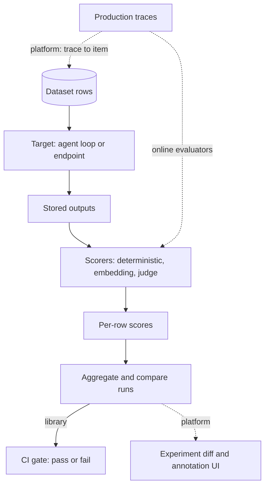

## TL;DR
Every eval tool runs dataset → agent → grade → store and compare. Promptfoo, RAGAS and DeepEval are
libraries; Braintrust, LangSmith and Langfuse are platforms holding agent traces and experiments. Choose
by where traces live and how much grading you own.

## For agent builders
- **Why it matters for agents.** An agent run is a tree of LLM calls and tool calls, so you need a tool
  that stores the whole trajectory, lets you grade outcome and tool use, and turns a bad production run
  into a test case. Picking the wrong one means hand-copying traces into spreadsheets.
- **Where it shows up in your stack.** LangChain and LangGraph trace into LangSmith automatically and
  into Langfuse through its LangChain callback handler; a hand-rolled loop or another SDK uses LangSmith's
  `@traceable`, Langfuse's `@observe` decorator or OpenTelemetry. Promptfoo or DeepEval run in CI; RAGAS scores the
  retrieval step.
- **What you control.** The target adapter that runs your agent per item, which scorers grade the final
  state and which grade the trajectory, the pinned judge model and library version, sampling rate for
  online evaluators, and redaction before traces leave your network.
- **What you can skip.** Comparing every feature matrix. Start with the platform your framework already
  traces into, one library for the CI gate, and your own trajectory graders; add prebuilt metrics only
  after calibrating them.

## Why it exists
- **Every serious team writes the same code.** A runner with concurrency, retries and caching; judge
  prompts for faithfulness and relevance; a side-by-side run comparison; somewhere to keep raw outputs so
  Tuesday's run can be compared with Friday's. Version one takes a week; keeping it alive for a year is
  the real, undifferentiated cost.
- **Evals must connect to traces.** A failed production conversation should become a dataset item in one
  click, and a judge score should be visible on the trace it graded; otherwise error analysis and the
  eval suite drift apart.
- **Experts need a UI.** Product owners and subject-matter experts, who know what "good" looks like, must
  read and annotate outputs without cloning a repo.
- **The naive alternatives fall short.** A notebook is not reproducible; a spreadsheet of outputs is fine
  for fifty rows but has no automation or history; a hand-rolled harness works but has no trace link and
  no UI, and becomes someone's unpaid second job.
- **Tools bring sharp edges of their own.** A prebuilt "faithfulness" metric is an LLM judge running
  someone else's prompt on a default model; a hosted platform holds your prompts and customer data; judge
  calls cost money every run. Know what a tool's number means before it gates a release.

## How it works
### The common shape
1. **A dataset of rows:** input, optional expected output, metadata such as slice.
2. **A target:** a function, a prompt plus provider, or an HTTP endpoint.
3. **Stored outputs.**
4. **Scorers:** deterministic, embedding-based, or an LLM judge.
5. **Per-row scores,** then aggregation and comparison across runs.

Each tool is packaging around that shape; the comparison below is about the packaging.

For an agent the target is a function that runs the whole loop for one item and returns both the final
output and the list of tool calls, so scorers can grade the outcome and the trajectory separately.

| Tool | Type | Best fit | Main sharp edge |
|---|---|---|---|
| Promptfoo | open-source TypeScript CLI, YAML config | prompt × model comparisons, CI gate, non-Python teams | agents must be wrapped as a custom provider |
| RAGAS | Python library, RAG metrics | RAG evaluation before labels exist | "reference-free" means compared to context, not truth |
| DeepEval | Python library, pytest-style | evals in the repo next to tests, custom rubric metrics | pass/fail per case hides the distribution |
| Braintrust | hosted platform + open-source `autoevals` | tight experiment-diff loop with a readable UI | hosted: data residency is a plan-level question |
| LangSmith | platform | LangChain or LangGraph shops, human annotation workflow | hosted by default; native schema is LangSmith-specific |
| Langfuse | open-source, self-hostable platform | data residency, unifying production feedback and offline evals | you run a multi-service stack and bring your own graders |

### Promptfoo (library, config-driven)
- **Shape:** an open-source TypeScript CLI run with `npx promptfoo`. A YAML file declares `prompts`,
  `providers` (hosted APIs, local models, an HTTP endpoint, or a Python/JS script wrapping your own
  pipeline) and `tests` with `vars` and `assert` entries.
- **Execution:** runs the full matrix of prompts × providers × tests and caches responses so re-runs are
  free; `promptfoo view` opens a side-by-side web table.
- **Assertions:** deterministic (`contains`, `regex`, `is-json`, custom `javascript`/`python`), semantic
  (`similar` via embeddings) and model-graded (`llm-rubric`, `factuality`, context-faithfulness and
  recall style checks).
- **Red-team mode:** generates adversarial probes by plugin and strategy.
- **Sharp edges:** the YAML grows with the suite; model-graded assertions use a default grader you should
  pin explicitly; a multi-step agent has to be wrapped as a custom provider.

### RAGAS (library, RAG metrics)
A Python library born from the paper of the same name. Core metrics are LLM-judge chains plus
embeddings:

| Metric | What it measures |
|---|---|
| *Faithfulness* | splits the answer into statements, scores the fraction the retrieved context supports |
| *Answer relevancy* | generates questions from the answer, measures their embedding similarity to the original question; penalises incomplete or padded answers |
| *Context precision* | whether the relevant chunks were ranked at the top |
| *Context recall* | how much of a reference answer the retrieved context could support |

- **Labels:** faithfulness and answer relevancy need no reference labels; context recall does.
- **Also:** generates synthetic test sets from your documents.
- **Sharp edge 1:** "reference-free" means "compared to the context, not to the truth", so a faithful
  answer built on the wrong chunk scores perfectly.
- **Sharp edge 2:** every score depends on the judge model and on the statement-splitting prompt.
- **Sharp edge 3:** metric definitions have changed across library versions, so pin the version and never
  compare scores across versions.

### DeepEval (library, pytest-style)
- **Shape:** Python, shaped like unit tests: an `LLMTestCase(input, actual_output, expected_output, retrieval_context)` is checked with `assert_test(case, metrics)` and run through `deepeval test run`.
- **Metrics** are classes with a `threshold`: `FaithfulnessMetric`, `AnswerRelevancyMetric`,
  `ContextualPrecisionMetric`, `HallucinationMetric`, and `GEval` for custom criteria written in prose,
  each returning a `score` and a `reason`.
- **Sharp edges:** pass/fail per case hides the score distribution; prebuilt metrics are judge prompts
  you do not own; the hosted Confident AI platform is where the dashboards live.

### Braintrust (platform with an open-source scorer library)
- **Shape:** a hosted platform whose SDK runs `Eval(project, data=..., task=..., scores=[...])` and
  uploads an experiment with a per-row diff against previous experiments.
- **Scorers:** the open-source `autoevals` package provides `Factuality`, `ClosedQA`, `Levenshtein`,
  embedding similarity and a generic `LLMClassifier`.
- **Also:** logs production calls as traces, curates datasets from logs, has a prompt playground.
- **Sharp edge:** it is hosted, so where your traces and prompts may reside is a plan-level question to
  settle before adopting.

### LangSmith (platform)
- **Shape:** LangChain's platform: automatic tracing for LangChain and LangGraph code, a `@traceable`
  decorator for anything else, datasets, and experiments through `evaluate(target, data=...,
  evaluators=[...])`.
- **Also:** annotation queues for human review, online evaluators that sample production traces, and a
  prompt hub with a playground. It does not require LangChain.
- **Sharp edges:** hosted by default, with self-hosting on enterprise tiers; pricing scales with trace
  volume; its native run/trace schema is LangSmith-specific (OpenTelemetry ingestion exists, but the
  evaluation features are built around the native format).

### Langfuse (open-source platform)
- **Shape:** open source and self-hostable, with tracing SDKs for Python and JavaScript (recent versions
  build on OpenTelemetry), prompt management with versions and labels, and datasets with experiment runs.
- **Scores API:** attaches any numeric, categorical or boolean score to a trace, whether from a judge, a
  human annotator or end-user feedback.
- **Also:** managed LLM-as-judge evaluators on sampled production traces; token cost tracked per trace.
- **Best fit:** data-residency requirements, an open-source preference, and unifying production feedback
  with offline evals in one score table.
- **Sharp edges:** you run a multi-service stack yourself; fewer prebuilt scorers than DeepEval or RAGAS,
  so you bring your own graders.

### Where your agent framework meets the eval tools
| Agent stack | Tracing path | Eval loop that fits |
|---|---|---|
| LangChain or LangGraph | LangSmith traces automatically (an API key and tracing env vars); Langfuse via its LangChain callback handler | LangSmith `evaluate` with a target that invokes the graph, or DeepEval/Promptfoo wrapping the same call |
| Your own loop or a vendor agent SDK | LangSmith `@traceable`, a Langfuse decorator, or OpenTelemetry spans | Braintrust `Eval` or DeepEval tests calling your loop function |
| RAG-heavy agent | any of the above for the trace | RAGAS metrics on the retrieval step, plus task-level graders on the outcome |
| Polyglot or non-Python team | HTTP endpoint in front of the agent | Promptfoo with an HTTP or script provider |

- **Agent-aware metrics exist but vary by version.** DeepEval and RAGAS have added tool-use and goal
  metrics, and LangChain publishes trajectory evaluators; check the installed version's docs before
  relying on one, and calibrate it like any judge.
- **Deterministic trajectory checks are usually your own code:** required tool called, forbidden tool
  avoided, confirmation before a write, step count within budget.

### How to choose
Two axes decide it:
- **Library vs platform:** do you need a CI gate in a repository, or traces, datasets and annotations
  shared across people?
- **Prebuilt judges vs your own graders:** are packaged metrics close enough to your rubric that
  calibrating them is cheaper than writing a judge?
- **A common combination:** Promptfoo or DeepEval in CI, RAGAS metrics as scorers inside whichever
  harness, and one platform for traces, datasets and online evaluation.
- **Keep one canonical dataset store;** two sources of truth for golden items is the most common way these
  stacks rot.

### What is under every prebuilt metric
- **A prompt, a model and a parsing step.** Read the prompt before trusting the number, pin the judge
  model, and calibrate against a few dozen human-labelled items from your domain before it gates anything.
- **Faithfulness-style metrics are typically a ratio,** supported statements ÷ extracted statements, so the score
  inherits two judge decisions per item: how the answer was split, and whether each statement was judged
  supported.
- **It mildly rewards saying less.** A terse answer with one supported claim scores 1.0; a thorough answer
  with nine supported claims and one unsupported aside scores 0.9.

### What it costs
```
judge calls per run ≈ rows × judge metrics × calls per metric × samples per row
illustrative: 500 rows × 3 metrics × ~2 calls × 3 samples ≈ 9,000 judge calls per run
```

- **So the cost pyramid** (deterministic checks per commit, judges per PR or nightly) is a budgeting
  decision, not a style preference.
- **Caching rarely helps the run that matters:** it only helps when the target's output is unchanged,
  which a change under test rarely leaves true.

## Diagram
Every tool implements this one pipeline; libraries end it in a CI pass or fail, platforms add the
dotted links from production traces and to a shared annotation UI.



## Examples
### One assistant, two tools
The same support assistant tested two ways: a DeepEval test that pairs a prebuilt faithfulness metric
with a custom G-Eval criterion, and a Promptfoo config that compares two prompt versions across two
providers with deterministic and rubric assertions.

```python
# test_support_bot.py — run with: deepeval test run test_support_bot.py
# imports and signatures checked against deepeval 4.3.1 (needs Python 3.10+); there LLMTestCaseParams
# still works but is deprecated in favour of SingleTurnParams. Judge metrics need a model API key.
import pytest
from deepeval import assert_test
from deepeval.metrics import FaithfulnessMetric, GEval
from deepeval.test_case import LLMTestCase, LLMTestCaseParams
from my_app import answer_with_context      # returns (answer: str, retrieved_chunks: list[str])

handoff = GEval(
    name="AccountDataHandoff",
    criteria="If the input asks for account-specific data (invoices, usage, balances), the output must "
             "offer a handoff to a person or a self-service link instead of stating a figure.",
    evaluation_params=[LLMTestCaseParams.INPUT, LLMTestCaseParams.ACTUAL_OUTPUT],
    threshold=0.8,
)

@pytest.mark.parametrize("question", ["How do I enable SCIM?", "What was my invoice total last month?"])
def test_answer(question):
    answer, chunks = answer_with_context(question)
    case = LLMTestCase(input=question, actual_output=answer, retrieval_context=chunks)
    assert_test(case, [FaithfulnessMetric(threshold=0.9), handoff])
```

```yaml
# promptfooconfig.yaml — run with: npx promptfoo eval && npx promptfoo view
# `promptfoo validate` accepts this config (checked with promptfoo 0.124.1)
prompts: [file://prompts/support_v7.txt, file://prompts/support_v8.txt]
providers: [openai:chat:MODEL_A, anthropic:messages:MODEL_B]   # substitute current model ids
tests:
  - vars: { question: "How do I enable SCIM?" }
    assert:
      - { type: contains, value: "SCIM" }
      - { type: llm-rubric, value: "Steps match the SCIM article; no invented settings." }
  - vars: { question: "What was my invoice total last month?" }
    assert:
      - { type: not-contains, value: "$" }      # must not invent a figure
      - { type: python, value: "'billing' in output.lower() or 'contact' in output.lower()" }
```

### An agent experiment in LangSmith
A LangGraph agent evaluated on a LangSmith dataset with two of your own scorers: one on the outcome, one
on the trajectory. The target runs the full loop per item and returns the tool calls it made.

```python
# assumes langsmith 0.2+ (evaluators may take outputs/reference_outputs and return a bool; the evaluate
# signature, incl. num_repetitions, checked against langsmith 0.14.12), LANGSMITH_API_KEY and tracing
# env vars set, and a dataset "support-agent-v3" that already exists
from langsmith.evaluation import evaluate
from my_agent import agent          # compiled LangGraph graph, e.g. create_react_agent(model, tools)

def target(inputs: dict) -> dict:
    result = agent.invoke({"messages": [("user", inputs["question"])]})
    calls = [tc["name"] for m in result["messages"] for tc in (getattr(m, "tool_calls", None) or [])]
    return {"answer": result["messages"][-1].content, "tools": calls}

def resolved(outputs: dict, reference_outputs: dict) -> bool:
    return reference_outputs["must_mention"].lower() in outputs["answer"].lower()

def right_tools(outputs: dict, reference_outputs: dict) -> bool:
    used = set(outputs["tools"])
    return set(reference_outputs["required_tools"]) <= used and not (used & {"issue_refund"})

evaluate(target, data="support-agent-v3", evaluators=[resolved, right_tools],
         experiment_prefix="planner-prompt-v8", num_repetitions=3)   # k samples per item
```

- **Why own scorers here:** both checks are deterministic, cost nothing per run and mean exactly what the
  task says; a judge can be added later for answer quality.
- **The traces of every repetition** sit next to the scores, so a failing item opens straight into the
  trajectory for error analysis.

### Worked scenario: what an agent eval run costs
Illustrative: 120 golden tasks, *k* = 3, about 7 LLM steps per agent run, two judge metrics (answer
quality and a trajectory judge) at one call each.

| Item | Calculation | Calls per run |
|---|---|---|
| Agent LLM calls | 120 × 3 × 7 | 2,520 |
| Judge calls | 120 × 3 × 2 × 1 | 720 |
| Deterministic trajectory checks | 120 × 3 × 2 | 720, free |

- **The agent, not the judge, dominates here,** unlike single-call features, so cheaper tiers come from a
  smaller smoke subset of tasks per PR, not only from dropping judges.

### What the numbers mean underneath
| Tool | Calculation | Result |
|---|---|---|
| Promptfoo | 2 prompts × 2 providers × 2 tests = 8 cells, each graded by its two assertions | view shows prompt v7 and v8 side by side per provider, the comparison you wanted |
| DeepEval | SCIM answer makes four claims; the retrieved article supports three and contradicts one | faithfulness 3/4 = 0.75, below the 0.9 threshold: the test fails and `reason` names the contradicted claim |

- **The four claims:** SCIM lives under Settings → Security; it needs the Enterprise plan; you generate a
  token; you paste the token into the identity provider. The article says SCIM is available on every
  plan, so the plan claim contradicts it.
- **Metric definitions differ:** DeepEval's faithfulness (default `penalize_ambiguous_claims=False`, 4.3.1)
  counts a claim as truthful unless it *contradicts* the context, so a claim the article is merely silent on would not lower the score. RAGAS
  counts a claim the context cannot support as unfaithful. Same name, different number.
- **The trap:** if retrieval had returned the SSO article and the bot faithfully described SSO setup,
  faithfulness would be 1.0 and the test would pass.
- **What catches it:** the Promptfoo `contains: SCIM` and the rubric assertion. The general lesson: pair
  every context-relative metric with a check against the task itself.

### Budgeting judge spend before you wire the gate
Pure Python: estimate calls per run and see why the faithfulness ratio favours short answers.

```python
def judge_calls(rows, judge_metrics, calls_per_metric, samples):
    return rows * judge_metrics * calls_per_metric * samples

def faithfulness(supported, extracted):
    return supported / extracted

print(judge_calls(500, 3, 2, 3))         # 9000 per run: nightly, not per commit
print(judge_calls(500, 0, 2, 3))         # 0: deterministic checks only, cheap enough per commit
print(faithfulness(1, 1))                # 1.0  terse answer, one supported claim
print(faithfulness(9, 10))               # 0.9  thorough answer with one unsupported aside
print(faithfulness(3, 4))                # 0.75 the SCIM case above
```

## Production patterns
- **Pin the judge and the library.** Whenever a model-graded metric gates CI, set the grading model
  explicitly (Promptfoo lets you override the default grader in config or on the command line; DeepEval
  metrics accept a model argument) and pin the eval library version in the lockfile. Monitor score jumps
  that coincide with dependency upgrades.
- **Two-speed CI.** Run deterministic Promptfoo assertions or DeepEval tests without judge metrics on
  every commit, and the judge-graded suite on pull requests or nightly. Monitor judge spend per run
  against the feature's own inference cost.
- **One canonical dataset store.** Keep golden items in one place (a platform dataset or a versioned
  JSONL in the repo) and import into every other tool from it. Monitor how many production traces become
  dataset items each week, and alert when two copies diverge.
- **Trace-to-task in one click.** Configure the platform so a failed production agent run (low user
  feedback, step cap hit, tool error) can be added to the golden dataset with its input and a corrected
  expected outcome. Monitor how many such runs become tasks each week.
- **Online evaluators on sampled traffic.** In Langfuse or LangSmith, attach a judge evaluator to a
  sampled fraction of production traces and write its result as a score next to user feedback. Monitor
  the gap between online judge scores and offline scores for the same slice.
- **Redact before export.** Mask PII in the tracing SDK or a proxy before traces reach a hosted platform,
  or self-host Langfuse when data-residency rules apply. Monitor redaction coverage with a scheduled scan
  for known PII patterns in stored traces.
- **Calibrate before gating.** Label a few dozen domain items by hand, run the prebuilt metric on them,
  and measure agreement before the metric blocks a release. Re-check agreement after every judge-model
  or library upgrade.

## Trade-offs
- **Prebuilt metrics vs owned judges.** Prebuilt metrics give faithfulness and relevance on day one
  without labels, but each is a judge whose prompt and model you do not control. Once a metric gates a
  release you must calibrate it against human labels, and at that point writing your own judge is often
  as cheap.
- **Platform vs data control.** A platform connects production traces to datasets and lets non-engineers
  annotate, but it stores your prompts and customer data. This flips toward self-hosting (Langfuse, or
  enterprise self-hosted tiers) whenever data-residency rules apply.
- **Config-driven vs code-first.** Promptfoo makes prompt×model comparison trivial, but agents and
  multi-step pipelines must be wrapped as a custom provider, where a code-first `Eval` or pytest style is
  more natural.
- **Pass/fail vs distributions.** Pytest-style pass/fail slots into CI and feels familiar but hides
  distributions; score tables show distributions but need a separate gating rule before they stop
  anything. Per-case thresholds suit a small suite of must-pass behaviours; once the suite is large and
  noisy, gate on aggregate drops and regressed-item counts instead.

## Pitfalls
- **Reading a RAGAS faithfulness of 0.95 as "accurate".** Symptom: users report wrong answers while
  faithfulness stays high, because answers are faithful to the wrong chunk. Diagnose: log retrieved chunk
  ids per item and compute recall@k on labelled queries. Fix: pair faithfulness with a retrieval metric.
- **Comparing scores across tool versions or judge models.** Symptom: a jump or drop after a dependency
  upgrade with no change to the system under test. Diagnose: diff the lockfile and judge model id
  between the two runs, then re-score old outputs with the new setup. Fix: pin both; re-baseline on upgrade.
- **Leaving the judge model at the tool's default.** Symptom: CI and a developer's laptop disagree on the
  same run because each resolved a different default. Diagnose: record the resolved grader model in
  every run's metadata. Fix: set it explicitly in config.
- **Sending production traces with customer data to a hosted platform** without redaction or a data
  agreement. Symptom: a security review blocks the rollout months after the team came to depend on it.
  Diagnose: scan a sample of stored traces for PII patterns. Fix: redact in the SDK or self-host.
- **Running judge metrics on every commit.** Symptom: eval spend exceeds the feature's own inference
  cost. Diagnose: count judge calls per run with the formula above. Fix: deterministic checks per commit,
  judge runs per pull request or nightly.
- **Treating packaged "hallucination" or "toxicity" metrics as safety guarantees.** Symptom: a confident
  dashboard and an incident the judge's blind spots let through. Diagnose: run the metric on the
  incident and on labelled failures. Fix: calibrate, and keep deterministic guards.

## When to use
- **Use a library when** the eval is a CI gate owned by engineers and the data is small.
- **Use a platform when** you need traces, human annotation and online evaluators in one shared place.
- **Start closest to your traces:** LangChain code points to LangSmith; an OpenTelemetry or self-hosted
  setup points to Langfuse.
- **Avoid when:** do not adopt a platform for one prompt and thirty test cases; a Promptfoo config is
  enough.
- **Measure:** judge agreement with human labels, eval runtime and cost per run, and how many production
  traces become dataset items each week.
- **Interviews:** answer "what would you use to evaluate a RAG system?" by naming the pipeline, saying the
  tool is packaging, and explaining what RAGAS faithfulness measures and what it cannot see.

## Exercise
**Goal:** decide whether a prebuilt faithfulness metric may gate releases for one of your agents. No
solution is given.
- **Inputs:** 30 items from your agent (question, retrieved chunks, answer), at least 5 answered from the
  wrong chunk; one library (DeepEval or RAGAS) with a pinned version and judge model.
- **Deliver:** your own pass/fail label per item, the metric's score per item, an agreement table, and a
  written gate decision with the threshold you would use.
- **Acceptance:** re-running gives the same scores within judge noise; you show which wrong-chunk items
  the metric passed and which retrieval or task check catches them.

## Role lens
- **Engineer:** Wires the chosen scorers into the harness or CI, pins judge models and library
  versions, and writes custom graders where the packaged metric does not match the rubric.
- **Architect:** Decides library versus platform, hosted versus self-hosted storage of traces and
  datasets, and which store is the single source of truth for eval data across teams.
- **FDE:** Picks what can run inside the customer's environment, often self-hosted Langfuse or
  Promptfoo in their CI, and uses the platform's annotation UI so the customer's experts can label.

## Check yourself
**Q:** A team evaluating a RAG assistant reports RAGAS faithfulness 0.93 and answer relevancy 0.88 and
concludes it is ready to ship. What would you ask before agreeing, and which facts about the tooling
drive your questions?
**A:** Faithfulness measures support by the retrieved context, not truth, so the first question is what
the retrieval metrics are against a labelled query set: recall@k, context recall, or an error-analysis
count of "right chunk missing". Second, which judge model and which library version produced the
scores, and whether they were calibrated against human labels on a sample from this domain. Third, the
distribution: the mean hides a tail, and how many items were there and where did they come from, since
a synthetic test set generated from the documents is usually easier than real user queries. Fourth,
whether the suite contains the failure modes error analysis found, such as account-data questions, and
deterministic checks for them. Readiness is decided by the task's acceptance criteria; the two RAGAS
numbers are components, not the verdict.

## Interview questions
### What does an eval tool actually do underneath its branding?
- **One pipeline:** dataset rows → run the target → store outputs → score with deterministic,
  embedding or judge scorers → aggregate and compare runs.
- **The differences are packaging:** where state lives (repo vs server), which graders come prebuilt,
  and whether production traces and a shared annotation UI are attached.

### A model upgrade moved your RAGAS scores ten points. How do you debug it?
- **Check what changed in the measurement first:** judge model, library version and statement-splitting
  prompt, because metric definitions have changed across versions and scores are not comparable across them.
- **Pin both and re-run** the old and new system under the same judge and version.
- **Then read traces** of items that moved, and pair faithfulness with a retrieval metric so a faithful
  answer to the wrong chunk is caught.

### Your team builds agents on LangGraph. How would you set up evaluation tooling?
- **Tracing first:** LangSmith traces LangGraph runs automatically, or Langfuse via its callback handler
  when self-hosting is required, so every run's tool calls are inspectable.
- **Offline experiments:** a dataset of golden tasks and a target that invokes the graph, scored by
  deterministic outcome and trajectory checks, with repetitions for *k* samples.
- **CI and online:** a fast subset gates PRs; sampled production traces get online evaluators, and
  failed runs flow back into the dataset.

### How do you evaluate tool use, not just the final answer, with these tools?
- **Return the trajectory from the target:** the list of tool calls with arguments, alongside the answer.
- **Score it with your own functions** (required tools, forbidden tools, confirmation before writes,
  step budget), because these are cheap and exact.
- **Use packaged agent metrics** from DeepEval, RAGAS or LangChain's trajectory evaluators only after
  checking the installed version and calibrating against labelled runs.

### When would you choose a self-hosted platform over a hosted one?
- **Data residency or contractual limits** on where prompts and customer traces may live; Langfuse is
  open source and self-hostable, and LangSmith offers self-hosting on enterprise tiers.
- **Cost:** you then run and upgrade a multi-service stack yourself, and Langfuse ships fewer prebuilt
  scorers, so you bring your own graders.

### Roughly what does a judge-graded eval run cost, and how do you control it?
- **Formula:** rows × judge metrics × calls per metric × samples per row. An illustrative 500 rows × 3
  metrics × ~2 calls × 3 samples is about 9,000 judge calls per run.
- **Control:** deterministic checks per commit, judges per PR or nightly, a smoke subset for fast loops.
- **Caching** saves little on the run that tests a change, because the target's outputs differ.

## Quiz
### Q: What does a RAGAS faithfulness score of 1.0 tell you?
- [ ] The answer is factually correct
- [x] Every statement in the answer is supported by the retrieved context, which says nothing about whether the right context was retrieved
- [ ] The retriever returned all of the relevant chunks
- [ ] The answer matches the reference answer exactly
> Faithfulness decomposes the answer into statements and checks each against the retrieved chunks. A
> wrong chunk faithfully summarised scores perfectly, which is why it must be read next to a retrieval
> metric.

### Q: What is the main reason to choose a platform such as Langfuse, LangSmith or Braintrust over a library such as Promptfoo or DeepEval?
- [ ] Platforms ship more accurate judge models
- [ ] Libraries cannot run LLM-as-judge metrics
- [x] You need production traces, datasets, human annotation and online evaluators in one shared place rather than a CI gate in a repository
- [ ] Platforms are required for CI integration
> The grading logic is similar everywhere; what a platform adds is shared state: traces linked to
> dataset items, annotation queues and evaluators on live traffic. A repository-scoped CI gate does not
> need that and a library does it with less infrastructure.

### Q: A prebuilt "hallucination" metric from an eval library is about to become a release gate. What must happen first?
- [ ] Set its threshold to 1.0 so only perfect outputs pass
- [x] Calibrate it against human-labelled examples from your domain and pin the judge model, because the metric is an LLM judge with its own prompt and biases
- [ ] Replace it with a string-match assertion
- [ ] Run it on every commit for a month to build a history
> A packaged metric is a prompt, a model and a parser; its agreement with your definition of a
> hallucination is unknown until measured. Pinning the judge keeps the gate stable across environments
> and upgrades.

## Mastery test
**Problem:** a bank's agent team has no eval tooling, uses a custom loop, and must keep customer data
in its own network. They run 800 golden tasks, *k* = 3, four judge metrics nightly, and want a stack. What do you
propose, and what do you measure first?

**A strong answer:**
- picks a self-hosted platform such as Langfuse for traces and scores, and a library in CI;
- computes 800 × 3 × 4 = 9,600 judge calls before multi-call metrics, and puts judges nightly with a smoke subset per PR;
- keeps the judge model in-network too, because every judge call ships customer data;
- writes trajectory checks as own code, pins judge and library, and calibrates against labelled items first.

## Use cases & projects
### Use cases
- **Choosing an eval stack for a new agent team.** Starting from where the framework already sends traces
  (LangSmith for LangChain and LangGraph, or Langfuse) avoids hand-copying trajectories into sheets.
- **CI gates on agent changes.** A library such as Promptfoo or DeepEval runs the golden set on each PR
  and fails the build when scores drop.
- **Scoring the retrieval step of a RAG agent.** RAGAS-style metrics grade retrieved context separately
  from the final answer, once calibrated against human labels.
- **Online evaluation of production traffic.** Platform evaluators sample live traces, score them and
  route low scorers into annotation queues and new dataset items.

### Mini project
**Wire one agent into a trace platform and a CI eval library (2-3 hours).**
- **Goal:** run the same small golden set against an agent both locally in CI and as a stored experiment
  you can compare in a platform UI.
- **Steps:** take a small tool-calling agent and instrument it with LangSmith's `@traceable`, Langfuse's
  decorator or OpenTelemetry; write a target adapter that runs the agent per dataset item; add one
  outcome scorer and one trajectory scorer (for example, was the right tool called); run 15-20 items
  through a CI library and log the run to the platform; repeat with a second prompt version; pin the
  library version (and the judge model, if you add a judge scorer).
- **Done when:** two runs of different prompt versions appear side by side in the platform with per-item
  scores and full trajectories, and the CI job fails when you break the agent on purpose.
