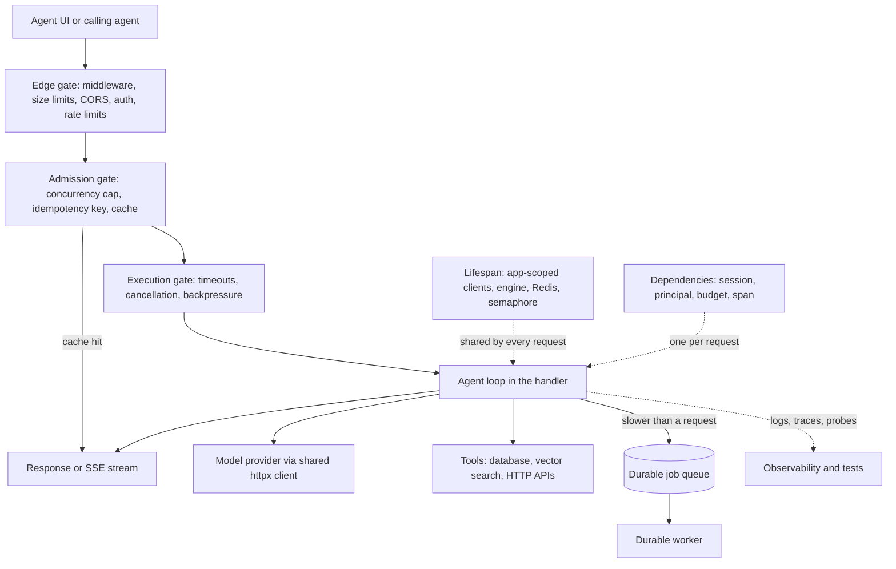

## Overview
This module is about building the HTTP service that sits in front of a model or an agent: the FastAPI
process that accepts prompts, files and chat sessions, calls a provider or a local model, runs tools,
and returns tokens without falling over under real traffic.

For an agent builder this is the shell every agent runs inside. One agent run is a long chain of model
and tool calls, so the service must stream progress, survive disconnects and retries, bound spend, and
show where each second went.

What the module gives you, in the order the ideas build:
- **The runtime.** The ASGI lifecycle explains what a request, a stream, a disconnect and a startup actually are. Async endpoints set the rule that decides everything else: await remote models, never block the event loop.
- **The contract layer.** Pydantic request and response models, `response_model`, error handling, routers and dependency injection define what goes in, what may come out and who is calling.
- **Resource scoping.** Lifespan decides what is built once per worker (model weights, the shared httpx client, the database engine) and what lives for one request (session, principal, budget).
- **The shapes AI traffic takes.** Streaming responses, Server-Sent Events, WebSockets and cancellation when the user closes the tab; async database access, SQLAlchemy and Alembic; uploads with size and safety limits; background tasks versus durable job queues.
- **Protection.** Timeouts, idempotency keys, CORS, authentication, Redis caching, rate limits, concurrency caps and backpressure.
- **Operability and proof.** Structured logs, OpenTelemetry traces, health and readiness probes, worker sizing, graceful draining, OpenAPI docs and three layers of tests.

Core for agents (you use them directly in every agent backend): async endpoints, Pydantic models, error
handling, dependency injection, resource scoping, the shared httpx client, timeouts, auth, streaming,
SSE, cancellation, WebSockets, concurrency limits, idempotency keys, job queues, Redis caching, upload
security, OpenTelemetry and OpenAPI docs.

Useful background (you meet it when operating the service): the ASGI lifecycle, lifespan,
`response_model`, routers, middleware ordering, CORS, the database layer, Alembic, uploads,
BackgroundTasks, rate limiting, backpressure, structured logging, probes, workers, draining and the
three test layers.

What you can build afterwards:
- An authenticated, streaming, cost-bounded LLM or agent API that survives deploys, overload and retries.
- A tool server whose OpenAPI schema an agent can call safely, with one error shape the model can read.
- A service whose behaviour you can explain from a trace, step by step and tool call by tool call.

## Why it matters
- **Engineer:** You write the endpoints, dependencies, streaming generators and worker configuration behind every agent run, so a blocking SDK call that freezes every request, a pool exhausted by a connection held across a model call, a double-billed retry of a tool call, or a stream that keeps generating for a closed tab is a bug in your code.
- **Architect:** You decide what is application-scoped versus request-scoped, where slow agent work goes (BackgroundTasks or a durable queue), how concurrency, rate and token budgets are enforced per run and per tenant, and how workers map to memory and GPUs, and those choices fix the agent service's cost and failure behaviour.
- **FDE:** Customers deploy the agent service behind their own proxies, identity providers and Kubernetes clusters, so you are the one tuning CORS and auth, fixing proxy buffering that breaks streamed agent output, setting probe and drain timeouts for long runs, and proving with traces and contract tests that it behaves under their load.

## Mental model
Picture one worker process as an event loop with two kinds of objects and three gates. Every agent
request passes the gates on its way to the model and tools. Anything slower than a request leaves the
loop for a durable worker.

| Piece | What it holds or decides | Examples |
|---|---|---|
| Application-scoped objects | Built once in lifespan, shared by every request | model or provider client, its connection pool, database engine, Redis client, semaphore |
| Request-scoped objects | Created by dependencies, destroyed when the request ends | session, principal, budget, trace span |
| Edge gate | Whether the request gets in at all | middleware, size limits, CORS, auth, rate limits |
| Admission gate | Whether it needs to call the model | concurrency limits, idempotency keys, caches |
| Execution gate | How long it may hold its slot, and what happens if the client goes away | timeouts, cancellation, backpressure |
| Durable worker | Work slower than a request | job queue with 202 and a status endpoint |
| Visibility and proof | How you see each gate working and pin the contract | logs, traces, probes; tests pin the contract to the schema |

## Suggested order
1. async-endpoints — the async versus def rule and the blocking-call trap decide how every handler, client and database call in an agent loop must be written.
2. pydantic-request-response-models — defines the validated input contract that stops malformed or oversized prompts before they cost money.
3. response-model — completes the contract on the way out so internal fields and raw provider payloads never reach clients.
4. httpexception-handling — maps validation, domain and upstream LLM failures onto one consistent error shape built on those models.
5. dependency-injection — introduces Depends, the mechanism that delivers auth, sessions, clients and test overrides to handlers.
6. lifespan — shows where expensive shared resources are built and closed once per worker, which dependencies then hand out.
7. request-scoped-vs-application-scoped-resources — names the scoping rule that lifespan and dependencies implement, and the leaks when it is wrong.
8. shared-httpx-asyncclient — applies that rule to the most common resource in an AI service, the pooled client calling model providers.
9. timeouts — bounds every outbound model call and the request as a whole before streams make requests long-lived.
10. api-keys-oauth2-jwt — adds real caller identity for billing and data scoping, implemented as dependencies and middleware.
11. asgi-lifecycle — the scope/receive/send protocol underlies lifespan, middleware, streaming and disconnects, so the streaming lessons that follow refer back to it.
12. streamingresponse — sends tokens as they are generated, with the frozen-status rule that shapes mid-stream error handling.
13. server-sent-events — gives the stream message boundaries and reconnection, the format chat UIs and vendor APIs use.
14. cancellation-on-client-disconnect — stops generation and frees slots when a streaming client goes away, using the ASGI disconnect message.
15. websockets — covers the two-way case (interrupts, voice, approvals) once one-way streaming and its limits are understood.
16. concurrency-limits — caps in-flight model calls per worker so the provider or GPU is not overrun by an async loop.
17. async-database-access-and-connection-pooling — introduces async drivers, pool sizing and the rule never to hold a connection across a model call.
18. job-queues-and-durable-workers — moves long or must-complete work to a queue with 202 and a status endpoint, building on the database layer.
19. idempotency-keys — makes retried POSTs and at-least-once job delivery produce one effect instead of double billing.
20. redis-caching — avoids repeated model and embedding calls with a shared cache whose key captures everything that changes the answer.
21. request-size-limits-and-upload-security — caps and isolates the large, untrusted inputs that uploads and long prompts bring.
22. opentelemetry-instrumentation — adds traces across FastAPI, httpx, SQLAlchemy and Redis plus manual LLM spans, joined to the logs.
23. openapi-docs — turns the typed routes and models into a published schema for clients, SDKs and LLM tool definitions.
24. routers — splits the growing service by feature and version once there are enough endpoints and errors to organise.
25. middleware-ordering — explains the wrapping stack that request IDs, CORS, auth and timing all sit in.
26. cors — the first middleware most browser-facing AI apps need, and why it is not authentication.
27. sqlalchemy-sqlmodel — models conversations, jobs and chunks on top of the async engine and session dependency.
28. alembic-migrations — evolves that schema safely across every environment once models exist.
29. uploadfile — accepts documents, images and audio for RAG and multimodal endpoints, behind the size and safety limits above.
30. backgroundtasks — handles cheap after-response work and shows where in-process follow-up stops being safe.
31. rate-limiting — caps request and token spend per caller, typically counted in the same Redis.
32. backpressure — ties limits, bounded queues, 429/503 with Retry-After and stream flow control into one overload story.
33. structured-logging — binds request, tenant, model and token fields into every log line so behaviour can be filtered and costed.
34. health-readiness-endpoints — separates liveness from readiness so orchestrators restart and route traffic correctly, including during model loading.
35. uvicorn-gunicorn-workers — sizes processes by memory and GPUs rather than cores, which determines how per-worker limits add up.
36. graceful-shutdown-and-worker-draining — drains long streams within the orchestrator's budget using readiness flips and lifespan cleanup.
37. testclient-plus-pytest-asyncio — tests the app in-process with the LLM replaced by a dependency override, now that the whole surface exists.
38. integration-tests-with-real-dependencies — proves SQL, pgvector, Redis TTLs and migrations against real containers, which fakes cannot.
39. openapi-contract-testing — closes the loop by checking the schema for breaking changes and fuzzing responses against it.

## Capstone
### Brief
**Use case.** You are delivering a document question-answering agent API for a customer pilot, and it
must survive their staging cluster rather than a laptop. Users upload PDFs, then ask questions that an
agent answers by retrieving chunks and calling a real or mock LLM provider.

This is the module's major project, a multi-day build. Build a FastAPI service with versioned routers
where an authenticated caller (API key for servers, JWT for the browser app) uploads PDFs. The service
ingests them through a durable job queue: 202 Accepted plus a job-status endpoint.

A chat endpoint streams the agent's answer over Server-Sent Events from the provider, called through one
shared httpx client created in lifespan. Conversations, jobs and chunks live in Postgres through an
async SQLAlchemy engine with Alembic migrations. Repeated questions are served from a Redis cache.

Protect the model and the agent loop:
- per-tenant request and token rate limits;
- a per-worker concurrency semaphore that sheds load with 503 and Retry-After;
- per-phase timeouts, upload size caps and idempotency keys on the ingest endpoint;
- a stream that stops generating when the client disconnects.

Make it operable: JSON logs with request and tenant fields, OpenTelemetry traces showing where each
second went, separate liveness and readiness probes, a Gunicorn/Uvicorn worker configuration you can
justify, and a drain path that lets in-flight streams finish on SIGTERM. Finish with a test suite that a
reviewer can run in CI.

### Deliverables
- A repository with the FastAPI service, a docker-compose file (API, worker, Postgres with pgvector, Redis, an OTel collector) and Alembic migrations that build the schema from empty.
- Endpoints for upload, job status, streaming chat over SSE and health/readiness, with Pydantic request and response models and one consistent error envelope, published at `/docs`.
- A test suite with in-process tests using dependency overrides for the LLM, integration tests against containerised Postgres and Redis, and an OpenAPI snapshot diff plus a Schemathesis run in CI.
- A load-test script and short report showing behaviour at and beyond the concurrency cap, with p50/p95 time to first token and the rate of 429 and 503 responses.
- A one-page operations note covering worker count and pool sizing arithmetic, timeout layering, probe settings, drain budget and how to read a trace for a slow request.

### Rubric
- A blocking-call check passes: under load, `/health` stays responsive while 50 chat streams run, and no sync SDK or database call appears on the event loop.
- Closing the browser mid-answer stops the upstream generation within a second and releases the concurrency slot, visible in logs and the trace.
- Replaying an ingest request with the same idempotency key returns the original job id and creates no second job or charge.
- Beyond the cap, excess requests receive 503 or 429 with `Retry-After` while memory stays flat and accepted requests keep their latency, rather than every request slowing down.
- A rolling restart during active streams drops no in-flight answer that fits within the drain budget, and readiness goes false before the process stops accepting.
- Responses never contain fields outside the declared response models, and a deliberately removed field fails the OpenAPI contract check in CI.
- Every log line for a request carries the same request id and tenant as its trace, and the trace shows separate spans for retrieval, the LLM call and database work.
