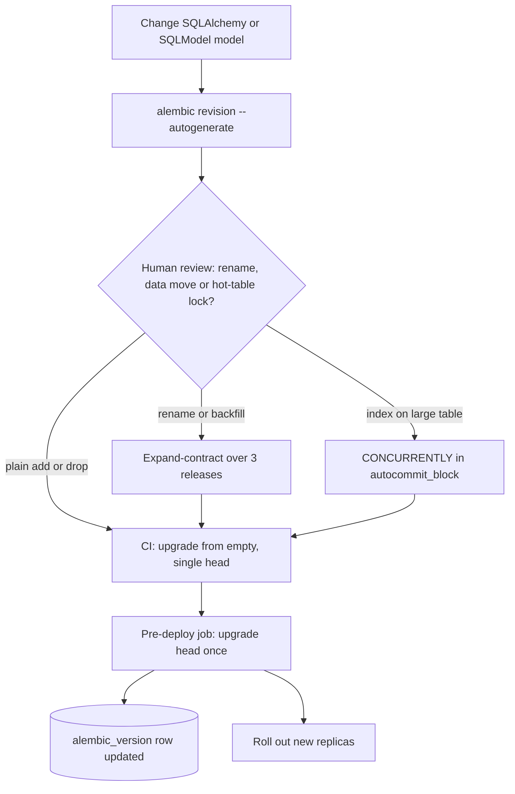

## TL;DR
Alembic versions every schema change as a Python script with `upgrade()` and `downgrade()`, and each
database records its revision, so "what schema does production have?" is queryable. Autogenerate only
drafts; renames, data moves and locks need a human and expand-contract.

## Why it exists
- **AI schemas change constantly.** A `tool_calls` JSONB column on messages, a `status` and `progress` on
  jobs, an `embedding vector(1024)` on chunks, then a second embedding column when you switch models.
- **Every environment must converge.** Laptops, CI, staging and each customer's VPC must end up with
  exactly the same schema, each starting from wherever it is today.
- **`Base.metadata.create_all()` at startup fails silently.** It only creates missing tables and never
  adds a column to an existing one, so the first schema change after launch does nothing and the app
  crashes on a missing column.
- **Hand-run SQL and ad-hoc `ALTER` drift and race.** Console-pasted files leave no record of what ran
  where, so nobody can say whether a customer deployment has the `idx_chunks_tenant` index; "if the
  column is missing" code spreads schema logic and races when ten replicas start at once.
- **Alembic uses the standard answer from Rails and Django.** An ordered, version-controlled list of
  changes plus a one-row table per database saying how far along it is; because it reads SQLAlchemy
  metadata, it can propose the next change from your model diff instead of making you type every column
  twice.

## How it works
### The revision chain
- **Scaffold:** `alembic init migrations` creates `alembic.ini`, a `migrations/env.py` and a `versions/`
  folder.
- **Linked list of scripts:** each file declares `revision = "7c1e..."` and `down_revision = "3d5f..."`,
  forming a linked list (a directed graph, once branches appear).
- **Random IDs, not sequence numbers,** *because* two developers on separate branches would otherwise
  both create "migration 12".
- **Position in the database:** a table named `alembic_version` holds the current revision ID.

| Command | Effect |
|---|---|
| `alembic upgrade head` | walks the graph from the stored ID to the newest revision, running each `upgrade()` in order, and updates the row |
| `alembic downgrade -1` | runs the latest `downgrade()` |
| `alembic current` / `alembic history` | show where you are |

**Transactions differ by backend:**
- **PostgreSQL:** DDL is transactional, and Alembic by default runs the whole `upgrade` invocation in one
  transaction (`transaction_per_migration=True` in `env.py` makes it one per revision), so a failed
  migration rolls back cleanly instead of leaving a half-altered table.
- **MySQL:** most DDL commits implicitly, so a failure midway can leave you between two revisions.

### env.py: the bridge to your app
- **Ordinary Python** that Alembic runs for every command.
- **Desired schema:** set `target_metadata = Base.metadata` (or `SQLModel.metadata`) so autogenerate
  knows what to diff against.
- **Connection:** read the URL from the same settings object the app uses, *because* a hard-coded URL in
  `alembic.ini` is how migrations end up pointed at the wrong database.
- **Async apps:** `alembic init -t async migrations` generates an `env.py` that creates an async engine
  and calls `await connection.run_sync(do_run_migrations)`, since Alembic's operations are synchronous.

### Autogenerate: a diff, not an oracle
`alembic revision --autogenerate -m "add embedding_model"` connects to a database at head, reflects its
schema, compares it to `target_metadata`, and writes `op.add_column`, `op.create_index` and similar.

| Reliably detects | Cannot see or needs help with |
|---|---|
| added and dropped tables and columns | intent: a renamed column looks like one dropped and another added, which destroys data if run as written |
| nullability changes | server defaults (comparison is off unless you enable it) |
| indexes and foreign keys that have names | custom types (pgvector's `Vector`, enum changes on some backends) may need manual imports or edits |

Set a `naming_convention` on your `MetaData` *because* constraints then get deterministic names that a
later migration can drop by name.

### Operations that are not schema diffs
- **`op.execute()`** runs raw SQL autogenerate never produces: `CREATE EXTENSION IF NOT EXISTS vector`, a
  backfill `UPDATE`, or `SET lock_timeout`.
- **No-transaction statements.** Some PostgreSQL statements refuse to run inside a transaction block,
  notably `CREATE INDEX CONCURRENTLY`, so Alembic provides `op.get_context().autocommit_block()`.
- **Failed concurrent builds are not rolled back.** A build that fails or hits the lock timeout leaves an
  `INVALID` index behind, which must be dropped before retrying.
- **SQLite** cannot alter most columns in place; `op.batch_alter_table` works around this by copying the
  table.
- **Offline mode.** `alembic upgrade head --sql` renders the SQL without connecting, for DBAs who must
  review or run it themselves.

### Branches and merges
1. Two pull requests each add a revision on the same parent, so the graph has two heads and
   `alembic upgrade head` refuses to guess an order.
2. `alembic merge heads` creates an empty revision whose `down_revision` is a tuple of both, restoring a
   single head.
3. A CI check that `alembic heads` prints exactly one line catches this before deploy.

## Diagram
From model change to production: autogenerate only drafts, a human decides whether the change needs
expand-contract, and CI plus a single pre-deploy job move every database to head.



## Examples
### Expand step: add a column and index for re-embedding
Safe to run while the old code still serves traffic: the new column is nullable with no default, so old
code that never writes it keeps working.

```python
"""chunks: add embedding_model (expand step)

Revision ID: 7c1e2a9b4f10
Revises: 3d5f0e8a1b22
"""
from alembic import op
import sqlalchemy as sa

revision = "7c1e2a9b4f10"
down_revision = "3d5f0e8a1b22"


def upgrade() -> None:
    # Fail fast instead of queueing behind a long query and blocking every reader.
    op.execute("SET lock_timeout = '5s'")
    # Nullable, no default: a catalog-only change in PostgreSQL, no table rewrite
    # (since PostgreSQL 11 a constant default is catalog-only too; a volatile one rewrites the table).
    op.add_column("chunks", sa.Column("embedding_model", sa.Text(), nullable=True))
    # CREATE INDEX CONCURRENTLY is rejected inside a transaction block.
    with op.get_context().autocommit_block():
        op.create_index(
            "ix_chunks_embedding_model",
            "chunks",
            ["embedding_model"],
            postgresql_concurrently=True,
        )


def downgrade() -> None:
    with op.get_context().autocommit_block():
        op.drop_index(
            "ix_chunks_embedding_model",
            table_name="chunks",
            postgresql_concurrently=True,
        )
    op.drop_column("chunks", "embedding_model")
```

### The three-release rollout
| Release | Schema | Code | Notes |
|---|---|---|---|
| 1 | apply the migration above as a pre-deploy job | writes `embedding_model` for new chunks | a background job backfills old rows in batches of a few thousand, committing per batch so no transaction holds locks for minutes |
| 2 | add `NOT NULL` once the backfill reports zero NULLs | unchanged | see the safe sequence below |
| 3 (contract) | drop whatever the old column was | no running code reads it | only after release 2 is fully rolled out |

Safe `NOT NULL` on a large table, because a plain `SET NOT NULL` scans the whole table under an
`ACCESS EXCLUSIVE` lock:
1. Add `CHECK (embedding_model IS NOT NULL) NOT VALID` (instant), then validate it.
2. `VALIDATE CONSTRAINT` (scans, but under a lock that lets reads and writes continue).
3. `SET NOT NULL`, which PostgreSQL 12 and later can apply without re-scanning, because the validated
   check already proves it.
4. Drop the redundant check.

### Release 2 as a migration
The sequence above, with each statement in its own transaction so the brief `ACCESS EXCLUSIVE` lock of
the `ADD CONSTRAINT` is not still held while `VALIDATE` scans. The price: a failure midway leaves the
earlier steps applied (a `NOT VALID` constraint), so drop it before rerunning.

```python
def upgrade() -> None:
    # autocommit_block: every statement commits on its own, so no lock is carried into the next step.
    with op.get_context().autocommit_block():
        op.execute("SET lock_timeout = '5s'")                      # session-level: applies to each step
        op.execute("ALTER TABLE chunks ADD CONSTRAINT ck_chunks_embedding_model_nn "
                   "CHECK (embedding_model IS NOT NULL) NOT VALID")          # instant, brief lock
        op.execute("ALTER TABLE chunks VALIDATE CONSTRAINT ck_chunks_embedding_model_nn")  # scans; reads/writes continue
        op.execute("ALTER TABLE chunks ALTER COLUMN embedding_model SET NOT NULL")         # PG 12+: no re-scan
        op.execute("ALTER TABLE chunks DROP CONSTRAINT ck_chunks_embedding_model_nn")


def downgrade() -> None:
    op.execute("ALTER TABLE chunks ALTER COLUMN embedding_model DROP NOT NULL")
```

### CI gate for migrations
Run against a real, empty Postgres service in the pipeline.

```bash
set -euo pipefail
test "$(alembic heads | wc -l)" -eq 1 || { echo "multiple heads: run alembic merge heads"; exit 1; }
alembic upgrade head          # every revision applies from empty
alembic check                 # fails if autogenerate would still produce changes (recent Alembic)
alembic downgrade base && alembic upgrade head   # optional: downgrades are at least runnable
```

## Production patterns
- **Migrate as a pre-deploy job, once.** For any multi-replica service, run `alembic upgrade head` in a
  single job (a Kubernetes Job or a pipeline step) before new pods roll out, never at app startup on
  every replica. Monitor job duration and fail the deploy if the job fails.
- **Lock timeouts on every DDL migration.** Start each `upgrade()` touching hot tables with
  `op.execute("SET lock_timeout = '5s'")`, so a migration waiting behind a long query fails fast instead
  of queueing every reader behind it. Monitor lock waits during deploys and retry failed runs off-peak.
- **`CONCURRENTLY` plus an INVALID-index check.** Build indexes on large tables with
  `postgresql_concurrently=True` inside `autocommit_block()`, and after a failure query
  `pg_index.indisvalid` to find and drop the leftover `INVALID` index before retrying.
- **Data migrations without app models.** Write backfills with `op.execute()` or a minimal
  `sa.table("chunks", sa.column("embedding_model"))` declared inside the script, so the migration still
  runs on a fresh database after the ORM models change. Test by upgrading from empty in CI.
- **Offline SQL for customer DBAs.** For VPC installs where every statement is reviewed, ship the output of
  `alembic upgrade <from>:<to> --sql` with the release and keep data migrations expressible as plain SQL.
  Verify afterwards with `alembic current` against their database.

## Trade-offs
- **Less typing vs destructive drafts.** Autogenerate saves typing and catches forgotten columns, but
  produces destructive drafts for renames; it is a net win only when every generated script is read in
  review.
- **Pre-deploy job vs startup.** A separate job keeps replicas from racing, at the cost of a deploy step;
  tiny single-instance apps can run `upgrade head` at startup instead.
- **Zero downtime vs three releases.** Expand-contract avoids downtime but triples the releases per
  change; for an internal tool that can take a two-minute maintenance window, a single breaking
  migration is simpler.
- **Fast rollback vs data loss.** Real `downgrade()` functions roll back schema-only changes quickly, but
  a downgrade that drops a populated column destroys data; past the first deploy, roll forward instead.
- **DBA review vs Python logic.** Offline `--sql` mode satisfies customers whose DBAs must review every
  statement, but you lose Python-side logic and must keep data migrations expressible as plain SQL.

## Pitfalls
- **Accepting an autogenerated rename as written.** Symptom: a migration containing
  `drop_column("content")` and `add_column("body")`, followed by an empty column in production.
- **Importing app ORM models inside a data migration.** Symptom: months later the model has changed and
  the old migration fails on a fresh database with an attribute or column error.
- **Adding an index without `CONCURRENTLY` on a large, hot table.** Writes block for the whole build;
  symptom: a spike of request timeouts exactly during the deploy.
- **Merging two branches that each added a revision.** Symptom: `alembic upgrade head` fails with a
  "multiple head revisions" error on the deploy pipeline, not on either developer's laptop.
- **Running `alembic stamp head` to "fix" a failing upgrade.** The version row now claims changes that
  were never applied; the missing column surfaces later as an application crash.
- **Forgetting `CREATE EXTENSION vector` or the `pgvector` import in the script.** Symptom: the upgrade
  fails with an unknown type error on a fresh customer database but passes on yours.

## When to use
- **Use Alembic** for any SQLAlchemy or SQLModel service whose database outlives a single deploy, which is
  every real one; `create_all()` is acceptable only in throwaway prototypes and test fixtures.
- **Wire it in early.** An empty initial revision costs nothing; retrofitting onto a drifted production
  database means hand-writing a baseline and `stamp`ing it.
- **In CI,** run `upgrade head` against a real Postgres from empty, assert a single head, and fail if
  autogenerate would still produce changes (recent Alembic versions offer `alembic check` for this).
- **In production,** run migrations once per deploy as a job before the new code rolls out, and design
  each migration to be compatible with the code already running.
- **Interviews:** explain expand-contract for a column rename and why autogenerate cannot be trusted
  with it.

## Role lens
- **Engineer:** Writes and reviews each revision, fixes autogenerate's renames, adds lock timeouts
  and `CONCURRENTLY`, and keeps data migrations independent of current ORM models.
- **Architect:** Owns the migration policy: pre-deploy job versus startup, expand-contract as the
  default, roll-forward over downgrade, and which tables need a DBA review.
- **FDE:** Ships migrations into customer VPCs where DBAs demand offline SQL, extensions need
  approval, and the version table is the first thing checked when an install misbehaves.

## Check yourself
**Q:** Your chat service runs six replicas with rolling deploys. You need to rename `messages.content`
to `messages.body`. Autogenerate produced a script. What do you ship, and in what order?
**A:** Not the autogenerated script: it drops `content` and adds an empty `body`, losing every message,
and even a true `ALTER ... RENAME` breaks old replicas mid-rollout. Use expand-contract. Release 1:
migration adds nullable `body`; code writes both columns and reads `body` falling back to `content`.
Backfill `body` from `content` in batches. Release 2: code reads and writes only `body`; add the `NOT
NULL` constraint once the backfill is complete. Release 3: drop `content`. Each migration runs as a
pre-deploy job with a lock timeout, and each step is compatible with the code still running.

## Interview questions
### Why use Alembic instead of calling Base.metadata.create_all() at startup?
- **`create_all()` never alters existing tables.** It only creates missing ones, so the first new column
  after launch silently does nothing and the app crashes on a missing column.
- **Alembic versions every change and records position.** Each database's `alembic_version` row says
  which revision it is at, so every environment, including customer VPCs, converges on the same schema.

### The deploy pipeline fails with "multiple head revisions". What happened and how do you prevent it?
- **Two branches each added a revision on the same parent,** so the graph has two heads and
  `alembic upgrade head` refuses to guess an order.
- **Fix:** `alembic merge heads` creates an empty revision whose `down_revision` is a tuple of both.
- **Prevent:** a CI check that `alembic heads` prints exactly one line.

### How do you add an index to a 50-million-row chunks table without an outage?
- **Build it concurrently.** A plain `CREATE INDEX` blocks writes for the whole build; use
  `postgresql_concurrently=True` inside `op.get_context().autocommit_block()`, because it cannot run in a
  transaction.
- **Set `lock_timeout` and check for leftovers.** A failed concurrent build leaves an `INVALID` index
  that must be dropped before retrying.

### When would you skip expand-contract and ship a single breaking migration?
- **When a short maintenance window is acceptable,** for example an internal tool that can take two
  minutes of downtime; expand-contract triples the releases per change.
- **Never for a rename on a multi-replica service with rolling deploys,** because old replicas still read
  the old column mid-rollout.

### Should migrations run at app startup or as a separate job?
- **A separate pre-deploy job for anything with replicas,** because ten replicas starting at once would
  race to apply the same revision.
- **Startup is acceptable for tiny single-instance apps,** trading safety for one fewer deploy step.
- **Either way,** design each migration to be compatible with the code already running.

## Quiz
### Q: You rename the `content` attribute and column to `text` on a model and run autogenerate. What does the generated script typically contain?
- [ ] An `op.alter_column` call with `new_column_name="text"`
- [x] An `op.drop_column` for `content` and an `op.add_column` for `text`
- [ ] Nothing, because the column type and nullability did not change
- [ ] An error asking you to confirm the rename interactively
> Autogenerate compares reflected schema with metadata and has no record of intent, so it sees one
> column vanish and another appear. Running that draft would discard the data; a rename must be
> written by hand, or done via expand-contract.

### Q: After two feature branches merge, the deploy fails with "multiple head revisions". What is the correct fix?
- [ ] Run `alembic stamp head` on production so the version table matches the newest file
- [ ] Downgrade production by one revision and then upgrade again
- [x] Create a merge revision with `alembic merge heads` so the graph has a single head again
- [ ] Delete the `alembic_version` table and let Alembic rebuild it
> Both branches created revisions off the same parent, so the graph has two leaves and Alembic will not
> guess an order. A merge revision whose down_revision lists both restores one head. Stamping would
> mark unapplied changes as applied.

### Q: Why does a migration that runs `CREATE INDEX CONCURRENTLY` on PostgreSQL wrap it in `op.get_context().autocommit_block()`?
- [ ] Alembic cannot emit index operations without it
- [ ] It makes the index build faster by disabling write-ahead logging
- [ ] It lets `downgrade()` drop the index automatically
- [x] PostgreSQL rejects `CREATE INDEX CONCURRENTLY` inside a transaction block, and Alembic normally runs migrations in one
> Concurrent builds avoid blocking writes but cannot run in a transaction, while Alembic runs
> migrations inside one by default on PostgreSQL. The autocommit block commits what came before and
> runs that statement outside a transaction; it does not change logging or speed.
