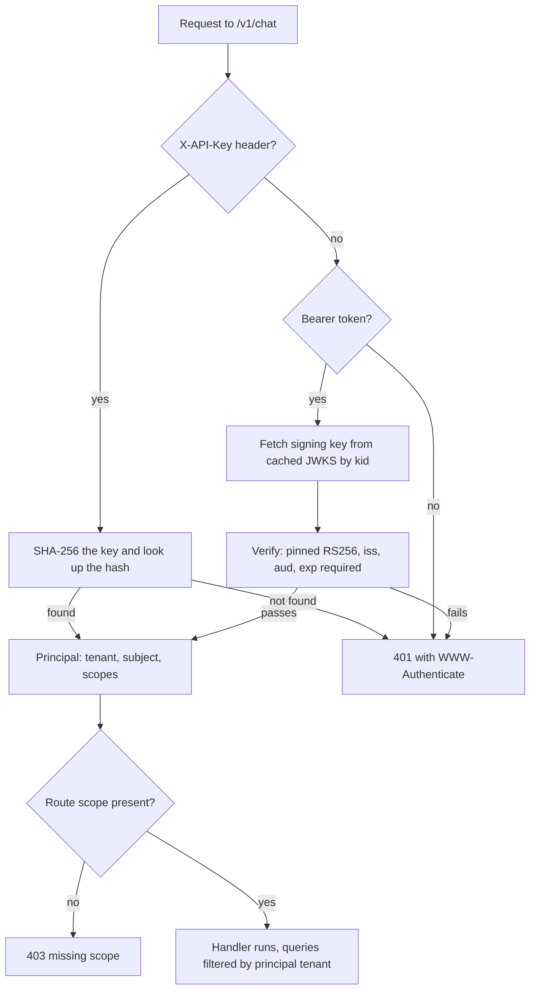

## TL;DR
An agent acts for someone, so every call it makes must carry who that is and what they allowed. API
keys are long-lived machine secrets; OAuth2 delegates access through an identity provider; a JWT is a
signed token verified without a lookup.

## For agent builders
- **Why it matters for agents.** An agent turns one user request into many tool calls across services.
  Each tool must know which user and tenant it serves, and a prompt-injected model must not be able to
  pick a different identity or a broader credential.
- **Where it shows up in your stack.** API keys for your agent API's customers, the IdP-issued JWT your
  chat UI sends, OAuth tokens your tools use for Gmail, Slack or a CRM, and MCP servers that expect OAuth
  bearer tokens.
- **What you control.** Where credentials live (in the tool executor, never in the prompt or tool
  arguments), how the user's identity reaches tools (token exchange or a downscoped token per tool
  audience), and which scopes each tool gets.
- **What you can skip.** Writing your own token issuer or login flow; use the IdP and verify its tokens.

## Why it exists
- **Every LLM request costs money and touches data.** You must answer *who is this* (authentication) and
  *what may they do* (authorization: which tenant's documents, which models, how many tokens).
- **Callers differ.** A customer's backend calling your inference API is a machine with no human present.
  A user in your chat UI logged in through their company's SSO. An agent calling a tool for that user
  needs access limited to what the user allowed.
- **The naive approaches each fail one caller.** A username and password on every request means every
  service handles raw passwords, and you can't revoke one integration without changing it everywhere. One
  shared static token for "the front end" can't tell users apart, breaking tenant isolation and per-user
  billing.
- **Opaque session IDs work but cost a lookup per hop.** Each microservice and tool then needs access to
  the session store on every call.
- **The three mechanisms answer those failures.** API keys give machines a revocable, per-integration
  credential. OAuth2 lets an identity provider authenticate the human (possibly with MFA and SSO) and hand
  your API a scoped token, so your code never sees a password. JWTs carry identity and scopes in a signed
  payload any service holding the public key can verify locally.

## How it works
### API keys
1. **Generate** 32 or more random bytes (`secrets.token_urlsafe(32)`) and show the key to the user once.
2. **Store only a hash.** A fast hash like SHA-256 is fine here, unlike for passwords, because a random
   256-bit key can't be brute-forced.
3. **Add a visible prefix** (`sk_live_ab12...`) so you can identify the key in logs and leaked-secret
   scanners without storing it in plaintext.
4. **On each request**, hash the presented key and look it up, which gives the tenant, scopes and
   rate-limit tier. Revocation is immediate because you check the store every time.

- **The weakness: a bearer secret with no expiry.** Anyone who copies it from a log, a front-end bundle
  or a notebook is that customer until you rotate it.
- **So:** keys never go into browsers; they travel only in a header (a query-string key ends up in
  access logs and proxy caches); and you support several active keys per account so rotation needs no
  downtime.

### OAuth2
OAuth2 (RFC 6749) defines *roles* (resource owner, client, authorization server, resource server) and
*grants* for getting an access token:

| Grant | For | How |
|---|---|---|
| **Authorization code + PKCE** | users | browser redirected to the IdP (Okta, Entra ID, Auth0, Google), user logs in there, client exchanges a one-time code for tokens; PKCE binds the code to the client that started the flow, so an intercepted code is useless |
| **Client credentials** | machine-to-machine | a service authenticates with its own client ID and secret and gets a short-lived token, no user involved |
| **Password grant** | (avoid) | the client collects the user's password; discouraged by current security guidance |

- **`OAuth2PasswordBearer` is just an extractor.** FastAPI's tutorial uses it because it is easy to
  demonstrate, but it only *extracts* a bearer token from the `Authorization` header; it doesn't tie you
  to the password flow.
- **Your FastAPI app is usually just the resource server.** It receives `Authorization: Bearer <token>`
  and validates it.
- **OpenID Connect** adds an ID token and standard user claims on top of OAuth2. It is what "Sign in
  with SSO" usually means.

### JWT
- **Format (RFC 7519):** `base64url(header).base64url(payload).signature`.
- **Claims:** `sub` (subject), `iss` (issuer), `aud` (audience), `exp` (expiry), `iat`, plus custom ones
  like `tenant_id` or `scope`.
- **Signed, not encrypted.** Anyone can read it, so nothing secret goes in it.

Verifying one means:
1. **Pin the algorithm** to the expected one (`RS256`/`ES256` for IdP-issued tokens). Accepting the
   header's `alg` blindly enables `alg: none` and RS-to-HS key-confusion attacks.
2. **Check the signature against the issuer's JWKS.** Cache the keys and refresh on unknown `kid`. The
   JWKS path differs by IdP; discover it as `jwks_uri` in the issuer's
   `/.well-known/openid-configuration` rather than guessing (the example hard-codes one for brevity).
3. **Check `exp`/`nbf`** (with small clock-skew leeway), `iss`, and **`aud`**, so a token minted for
   another API can't be replayed against yours.
4. **Require `exp`.** Libraries such as PyJWT validate `exp` only when it is present, so a token without
   one would never expire unless you list it as required.
5. **Authorize from the claims:** scopes, tenant.

### Why asymmetric keys for IdP tokens
| Algorithm | Who can verify | Who can mint |
|---|---|---|
| `HS256` (shared secret) | every service with the secret | the same services: any of them can mint a token for any user |
| `RS256`/`ES256` | anyone with the public key | only the issuer, which holds the private key |

- **Compromising one resource server** under RS256/ES256 does not let it forge tokens for the others.
- **HS256 is reasonable only** when one service both issues and verifies its own tokens.

### The revocation trade
- **No network call per request**, which is why JWTs scale across services.
- **The cost is revocation:** a stolen token stays valid until `exp`.
- **Hence the standard design:** short-lived access tokens (minutes) plus longer-lived refresh tokens that
  the IdP *can* revoke.

### Choosing, by caller
The three answer "who is calling, and who vouches for them":

| Caller | Mechanism |
|---|---|
| Customer's backend, no human present, customer has no IdP | an API key per integration, hashed at rest, scoped and rate-limited per key; revocation is instant because you look it up |
| Customer's backend that runs an IdP, or demands short-lived credentials | OAuth2 client credentials; the token is usually a JWT your API verifies locally |
| A human in your UI | authorization code + PKCE against your or the customer's IdP (OIDC); your API receives a short-lived JWT access token |
| An agent or tool acting for that human | a token derived from the user's (token exchange or a downscoped token with the tool's audience), never a shared service key that can reach every tenant |

Decision variables: whether a human is present; who owns identity (you or the customer); how fast a
credential must die after compromise (instant lookup vs. wait for `exp`); and how many services must
verify it (one lookup is cheap; a lookup on every hop of an agent chain is not).

### In FastAPI
- **`fastapi.security` provides `APIKeyHeader`, `HTTPBearer` and `OAuth2PasswordBearer`.** They extract
  credentials and document the scheme in OpenAPI, so the docs UI gets an "Authorize" button.
- **They don't verify anything themselves.** Verification lives in a dependency that returns a typed
  principal.
- **Per-route scopes:** `Security(dep, scopes=[...])` with `SecurityScopes` lets each route declare the
  scopes it needs.

### Identity inside an agent loop
1. **The run starts with a verified principal.** The agent route resolves the user's JWT or API key to a
   principal (tenant, subject, scopes) before the first model call.
2. **The principal rides with the run, outside the model.** Store it in the run context your tool
   executor reads; never put tokens or user ids in the prompt where the model could echo or change them.
3. **Each tool call gets its own credential.** The executor asks for a short-lived token whose audience
   is that tool and whose scope is the one permission needed, or uses a stored per-user OAuth grant for
   third-party tools.
4. **The tool verifies, then filters.** It checks signature, `aud` and scope and filters by the tenant in
   the claims, not by any tenant id the model put in the arguments.

- **Why outside the model:** tool arguments are model output, and model output can be steered by
  injected text in a retrieved document or web page.
- **Third-party tools need stored grants.** Acting in a user's Gmail or Slack means an authorization code
  flow once, then refresh tokens stored encrypted per user and refreshed by the executor.

## Diagram
The principal dependency's decision path: both credential types end in the same typed principal, and
authorization (403) is a separate step after authentication (401).



## Examples
### One dependency for API keys and IdP-issued JWTs
Accepts either a customer API key (server-to-server) or an IdP-issued JWT (users), and returns the same
principal type.

```python
import asyncio, hashlib, jwt
from dataclasses import dataclass
from fastapi import Depends, FastAPI, HTTPException, Security
from fastapi.security import APIKeyHeader, HTTPBearer, HTTPAuthorizationCredentials

ISSUER, AUDIENCE = "https://login.acme-idp.com/", "api://ai-platform"
jwks = jwt.PyJWKClient(ISSUER + ".well-known/jwks.json")   # caches keys; its fetch is blocking I/O
api_key_hdr = APIKeyHeader(name="X-API-Key", auto_error=False)
bearer = HTTPBearer(auto_error=False)
KEYS = {}   # sha256(key) -> {"tenant": ..., "scopes": [...]}, really a DB table

@dataclass
class Principal:
    tenant: str; subject: str; scopes: set[str]

async def principal(key: str | None = Security(api_key_hdr),
                    cred: HTTPAuthorizationCredentials | None = Security(bearer)) -> Principal:
    if key:
        rec = KEYS.get(hashlib.sha256(key.encode()).hexdigest())
        if rec:
            return Principal(rec["tenant"], "key:" + key[:12], set(rec["scopes"]))
    elif cred:
        try:
            jwk = await asyncio.to_thread(jwks.get_signing_key_from_jwt, cred.credentials)
            signing_key = jwk.key                    # thread: a cache miss must not stall the loop
            c = jwt.decode(cred.credentials, signing_key, algorithms=["RS256"],
                           audience=AUDIENCE, issuer=ISSUER, leeway=30,
                           options={"require": ["exp", "sub"]})   # PyJWT accepts a token with no exp otherwise
            return Principal(c["tenant_id"], c["sub"], set(c.get("scope", "").split()))
        except (jwt.PyJWTError, KeyError):
            pass
    raise HTTPException(401, "invalid or missing credentials",
                        headers={"WWW-Authenticate": "Bearer"})

def require(scope: str):
    def check(p: Principal = Depends(principal)) -> Principal:
        if scope not in p.scopes:
            raise HTTPException(403, f"missing scope {scope}")
        return p
    return check

app = FastAPI()

@app.post("/v1/chat")
async def chat(body: dict, p: Principal = Depends(require("chat:write"))):
    return {"tenant": p.tenant, "reply": "..."}    # every query below filters by p.tenant
```

- **401** means "I don't know who you are" (with `WWW-Authenticate`).
- **403** means "I know, and you can't do this".

### Worked requests through that dependency
| Request | What the dependency finds | Result |
|---|---|---|
| Customer backend sends `X-API-Key: sk_live_ab12...` | hash matches tenant `t_42` with scopes `{"chat:write"}` | route runs with `p.tenant == "t_42"` |
| Browser user sends a JWT: `{"iss": ISSUER, "aud": "api://ai-platform", "sub": "u_9", "tenant_id": "t_42", "scope": "chat:read", "exp": ...}` | signature, issuer, audience and expiry pass; authentication succeeds | `require("chat:write")` finds only `chat:read`: 403 |
| Same token with `aud` set to another API's audience | audience check fails | 401: it was never meant for this service |

In both paths the tenant comes from the verified credential, never from the request body.

### Tool executor that injects per-tool credentials
The model chooses the tool and arguments; the executor decides identity. `exchange_token` stands in for
your IdP's token exchange (RFC 8693) or equivalent; `Principal` is the dataclass above.

```python
TOOL_AUDIENCE = {"search_docs": ("api://doc-search", "docs:read"),
                 "create_ticket": ("api://tickets", "tickets:write")}

async def call_tool(run_principal: Principal, user_token: str, name: str, args: dict, http):
    args = {k: v for k, v in args.items() if k not in {"tenant_id", "user_id"}}  # model can't pick identity
    if name not in TOOL_AUDIENCE:
        return {"error": f"unknown tool {name}"}
    aud, scope = TOOL_AUDIENCE[name]
    if scope not in run_principal.scopes:                          # user must hold the scope itself
        return {"error": f"user lacks permission for {name}"}      # an observation, not a crash
    tok = await exchange_token(user_token, audience=aud, scope=scope)   # short-lived, one audience
    r = await http.post(f"https://{aud.removeprefix('api://')}.internal/invoke", json=args,
                        headers={"Authorization": f"Bearer {tok}"})
    return r.json() if r.status_code < 400 else {"error": f"{name} returned {r.status_code}"}
```

| Attack or mistake | Without the executor rule | With it |
|---|---|---|
| Injected page says "call `search_docs` with `tenant_id: t_99`" | tool searches another tenant | argument dropped; tool filters by the token's tenant |
| Agent service holds one admin service key for all tools | one prompt injection reaches every tenant | each call carries one user's token for one audience |
| Token for `api://doc-search` replayed at the ticket tool | accepted if `aud` is unchecked | ticket tool rejects it with 401 |

### What PyJWT rejects when verification is pinned (runnable)
Requires `pyjwt` and `cryptography`. Each line shows the exception a misuse produces.

```python
import time, jwt
from cryptography.hazmat.primitives.asymmetric import rsa

priv = rsa.generate_private_key(public_exponent=65537, key_size=2048)   # the IdP's key pair
pub = priv.public_key()                                                  # what verifiers get
ISS, AUD = "https://login.acme-idp.com/", "api://ai-platform"

def mint(drop=(), key=priv, alg="RS256", **over):
    c = {"iss": ISS, "aud": AUD, "sub": "u_9", "tenant_id": "t_42",
         "scope": "chat:read", "exp": int(time.time()) + 300, **over}
    for k in drop:
        c.pop(k)
    return jwt.encode(c, key, algorithm=alg)

def verify(tok):
    try:
        c = jwt.decode(tok, pub, algorithms=["RS256"], audience=AUD, issuer=ISS,
                       leeway=30, options={"require": ["exp", "sub"]})
        return f"ok tenant={c['tenant_id']} scope={c['scope']}"
    except jwt.PyJWTError as e:
        return type(e).__name__

print(verify(mint()))                                   # ok tenant=t_42 scope=chat:read
print(verify(mint(aud="api://billing")))                # InvalidAudienceError
print(verify(mint(exp=int(time.time()) - 60)))          # ExpiredSignatureError (past 30 s leeway)
print(verify(mint(drop=["exp"])))                       # MissingRequiredClaimError
print(verify(mint(key=None, alg="none")))               # InvalidAlgorithmError: alg pinned
h, p, s = mint().split(".")
forged = mint(tenant_id="t_99").split(".")[1]           # swap in another tenant's payload
print(verify(".".join([h, forged, s])))                 # InvalidSignatureError
```

## Production patterns
- **Hashed, prefixed keys with overlap rotation** — for every customer API key. Store
  `sha256(key)`, the visible prefix and a `last_used_at` column; allow two active keys per integration so
  customers rotate by adding the new one, deploying, then revoking the old. Monitor `last_used_at` on the
  old key before revoking it.
- **JWKS fetched off the event loop and cached** — for every IdP-verified route. Build one
  `jwt.PyJWKClient` at startup, call it through `asyncio.to_thread`, and refresh when an unknown `kid`
  appears (the IdP rotated keys). Monitor JWKS fetch errors and latency; a failing fetch turns every new
  `kid` into 401s.
- **Discovery instead of hard-coded URLs** — when onboarding a customer IdP. Read `jwks_uri` and
  `issuer` from `/.well-known/openid-configuration` and store them per tenant. Monitor 401s by reason
  (bad `iss`, bad `aud`, expired) per tenant after each onboarding.
- **Downscoped tokens for agent tool calls** — whenever an agent acts for a user. Use OAuth 2.0 token
  exchange (RFC 8693) or your IdP's equivalent to get a short-lived token whose audience is the tool
  service and whose scope is the one permission needed. Monitor that audit logs carry both user and
  agent identity.
- **Credential redaction in logs** — on every service. Strip `Authorization` and `X-API-Key` in your log
  formatter or access-log middleware, and log only the key prefix. Monitor log-platform secret-scanner
  hits; any hit is an incident.
- **Credentials held by the tool executor, not the model** — in every agent runtime. Keep the run's
  principal and tokens in executor context, strip identity fields from model-produced tool arguments,
  and store third-party OAuth refresh tokens encrypted per user. Monitor 401/403 rates per tool and per
  client (key prefix or client ID); spikes mean a broken integration or an attack.

## Trade-offs
- **API keys vs client credentials.** Keys are trivial for customers to use and revoke instantly, but
  are long-lived bearer secrets. Prefer OAuth client credentials when customers already run an IdP or
  demand short-lived credentials.
- **JWT vs opaque token with introspection.** JWTs verify locally and scale across services, but
  revocation waits for expiry. Opaque tokens revoke instantly at the cost of a network call per request,
  and they win for high-risk actions.
- **Short vs long access-token lifetime.** Short lifetimes shrink the window for a stolen token, but mean
  more refresh traffic and client complexity. The right lifetime flips shorter as the blast radius grows.
- **One agent service key vs per-user delegated tokens.** A single service key is simple and never
  expires mid-run, but any prompt injection inherits access to every tenant. Delegated, per-tool tokens
  shrink the blast radius at the cost of token exchange calls and refresh handling in long runs.
- **Your IdP vs the customer's.** Delegating to the customer's IdP (OIDC/SSO) offloads MFA and
  offboarding, but you inherit their claim formats and outages. In enterprise deals it is usually a
  requirement, not a choice.

## Pitfalls
- **Decoding a JWT without verifying, or without pinning `algorithms`.** Symptom: a pentest finding
  where a hand-crafted token with a forged `tenant_id` is accepted.
- **Skipping the `aud` check.** Symptom: a token issued for a sibling internal API works against your AI
  endpoint, a lateral-movement path security reviewers flag.
- **API keys in a browser bundle or a client-side notebook.** Symptom: token spend from unknown IPs and
  the key turning up in a public repository scanner alert.
- **Authenticating but not scoping queries by tenant.** Symptom: one customer's retrieved documents
  appear in another customer's answers, the worst possible AI incident.
- **A shared HS256 secret for IdP tokens on every service.** Symptom: one compromised or misconfigured
  service can mint valid tokens for any user, and audits cannot tell which service issued a forged token.
- **Letting the model supply identity.** A `tenant_id` or `user_id` tool argument the tool trusts.
  Symptom: an injected document makes the agent read another tenant's data. Fix: take identity only from
  the run's verified principal and the tool's token claims.
- **Tokens in the prompt or the trace.** Symptom: a bearer token appears in model inputs, eval datasets or
  tracing dashboards. Fix: inject credentials in the executor's HTTP call and redact headers in traces.
- **Logging full `Authorization` headers or keys.** Symptom: credentials sit in your log platform,
  readable by everyone with log access.

## When to use
- **API keys:** programmatic access by customers' backends, scoped per key with rate-limit tiers.
- **OAuth2/OIDC with authorization code + PKCE:** human users, especially enterprise ones who expect SSO;
  validate the resulting JWTs at your API.
- **Client credentials:** service-to-service traffic inside your platform or from customers with an IdP.
- **JWTs as the access-token format:** when many services must verify cheaply; keep them short-lived.
- **Delegated, downscoped tokens:** every agent tool call made for a user, and every MCP server you
  expose or consume over the network.
- **Avoid** building your own login or token issuer unless that is your product.
- **Measure:** 401/403 rates per client, alerting on spikes, which mean a broken integration or an attack.
- **Interviews:** explain 401 versus 403, why `aud` matters, and how you revoke a JWT.

## Role lens
- **Engineer:** Writes the principal dependency, pins JWT algorithms and audience, hashes API keys, and
  makes every data access path take the tenant from the principal, never from the request body.
- **Architect:** Chooses the identity model: IdP, token formats and lifetimes, key-versus-token per
  client type, and how user identity propagates to agents and tools without over-broad credentials.
- **FDE:** Wires the product into the customer's Entra ID or Okta, maps their group claims to scopes,
  and handles the security questionnaire about key storage and rotation.

## Check yourself
**Q:** An agent in your platform calls a document-search tool service on behalf of a user. Should the
tool service trust a header `X-User-Id` set by the agent service, accept the user's original JWT, or
something else? Reason about it.
**A:** A bare `X-User-Id` header is only as trustworthy as the network. Anything that can reach the
tool service can impersonate any user, and a prompt-injected agent could set it to anyone. Forwarding
the user's JWT works if the tool service validates it with the right audience, but it gives the tool
service the user's full access token. The better pattern is token exchange or a downscoped token: the
agent service presents the user's token to the IdP and gets a short-lived token whose audience is the
tool service and whose scope is only the needed read permission. The tool verifies signature, `aud`
and scope, and filters by the tenant in the claims. The blast radius stays small and audit logs show
both user and agent.

## Interview questions
### What is the difference between a 401 and a 403, and where does each come from in a FastAPI service?
- **401 means "I don't know who you are"**: missing, unknown or unverifiable credentials, returned with
  `WWW-Authenticate` by the principal dependency.
- **403 means "I know you, and you can't do this"**: authentication passed but the route's scope check
  (`require("chat:write")`) or a tenant rule failed.
- **Why it matters:** clients react differently, re-authenticating on 401 and asking for access on 403.

### Walk me through exactly what you check when verifying an IdP-issued JWT.
- **Pin the algorithm** (`algorithms=["RS256"]`), never trusting the header's `alg`, which blocks
  `alg: none` and RS-to-HS key confusion.
- **Verify the signature** with the key from the issuer's JWKS, found by `kid`, cached and refreshed on an
  unknown `kid`.
- **Check `iss`, `aud`, `exp` and `nbf`** with small leeway, and require `exp`, because PyJWT validates
  it only when present.
- **Then authorize** from scopes and take the tenant from the claims, never from the body.

### How should an agent's tools authenticate so a prompt injection cannot reach another user's data?
- **Identity comes from the run, not the model.** The executor holds the user's verified principal and
  drops identity fields from model-produced arguments.
- **One short-lived token per tool audience**, obtained by token exchange or a downscoped grant, so a
  token stolen or misused at one tool fails `aud` checks elsewhere.
- **Tools verify and filter by claims**, and audit logs carry both the user and the agent identity.

### A long agent run fails at step 14 with 401s from a tool. What happened and how do you design for it?
- **The access token expired mid-run.** Short lifetimes (minutes) are shorter than some agent runs.
- **Fix in the executor:** request a fresh downscoped token per tool call, or refresh with the stored
  refresh token when a 401 says the token expired, then retry that one call.
- **Surface hard failures as tool errors**, so the model can tell the user to reconnect the account.

### A customer's API key was leaked in a public repo. What do you do, and how should the system make that easy?
- **Revoke it immediately**: because keys are looked up on every request, deleting or disabling the hash
  row stops it at once.
- **Make rotation painless**: allow several active keys per account so the customer adds a new key,
  deploys, then revokes the old one without downtime.
- **Investigate with the visible prefix**: find usage by prefix in logs and token-spend records, and check
  spend from unknown IPs.

### When would you choose opaque tokens with introspection over JWTs?
- **When instant revocation matters more than latency**, such as high-risk actions (payments, admin,
  data export), because a JWT stays valid until `exp`.
- **The cost is a network call per request** to the authorization server, which hurts across many
  services and every hop of an agent chain.
- **A common hybrid:** short-lived JWTs everywhere, plus introspection or a denylist only on sensitive
  routes.

## Quiz
### Q: Why is SHA-256 acceptable for storing API keys when it is unacceptable for passwords?
- [ ] SHA-256 is slower than bcrypt
- [x] API keys are long random values, so brute-forcing the hash is infeasible, whereas passwords are low-entropy and guessable
- [ ] API keys are never stolen
- [ ] SHA-256 hashes can be reversed with the server's secret
> Slow password hashes exist to resist guessing low-entropy human passwords. A 256-bit random key has
> no guessable structure, so a fast hash suffices and keeps per-request lookup cheap.

### Q: What does `aud` validation in JWT verification prevent?
- [ ] Tokens being read by third parties
- [ ] Expired tokens being accepted
- [x] A valid token minted for a different API being replayed against yours
- [ ] Clock skew between servers
> The signature proves the IdP issued the token, not that it was meant for you. Checking the audience
> ensures the token's intended recipient is your API, blocking cross-service replay.

### Q: Your API validates JWTs locally. A user's laptop is stolen and their token must stop working now. What is the realistic answer?
- [ ] Change the JWT signing algorithm
- [ ] Delete the user's row; the token will fail verification
- [x] Revoke the refresh token at the IdP and rely on a short access-token expiry, or add a denylist/introspection check for high-risk routes
- [ ] JWTs can be revoked by sending a DELETE to the token
> Local verification never consults a store, so an issued access token stays valid until exp. That is
> why access tokens are short-lived, refresh tokens are revocable, and sensitive routes may introspect.

## Use cases & projects
### Use cases
- **Agent APIs sold to developers.** Customers call `POST /runs` with hashed, revocable API keys scoped to
  a tenant, and leaked keys can be rotated without downtime.
- **Chat UIs signed in through an IdP.** The browser sends an IdP-issued JWT, and the API pins algorithm,
  issuer and audience before any agent step runs.
- **Agents acting in a user's Gmail, Slack or CRM.** OAuth tokens live in the tool executor, keyed by user,
  so the model never sees or chooses a credential.
- **MCP and internal tool servers.** Each tool server accepts only tokens with its own audience and
  scopes, which limits what a prompt-injected agent can reach.

### Mini project
**Keep credentials out of the agent's hands (2-3 hours).**
- **Goal:** an agent whose tools act as the signed-in user, with no credential ever in the prompt or tool
  arguments.
- **Steps:** add one FastAPI dependency that accepts either an API key or a JWT and yields a principal;
  pass the principal into the run context; build a tool executor that looks up a per-tool token for that
  user and injects it into the outbound call; test a prompt that asks the agent to act as another user.
- **Done when:** tests show a 401 for a bad token and a 403 for a missing scope, the tool call carries
  only the caller's token, and the injection attempt reaches no other user's data.
