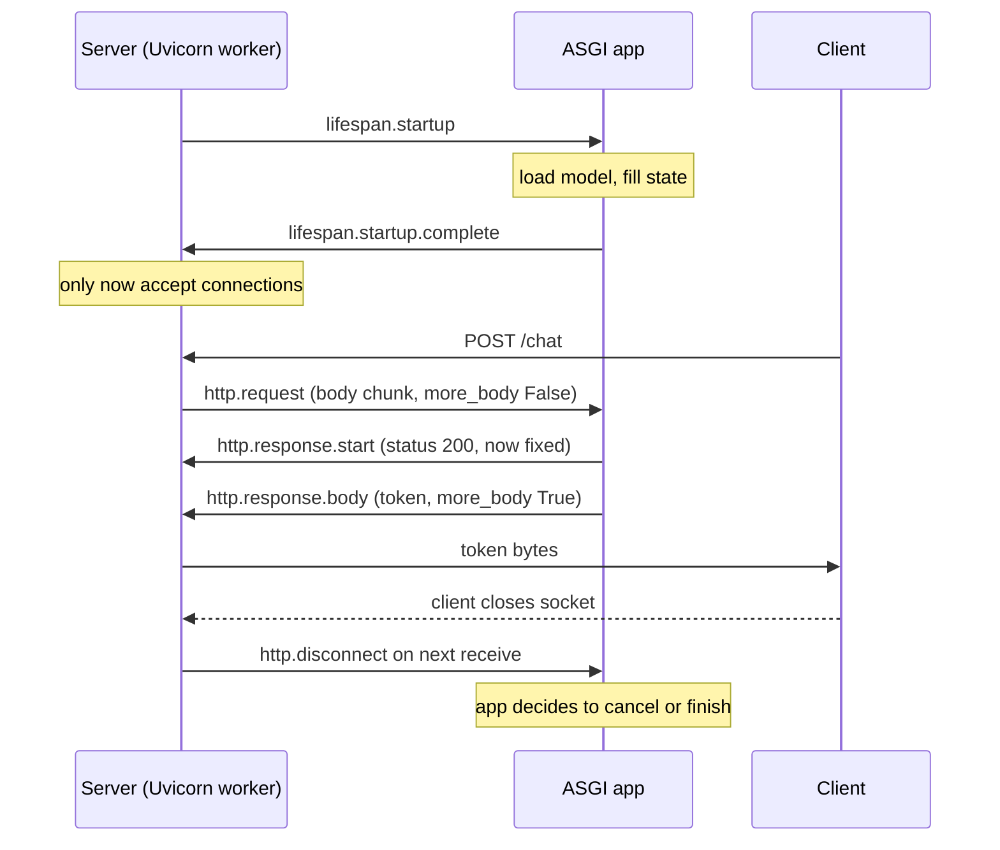

## TL;DR
ASGI is the message protocol between an async server (Uvicorn, Hypercorn) and your app: one
`async def app(scope, receive, send)` called once per connection, plus one `lifespan` connection per
process. FastAPI's lifespan, middleware, streaming and disconnect detection are all moves in it.

## Why it exists
- **WSGI holds a thread per request.** The previous contract, `app(environ, start_response)`, is a
  synchronous call returning an iterable of bytes; the server dedicates a thread or process until it is
  exhausted. Fine for millisecond database-backed pages.
- **AI traffic breaks that model.** An LLM call holds a connection for 30–120 seconds while the handler
  just waits on a socket; token streaming writes partial output all that time; voice and agent UIs want
  WebSockets; one request often fans out to several provider calls at once.
- **Idle threads are the cost.** Under thread-per-request, 500 concurrent streaming chats means 500
  mostly idle threads, each with a stack, all contending on the GIL, with no way to say "wait for this
  socket without holding a thread".
- **The naive fixes fail.** "Add more threads" hits memory and scheduler cost long before 10k
  connections and still has no WebSocket or server-push semantics. "Monkey-patch with gevent" makes
  blocking libraries cooperative by stealth, fragile with C extensions and GPU libraries. Neither has a
  startup/shutdown protocol, so model loading lands at import time (slow tests, no failure signal) or on
  the first request (one unlucky user pays the cold start).
- **What ASGI buys.** Asynchronous message passing over an awaitable callable: one event loop parks
  thousands of connections cheaply on `await`, with explicit messages for body chunks, response chunks,
  disconnects, WebSocket frames and process lifecycle. The cost: every layer must speak the protocol,
  which is what Starlette and FastAPI do for you.

## How it works
### One callable, three kinds of scope
- **Signature.** An ASGI application is `async def app(scope, receive, send)`.
- **`scope`** is a plain dict describing the connection; its `type` is `"http"`, `"websocket"` or
  `"lifespan"`.
- **HTTP scope fields:** `method`, `path`, `query_string`, `headers` (a list of `(bytes, bytes)` pairs),
  `client`, `server` and a `state` dict.
- **`receive`** is an async callable returning the next event from the server; **`send`** pushes an
  event back.
- **One call per connection.** For HTTP/1.1 keep-alive, every request on the socket is its own call with
  a fresh scope, so nothing leaks between requests unless you create it.

### The lifespan connection
1. **Worker starts.** The server opens one connection with `scope["type"] == "lifespan"` and calls the app.
2. **Startup.** The app awaits `receive()`, gets `{"type": "lifespan.startup"}`, runs startup work, then
   sends `lifespan.startup.complete` (or `lifespan.startup.failed` with a message).
3. **Park.** The app waits on `receive()` until the server sends `lifespan.shutdown`.
4. **Shutdown.** It runs teardown and answers `lifespan.shutdown.complete`.

- **FastAPI's `lifespan` context manager** is literally the code before and after the `yield` in this
  exchange.
- **State without globals.** The lifespan scope carries a `state` dict. Whatever startup puts there
  (Starlette does this when your lifespan yields a dict) is shallow-copied into the `state` of every later
  HTTP and WebSocket scope, so a model loaded once reaches `request.state` in every request.
- **Handshake before traffic.** Uvicorn completes startup *before* it accepts connections on its socket,
  so a worker whose startup fails never receives traffic, and a worker still loading a model is simply
  not serving yet.
- **`--lifespan` flag:** `auto` (tolerate apps that do not implement the protocol), `on` (require it) or
  `off`.

### An HTTP request, message by message
1. **Scope.** The server parses the request line and headers, builds the scope and calls `app`.
2. **Body.** The app loops on `receive()`: each `http.request` event carries a `body` chunk and a
   `more_body` flag. FastAPI's JSON parsing and `UploadFile` streaming are built on this loop, which is
   why a body can be read only once.
3. **Response.** The app sends exactly one `http.response.start` with `status` and `headers`, then one
   or more `http.response.body` events. `more_body: True` keeps the response open, which is how
   `StreamingResponse` emits tokens as they arrive; the final event has `more_body: False`.
4. **Disconnect.** If the client goes away, the next `receive()` returns `http.disconnect`.

| Rule | Because | Consequence |
|---|---|---|
| Start before body, status fixed | HTTP/1.1 writes the status line and headers before any body bytes | once `http.response.start` is out, the status cannot change |
| Mid-stream exception | the 200 is already on the wire | the server can only cut the connection; the client sees a 200 with a truncated body |
| Disconnect is a message, not cancellation | only the app knows whether work should stop (abandon an LLM call) or must finish (write the audit row, record usage) | someone has to read that event |

### Disconnect handling in practice
- **ASGI spec 2.4:** a server may also raise an `OSError` subclass from a `send()` on a closed connection.
- **`StreamingResponse` uses whichever applies.** On older-spec servers it listens for `http.disconnect`
  in a parallel task and cancels the generator; on 2.4 servers the next `send` fails.
- **Non-streaming handlers get no help.** One that awaits a 60-second completion and then returns runs
  to the end unless it polls `request.is_disconnected()` or races the call against it.

### WebSockets
- A `websocket` scope begins with a `websocket.connect` event; the app answers `websocket.accept`
  (optionally with a subprotocol) or `websocket.close`.
- Frames flow as `websocket.receive` / `websocket.send` events with `text` or `bytes`, until
  `websocket.disconnect`.
- Same callable signature, which is why one FastAPI process serves REST and WebSocket routes.

### Where FastAPI sits in the chain
- **FastAPI subclasses Starlette**, whose `__call__` builds a stack on first use:
  `ServerErrorMiddleware` → your middleware → `ExceptionMiddleware` → `Router` → route → endpoint.
- **Every layer has the same `(scope, receive, send)` signature**, so a middleware can wrap `send` to add
  a header or count bytes, or wrap `receive` to cap body size.
- **The router** sends lifespan scopes to the lifespan handler and dispatches http/websocket scopes by path.

### Processes and event loops
- **One worker = one process, one event loop, one app instance.**
- `uvicorn --workers 4` (or Gunicorn with a Uvicorn worker class) starts four processes (Uvicorn spawns
  them, Gunicorn forks them). Each runs its own lifespan handshake and holds its own copies of anything
  loaded there.
- **"Load once" means once per worker**, which matters when the thing loaded is a multi-gigabyte model.

## Diagram
Read top to bottom: the lifespan handshake finishes before any HTTP traffic, then one request streams
body chunks with `more_body: True` until the client either reads the final chunk or disconnects.



## Examples
### Raw ASGI app: lifespan, body, streamed response
No framework. Run it with `uvicorn asgi_demo:app --lifespan on` and `curl -N -d "the kv cache stores keys"
localhost:8000` to watch words arrive one at a time. FastAPI's `lifespan=` and `StreamingResponse`
generate exactly these messages for you.

```python
import asyncio

STATE = {}

async def app(scope, receive, send):
    if scope["type"] == "lifespan":
        while True:
            msg = await receive()
            if msg["type"] == "lifespan.startup":
                STATE["gen"] = lambda text: (w + " " for w in text.split())  # stand-in for a model
                await send({"type": "lifespan.startup.complete"})
            elif msg["type"] == "lifespan.shutdown":
                STATE.clear()
                await send({"type": "lifespan.shutdown.complete"})
                return
    elif scope["type"] == "http":
        body = b""
        while True:                                   # read the whole request body
            msg = await receive()
            body += msg.get("body", b"")
            if not msg.get("more_body"):
                break
        await send({"type": "http.response.start", "status": 200,
                    "headers": [(b"content-type", b"text/plain")]})
        for token in STATE["gen"](body.decode() or "hello world"):
            await send({"type": "http.response.body", "body": token.encode(), "more_body": True})
            await asyncio.sleep(0.2)                  # pretend each token costs time
        await send({"type": "http.response.body", "body": b"", "more_body": False})
```

### Production snippet: stop a non-streaming LLM call when the client leaves
A handler that awaits a full completion is never interrupted by a disconnect. Race the call against
`request.is_disconnected()` so an abandoned request stops spending provider tokens.

```python
import asyncio
from fastapi import FastAPI, Request, Response

app = FastAPI()

async def call_llm(prompt: str) -> str:
    await asyncio.sleep(60)                  # stand-in for a 60-second provider call
    return f"answer to {prompt!r}"

async def wait_for_disconnect(request: Request, poll_s: float = 0.5) -> None:
    while not await request.is_disconnected():   # reads http.disconnect from receive()
        await asyncio.sleep(poll_s)

@app.post("/complete")
async def complete(request: Request, body: dict):
    llm = asyncio.create_task(call_llm(body["prompt"]))
    gone = asyncio.create_task(wait_for_disconnect(request))
    done, _ = await asyncio.wait({llm, gone}, return_when=asyncio.FIRST_COMPLETED)
    if llm in done:
        gone.cancel()
        return {"answer": llm.result()}
    llm.cancel()                             # client left: stop paying for tokens
    return Response(status_code=499)         # nginx's "client closed request"; nobody reads it
```

### Worked trace: a stream that fails halfway
A chat stream validates the prompt lazily inside its generator, and the provider errors after 3 tokens.

| Message sent | What the client sees |
|---|---|
| `http.response.start`, status 200 | headers arrive; status is now fixed |
| 3 × `http.response.body`, `more_body: True` | three tokens render |
| generator raises | no 5xx possible; server closes the connection |
| (no final `more_body: False`) | HTTP 200 with a stream that stops mid-sentence; traceback only in server log |

Fix: run checks that can fail before returning the `StreamingResponse`, and send an explicit error event
inside the stream for failures after it starts.

## Production patterns
- **Load models in lifespan and gate readiness on it.** Use when startup is slow (model weights,
  warm-up). Run `uvicorn --lifespan on` so a missing or broken handler fails loudly, and size the
  orchestrator's startup probe above the measured load time. Monitor startup duration and restart counts.
- **Race long non-streaming calls against disconnect.** Use for any endpoint that awaits a full LLM
  completion. Wrap the call in a task and `asyncio.wait` it against a `request.is_disconnected()` poller,
  as above. Monitor provider tokens billed versus responses actually delivered.
- **Pure ASGI middleware on streaming routes.** Use when you add headers, metrics or limits to token
  streams. Wrap `send` and pass every `more_body` chunk through untouched instead of collecting the
  response. Monitor time to first byte at the client versus at the app.
- **Turn off proxy buffering for streams.** Use behind nginx-style gateways: set `proxy_buffering off`
  for the route or send an `X-Accel-Buffering: no` response header. Verify with `curl -N` against each hop
  outward; monitor client-side time to first token.
- **Measure event-loop lag.** Use on every async service: schedule a no-op task every second and record
  how late it runs as a metric. Alert when lag climbs under load, because it means something is blocking
  the loop.

## Trade-offs
- **Cheap idle connections vs one shared loop.** One event loop serves thousands of idle connections
  cheaply, but a single blocking call anywhere stalls all of them; the win flips into a loss the moment
  CPU-bound inference runs on the loop.
- **Rich protocol vs correct layers.** Messages give you streaming, WebSockets and disconnect events, but
  every middleware must handle `send`/`receive` correctly; a sloppy middleware can buffer a token stream
  into one lump.
- **Per-worker lifespan vs memory.** It isolates failures and avoids cross-process locks, but multiplies
  memory for app-scoped models by the worker count; past one or two workers a separate model server
  usually wins.
- **Safe startup vs slow readiness.** A failing startup keeps a broken worker off the network, but a slow
  model load delays readiness; orchestrators need startup probes tuned to the load time.

## Pitfalls
- **Draining `receive()` in a pure ASGI middleware without replaying it.** Reading the body to log it
  consumes the `http.request` events, which arrive only once, so the endpoint hangs or gets an empty
  body. (Starlette's
  `Request` caches the body, and current `BaseHTTPMiddleware` replays it, so this bites hand-written ASGI
  layers and older Starlette.) Symptom: 422s or timeouts only when that middleware is enabled.
- **Assuming a disconnect interrupts every handler.** `StreamingResponse` stops its generator, but a
  handler that awaits the full completion before returning is never interrupted, so a long LLM call keeps
  burning provider tokens for a user who left. Symptom: provider spend higher than responses delivered.
- **Expecting errors inside a stream generator to become 4xx/5xx.** Validating or calling the provider
  lazily there is too late: the 200 and headers were already sent. Symptom: HTTP 200 with a stream that
  stops mid-sentence, traceback in the server log. Fix: check before returning the `StreamingResponse`,
  and send an explicit error event for failures after it starts.
- **Treating `app.state` as shared memory across workers.** Each worker has its own, so caches and
  counters diverge. Symptom: rate limits or cache hit rates that look random under `--workers 4`.
- **Loading models at import time.** Tests, migrations and CLI tools that import the module pay the load,
  and a failure surfaces as an import error with no `startup.failed` message. Symptom: twenty-second test
  collection. Fix: move it into the lifespan handshake.

## When to use
- **Choose per service, not per endpoint.** Anything that streams, holds long connections or awaits
  remote models is ASGI.
- **Reach for protocol knowledge at the edges:** a streaming response that arrives all at once, a
  disconnect nobody noticed, a startup that hangs under Gunicorn, a body that reads as empty.
- **Measure:** event-loop lag (how late a no-op task scheduled every second actually runs) under load; it
  tells you whether something is blocking.
- **Interviews:** walk through the lifespan and HTTP message sequence and say where FastAPI's lifespan,
  middleware and `StreamingResponse` plug in; that separates reading the docs from debugging a server.

## Role lens
- **Engineer:** Writes pure-ASGI middleware when `BaseHTTPMiddleware` breaks streaming, reads
  `http.disconnect` to cancel abandoned LLM calls, and keeps startup work inside lifespan.
- **Architect:** Decides worker count versus a dedicated model server from the fact that lifespan state
  is per process, and sets probe timings around measured startup cost.
- **FDE:** Diagnoses "the stream only shows up at the end" at a customer site by checking which proxy or
  middleware is buffering `http.response.body` events.

## Check yourself
**Q:** A streaming chat endpoint works locally but, behind a customer's gateway, tokens arrive only
after the full answer is complete, and abandoned chats keep running to completion. Using the ASGI
message model, explain both symptoms and what you would check.
**A:** Streaming is a sequence of `http.response.body` events with `more_body: True`; something between
the app and the browser is accumulating them until `more_body: False`. Candidates are a
`BaseHTTPMiddleware` that reads the whole response, a compression layer, or the gateway buffering
upstream responses; test by curling the app directly with `-N`, then each hop outward. Abandoned chats
continue because a disconnect reaches the app only as an `http.disconnect` event (or a failed `send`),
not as cancellation by the server. A buffering gateway explains both symptoms at once: it keeps
reading the upstream response after the browser leaves, so the app never sees a disconnect at all.
If the gateway is not the cause, check for a hand-rolled stream loop or a non-streaming provider call
that never polls `request.is_disconnected()`; `StreamingResponse` itself stops its generator on
disconnect. Fixes: disable response buffering for the streaming route at the gateway, confirm it
forwards the client close upstream, and race long provider calls against the disconnect event.

## Interview questions
### What is ASGI, and why did Python web servers need it after WSGI?
- **Definition:** ASGI is the contract `async def app(scope, receive, send)` between an async server and
  an app, where everything (body chunks, response chunks, disconnects, WebSocket frames, startup and
  shutdown) is an explicit message.
- **Why:** WSGI's synchronous `app(environ, start_response)` holds a thread until the response is done,
  so 500 streaming chats mean 500 mostly idle threads; ASGI parks them on `await` in one event loop.
- **Bonus:** WSGI has no WebSocket, server-push or lifecycle semantics, which is why model loading had
  nowhere clean to live.

### A worker loads a 20-second model at startup. What does the client see during those 20 seconds, and why?
- **Nothing from that worker.** Uvicorn completes the lifespan handshake before accepting connections,
  so a loading worker simply is not serving yet.
- **If startup fails**, the app sends `lifespan.startup.failed` and the worker never receives traffic.
- **Operationally:** set the orchestrator's startup probe above the measured load time, or the platform
  kills the worker mid-load and it restart-loops.

### Your stream returns HTTP 200 but stops mid-sentence, and there is a traceback in the server log. Explain.
- **The status was already sent.** `http.response.start` goes out before the first body chunk, and HTTP/1.1
  cannot change the status after that.
- **So a generator error can only cut the connection**; the client sees a 200 with a truncated body.
- **Fix:** do the checks that can fail before returning the `StreamingResponse`, and emit an explicit
  error event inside the stream for failures that happen after it starts.

### When would you write a pure ASGI middleware instead of using `BaseHTTPMiddleware` or a decorator?
- **When it touches streams.** A pure ASGI layer wraps `send` and can pass each `more_body` chunk through
  untouched; a layer that collects the response turns a token stream into one lump.
- **Cost:** you must handle `receive` and `send` correctly yourself, including replaying any body you
  drain, or the endpoint hangs or sees an empty body.
- **Rule of thumb:** use the simple helpers for request-only concerns on non-streaming routes; go pure
  ASGI for headers, metrics or limits on streaming routes.

### With `uvicorn --workers 4` and a 6 GB model loaded in lifespan, what does that cost and what would you change?
- **Memory:** each worker runs its own lifespan, so the model is loaded four times, about 24 GB in total.
- **State:** `app.state` caches and counters also diverge per worker, so in-process rate limits are per
  worker, not per service.
- **Change:** past one or two workers, move the model to a dedicated model server and keep the API
  workers thin, or run fewer workers and rely on async concurrency within each.

## Quiz
### Q: When does Uvicorn start accepting HTTP connections for a FastAPI app with a lifespan handler?
- [ ] As soon as the process starts; startup runs concurrently with the first requests
- [x] After the app sends `lifespan.startup.complete`
- [ ] After the first request triggers lazy initialisation
- [ ] When the health endpoint first returns 200
> The lifespan handshake completes before the server begins serving on its socket, so a worker that is
> still loading a model is not serving yet, and a failed startup never receives traffic.

### Q: How does an ASGI app learn that the client closed the connection mid-stream?
- [ ] An exception is raised at the next `await` in the handler
- [ ] The server cancels the handler's task immediately
- [x] A subsequent `receive()` returns an `http.disconnect` event
- [ ] The scope's `client` field becomes `None`
> Disconnect is a message, not a cancellation; the handler must read it, which is what
> `request.is_disconnected()` does (spec-2.4 servers may also fail the next `send`, but not an arbitrary
> `await`), otherwise a long model call keeps running for nobody.

### Q: With `uvicorn --workers 4`, how many times does the lifespan startup code run?
- [ ] Once, in the master process, with state shared by fork
- [x] Four times, once per worker process
- [ ] Once per request until every worker is warm
- [ ] Twice: once at bind time and once at first request
> Each worker is a separate process with its own event loop and app instance, so a model loaded in
> lifespan is loaded four times and occupies four times the memory.
