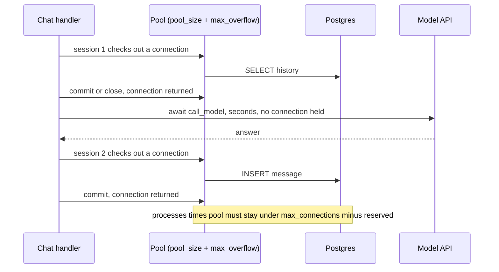

## TL;DR
In `async def` endpoints use an async driver behind SQLAlchemy's `AsyncEngine`; blocking drivers belong
in `def` endpoints. Each process keeps a bounded pool, and `processes × (pool_size + max_overflow)` must fit Postgres's cap.
AI rule: never hold a pooled connection across a model call.

## Why it exists
- **Problem 1: blocking.** A sync driver call such as psycopg2's `cursor.execute()` inside an `async def`
  endpoint freezes the event loop for the query. At 20 ms per query and fifty concurrent requests
  (illustrative) nothing else runs, including health checks, so readiness probes fail exactly when
  traffic is highest.
- **Two correct escapes.** A plain `def` endpoint runs on a worker thread, but that caps concurrency at
  the pool size (anyio's default limiter is 40) and makes mixing a database read with an awaited model
  call awkward. An async driver (asyncpg, psycopg 3, aiosqlite) yields to the loop while the server works,
  which is why AI services usually take that route.
- **Problem 2: connections are expensive.** Each Postgres connection is a backend process with its own
  memory (a few megabytes each, order of magnitude); opening one costs a TCP handshake, usually TLS, and
  authentication: milliseconds to tens of milliseconds.
- **And capped.** The server refuses connections beyond `max_connections`, default 100, so
  connection-per-request pays the handshake every time and, under a burst, storms the server into "too
  many clients already".
- **A pool fixes both, and creates a new problem.** Keep a bounded set open per process, lend one per
  unit of work, take it back. But pools multiplied across processes and worker fleets are a capacity
  problem, and that arithmetic, not query speed, usually bites first.

## How it works
### The driver layer
| URL prefix | Driver |
|---|---|
| `postgresql+asyncpg://` | asyncpg: binary protocol, fastest, its own API |
| `postgresql+psycopg://` | psycopg 3 with async support, DB-API shaped |
| `sqlite+aiosqlite://` | aiosqlite, for tests |

- **Greenlet bridge.** SQLAlchemy's asyncio extension keeps its synchronous core and bridges to the async
  driver with greenlets: ORM code runs in a greenlet and switches out whenever the driver would block.
- **Consequence: no implicit IO.** Anything that queries where you cannot `await` (a lazy relationship, an
  attribute expired by `commit()`) raises `MissingGreenlet`.
- **So async sessions use** eager loading (`selectinload`, `joinedload`) and `expire_on_commit=False`.

### Pool mechanics
`create_async_engine(url, pool_size=10, max_overflow=5, pool_timeout=30, pool_recycle=1800,
pool_pre_ping=True)` configures the per-process pool.

| Setting | Meaning |
|---|---|
| `pool_size` | connections that persist (SQLAlchemy default 5) |
| `max_overflow` | extra connections opened on demand, closed when returned (default 10) |
| `pool_timeout` | max checkout wait; then `QueuePool limit of size N overflow M reached, connection timed out` |
| `pool_pre_ping` | trivial query on checkout, so a connection killed by a failover is replaced; costs one round trip |
| `pool_recycle` | closes connections older than the given seconds, because cloud databases and network appliances silently drop idle ones |

A session checks a connection out on its first statement and returns it on `commit()`, `rollback()` or
`close()`.

### The per-request session
- **Idiom:** a `yield` dependency that opens an `AsyncSession` from an `async_sessionmaker` and closes it
  afterwards.
- **The trap:** a session held open across `await call_model(...)` holds its connection for the whole
  model call.
- **The numbers:** with 15 connections per process and an average 8-second model call, a process serves
  at most about two requests per second before checkouts time out, while the database sits idle.
- **The fix is structural:** read what you need, release the connection (`commit()` or `close()`), call
  the model, then open a short second session to write.

### Sizing from hold time
Little's law: connections busy on average = request rate × time each request holds a connection.

| Route | Calculation | Busy connections |
|---|---|---|
| 200 req/s, 10 ms of queries | 200 × 0.01 | about 2; 5 to 10 with burst headroom is plenty |
| 200 req/s, session held across a 4-second model call | 200 × 4 | 800, which no pool or server will give you |

Hold time, not query speed or pool size, is the number to measure and attack first: shrinking it
shrinks the pool you need linearly, while raising the pool only moves the queue from the pool to Postgres.

### Process and loop boundaries
- **One engine per process and event loop.** Create it in the lifespan handler, not at import time.
- **Because of forking:** with gunicorn `--preload`, a pool that opened connections before the fork hands
  the same sockets to every child and the protocol streams get corrupted.
- **Because of loops:** asyncpg connections are bound to the loop that made them, which is also why tests
  that spin up their own loop break with import-time engines.
- **On shutdown,** call `engine.dispose()`.

### Capacity arithmetic
| Consumer | Connections |
|---|---|
| 4 API processes, `pool_size=10, max_overflow=5` | 60 |
| 3 ARQ workers, pool of 10 | 30 |
| Migration job and a few operator shells | ~5 |
| **Total** | **95** |
| Budget: 100 minus `superuser_reserved_connections` (3 by default) | 97 |

It fits, barely; add one replica of either tier and it does not. That is when PgBouncer enters:
application pools connect to PgBouncer, which multiplexes them onto a small server pool.

### PgBouncer transaction mode
- **A server connection is assigned per transaction**, so anything session-scoped breaks: `SET` session
  variables, advisory locks held across transactions, `LISTEN/NOTIFY`, and prepared statements.
- **asyncpg prepares statements implicitly**, and SQLAlchemy's asyncpg dialect keeps its own
  prepared-statement cache on top. Disable both: `statement_cache_size=0` in `connect_args` and
  `prepared_statement_cache_size=0` on the URL (SQLAlchemy's docs also suggest unique statement names via
  `prepared_statement_name_func`).
- **Or upgrade PgBouncer:** protocol-level prepared-statement support arrives in 1.21 and later, enabled
  with `max_prepared_statements`.

### Concurrency inside one request
- **A session is not safe for concurrent use.** `asyncio.gather(session.execute(a), session.execute(b))`
  fails with an error about concurrent operations on one session.
- **Run statements sequentially**, or give each task its own session, which also means its own connection.

## Diagram
The structural fix: the connection goes back to the pool before the slow model call, so hold time is
milliseconds of queries instead of seconds of waiting.



## Examples
### Lifespan engine and a chat route that releases before the model call
Engine and session factory are created in the lifespan; ordinary routes use the per-request dependency;
the chat endpoint returns its connection before the slow model call and opens a short second session
for the write.

```python
from contextlib import asynccontextmanager
from fastapi import Depends, FastAPI, Request
from sqlalchemy import select
from sqlalchemy.ext.asyncio import AsyncSession, async_sessionmaker, create_async_engine

@asynccontextmanager
async def lifespan(app: FastAPI):
    app.state.engine = create_async_engine(
        "postgresql+asyncpg://app:pw@db/app",
        pool_size=10, max_overflow=5, pool_timeout=10, pool_recycle=1800, pool_pre_ping=True,
    )                                         # per process: 4 uvicorn workers -> up to 60 connections
    app.state.sessions = async_sessionmaker(app.state.engine, expire_on_commit=False)
    yield
    await app.state.engine.dispose()

app = FastAPI(lifespan=lifespan)

async def get_session(request: Request):      # for ordinary CRUD routes: one session per request
    async with request.app.state.sessions() as session:
        yield session

@app.post("/chat/{conv_id}")
async def chat(conv_id: int, body: Ask, request: Request):
    sessions = request.app.state.sessions
    async with sessions() as s:               # session 1: read, then RELEASE the connection
        history = (await s.scalars(select(Message).where(Message.conv_id == conv_id)
                                   .order_by(Message.id))).all()

    answer = await call_model(body.prompt, history)   # seconds; holds no database connection

    async with sessions() as s:               # session 2: short write
        s.add(Message(conv_id=conv_id, role="assistant", content=answer))
        await s.commit()
    return {"answer": answer}

# Ask, Message and call_model are the Pydantic model, ORM model and model client from the other lessons.
```

### Pool budget calculator
Run it before the first load test, and again before adding replicas. Pure Python, runnable as is.

```python
def pool_needed(req_per_s: float, hold_s: float, headroom: float = 3.0) -> int:
    """Little's law: busy connections = arrival rate x hold time; add burst headroom."""
    return max(1, round(req_per_s * hold_s * headroom))

def budget(tiers: dict[str, tuple[int, int, int]], max_connections=100, reserved=3) -> None:
    """tiers: name -> (processes, pool_size, max_overflow)."""
    total = 0
    for name, (procs, size, overflow) in tiers.items():
        n = procs * (size + overflow)
        total += n
        print(f"{name:<10} {procs} x ({size} + {overflow}) = {n}")
    avail = max_connections - reserved
    print(f"total {total} of {avail} available -> {'fits' if total <= avail else 'OVER: add PgBouncer'}")

print(pool_needed(200, 0.010))     # 6: 2 busy on average, x3 headroom
print(pool_needed(200, 4.0))       # 2400: holding a session across a 4 s model call
budget({"api": (4, 10, 5), "arq": (3, 10, 0), "ops": (1, 5, 0)})   # total 95 of 97 -> fits
budget({"api": (5, 10, 5), "arq": (3, 10, 0), "ops": (1, 5, 0)})   # total 110 of 97 -> OVER
```

### Engine behind PgBouncer in transaction mode
Both prepared-statement caches off, as described above; the URL parameter and `connect_args` key are the
ones SQLAlchemy's asyncpg dialect documents.

```python
from sqlalchemy.ext.asyncio import create_async_engine

engine = create_async_engine(
    "postgresql+asyncpg://app:pw@pgbouncer:6432/app?prepared_statement_cache_size=0",
    connect_args={"statement_cache_size": 0},   # asyncpg's own implicit statement cache
    pool_size=5, max_overflow=5, pool_pre_ping=True,
)
# Also audit the code for SET, advisory locks across transactions and LISTEN/NOTIFY: all session-scoped.
```

## Production patterns
- **Two short sessions around every model call.** On any route that calls a model or external API, read
  in session 1, close it, call the model, write in session 2. Monitor connection hold time per route and
  pool checkout wait; hold time should be milliseconds, not seconds.
- **Short `pool_timeout`, loud failure.** Set `pool_timeout` to a few seconds (the example uses 10)
  rather than the 30 default, so exhaustion surfaces as fast errors you can alert on instead of piled-up
  latency. Monitor checked-out connections versus `pool_size + max_overflow` per process.
- **Written connection budget.** Keep a table of every consumer (API processes, workers, migrations,
  shells) against `max_connections` minus reserved, and check it in review whenever replicas or pool
  settings change. Monitor server-side connection count (`pg_stat_activity`) against the cap.
- **PgBouncer once the budget is tight.** Put it in transaction mode in front of Postgres, disable
  asyncpg's and SQLAlchemy's statement caches (or use 1.21+ with `max_prepared_statements`), and ban
  session state in code review. Monitor PgBouncer client wait time and prepared-statement errors.
- **Pre-ping and recycle on cloud databases.** Keep `pool_pre_ping=True` and a `pool_recycle` below the
  provider's or appliance's idle cut-off, because those drops are silent. Monitor "server closed the
  connection unexpectedly" errors after failovers.

## Trade-offs
- **High concurrency vs async discipline.** An async driver lets one process keep hundreds of requests in
  flight, but every database touch must be awaited and implicit lazy loading is gone; for a simple CRUD
  service with a team new to asyncio, `def` endpoints with a sync driver are less error-prone.
- **Bigger pools vs a fixed server cap.** Larger pools cut checkout waits but multiply across processes
  against a fixed `max_connections`; once the total exceeds the server, the answer is PgBouncer, not
  bigger pools.
- **`pool_pre_ping` vs a round trip.** It costs a round trip per checkout but eliminates "server closed
  the connection unexpectedly" after failovers; if every microsecond matters and `pool_recycle` is short,
  turn it off.
- **Transaction vs session pooling.** Transaction-mode PgBouncer multiplexes thousands of client
  connections but forbids session state and complicates prepared statements; session mode keeps the
  semantics but surrenders most savings, since each client holds a server connection for its session.

## Pitfalls
- **Holding a session across a model or HTTP call.** Symptom: `QueuePool limit ... reached` under modest
  traffic while database CPU is near idle.
- **A sync driver inside `async def`.** Symptom: every route, including `/health`, stalls together
  whenever database-heavy traffic arrives.
- **Lazy loading or `expire_on_commit=True` in async sessions.** Symptom: `MissingGreenlet` raised from
  an innocent attribute access.
- **Creating the engine at import time under gunicorn preload or in tests.** Symptom: asyncpg errors such
  as "another operation is in progress" or "attached to a different loop".
- **Sharing one session across `asyncio.gather`.** Symptom: an error about concurrent operations on the
  session, or silently interleaved transactions.
- **asyncpg behind transaction-mode PgBouncer with the statement cache on.** Symptom:
  `prepared statement "__asyncpg_stmt_N__" does not exist` or "already exists" errors under load.

## When to use
- **Use the async driver path** for any FastAPI service that mixes database access with awaited model or
  HTTP calls, which is nearly every AI backend.
- **Stay on sync drivers in `def` endpoints** for small internal tools or when the team has no asyncio
  experience.
- **Do the capacity arithmetic before the first load test:** processes, pools, workers, reserved
  connections, and whether PgBouncer is needed.
- **Measure** checkout wait time, pool saturation, connection count on the server, and the time each
  request holds a connection.
- **Interviews:** compute the pool budget, explain why holding a connection across a model call is the
  classic failure, and describe what transaction pooling breaks.

## Role lens
- **Engineer:** Creates the engine in the lifespan, writes the session dependency, structures handlers
  so no connection is held across a model call, and tunes pool sizes from measured checkout waits.
- **Architect:** Owns the connection budget across API processes, workers and jobs, decides when
  PgBouncer is introduced and in which mode, and sets the no-session-across-LLM-call rule as policy.
- **FDE:** Diagnoses a customer's "database is slow" as pool exhaustion caused by long model calls,
  and proves it with pool metrics against an idle database.

## Check yourself
**Q:** A service runs 6 uvicorn workers, each with `pool_size=10, max_overflow=10`, against a Postgres
with default `max_connections`. Under load users see connection errors. Explain and fix it.
**A:** The arithmetic is 6 × (10 + 10) = 120 possible connections against a server allowing 100, of
which a few are reserved for superusers, so under load the overflow connections are refused with "too
many clients already" and surface as 500s. Short-term, cut the per-process pool so the total fits, for
example `pool_size=8, max_overflow=4` for 72, leaving headroom for workers and migrations. Then check
why the pool fills: if handlers hold sessions across model calls, restructuring them to release before
the slow call will drop real usage far below the cap. If the fleet must grow beyond the budget, put
PgBouncer in front in transaction mode, disable asyncpg's and SQLAlchemy's prepared-statement caches
(or use PgBouncer's protocol-level prepared-statement support), and audit for
session-scoped features such as `SET` and advisory locks that transaction pooling breaks.

## Interview questions
### Why use an async driver in a FastAPI AI service instead of psycopg2?
- **A sync driver blocks the event loop.** A `cursor.execute()` inside `async def` freezes every request,
  health checks included, for the length of the query.
- **An async driver yields while Postgres works,** so one process keeps many requests in flight and can
  mix awaited database reads with awaited model calls, which `def` endpoints capped by the 40-thread pool
  handle awkwardly.

### Users see QueuePool timeouts while database CPU is near idle. What do you look for?
- **Connections held across slow awaits.** A session open across an 8-second model call holds its
  connection the whole time; with 15 connections per process that caps throughput near two requests per
  second.
- **Prove it** with checkout wait and connection hold time per route against an idle database.
- **Fix structurally:** read in one session, close it, call the model, write in a second short session.

### How would you size pool_size for a route doing 200 requests per second with 10 ms of queries?
- **Little's law:** busy connections = rate × hold time = 200 × 0.01, about 2 on average.
- **Add burst headroom,** 5 to 10 per process, then multiply by processes and add workers, migrations and
  shells, and check the total against `max_connections` (default 100) minus reserved superuser slots.

### When would you add PgBouncer, and what does transaction mode break?
- **When the connection budget no longer fits,** typically as API and worker replicas grow; bigger pools
  only move the queue to Postgres.
- **Transaction mode assigns a server connection per transaction,** so `SET` session variables, advisory
  locks across transactions, `LISTEN/NOTIFY` and prepared statements break.
- **For asyncpg,** set `statement_cache_size=0` and `prepared_statement_cache_size=0`, or use PgBouncer
  1.21+ with `max_prepared_statements`.

### What causes MissingGreenlet in an async SQLAlchemy app?
- **Implicit IO where you cannot await,** usually a lazy-loaded relationship or an attribute expired by
  `commit()`, because the greenlet bridge cannot switch out there.
- **Fix:** eager-load with `selectinload` or `joinedload` and create sessions with
  `expire_on_commit=False`.

## Quiz
### Q: Why does holding a session open across an awaited model call hurt, even though the code is fully async?
- [ ] The event loop is blocked while the model responds
- [x] The session keeps a pooled connection checked out for the whole call, so the pool empties while the database does nothing
- [ ] asyncpg closes idle connections after one second
- [ ] SQLAlchemy serialises all sessions in a process
> Async keeps the loop free, but the connection is a scarce resource held for seconds per request.
> Fifteen connections and eight-second calls cap a process at roughly two requests per second.

### Q: What does a `MissingGreenlet` error in an async SQLAlchemy app indicate?
- [ ] The greenlet package is not installed
- [ ] The engine was created on a different event loop
- [x] Implicit database IO was triggered outside an awaitable context, typically a lazy load or an attribute expired by commit
- [ ] The pool has been exhausted
> The async bridge can only switch to the driver inside an awaited operation. Lazy relationship access
> and post-commit refresh try to query synchronously, so use eager loading and `expire_on_commit=False`.

### Q: Which feature breaks when you put asyncpg behind PgBouncer in transaction pooling mode without changes?
- [ ] SELECT statements with JOINs
- [x] Implicit prepared statements, because the server connection can change between transactions
- [ ] Connection pooling in SQLAlchemy, which must be disabled
- [ ] TLS between the application and the database
> Transaction mode hands out a different server connection per transaction, so a statement prepared on
> one may not exist on the next. Disable the driver and dialect statement caches, or use PgBouncer's
> protocol-level prepared statement support.
