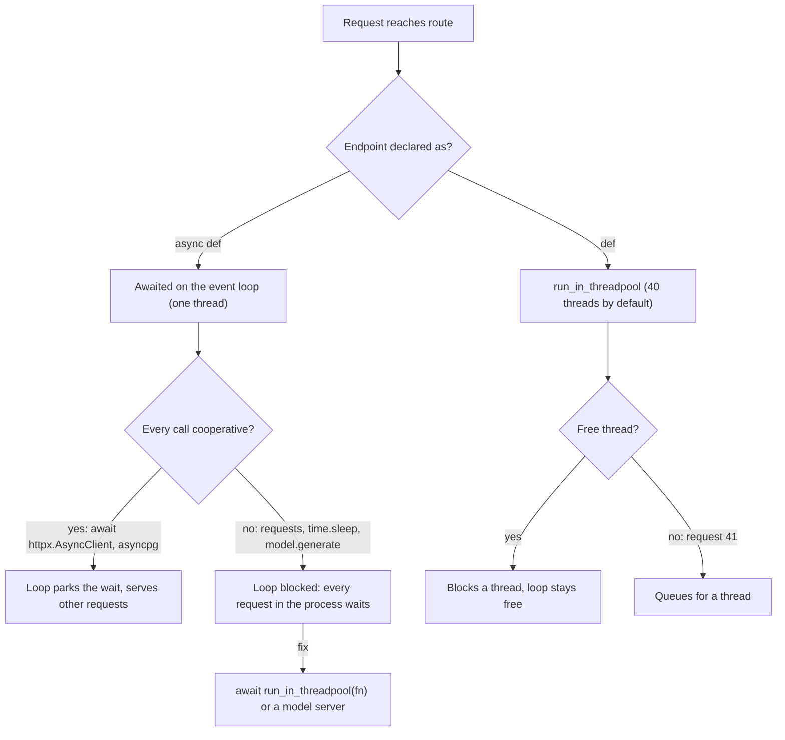

## TL;DR
An agent loop is mostly waiting on LLM and tool calls. FastAPI runs `async def` endpoints on one event
loop and `def` in a thread pool: awaiting lets one process hold hundreds of runs, one blocking tool
freezes them all.

## For agent builders
- **Why it matters for agents.** Each agent step is a 2-60 second LLM call plus tool calls (HTTP APIs,
  vector search, SQL). Awaited, hundreds of runs share one process; one sync tool or SDK call on the loop
  stalls every run, health check and stream in it.
- **Where it shows up in your stack.** `AsyncOpenAI` / `AsyncAnthropic` clients, async `ainvoke` /
  `astream` paths in LangChain and LangGraph, `httpx.AsyncClient` for tool APIs, `asyncio.gather` for
  parallel tool calls, and `anyio.to_thread.run_sync` for tools with no async form.
- **What you control.** Whether every tool is async or explicitly offloaded, how many tool calls run at
  once (a semaphore sized to quotas), timeouts per tool, and whether a run can be cancelled when the user
  leaves.
- **What you can skip.** Event-loop internals. Know the two execution paths, what blocks, and the
  Little's-law ceiling per process; that covers almost every agent latency cliff.

## Why it exists
- **AI endpoints mostly wait.** A hosted chat completion takes anywhere from two to sixty seconds; the
  Python work around it (validate, build messages, parse) takes about a millisecond.
- **Thread-per-request wastes that wait.** Serving 300 concurrent chats means 300 threads asleep nearly
  all the time, each holding a stack and competing for the GIL. Scaling to thousands of users means more
  processes, memory and money for idle CPU.
- **Cooperative concurrency makes waiting free.** A coroutine at `await client.post(...)` hands the loop
  back until the socket has data, so one thread keeps thousands of waits in flight. For AI workloads the
  gain is unusually large because the wait-to-work ratio is so extreme.
- **"`async def` everywhere" fails the other way.** The loop has exactly one thread. `requests.post`,
  `time.sleep`, `model.generate(...)` on a CPU or GPU, or a sync database driver holds it, so nothing else
  runs: not other requests, not health checks, not the load-balancer heartbeat.
- **The symptom is a cliff.** Fast at one request per second, collapsing at twenty with every latency
  equal to the slowest call. Knowing which code is cooperative is the real content of this topic.

## How it works
### Two execution paths
When a request reaches a route, FastAPI resolves dependencies and calls the endpoint:

| Declared as | Runs on | Rule |
|---|---|---|
| `async def` endpoint or dependency | awaited directly on the event loop | must only `await` cooperative libraries |
| `def` endpoint or dependency | `run_in_threadpool`, which uses AnyIO's `to_thread.run_sync` | the loop keeps running while the thread blocks |

- **The thread pool is bounded.** AnyIO's default thread limiter allows 40 concurrent threads per
  process, so the 41st blocking call queues; you can raise it, at the cost of memory and GIL contention.
- **Validation also costs CPU.** Request parsing and body validation run on the loop in both cases;
  response-model validation runs on the loop for `async def` and in the thread pool for `def`.
- **That is acceptable because it is bounded**, normally sub-millisecond for chat-sized payloads, unlike a
  forward pass. It grows with payload size, so megabyte documents or thousands of vectors are worth
  measuring.

### What counts as blocking
Blocking means the thread can do nothing else until the call returns.

| Usual offender | Cooperative equivalent |
|---|---|
| sync HTTP clients (`requests`, sync variants of provider SDKs) | `httpx.AsyncClient`, the `Async*` provider clients |
| `time.sleep` | `await asyncio.sleep` / `anyio.sleep` |
| synchronous database drivers | async drivers (asyncpg, aiomysql) |
| file I/O on large files | `aiofiles` |
| tokenising a very long document, local model inference (PyTorch, ONNX Runtime, llama.cpp bindings) | `anyio.to_thread.run_sync` for anything with no async form |

- **GPU calls block too.** A GPU call blocks the calling thread until the result is back, on CPU or GPU,
  unless the library offers an async API.

### Fan-out
- **Awaits yield, so calls overlap.** One request can run several provider calls with `asyncio.gather`
  or an AnyIO task group: embed three chunks at once, call two models and pick the better answer, run a
  guardrail classifier beside the main completion, or execute the parallel tool calls a model returned in
  one turn.
- **Latency becomes the maximum, not the sum.**
- **Async path only.** A `def` endpoint would need its own threads for the same overlap.

### Threads and the GIL
- **`def` endpoints parallelise waiting, not Python computation.** Two threads running pure-Python
  tokenisation share one interpreter lock.
- **They do help for C and CUDA code that releases the GIL**, which PyTorch and NumPy do for most heavy
  kernels, so a `def` endpoint running `model.generate()` lets the loop keep serving health checks.
- **The GPU is still one shared resource**; concurrency limits still apply.

### Capacity arithmetic
Little's law, `concurrency = throughput × latency`, with hosted LLM calls that take 10 s:

| Path | What bounds in-flight requests | Ceiling per process |
|---|---|---|
| `def` endpoint | thread limiter: at most 40 | 40 ÷ 10 s = 4 requests/s, however idle the CPU; request 41 waits for a thread |
| `async def` endpoint | HTTP client's connection pool (`httpx` defaults to 100 connections) | 100 ÷ 10 s = 10 requests/s per client; raise it cheaply, since a parked coroutine costs kilobytes, not a thread |
| blocking call on the loop | each request holds the *whole process* for its blocking time *b* | 1 ÷ *b*: 40 ms of sync work caps the worker at 25 requests/s |

The async path moves limits from threads to sockets and provider quotas, which are the limits you
actually want to be bound by.

### Cancellation and disconnects
- **Uvicorn does not cancel a handler when the client leaves**; it delivers a disconnect event.
- **On the async path you can act on it.** Race the provider call against `request.is_disconnected()` in
  a task group and cancel it, so you stop paying for tokens nobody will read.
- **Cancelling a coroutine** raises `CancelledError` at its current `await`, which closes the provider socket.
- **A thread blocked in a sync call cannot be cancelled from outside in Python**; it runs to completion.
  Another reason to keep remote model calls on the async path.

### Choosing per endpoint
- **Hosted LLM, embedding API, vector database, Redis, or Postgres over an async driver** → `async def`.
- **Local model or a sync-only library you cannot change** → `def`, or `async def` with
  `await run_in_threadpool(fn, ...)` around just the blocking part.
- **Heavy local inference in production** → neither; put the model behind a dedicated inference server
  and go back to the first case.

## Diagram
The decision path FastAPI and you take per endpoint: `async def` runs on the single loop thread, `def` is
dispatched to the bounded thread pool, and a blocking call on the loop is the one branch that stalls
the whole process.



## Examples
### Agent step: run the model's parallel tool calls concurrently
When the model returns several tool calls in one turn, run them together. Async tools are awaited, the
one sync tool is offloaded, a semaphore caps concurrency, and each call gets its own timeout so one slow
tool cannot hang the run. Failures go back to the model as tool results instead of crashing the step.

```python
import asyncio, anyio, httpx

TOOL_SLOTS = asyncio.Semaphore(8)                 # per-process cap, sized to tool and provider quotas

async def web_search(q: str, client: httpx.AsyncClient) -> str:
    r = await client.get("https://search.example.com", params={"q": q}, timeout=10)
    return r.text[:2000]

def read_local_file(path: str) -> str:           # sync library, no async form
    with open(path) as f:
        return f.read()[:2000]

async def run_tool(call: dict, client: httpx.AsyncClient) -> dict:
    async with TOOL_SLOTS:
        try:
            if call["name"] == "web_search":
                out = await asyncio.wait_for(web_search(call["args"]["q"], client), 15)
            elif call["name"] == "read_file":       # offload: never block the loop
                out = await asyncio.wait_for(       # timeout frees the step, not the thread
                    anyio.to_thread.run_sync(read_local_file, call["args"]["path"]), 15)
            else:
                out = f"unknown tool {call['name']}"
        except Exception as e:                    # timeout or tool error becomes an observation
            out = f"error: {type(e).__name__}: {e}"
    return {"tool_call_id": call["id"], "content": out}

async def execute_tool_calls(calls: list[dict], client: httpx.AsyncClient) -> list[dict]:
    # latency is the slowest tool, not the sum; order of results matches order of calls
    return await asyncio.gather(*(run_tool(c, client) for c in calls))
```

### Worked scenario: one agent turn with three tool calls
The model asks for three tools in one turn (illustrative latencies). A 40-run burst shares one process.

| Approach | Turn latency | What the other 39 runs see |
|---|---|---|
| Sequential awaits | 2 + 3 + 1.5 = 6.5 s | unaffected: all waits yield |
| `asyncio.gather` | max(2, 3, 1.5) = 3 s | unaffected |
| `gather`, but one tool uses `requests` (1.5 s) | 3 s | the loop freezes 1.5 s per call: every stream and health check stalls |
| `gather`, that tool via `anyio.to_thread.run_sync` | 3 s | unaffected; uses 1 of AnyIO's 40 threads |

### RAG endpoint: offload the reranker, fan out the calls
The commented-out version blocks the loop twice: a CPU reranker and a sync HTTP call. The live version
runs the reranker in the thread pool, borrows the shared async client created in lifespan, and fans out
the completion and a safety classifier so latency is the slower of the two, not their sum.

```python
import anyio, httpx
from fastapi import FastAPI, Request
from fastapi.concurrency import run_in_threadpool
from pydantic import BaseModel

app = FastAPI()

class Ask(BaseModel):
    question: str
    candidates: list[str]

def rerank_sync(question: str, docs: list[str]) -> list[str]:
    # stand-in for a CPU/GPU cross-encoder; blocks for the duration of the forward pass
    return sorted(docs, key=lambda d: -len(set(d.split()) & set(question.split())))

# BAD: both calls hold the event loop; every other request in the process waits.
# @app.post("/ask")
# async def ask_blocking(body: Ask):
#     ranked = rerank_sync(body.question, body.candidates)
#     r = httpx.post("https://api.example.com/v1/complete", json={"q": body.question, "ctx": ranked[:3]})
#     return r.json()

@app.post("/ask")
async def ask(body: Ask, request: Request):
    client: httpx.AsyncClient = request.app.state.http       # created once in lifespan, with base_url
    ranked = await run_in_threadpool(rerank_sync, body.question, body.candidates)
    results = {}
    async def call(name, path, payload):
        r = await client.post(path, json=payload, timeout=30)
        results[name] = r.json()
    async with anyio.create_task_group() as tg:               # fan out: completion + guardrail
        tg.start_soon(call, "answer", "/v1/complete", {"q": body.question, "ctx": ranked[:3]})
        tg.start_soon(call, "safety", "/v1/classify", {"text": body.question})
    if results["safety"].get("flagged"):
        return {"answer": None, "reason": "blocked"}
    return {"answer": results["answer"], "sources": ranked[:3]}
```

### Runnable: measure the stall with an event-loop lag probe
Pure asyncio, no server. Fifty "requests" each do 40 ms of blocking work, once on the loop and once
offloaded, while a probe records how late its 100 ms timer fires.

```python
import asyncio, time

async def lag_probe(samples, interval=0.1):
    while True:
        t0 = time.perf_counter()
        await asyncio.sleep(interval)
        samples.append((time.perf_counter() - t0 - interval) * 1000)

def embed_sync():                     # stand-in for 40 ms of CPU-bound embedding
    time.sleep(0.04)

async def handler(offload: bool):
    if offload:
        await asyncio.to_thread(embed_sync)   # loop stays free
    else:
        embed_sync()                          # holds the loop for 40 ms

async def run(offload: bool, n: int = 50):
    samples = []
    probe = asyncio.create_task(lag_probe(samples))
    t0 = time.perf_counter()
    await asyncio.gather(*(handler(offload) for _ in range(n)))
    elapsed = time.perf_counter() - t0
    await asyncio.sleep(0.15)                 # let the probe take one more sample
    probe.cancel()
    print(f"offload={offload}: {n} calls in {elapsed:.2f}s, worst loop lag {max(samples):.0f} ms")

asyncio.run(run(offload=False))   # ~2.2 s total, loop lag ~2,000 ms: everything serialised
asyncio.run(run(offload=True))    # ~0.2 s total, loop lag ~1 ms
```

- **Read the numbers as illustrative.** `time.sleep` releases the GIL, so offloading overlaps perfectly
  here; real pure-Python CPU work overlaps only if the library releases the GIL (NumPy, PyTorch kernels).
- **The lag number is the point.** On the blocking path, a health check would have waited two seconds.

## Production patterns
- **Async-only tools, enforced at registration.** Use for every agent tool registry: require tools to be
  `async def`, or wrap sync ones once with `anyio.to_thread.run_sync` when registering, with a timeout per
  tool. Monitor per-tool latency and timeout rate, and the loop-lag gauge after adding any new tool.
- **Export an event-loop lag gauge.** Use on every async worker: start a probe task like the one above in
  lifespan and publish its lateness as a metric. Alert when lag stays above a few milliseconds under load,
  because it means something is blocking the loop.
- **One shared async client with explicit limits.** Use for every provider and internal API: create
  `httpx.AsyncClient(limits=httpx.Limits(max_connections=...), timeout=...)` once in lifespan and store it
  on `app.state`. Monitor pool wait time and provider 429s, since the pool is now your concurrency cap.
- **Size the thread limiter deliberately.** Use when `def` endpoints or `run_in_threadpool` calls queue:
  in lifespan, set `anyio.to_thread.current_default_thread_limiter().total_tokens` to a measured value.
  Monitor memory and throughput together; more threads only help code that releases the GIL.
- **Bound fan-out per request and per process.** Use when one request triggers several provider calls:
  wrap them in an `anyio.CapacityLimiter` or `asyncio.Semaphore` sized to your provider quota. Monitor
  in-flight provider calls and 429 rates.
- **Catch blocking calls before production.** Use in CI and staging: enable ruff's flake8-async (`ASYNC`)
  rules to flag blocking calls in `async def`, and run staging with `PYTHONASYNCIODEBUG=1` so asyncio logs
  callbacks slower than `loop.slow_callback_duration` (default 0.1 s).

## Trade-offs
- **Huge I/O concurrency vs fragility.** `async def` gives huge concurrency per process for I/O-bound
  work, but one accidental blocking call degrades every request; the win flips to a loss exactly when a
  sync library sneaks in.
- **`def` safety vs a low ceiling.** `def` endpoints are safe by default and tolerate sync libraries, but
  each in-flight request occupies a thread from a bounded pool (40 by default), so throughput caps far
  lower under long calls.
- **Fan-out latency vs provider load.** `gather` or task groups cut latency to the slowest call, but
  multiply provider concurrency and cost, and need per-request concurrency limits once traffic grows.
- **Thread-pool inference vs control.** Blocking inference in the thread pool keeps the loop alive, yet
  threads cannot be cancelled on disconnect and still contend for the GIL on the pure-Python parts.

## Pitfalls
- **A sync provider SDK inside `async def`.** `OpenAI()` rather than `AsyncOpenAI()`, or `requests`.
  Symptom: p50 latency fine in isolation, every latency equal to the slowest call under modest load,
  health checks timing out.
- **`time.sleep` for retry back-off inside a coroutine.** Symptom: a single rate-limited request pauses
  the whole process for the back-off period. Fix: `await asyncio.sleep`.
- **Blocking work in `async def` dependencies.** Sync DB session creation, sync JWKS fetch. Symptom: the
  same stall, but harder to find because it is outside the endpoint body.
- **A GPU model directly in `async def` to "keep it async".** Symptom: throughput equals one request at a
  time with no overlap of network waits, and the loop-lag metric spikes to the model's latency.
- **Raising the thread limiter to hundreds to fix slow `def` endpoints.** Symptom: memory growth and GIL
  thrash with no throughput gain for Python-bound code.

## When to use
- **Use `asyncio.gather` for parallel tool calls** when the model emits several independent calls in one
  turn; keep sequential execution when one tool's output feeds the next or a tool has side effects that
  must be ordered.
- **Default to `async def`** for any endpoint whose time goes to remote calls, which is most AI gateway,
  RAG and agent endpoints, and make sure every library on that path is actually async.
- **Use `def` or `run_in_threadpool`** for unavoidable blocking work, and bound how much can run at once.
- **Measure:** event-loop lag (schedule a no-op every second and record how late it runs) and thread-pool
  queue depth; lag above a few milliseconds under load means something is blocking.
- **Code review:** `import requests` in an async service is a bug until proven otherwise.
- **Interviews:** expect "what happens if you call a sync function in an async endpoint?" and "when would
  you use `def` instead?"; the answers are the stall and the thread pool.

## Role lens
- **Engineer:** Picks the async client of every SDK, wraps leftover sync calls in `run_in_threadpool`,
  and adds an event-loop-lag gauge to catch regressions before users do.
- **Architect:** Decides that local inference lives behind a model server rather than inside the API
  process, so API workers stay purely I/O-bound and cheap to scale.
- **FDE:** Finds the one synchronous call a customer's team added to an async endpoint when they report
  "it falls over at thirty users".

## Check yourself
**Q:** A RAG endpoint is `async def`: it embeds the query with a local sentence-transformer (about
40 ms on CPU), queries a vector database over an async client, then calls a hosted LLM asynchronously.
Under load, throughput plateaus at roughly 25 requests per second even though the LLM provider is
nowhere near its limits. Explain and fix.
**A:** The embedding call is synchronous CPU work executed on the event loop. At 40 ms per call the
loop can do at most about 25 such calls per second, and while each one runs no other coroutine
progresses, so the asynchronous vector-database and LLM calls never overlap as they should. Moving the
embedding to `await run_in_threadpool(embed, query)` frees the loop, so the vector-database and LLM
waits overlap again; NumPy and PyTorch release the GIL during the heavy kernels. It does not make the
CPU faster: if one 40 ms embedding already uses every core through PyTorch's intra-op threads,
embedding throughput stays near the same ceiling, now without stalling everything else. Beyond that,
batch embeddings across concurrent requests or move the embedder to a separate service, so the API
process is purely I/O-bound and its throughput is set by provider latency and connection limits rather
than by CPU time spent on the loop.

## Interview questions
### How does FastAPI decide where an endpoint runs, and why does that matter for LLM calls?
- **By its declaration.** `async def` endpoints and dependencies are awaited directly on the event loop;
  `def` ones go through `run_in_threadpool`, which uses AnyIO's `to_thread.run_sync`.
- **It matters because LLM calls mostly wait.** A 2-60 second completion around a millisecond of Python
  work is ideal for `await`: one thread keeps thousands of waits in flight instead of one sleeping thread
  per request.

### Your agent service passes every test, but at about twenty concurrent runs health checks time out. How do you debug it?
- **Suspect a blocking call on the loop.** The signature is a cliff: fine at one request per second,
  then every latency equals the slowest call. In agents the culprit is often a newly added tool.
- **Measure event-loop lag** with a no-op task scheduled every second; lag in the hundreds of
  milliseconds confirms it.
- **Find the call:** a sync provider SDK (`OpenAI()` rather than `AsyncOpenAI()`), `requests`,
  `time.sleep` in a retry, or a sync driver in an `async def` dependency. Swap in the async client or wrap
  it with `run_in_threadpool`.

### Your agent framework lets a model request five tools in one turn. How do you execute them in a FastAPI service?
- **Concurrently, on the loop.** `asyncio.gather` (or a task group) over async tool wrappers, so turn
  latency is the slowest tool, not the sum of all five.
- **Never block.** Sync tools go through `anyio.to_thread.run_sync` or `run_in_threadpool`; a single
  `requests` call inside the gather freezes every other run in the process.
- **Bound and isolate.** A semaphore sized to tool quotas, a timeout per tool, and errors returned to the
  model as tool results, so one failing tool does not crash the run.

### When would you deliberately write a `def` endpoint instead of `async def`?
- **When the work is blocking and has no async form**, such as a local model or a sync-only library you
  cannot change; the thread pool keeps the loop free, and PyTorch and NumPy release the GIL in heavy
  kernels.
- **Cost:** the pool is bounded (40 threads by default), so long calls cap throughput, and a thread
  blocked in a sync call cannot be cancelled when the client disconnects.
- **For heavy production inference neither fits**: put the model behind a dedicated inference server and
  call it with `async def`.

### Hosted LLM calls take 10 seconds. What throughput ceiling does one process have on each path?
- **`def` endpoint:** at most 40 in flight, so 40 ÷ 10 s = 4 requests/s however idle the CPU.
- **`async def` endpoint:** bounded by the client's connection pool; `httpx` defaults to 100 connections,
  so 100 ÷ 10 s = 10 requests/s per client, cheap to raise because a parked coroutine costs kilobytes.
- **A blocking call of *b* seconds on the loop** caps the worker at 1 ÷ *b*, whatever the provider
  latency: 20 ms of sync work per request means at most 50 requests/s, with every other request stalled
  while it runs.

### What does fanning out calls with `asyncio.gather` buy you, and what does it cost?
- **Gain:** latency becomes the maximum of the calls instead of their sum, for example a completion and a
  guardrail classifier running side by side.
- **Cost:** provider concurrency and spend multiply per request, so you need a per-process limit such as
  an `asyncio.Semaphore` or `anyio.CapacityLimiter` sized to the provider quota.
- **Limit:** it overlaps waits only; CPU-bound work on one loop thread still runs one piece at a time.

## Quiz
### Q: What happens when an `async def` endpoint calls a synchronous HTTP client that takes 5 seconds?
- [ ] FastAPI detects the blocking call and moves it to a thread
- [x] The event loop is blocked for 5 seconds, so every other request in the process waits
- [ ] Only that request is delayed; others proceed on other loop threads
- [ ] The call is cancelled after the default timeout
> The loop runs on one thread and cannot switch coroutines while a non-awaiting call holds it;
> concurrency on the async path depends entirely on code yielding with `await`.

### Q: Why can a plain `def` endpoint running `model.generate()` keep the server responsive while an `async def` one cannot?
- [ ] `def` endpoints are compiled to C and release the GIL
- [ ] `def` endpoints run in a separate process
- [x] `def` endpoints run in a thread pool, so the loop thread stays free to serve other requests
- [ ] `async def` endpoints are limited to one request at a time
> FastAPI dispatches sync endpoints through `run_in_threadpool`; the loop continues scheduling other
> coroutines while the worker thread blocks, bounded by the thread limiter's capacity.

### Q: When does fanning out two provider calls with `asyncio.gather` reduce latency?
- [ ] Always, because gather parallelises CPU work across cores
- [x] When both calls spend their time awaiting I/O, so their waits overlap on one loop
- [ ] Only when the endpoint is declared with `def`
- [ ] Never; gather only orders the results
> Overlap comes from both coroutines yielding while sockets are idle; CPU-bound work does not overlap on
> a single loop thread, and the gain is capped by the slower of the two calls.

## Use cases & projects
### Use cases
- **Serving many concurrent agent runs per process.** Awaited LLM and tool calls let one worker hold
  hundreds of runs that are mostly waiting on the network.
- **Parallel tool calls in one step.** When the model asks for several independent tools, `asyncio.gather`
  overlaps their waits so the step takes about as long as the slowest tool.
- **Wrapping sync-only tools safely.** A legacy SDK or CPU-heavy parser goes through
  `anyio.to_thread.run_sync` so it cannot freeze every other run on the loop.
- **Respecting provider quotas.** A semaphore sized to the rate limit caps in-flight LLM calls across all
  runs in the process.

### Mini project
**Find and fix a loop-blocking tool (1-2 hours).**
- **Goal:** show how one blocking tool stalls every agent run, then fix it.
- **Steps:** build an `async def /agent/run` route whose fake agent calls two tools, one awaiting
  `asyncio.sleep(1)` and one calling `time.sleep(1)`; fire 50 concurrent requests with an async load
  script and record total time and `/health` latency; move the blocking tool to a thread with
  `anyio.to_thread.run_sync`, then run its two tools with `asyncio.gather`.
- **Done when:** you have a before-and-after table of total time and health-check latency, and can
  explain each change in one sentence.
