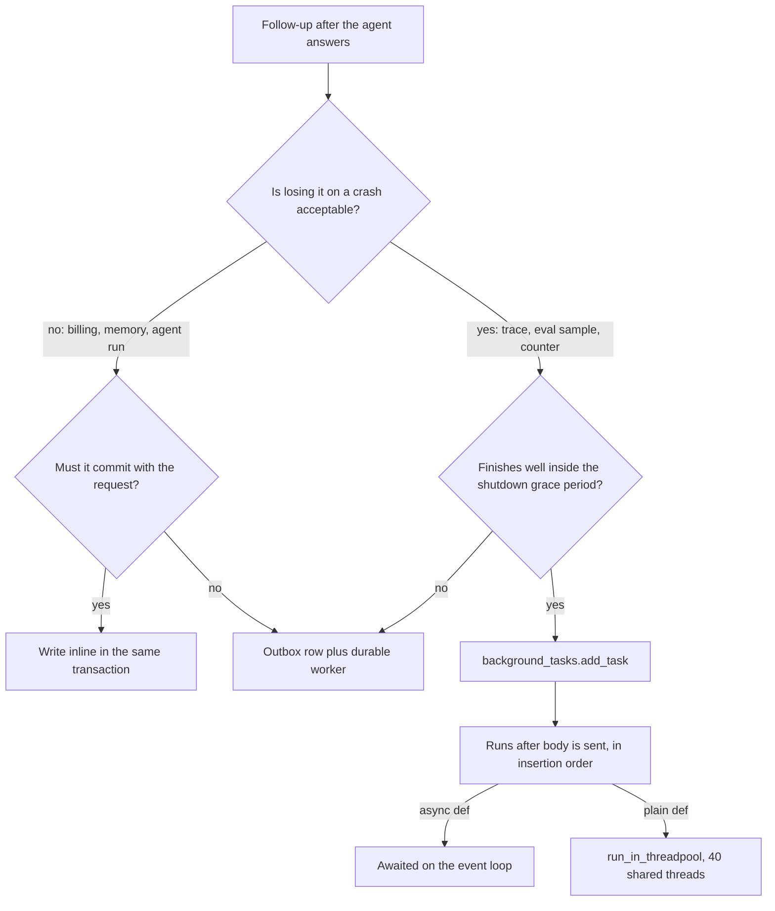

## TL;DR
`BackgroundTasks` runs functions after your agent's response is sent, in the same process, with no
persistence, retry or status. Use it for cheap, loss-tolerant follow-ups (traces, eval samples,
counters); agent runs, memory extraction and anything that must happen need a durable queue.

## For agent builders
- **Why it matters for agents.** Every agent turn leaves follow-up work: write the trace with its tool
  calls, bump token usage, sample the run for evals, maybe extract long-term memory. Doing it inline adds
  latency to every turn; doing it in `BackgroundTasks` is free until the process dies.
- **Where it shows up in your stack.** A `BackgroundTasks` parameter on your FastAPI agent route, and the
  tempting misuse: "run the agent in the background and return a run id", which loses runs on every deploy.
- **What you control.** Which follow-ups are loss-tolerant, giving each task its own DB session and
  exception handling, and keeping task duration well inside the shutdown grace period.
- **What you can skip.** Starlette internals beyond "runs after the body, sequentially, in this process".
  Remember the decision test: if losing it on a crash is not acceptable, use a queue.

## Lab
### Task
Move an agent endpoint's trace write off the response path without letting it hurt users. Today the
write runs inline, so a trace-DB outage returns a 500. Time box: 30-45 minutes. Prerequisites:
Dependency injection and Async endpoints.
- **After the response:** schedule `record_trace` with `BackgroundTasks` so the answer goes out first.
- **Own session:** the task opens and closes its own `Session`, never the request's.
- **Guarded:** a failed write is logged as `trace write failed`, never raised.
- **Idempotent:** an upsert on run id, so a rerun never duplicates the trace.

### Starter code
Save as `lab_bg.py`. Needs `pip install fastapi httpx pytest` (checked with FastAPI 0.161.1, Starlette
1.9.0, httpx 0.28.1, pytest 9.1.1, Python 3.12). The fake `Session` stands in for an async DB session.

```python
import asyncio, logging, uuid
from fastapi import BackgroundTasks, Depends, FastAPI
from fastapi.testclient import TestClient
from pydantic import BaseModel

log = logging.getLogger("trace")
app = FastAPI()
EVENTS: list[str] = []                               # ordering log that the tests read
ROWS: list[dict] = []                                # the fake trace table
DB = {"down": False}                                 # flip to simulate a trace-DB outage

class Session:
    """Fake async DB session: add() inserts, merge() upserts on run_id."""
    def __init__(self):
        self.closed = False
    async def _write(self):
        if self.closed:
            raise RuntimeError("session is closed")
        if DB["down"]:
            raise ConnectionError("trace DB down")
        await asyncio.sleep(0.01)
    async def add(self, row: dict) -> None:
        await self._write(); ROWS.append(row); EVENTS.append("trace_written")
    async def merge(self, row: dict) -> None:
        await self._write()
        ROWS[:] = [r for r in ROWS if r["run_id"] != row["run_id"]] + [row]
        EVENTS.append("trace_written")
    async def close(self) -> None:
        self.closed = True

async def get_session():                             # request-scoped yield dependency
    s = Session()
    try:
        yield s
    finally:
        await s.close()

class Ask(BaseModel):
    prompt: str

async def run_agent(prompt: str) -> tuple[str, list[dict]]:   # fake agent: answer + tool calls
    return f"echo: {prompt}", [{"tool": "search", "ms": 120}]

async def record_trace(run_id: str, prompt: str, answer: str, steps: list[dict]) -> None:
    # YOUR CODE 1: open your OWN Session (never the request's), upsert the row with merge(),
    #              close the session, and log failures with log.exception("trace write failed")
    #              instead of raising: the client already has its answer.
    raise NotImplementedError

@app.post("/agent/run")
async def answer(body: Ask, session: Session = Depends(get_session)):
    run_id = str(uuid.uuid4())
    text, steps = await run_agent(body.prompt)
    # BUG: the trace write runs BEFORE the response, on the request's session, as a plain insert,
    #      so a trace-DB outage becomes a 500 for the user.
    await session.add({"run_id": run_id, "prompt": body.prompt, "answer": text, "steps": steps})
    # YOUR CODE 2: take a BackgroundTasks parameter and schedule record_trace instead.
    return {"run_id": run_id, "answer": text}

if __name__ == "__main__":
    client = TestClient(app, raise_server_exceptions=False)
    r = client.post("/agent/run", json={"prompt": "hi"})
    print(r.status_code, r.json()["answer"], "| traces:", len(ROWS))
    DB["down"] = True
    r = client.post("/agent/run", json={"prompt": "hi again"})
    print(r.status_code, "| traces:", len(ROWS))
```

The starter prints `200 echo: hi | traces: 1` and then `500 | traces: 1`: the outage reaches the user.

### Expected output
With a correct solution, `python lab_bg.py` prints (the outage is logged to stderr, not shown):

```
200 echo: hi | traces: 1
200 | traces: 1
```

### Tests
Save as `test_lab_bg.py` and run `pytest -q`. On the starter all three fail: the trace is written before
the response, the outage returns 500, and `record_trace` raises `NotImplementedError`.

```python
import asyncio, logging
import pytest
from fastapi.testclient import TestClient
from lab_bg import DB, EVENTS, ROWS, app, record_trace

def mark_response_sent(inner):
    """ASGI wrapper: logs the moment the last body chunk has been handed to the server."""
    async def asgi(scope, receive, send):
        async def send_and_mark(msg):
            await send(msg)
            if msg["type"] == "http.response.body" and not msg.get("more_body", False):
                EVENTS.append("response_sent")
        await inner(scope, receive, send_and_mark)
    return asgi

client = TestClient(mark_response_sent(app), raise_server_exceptions=False)

@pytest.fixture(autouse=True)
def reset():
    EVENTS.clear(); ROWS.clear(); DB["down"] = False

def test_trace_is_written_after_the_response():
    r = client.post("/agent/run", json={"prompt": "hi"})
    assert r.status_code == 200
    assert EVENTS == ["response_sent", "trace_written"]
    assert ROWS[0]["run_id"] == r.json()["run_id"]

def test_trace_db_outage_does_not_fail_the_user(caplog):
    DB["down"] = True
    with caplog.at_level(logging.ERROR, logger="trace"):
        r = client.post("/agent/run", json={"prompt": "hi"})
    assert r.status_code == 200 and r.json()["answer"] == "echo: hi"
    assert "trace write failed" in caplog.text

def test_record_trace_is_idempotent_on_run_id():
    for _ in range(2):                                   # a retry or a future queue redelivery
        asyncio.run(record_trace("run-1", "hi", "echo: hi", []))
    assert [r["run_id"] for r in ROWS] == ["run-1"]
```

### Failure scenarios
- **Schedule `session.merge` from the request's session instead of `record_trace`.** On FastAPI 0.161.1
  the first test still passes, because the yield dependency is still open during background tasks, but
  the outage test fails with an empty log. Debug: the exception escapes after the response, so only the
  server log shows it; that is why each task guards itself.
- **Keep `add()` in the task.** The idempotency test sees `run-1` twice. Debug: count rows per run id.
- **Write `def record_trace` with a blocking call.** It runs in the shared 40-thread pool. Debug: under
  load, watch latency on unrelated sync routes rise with trace volume.
- **Put a 40-second model call (memory extraction) in the task.** It passes here, but dies on every deploy
  past the 30 s grace period. Debug: compare trace coverage before and after a rollout.

### Submission
- **Code:** `lab_bg.py` with both YOUR CODE steps done and the fake `Session` unchanged.
- **Test run:** `pytest -q` showing 3 passed.
- **Trace:** the output of `python lab_bg.py`, matching the expected output.
- **Note (3-5 sentences):** which of your own agent's follow-ups could move to this pattern, and which
  belong on a durable queue, using the loss-on-crash test.
- **Evaluated on:** passing tests, no request-scoped resource handed to the task, and a logged failure.

## Why it exists
- **Every LLM request drags follow-up work.** Persist prompt, response and token usage for observability
  and billing, update a rate-limit counter, save an evaluation sample, emit an analytics event, notify a
  webhook.
- **Inline costs latency and couples failures.** A database write plus a webhook round trip can be a few
  hundred milliseconds (illustrative), and a slow analytics endpoint should never turn a good answer
  into a 500.
- **Bare `asyncio.create_task(...)` is a trap.** The event loop keeps only weak references to tasks, so
  an unreferenced task can be garbage collected mid-flight, and its exception surfaces only as a "Task
  exception was never retrieved" log line when collected, if at all; the asyncio documentation warns
  about exactly this. A thread per request has no limit and loses exceptions the same way.
- **A full job queue is heavy for small work.** Celery or ARQ is correct for durable work, but it is a
  broker, a worker fleet and a serialisation boundary: a lot of machinery for a fifty-millisecond insert.
- **`BackgroundTasks` is the deliberately small middle.** Starlette keeps the task list on the response
  and awaits it right after the body is flushed, so ordering is guaranteed, sync functions go to the
  thread pool, async ones are awaited, and nothing new is deployed. The flip side: the work lives only
  in this process's memory, so a crash, deploy or out-of-memory kill erases it silently.

## How it works
### Declaring tasks
- **Inject it.** Add a parameter typed `BackgroundTasks` to a path operation or any dependency; FastAPI
  injects one instance per request.
- **One ordered list.** Every `add_task(func, *args, **kwargs)` call, from the route or any dependency, is
  merged into a single ordered list.
- **Lower-level form.** `Response(..., background=BackgroundTask(fn))` is the Starlette form for custom
  responses, including `StreamingResponse`.

### When they run
1. Starlette's `Response.__call__` sends `http.response.start`.
2. It sends the body; the client now has its response.
3. If a background object is attached, it calls `await self.background()`.
4. `BackgroundTasks.__call__` runs tasks sequentially in insertion order: an `async def` is awaited on
   the event loop, a plain `def` runs via `run_in_threadpool`.

Nothing runs in parallel, so one slow task delays the rest.

### What the server sees
The ASGI call for the request has not returned while tasks run, so:
- **Graceful shutdown waits for them**: indefinitely by default, or up to `--timeout-graceful-shutdown`
  if set.
- **In-flight counters count them**, and the handler's resources stay allocated.
- **The work dies with the process.** An orchestrator that sends SIGKILL after its grace period takes
  every pending task with it, and nothing recorded that they existed.
- **Budget accordingly.** Kubernetes allows 30 seconds by default between SIGTERM and SIGKILL, so a task
  must finish well inside the grace period or be acceptable to lose. A task that calls a model for 40
  seconds fails that test on every deploy.

### Exceptions
- **They escape after the response is gone.** The server logs it (uvicorn prints an "Exception in ASGI
  application" traceback), the client never learns of it, and there is no retry.
- **Guard each task.** Wrap the body in `try/except` with real logging and a metric.
- **Make tasks idempotent**, so running twice is harmless, because the day you move them to a queue they will.

### Interaction with yield dependencies
- **Teardown timing has moved.** Whether a yield dependency's exit code runs before or after background
  tasks has changed across FastAPI versions: 0.106 changed the default so sessions are not held while
  the response travels the network; later versions added a scope option to choose.
- **Version-proof rule:** never hand a request-scoped resource to a background task. Create the session,
  client or file handle inside the task.

### Capacity
| Task type | Shares | Risk |
|---|---|---|
| Sync `def` | the default thread pool (anyio's limiter, 40 threads) with sync endpoints and dependencies | a burst of "cheap" sync tasks starves ordinary sync routes |
| `async def` | the event loop | a CPU-heavy task (local embeddings, hashing a large upload) blocks every request for its duration |

Treat a task as part of the request's cost, paid after the response. Back-of-envelope:

```
background work in flight ≈ request rate × task duration
200 req/s × 250 ms trace write ≈ 50 tasks running at any moment per process
```

That is on top of the requests themselves; if those tasks are sync, that alone exceeds the 40-thread pool.

### Agent follow-ups: which fit
| Follow-up after an agent turn | Fits `BackgroundTasks`? | Why |
|---|---|---|
| Trace with steps, tool calls and token usage | yes | short, and a missing trace is tolerable |
| Eval sample (copy a fraction of runs to an eval table) | yes | short; sampling already tolerates gaps |
| Long-term memory extraction (another model call) | usually no | seconds long and the user expects the memory to exist next session |
| The agent run itself | no | minutes long, must survive deploys, needs status |

- **Memory writes are the grey zone.** A cheap insert of the raw turn fits; an LLM call that summarises
  the turn into memories belongs on a queue, because it is long and losing it changes future behaviour.

## Diagram
The decision path for a follow-up: only short, loss-tolerant work reaches `BackgroundTasks`, and there
the function type decides whether it runs on the loop or in the thread pool.



## Examples
### Agent endpoint that records its trace after answering
The task opens its own session, guards its own exceptions, and would be harmless if run twice (the run
id is the primary key). A random 5% of runs are also copied to the eval sample table.

```python
import logging, random, time, uuid
from fastapi import BackgroundTasks, FastAPI
from pydantic import BaseModel

app, log = FastAPI(), logging.getLogger("trace")

class Ask(BaseModel):
    prompt: str

async def run_agent(prompt: str) -> tuple[str, list[dict], int]:
    # stand-in: (answer, tool calls made, output_tokens)
    return f"echo: {prompt}", [{"tool": "search", "ms": 120}], 7

async def record_trace(run_id: str, user_id: str, prompt: str, answer: str,
                       steps: list[dict], tokens: int, ms: float, sample: bool):
    try:
        async with session_factory() as session:     # its OWN session; never the request's
            await session.merge(Trace(id=run_id, user_id=user_id, prompt=prompt, answer=answer,
                                      tool_calls=steps, output_tokens=tokens, latency_ms=ms))
            if sample:
                await session.merge(EvalSample(run_id=run_id, prompt=prompt, answer=answer))
            await session.commit()                   # merge on run_id: a rerun overwrites, never duplicates
    except Exception:
        log.exception("trace write failed")          # client already has its answer: log, don't raise

@app.post("/agent/run")
async def answer(body: Ask, bg: BackgroundTasks):
    t0, run_id = time.perf_counter(), str(uuid.uuid4())
    text, steps, tokens = await run_agent(body.prompt)
    ms = (time.perf_counter() - t0) * 1000
    bg.add_task(record_trace, run_id, "user-123", body.prompt, text, steps, tokens, ms,
                random.random() < 0.05)              # runs after the body is sent
    return {"run_id": run_id, "answer": text}

# session_factory, Trace and EvalSample come from your SQLAlchemy setup (see the async database lesson).
```

### If you must use `create_task`: keep a strong reference
When work should outlive the request but not block its response cleanup (for example, launched from a
WebSocket handler), the asyncio-docs pattern is a module-level set plus a done callback. Runnable as is.

```python
import asyncio, logging

_tasks: set[asyncio.Task] = set()

def _done(task: asyncio.Task) -> None:
    _tasks.discard(task)                              # drop the reference once finished
    if not task.cancelled() and task.exception():
        logging.error("background task failed", exc_info=task.exception())

def spawn(coro) -> asyncio.Task:
    task = asyncio.create_task(coro)
    _tasks.add(task)                                  # strong reference: cannot be GC'd mid-flight
    task.add_done_callback(_done)                     # exception is retrieved and logged, not lost
    return task

async def write_trace(n: int) -> None:
    await asyncio.sleep(0.1)
    if n == 2:
        raise RuntimeError("db down")

async def main() -> None:
    for n in range(3):
        spawn(write_trace(n))
    print("in flight:", len(_tasks))                  # 3
    await asyncio.gather(*_tasks, return_exceptions=True)   # what a lifespan shutdown should do
    print("in flight:", len(_tasks))                  # 0

asyncio.run(main())
```

Still not durable: a SIGKILL loses these exactly as it loses `BackgroundTasks`.

### Worked scenario: which agent follow-ups survive a deploy?
Illustrative: 30 s Kubernetes grace period, uvicorn draining in-flight requests on SIGTERM.

| Follow-up | Duration | Loss acceptable? | Verdict |
|---|---|---|---|
| Trace write | ~250 ms | yes, a missing trace is tolerable | `BackgroundTasks` |
| Eval sample copy | a few ms more in the same task | yes, it is a sample | `BackgroundTasks` |
| Usage counter bump | ~5 ms | yes, if reconciled from traces | `BackgroundTasks` |
| Memory extraction model call | seconds | no, next session depends on it | durable job queue |
| Webhook to customer | ~300 ms, can hang | no, customer expects it | outbox row + worker |
| Summarisation model call | ~40 s | no, user waits for it | durable job queue |
| Billing ledger entry | ~5 ms | never | same transaction as the request |

## Production patterns
- **Trace and sample agent runs after the response.** Agent teams write the run trace (steps, tool calls,
  tokens, latency) keyed by run id in a background task, and copy a small random fraction to an eval
  table for offline grading. Monitor trace coverage: runs answered versus traces stored, which exposes
  silent task failures.
- **Own resources inside the task.** For any task touching a database or HTTP client, open it inside the
  task (`async with session_factory() as session`) or use an app-scoped client from lifespan, never a
  `yield` dependency's object. Monitor "session is closed" and pool-checkout errors after upgrades.
- **Guard, log and count every task.** Wrap each body in `try/except`, call `log.exception(...)` and
  increment a failure counter labelled by task name, because the server log is otherwise the only trace.
  Alert on failure rate per task name.
- **Fit the shutdown budget.** Set uvicorn `--timeout-graceful-shutdown` below Kubernetes
  `terminationGracePeriodSeconds` (30 by default), and keep every task's p99 well under it. Monitor task
  duration p99 and log lines for tasks cut off at shutdown.
- **Promote to an outbox when loss costs money.** When a follow-up becomes billing, audit or a customer
  webhook, insert an outbox row in the request's transaction and let a worker deliver it with an
  idempotency key. Monitor outbox lag and oldest undelivered row.
- **Keep sync tasks off the shared pool.** Prefer async clients in tasks; if sync work is unavoidable,
  size the pool deliberately (`anyio.to_thread.current_default_thread_limiter().total_tokens = N` in
  lifespan) instead of discovering the 40-thread limit under load. Monitor thread-pool saturation.

## Trade-offs
- **Zero infrastructure vs zero durability.** Execution is in-process with nothing to deploy, but the
  moment losing the work has a cost (billing ledgers, audit records) the trade flips to a queue with
  persisted jobs.
- **Hidden latency vs a still-busy worker.** The user does not wait, but under load background work
  competes with new requests for the loop and thread pool; once tasks take seconds, that competition is
  visible in p99 latency.
- **Simple ordering vs no overlap.** Sequential execution per request is easy to reason about, but a slow
  webhook delays the trace write queued behind it.
- **Isolated exceptions vs hidden failures.** The user experience is protected, but the same isolation
  hides failures unless you add logging and metrics yourself.

## Pitfalls
- **Extracting long-term memory with a model call in a background task.** Symptom: the agent sometimes
  "forgets" what a user told it, always around deploys or crashes. Fix: enqueue memory extraction as a
  durable job keyed by run id.
- **Running the LLM job itself in the background and returning a job id.** Symptom: jobs vanish after
  every deploy and the status endpoint has nothing to read, because nothing persisted the job.
- **Passing the request's yield-dependency session into a task.** Symptom: "session is closed" or
  "connection already returned to pool" errors, often appearing only after a FastAPI upgrade.
- **A CPU-heavy sync task.** Symptom: latency on unrelated sync endpoints rises with traffic as the
  40-thread pool fills up.
- **A blocking call (sync HTTP client, sync SDK) inside an async task.** Symptom: the whole worker
  freezes for each task, visible as periodic stalls in every route.
- **Assuming the client would have noticed a failure.** Symptom: silent data loss in traces or counters,
  discovered weeks later during an audit.
- **Reaching for bare `asyncio.create_task` instead.** Symptom: tasks occasionally vanish mid-flight with
  no error, because nothing held a strong reference to them.

## When to use
- **Use when** follow-ups are short, idempotent and loss-tolerant: agent trace and metric writes, eval
  sampling, cache warming, non-critical notifications, cleanup of temporary files.
- **Avoid when** it is the LLM call or agent run itself, memory extraction, anything a customer will
  later ask about, retries, or work longer than a few seconds.
- **Decision test:** "if this process dies now, is losing this acceptable?"
- **Measure** task duration, failure rate from your own logging, and thread-pool saturation.
- **Interviews:** articulate after-response versus durable: when it runs, where it runs, and what happens
  on a crash.

## Role lens
- **Engineer:** Queues trace writes and counters after the response, gives each task its own
  resources and exception handling, and knows the thread-pool and event-loop cost of each.
- **Architect:** Draws the line between loss-tolerant follow-ups and durable jobs, and mandates a
  queue for anything with financial or audit consequences.
- **FDE:** Spots a customer's "we run the summarisation in a BackgroundTask" design and explains why
  their jobs disappear on deploys before it becomes a support escalation.

## Check yourself
**Q:** A team writes the per-request billing ledger entry in a `BackgroundTasks` function to keep
latency low. What is wrong with that, and what would you do instead?
**A:** A ledger entry is money, and `BackgroundTasks` offers no durability: a crash, SIGKILL after the
shutdown grace period or an unhandled exception loses the entry silently, and the client has already
received a success. Either write the entry synchronously in the same transaction as the request's own
state, which costs a few milliseconds and is the simplest correct option, or record the intent
durably before responding and process it asynchronously: insert an outbox row in that transaction and
let a worker or queue consumer post it, with idempotency keyed by request id so retries never
double-charge. Keep `BackgroundTasks` for the non-financial trace and metrics writes.

## Interview questions
### What is FastAPI's BackgroundTasks, and why use it instead of asyncio.create_task?
- **An ordered list of callables run after the response body is sent,** in the same process: `async def`
  functions are awaited, plain `def` functions go to the thread pool.
- **It is safer than a bare task,** because the event loop keeps only weak references to tasks, so an
  unreferenced `create_task` can be garbage collected mid-flight and its exception may never surface.

### A team runs a 40-second summarisation in a BackgroundTask and returns a job id. Jobs vanish after deploys. Why?
- **Nothing persisted the job.** The work lives only in process memory, so a deploy, crash or OOM kill
  erases it and the status endpoint has nothing to read.
- **It also loses the shutdown race.** Kubernetes allows 30 seconds between SIGTERM and SIGKILL by
  default, so a 40-second task is cut off on every deploy.
- **Fix:** persist a job row and enqueue it to a durable queue such as Celery or ARQ, with a status
  endpoint reading the row.

### Latency on unrelated sync endpoints climbs with traffic after adding background trace writes. Diagnose it.
- **Sync tasks share the thread pool** (anyio's limiter, 40 threads) with sync endpoints and dependencies.
- **Do the arithmetic:** 200 req/s × 250 ms is about 50 tasks in flight per process, which alone exceeds
  40 threads, so routes queue for a thread.
- **Fix:** make the writes async with an async client, or size the limiter deliberately in lifespan, and
  watch thread-pool saturation.

### When is BackgroundTasks the wrong choice even for small work?
- **When it is CPU-bound.** An `async def` task computing local embeddings or hashing a large upload
  blocks the event loop for every request on the worker; push it to a process pool or a job queue.
- **When an external call can hang.** Tasks run sequentially, so a hanging webhook delays every task
  queued behind it and keeps the request open through graceful shutdown; give it a timeout or move it to
  an outbox row.
- **When the task needs the request's database session.** Yield-dependency teardown timing has changed
  across FastAPI versions (0.106 changed the default), so create resources inside the task instead.

### After each agent turn you want a trace, an eval sample and new long-term memories. Where does each run?
- **Trace and eval sample: `BackgroundTasks`.** Both are short inserts keyed by run id, and a rare loss
  only dents observability, so after-response in-process work is right.
- **Memory extraction: a durable queue.** It is another model call lasting seconds, and losing it changes
  what the agent knows next session, so enqueue a job with the run id as idempotency key.
- **Measure** trace coverage against answered runs to catch silent background failures.

### Your agent's trace coverage dropped from nearly all runs to 97% after a release. How do you investigate?
- **Look for task exceptions first.** Background failures only show up in logs, so check the per-task
  failure counter and "trace write failed" lines around the release.
- **Then check shutdown and sessions.** Traces lost in bursts at deploy times mean tasks were cut off at
  SIGKILL; "session is closed" errors mean a request-scoped session leaked into the task.
- **Fix the cause,** and promote traces to an outbox if the business now treats them as must-have.

## Quiz
### Q: When exactly does a function added with BackgroundTasks start running?
- [ ] Immediately, in parallel with the handler, on a separate thread
- [x] After the response body has been sent to the client, inside the same process and request lifecycle
- [ ] When the event loop is idle, on a best-effort basis
- [ ] On the next request to the same worker
> Starlette awaits the background object right after flushing the body, so the client already has its
> response but the ASGI call is still running until the tasks finish.

### Q: What happens when a background task raises an exception?
- [ ] The client receives a 500 response
- [ ] FastAPI retries the task up to three times
- [x] The server logs the traceback, the client is unaffected, and the work is simply lost
- [ ] The exception is delivered to the next request on that connection
> The response is already sent, so there is no status code to change and no retry machinery. Your own
> try/except with logging is the only visibility you get.

### Q: Which of these is an appropriate use of BackgroundTasks?
- [ ] Running a three-minute batch summarisation and returning a job id
- [ ] Capturing a card payment after responding with "order confirmed"
- [x] Posting a non-critical analytics event about the completed request
- [ ] Writing the invoice record that finance reconciles against
> The test is whether losing the work on a crash is acceptable. An analytics event is; a payment,
> an invoice or a multi-minute job need a durable queue with persisted job state and retries.

## Use cases & projects
### Use cases
- **Trace writing after each agent turn.** Record the run's tool calls and timings after the answer is
  sent, accepting that a crash may lose a few traces.
- **Usage and cost counters.** Bump token and request counters without adding latency to the user's turn.
- **Eval sampling.** Copy a small share of completed runs into an eval review table, where losing one
  sample does not matter.
- **Deciding what must move to a queue.** Memory extraction, long agent runs and anything billed or
  user-visible fail the loss test and go to a durable worker instead.

### Mini project
**Agent follow-ups with a loss audit (1-2 hours).**
- **Goal:** add after-response follow-ups to an agent endpoint and measure what a restart loses.
- **Steps:** build a FastAPI agent route (a fake model plus one tool); add a trace write and a usage
  counter as `BackgroundTasks`, each opening its own DB session and catching its own exceptions; make
  the trace write slow (a sleep of a second or two); send a burst of requests and `kill -9` the server
  mid-burst (a graceful restart drains pending tasks, so it would hide the loss); compare responses sent
  with traces stored.
- **Done when:** you have a short table of requests answered versus traces written, a list classifying
  each follow-up as loss-tolerant or queue-bound, and no follow-up shares the request's DB session.
