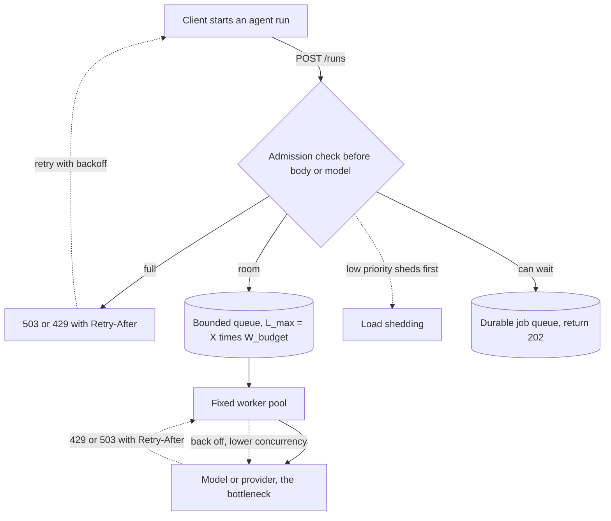

## TL;DR
Backpressure carries the model's limit back to whoever sends work, so an agent service under load admits
what it can finish and refuses the rest early: bounded queues, 429/503 with `Retry-After`, and honouring
provider 429s inside the loop.

## For agent builders
- **Why it matters for agents.** An agent run holds a model and tool budget for tens of seconds or
  minutes, so a launch-day burst turns into thousands of half-finished runs, each retrying provider 429s.
  Without bounds, every run gets slower until all of them time out.
- **Where it shows up in your stack.** Admission checks before an agent run starts, bounded
  `asyncio.Queue` workers for ingestion and embedding, a durable job queue for long-running agent tasks,
  retry policies around provider calls, and the event stream back to the user.
- **What you control.** How many runs you admit, the queue bound from the latency budget, which traffic
  sheds first, when a run goes async (202 plus a run ID), and how the loop backs off on provider 429s.
- **What you can skip.** TCP flow-control internals and adaptive limiter maths. Know Little's law, the
  bounded-buffer rule and where to reject.

## Lab
### Task
Add backpressure to an agent service's RAG ingest path and its provider retries: bound the queue,
admit batches all-or-nothing with a 503 and `Retry-After`, keep embedding workers alive when one chunk
fails, and compute retry delays that honour a provider's `Retry-After` and give up inside the deadline.
Time box: 45-75 minutes.
- **Prerequisites:** the concurrency limits and lifespan lessons, and the bounded-queue section below.
- **Setup:** `pip install fastapi httpx pytest`; checked with Python 3.12, FastAPI 0.161 and pytest 9.1.
  `slow_embed` stands in for the embedding service and fails on the chunk `"bad"`.
- **Save** the starter as `lab.py` and the tests as `test_lab.py`, then run `pytest -q`.

### Starter code
```python
"""Lab: backpressure for a RAG ingest path and an agent's provider calls. Needs fastapi, httpx."""
import asyncio, random
from contextlib import asynccontextmanager
from fastapi import FastAPI, HTTPException, Request

async def embed_worker(q: asyncio.Queue, embed, stats: dict):
    while True:
        chunk = await q.get()
        # BUG to fix in LAB 2: one failing chunk raises out of this loop and the worker dies
        # silently, so drain rate drops. Count failures in stats["failed"] and keep going;
        # always call q.task_done().
        await embed(chunk)
        stats["processed"] += 1
        q.task_done()

def build_app(embed, workers: int = 2, queue_max: int = 5) -> FastAPI:
    @asynccontextmanager
    async def lifespan(app: FastAPI):
        q = asyncio.Queue()              # BUG to fix in LAB 1: unbounded; use maxsize=queue_max
        app.state.q, app.state.stats = q, {"processed": 0, "failed": 0}
        tasks = [asyncio.create_task(embed_worker(q, embed, app.state.stats)) for _ in range(workers)]
        yield
        for t in tasks:
            t.cancel()
    app = FastAPI(lifespan=lifespan)

    @app.post("/ingest")
    async def ingest(body: dict, request: Request):
        q: asyncio.Queue = request.app.state.q
        # LAB 3: all-or-nothing admission. If the whole batch does not fit under queue_max,
        # raise HTTPException(503, headers={"Retry-After": "10"}) before enqueuing anything.
        for c in body["chunks"]:
            q.put_nowait(c)
        return {"accepted": len(body["chunks"]), "queued": q.qsize()}

    @app.get("/stats")
    async def stats(request: Request):
        return {"queued": request.app.state.q.qsize(), **request.app.state.stats}
    return app

def next_delay(attempt: int, retry_after: float | None, remaining: float,
               base: float = 0.5, cap: float = 8.0) -> float | None:
    """How long an agent step waits before retrying a provider 429 (attempt starts at 0).
    LAB 4: honour retry_after when the provider sent one; otherwise full jitter:
    random.uniform(0, min(cap, base * 2 ** attempt)). Return None (give up, surface the error)
    when the delay would not fit in the remaining deadline."""
    raise NotImplementedError("lab step 4: next_delay")

async def slow_embed(chunk: str):
    await asyncio.sleep(0.01)
    if chunk == "bad":
        raise ValueError("embedding service rejected the chunk")

if __name__ == "__main__":
    import time
    from fastapi.testclient import TestClient
    with TestClient(build_app(slow_embed, workers=0)) as client:      # no drain: see the bound
        print("batch of 3:", client.post("/ingest", json={"chunks": ["a", "b", "c"]}).status_code)
        r = client.post("/ingest", json={"chunks": ["d", "e", "f"]})
        print("batch of 3 more:", r.status_code, r.headers.get("retry-after"),
              "queued:", client.get("/stats").json()["queued"])
    with TestClient(build_app(slow_embed, workers=1)) as client:
        client.post("/ingest", json={"chunks": ["bad", "x", "y"]})
        time.sleep(0.5)
        print("after a bad chunk:", client.get("/stats").json())
    try:
        print("retry delays:", next_delay(0, 2.0, remaining=10), next_delay(3, 20.0, remaining=10))
    except NotImplementedError as e:
        print(f"not done yet: {e}")
```

### Expected output
`python lab.py` with a correct solution prints:

```
batch of 3: 200
batch of 3 more: 503 10 queued: 3
after a bad chunk: {'queued': 0, 'processed': 2, 'failed': 1}
retry delays: 2.0 None
```

The starter prints `200 None queued: 6` for the second batch and `'processed': 0` with two chunks
stuck after the bad one, which are the two failures this lab fixes.

### Tests
```python
import time
from fastapi.testclient import TestClient
import lab

def wait_for(client, pred, timeout=2.0):
    end = time.monotonic() + timeout
    while time.monotonic() < end:
        s = client.get("/stats").json()
        if pred(s):
            return s
        time.sleep(0.02)
    return client.get("/stats").json()

def test_queue_is_bounded():
    app = lab.build_app(lab.slow_embed, workers=0, queue_max=5)
    with TestClient(app):
        assert app.state.q.maxsize == 5

def test_admission_is_all_or_nothing():
    with TestClient(lab.build_app(lab.slow_embed, workers=0, queue_max=5)) as client:
        assert client.post("/ingest", json={"chunks": ["a", "b", "c"]}).status_code == 200
        r = client.post("/ingest", json={"chunks": ["d", "e", "f"]})
        assert r.status_code == 503 and r.headers["retry-after"] == "10"
        assert client.get("/stats").json()["queued"] == 3       # nothing half-accepted
        assert client.post("/ingest", json={"chunks": ["d", "e"]}).status_code == 200

def test_worker_survives_a_bad_chunk():
    with TestClient(lab.build_app(lab.slow_embed, workers=1)) as client:
        client.post("/ingest", json={"chunks": ["bad", "a", "b"]})
        s = wait_for(client, lambda s: s["processed"] == 2)
    assert s == {"queued": 0, "processed": 2, "failed": 1}

def test_retry_after_is_honoured_within_deadline():
    assert lab.next_delay(0, 2.0, remaining=10) == 2.0
    assert lab.next_delay(3, 20.0, remaining=10) is None          # would miss the deadline

def test_backoff_is_jittered_and_capped():
    delays = [lab.next_delay(a, None, remaining=100) for a in range(10) for _ in range(50)]
    assert all(0 <= d <= 8.0 for d in delays)
    assert len({round(d, 6) for d in delays}) > 100                # jitter, not a fixed schedule
    assert max(lab.next_delay(0, None, remaining=100) for _ in range(200)) <= 0.5
```

All five fail on the starter (unbounded queue, 200 instead of 503, a dead worker, and
`NotImplementedError`); a correct solution passes all five.

### Failure scenarios
- **Bound the queue but keep the `put_nowait` loop without the pre-check.** The second batch enqueues
  two chunks, then `QueueFull` escapes: the admission test errors on the second post, and in production
  the client gets a 500 for a batch that was half accepted. Debug by logging `qsize()` before and after
  each request.
- **Catch errors in the worker but forget `task_done()` on the failure path.** Processing continues,
  but `await q.join()` (used for graceful drains) never returns. Debug with
  `await asyncio.wait_for(q.join(), 1)` in a test, which times out.
- **Retry immediately on 429 with no jitter.** Every agent run retries at the same instant and the
  provider's error rate rises after the first throttle; the jitter test fails on the distinct-delay
  count. In production, chart retries per second against 429s.
- **Raise the bound to absorb a burst.** Tests still pass, but at 16 chunks per second a bound of 2,000
  means the newest chunk waits about 125 s; recompute `L_max = X × W_budget` instead.

### Submission
- `lab.py` with the four lab steps done, and `test_lab.py` unchanged.
- A `pytest -q` run showing 5 passed, plus `python lab.py` matching the expected output.
- A note sizing `queue_max` for your own ingest path from measured drain rate and a latency budget,
  with the arithmetic shown.
- Evaluation: no unbounded buffer remains, rejections happen before any work is enqueued, workers
  survive bad input, and retries never run past the deadline.

## Why it exists
- **Every pipeline has a slowest stage,** and in AI services it is almost always the model: a GPU that
  can decode for a fixed number of sequences, a provider quota, an embedding service with a throughput
  ceiling.
- **The excess has to go somewhere.** If each stage accepts everything and buffers it, the excess
  accumulates in queues: in `asyncio` tasks waiting on a semaphore, in an unbounded `asyncio.Queue`, in
  the provider's own queue, in socket buffers.
- **Queues do not add capacity; they convert overload into waiting.** If capacity is 8 requests per
  second and 12 arrive per second, the queue grows by 4 every second forever. The back of the queue
  waits past the client's timeout, the server spends capacity on answers nobody receives, clients retry
  and add load, and the system collapses at exactly the moment it is busiest.
- **A bigger buffer makes it worse.** It only delays the collapse, *because* a deeper queue means longer
  waits for everything in it.
- **Backpressure replaces "accept and hope" with a feedback loop.** Each stage advertises how much it can
  take; when it is full, the stage upstream waits briefly, slows down, or is told no. The system runs at
  the bottleneck's rate with bounded latency, and the excess is handled deliberately rather than by
  timeouts.

## How it works
### The core rule: every buffer is bounded
A bounded buffer is what turns "slow" into a signal.

| Mechanism | Behaviour when full | Use |
|---|---|---|
| `await q.put(x)` on `asyncio.Queue(maxsize=n)` | Suspends | Slows a producer coroutine to the consumer's pace |
| `q.put_nowait(x)` | Raises `QueueFull` | Lets an endpoint reject instead of waiting |
| Semaphore with a bounded acquire timeout | Times out | Same idea for in-flight calls |

- **Size bounds from the latency you can tolerate,** *because* the wait at the back of a queue of length
  *L* in front of a stage with throughput *X* is about *L / X* (Little's law with arrivals matched to
  throughput).
- **Inverting it gives the bound directly:**

```
L_max = X × W_budget
```

- **Example:** a stage doing 16 items per second with a 15-second wait budget should hold at most about
  240 waiting items; anything deeper guarantees the tail of the queue misses its deadline.

### Agent runs are the unit of admission
- **Admit runs, not just calls.** A run that starts and then cannot get model slots for its later steps
  wastes the tokens it already spent, so decide at the start whether the service can finish it.
- **Interactive vs background.** Interactive runs get a small bound and a fast 503; long research or batch
  runs go to a durable queue and return 202 with a run ID the client polls or subscribes to.
- **Inside the loop,** a provider 429 should slow this run (back off within its deadline) and lower the
  service's concurrency, not trigger an immediate retry from every run at once.

### At the HTTP edge you cannot slow the client, only answer it
- **The client is a producer you do not control.** The only tools are refusing early and saying when to
  come back: `503 Service Unavailable` (or `429 Too Many Requests` when it is a per-client quota) with a
  `Retry-After` header.
- **Reject before reading large bodies or calling anything expensive,** *because* rejection is only cheap
  if it happens first.
- **FastAPI parses a declared body first.** It reads and parses a declared body parameter before your
  endpoint function or its dependencies run, so a check inside the endpoint happens after the upload. For
  large bodies, admit in middleware or take the raw `Request` and read the body only once admitted.
- **Blunt vs precise.** Uvicorn's `--limit-concurrency` returns 503 server-wide above a connection or task
  count; per-dependency semaphores give the precise version.
- **Who acts on the signal:** upstream load balancers and well-behaved clients turn it into retries with
  backoff or routing to another replica.

### Inside a stream, flow control is automatic but partial
1. A `StreamingResponse` generator yields a chunk, and the server's `send` writes it to the socket.
2. If the client reads slowly, the kernel's send buffer and the server's write buffer fill.
3. The server pauses writing, the `await` on `send` stops returning, and the generator stops being
   iterated. That is real backpressure from the client to your code.
- **It effectively stops at your code.** If the generator reads tokens from a provider stream, TCP flow
  control may eventually reach the provider's front end once you stop reading, but generation on its side
  is typically decoupled from socket writes, so it keeps decoding and buffers or bills tokens regardless.
- **So for an expensive upstream,** a stalled or vanished client should become an explicit decision to
  cancel, not an implicit pause. For an agent, that includes the tool calls the run would make next.

### Upstream signals
- **Your service is also a producer for the provider.** A 429 or 503 from the provider, especially with
  `Retry-After`, is backpressure aimed at you.
- **Honour it:** back off, retry with jitter within the deadline, and reduce your own concurrency rather
  than retrying at full rate.
- **Adaptive limiters** lower concurrency when latency or error rates rise and raise it slowly when they
  recover: the same additive-increase, multiplicative-decrease shape TCP congestion control uses.

### Backpressure versus load shedding versus queuing
| Tool | What it does | Example |
|---|---|---|
| Backpressure | Slows the producer | Bounded queue, early 503 |
| Load shedding | Drops work when slowing is impossible, least valuable first | Free tier before paid, background re-indexing before interactive chat |
| Durable job queue | Moves work that can wait out of the request path, with its own depth limit | Batch embedding, long-running agent tasks |

A well-built service uses all three.

## Diagram
Solid arrows are work flowing toward the slowest stage; dotted arrows are the backpressure signals
flowing back, each ending in a deliberate wait, slowdown or refusal.



## Examples
### Bounded ingest queue with all-or-nothing admission
The RAG ingest endpoint feeds a bounded queue drained by a fixed pool of embedding workers. When the queue
is full the endpoint rejects at once instead of queueing more work than the workers can finish within the
latency budget.

```python
import asyncio, logging
from contextlib import asynccontextmanager
from fastapi import FastAPI, HTTPException, Request

EMBED_WORKERS, QUEUE_MAX = 8, 200   # 200 waiting chunks is the most we accept
log = logging.getLogger(__name__)

async def embed_worker(q: asyncio.Queue):
    while True:
        chunk = await q.get()
        try:
            await embed_and_store(chunk)          # slow stage: the embedding service
        except Exception:
            log.exception("embed failed")         # an escaping error would kill this worker
        finally:
            q.task_done()

@asynccontextmanager
async def lifespan(app: FastAPI):
    q = asyncio.Queue(maxsize=QUEUE_MAX)
    workers = [asyncio.create_task(embed_worker(q)) for _ in range(EMBED_WORKERS)]
    app.state.embed_q = q
    yield
    for w in workers: w.cancel()

app = FastAPI(lifespan=lifespan)

@app.post("/ingest")
async def ingest(body: dict, request: Request):
    q: asyncio.Queue = request.app.state.embed_q
    if q.qsize() + len(body["chunks"]) > QUEUE_MAX:            # all-or-nothing admission
        raise HTTPException(503, "ingest saturated", headers={"Retry-After": "10"})
    for c in body["chunks"]:            # no await since the check, so nothing can interleave
        q.put_nowait(c)
    return {"accepted": len(body["chunks"]), "queued": q.qsize()}
```

Numbers (illustrative):
| Quantity | Value |
|---|---|
| Embed call | 0.5 s each |
| Drain rate | 8 workers → 16 chunks per second |
| Wait at a full queue of 200 | 200 / 16 ≈ 12.5 s |
| Ceiling for a 15 s searchable-within budget | 16 × 15 = 240; 200 leaves margin for the embed call itself and slow calls |
| Unbounded queue, 30-chunks-per-second burst | grows by 14 chunks every second |
| After five minutes | about 4,200 chunks, a wait of over four minutes for the newest |

Two details make the bound real, plus two caveats:
- **The worker catches errors,** *because* a worker task that dies on one bad chunk silently cuts drain
  rate, and the queue then fills at a load it used to handle.
- **Admission checks the whole batch before enqueuing any of it,** so a client never gets a 503 for a
  request that was half accepted.
- **Caveat:** this in-process queue is lost on restart; work that must survive belongs in a durable job
  queue with the same depth limit.
- **Caveat:** `body: dict` means FastAPI has already read and parsed the body before the admission check.
  That is fine for small JSON batches; for large uploads, admit before reading the body, as described
  above.

### Admitting agent runs: run now, queue, or refuse
Interactive runs start only if a run slot is free; background runs go to a bounded pending queue and get
202 with a run ID; everything else gets 503. `start_run` and `enqueue_run` stand in for your agent runner
and job queue.

```python
import uuid
from fastapi import HTTPException, Request
from fastapi.responses import JSONResponse

MAX_ACTIVE_RUNS, MAX_PENDING = 20, 100          # per worker, from the sizing table below

@app.post("/runs")
async def create_run(body: dict, request: Request):
    st = request.app.state                       # active_runs: BoundedSemaphore(20), pending: int
    if body.get("mode") == "interactive":
        if st.active_runs.locked():              # no free slot: refuse now, do not queue
            raise HTTPException(503, "agents busy", headers={"Retry-After": "5"})
        await st.active_runs.acquire()           # free slot, so this does not wait
        return start_run(body, release=st.active_runs.release)   # streams events, releases at end
    if st.pending >= MAX_PENDING:
        raise HTTPException(503, "run queue full", headers={"Retry-After": "60"})
    st.pending += 1
    run_id = str(uuid.uuid4())
    await enqueue_run(run_id, body)              # durable queue; worker decrements pending on pickup
    return JSONResponse({"run_id": run_id, "status": "queued"}, status_code=202)
```

- **In real code** keep the pending count in the durable queue itself, since a per-process counter is lost
  on restart and differs per worker.

### Worked numbers: sizing agent-run admission
Illustrative: interactive runs average 30 s and make 5 model calls each; the worker may hold 20 runs.

| Quantity | Value |
|---|---|
| Run throughput per worker | 20 / 30 s ≈ 0.67 runs per second |
| Model calls in flight at full admission | up to 20 (one model call per run at a time) |
| Burst of 2 runs per second for 60 s | 120 arrive, about 40 can start in that minute |
| Unbounded admission | 80 extra runs compete for model slots and every run slows |
| Bounded admission | 80 get fast 503s or move to the background queue |
| Background queue of 100 at 0.67 runs/s | the last one waits about 150 s, acceptable for a 202 job |

### Runnable: bounded vs unbounded under the same burst
Thirty arrivals per second against a 16-per-second stage for 300 seconds. Pure Python, no dependencies.

```python
def simulate(arrive, drain, seconds, bound=None):
    depth = rejected = 0
    for _ in range(seconds):
        admitted = arrive if bound is None else min(arrive, bound - depth)
        rejected += arrive - admitted          # in FastAPI: 503 with Retry-After
        depth = max(0, depth + admitted - drain)
    return depth, depth / drain, rejected

for bound in (None, 200):
    depth, wait, rej = simulate(arrive=30, drain=16, seconds=300, bound=bound)
    print(f"bound={bound}: depth={depth}, newest waits ~{wait:.1f}s, rejected={rej}")
# bound=None: depth=4200, newest waits ~262.5s, rejected=0
# bound=200: depth=184, newest waits ~11.5s, rejected=4016
```

- **Unbounded:** nothing is rejected, but the newest item waits over four minutes, so in practice it
  times out and the work was wasted anyway.
- **Bounded:** the excess gets fast, honest 503s while admitted work stays inside the 15 s budget.

## Production patterns
- **Expose queue depth and time in queue as metrics.** For every bounded queue, publish `qsize()` as a
  gauge and record enqueue-to-dequeue time per item. Alert on depth approaching the bound and on p99 time
  in queue, which move before average latency does.
- **Admit agent runs, not only requests.** Cap active runs per worker and decide at the start whether a
  run is interactive (fast 503 when full) or background (202 plus a run ID on a durable queue). Monitor
  active runs, pending runs, and runs abandoned mid-way for lack of model slots.
- **Admit before the body is read.** For upload and ingest routes, check capacity in middleware (or take
  the raw `Request`) and reject with 503 and `Retry-After` before streaming the body in. Monitor how much
  request-body bandwidth rejected requests still consume.
- **Retry upstream 429s with capped, jittered backoff.** Wrap provider calls in a retry policy that
  honours `Retry-After` when present, otherwise uses exponential backoff with jitter (for example
  tenacity's `wait_random_exponential` with `stop_after_delay` set inside the request deadline). Monitor
  retry rate and whether 429s fall after a throttle or keep climbing.
- **Shed by priority at the edge.** Classify requests by tier or route before admission and give
  low-priority traffic a smaller bound, so it is rejected first. Monitor rejection rate per class and
  latency of the protected class during overload.
- **Uvicorn `--limit-concurrency` as a last resort.** Set it above the sum of your own bounds so the
  server-wide 503 only fires if the precise limits fail. Monitor its 503 count separately.
- **Durable queue for work that can wait.** Route batch embedding, re-indexing and long agent tasks to a
  durable job queue with a depth limit and return 202, keeping in-process queues for short-lived work.
  Monitor job age and dead-letter counts.

## Trade-offs
- **Predictable latency vs absorbed bursts.** Bounded queues keep latency predictable but reject work
  during bursts the system might have absorbed later; deeper bounds suit batch work with loose
  deadlines, shallow ones interactive chat.
- **Early 503 vs client burden.** Rejecting early protects everyone already admitted, but pushes retry
  handling onto clients; it only works when clients honour `Retry-After` and back off with jitter.
- **Brief vs long waits.** Waiting briefly on a full stage smooths spikes, while waiting long just
  converts overload into timeouts; the wait should be a small fraction of the client's deadline.
- **Priority shedding vs classification cost.** Shedding by priority keeps paid or interactive traffic
  healthy under overload, at the cost of classifying requests up front and occasionally failing work that
  was cheap to serve.
- **Sync agent runs vs 202 jobs.** Streaming a run back on the request is the best experience, but ties
  capacity to open connections; a 202 job survives disconnects and queues cleanly, at the cost of polling
  or a separate event channel.

## Pitfalls
- **Unbounded `asyncio.Queue()` or unbounded task creation with `create_task` per request.** Symptom:
  memory climbs during a burst and p99 latency rises steadily while CPU looks idle.
- **Retrying provider 429s immediately at full concurrency.** Symptom: the error rate increases after the
  first throttle instead of recovering, because retries add load to a saturated dependency. In agent
  loops every run retries at once, which makes it worse.
- **Admitting every agent run and throttling only model calls.** Symptom: during a burst, many runs finish
  their first step and then stall, so tokens are spent on runs that never complete. Fix: admission per run.
- **Rejecting only after reading the full body or calling the model.** Overload responses are as
  expensive as successes, so shedding does not relieve anything.
- **Assuming a paused stream pauses the provider.** A slow or stalled client keeps upstream tokens billing
  while the generator waits on `send`.
- **Measuring only average latency.** Queue growth shows up first in p99 and in queue depth, so averages
  hide the collapse until it is total.
- **Consumer tasks that die on an unhandled exception.** Symptom: queue depth and 503s rising at a load
  the service handled yesterday, with fewer active workers than configured.

## When to use
- **Design for it** in any service whose slowest stage is a model, a quota or a GPU, which is nearly
  every agent service.
- **Do:** bound every queue and in-flight pool, decide which requests to reject first, return 503 or 429
  with `Retry-After`, honour the same signals from your providers, and move work that can wait into a
  durable queue.
- **Measure** queue depth, time in queue, rejection rate, p99 latency and upstream 429s.
- **Interviews:** expect to explain why bigger buffers make overload worse and to show where in a request
  path you would shed load.

## Role lens
- **Engineer:** Bounds queues and semaphores, returns fast 503s with `Retry-After`, honours upstream
  429s with backoff, and exposes queue depth as a metric.
- **Architect:** Defines shedding priorities, latency budgets per stage and which work moves to durable
  queues, so the system degrades predictably under overload.
- **FDE:** Explains to a customer why their burst ingestion got 503s, tunes depth to their deadlines,
  and helps their client honour `Retry-After` instead of retrying in a tight loop.

## Check yourself
**Q:** During a marketing launch, chat latency climbs from 3 s to 45 s over ten minutes, CPU stays
low, memory rises, then the service starts timing out entirely. The code awaits a semaphore with no
timeout before each LLM call. Explain what happened and how you would redesign it.
**A:** Arrivals exceeded the throughput the semaphore allowed, and with no bound on the wait every
excess request became a suspended coroutine holding its request state, so the wait queue grew
linearly with the overload. By Little's law the wait was queue length divided by throughput, which
crossed client timeouts, so the service spent capacity on answers nobody received and retries added
load. The redesign bounds the wait (a short acquire timeout or an explicit queue cap), returns 503
with `Retry-After` before doing expensive work, sheds lower-priority traffic first, alerts on queue
depth, and raises real capacity if the overload is normal demand rather than a spike.

## Interview questions
### What is backpressure, and why is a bigger buffer not the answer to overload?
- **Backpressure is a feedback signal** from a slow consumer to a fast producer, so the producer waits,
  slows down or is told no instead of filling buffers.
- **Queues do not add capacity.** At 8 requests per second of capacity and 12 arriving, the queue grows by
  4 every second regardless of its size.
- **A bigger buffer only delays collapse,** because a deeper queue means longer waits for everything in it,
  until the tail misses client timeouts.

### How would you apply backpressure to an agent service where each run makes several model calls?
- **Admit at the run level:** cap active runs per worker from run duration and model capacity, because a
  run that starts and then starves for model slots wastes the tokens it already spent.
- **Split interactive and background work:** interactive runs get a fast 503 with `Retry-After` when full;
  long runs go to a durable queue with a depth limit and return 202 with a run ID.
- **Inside the loop,** back off on provider 429s with jitter within the run's deadline, and lower service
  concurrency instead of retrying every run at once.

### How would you size the bound on an in-process queue in front of an embedding stage?
- **Start from the latency budget,** because the wait at the back of a queue of length *L* in front of a
  stage with throughput *X* is about *L / X*.
- **Invert it:** `L_max = X × W_budget`. At 16 chunks per second and a 15-second budget that is 240, and
  the example uses 200 to leave margin for the embed call itself.
- **Then watch** `qsize()` and p99 time in queue, which move before average latency does.

### Users upload large documents and overload still hurts even though you return 503. What is wrong?
- **The rejection happens too late.** FastAPI reads and parses a declared body parameter before the
  endpoint or its dependencies run, so a capacity check inside the endpoint happens after the upload.
- **Overload responses then cost as much as successes,** so shedding relieves nothing.
- **Fix:** admit in middleware or take the raw `Request` and read the body only once admitted, rejecting
  with 503 and `Retry-After` first.

### Does a slow streaming client slow down the LLM provider?
- **Partly, and only up to your code.** When the client reads slowly, socket and server buffers fill, the
  awaited `send` stalls and the generator stops being iterated.
- **The provider typically keeps decoding,** because generation on its side is decoupled from socket
  writes, so tokens are buffered or billed regardless.
- **So for an expensive upstream,** treat a stalled or vanished client as an explicit decision to cancel,
  including the agent's next tool calls.

### When would you shed load or use a durable queue instead of just applying backpressure?
- **Shed when slowing is impossible:** drop the least valuable work first, such as free tier before paid or
  background re-indexing before interactive chat.
- **Use a durable job queue** for work that can wait, such as batch embedding or long agent tasks: return
  202, keep its own depth limit, and survive restarts that would lose an in-process queue.
- **The trade-off:** classification adds up-front cost and occasionally fails cheap work, but keeps the
  protected class healthy under overload.

## Quiz
### Q: A stage handles 10 requests per second and 15 arrive per second. What does adding a larger unbounded buffer in front of it achieve?
- [ ] It raises throughput to 15 requests per second
- [ ] It stabilises latency at a higher but constant level
- [x] It delays failure while waits grow without limit, until requests time out
- [ ] It converts the excess into 503 responses automatically
> The queue grows by 5 requests per second regardless of its size, so waiting time rises steadily.
> A buffer absorbs short bursts, but under sustained overload it only postpones and worsens timeouts.

### Q: What is the server's most direct backpressure mechanism toward an external HTTP client?
- [ ] Slowing down the TCP accept loop for that client's IP
- [x] Rejecting early with 503 or 429 and a `Retry-After` header
- [ ] Holding the request open until capacity frees up
- [ ] Returning 200 with an empty body
> The server cannot make a remote client produce more slowly; it can only refuse cheaply and say when to
> retry. Holding requests open is unbounded queuing, which is what backpressure prevents.

### Q: A streaming endpoint relays tokens from a provider to a client on a slow mobile network. What happens when the client stops reading?
- [ ] The provider automatically pauses generation
- [ ] The server buffers the entire remaining response in memory
- [x] The server's `send` stops completing, so the generator pauses, but the provider may keep generating
- [ ] FastAPI raises a `BackpressureError` in the generator
> Socket and server buffers fill and the awaited `send` stalls the generator, which is real flow
> control. It does not reach the provider, which may keep generating and billing unless you cancel.

## Use cases & projects
### Use cases
- **Launch-day agent traffic.** Admission checks reject new runs early with 429 or 503 plus `Retry-After`,
  so admitted runs finish instead of everyone timing out.
- **Document ingestion for RAG.** A bounded `asyncio.Queue` in front of embedding workers keeps a bulk
  upload from piling up unbounded work in memory.
- **Long-running agent tasks.** Returning 202 with a run ID and moving work to a durable job queue keeps
  the request path within its latency budget.
- **Provider 429s inside the loop.** Backing off and honouring the provider's retry hint stops each agent
  step from amplifying the overload it hit.

### Mini project
**Add admission control to an agent endpoint (2-3 hours).**
- **Goal:** keep latency bounded when agent traffic exceeds the model's capacity.
- **Steps:** build an agent endpoint over a fake model with a fixed capacity; add an admission check that
  returns 503 with `Retry-After` when in-flight runs reach a bound set from the latency budget; add a
  bounded `asyncio.Queue` with fixed workers for an ingestion path; make the fake model return 429s at
  overload and have the loop back off; load-test at 1.5 times capacity.
- **Done when:** a table compares p95 latency and completed runs with and without the bounds, the bounded
  version keeps p95 flat and rejects the excess early, and memory stays stable.
