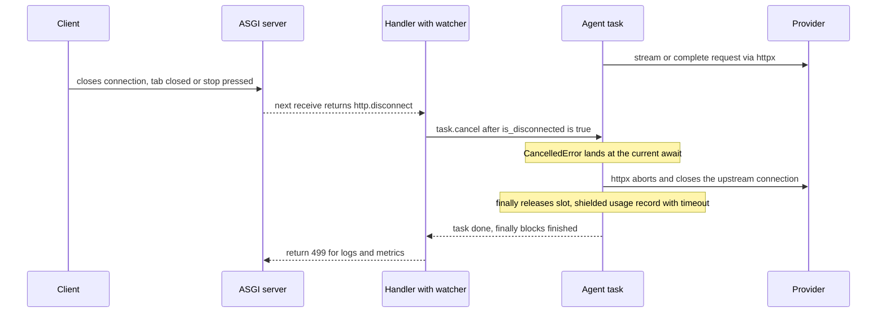

## TL;DR
When a user presses stop, an unaware agent keeps generating tokens, holding slots and running tools for
nobody. ASGI reports disconnect as an `http.disconnect` message, so detect it, cancel the run and its
children, clean up in `finally`, and shield the accounting.

## For agent builders
- **Why it matters for agents.** An agent run can last minutes and make dozens of model and tool calls.
  If "stop" does not reach the loop, the ghost run keeps billing tokens and may still send the email or
  create the ticket the user meant to stop.
- **Where it shows up in your stack.** `request.is_disconnected()` checks between agent steps,
  `StreamingResponse` event streams, `asyncio.TaskGroup` for parallel tool calls, httpx and SDK calls that
  abort on cancellation, and the proxy in front that must forward the abort.
- **What you control.** Where the cancel points are (between steps, before side-effecting tools), which
  work is shielded (usage and audit records), idempotency keys on tool calls, and which runs become
  durable jobs instead.
- **What you can skip.** The ASGI receive-channel internals beyond "disconnect is a message". Know how
  `CancelledError` propagates and why bare `create_task` orphans children.

## Why it exists
- **LLM requests are long and expensive.** A chat answer can stream for thirty seconds; an agent run can
  take minutes and make dozens of model and tool calls.
- **Users abandon requests constantly.** They navigate away, hit "stop generating", lose mobile signal,
  or click retry, which disconnects the first request and starts a second identical one.
- **An ignored disconnect keeps consuming everything.** Output tokens billed by the provider, a slot under
  your concurrency limit, a sequence in a self-hosted engine's batch with its KV cache, a database
  connection. A retry storm doubles load at exactly the wrong moment, since every retry leaves a ghost.
- **In agent workflows the cost is worse than money.** The ghost may go on to send an email or write a
  record the user thought they had stopped.
- **The framework does not handle it, in general.** The ASGI server puts an `http.disconnect` event on the
  receive channel, but your handler is awaiting a provider call, not reading that channel, so nothing
  interrupts it. Streaming responses get partial help in recent Starlette versions; ordinary endpoints
  typically run to completion. Cancellation is something you wire up deliberately.

## How it works
### How a disconnect reaches the app
1. The client closes the connection and the server marks it closed.
2. The next `receive()` returns `{"type": "http.disconnect"}`.
3. Starlette exposes this as `await request.is_disconnected()`, which checks for that message without
   blocking.
- **Nothing is raised into the handler,** *because* the handler is the one deciding what to await.

### Streaming responses
- **Recent Starlette cancels the iterator.** For a `StreamingResponse`, it runs the body iterator alongside
  a task that listens for `http.disconnect` and cancels the iterator when it arrives, so an `async for`
  over the provider stream receives `CancelledError`.
- **That listener depends on the server.** Starlette uses it when the server reports an ASGI spec version
  below 2.4, as Uvicorn's HTTP protocol does; for 2.4 servers it stops only when the next `send` fails,
  which waits for the next chunk.
- **Belt and braces.** The exact behaviour has changed across releases, so also check `is_disconnected()`
  between chunks, and open the upstream stream with `async with` so leaving the block closes the
  upstream connection.
- **Closing upstream is what stops the provider.** Self-hosted engines such as vLLM abort the sequence and
  free its cache; hosted providers' billing for partial output is vendor-specific.

Where the cancellation lands matters:
| Generator suspended at | What happens | When `finally` runs |
|---|---|---|
| An `await` on the provider | Receives `CancelledError` there | Immediately |
| `yield`, waiting for the server to take the next chunk | Not running; finalised when closed (`GeneratorExit` at the `yield`) | Possibly only when the iterator is cleaned up, later than you expect |

- **So do not put time-critical release logic only in the generator's `finally`;** pair it with a
  release-once guard that the endpoint's own cleanup can also trigger.

### Ordinary endpoints
1. Run the expensive work as a task.
2. Race it against a disconnect watcher.
3. If the watcher wins, cancel the task. Cancellation raises `CancelledError` at the task's current
   `await`; inside httpx that aborts the request and closes the connection, *because* httpx treats
   cancellation as abandoning the exchange.
- **It is cooperative:** cancellation lands only at an `await`, so CPU-bound code or a blocking call in a
  thread cannot be interrupted this way.

Two watcher designs:
| Watcher | Reacts | Safe when |
|---|---|---|
| Poll `is_disconnected()` on an interval (the example below) | Within one poll interval | Always |
| A task awaiting `request.receive()` until it returns `http.disconnect` | Instantly, no polling | Only once the body has been fully read, *because* `receive()` also delivers body chunks and a watcher that consumes them steals them from the handler |

### Cancellation must reach every child task
- **Cancelling a task cancels what it is awaiting, not tasks it started.** An agent loop that fires
  parallel tool calls with bare `asyncio.create_task(...)` leaves those children running after the
  parent is cancelled.
- **Use an `asyncio.TaskGroup` (Python 3.11+) or an AnyIO task group,** *because* structured concurrency
  ties the children's lifetime to the block: cancelling the parent cancels every child and waits for
  their `finally` blocks before the parent finishes.

### Rules for code that may be cancelled
1. **Do not swallow `CancelledError`.** Catching `Exception` is safe because `CancelledError` derives
   from `BaseException`, but a bare `except:` or `except BaseException:` that does not re-raise turns
   cancellation into a silent continue.
2. **Put cleanup in `finally`**: release semaphore slots, close streams, record partial usage.
3. **Shield what must finish.** Writing the usage or audit record for tokens already spent should not
   be abandoned; run it under `asyncio.shield` or as a short, bounded step in `finally`, *because* a
   cancelled request still cost money and must be accounted for.
4. **Choose cancel points in agent loops.** Check for disconnect between steps, not in the middle of a
   side-effecting tool call. Tool calls that change external state should carry idempotency keys so a
   retry after cancellation cannot duplicate them.

### When not to cancel
- **Work the user expects to finish without watching,** such as a long report, a deep-research agent run
  or a batch ingestion. Move it to a durable job, return a job ID, and let the client reconnect for the
  result.

### The path in between
- **Proxies may hide the disconnect.** A proxy or load balancer between client and app may not propagate
  the disconnect promptly, or may keep the upstream connection open while it buffers.
- **Test the full path:** start a long request through the real ingress, close the client, and confirm
  the app logs a cancellation.

## Diagram
Nothing interrupts the handler on its own: the disconnect is only a message until the watcher reads it,
cancels the agent task and lets `finally` close upstream and record usage under a bounded shield.



## Examples
### Cancel a non-streaming call when the client leaves
A helper that runs a non-streaming model call as a task and cancels it if the client disconnects,
returning 499 (the "client closed request" code popularised by nginx) for logs and metrics.

```python
import asyncio
from fastapi import FastAPI, Request, Response

app = FastAPI()

async def run_unless_disconnected(request: Request, coro, poll_s: float = 0.25):
    task = asyncio.create_task(coro)
    try:
        while True:
            done, _ = await asyncio.wait({task}, timeout=poll_s)
            if done:
                return task.result()               # re-raises the task's own exception
            if await request.is_disconnected():
                task.cancel()                      # CancelledError lands at the provider await
                await asyncio.wait({task})         # let its finally blocks run, no re-raise
                return None
    finally:
        task.cancel()                              # no-op if done; covers our own cancellation

async def answer_question(q: str) -> str:
    try:
        return await llm_complete(q)               # httpx call, closed on cancellation
    finally:
        # billing record must survive cancellation, but bounded so it cannot hang shutdown
        await asyncio.shield(asyncio.wait_for(record_usage(q), timeout=2.0))

@app.post("/answer")
async def answer(body: dict, request: Request):
    result = await run_unless_disconnected(request, answer_question(body["q"]))
    if result is None:
        return Response(status_code=499)           # nobody is listening; count it
    return {"answer": result}
```

Scenario (illustrative):
| | Without cancellation | With cancellation |
|---|---|---|
| Abandoned requests | 20% of chats, after about 3 seconds | same |
| Model time per abandoned request | full 15-second generation | about 3 seconds |
| Slot held | 15 seconds | about 3 seconds |
| Effect under a fixed concurrency cap | longer queues for everyone | shorter queues for the users who stayed |

### An agent loop with cancel points and idempotent side effects
The loop checks for disconnect before every step and before any side-effecting tool, runs parallel tools
in a `TaskGroup`, and passes an idempotency key built from run ID and step. `llm_step`, `TOOLS`,
`SIDE_EFFECTS` and `record_usage_run` stand in for your own code.

```python
import asyncio

class Stopped(Exception): ...

async def run_agent(request, run_id: str, messages: list, max_steps: int = 10):
    try:
        for step in range(max_steps):
            if await request.is_disconnected():          # cancel point between steps
                raise Stopped
            out = await llm_step(messages)               # cancellable: httpx aborts on cancel
            if out["type"] == "final":
                return out["text"]
            calls = out["tool_calls"]
            if any(c["name"] in SIDE_EFFECTS for c in calls) and await request.is_disconnected():
                raise Stopped                            # never start a side effect for nobody
            async with asyncio.TaskGroup() as tg:        # children die with the run
                tasks = [tg.create_task(TOOLS[c["name"]](**c["args"],
                                        idempotency_key=f"{run_id}:{step}:{i}"))
                         for i, c in enumerate(calls)]
            messages += [{"role": "tool", "content": t.result()} for t in tasks]
        return None
    finally:
        # runs on success, Stopped and CancelledError alike; bounded so shutdown cannot hang
        await asyncio.shield(asyncio.wait_for(record_usage_run(run_id, messages), timeout=2.0))
```

- **Run it under `run_unless_disconnected`** as well, so a disconnect during a long model call cancels it
  at that `await` instead of waiting for the next step's check.

### Streaming relay that stops upstream on disconnect
The upstream stream is opened with `async with`, so breaking out of the loop (or being cancelled by
Starlette) closes the provider connection. Assumes a shared httpx client on `app.state.http`.

```python
from fastapi.responses import StreamingResponse

@app.post("/chat/stream")
async def chat_stream(body: dict, request: Request):
    http = request.app.state.http

    async def gen():
        async with http.stream("POST", "/v1/chat", json={**body, "stream": True}) as r:
            async for line in r.aiter_lines():
                if await request.is_disconnected():
                    break                          # leaving the block closes the upstream stream
                yield line + "\n"

    return StreamingResponse(gen(), media_type="text/event-stream")
```

### Runnable: bare tasks vs a TaskGroup under cancellation
An agent step fans out two tool calls; the client disconnects 0.1 seconds in. Bare tasks finish their
side effects anyway; TaskGroup children are cancelled with the parent. Python 3.11+.

```python
import asyncio

log: list[str] = []

async def tool(name: str, seconds: float):
    try:
        await asyncio.sleep(seconds)               # stands in for a tool or model call
        log.append(f"{name} finished")             # a side effect the user thought they stopped
    except asyncio.CancelledError:
        log.append(f"{name} cancelled")
        raise

async def step_bare():
    asyncio.create_task(tool("bare-A", 0.3))       # orphans: nothing ties them to this step
    asyncio.create_task(tool("bare-B", 0.3))
    await asyncio.sleep(1)

async def step_grouped():
    async with asyncio.TaskGroup() as tg:          # Python 3.11+
        tg.create_task(tool("tg-A", 0.3))
        tg.create_task(tool("tg-B", 0.3))

async def main():
    for step in (step_bare, step_grouped):
        t = asyncio.create_task(step())
        await asyncio.sleep(0.1)
        t.cancel()                                 # the client disconnected
        await asyncio.gather(t, return_exceptions=True)
    await asyncio.sleep(0.5)                       # give orphans time to act
    print(log)

asyncio.run(main())
# ['tg-B cancelled', 'tg-A cancelled', 'bare-A finished', 'bare-B finished']
# (the order of the two tg lines is not guaranteed)
```

## Production patterns
- **Count 499s as a first-class metric.** Return or log 499 for every request cancelled by disconnect and
  chart it per route next to latency. A rising 499 rate after a latency regression means users are giving
  up; alert on it.
- **Track tokens spent after disconnect.** In the shielded usage record, store whether the request or
  agent run was cancelled and the tokens billed, so finance and capacity reviews see the ghost cost.
  Monitor its share of total spend; it should fall after cancellation ships.
- **Configure the proxy to forward aborts.** With nginx in front, keep `proxy_ignore_client_abort` off
  (its default) so a client abort closes the upstream connection, and disable `proxy_buffering` on
  streaming routes. Verify with an end-to-end test that the app logs a cancellation within a second or
  so of the client closing.
- **Cancel points plus idempotency keys in agent loops.** Check `is_disconnected()` before each step and
  before any side-effecting tool call, and send an idempotency key derived from run ID and step number.
  Monitor duplicate side effects reported by downstream systems.
- **Durable jobs for work that must finish.** For reports, long research runs and batch ingestion, enqueue
  a job, return 202 with a job ID, and let the client poll or reconnect. Monitor job completion rate and
  age, not 499s.
- **Bounded shields only.** Wrap every shielded step in its own timeout (`asyncio.wait_for(..., 2.0)` in
  the example) so shutdown cannot hang. Monitor shielded-step timeouts and graceful-shutdown duration.

## Trade-offs
- **Saved capacity vs lost work.** Cancelling on disconnect saves tokens, slots and GPU memory, but loses
  work a user might have come back for; move such work to a durable job with a result the client can
  fetch later.
- **Poll interval vs overhead.** Polling `is_disconnected()` frequently notices faster but adds overhead
  per request; a quarter to half a second is usually ample next to multi-second model calls.
- **Aggressive vs safe cancellation in agents.** Aggressive cancellation prevents ghost actions, but
  cancelling mid-tool-call can leave external systems half-updated; cancel between steps and make side
  effects idempotent.
- **Shielded cleanup vs shutdown.** Shielding keeps billing and audit records complete, but a shielded
  step that hangs blocks shutdown; bound every shielded operation with its own timeout.

## Pitfalls
- **Assuming the handler is cancelled automatically when the client leaves.** Symptom: provider
  dashboards show token usage well above what users actually received.
- **A broad `except BaseException:` or bare `except:` around the model call that logs and continues.**
  The cancellation is swallowed and the request keeps running after the disconnect.
- **Cancelling the task but not closing the upstream stream.** The app stops reading while the provider or
  engine keeps generating, visible as engine batch occupancy that does not drop.
- **Releasing concurrency slots only on the success path.** Every cancelled request leaks a slot, and
  capacity shrinks until the worker appears hung.
- **Testing only against the app directly.** Behind a buffering proxy the disconnect never arrives, so
  cancellation works in development and silently does nothing in production.
- **Spawning parallel tool or model calls with bare `create_task` inside a cancellable agent step.**
  Symptom: tool side effects and provider usage logged seconds after the request was cancelled.

## When to use
- **Use for** every interactive endpoint whose work is long or expensive: chat and completion endpoints,
  streaming generations, agent runs, and retrieval pipelines with several model calls.
- **Skip it** for work that must complete regardless of the client, which belongs in a job queue.
- **Measure** the rate of 499s or cancelled requests, tokens spent after disconnect, slot occupancy, and
  time from disconnect to cancellation through the real ingress.
- **Interviews:** explain that disconnect is a message, how cancellation propagates through `await`, and
  what must be shielded.

## Role lens
- **Engineer:** Races model calls against a disconnect watcher, propagates cancellation into the httpx
  or SDK call, and keeps cleanup and usage recording in `finally`.
- **Architect:** Decides which operations are cancellable, which must become durable jobs, and where
  agent loops are allowed to stop without leaving external systems inconsistent.
- **FDE:** Verifies that the customer's proxies and load balancers forward disconnects, and explains
  the token and capacity saved by cancellation using their abandonment rate.

## Check yourself
**Q:** An agent endpoint runs a loop of LLM calls and tool calls, one of which creates a ticket in the
customer's helpdesk. Users who press stop sometimes still get tickets created. How do you make stop
mean stop without corrupting state?
**A:** First detect the disconnect: run the loop as a task and cancel it when `is_disconnected()`
returns true, or have the loop check before each step. Cancellation lands at the next `await`, so
place explicit cancel points between steps rather than relying on wherever it happens to land. The
ticket-creating call should either complete or not start: check for disconnect before it, give it an
idempotency key so a retry cannot duplicate it, and shield only the bookkeeping that records what was
done. If steps fan out into parallel tool calls, run them in a `TaskGroup` so the cancellation reaches
every child rather than leaving orphans that finish the job anyway. Make sure no broad `except`
swallows `CancelledError`, and record the run's final state so the
user can see what happened before they stopped it.

## Interview questions
### Why doesn't FastAPI stop work automatically when a client disconnects?
- **Disconnect is a message, not an exception.** The ASGI server puts `http.disconnect` on the receive
  channel, and the next `receive()` returns it.
- **The handler is awaiting a provider call,** not reading that channel, so nothing interrupts it and
  ordinary endpoints typically run to completion.
- **Streaming gets partial help:** recent Starlette cancels a `StreamingResponse` iterator on disconnect,
  but behaviour has changed across releases, so also check `is_disconnected()` between chunks.

### Provider dashboards show far more output tokens than users received. How do you find and fix the leak?
- **Suspect ghosts:** abandoned or retried requests whose generations kept running after the client left.
- **Check each layer:** is anything watching for disconnect, is the upstream stream opened with `async with`
  so it closes, and does a buffering proxy hide the disconnect from the app?
- **Fix and verify:** race the call against a watcher, keep nginx `proxy_ignore_client_abort` off, and run
  an end-to-end test that the app logs a cancellation.

### A user presses stop, then immediately retries the same agent request. How do you avoid duplicate side effects?
- **The first run may have been cancelled mid-step,** so a tool call might have reached the external system
  before the cancellation landed.
- **Give every side-effecting tool call an idempotency key** derived from a client-supplied run ID and the
  step number, so the downstream system rejects or returns the earlier result for a repeat.
- **Record each step's outcome in the shielded run record,** so the retry can resume or skip completed
  side effects instead of redoing them.

### Should you poll is_disconnected() or await request.receive() in a watcher task?
- **Polling** reacts within one interval and is always safe; a quarter to half a second is usually ample
  next to multi-second model calls.
- **Awaiting `receive()`** reacts instantly, but only once the body has been fully read, because
  `receive()` also delivers body chunks and a watcher would steal them from the handler.
- **Default to polling** unless instant reaction matters and the body is already consumed.

### An agent step fans out parallel tool calls. After the user presses stop, tools still finish. Why?
- **Cancelling a task cancels what it is awaiting, not tasks it started,** so children created with bare
  `asyncio.create_task(...)` are orphans and keep running.
- **Use `asyncio.TaskGroup` (Python 3.11+) or an AnyIO task group:** cancelling the parent cancels every
  child and waits for their `finally` blocks.
- **The runnable example shows it:** bare tasks log "finished", TaskGroup children log "cancelled".

### When is cancelling on disconnect the wrong choice, and what do you do instead?
- **When the user expects the work to finish without watching,** such as a long report or batch ingestion,
  because cancelling would lose work they will come back for.
- **Move it to a durable job:** return 202 with a job ID and let the client poll or reconnect for the
  result.
- **Even for cancellable requests,** shield the usage and audit record with a timeout, because tokens
  already spent were billed whether or not anyone read them.

## Quiz
### Q: How does an ASGI application learn that an HTTP client has disconnected?
- [ ] The server raises `ConnectionResetError` inside the handler immediately
- [x] The next `receive()` returns an `http.disconnect` message, which the app must read
- [ ] The response status is changed to 499 automatically
- [ ] FastAPI cancels every pending dependency
> Disconnect is delivered as a message on the receive channel. A handler that is awaiting a provider
> call never reads it unless it checks, which is what `request.is_disconnected()` does.

### Q: Why might a `try/except BaseException` around a model call stop cancellation from working?
- [x] `CancelledError` derives from `BaseException`, so the handler catches it and can continue running
- [ ] `BaseException` handlers disable the event loop's task scheduler
- [ ] Cancellation only works with synchronous code
- [ ] httpx converts cancellation into a `TimeoutError`
> Since Python 3.8, `CancelledError` is a `BaseException`, so `except Exception` lets it pass but a broad
> `BaseException` handler swallows it unless it re-raises, and the cancelled request keeps going.

### Q: Which work should not be cancelled when the client disconnects?
- [ ] A streaming chat completion the user stopped reading
- [ ] A retrieval-plus-generation request the user abandoned
- [x] Recording the usage and audit entry for tokens already spent
- [ ] An agent step that has not yet started its next model call
> The tokens were spent and billed whether or not anyone read them, so accounting must finish; shield it
> with a timeout. The other work produces output for a client that is gone, so cancelling it is the point.

## Use cases & projects
### Use cases
- **"Stop generating" in chat agents.** Detecting disconnect stops token generation, so the provider stops
  billing output nobody reads.
- **Side-effecting tools.** A cancel check before sending an email or creating a ticket keeps a ghost run
  from doing what the user meant to stop.
- **Retry storms.** Cancelling the abandoned first request frees its concurrency slot before the retry
  claims another one.
- **Self-hosted engines.** Aborting the request frees the sequence and its KV cache in the engine's batch
  for other users.

### Mini project
**Make an agent run stoppable (1-2 hours).**
- **Goal:** prove that closing the client stops the agent loop, its parallel tool calls and its stream,
  while usage accounting still completes.
- **Steps:** build a streaming agent endpoint with a fake model that yields tokens slowly and a step that
  runs two tools in an `asyncio.TaskGroup`; check `request.is_disconnected()` between steps and before a
  fake side-effecting tool; clean up in `finally`; shield the usage write with a timeout; disconnect a
  client mid-stream with a script.
- **Done when:** logs show generation and tools stopping within one step of the disconnect, the
  side-effecting tool never runs after it, and the usage record is written every time.
