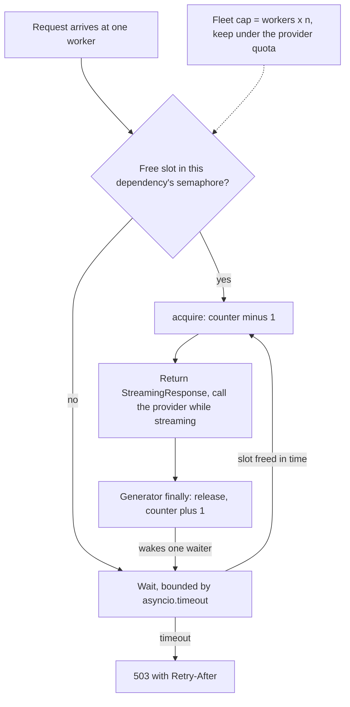

## TL;DR
An async worker will start thousands of model calls at once; providers, GPUs and memory cannot cope. A
semaphore caps calls in flight. Size it from the downstream limit divided across workers, bound the
wait, and fail fast with 503.

## Why it exists
- **Async removes the natural brake.** With `async def` endpoints a worker does not run out of threads;
  each request is a cheap coroutine. A burst of 2,000 chat requests becomes 2,000 concurrent provider
  calls in a few milliseconds.
- **Everything downstream suffers and nothing pushes back.** The provider answers with 429s past its
  concurrency quota, a self-hosted vLLM server queues internally until latency is useless, each
  in-flight request holds a connection, a prompt and a growing response in memory, and retries from
  impatient clients double the load.
- **A rate limit controls arrivals, not in-flight work.** With LLM calls taking anywhere from one to sixty
  seconds, the same rate can mean ten or six hundred concurrent calls.
- **The HTTP client's pool limit is the wrong cap.** It only moves the queue into the pool wait, where it
  surfaces as `PoolTimeout` with no clean 503 and no per-dependency policy; a bigger pool just sends more
  load downstream. More workers multiply the problem.
- **What is missing is a direct cap per scarce resource, enforced before the work starts.** Little's law:
  in-flight = throughput × latency. A dependency that sustains 64 concurrent calls at 4 seconds average
  has a ceiling of about 16 requests per second, whatever you do upstream.

## How it works
### The primitive
- **`asyncio.Semaphore(n)`** holds a counter starting at *n*.
  - `acquire()` decrements it, or suspends the coroutine if it is zero.
  - `release()` increments it and wakes one waiter.
- **`async with sem:`** pairs them and releases even on exceptions and cancellation, *because* a leaked
  slot permanently shrinks capacity until restart.
- **`BoundedSemaphore`** also raises if released more times than acquired, turning a double-release bug
  into an error instead of silent extra capacity.
- **AnyIO's `CapacityLimiter`** is the equivalent when the codebase uses AnyIO.

### Where it lives
- **One semaphore per scarce dependency,** created at startup in the lifespan and stored on `app.state`.
  It must be shared across requests, *because* a semaphore created per request limits nothing.
- **It is per process.** Each Uvicorn worker has its own, so the effective limit is `workers × n`.
- **Example:** to keep a fleet under a provider quota of 64 with 4 workers, use 16 per worker.
- **Autoscaling breaks fixed numbers.** With autoscaling replicas a fixed per-process number drifts, so
  you need a shared limiter (for example leases with expiry in Redis) or a gateway that enforces the
  global cap.

### Bound the wait
- **A plain `async with sem:` waits forever.** Under sustained overload the wait queue grows without limit,
  which is just an unbounded queue with extra steps.
- **Wrap the acquire in a timeout** and, if it expires, return 503 with `Retry-After`, *because* a fast,
  honest rejection lets the client or load balancer retry elsewhere while a slow one burns the client's
  whole timeout.
- **Reject immediately** by checking `sem.locked()` when there is no free slot.

### Choosing n
| Dependency | Starting point |
|---|---|
| Hosted provider | The quota: `n_per_worker = floor(quota / (workers × replicas))`, minus headroom for retries and other services sharing the key |
| Self-hosted inference server | No quota, only a curve: find the knee with a concurrency sweep |

The sweep for a self-hosted engine:
1. Step concurrency up in a load test.
2. Record throughput and per-request latency (time per output token, time to first token) at each step.
3. Throughput rises while the engine batches more sequences, then flattens; latency stays roughly flat,
   then climbs.
4. Set *n* just before the knee, *because* past it extra concurrency buys no throughput and only adds
   queueing inside the engine, where you can neither see nor reject it.

- **The resulting ceiling (Little's law):** `max throughput ≈ n / mean latency`.
- **Static *n* goes stale** when the knee moves (longer prompts, a new model). Adaptive limiters adjust it
  from observed latency or 429s, at the cost of a feedback loop that must itself be tuned.

### Not all calls cost the same
- **Quotas count tokens too.** A provider quota is often in tokens per minute as well as requests, and a
  50k-token prompt holds far more of a self-hosted engine's KV cache than a 200-token one.
- **A slot-per-request semaphore treats them as equal.** A weighted limit charges each call units
  proportional to its expected tokens.
- **Do not call `acquire()` *k* times on an `asyncio.Semaphore`.** Acquisition is not atomic, so two large
  requests can each hold half of what they need and wait on each other forever.
- **Instead,** use a limiter that takes *k* units in one step, or cap request size separately so one slot
  is a bounded cost.

### Separate limits per dependency
- **One semaphore each** for the LLM, embeddings, the reranker or a slow internal tool.
- **This is the bulkhead idea:** a stall in one dependency fills only its own slots instead of starving
  every endpoint.
- **Endpoints that call several dependencies** take each slot only around the call that needs it.

### Streaming endpoints
- **Acquire before returning the response,** so you can still answer 503 with proper headers.
- **Release in the generator's `finally`,** *because* the expensive work happens while the stream is being
  consumed, after the endpoint function has returned.
- **Edge case:** an async generator that is never started never runs its `finally`, so if the response is
  abandoned before the first chunk the slot can leak. Guard with a release-once flag that is also
  triggered from cleanup outside the generator, and alert on slots that never return.

### The hidden limit you already have
- **The thread pool.** Sync `def` endpoints and `run_in_threadpool` calls run on AnyIO's worker thread
  pool, which has a default capacity limiter (40 threads in current AnyIO). That is a concurrency limit
  too, often hit by accident when blocking SDK calls sit in a sync endpoint.
- **Uvicorn's `--limit-concurrency`** returns 503 once a worker holds too many connections or tasks; it is
  a coarse safety net, not a per-dependency limit.

## Diagram
A request either gets a slot within the bounded wait or a fast 503; a streaming request keeps its slot
until the generator's `finally`, not until the endpoint returns.



## Examples
### Per-worker cap for a streaming LLM endpoint
A per-worker cap on calls to an LLM provider whose quota is 64 concurrent requests across 4 workers, with
a bounded wait and a slot held for the full duration of a stream.

```python
import asyncio
from contextlib import asynccontextmanager
from fastapi import FastAPI, HTTPException, Request
from fastapi.responses import StreamingResponse

WORKERS, PROVIDER_LIMIT = 4, 64

@asynccontextmanager
async def lifespan(app: FastAPI):
    app.state.llm_slots = asyncio.BoundedSemaphore(PROVIDER_LIMIT // WORKERS)  # 16 per worker
    yield

app = FastAPI(lifespan=lifespan)

async def take_slot(sem: asyncio.Semaphore, wait_s: float = 2.0) -> None:
    try:
        async with asyncio.timeout(wait_s):    # Python 3.11+
            await sem.acquire()
    except TimeoutError:
        raise HTTPException(503, "LLM capacity full", headers={"Retry-After": "2"})

@app.post("/chat")
async def chat(body: dict, request: Request):
    sem = request.app.state.llm_slots
    await take_slot(sem)                       # reject before headers are sent

    async def gen():
        try:
            async for token in stream_llm(body["messages"]):   # provider call
                yield token
        finally:
            sem.release()                      # held until the stream really ends
    return StreamingResponse(gen(), media_type="text/plain")
```

- **Ceiling:** with an average generation of 8 seconds, 16 slots per worker sustain about 16 / 8 = 2
  requests per second per worker, 8 across the fleet.
- **Above that,** requests wait up to 2 seconds and then get 503 instead of piling up.

### Runnable: a burst against a bounded semaphore
Twelve requests arrive at once against 4 slots; each call takes 1 second and waiters give up after 0.5
seconds. Runs on Python 3.11+ with no dependencies.

```python
import asyncio

async def main(n=4, requests=12, work_s=1.0, wait_s=0.5):
    sem, inflight, peak, rejected = asyncio.BoundedSemaphore(n), 0, 0, 0

    async def handle():
        nonlocal inflight, peak, rejected
        try:
            async with asyncio.timeout(wait_s):
                await sem.acquire()
        except TimeoutError:
            rejected += 1                      # in FastAPI: 503 with Retry-After
            return
        try:
            inflight += 1
            peak = max(peak, inflight)
            await asyncio.sleep(work_s)        # stands in for the provider call
        finally:
            inflight -= 1
            sem.release()

    await asyncio.gather(*(handle() for _ in range(requests)))
    print(f"peak in flight={peak}, served={requests - rejected}, rejected={rejected}")

asyncio.run(main())   # peak in flight=4, served=4, rejected=8
```

### Worked sizing: quota, workers and throughput
| Input | Value | Result |
|---|---|---|
| Provider quota | 64 concurrent | — |
| Workers × replicas | 4 × 1 | `floor(64 / 4)` = 16 per worker |
| Mean generation | 8 s | 16 / 8 = 2 req/s per worker, 8 req/s fleet |
| Scale to 8 workers, same *n* | 8 × 16 = 128 in flight | double the quota: 429s return |
| Scale to 8 workers, re-sized | `floor(64 / 8)` = 8 per worker | fleet stays at 64 |

## Production patterns
- **Per-dependency bulkheads in the lifespan.** When an endpoint fans out to an LLM, embeddings and a
  reranker, create one `BoundedSemaphore` per dependency on `app.state` and take each only around its
  call. Monitor slots in use, wait time and rejections per dependency (count them in your own code, since
  the semaphore exposes no public in-use counter).
- **Derive *n* from config, not a constant.** Read the quota and the worker and replica counts from
  settings and compute `floor(quota / (workers × replicas))` at startup, minus retry headroom. Monitor
  provider 429 rate after every scaling change.
- **Global leases for autoscaled fleets.** When replica count varies, take a lease with expiry in Redis
  (or route through a gateway that enforces the global cap) instead of a per-process semaphore. Monitor
  lease acquire latency and leases that expire without release.
- **Raise the thread limiter deliberately.** If sync SDK calls must stay in `def` endpoints, set AnyIO's
  default limiter in the lifespan, for example
  `anyio.to_thread.current_default_thread_limiter().total_tokens = 100`, sized to the downstream. Monitor
  latency of sync endpoints under load, which plateaus at the thread cap.
- **Per-tenant caps on top of the global cap.** For multi-tenant APIs, give each tenant a small semaphore
  checked before the shared one, so a noisy customer cannot take every slot. Monitor rejections by tenant
  and idle global capacity.
- **Uvicorn `--limit-concurrency` as the outer net.** Set it above the sum of your dependency caps so it
  only fires when something else has failed. Monitor its 503s separately from your own.

## Trade-offs
- **Tight cap vs absorbed load.** A tight cap protects the downstream and keeps latency predictable, but
  rejects requests the downstream might have absorbed; raise it only when measured downstream latency
  stays flat.
- **Short vs long waits.** Waiting briefly for a slot smooths short bursts; waiting long only converts
  overload into latency, so the right wait is short compared with the client's timeout.
- **Per-process vs distributed limiter.** Per-process semaphores are simple and fast but assume a fixed
  worker count; under autoscaling a distributed limiter is accurate at the price of a network round trip
  per acquire.
- **Shared vs per-tenant caps.** One shared cap per dependency is fair to no one in particular; per-tenant
  caps prevent a noisy customer from taking every slot, at the cost of idle capacity when tenants are
  quiet.

## Pitfalls
- **Creating the semaphore inside the endpoint or a per-request dependency.** It limits nothing; the
  symptom is provider 429s at the same load as before the change.
- **Forgetting that the cap is per worker.** Scaling from 4 to 8 workers doubles provider concurrency and
  429s return after the scale-up.
- **Acquiring without a timeout.** Under overload p99 latency climbs to the client timeout and memory
  grows with the number of suspended waiters.
- **Releasing in the endpoint for a streaming response.** The slot is freed when headers go out, so real
  concurrency against the provider far exceeds the cap.
- **Manual `acquire()` without `try/finally`.** A cancelled or failed request leaks a slot, and capacity
  shrinks slowly until the worker seems to hang at zero.
- **Sizing *n* for a self-hosted engine from GPU count or intuition** rather than a concurrency sweep.
  Symptom: throughput does not rise when *n* is raised while time per token keeps growing.

## When to use
- **Use in front of** every scarce or quota-bound dependency an async service calls: hosted LLMs with
  concurrency quotas, self-hosted inference servers whose latency degrades past a batch size, embedding
  and reranking services, slow internal tools.
- **Pair it** with rate limiting for per-client fairness and with backpressure for what to do when slots
  run out.
- **Measure** slot utilisation, wait time, rejection rate and downstream latency against concurrency.
- **Interviews:** expect to compute a per-worker limit from a quota and to explain why rate limits alone
  do not bound concurrency.

## Role lens
- **Engineer:** Creates per-dependency semaphores in the lifespan, bounds acquisition with a timeout,
  and holds slots correctly across streaming responses and cancellation.
- **Architect:** Owns the concurrency budget per dependency across workers and replicas, and decides
  where a global limiter or gateway replaces per-process caps.
- **FDE:** Sizes caps to the customer's provider quota or GPU deployment, and explains the resulting
  throughput ceiling in requests per second using Little's law.

## Check yourself
**Q:** Your team caps LLM calls at 20 per worker with 6 workers. The provider allows 100 concurrent
requests. Average generation is 5 seconds. What throughput can you sustain, what happens at 30
requests per second, and what would you change?
**A:** The fleet allows 6 × 20 = 120 in flight, above the provider's 100, so near saturation you will
see 429s; set per-worker caps to about 16. With 96 slots and 5-second calls, Little's law gives about
96 / 5 ≈ 19 requests per second. At 30 requests per second arrivals exceed that by 11 per second, so
waiters accumulate; with a bounded wait the excess gets fast 503s with `Retry-After` rather than
timing out. To serve 30 per second you need more provider concurrency, shorter generations (lower
max tokens), caching, or routing some traffic to another model.

## Interview questions
### Why does an async FastAPI service need an explicit concurrency limit when a sync one often does not?
- **Async removes the natural brake.** A sync worker runs out of threads; an async one turns a burst of
  2,000 requests into 2,000 concurrent provider calls within milliseconds, because each request is a cheap coroutine.
- **Downstream cannot push back cleanly:** the provider returns 429s, a self-hosted engine queues
  internally, and every in-flight call holds memory and a connection.
- **A semaphore per scarce dependency** caps calls in flight before the work starts.

### After scaling from 4 to 8 workers, provider 429s come back even though the code did not change. Why?
- **The semaphore is per process,** so the fleet limit is `workers × n`. With 16 per worker, 8 workers allow
  128 in flight against a quota of 64.
- **Fix the sizing:** compute `floor(quota / (workers × replicas))` from settings at startup, which gives 8
  per worker here, minus headroom for retries.
- **For autoscaled replicas,** a fixed number drifts, so move to leases with expiry in Redis or a gateway.

### When is a plain async with sem the wrong choice?
- **When the wait is unbounded:** under sustained overload waiters pile up, p99 climbs to the client
  timeout and memory grows, so wrap the acquire in a timeout and return 503 with `Retry-After`.
- **For streaming responses:** `async with` around `return StreamingResponse(...)` frees the slot before
  any tokens are generated, so release in the generator's `finally`.
- **For calls of very different cost:** a 50k-token prompt is not one slot's worth, so weight the limit or
  cap request size.

### How would you pick n for a self-hosted inference server that has no quota?
- **Run a concurrency sweep:** step concurrency up in a load test and record throughput, time to first
  token and time per output token at each step.
- **Find the knee:** throughput rises then flattens while latency stays flat then climbs; set *n* just
  before it, because past it extra concurrency only queues inside the engine.
- **Check the ceiling with Little's law:** `max throughput ≈ n / mean latency`, and re-run the sweep when
  prompts or the model change.

### Why not just acquire the semaphore k times to weight large requests?
- **Acquisition of k units on `asyncio.Semaphore` is not atomic,** so two large requests can each hold half of
  what they need and wait on each other forever: a deadlock.
- **Use a limiter that takes k units in one step,** or cap request size separately so one slot is a
  bounded cost.
- **Remember quotas often count tokens per minute too,** so a request-count cap alone may still breach
  the provider's token limit.

## Quiz
### Q: Why does a requests-per-second rate limit not bound the number of concurrent LLM calls?
- [ ] Rate limits only apply to authenticated clients
- [x] In-flight work equals arrival rate times latency, and LLM latency varies widely
- [ ] Rate limits are enforced after the call completes
- [ ] Async endpoints bypass rate limiting middleware
> By Little's law, concurrency is throughput multiplied by time in system. The same 10 requests per
> second can mean 10 or 600 calls in flight depending on whether generations take 1 or 60 seconds.

### Q: A streaming endpoint acquires a semaphore slot in the endpoint body with `async with sem:` around `return StreamingResponse(gen())`. What happens?
- [ ] The slot is held until the client disconnects
- [x] The slot is released as soon as the response object is returned, before tokens are generated
- [ ] The stream cannot start until another request releases a slot
- [ ] FastAPI raises an error because semaphores cannot be used with streams
> The `async with` exits when the function returns the response object, but generation happens later
> while the server iterates the generator. Release in the generator's `finally` to cover the stream.

### Q: A provider allows 120 concurrent requests and you run 8 Uvicorn workers with one semaphore each. What per-worker limit keeps the fleet within quota?
- [ ] 120
- [ ] 960
- [x] 15
- [ ] 8
> Each worker process has its own semaphore, so the fleet total is workers times per-worker limit.
> 120 / 8 = 15 per worker; setting 120 each would allow 960 concurrent calls.
