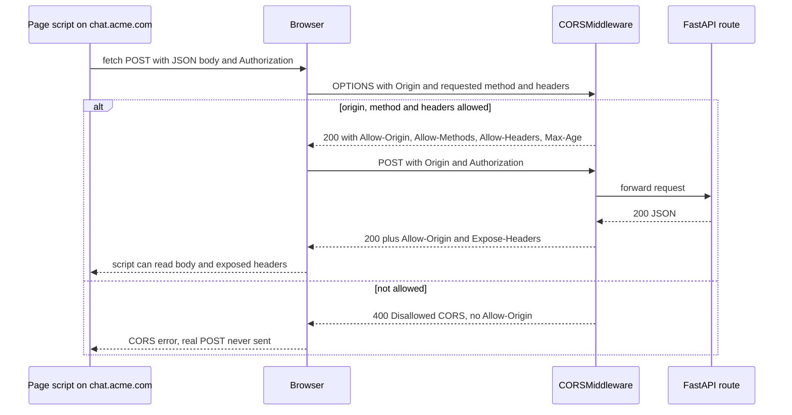

## TL;DR
CORS headers let a browser chat UI on another origin read your agent API's responses and streams.
Browsers enforce it, so it is not authentication: curl, your agent's tool calls and other servers
ignore it, and the API still needs real auth.

## For agent builders
- **Why it matters for agents.** The usual agent product is a browser UI streaming a run from a FastAPI
  backend on another origin. A CORS mistake shows up as "the agent hangs" in the UI, while the server
  logs a perfectly good run, or a 401 or 429 the UI never sees.
- **Where it shows up in your stack.** `CORSMiddleware` on the agent API, the preflight before every JSON
  or bearer-token call, `expose_headers` for a run id or `Retry-After`, and per-tenant origin lists for
  embeddable agent widgets.
- **What you control.** The origin allowlist per environment, middleware order (CORS outermost), which
  response headers the UI may read, and how the stream is authenticated (`fetch` reader versus
  `EventSource`).
- **What you can skip.** CORS for server-side hops: the agent calling LLM providers, tools, MCP servers
  or a vector store from Python never touches it, because no browser is involved.

## Why it exists
- **The same-origin policy is the browser's basic defence.** A script loaded from `evil.example` must not
  read your bank's responses using the cookies your browser holds for the bank.
- **An origin is the triple (scheme, host, port).** So `https://app.acme.com` and `https://api.acme.com`
  are *different* origins, and so are `http://localhost:3000` and `http://localhost:8000`. That is the
  typical AI product: a React or Next.js chat UI on one origin calling a FastAPI backend on another,
  which can't read its own API's responses without a relaxation mechanism.
- **The naive fixes fail in opposite directions.** "Allow everything" (`*` plus credentials) would let any
  website make credentialed calls as your users; browsers refuse it, so people "reflect whatever Origin
  arrives", recreating the hole on purpose. Proxying through the front-end server avoids CORS but adds a
  hop and makes the front end a gateway.
- **CORS is the middle path.** The server names exactly which origins may read its responses, with which
  methods, headers and credentials, and the browser enforces that list.
- **Know who it protects.** It protects *users' browsers* from malicious sites. It does not protect your
  API from attackers, who call it with any HTTP client and ignore CORS headers.

## How it works
### Simple requests versus preflight
| Request type | What qualifies | What the browser does |
|---|---|---|
| **Simple** | GET, HEAD or POST with only CORS-safelisted headers and content type `text/plain`, `multipart/form-data` or `application/x-www-form-urlencoded` | sends it directly with an `Origin` header; hides the response if `Access-Control-Allow-Origin` doesn't match |
| **Preflighted** | anything else, e.g. `Content-Type: application/json` or an `Authorization` header | sends `OPTIONS` first and only sends the real request if the answer allows it |

- **CORS blocks reading, not sending.** A simple request still reached your server and still ran, which is
  why CSRF protection is a separate concern.
- **Almost every AI API call is *not* simple.** JSON bodies and bearer tokens each trigger a preflight.

### The preflight exchange
1. The browser sends `OPTIONS /v1/chat` with `Origin`, `Access-Control-Request-Method: POST` and
   `Access-Control-Request-Headers: authorization, content-type`.
2. The server must answer with:
   - `Access-Control-Allow-Origin`: the exact origin (or `*` when no credentials are used);
   - `Access-Control-Allow-Methods` and `Access-Control-Allow-Headers` covering what was asked;
   - optionally `Access-Control-Max-Age`, so the browser caches the result instead of paying an extra
     round trip on every call (browsers cap how long they honour it);
   - `Access-Control-Allow-Credentials: true` if cookies or HTTP auth are involved.
3. **Why preflight exists:** non-simple requests were impossible from other origins before CORS, and old
   servers may rely on that. Asking permission first keeps them safe.

### Credentials
- **Cookies are sent** with `fetch(url, {credentials: "include"})` or an `EventSource` created with
  `withCredentials`.
- **The browser then requires** an exact `Access-Control-Allow-Origin` (no `*`) plus
  `Allow-Credentials: true`, paired with `Vary: Origin` so caches don't serve one origin's headers to
  another.
- **Bearer tokens are not "credentials" in this sense**, but the `Authorization` header still triggers
  preflight and must appear in `Allow-Headers`.

### Streaming endpoints
The browser's `EventSource` API cannot set request headers, so it cannot send `Authorization: Bearer`.
Teams pick one of three options:

| Option | Cost |
|---|---|
| Switch to cookies | credentialed CORS, exact origins and CSRF defences |
| Token in the query string | it lands in proxy and access logs, so use a short-lived, single-purpose token |
| Read SSE with `fetch` and a stream reader | can send any header; the usual choice for POST-based chat endpoints |

Either way the CORS headers must be on the streaming response itself, which `CORSMiddleware` handles
because it adds them to the response start.

### Reading response headers
- **Scripts read only safelisted response headers** unless you list others in
  `Access-Control-Expose-Headers`.
- **Expose what the UI needs**, such as `X-Request-ID`, `Retry-After` or a token-usage header.

### In FastAPI
- **`CORSMiddleware` (from Starlette)** answers preflights itself and adds headers to normal responses.
- **Defaults are restrictive:** no origins, only GET, no extra headers, no credentials. Opt in to each.
- **Disallowed preflights get a 400** ("Disallowed CORS ...") with no `Access-Control-Allow-Origin`, and
  the browser refuses to send the real request. That 400 in the network tab is the fastest clue to which
  list is missing an entry.
- **Sharp edge: `allow_origins=["*"]` *and* `allow_credentials=True`.** Starlette does not send a literal
  `*` (which browsers would reject). It echoes back whatever `Origin` arrived, so every website may make
  credentialed calls: the combination browsers refuse is silently turned into "reflect any origin".
- **Ordering:** middleware wraps the app in order, so CORS must sit outside anything that might
  short-circuit a request (auth returning 401, rate limiters returning 429). Otherwise those responses
  lack CORS headers and the browser reports a CORS error instead of the real status.

### Which hops in an agent stack involve CORS
| Hop | Browser involved? | CORS? |
|---|---|---|
| Chat UI script to your agent API | yes | yes: preflight, allowlist, exposed headers |
| Agent API to LLM provider, tools, vector store | no, server-side Python | no; auth and egress rules instead |
| Browser UI calling an LLM provider directly with a key | yes | it may work, but it ships your key to every visitor; route through your backend |
| Agent driving a headless browser that fetches pages | the page's own script is | the page's CORS applies to that page, not to your API |

- **Run state the UI needs travels in headers or the stream.** A run id, `Retry-After` or token usage
  must be listed in `expose_headers`, or put in the stream's first event, because the script cannot read
  unlisted headers.

## Diagram
A chat UI starting an agent run with a JSON body and a bearer token: the browser asks permission with
`OPTIONS`, and only an allowed answer lets the real POST go out and its response reach the script.



## Examples
### Chat UI calling a FastAPI backend with a bearer token
A UI at `https://chat.acme.com` (and a local dev server) reads a request ID and rate-limit hint from
responses.

```python
from fastapi import FastAPI
from fastapi.middleware.cors import CORSMiddleware
import os

app = FastAPI()

origins = ["https://chat.acme.com"]
if os.getenv("ENV") == "dev":
    origins += ["http://localhost:3000"]

app.add_middleware(                      # add last => outermost, wraps auth and rate limiting
    CORSMiddleware,
    allow_origins=origins,               # exact list; never "*" together with credentials
    allow_credentials=False,             # bearer tokens, not cookies
    allow_methods=["GET", "POST"],
    allow_headers=["authorization", "content-type", "idempotency-key"],
    expose_headers=["x-request-id", "retry-after"],
    max_age=600,                         # cache preflight results for 10 minutes
)

@app.post("/v1/chat")
async def chat(body: dict):
    return {"reply": "..."}
```

What the browser does with `fetch("https://api.acme.com/v1/chat", {method: "POST", headers:
{Authorization: "Bearer ...", "Content-Type": "application/json"}})`: it first sends `OPTIONS` from
the page's origin, then acts on the answer.

| Caller | Exchange | Outcome |
|---|---|---|
| page on `https://chat.acme.com` | `OPTIONS` → 200 with allowed methods and headers, then the POST | works |
| page on `https://evil.example` | 400 preflight with no `Allow-Origin` | its script never sends the POST |
| `evil.example` sending a form-encoded POST with no custom headers | simple request, no preflight | *reaches your server and runs*; the browser only hides the response |
| `curl` from anywhere | no CORS at all | reaches `/v1/chat` |

- **State-changing routes must reject requests** that lack a credential the attacker's page cannot
  obtain, such as the bearer token here.
- **That is why the bearer token must be validated**: curl ignores CORS entirely.

### Agent run endpoint that streams to a browser UI
The UI starts a run with `fetch` (so it can send `Authorization`), reads the run id header to show a
"cancel" button, and reads `Retry-After` when the run is rate limited.

```python
from fastapi import FastAPI
from fastapi.middleware.cors import CORSMiddleware
from fastapi.responses import StreamingResponse
import json, uuid

app = FastAPI()
# auth and rate-limit middleware added here, before CORS ...
app.add_middleware(
    CORSMiddleware,                                    # added last => outermost
    allow_origins=["https://chat.acme.com"],
    allow_methods=["POST", "DELETE"],                  # start a run, cancel a run
    allow_headers=["authorization", "content-type", "idempotency-key"],
    expose_headers=["x-run-id", "retry-after"],        # the UI script reads these
    max_age=600,
)

@app.post("/v1/agent/runs")
async def start_run(body: dict):
    run_id = str(uuid.uuid4())
    async def events():
        yield f"data: {json.dumps({'type': 'run_started', 'run_id': run_id})}\n\n"
        yield f"data: {json.dumps({'type': 'tool_call', 'name': 'search'})}\n\n"
        yield f"data: {json.dumps({'type': 'final', 'text': '...'})}\n\n"
    return StreamingResponse(events(), media_type="text/event-stream",
                             headers={"x-run-id": run_id})
```

| Symptom in the UI | Real cause | Fix |
|---|---|---|
| "CORS error", run never starts | `idempotency-key` missing from `allow_headers` | add it; check the preflight's 400 body |
| Run streams, cancel button shows `null` run id | `x-run-id` not exposed | add to `expose_headers` or send it in the first event |
| Busy hours: "CORS error" instead of "slow down" | rate limiter outside CORS returns a bare 429 | add CORS last so it is outermost |

### Verify the policy with TestClient (runnable)
Simulate preflights and a simple request, and see the wildcard-plus-credentials reflection.

```python
from fastapi import FastAPI
from fastapi.middleware.cors import CORSMiddleware
from fastapi.testclient import TestClient

app = FastAPI()
app.add_middleware(CORSMiddleware, allow_origins=["https://chat.acme.com"],
                   allow_methods=["POST"], allow_headers=["authorization", "content-type"])

@app.post("/v1/chat")
async def chat():
    return {"reply": "..."}

c = TestClient(app)
def preflight(origin, headers="authorization, content-type"):
    r = c.options("/v1/chat", headers={"Origin": origin,
        "Access-Control-Request-Method": "POST", "Access-Control-Request-Headers": headers})
    return r.status_code, r.headers.get("access-control-allow-origin"), r.text

print(preflight("https://chat.acme.com"))                 # (200, 'https://chat.acme.com', 'OK')
print(preflight("https://evil.example"))                  # (400, None, 'Disallowed CORS origin')
print(preflight("https://chat.acme.com", "x-api-key"))    # 400 'Disallowed CORS headers'
r = c.post("/v1/chat", headers={"Origin": "https://evil.example"})
print(r.status_code, r.headers.get("access-control-allow-origin"))  # 200 None: it ran anyway

app2 = FastAPI()
app2.add_middleware(CORSMiddleware, allow_origins=["*"], allow_credentials=True)
app2.get("/me")(lambda: {"user": "alice"})
r = TestClient(app2).get("/me", headers={"Origin": "https://evil.example", "Cookie": "s=1"})
print(r.headers.get("access-control-allow-origin"),          # https://evil.example (reflected)
      r.headers.get("access-control-allow-credentials"))     # true
```

## Production patterns
- **Origins from per-environment config** — for every deployed API. Load the allowlist from settings
  (an env var parsed into a list) instead of code, so staging adds `http://localhost:3000` and prod does
  not. Monitor 400 preflight responses by `Origin` to catch a front end that was never added.
- **CORS outermost in the middleware stack** — whenever auth or rate limiting is middleware. Call
  `app.add_middleware(CORSMiddleware, ...)` last, since the last added wraps everything. Monitor browser
  error reports that say "CORS" while server logs show 401 or 429 for the same request ID.
- **Tenant-specific origins for embeddable agent widgets** — when customers embed your agent on their sites.
  Store allowed origins with the tenant and check the `Origin` against that list in your own small
  middleware, adding `Vary: Origin`. Monitor per-tenant rejected origins so FDEs can fix config fast.
- **Expose headers the agent UI reads** — for rate limits, run ids and support tickets. List
  `x-request-id`, a run id header and `retry-after` in `expose_headers` (or send the run id in the first
  stream event) and add a front-end test that reads them. Monitor support tickets that arrive without a
  request or run ID.
- **Same-origin path routing for first-party UIs** — when UI and API ship together. Serve `/api` behind
  the same host via the reverse proxy, which removes preflights entirely. Monitor preflight count; it
  should drop to zero.
- **Preflight caching for chat latency** — on high-RTT mobile users. Set `max_age` (for example 600) so
  repeat calls skip the `OPTIONS` round trip. Monitor `OPTIONS` request rate per session.

## Trade-offs
- **Explicit allowlist vs regex.** An explicit origin list is the safe default but needs a deploy for each
  new front end. `allow_origin_regex` (for example, for preview deployments) is more flexible, but one
  loose regex can match an attacker's domain.
- **Cookies vs bearer tokens.** Cookie-based auth with credentials gives simpler UX and HttpOnly storage,
  but needs exact origins, `Vary: Origin` and separate CSRF defences. Bearer tokens avoid CSRF but must
  be stored by front-end code.
- **Browser-direct LLM calls vs a backend agent.** Calling a provider straight from the browser skips a
  hop and your CORS config, but exposes the API key and puts tool execution in untrusted code. Keep the
  agent loop server-side unless the provider issues short-lived, scoped browser tokens.
- **Long vs short `max_age`.** A long one cuts preflight round trips (which hurt chat latency on high-RTT
  mobile links), but policy changes take longer to reach browsers that cached the old answer.
- **Same origin vs cross-origin.** Serving UI and API from one origin (a path-based reverse proxy)
  removes CORS entirely, at the cost of coupling their deploy and routing infrastructure.

## Pitfalls
- **Treating CORS as access control.** Symptom: an "internal" API with only a CORS allowlist that scripts
  and partners call freely, because only browsers honour CORS.
- **CORS inside auth or rate-limit middleware.** Or relying on it for unhandled exceptions (Starlette's
  server-error handler sits outside user middleware). Symptom: the console shows "CORS error" when the
  real response was a 401, 429 or 500.
- **Forgetting `Access-Control-Expose-Headers`.** Symptom: front-end code reads `null` for `Retry-After`
  or a request ID that is visible in the network tab.
- **Reflecting any `Origin` with credentials enabled.** Including by passing `["*"]` with
  `allow_credentials=True`, which Starlette implements as reflection. Symptom: only a security review or
  pentest finds it: any website can read logged-in users' conversations (where the session cookie is
  `SameSite=None`, so the browser attaches it to cross-site requests).
- **A long-lived API token in an `EventSource` URL.** Symptom: streams work in the browser, and full
  credentials are visible in proxy access logs and browser history.
- **Adding CORS config to fix a server-side agent call.** Symptom: an agent's tool call to a third-party
  API fails and someone edits `allow_origins`. CORS never applies to Python-to-API calls; read the real
  status, auth error or network failure instead.
- **Expecting a trailing slash or a different port to match.** Symptom: the allowlist works in staging
  and fails in prod because `https://chat.acme.com/` was listed with a slash.

## When to use
- **Use when** browser JavaScript on one origin calls your API on another: SPA front ends, embeddable
  chat widgets, browser extensions, notebooks hosted elsewhere.
- **Skip for** server-to-server and mobile-native clients, which don't enforce it, for same-origin
  deployments, and for every call your agent makes to models, tools or MCP servers from the backend.
- **Default to** an explicit allowlist from configuration per environment, the minimum methods and
  headers, and bearer tokens unless you have a reason for cookies. For a widget embedded on many
  customer sites, consider per-tenant origin lists stored with the tenant.
- **Debug** by reading the preflight in the browser's network tab first. Most "CORS bugs" are a missing
  header in `Allow-Headers` or middleware ordering.
- **Interviews:** say plainly that CORS is browser-enforced and not a security boundary.

## Role lens
- **Engineer:** Adds `CORSMiddleware` with per-environment origins, lists every custom request and
  response header, and keeps the middleware outermost so error responses stay readable.
- **Architect:** Decides same-origin versus cross-origin topology, cookie versus token auth, and how
  embeddable widgets get tenant-specific origin allowlists without a code deploy.
- **FDE:** Debugs "the widget works on our demo but not on the customer intranet" by checking which
  origin the customer's portal actually sends and adding it to their tenant config.

## Check yourself
**Q:** A teammate says, "We set `allow_origins` to only our domain, so nobody else can use the API." Is
that right? What does the allowlist actually achieve, and what else is needed?
**A:** No. CORS is enforced by browsers to protect users. It stops a *script on another website*
from reading your API's responses in a victim's browser. Any non-browser client (curl, Python, a
partner server, an attacker's script) ignores the headers and calls the API directly. So the
allowlist protects against cross-site abuse of logged-in users, and real access control still needs
authentication on every request (API keys or validated tokens), authorization checks, rate limits, and
CSRF defences if cookies are used. Even for browsers, a simple POST is sent anyway; CORS only hides the
response.

## Interview questions
### What is an origin, and why do a front end and API on the same company domain still need CORS?
- **An origin is (scheme, host, port).** `https://app.acme.com` and `https://api.acme.com` differ by
  host, and `http://localhost:3000` and `http://localhost:8000` differ by port.
- **So the same-origin policy blocks reads between them**, even though one company owns both; CORS
  headers from the API are what let the UI's script read responses.

### The console shows a CORS error but the server logs a 401 for the same request. What's wrong and how do you fix it?
- **The auth middleware short-circuits outside CORS**, so its 401 carries no `Access-Control-Allow-Origin`
  and the browser hides it, reporting a CORS error instead.
- **Fix:** add `CORSMiddleware` last so it is outermost and decorates every response, including early
  401s and 429s.
- **Note:** unhandled 500s still bypass it, because Starlette's server-error handler sits outside user
  middleware.

### Cookies or bearer tokens for a browser chat UI on a different origin?
- **Cookies:** HttpOnly storage and simpler UX, but they need credentialed CORS with exact origins,
  `Allow-Credentials: true`, `Vary: Origin` and separate CSRF defences.
- **Bearer tokens:** no CSRF from ambient credentials and no credentialed CORS, but front-end code must
  store them, and `EventSource` cannot send the `Authorization` header.
- **Common choice:** bearer tokens with SSE read through `fetch` and a stream reader.

### Your agent UI says "the agent is stuck" for some users, but traces show the run completed. Where do you look?
- **The preflight and the stream response in the network tab.** A missing `Allow-Headers` entry or an
  unexposed run id header breaks the UI while the server-side run succeeds.
- **Short-circuited responses.** A 401 or 429 from middleware outside CORS reaches the browser without
  CORS headers, so the UI sees a CORS error and waits.
- **Not the agent's tool calls**, which run server-side and never involve CORS.

### How would you support an embeddable agent widget that runs on hundreds of customer sites?
- **Per-tenant origin allowlists** stored with the tenant, checked against the incoming `Origin` in a
  small middleware that also sets `Vary: Origin`, so adding a customer needs no deploy.
- **Never** fall back to reflecting any origin or `allow_origins=["*"]` with credentials.
- **Monitor rejected origins per tenant** so an FDE can fix a misconfigured portal quickly.

### Why does `Access-Control-Max-Age` matter for chat latency, and what does a long value cost?
- **Every JSON or bearer-token call is preflighted**, so without caching each request pays an extra
  `OPTIONS` round trip, which hurts on high-RTT mobile links.
- **A long `max_age` delays policy changes**, because browsers keep using their cached answer (and
  browsers cap how long they honour it anyway).

## Quiz
### Q: Why does a `fetch` POST with `Content-Type: application/json` trigger an OPTIONS request first?
- [ ] JSON bodies must be validated by the server before sending
- [x] That content type is not CORS-safelisted, so the browser preflights to ask whether the server allows it
- [ ] All POST requests are always preflighted
- [ ] FastAPI requires OPTIONS before any POST
> Only a few content types count as "simple". application/json does not, so the browser checks
> permission with a preflight first. A form-encoded POST from another origin would be sent directly.

### Q: In FastAPI you set `CORSMiddleware(allow_origins=["*"], allow_credentials=True)` for a cookie-authenticated API. What is the effect?
- [ ] Every credentialed call fails, because browsers reject `Access-Control-Allow-Origin: *` with credentials
- [ ] The middleware refuses to start because the combination is invalid
- [x] Starlette echoes each request's Origin back with Allow-Credentials, so any website's script can make credentialed calls and read the responses
- [ ] Only same-origin requests carry cookies, so the setting has no effect
> The Fetch standard forbids a literal "*" on credentialed responses, which makes the first option tempting,
> but Starlette works around it by reflecting the caller's Origin. That turns the wildcard into an open,
> credentialed policy, which is why production code needs an explicit allowlist with Vary: Origin.

### Q: Most calls from your UI work, but one shows a CORS error in the console while server logs show that request returned 429. Most likely cause?
- [ ] The client's origin is missing from the allowlist
- [x] The rate limiter short-circuits before CORS middleware runs, so the 429 has no CORS headers
- [ ] Browsers always report 429 as a CORS error
- [ ] max_age was set too high
> If middleware that returns early sits outside CORS, its responses lack Access-Control-Allow-Origin,
> and the browser hides them. Making CORS outermost lets the front end see the real 429 and its Retry-After.

## Use cases & projects
### Use cases
- **Browser chat UIs on their own origin.** A web app on one origin streams agent runs from a FastAPI API
  on another, with bearer tokens and an explicit origin allowlist.
- **Embeddable agent widgets.** A support agent embedded on customer sites checks each tenant's allowed
  origins instead of using a wildcard.
- **Surfacing limits and errors to the UI.** CORS outermost plus exposed headers let the front end read a
  run id, a 401 or a 429 with `Retry-After` instead of showing "the agent is stuck".
- **Separating browser hops from server hops.** Teams confirm that provider, tool and MCP calls from
  Python need no CORS, and focus the policy on the one browser-facing API.

### Mini project
**Wire a cross-origin chat UI to a streaming agent API (1-2 hours).**
- **Goal:** a static page on one local port streams an agent run from FastAPI on another, with errors
  visible in the UI.
- **Steps:** add `CORSMiddleware` with an explicit origin and bearer-token auth to a FastAPI endpoint
  that streams fake agent steps; read the stream with a `fetch` reader; add a rate limiter and make sure
  CORS sits outermost; expose a run id header.
- **Done when:** the UI shows streamed steps and the run id, a 429 appears as a readable error with its
  retry hint, and a request from an unlisted origin is blocked in the browser.
