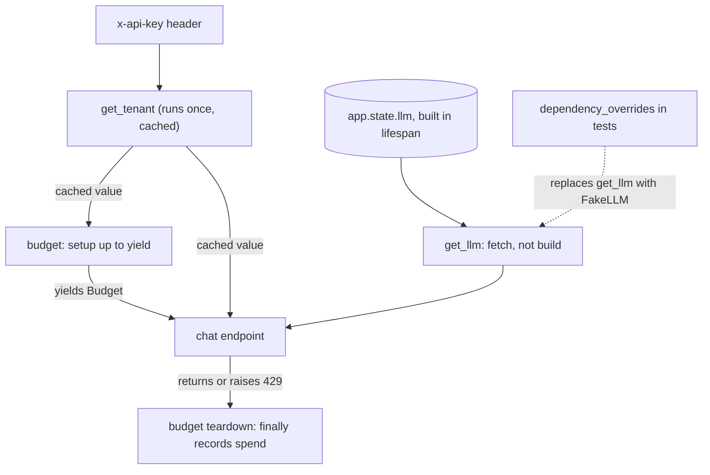

## TL;DR
`Depends` is how an agent endpoint gets its LLM client, the user's permitted tools, a token budget and a
checkpointer as typed parameters. FastAPI resolves, caches and cleans them per request; tests swap the
LLM with `dependency_overrides`.

## For agent builders
- **Why it matters for agents.** An agent run needs a different toolset per user (permissions,
  tenant data), a spend cap per run, and a model client that tests can replace with a scripted fake.
  Dependencies give each of those one typed, overridable seam instead of globals inside the agent loop.
- **Where it shows up in your stack.** `Depends(get_llm)`, `Depends(get_tools)`, `Depends(budget)` on
  `/agent/run`; router-level auth; and `app.dependency_overrides` in tests that run the agent against a
  fake model returning a fixed tool call, so agent tests are deterministic and cost nothing.
- **What you control.** Which tools a principal may see (built per request from their scopes), where the
  shared client comes from (lifespan, never built per request), what cleanup runs after the run (record
  spend, close the session), and what tests replace.
- **What you can skip.** DI container libraries and the dependency-graph internals. Know caching, `yield`
  teardown, sibling ordering and overrides.

## Why it exists
- **Every endpoint needs the same things.** Who is calling, which tenant, a provider client, a retrieval
  index, a DB session, a request ID for logs. Version one gets these from module-level globals and helper
  calls at the top of each handler.
- **Globals fail in three predictable ways.** Tests cannot replace them cleanly, so unit tests hit the
  real provider or monkeypatch half the module. Auth and quota checks are duplicated and one route forgets
  them. Lifecycle resources (a session to close, a transaction to commit or roll back) are cleaned up
  inconsistently, usually with a `try/finally` one handler lacks.
- **The usual alternatives fall short.** "Write a decorator" fixes duplication but not typing or testing,
  and cannot easily pass values in. "Use a DI container library" adds a second configuration language and
  knows nothing about request scope, OpenAPI security schemes or the thread pool.
- **`Depends` is DI inside the request pipeline.** Dependencies are typed callables that can depend on
  others, so FastAPI builds a tree per route and resolves it per request *because* the request is the
  natural unit of scope for auth, sessions and tracing.
- **Each feature has a reason.** `yield` dependencies attach cleanup *because* teardown must run even
  when the handler raises; `dependency_overrides` exists *because* tests need a seam to replace the model
  client; security metadata reaches OpenAPI, so docs follow the code.

## How it works
### Declaring and resolving
- **Any callable works:** a function, an `async def`, a class, or an object with `__call__`.
- **Declare it on the endpoint:** `client: Annotated[LLMClient, Depends(get_llm)]`.
- **At request time** FastAPI inspects the signature, resolves `get_llm`'s own parameters (path, query,
  header and body parameters, or further `Depends`), calls it, and passes the result in.
- **Depth-first, leaves first.** An endpoint depending on `get_user`, which depends on `get_token`, which
  reads the `Authorization` header, receives a fully built user object.
- **Siblings run one after another, not concurrently**, even when both are `async def`. Two independent
  dependencies that each await a 200 ms lookup add 400 ms before the handler starts. To overlap them, make
  one dependency that runs both in a task group and returns the pair.

### Per-request caching
- **Called once per request.** If `get_settings` appears under both `get_llm` and `get_retriever`, it runs
  once and the value is reused, *because* most dependencies are deterministic for a request and calling
  them twice would double DB lookups or token verifications.
- **Opt out** with `Depends(fn, use_cache=False)` when repeated evaluation is the point (a fresh
  timestamp, a new sub-span).

### Sync and async
- **Same rule as endpoints:** `async def` dependencies run on the event loop; `def` dependencies run in
  the thread pool.
- **Blocking work belongs in `def`.** Verifying a JWT with a sync library or opening a sync DB session in
  an `async def` dependency stalls the loop for every request in the process.

### Cleanup with yield
1. **Setup** runs up to `yield`; the yielded value goes to the handler.
2. **The handler runs.**
3. **Teardown** resumes after the handler finishes, in reverse order of setup.
4. **Exceptions** raised in the endpoint are re-raised at the `yield` point, so `try/except/finally`
   around it can roll back a transaction and still close the session.

- **Timing caveat.** When exit code runs relative to sending the response bytes has changed between
  FastAPI versions, so never use a yielded resource from a background task and never rely on teardown
  having finished before the client sees the response.

### Parameterised dependencies
- **Instances as dependencies.** A dependency is looked up by the callable object, so an *instance* with
  `__call__` gives one class many configurations: `Depends(RateLimit(per_minute=60))` on the chat route,
  `Depends(RateLimit(5))` on an expensive batch route.
- **Each instance is distinct** for caching and for `dependency_overrides`, *because* the key is the
  object itself. To override it in tests, keep a reference to the instance you registered.

### Side-effect, security and override hooks
| Feature | What it does |
|---|---|
| `dependencies=[Depends(verify_api_key)]` on a route, router or app | runs the dependency without binding its return value: enforce auth or quotas on a whole router without a parameter in every handler |
| `Security(get_user, scopes=["chat:write"])` | `Depends` plus scope metadata; with `OAuth2PasswordBearer`, `APIKeyHeader` or `HTTPBearer` it emits the security scheme into OpenAPI, so the docs show the lock icon and clients know what to send |
| `app.dependency_overrides[get_llm] = lambda: FakeLLM()` | replaces a dependency everywhere it is used, for as long as the entry exists; keyed by the callable, so it reaches nested uses too |

Overrides are the seam for running an AI service's tests against a canned model, a SQLite session or a
fixed tenant.

### Where dependencies meet lifespan
- **Dependencies fetch; lifespan builds.** The provider client, model, engine or index is created once in
  lifespan and stored on `app.state`; a dependency reads `request.app.state.llm` and returns it.
- **Same interface for everything.** Every handler gets the shared object through a typed, overridable
  dependency.
- **Request-scoped objects** (a session, a per-tenant configuration, a trace span) are created inside the
  dependency and torn down after `yield`.

### Dependencies in an agent endpoint
| Dependency | Scope | Why it is a dependency |
|---|---|---|
| `get_llm` | fetches the lifespan client | tests swap it for a scripted fake |
| `get_tools(principal)` | built per request | the toolset is filtered by the caller's scopes, so the model never sees a tool it may not use |
| `budget` (yield) | per run | caps spend across all steps, records spend in teardown even on a 429 |
| `get_checkpointer` | fetches a shared store | resumes or persists agent state; tests use an in-memory store |

## Diagram
The dependency tree for the `/chat` example below, resolved leaves first: `get_tenant` is shared by two
dependents but runs once, the client comes from lifespan state, and the yield dependency's teardown
runs after the handler, even when it raises.



## Examples
### Agent endpoint with per-user tools and a scripted fake model in tests
The toolset is built per request from the caller's scopes, so a viewer's agent cannot even propose
`refund_order`. In the test, `ScriptedLLM` returns a fixed tool call and then an answer, which makes the
agent loop deterministic and free to run in CI.

```python
from typing import Annotated
from fastapi import Depends, FastAPI, Header, HTTPException, Request
from fastapi.testclient import TestClient

app = FastAPI()
USERS = {"key-viewer": {"id": "u1", "scopes": {"orders:read"}},
         "key-admin": {"id": "u2", "scopes": {"orders:read", "orders:refund"}}}
ALL_TOOLS = {"lookup_order": "orders:read", "refund_order": "orders:refund"}

def get_principal(x_api_key: Annotated[str, Header()]) -> dict:
    p = USERS.get(x_api_key)
    if p is None:
        raise HTTPException(401, "invalid api key")
    return p

def get_tools(p: Annotated[dict, Depends(get_principal)]) -> list[str]:
    return [t for t, scope in ALL_TOOLS.items() if scope in p["scopes"]]   # per request

def get_llm(request: Request):
    return request.app.state.llm                      # built once in lifespan (not shown)

@app.post("/agent/run")
async def run(task: str, tools: Annotated[list[str], Depends(get_tools)], llm=Depends(get_llm)):
    history, steps = [task], []
    for _ in range(5):                                # max steps
        reply = await llm.next(history, tools)
        if reply["type"] == "answer":
            return {"answer": reply["text"], "steps": steps}
        if reply["tool"] not in tools:                # defence in depth: re-check every call
            raise HTTPException(403, f"tool {reply['tool']} not allowed")
        steps.append(reply["tool"]); history.append(f"{reply['tool']} -> ok")
    return {"answer": None, "steps": steps}

class ScriptedLLM:                                    # deterministic fake for agent tests
    def __init__(self): self.calls = 0
    async def next(self, history, tools):
        self.calls += 1
        return {"type": "tool", "tool": "lookup_order"} if self.calls == 1 else {"type": "answer", "text": "shipped"}

app.dependency_overrides[get_llm] = ScriptedLLM       # class is callable: fresh fake per request
with TestClient(app) as c:
    r = c.post("/agent/run", params={"task": "where is order 7?"}, headers={"x-api-key": "key-viewer"})
    assert r.json() == {"answer": "shipped", "steps": ["lookup_order"]}
app.dependency_overrides.clear()
```

### Worked scenario: agent test suite with and without the override
A suite of 200 agent tests, each averaging 4 steps (illustrative costs and latencies).

| | Real model | `ScriptedLLM` override |
|---|---|---|
| LLM calls per CI run | 200 × 4 = 800 | 0 |
| Wall time (about 3 s per call, run serially) | ~40 minutes | seconds |
| Flaky failures | model output varies between runs | none: the script is fixed |
| What it tests | prompt quality and wiring together | wiring: tool filtering, budget, loop limits, error paths |

Keep a separate, smaller eval suite against the real model for prompt quality; do not mix the two.

### Auth, shared client, request-scoped budget and a test override
- **Auth:** an API-key dependency.
- **Shared client:** the LLM client fetched from `app.state`.
- **Request scope:** a yield dependency holding a per-request spend cap (here $0.50) whose spend is
  recorded even when the handler raises a 429.
- **Test seam:** the override that keeps the suite from spending tokens.
- **Caching:** `get_tenant` appears twice in the tree (directly and under `budget`) but runs once per
  request.

```python
from typing import Annotated
from fastapi import Depends, FastAPI, Header, HTTPException, Request
from fastapi.testclient import TestClient

app = FastAPI()
TENANTS = {"key-acme": {"id": "acme", "max_request_usd": 0.50}}

def get_tenant(x_api_key: Annotated[str, Header()]) -> dict:
    tenant = TENANTS.get(x_api_key)
    if tenant is None:
        raise HTTPException(401, "invalid api key")
    return tenant

def get_llm(request: Request):
    return request.app.state.llm       # created once in lifespan (not shown); fetched per request

class Budget:
    def __init__(self, limit): self.limit, self.spent = limit, 0.0
    def charge(self, usd):
        self.spent += usd
        if self.spent > self.limit: raise HTTPException(429, "budget exceeded")

async def budget(tenant: Annotated[dict, Depends(get_tenant)]):
    b = Budget(tenant["max_request_usd"])     # request-scoped: fresh per request
    try:
        yield b
    finally:
        print("record spend", tenant["id"], b.spent)   # persist to the ledger; runs even on 429

@app.post("/chat")
async def chat(prompt: str, tenant: Annotated[dict, Depends(get_tenant)],
               b: Annotated[Budget, Depends(budget)], llm=Depends(get_llm)):
    text, cost = await llm.complete(prompt)
    b.charge(cost)                  # post-hoc; a real cap also pre-checks an estimated cost
    return {"tenant": tenant["id"], "text": text}

class FakeLLM:                                       # test seam: no production code changes
    async def complete(self, prompt): return f"echo: {prompt}", 0.001
app.dependency_overrides[get_llm] = lambda: FakeLLM()
with TestClient(app) as c:
    r = c.post("/chat", params={"prompt": "hi"}, headers={"x-api-key": "key-acme"})
    assert r.json()["text"] == "echo: hi"
```

### Runnable: sibling dependencies add up, a combined one overlaps
Two independent 200 ms lookups declared as siblings cost ~400 ms before the handler starts; one
dependency that runs both in a task group costs ~200 ms.

```python
import asyncio, time
from typing import Annotated
import anyio
from fastapi import Depends, FastAPI
from fastapi.testclient import TestClient

app = FastAPI()

async def get_profile() -> dict:
    await asyncio.sleep(0.2)                 # stand-in for a 200 ms lookup
    return {"plan": "pro"}

async def get_quota() -> int:
    await asyncio.sleep(0.2)                 # another independent 200 ms lookup
    return 1000

@app.get("/slow")                            # siblings resolve one after another: ~400 ms
async def slow(p: Annotated[dict, Depends(get_profile)], q: Annotated[int, Depends(get_quota)]):
    return {"plan": p["plan"], "quota": q}

async def profile_and_quota() -> tuple[dict, int]:
    out = {}
    async def run(key, fn): out[key] = await fn()
    async with anyio.create_task_group() as tg:   # both lookups overlap: ~200 ms
        tg.start_soon(run, "p", get_profile)
        tg.start_soon(run, "q", get_quota)
    return out["p"], out["q"]

@app.get("/fast")
async def fast(pq: Annotated[tuple[dict, int], Depends(profile_and_quota)]):
    p, q = pq
    return {"plan": p["plan"], "quota": q}

with TestClient(app) as c:
    for path in ("/slow", "/fast"):
        t0 = time.perf_counter(); c.get(path)
        print(path, f"{(time.perf_counter() - t0) * 1000:.0f} ms")   # ~405 ms, then ~205 ms
```

## Production patterns
- **Build the toolset per request from the principal.** Use on every multi-user agent: a dependency
  filters the tool registry by the caller's scopes and tenant, the agent only sees that list, and the
  executor re-checks each call. Monitor denied tool calls; a non-zero rate means the model is proposing
  tools it was never offered, or a prompt injection is trying.
- **Scripted fakes for agent wiring tests.** Use in CI: override `get_llm` with a fake that returns a
  fixed sequence of tool calls and answers, so tests cover tool filtering, budgets and step limits with
  no tokens spent. Run real-model evals separately and track their pass rate per prompt version.
- **Enforce auth at router level.** Use for every group of protected routes: create
  `APIRouter(dependencies=[Depends(verify_api_key)])` so new routes inherit it. Add a test that walks
  `app.routes` and fails if a protected path lacks the dependency; monitor 401 rate per route.
- **Override fixtures that always clean up.** Use in every test suite: a pytest fixture sets
  `app.dependency_overrides[get_llm] = lambda: FakeLLM()`, yields a `TestClient`, then calls
  `app.dependency_overrides.clear()`. Watch for order-dependent CI failures as the sign a fixture leaks.
- **Fetch shared clients, never build them.** Use for provider clients, engines and indexes: create them in
  lifespan, store on `app.state`, and expose them through a one-line dependency. Monitor connection-pool
  reuse and TLS handshake counts; a rise means something builds clients per request.
- **Reusable `Annotated` aliases.** Use when many routes share a dependency: define
  `CurrentTenant = Annotated[dict, Depends(get_tenant)]` once and annotate parameters with it, so the
  wiring is identical everywhere and one override covers all routes.
- **Trace time spent before the handler.** Use when latency is unexplained: open a span or timer inside
  slow dependencies and compare total request time to handler time. Merge independent slow siblings into
  one task-group dependency, as in the runnable example.

## Trade-offs
- **Explicit needs vs hidden cost.** Typed, per-request resolution makes every handler's needs explicit
  and testable, but deep trees hide the cost of each request (three DB lookups behind one parameter) until
  you trace them.
- **Caching vs freshness.** Per-request caching avoids repeated work within a request and flips into a bug
  when a dependency is meant to produce fresh values each call, which is what `use_cache=False` is for.
- **Zero-boilerplate seam vs global state.** `dependency_overrides` is global on the app object, so a test
  that forgets to clear it leaks a fake into the next test.
- **Request-tied cleanup vs background work.** Yield dependencies are the right scope for sessions and
  spans, but their teardown timing relative to the response has shifted across versions, so they are the
  wrong tool for anything a background task needs.

## Pitfalls
- **Building the expensive object inside the dependency.** `httpx.AsyncClient()` or a model load per
  request. Symptom: connection pools never warm up, TLS handshakes on every call, memory climbing with
  concurrency.
- **Blocking work in an `async def` dependency.** Such as sync JWT verification with a network JWKS fetch.
  Symptom: the whole process stalls during login spikes, not just the authenticating requests.
- **A yield dependency's DB session inside a `BackgroundTasks` function.** Symptom: intermittent "session
  is closed" errors whose frequency depends on timing and FastAPI version.
- **Forgetting `dependencies=[Depends(auth)]` on a new router.** Symptom: one unauthenticated route found
  in a pentest, because auth was attached per route instead of per router.
- **Building the agent's toolset once at startup for everyone.** Symptom: a read-only user's agent issues
  a refund because the model saw every tool. Fix: build the list in a per-request dependency from the
  principal, and re-check each call in the tool executor.
- **Leaving `app.dependency_overrides` set after a test.** Symptom: a later test passes against the fake
  model locally and fails when CI runs the files in a different order.

## When to use
- **Use `Depends` for anything not in the request body:** authentication and authorisation, tenant
  resolution, sessions and transactions, shared clients and models, per-request budgets, pagination
  parameters, feature flags.
- **Put enforcement-only dependencies at router level.**
- **Keep dependencies small and composable**, and have them fetch rather than build long-lived resources.
- **In tests, override where the real world starts:** the LLM client, the vector store, the database.
- **Measure:** count dependency calls per request when latency is unexplained.
- **Interviews:** "how would you test this endpoint without calling the model?" and "where does the DB
  session get closed if the handler raises?"; `dependency_overrides` and `yield` with `try/finally` are
  the answers.

## Role lens
- **Engineer:** Writes auth, session and client dependencies, uses `Annotated` types for them, and
  overrides the model client in tests so the suite never spends tokens.
- **Architect:** Defines the dependency boundaries every service shares — principal, tenant, budget,
  tracing — so teams compose them rather than reinvent them.
- **FDE:** Swaps a customer-specific auth or data-source dependency into an existing service without
  forking handlers, using overrides to demo against sandbox systems.

## Check yourself
**Q:** A service has `get_db` (yield: opens a session, commits on success, rolls back on exception),
`get_user` (depends on `get_db`), and a `/generate` endpoint depending on both plus `get_llm`. A
teammate adds a background task that writes the generation result using the session from `get_db`,
and tests now hit the real provider. Explain what is wrong and how you would restructure.
**A:** The background task runs after the handler returns, while the session's lifetime ends after
`yield`; depending on FastAPI version the session may already be closed when the task runs, giving
intermittent errors, and in any case a request-scoped resource must not outlive the request. The task
should open its own session, or the write should move into the handler before returning, or the work
should go to a durable queue. Tests hitting the provider means `get_llm` is not overridden: register
`app.dependency_overrides[get_llm]` with a fake in a fixture and clear it on teardown. Note that
`get_db` is resolved once per request thanks to caching, so `get_user` and the handler share one
session and one transaction, which is the intended scope.

## Interview questions
### What problem does `Depends` solve that module-level globals do not?
- **Testability:** dependencies are typed callables keyed in `app.dependency_overrides`, so a test swaps
  the LLM client for a fake without monkeypatching the module.
- **Consistency:** auth, tenant and quota checks are declared once, or attached to a whole router with
  `dependencies=[...]`, instead of being copied into each handler where one route forgets them.
- **Lifecycle:** `yield` dependencies give every session or transaction the same teardown, even when the
  handler raises, because the exception is re-raised at the `yield` point.

### How do you test an agent endpoint's loop logic without calling the model?
- **Override the client.** `app.dependency_overrides[get_llm]` with a scripted fake that returns a fixed
  tool call, then an answer, so each test is deterministic and spends no tokens.
- **Test the wiring, not the prompt:** tool filtering by scope, step limits, budget teardown, behaviour
  when a tool fails or the model proposes a tool it was not given.
- **Clean up and separate.** Set and clear overrides in a fixture, and keep real-model evals in their own
  suite measured by pass rate.

### How do you make sure each user's agent can only call the tools that user is allowed to use?
- **A per-request dependency builds the toolset** from the principal's scopes and tenant, so the model is
  never offered a tool the user may not use.
- **Re-check at execution.** The tool executor validates each call against that same list, because the
  model (or an injected instruction) can still name a tool it was not given.
- **Attach auth at router level** so a new agent route cannot ship without the principal dependency.

### A protected endpoint has 400 ms of latency before the handler body even starts. How do you find and fix it?
- **Trace the dependency tree.** Open a span or timer inside each slow dependency and compare total
  request time with handler time.
- **Look for sibling lookups.** Sibling dependencies run one after another, so two independent 200 ms
  lookups add 400 ms.
- **Fix:** merge them into one dependency that runs both in a task group (about 200 ms), and check that
  no `async def` dependency does blocking work such as a sync JWKS fetch.

### Why is a `yield` dependency the wrong place to hold a resource a background task needs?
- **Its lifetime ends with the request.** Teardown runs after `yield`, and when it runs relative to the
  response bytes has changed between FastAPI versions.
- **So the background task may get a closed session**, producing intermittent "session is closed" errors
  that depend on timing and version.
- **Instead:** let the task open its own session, do the write in the handler before returning, or move
  the work to a durable queue.

### How do you apply different rate limits to different routes with one dependency class?
- **Use instances with `__call__`:** `Depends(RateLimit(per_minute=60))` on the chat route and
  `Depends(RateLimit(5))` on an expensive batch route.
- **Each instance is a distinct dependency** for caching and overrides, because the key is the object
  itself.
- **In tests, keep a reference** to the instance you registered, since overriding a new `RateLimit(...)`
  object matches nothing.

## Quiz
### Q: `get_settings` is a dependency of both `get_llm` and `get_retriever`, and an endpoint depends on both. How many times does `get_settings` run per request by default?
- [ ] Twice, once per dependent
- [x] Once; the result is cached for the rest of that request
- [ ] Once per worker process, at startup
- [ ] Zero times until a handler accesses the value
> FastAPI caches a dependency's result within a single request when the same callable appears multiple
> times; `use_cache=False` disables this for dependencies that must run every time.

### Q: Where should an `httpx.AsyncClient` for the model provider be created, and what should the dependency do?
- [ ] Created inside the dependency on every request, so each request has a clean client
- [x] Created once in lifespan and stored on `app.state`; the dependency returns that shared instance
- [ ] Created as a module-level global at import time
- [ ] Created in a `BaseHTTPMiddleware` and attached to the request
> The client owns a connection pool that must persist across requests; the dependency's job is to
> provide typed, overridable access to the shared object, not to build it.

### Q: How do tests replace the real LLM client dependency without modifying production code?
- [ ] Monkeypatch `httpx.AsyncClient.post` globally
- [ ] Set an environment variable that the dependency checks
- [x] Register a fake in `app.dependency_overrides[get_llm]` and clear it afterwards
- [ ] Subclass `FastAPI` and override `__call__`
> Overrides are keyed by the dependency callable and apply everywhere it is used, including nested
> dependencies, which makes them the designated seam for test doubles.
