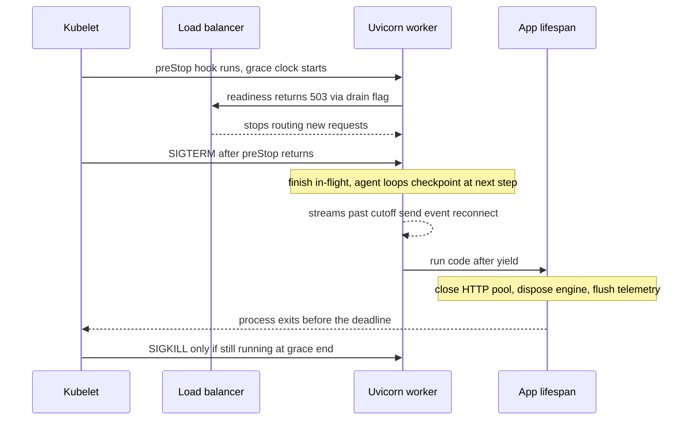

## TL;DR
Every deploy sends SIGTERM to workers mid agent run. A graceful worker stops taking
traffic, finishes or checkpoints in-flight work, closes resources and exits before SIGKILL. Agent runs
outlast the default 30-second grace, so drain needs a budget and a plan.

## For agent builders
- **Why it matters for agents.** A killed agent run is worse than a killed request: paid model calls are
  lost, a tool side effect (ticket created, email sent) may have happened with no record, and the user
  sees a run that just stops. Shutdown is when that happens, many times a day.
- **Where it shows up in your stack.** The pod spec (`terminationGracePeriodSeconds`, `preStop`), the
  Uvicorn or Gunicorn drain timeout, the Dockerfile `CMD`, your readiness endpoint, and the agent loop
  itself, which must check a drain flag between steps and checkpoint.
- **What you control.** The grace budget, where long runs execute (request path or durable worker), how
  often the loop checkpoints, and what the client sees when a stream is cut (a reconnect event, a run id
  to resume).
- **What you can skip.** Signal-handling internals of Uvicorn and Gunicorn. Know the SIGTERM-to-SIGKILL
  timeline and the budget formula.

## Why it exists
- **Processes are stopped far more often than they crash.** Every rolling deploy, autoscaler scale-down,
  spot instance reclaim and node upgrade terminates workers that are busy.
- **Exiting immediately kills open requests.** For a CRUD API that is a few failed 50 ms calls which
  clients retry. For an LLM service it is an answer stopping halfway after 40 seconds, an agent run losing
  several paid tool calls, or an ingestion request that already spent money on embeddings starting over.
- **Unbounded waiting fails the other way.** One client holding a stream open blocks deploys forever, and
  the orchestrator eventually sends SIGKILL anyway, losing the work *and* skipping cleanup.
- **Ordering is a trap.** On Kubernetes, SIGTERM and load-balancer endpoint removal happen in parallel, so
  a worker that stops accepting at once still receives new requests for a short window and refuses them.
- **Graceful shutdown sequences these steps deliberately.**

## How it works
### The signals
| Signal | Meaning | Catchable |
|---|---|---|
| **SIGTERM** | "please stop"; Uvicorn and Gunicorn treat it as a graceful shutdown | yes |
| **SIGKILL** | sent when the grace period expires; nothing after it runs, including lifespan shutdown | no |

- **`terminationGracePeriodSeconds`** (default 30) is the whole budget from the start of termination to
  SIGKILL.
- **The clock starts when the `preStop` hook starts.** SIGTERM is sent only after the hook returns, so the
  hook's duration comes out of the same budget.

### The sequence
1. **Stop new traffic first.** A `preStop` hook (often a sleep of a few seconds) delays SIGTERM so endpoint
   controllers and load balancers stop routing to the pod before the process stops listening.
   - Kubernetes removes a terminating pod from Service endpoints on its own, but an external balancer that
     polls `/readyz` does not know.
   - The app does not learn about SIGTERM until lifespan shutdown, which runs only *after* draining.
   - So the hook can also tell the app it is draining (for example a local `POST /internal/drain` that sets
     a flag): readiness then fails, and long streams and agent loops know a cutoff is coming.
   - An in-memory flag is per process; with several workers in one pod, one request reaches only one of
     them. Run one worker per pod, or have the hook touch a file (`/tmp/draining`) every worker's readiness
     check reads.
2. **Stop accepting, keep serving.** On SIGTERM, Uvicorn closes the listening socket, closes idle
   keep-alive connections and waits for in-flight requests.
   - `--timeout-graceful-shutdown` bounds that wait; without it Uvicorn waits indefinitely and leaves the
     bound to SIGKILL.
   - Under Gunicorn, the master forwards the signal and `--graceful-timeout` bounds the workers' drain.
3. **Run lifespan shutdown.** After requests drain, the code after `yield` runs: close the HTTP client
   pool, dispose the DB engine, flush telemetry exporters (including the agent's trace spans), release GPU
   memory.
4. **Exit before SIGKILL**, with margin, so step 3 actually happens.

### The budget
```
terminationGracePeriodSeconds ≥ preStop delay + longest request you intend to finish + cleanup time
```
- Set the server's drain timeout slightly below the grace period minus preStop, so the server, not
  SIGKILL, decides what gets cut off and lifespan cleanup still runs.

### Work that cannot finish
Some requests should not be waited for: a 10-minute agent run, or a stream the client keeps open. Three
strategies, in order of robustness:
1. **Move it out of the request.** Long jobs go to a durable queue; the API returns a job id and the client
   polls or subscribes. The queue survives the worker.
2. **Make it resumable.** Persist progress (tokens generated, steps completed) and let the client reconnect
   with an id, so a cut stream can continue elsewhere. For agents this is a checkpoint after every step:
   transcript so far, pending tool call, and which side effects already ran.
3. **End it cleanly.** Once draining, a stream that will not finish inside the budget sends a final
   "reconnect" event and closes, so the client retries instead of rendering a truncated answer. This must
   happen before the server's drain timeout; after that the connection is just closed.

### The agent loop's part
- **Check the flag at step boundaries, never mid-tool-call.** Between steps the state is consistent: the
  last tool result is recorded, the next model call has not been made.
- **Checkpoint, then stop.** Write the run's state, mark it `interrupted`, emit a reconnect or resume event
  with the run id, and return. A worker on the new version picks it up.
- **Side-effecting tools need idempotency keys,** because a run resumed after a kill may repeat the last
  call if the checkpoint was written before the side effect completed.

### Draining that is not pod termination
- **Recycling and reloads drain too.** Gunicorn's `--max-requests` recycling and a `SIGHUP` reload retire
  workers: the retiring worker stops accepting and finishes in-flight requests within `--graceful-timeout`
  while the master starts a replacement, so siblings carry the load.
- **A single worker has no siblings.** New connections wait in the socket backlog until the replacement
  finishes lifespan startup: a latency spike every few thousand requests if the model loads slowly.
- **Cloud load balancers drain on their own timer.** An AWS ALB target group's deregistration delay
  defaults to 300 s. It should cover the server's drain timeout; much longer only slows deploys.

### Containers
- **The process must actually receive the signal.** A Dockerfile `CMD` in shell form wraps the server in
  `/bin/sh -c`; the shell becomes PID 1 and does not forward SIGTERM, so the server is SIGKILLed after the
  grace period with no drain at all.
- **Do not rely on shell luck.** Some shells exec a single simple command directly, hiding the bug until
  someone adds `&&` or a second command.
- **Fix:** exec form (`CMD ["uvicorn", ...]`), `exec` in an entrypoint script, or an init process such as
  tini.

## Diagram
Read it top to bottom as one grace budget: preStop, then SIGTERM and drain (agent loops checkpoint at the
next step), then lifespan cleanup, all before SIGKILL at the end of `terminationGracePeriodSeconds`.



## Examples
### Agent scenario: a loop that checkpoints and yields on drain
The agent loop checks the shared drain file between steps. If draining, it saves the run and tells the
client to resume elsewhere instead of being killed mid-tool-call.

```python
import json
from pathlib import Path

DRAIN_FILE = Path("/tmp/draining")             # touched by the preStop hook

async def run_agent(run_id: str, store, llm, tools, max_steps: int = 30):
    state = await store.load(run_id)       # {"messages": [...], "step": n, "pending": [...]}
    while state["step"] < max_steps:
        if not state.get("pending"):       # step boundary: no tool call half-done
            if DRAIN_FILE.exists():
                await store.save(run_id, state, status="interrupted")
                yield f"event: resume\ndata: {json.dumps({'run_id': run_id})}\n\n"
                return
            reply = await llm.complete(state["messages"], tools=tools.schemas())
            state["messages"].append(reply.message)
            if not reply.tool_calls:
                await store.save(run_id, state, status="done")
                yield f"event: done\ndata: {json.dumps({'text': reply.text})}\n\n"
                return
            state["pending"] = [{"id": c.id, "name": c.name, "args": c.arguments}
                                for c in reply.tool_calls]
            await store.save(run_id, state, status="running")   # plan saved before side effects
        for call in state["pending"]:
            # a run resumed after a kill re-runs these with the same ids, so the same keys
            result = await tools.call(call["name"], call["args"],
                                      idempotency_key=f"{run_id}:{call['id']}")
            state["messages"].append({"role": "tool", "tool_call_id": call["id"], "content": result})
        state["pending"] = []
        state["step"] += 1
        await store.save(run_id, state, status="running")       # checkpoint every step
        yield f"event: step\ndata: {json.dumps({'step': state['step']})}\n\n"
```

- **`store`, `llm` and `tools` are your own interfaces** (a Postgres or Redis checkpoint store, a provider
  client, a tool registry); the shape, not a library API, is the point.
- **The client treats `resume` like `reconnect`:** it calls a resume endpoint with the run id and lands on
  a pod that is not draining.
- **Pending tool calls are saved before they run.** If the pod is SIGKILLed mid-step, the resumed run
  replays the same calls with the same ids instead of asking the model again (which would return new ids
  and new keys), so the tool's idempotency store turns each repeat into a no-op.

### Worked scenario: what one deploy costs a research agent
Illustrative numbers: runs take ~20 steps of ~6 s each (about 120 s), each step costs about $0.02 in model
calls, and 40 runs are in flight when a rolling deploy starts.

| Setup | What happens to the 40 runs | Lost model spend | Side effects |
|---|---|---|---|
| Defaults: grace 30 s, run in request, no checkpoints | most are SIGKILLed mid-run and restart from step 0 | ~40 × 10 steps × $0.02 ≈ $8 per deploy | unknown: some tool calls ran, none recorded |
| Grace 150 s, no checkpoints | typical runs finish, but any run longer than the drain budget is still cut; every pod takes up to 150 s to stop | lower, not zero | still unknown for the cut runs |
| Drain flag plus per-step checkpoints | each run stops at its next step boundary (within ~6 s) and resumes on a new pod | at most the in-flight step per run | recorded, and idempotency keys stop duplicates |

- **Ten deploys a day at the default setup** is ~$80 a day of discarded model calls, before counting
  user-visible failures.
- **Checkpointing beats a longer grace** because the budget only has to cover one step, not one run.

### Worked timeline: SSE chat on a rolling deploy
Answers take up to 50 seconds. **Defaults first:** grace 30 s, no preStop, Uvicorn waits indefinitely.

| t (s) | What happens |
|---|---|
| 0 | SIGTERM while 12 streams are open, the longest 10 s into a 50 s answer; Uvicorn stops listening |
| 0-1 | endpoint update lags, so a few new requests get connection refused |
| 30 | kubelet sends SIGKILL: streams with more than 30 s left are cut mid-sentence |
| 30 | lifespan shutdown never runs, so buffered telemetry spans are lost, which is why the incident is hard to see |

**Fixed configuration** (illustrative values):

```yaml
spec:
  terminationGracePeriodSeconds: 75
  containers:
    - name: api
      command: ["uvicorn", "app.main:app", "--host", "0.0.0.0", "--port", "8000",
                "--timeout-graceful-shutdown", "60"]
      lifecycle:
        preStop:
          exec:
            command: ["sh", "-c", "curl -s -X POST localhost:8000/internal/drain; sleep 5"]
```

| t (s) | What happens |
|---|---|
| 0 | preStop sets the drain flag; readiness now returns 503; pod removed from endpoints while still serving |
| 5 | SIGTERM reaches Uvicorn (exec form, PID 1), which stops accepting and drains |
| about 50 | streams that started before t=0 finish |
| before 65 | a rare outlier near its deadline sees the flag and sends `event: reconnect` (Uvicorn would close it at 65 anyway) |
| about 67 | lifespan closes clients and flushes telemetry, eight seconds before SIGKILL at 75 |

Answers longer than the budget are the signal to move that workload to a job queue.

### App side: drain flag, readiness and a stream that ends cleanly
The flag is a file so every worker in the pod sees it. Streams keep going after the flag flips and only
send `reconnect` once they pass the cutoff, matching the timeline above.

```python
import asyncio, time
from contextlib import asynccontextmanager
from pathlib import Path
import httpx
from fastapi import FastAPI, Response
from fastapi.responses import StreamingResponse

DRAIN_FILE = Path("/tmp/draining")   # shared by every worker in the pod
CUTOFF_S = 58                        # flag at t=0, Uvicorn closes at 5 + 60: leave margin

def draining() -> bool:
    return DRAIN_FILE.exists()

def past_cutoff() -> bool:
    try:
        return time.time() - DRAIN_FILE.stat().st_mtime > CUTOFF_S
    except FileNotFoundError:
        return False

@asynccontextmanager
async def lifespan(app: FastAPI):
    app.state.http = httpx.AsyncClient(timeout=30)
    yield                                   # requests are served here
    await app.state.http.aclose()           # runs only if the server exits before SIGKILL

app = FastAPI(lifespan=lifespan)

@app.post("/internal/drain", include_in_schema=False)
async def drain():
    DRAIN_FILE.touch()
    return {"draining": True}

@app.get("/readyz")
async def readyz(response: Response):
    if draining():
        response.status_code = 503
    return {"ready": not draining()}

async def tokens():                         # stand-in for a provider stream
    for i in range(500):
        await asyncio.sleep(0.1)
        yield f"tok{i} "

@app.get("/v1/chat/stream")
async def chat_stream():
    async def events():
        async for tok in tokens():
            if past_cutoff():
                yield "event: reconnect\ndata: {}\n\n"
                return
            yield f"data: {tok}\n\n"
        yield "event: done\ndata: {}\n\n"
    return StreamingResponse(events(), media_type="text/event-stream")
```

## Production patterns
- **Long agent runs as durable jobs.** Anything that can exceed the budget or performs side effects runs
  in a queue worker that checkpoints between tool calls, and the API only starts runs and streams their
  events. Monitor: jobs retried after worker termination and duplicate side effects.
- **Checkpoint per step, resume by run id.** For runs that stay in the request path, save state at each
  step boundary and stop at the next boundary once draining, as above. Monitor: runs ending as
  `interrupted` per deploy and the share that resume successfully.
- **Exec-form entrypoint, always.** Use `CMD ["uvicorn", ...]`, `exec uvicorn ...` in scripts, or tini as
  PID 1. Monitor: termination duration per pod; shutdowns that take exactly the grace period mean the
  signal never reached the server.
- **Budget written down and checked in review.** Keep `terminationGracePeriodSeconds`, the preStop delay
  and `--timeout-graceful-shutdown` (or Gunicorn's `--graceful-timeout`) next to each other in the
  manifest and check grace ≥ preStop + drain + cleanup. Monitor: request-duration p99 against the drain
  timeout, alerting when long requests approach it.
- **Delay-only preStop and an aligned balancer.** When the image is slim and only a delay is needed, use
  the built-in sleep action on recent Kubernetes (`preStop: {sleep: {seconds: 5}}`), or a Python one-liner
  to call the drain endpoint; set the target group deregistration delay (300 s by default on an AWS ALB)
  just above the server's drain timeout. Monitor: `FailedPreStopHook` events and 502s during rollouts.
- **Record why each stream ended.** Count stream completions by reason (`done`, `reconnect`, client
  disconnect, server error) as a metric. Monitor: `reconnect` and errors spiking at deploy time, which
  says the budget or the workload placement is wrong.

## Trade-offs
- **Long grace vs rollout speed.** A long grace period lets long streams finish, but it slows rollouts and
  scale-downs proportionally; past a minute or two, durable jobs or resumable streams are cheaper than
  waiting.
- **preStop sleep vs budget.** It prevents refused connections during endpoint propagation, but adds its
  duration to every pod termination and eats into the grace budget.
- **Bounded drain vs cut requests.** Bounding the server's drain timeout guarantees cleanup runs, but it
  deliberately cuts the longest requests; flip to an unbounded wait only for workers with no streaming or
  long requests.
- **Resumable streams vs build cost.** They avoid lost work on any shutdown, but require persisted
  generation state and client support, worth building only when long generations are core to the product.
- **Checkpoint every step vs write load.** Per-step checkpoints bound lost work to one step, but add one
  store write per step; for 30-step runs at high volume, checkpoint after side-effecting steps only.

## Pitfalls
- **Shell-form `CMD` in the Dockerfile.** Symptom: every shutdown takes exactly the grace period and ends
  in SIGKILL, with no shutdown log lines from the app.
- **Unbounded drain, grace shorter than the longest stream.** Symptom: lifespan cleanup never runs, so
  telemetry from the last seconds is missing.
- **Skipping the preStop delay.** Symptom: a burst of connection-refused or 502 errors at the start of
  every rolling deploy, even though shutdown itself looks clean.
- **Readiness green during shutdown** behind a balancer that polls it. Symptom: new requests land on a
  draining worker and fail or are cut a few seconds later.
- **`curl` in a `preStop` exec hook on a slim image with no curl.** Symptom: a `FailedPreStopHook` event and
  a drain flag that never flips. Fix: use a tool the image has (Python), or the built-in `sleep` preStop
  action that recent Kubernetes versions provide when only a delay is needed.
- **Agent runs treated as ordinary requests.** Symptom: half-completed side effects (tickets created,
  emails sent) with no record, because the run was killed between tool calls.
- **Checking the drain flag inside a tool call.** Symptom: runs interrupted after a side effect but before
  its result was recorded, so the resumed run repeats it. Fix: check only at step boundaries and pass an
  idempotency key to side-effecting tools.

## When to use
Every production service needs a deliberate shutdown, because deploys guarantee terminations.
- **Budget from data:** calculate it from your actual request-duration distribution.
- **p99 under a few seconds:** defaults plus a preStop sleep and exec-form CMD are enough.
- **Streaming LLM output:** size the grace period to the longest answer you will wait for and bound the
  server's drain below it.
- **Minutes-long requests or side effects:** move them to durable workers.
- **Measure:** 5xx and truncated streams around deploy times.
- **Interviews:** walking through the SIGTERM-to-SIGKILL timeline is the expected depth.

## Role lens
- **Engineer:** Uses exec-form CMD, sets the drain timeout, flips readiness on shutdown, and writes the
  stream cleanup path that tells clients to reconnect.
- **Architect:** Decides which workloads may live in the request path at all, and sets grace budgets
  that trade rollout speed against interrupted work.
- **FDE:** Diagnoses "answers cut off during deploys" in the customer's cluster by reading their pod spec,
  load balancer drain settings and container entrypoint.

## Check yourself
**Q:** After moving to Kubernetes, users report that roughly once a day chat answers stop mid-sentence,
always around deploy time, and the traces for those requests are missing. Explain the likely mechanism and
the fix.
**A:** Deploys terminate pods with SIGTERM and a 30-second default grace period. Streams longer than the
remaining budget are still open when SIGKILL arrives, so they are cut mid-token; SIGKILL also prevents
lifespan shutdown, so the telemetry exporter never flushes its buffered spans, which is why traces are
missing. I would check the entrypoint uses exec form so the signal reaches Uvicorn, add a short preStop
sleep for endpoint propagation, raise `terminationGracePeriodSeconds` to cover the longest answer plus
cleanup, bound Uvicorn's `--timeout-graceful-shutdown` below that, and send a reconnect event when a stream
must be cut. Very long generations should become resumable or move to a job queue.

## Interview questions
### What does graceful shutdown mean for a FastAPI worker, and why does it matter more for LLM services?
- **Definition:** on SIGTERM the worker stops taking new traffic, finishes in-flight requests within a
  bound, runs lifespan cleanup and exits before SIGKILL.
- **Why it matters more:** a cut CRUD call is retried in 50 ms, but a cut LLM stream loses a 40-second
  answer, and a killed agent run loses paid tool calls or leaves half-done side effects.

### Your agents run for 2 to 5 minutes inside the request. How do you make deploys safe for them?
- **Do not stretch the grace period to 5 minutes:** every rollout and scale-down would wait that long, and
  node loss would still kill runs.
- **Checkpoint at step boundaries and stop on drain:** the loop reads a drain flag before each model call,
  saves state, emits a resume event with the run id, and a pod on the new version continues.
- **Protect side effects:** idempotency keys on side-effecting tools, so a resumed step cannot send the
  email twice. Longer term, move runs to a durable job worker.

### Every pod shutdown takes exactly 30 seconds and the app logs nothing. What do you check?
- **Suspect the signal never arrived:** a shell-form `CMD` makes `/bin/sh -c` PID 1, and the shell does
  not forward SIGTERM, so the kubelet waits out the grace period and sends SIGKILL.
- **Confirm** by checking the Dockerfile and the process tree inside the container.
- **Fix** with exec form (`CMD ["uvicorn", ...]`), `exec` in the entrypoint script, or tini as PID 1.

### How do you size terminationGracePeriodSeconds for a chat service whose answers take up to 50 seconds?
- **Use the budget:** grace ≥ preStop delay + longest request you intend to finish + cleanup time.
- **With illustrative numbers:** a 5 s preStop, `--timeout-graceful-shutdown 60` and a few seconds of
  cleanup give grace 75, so the server, not SIGKILL, decides what is cut.
- **Check against data:** compare request-duration p99 with the drain timeout and alert when long requests
  approach it.

### When would you stop raising the grace period and redesign instead?
- **When answers or agent runs approach minutes:** a long grace slows every rollout and scale-down
  proportionally.
- **Redesign options, most robust first:** move the work to a durable queue that returns a job id, make
  streams resumable from persisted progress, or end streams cleanly with a reconnect event.
- **Side effects force the queue:** runs that create tickets or send emails need checkpoints between tool
  calls.

### Your dashboard shows a burst of 502s in the first second of every rolling deploy. Why, and what is the fix?
- **SIGTERM and endpoint removal happen in parallel on Kubernetes,** so for a short window traffic still
  arrives after the server has stopped listening.
- **Fix:** a `preStop` delay of a few seconds, which holds SIGTERM until endpoints update, plus a readiness
  flip for external balancers that poll `/readyz`.
- **Budget it:** the hook's duration comes out of the same grace period.

## Quiz
### Q: Why do new requests sometimes fail at the very start of a rolling deploy even though the app drains correctly?
- [ ] Uvicorn rejects requests until lifespan startup completes
- [x] SIGTERM and endpoint removal happen in parallel, so traffic still arrives after the server stops listening
- [ ] Kubernetes sends SIGKILL before SIGTERM on rolling updates
- [ ] Readiness probes are disabled during deploys
> Endpoint and load balancer updates propagate asynchronously after the pod starts terminating. A short
> preStop delay keeps the server listening until traffic has been rerouted.

### Q: What happens to code after `yield` in lifespan if the grace period expires while requests are still in flight?
- [ ] It runs immediately, in parallel with the remaining requests
- [ ] It is deferred until the next pod starts
- [x] It never runs, because SIGKILL cannot be caught
- [ ] It runs, but only the first line executes
> SIGKILL terminates the process without running any handlers, so lifespan cleanup is skipped. Bounding the
> server's own drain below the grace period is what preserves cleanup.

### Q: A service streams answers lasting up to 3 minutes. Which approach is most robust for deploys?
- [ ] Set `terminationGracePeriodSeconds` to one hour
- [ ] Disable rolling deploys during business hours
- [x] Make generation resumable or run it as a durable job the client subscribes to
- [ ] Increase Gunicorn's `--timeout` to 300 seconds
> Very long grace periods stall every rollout and scale-down, and still fail on node loss. Durable or
> resumable work survives any termination. Gunicorn's `--timeout` is the heartbeat limit, not a drain setting.

## Use cases & projects
### Use cases
- **Rolling deploys of an agent API.** Readiness goes false, in-flight runs finish or checkpoint, and the
  pod exits before SIGKILL, so a deploy does not cut runs mid-step.
- **Streaming agent answers.** A drained SSE stream ends with a reconnect event and a run id the client
  can resume from, instead of a silent cut.
- **Agents with side-effecting tools.** Checking a drain flag between steps keeps a tool call (ticket
  created, email sent) from happening with no record of it.
- **Autoscaling down.** Scale-down sends the same SIGTERM as a deploy, so the same drain budget protects
  runs when traffic falls.

### Mini project
**Drain an agent loop on SIGTERM (2-3 hours).**
- **Goal:** show that a deploy no longer loses agent runs.
- **Steps:** build a FastAPI endpoint that runs a fake 8-step agent loop (one second per step) and writes a
  checkpoint after each step; add `POST /internal/drain` that touches a drain file, and make `/readyz`
  return 503 and the loop checkpoint and stop at its next step boundary while the file exists.
- **Then simulate a deploy:** run Uvicorn with `--timeout-graceful-shutdown 5`, start 20 runs, act as
  preStop (call the drain endpoint, wait 2 seconds, send SIGTERM), then restart and resume the unfinished
  runs from their checkpoints.
- **Why not set the flag in lifespan shutdown:** that code runs only after in-flight requests have
  drained, so the loop and `/readyz` would never see it.
- **Done when:** every run either finished or resumed from its last checkpoint, no step ran twice, and
  `/readyz` returned 503 before SIGTERM was sent.

### Major project
This lesson feeds the module Capstone (see the module guide), where a rolling restart during active
streams must drop no in-flight answer that fits within the drain budget.
