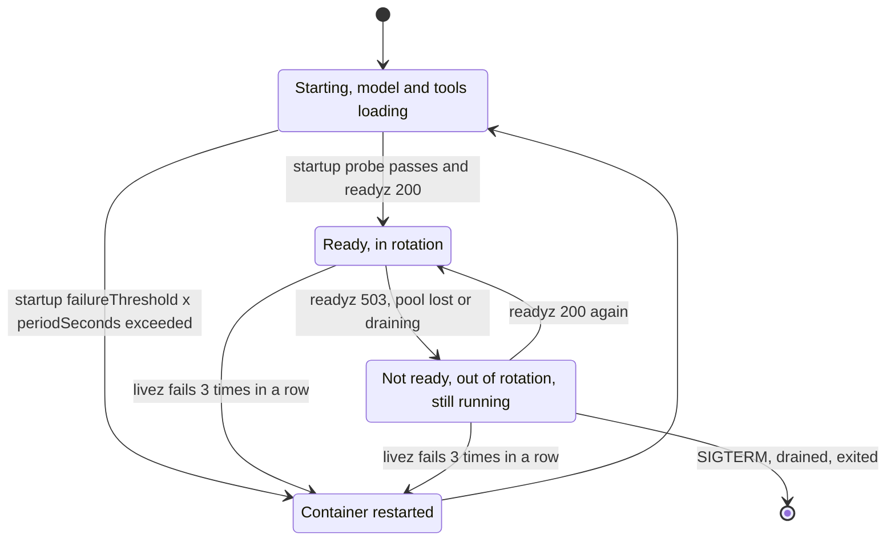

## TL;DR
An agent service depends on a model provider, a vector store, tool backends and a checkpoint store.
Liveness asks "restart this process?", readiness "route traffic here?", and a startup probe covers slow
loads. Shared dependencies belong in readiness, or nowhere, never in liveness.

## For agent builders
- **Why it matters for agents.** Agents fan out to more dependencies than a typical API: an LLM provider,
  embeddings, a vector store, several tool backends or MCP servers, and a checkpoint store. Probe the wrong
  ones and one flaky tool backend takes every replica out of rotation, or restarts them all mid-run.
- **Where it shows up in your stack.** `/livez` and `/readyz` routes on the FastAPI service hosting the
  agent, the pod's `startupProbe`, `livenessProbe` and `readinessProbe`, and the lifespan code that loads
  models, prompts and the tool registry.
- **What you control.** Which dependency failures mean "this instance is broken" (readiness), "the system
  is degraded" (the agent answers with fewer tools or a fallback model) and "restart fixes it" (rare);
  probe timings; and the drain flag.
- **What you can skip.** Probe types other than HTTP (exec, gRPC, TCP). The three questions and the
  default timings are what you need.

## Why it exists
- **Orchestrators need two cheap, automatic decisions per instance:** send it requests or not, and kill
  it or not.
- **An open port proves little.** TCP connections are accepted while the event loop is wedged, while a
  4 GB model is still loading, or after the worker lost its database pool, so users get timeouts from
  instances that look healthy.
- **One `/health` for everything is worse than none.** It checks DB, Redis, vector store and LLM provider
  for both decisions, so a 20-second shared-database blip fails every replica at once.
  - As readiness, all instances leave rotation: a partial degradation becomes a total outage.
  - As liveness, every pod restarts together; reloading models and reopening pools stampedes the
    recovering database, and the service stays down longer than the blip, and every in-flight agent run
    dies with it.
- **AI adds a crash loop.** A model that takes 90 seconds to load is killed by a liveness probe at 30
  seconds, forever.
- **Separate probes with separate semantics prevent all three.**

## How it works
### Three questions, three probes
| Probe | Question | On failure |
|---|---|---|
| **Liveness (`/livez`)** | can this process make progress? | restart the container |
| **Readiness (`/readyz`)** | should traffic come here now? | stop routing new requests; keep the process running to recover |
| **Startup** | has initialisation finished? | keep waiting; liveness and readiness do not run yet |

**Liveness**
- **Check only what a restart fixes:** the event loop is responsive, the worker is not deadlocked.
- **A trivial `async def` returning 200 is a good check**, because a blocked event loop cannot answer,
  which is exactly the condition to detect.
- **Keep it `async def`.** A plain `def` endpoint runs in the thread pool (AnyIO's default limit is 40
  threads), so it can fail when blocking work exhausts the pool while the loop is fine, restarting a
  process that only needed to shed load. Synchronous tool implementations are a common way to exhaust it.
- **Several workers per pod blur it.** Each probe reaches whichever worker accepts the connection, so one
  wedged worker out of four fails only some probes and rarely produces the consecutive failures that
  trigger a restart. Gunicorn's heartbeat timeout catches per-worker hangs better, one more reason for one
  worker per pod under Kubernetes.

**Readiness**
- Reflects local state the instance needs to serve: lifespan finished, model loaded, connection pools
  created, tool registry and prompt versions loaded, not draining for shutdown.

**Startup**
- While it has not yet succeeded, Kubernetes does not run liveness or readiness, so a slow model load is
  not mistaken for a hang.
- Size it as `failureThreshold × periodSeconds ≥ worst-case startup time`.

### Kubernetes mechanics worth knowing
| Field | Default |
|---|---|
| `periodSeconds` | 10 s |
| `timeoutSeconds` | 1 s |
| `failureThreshold` | 3 |

- **Restart after roughly 30 seconds** of consecutive liveness failures with defaults.
- **A probe slower than 1 second counts as failed**, so a readiness check that awaits a remote dependency
  inherits that dependency's latency.

### What readiness should check
- **Prefer state over calls.** Lifespan sets flags (`model_loaded`, `pools_ready`, `tools_loaded`); the
  probe reads them in microseconds.
- **Only dependencies this instance *alone* can lose**, such as its own pool's ability to hand out a
  connection, with a tight timeout and a cached result, so probes do not become load on the database.
- **Shared external dependencies, especially the LLM provider, usually should not gate readiness.** If the
  provider is down for everyone, removing every replica removes your ability to serve cached answers,
  fallback models or a clear error message.
- **Tool backends are shared too.** A down search API or MCP server should remove that tool from the
  agent's list (degraded mode), not the replica from rotation.

### Classifying an agent's dependencies
| Dependency | Lost by one instance alone? | Belongs in | On failure |
|---|---|---|---|
| Event loop | yes | liveness | restart |
| Local model or reranker loaded, tool registry built | yes | readiness (flags) | out of rotation until loaded |
| This instance's checkpoint-store pool | yes | readiness (cached check), if runs cannot start without it | out of rotation |
| LLM provider | no, shared | neither | fallback model or fast 503, alert |
| A tool backend or MCP server | no, shared | neither | hide that tool, agent continues with the rest, alert |

### Deep health for humans
- Keep a separate, authenticated `/health/details` reporting each dependency's status and latency for
  dashboards and on-call, wired to no automated restart or routing decision. For agents, list each tool
  backend so on-call sees which tools are degraded.

## Diagram
Each probe moves a pod along a different edge: startup gates the others, readiness only toggles traffic,
and only liveness (or an exhausted startup probe) restarts the container and its in-flight agent runs.



## Examples
### Agent scenario: readiness from local flags, tools degrade instead of failing the pod
An agent service loads prompts and the tool registry in lifespan. Readiness reads local flags only; a
background task tracks tool-backend health and hides failing tools from the agent.

```python
import asyncio
from contextlib import asynccontextmanager
from fastapi import FastAPI, Response

class AgentState:
    prompts_loaded = False
    tools: dict = {}            # name -> tool client, built in lifespan
    tool_ok: dict = {}          # name -> last health result, updated in the background
    draining = False

s = AgentState()

async def watch_tools(interval_s: float = 15.0):
    while True:
        for name, tool in s.tools.items():
            try:
                async with asyncio.timeout(2.0):
                    s.tool_ok[name] = await tool.ping()      # your client's cheap health call
            except Exception:
                s.tool_ok[name] = False
        await asyncio.sleep(interval_s)

@asynccontextmanager
async def lifespan(app: FastAPI):
    s.tools = await build_tool_registry()                    # connect tool backends, MCP sessions
    s.prompts_loaded = await load_prompt_versions()
    watcher = asyncio.create_task(watch_tools())
    yield
    s.draining = True
    watcher.cancel()

app = FastAPI(lifespan=lifespan)

@app.get("/livez", include_in_schema=False)
async def livez():
    return {"ok": True}

@app.get("/readyz", include_in_schema=False)
async def readyz(response: Response):
    ready = s.prompts_loaded and bool(s.tools) and not s.draining   # local state only
    response.status_code = 200 if ready else 503
    return {"ready": ready}

def available_tools() -> list:
    """What the agent loop offers the model this step: failing backends are hidden."""
    return [t for name, t in s.tools.items() if s.tool_ok.get(name, True)]
```

- **A search-API outage now costs one tool, not the service:** readiness stays 200, the agent answers
  without search, and `/health/details` shows which tool is down.
- **`build_tool_registry`, `load_prompt_versions` and `tool.ping` are your own code;** the split between
  local flags and shared-dependency handling is the point.

### Liveness, readiness and a draining flag
A service that loads an embedding model in lifespan.

```python
import asyncio
from contextlib import asynccontextmanager
from fastapi import FastAPI, Response

class State:
    model = None
    pools_ready = False
    draining = False

state = State()

@asynccontextmanager
async def lifespan(app: FastAPI):
    state.model = await asyncio.to_thread(load_embedding_model)   # ~60-90 s; off the event loop
    state.pools_ready = True
    yield
    state.draining = True            # in case anything polls during cleanup

app = FastAPI(lifespan=lifespan)

@app.get("/livez", include_in_schema=False)
async def livez():
    return {"ok": True}              # answers only if the event loop is responsive

@app.get("/readyz", include_in_schema=False)
async def readyz(response: Response):
    ready = state.model is not None and state.pools_ready and not state.draining
    response.status_code = 200 if ready else 503
    return {"model": state.model is not None, "pools": state.pools_ready, "draining": state.draining}

@app.post("/internal/drain", include_in_schema=False)     # called by preStop
async def drain():
    state.draining = True
    return {"draining": True}

def load_embedding_model():
    ...
```

Probe configuration to match: `startupProbe` on `/livez` with `periodSeconds: 5, failureThreshold: 30`
(150 s for model load), `livenessProbe` on `/livez` with defaults, `readinessProbe` on `/readyz` with
`periodSeconds: 5`:

```yaml
startupProbe:
  httpGet: {path: /livez, port: 8000}
  periodSeconds: 5
  failureThreshold: 30          # 5 x 30 = 150 s for model load
livenessProbe:
  httpGet: {path: /livez, port: 8000}   # defaults: 10 s period, 1 s timeout, 3 failures
readinessProbe:
  httpGet: {path: /readyz, port: 8000}
  periodSeconds: 5
```

- **Probes see nothing until the load finishes.** Uvicorn runs lifespan startup before it even binds the
  port, so every probe gets connection refused; that is why the startup probe must cover the whole load.
- **Under Gunicorn or `uvicorn --workers`** the parent has already bound the socket, so the kernel
  completes the TCP handshake and the probe waits out its `timeoutSeconds`. It looks like a timeout rather
  than a refusal, but counts the same.
- **The `model` check in `/readyz`** matters if you later switch to loading in a background task after
  startup.
- **The `draining` flag lives in one process's memory.** With several workers per pod, a preStop `POST`
  reaches only one of them, so use one worker per pod or a shared signal such as a file.

### Cached, time-boxed pool check for readiness
Checks the database (for an agent, often the checkpoint store) through this instance's own pool at most
once every 5 seconds, and never waits past the probe's 1 s timeout. Uses `asyncio.timeout` (Python 3.11+)
and an SQLAlchemy async engine.

```python
import asyncio, time
from sqlalchemy import text

_cache = {"at": 0.0, "ok": False}

async def pool_ok(engine, ttl_s=5.0, budget_s=0.3) -> bool:
    now = time.monotonic()
    if now - _cache["at"] < ttl_s:
        return _cache["ok"]                       # probes read the cached answer
    try:
        async with asyncio.timeout(budget_s):     # stay well inside timeoutSeconds
            async with engine.connect() as conn:
                await conn.execute(text("SELECT 1"))
        ok = True
    except Exception:
        ok = False
    _cache.update(at=now, ok=ok)
    return ok
```

- **What the cache and budget buy:** at most one `SELECT 1` per process per 5 s, however often the kubelet,
  an external balancer and dashboards call it, and a slow database fails the check in 0.3 s instead of
  hanging the probe past its timeout.
- **What it does not buy:** `SELECT 1` still travels to the shared database, so a database-wide outage
  fails it on every replica at once. Gate readiness on it only when no route can serve anything without
  the database; if cached or fallback routes exist, keep it out, as in the incident below.

### Worked incident: one `/health` vs separate probes
Illustrative: 12 replicas, a 40-second shared-database blip, the 60-90 s model load from above.

| Time | One `/health` as liveness and readiness | Separate `/livez` and `/readyz` |
|---|---|---|
| t=0 | DB blip starts; every replica's health fails | `/livez` and `/readyz` stay 200 (local state only) |
| t≈0-10 | all 12 pods leave rotation: balancer errors for everyone | DB-backed requests fail fast with a clear 503; cached and non-DB routes still work |
| t≈30 | 3 failed liveness probes: all 12 pods restart together | nothing restarts |
| t=40 | DB recovers, but pods are reloading models | full service resumes |
| t≈100-130 | 12 pods reopen pools at once, stampeding the DB | (already recovered) |

A 40-second blip becomes a two-minute outage when liveness checks a shared dependency. For an agent
service the restart column also kills every in-flight run on all 12 pods at t≈30.

## Production patterns
- **Degrade tools, do not fail pods.** Agent teams track each tool backend's health in the background and
  hide failing tools from the model's tool list, leaving readiness on local state. Monitor: per-tool
  availability, and agent task success rate while a tool is hidden.
- **Keep probes off the middleware path.** Skip auth, rate limiting and access logging for `/livez` and
  `/readyz` (check the path first in middleware) and mark them `include_in_schema=False`, which also keeps
  them out of OpenAPI-generated agent tools. Monitor: probe 401s or 429s, and the share of log lines that
  are probes.
- **Startup probe sized from measured load time.** Take the slowest observed model load on the slowest node
  type, add margin, and set `failureThreshold × periodSeconds` above it. Monitor: time from container start
  to ready, per node type, and CrashLoopBackOff events.
- **Readiness from lifespan flags, plus a cached check only where it earns its place.** Flags for model,
  pools, tools and draining; add the cached pool check above only if no route can serve without the
  database. Monitor: readiness flaps per pod; many pods flapping together means a shared dependency leaked
  into the probe.
- **Alert on restarts, not just errors.** Track container restarts per pod (for example
  `kube_pod_container_status_restarts_total` from kube-state-metrics). Monitor: restarts on every replica
  at once, the signature of a liveness probe that checks a shared dependency.
- **Authenticated details endpoint and one worker per pod.** `/health/details` reports each dependency's
  status and latency for on-call, behind auth, with no probe pointed at it; one worker per pod (or a shared
  drain signal) keeps liveness and the drain flag meaningful for the whole pod. Monitor: dependency latency
  trends there, and readiness still returning 200 during termination.

## Trade-offs
- **Dependency checks in readiness vs coupling.** They remove instances that genuinely cannot serve, but
  couple all replicas to shared failures; right only for dependencies one instance can lose independently.
- **Trivial liveness vs subtle hangs.** It never restarts a pod for someone else's outage, but misses
  subtle hangs such as a deadlocked thread pool; add a targeted check only for a hang you have actually
  observed.
- **Short probe periods vs load.** They detect failure quickly, but every probe is a request; with many
  replicas and dependency checks, aggressive probing becomes measurable load on the things being checked.
- **Gating readiness on the provider vs fallbacks.** Failing readiness when the LLM provider is down
  protects users from slow errors, but forfeits fallbacks and cached answers; flip to gating only when the
  instance truly has nothing useful to return.
- **Hiding a failed tool vs answer quality.** Degrading keeps the agent available, but it may now answer
  confidently without data it needed; pair it with an instruction or a message telling the user which
  capability is unavailable.

## Pitfalls
- **Same endpoint for liveness and readiness.** Symptom: all pods restarting together during a database
  blip, and a recovery slower than the outage itself.
- **No startup probe for a slow model load.** Symptom: a CrashLoopBackOff where each container is killed at
  about the same age, before it ever logs "model loaded".
- **Liveness that calls the database or the provider.** Symptom: restart storms correlated with upstream
  incidents, with restart counts climbing on every replica at once.
- **Readiness that pings every tool backend.** Symptom: one third-party tool's outage removes all replicas
  from rotation, and probe latency exceeds 1 s because it awaits several remote calls.
- **Synchronous inference on the event loop.** Symptom: liveness timeouts and restarts under load only,
  because probes queue behind the blocking work, killing pods that were merely busy.
- **Drain flag in process memory with several workers per pod.** Symptom: readiness keeps returning 200 on
  most probes during shutdown, because only the worker that received the drain call flipped.
- **Health routes through auth, rate-limit or logging middleware.** Symptom: probes failing with 401 or
  429, or logs dominated by probe requests every few seconds.

## When to use
- **Every deployed service** behind a balancer or orchestrator needs at least liveness and readiness;
  AI services that load models need a startup probe too.
- **Classify each dependency:** losing it means "this instance is broken" (readiness), "the whole system is
  degraded" (serve a fallback, alert, keep routing) or "restart fixes it" (rare; liveness).
- **Measure:** probe latency and failure counts, restarts per pod, and time from deploy to ready.
- **Interviews:** the strong answer explains why dependency checks in liveness cause cascading failures and
  why readiness is the lever for draining.

## Role lens
- **Engineer:** Implements `/livez` and `/readyz` from lifespan state, keeps them off auth and logging
  middleware, and moves model loading off the event loop.
- **Architect:** Decides which dependencies gate readiness versus trigger degraded modes, and sets probe
  timings against startup time and recovery behaviour.
- **FDE:** Translates the probes to whatever the customer's platform uses (an on-prem balancer, ECS,
  OpenShift) and tunes startup timing to their slower hardware.

## Check yourself
**Q:** Your RAG service's single `/health` endpoint checks Postgres, the vector database and the LLM
provider, and it is configured as both liveness and readiness. The provider has a 5-minute partial outage.
Describe what happens and how you would redesign.
**A:** Every replica's health fails at once. As readiness, all pods leave rotation, so users get balancer
errors instead of any degraded answer. As liveness, after about three failed probes every pod restarts;
restarts reload models and reopen pools, stampeding Postgres and the vector store just as traffic returns,
and the service may stay down after the provider recovers. Redesign: liveness becomes a trivial
event-loop check; readiness reads local lifespan state plus this instance's own pool health, with a tight
timeout; the provider is not probed at all but handled in the request path with timeouts, a fallback model
or a clear 503, plus an alert. A startup probe covers model load, and a separate authenticated details
endpoint serves dashboards.

## Interview questions
### What is the difference between liveness, readiness and startup probes?
- **Liveness** asks whether the process can make progress, and failure restarts the container, so it
  should check only what a restart fixes, such as a wedged event loop.
- **Readiness** asks whether this instance should get traffic now, and failure only removes it from
  rotation while it recovers or drains.
- **Startup** holds the other two until initialisation finishes, so a slow model load is not mistaken for
  a hang.

### Your agent uses six tools backed by different services. What do your health endpoints check?
- **Liveness:** only that the event loop answers, because no tool outage is fixed by restarting the agent
  service.
- **Readiness:** local state: prompts and tool registry loaded, own pools created, not draining. Tool
  backends are shared, so they never gate it.
- **Tool health:** a background check per backend that hides failing tools from the model and shows up in
  `/health/details` and alerts, so the agent degrades instead of disappearing.

### A new model version puts pods into CrashLoopBackOff, each killed at the same age. How do you debug it?
- **The same age is the clue:** the container is killed by a probe on a fixed schedule before it ever logs
  "model loaded", typically liveness at about 30 seconds with defaults.
- **Check** whether a startup probe exists and whether `failureThreshold × periodSeconds` covers the new,
  slower load on the slowest node type.
- **Fix:** size the startup probe from the measured worst case plus margin, and load the model off the
  event loop with `asyncio.to_thread`.

### Should readiness fail when the LLM provider is down?
- **Usually not:** the outage hits every replica at once, so gating readiness removes every pod and with
  them cached answers, fallback models and clear error messages.
- **Handle it in the request path instead:** timeouts, a fallback model or a fast 503, plus an alert.
- **Flip to gating** only when the instance truly has nothing useful to return without the provider.

### Your readiness probe checks the database. How do you keep it from becoming a problem?
- **First ask whether it should:** a check that reaches a shared database fails on every replica at once
  during an outage, pulling them all, so keep it only if no route can serve without the database.
- **Prefer instance-local signals** (lifespan flags, this instance's own pool state) over a round trip.
- **If you keep it, bound and cache it:** a 0.3 s budget inside the default 1 s `timeoutSeconds`, and a
  cached result for 5 seconds, so probes are not load on the database.
- **Watch for many pods flapping together**, which means a shared dependency has leaked into the probe.

### Why should liveness be an async def that does almost nothing?
- **Because a blocked event loop cannot answer it,** which is exactly the condition liveness should
  detect.
- **A plain `def` runs in the thread pool** (40 threads by default in AnyIO), so it can fail when the pool
  is exhausted while the loop is healthy, restarting a pod that only needed to shed load.
- **Anything heavier** couples restarts to dependencies a restart cannot fix.

## Quiz
### Q: Why should a liveness probe usually not check the database?
- [ ] Database queries cannot run inside async endpoints
- [x] Restarting the app does not fix a database outage, and simultaneous restarts amplify it
- [ ] Kubernetes forbids network calls in liveness probes
- [ ] Liveness probes run before the database driver is imported
> Liveness failure means restart. A shared database problem fails every replica's probe at once, so all
> pods restart together, reconnecting in a stampede, without fixing the cause.

### Q: A pod loads a model for 100 seconds and is killed repeatedly before it is ready. What is the fix?
- [ ] Increase the readiness probe's `failureThreshold`
- [ ] Remove the liveness probe entirely
- [x] Add a startup probe whose `failureThreshold × periodSeconds` exceeds the load time
- [ ] Load the model lazily on the first request instead
> While a startup probe is pending, liveness and readiness are not run, so slow initialisation is not
> mistaken for a hang. Lazy loading only moves the delay onto the first user's request.

### Q: What should `/readyz` return while a worker is draining for shutdown?
- [ ] 200, because the process is still alive
- [x] 503, so balancers that poll readiness stop sending new requests while in-flight ones finish
- [ ] 500, so the orchestrator restarts the pod faster
- [ ] A redirect to another replica
> Draining means "alive but should not get new traffic", which is exactly readiness semantics. In-flight
> requests continue; a 500 or restart would cut them off.

## Use cases & projects
### Use cases
- **Agent services on Kubernetes.** Separate `/livez` and `/readyz` routes keep a flaky tool backend from
  restarting every replica mid-run.
- **Slow model or prompt loading.** A startup probe covers lifespan work (loading models, prompts and the
  tool registry) without loosening liveness for the rest of the pod's life.
- **Degraded mode instead of outage.** When one tool backend or the primary model provider is down, the
  agent answers with fewer tools or a fallback model rather than failing readiness everywhere.
- **Draining before shutdown.** Readiness turning false is the signal that stops new runs while in-flight
  runs finish.

### Mini project
**Probe an agent service without self-inflicted outages (1-2 hours).**
- **Goal:** build probes that restart only broken processes and route around only broken instances.
- **Steps:** add `/livez` (process only) and `/readyz` (checkpoint store reachable, tool registry loaded,
  drain flag clear) to a FastAPI agent stub; run it locally with a fake tool backend; stop the tool
  backend and confirm both probes stay healthy while the agent reports the tool as unavailable; stop the
  checkpoint store and confirm only readiness fails (acceptable here only because no run can start
  without it).
- **Done when:** a written table lists each dependency failure and the probe result you observed, and no
  shared dependency appears in the liveness check.

### Major project
This lesson feeds the module Capstone (see the module guide), which needs separate liveness and
readiness probes, with readiness going false before the process stops accepting.
