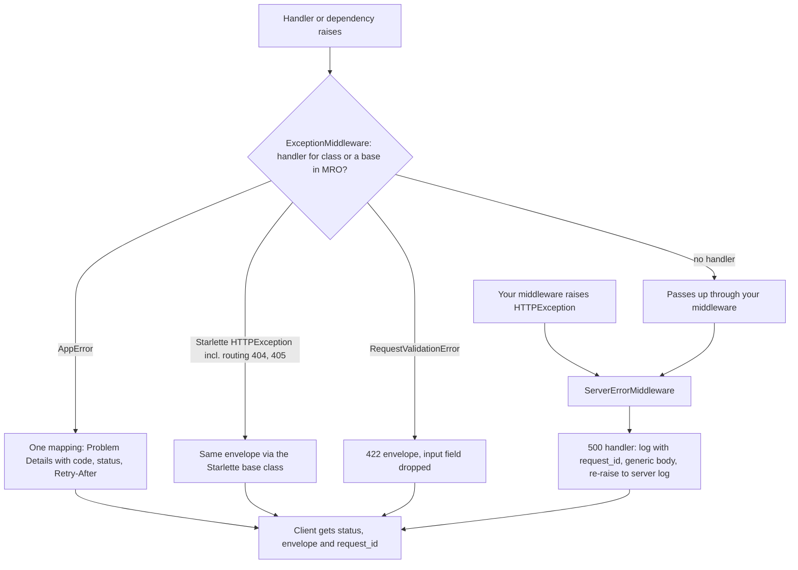

## TL;DR
`raise HTTPException(status_code, detail)` aborts a request from anywhere in the call stack and becomes
an error response. Do it well: map domain and LLM failures to meaningful codes, one error shape, no
leaked internals, and check everything before a stream starts.

## Why it exists
- **AI endpoints fail in many distinct ways.** Invalid input, an unauthorised or over-quota caller, a
  missing document, a model provider that is rate-limited, down or slow, output that fails schema
  validation, a safety refusal, an overflowing context.
- **Each failure needs a different client reaction:** fix the request, re-authenticate, back off for N
  seconds, retry, or report to a human. Clients can act only if the response tells them which case they hit.
- **The naive patterns break this.**
  - Letting exceptions propagate turns everything into a bare 500, so clients retry validation errors
    forever and give up on transient ones.
  - Returning `{"ok": false, "error": "..."}` with status 200 breaks every HTTP-aware tool: retries,
    monitoring, load-balancer health metrics, the OpenAI-style SDKs your customers use.
  - Passing the provider's exception text through (`detail=str(e)`) leaks API keys in URLs, internal
    hostnames, prompt fragments and stack traces.
  - `try/except` in every handler duplicates mapping logic and drifts.
- **FastAPI's model: raise typed exceptions where the problem is detected, convert them in one place.**
  Domain code stays free of HTTP, and the error contract is defined once.

## How it works
### The flow through the middleware stack
Starlette builds the stack outside in: `ServerErrorMiddleware` (outermost), then your middleware, then
`ExceptionMiddleware`, then the router. When a handler or dependency raises:
1. **`ExceptionMiddleware` looks for a handler** registered for that exception class, walking the class's
   MRO, so a handler for a base class catches subclasses.
2. **FastAPI registers defaults:** `HTTPException` becomes `{"detail": ...}` with its status and headers,
   and `RequestValidationError` becomes 422 with a list of field errors.
3. **Anything unhandled goes up to `ServerErrorMiddleware`**, which returns a plain 500 (or a traceback
   page in debug mode), calls a handler registered for `Exception` or `500` if there is one, and
   re-raises so the server logs it.

- **Consequence for middleware:** because `ExceptionMiddleware` sits *inside* your middleware, an
  `HTTPException` raised from a middleware is not converted by those handlers and becomes a 500.
  Middleware should return responses directly.

### Why raise rather than return
- **Raising unwinds the whole stack in one step.** A dependency three levels deep cannot `return` a
  response to the client; it can only return a value to its caller. That is why auth and quota checks
  live in dependencies that raise.
- **Raising lets cleanup see the failure.** A `yield` dependency (a DB session, a lock) receives the
  exception at its `yield` and can roll back.
- **Returning hides it.** A handler that catches the error and returns `JSONResponse(status_code=409)`
  leaves that dependency believing the request succeeded, so its commit-on-exit logic runs.

### fastapi.HTTPException versus Starlette's
- **FastAPI's `HTTPException` subclasses Starlette's**, and its `detail` may be any JSON-serialisable
  value, not just a string.
- **Starlette raises its own for routing errors** (404, 405).
- **So to customise all of them**, register your handler for `starlette.exceptions.HTTPException`.

### Domain exceptions plus one mapping
- **Define an application hierarchy:** `AppError` with `code`, `status`, `retryable`, `retry_after`, and
  raise those from services.
- **One handler converts them**, so services never import FastAPI, and the mapping becomes a single
  reviewable table.

### Mapping upstream LLM failures
| Upstream situation | Your status | Why |
|---|---|---|
| Provider 429 or quota exhausted | **503** (or 429 when it is the *caller's* own quota), with `Retry-After` from the provider's hint | don't relay the provider's 429 as if the client exceeded *your* limit |
| Provider timeout | **504** | the upstream did not answer in time |
| Provider 5xx or connection error | **502** or **503** | the upstream failed or is unavailable |
| Context too long, or invalid parameters you could have checked | **422** or **400**, with a fix ("input is 140k tokens; the limit is 128k") | the client can correct it |
| Model output fails your schema after retries | **502** | the upstream gave you something unusable, and the client did nothing wrong |
| Safety refusal | often a successful 200 with a structured refusal field | the system worked as designed; if your API treats it as an error, use a specific, documented code |

### One error shape
- **Pick an envelope and use it everywhere**, including 404s and 422s.
- **RFC 9457 Problem Details is a standard choice:** `application/problem+json` with `type`, `title`,
  `status`, `detail`, `instance`.
- **Include a `request_id`** matching your logs, so support can find the trace without the client
  seeing it.

### Streaming
- **Status and headers go out with the first byte** of a `StreamingResponse` or SSE stream.
- **So an exception mid-stream can't become a 503.** The connection just breaks, and the client sees a
  truncated answer.
- **Do every check that can fail first** (auth, quota, validation, opening the upstream stream) *before*
  returning the response.
- **After that, emit failures as an in-band error event** the client knows how to render.

## Diagram
Follow a raised exception outward: `ExceptionMiddleware` converts what it has handlers for, and anything
that escapes it, or is raised in your own middleware, ends up as a 500 at `ServerErrorMiddleware`.



## Examples
### A domain hierarchy, a single mapping to Problem Details, and safe 500s

```python
import logging, uuid
from fastapi import FastAPI, Request
from fastapi.encoders import jsonable_encoder
from fastapi.exceptions import RequestValidationError
from fastapi.responses import JSONResponse
from starlette.exceptions import HTTPException as StarletteHTTPException

log = logging.getLogger("api")
app = FastAPI()

class AppError(Exception):
    status, code, retry_after = 500, "internal", None
    def __init__(self, detail: str): self.detail = detail
class UpstreamBusy(AppError):    status, code, retry_after = 503, "model_busy", 10
class UpstreamTimeout(AppError): status, code = 504, "model_timeout"
class ContextTooLong(AppError):  status, code = 422, "context_too_long"

def problem(req: Request, status: int, code: str, detail, headers=None, rid=None):
    rid = rid or req.headers.get("x-request-id") or str(uuid.uuid4())  # usually set by middleware
    body = {"type": f"https://docs.acme.ai/errors/{code}", "title": code, "status": status,
            "detail": detail, "request_id": rid}
    return JSONResponse(body, status, headers=headers, media_type="application/problem+json")

@app.exception_handler(AppError)
async def app_error(req: Request, e: AppError):
    h = {"Retry-After": str(e.retry_after)} if e.retry_after else None
    return problem(req, e.status, e.code, e.detail, h)

@app.exception_handler(StarletteHTTPException)      # also catches routing 404/405
async def http_error(req: Request, e: StarletteHTTPException):
    return problem(req, e.status_code, "http_error", e.detail, getattr(e, "headers", None))

@app.exception_handler(RequestValidationError)
async def invalid(req: Request, e: RequestValidationError):
    errs = [{k: v for k, v in err.items() if k != "input"} for err in e.errors()]  # no echoed prompt
    return problem(req, 422, "invalid_request", jsonable_encoder(errs))

@app.exception_handler(Exception)                   # runs in ServerErrorMiddleware
async def unhandled(req: Request, e: Exception):
    rid = req.headers.get("x-request-id") or str(uuid.uuid4())
    log.exception("unhandled error request_id=%s", rid)   # full detail goes to logs only
    return problem(req, 500, "internal", "unexpected error; quote request_id to support", rid=rid)
```

What happens on a provider 429:
1. **A provider 429 inside `generate()`** is caught in the client wrapper and re-raised as
   `UpstreamBusy("model capacity exhausted")`.
2. **The caller receives a 503** Problem Details body with `Retry-After: 10` and a `request_id`.
3. **The SDK backs off for ten seconds** instead of hammering, and support can find the trace from the ID.
4. **Nothing from the provider's raw error reaches the client.**

- **The 500 handler logs the same `request_id` it returns.** An ID minted fresh in the response but
  absent from the log line would send support looking for a trace that doesn't exist.
- **In a real service a middleware assigns the ID once per request** and every log line carries it.

### The client wrapper that maps provider errors (production snippet)
Uses the hierarchy above plus a 502 class; this is where `generate()` turns httpx errors into domain
errors, so no handler ever sees provider text.

```python
import httpx

class UpstreamFailed(AppError):  status, code = 502, "model_upstream_error"

async def generate(client: httpx.AsyncClient, payload: dict) -> dict:
    try:
        r = await client.post("/v1/chat/completions", json=payload)
        r.raise_for_status()
        return r.json()
    except httpx.TimeoutException:
        raise UpstreamTimeout("model did not answer in time") from None
    except httpx.ConnectError:
        raise UpstreamFailed("model provider unreachable") from None
    except httpx.HTTPStatusError as e:
        s = e.response.status_code
        log.warning("provider status=%s body=%.200s", s, e.response.text)  # logs only
        if s == 429:
            err = UpstreamBusy("model capacity exhausted")
            hint = e.response.headers.get("retry-after", "")
            if hint.isdigit():
                err.retry_after = int(hint)          # provider's hint beats the default 10 s
            raise err from None
        if s >= 500:
            raise UpstreamFailed("model provider error") from None
        raise                                        # provider 4xx = our bug: a logged 500
```

| Provider event | Raised as | Client sees |
|---|---|---|
| 429 with `retry-after: 7` | `UpstreamBusy` | 503, `Retry-After: 7` |
| 503 from the provider | `UpstreamFailed` | 502 |
| read or connect timeout | `UpstreamTimeout` | 504 |
| 400 (we sent a bad request) | unmapped `HTTPStatusError` | generic 500 with `request_id`, full detail in logs |

### What the defaults and the middleware trap look like (runnable with TestClient)
Requires `fastapi` and `httpx`. Shows routing errors sharing the envelope, middleware that raises versus
returns, and the default 422 echoing input.

```python
from fastapi import FastAPI, HTTPException, Request
from fastapi.responses import JSONResponse
from fastapi.testclient import TestClient
from starlette.exceptions import HTTPException as StarletteHTTPException

app = FastAPI()

@app.exception_handler(StarletteHTTPException)       # covers handler-raised and routing errors
async def http_error(req: Request, e: StarletteHTTPException):
    return JSONResponse({"title": "http_error", "status": e.status_code, "detail": e.detail},
                        e.status_code, media_type="application/problem+json")

@app.middleware("http")
async def check_key(req: Request, call_next):
    key = req.headers.get("x-api-key")
    if key == "banned":
        raise HTTPException(401, "banned key")              # wrong: outside ExceptionMiddleware
    if key == "revoked":
        return JSONResponse({"detail": "revoked key"}, 401)  # right: middleware returns a response
    return await call_next(req)

@app.get("/v1/docs/{doc_id}")
async def get_doc(doc_id: int):
    raise HTTPException(404, f"document {doc_id} not found")

c = TestClient(app, raise_server_exceptions=False)
print(c.get("/v1/docs/7").json())        # {'title': 'http_error', 'status': 404, 'detail': 'document 7 not found'}
print(c.get("/nope").json())             # {'title': 'http_error', 'status': 404, 'detail': 'Not Found'}
print(c.delete("/v1/docs/7").status_code)                                  # 405, same envelope
print(c.get("/v1/docs/7", headers={"x-api-key": "revoked"}).status_code)   # 401
print(c.get("/v1/docs/7", headers={"x-api-key": "banned"}).status_code)    # 500
print(c.get("/v1/docs/abc").json()["detail"][0]["input"])                  # abc: default 422 echoes input
```

## Production patterns
- **Request ID assigned once, everywhere** — on every service. A small middleware reads `X-Request-ID`
  or mints one, stores it on `request.state`, adds it to the response header and the log context, and
  the error handlers read it from there. Monitor the share of error responses whose `request_id` is
  found in your logs; it should be 100%.
- **Provider errors mapped at the client boundary** — for every LLM or tool client. Wrap the SDK or httpx
  call as in the snippet above, log the raw provider status and body, and raise only domain errors.
  Monitor upstream errors by provider status next to your own 502/503/504 counts.
- **Error metrics by status, code and route** — always. Emit a counter labelled with status, the `code`
  from the envelope and the route template, and alert on 5xx separately from 4xx. Monitor 4xx spikes per
  client (their problem) and 5xx spikes per route (yours).
- **Pre-flight checks, then in-band stream errors** — on SSE and streaming routes. Validate, check quota
  and open the upstream stream before returning `StreamingResponse`; after that, catch errors in the
  generator and yield an `event: error` frame with a code and `retryable`. Monitor a stream-outcome
  metric (completed, errored, client-disconnected) separately from HTTP status.
- **Error contract tests** — in CI. With `TestClient(app, raise_server_exceptions=False)`, assert that an
  unknown route, a wrong method, an invalid body and a forced exception all return
  `application/problem+json` with a `request_id`. Monitor nothing at runtime; the test fails the build
  when someone adds a handler that bypasses the envelope.
- **Errors documented in OpenAPI** — for public APIs. Declare error bodies on routes with FastAPI's
  `responses=` parameter (for example `responses={503: {"model": Problem}}` with a Pydantic `Problem`
  model), so generated SDKs know the shape and which codes are retryable.

## Trade-offs
- **Central mapping vs indirection.** A central mapping keeps the contract consistent and the domain
  HTTP-free, at the cost of indirection: you must look up the table to know what a service exception
  becomes. That is worth it past a handful of endpoints.
- **Detailed messages vs leaks.** Detailed error messages speed up client debugging, but they risk
  leaking internals or enabling enumeration (for example, "user not found" versus "wrong tenant"). Be
  specific for validation, vague for auth and internal failures.
- **Refusal as 200 vs as an error.** Treating safety refusals as 200 with a refusal field keeps "the
  system worked" separate from "the system failed", but naive clients may show refusals as answers. Use
  an error code if your consumers are automated and must branch.
- **Standard vs compatible envelope.** Standard Problem Details helps third-party clients and tooling. A
  custom envelope may match an existing SDK or provider-compatible API, and compatibility wins when you
  mimic another provider's API.

## Pitfalls
- **`detail=str(exc)` from provider or database errors.** Symptom: customers see internal hostnames,
  SQL fragments or partial prompts in error messages and file security tickets.
- **Raising `HTTPException` from middleware.** Symptom: a 500 with "Exception in ASGI application" in
  logs where you expected a clean 401 or 429.
- **Registering a handler only for FastAPI's `HTTPException`.** Symptom: routing 404s and 405s still
  return the default `{"detail": "Not Found"}` shape while every other error uses your envelope.
- **Raising after a `StreamingResponse` has started.** Symptom: clients receive a 200 with a truncated
  answer and no error, which surfaces as "the bot just stops mid-sentence".
- **Returning Pydantic's raw validation errors on a prompt endpoint.** Pydantic v2 errors carry the
  offending `input`, so the symptom is 422 bodies that echo a 100k-token prompt (or a pasted secret)
  back to the client and into any logging proxy. Keep `loc`, `msg` and `type`, drop or truncate `input`.
- **Mapping every upstream failure to 500.** Symptom: client SDKs that never retry transient provider
  outages, or retry permanent errors forever, because the codes carry no meaning.

## When to use
- **Set up central exception handling at the start of every FastAPI service**, not after the first
  incident: one domain hierarchy, one mapping, one envelope, handlers for Starlette's `HTTPException`,
  `RequestValidationError` and `Exception`.
- **Raise `HTTPException` directly** in thin, HTTP-specific code (auth dependencies, routers). Raise
  domain errors from services.
- **For AI endpoints**, write the upstream mapping table deliberately and document which codes are retryable.
- **Measure** error rates by code and by route, and alert on 5xx separately from 4xx, since a 4xx spike
  means a client problem and a 5xx spike means yours.
- **Interviews:** explain the difference between 502, 503 and 504, and the streamed-response limitation.

## Role lens
- **Engineer:** Builds the exception hierarchy and handlers, wraps provider SDK errors at the client
  boundary, and pre-validates before opening a stream so failures get proper status codes.
- **Architect:** Defines the platform-wide error contract (envelope, codes, retryability, request IDs)
  so every service and SDK behaves consistently and gateways can make sense of failures.
- **FDE:** Reads a customer's failing integration logs, explains which errors are theirs (4xx) versus
  the platform's (5xx), and uses request IDs to pull the matching traces.

## Check yourself
**Q:** Your chat endpoint streams SSE. During a provider outage users see answers stop mid-sentence,
and dashboards show 100% 200s. What is happening and how do you redesign the error handling?
**A:** The response status and headers were sent with the first event, so when the provider fails
partway through, the code can't switch to 503. The exception just closes the stream, and access
logs record 200. Redesign in two phases. Before returning the `StreamingResponse`, do everything that
can fail cheaply: auth, quota, validation, token counting, and opening the upstream stream (or reading
its first chunk), so outages at that point get a proper 503 or 504. After streaming starts, catch
upstream errors in the generator and emit a typed error event (`event: error` with a code and
`retryable`) that the client renders, then end cleanly. Record a stream-outcome metric separate from
HTTP status, so dashboards reflect mid-stream failures.

## Interview questions
### What is the difference between 502, 503 and 504, with an LLM example of each?
- **502 Bad Gateway:** the upstream answered with something unusable, such as a provider 5xx or model
  output that still fails your schema after retries.
- **503 Service Unavailable:** temporary lack of capacity, such as the provider's 429 or exhausted quota,
  sent with `Retry-After` so clients back off.
- **504 Gateway Timeout:** the upstream did not answer within your deadline.
- **Why it matters:** SDKs decide whether and when to retry from these codes, so mapping all of them to
  500 removes that signal.

### Why should an auth or quota dependency raise instead of returning a JSONResponse?
- **A dependency can't return a response to the client**, only a value to its caller; raising unwinds
  the whole stack in one step.
- **Cleanup sees the failure:** a `yield` dependency receives the exception at its `yield` and can roll
  back, while a caught-and-returned error makes it believe the request succeeded and commit.

### A security ticket says your error messages contain internal hostnames and prompt fragments. How do you find and fix the cause?
- **Search for pass-through details:** `detail=str(e)` around provider or database calls, and default
  422 bodies that echo `input`.
- **Fix at the boundary:** wrap the provider client so it logs raw errors and raises domain errors with
  fixed messages, and strip `input` in the `RequestValidationError` handler.
- **Backstop:** an `Exception` handler that returns a generic body with a `request_id` and logs the
  rest, plus a CI test that forces an error and asserts no internals appear.

### Would you return a safety refusal as a 200 or as an error status?
- **200 with a structured refusal field** keeps "the system worked as designed" separate from "the system
  failed", so 5xx dashboards stay meaningful.
- **The risk** is naive clients rendering the refusal as if it were the answer.
- **Use a specific, documented error code** when consumers are automated pipelines that must branch.

### Your 5xx rate doubles but the 4xx rate is flat. What do you look at first?
- **Split 5xx by envelope `code` and route**: a jump in `model_busy` or `model_timeout` points at the
  provider, while a jump in `internal` points at your own code.
- **Pull traces by `request_id`** from a sample of failing responses to see the original exception.
- **Compare with upstream error counts by provider status**, since mapped errors should track them; 5xx
  growth without upstream errors means a regression in your service.

## Quiz
### Q: Where should a FastAPI service map an upstream provider's 429 to a client response, and to what?
- [ ] Pass the provider's 429 and message through unchanged
- [x] Convert it at the client wrapper into a domain error mapped to 503 with Retry-After, without exposing provider details
- [ ] Return 200 with an error field so clients do not retry
- [ ] Return 400 because the request could not be served
> The caller did not exceed your limit; your upstream is saturated, which is a temporary unavailability.
> A 503 with Retry-After lets clients back off correctly without leaking upstream internals.

### Q: Why does raising `HTTPException(401)` inside custom middleware often produce a 500?
- [ ] HTTPException is only valid in GET handlers
- [ ] Middleware runs after the response is sent
- [x] The exception-handling middleware sits inside user middleware, so handlers never see exceptions raised outside it
- [ ] FastAPI forbids 401 responses from middleware
> Starlette places ExceptionMiddleware between user middleware and the router. Exceptions raised in
> user middleware bypass it and reach ServerErrorMiddleware, which returns 500, so middleware should return responses.

### Q: Which handler registration ensures routing 404s use your error envelope?
- [ ] @app.exception_handler(fastapi.HTTPException)
- [x] @app.exception_handler(starlette.exceptions.HTTPException)
- [ ] @app.exception_handler(RequestValidationError)
- [ ] @app.exception_handler(404) is impossible; 404s cannot be customised
> Routing raises Starlette's HTTPException, and FastAPI's is a subclass of it. Registering for the
> Starlette base class covers both, while registering only the subclass misses router-generated errors.
