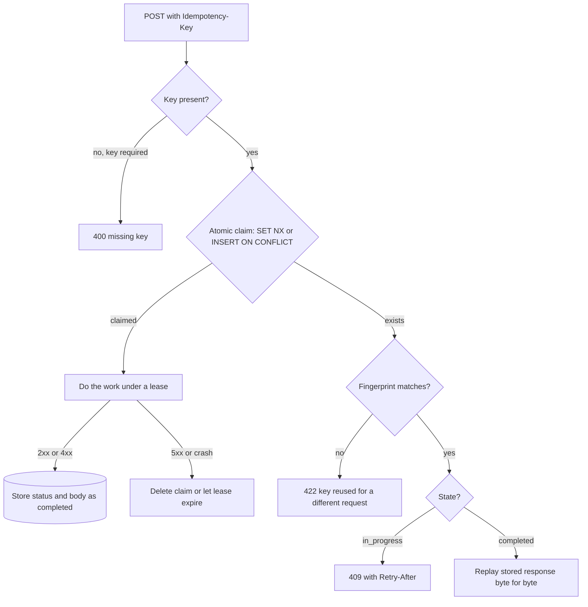

## TL;DR
Agents retry: after a timeout, a crash or a resumed run, the same tool call or generation fires again.
An idempotency key names the operation once; the server records the first outcome and replays it, so a
retry cannot send, charge or bill twice.

## For agent builders
- **Why it matters for agents.** Agent tool calls have side effects (send an email, file a ticket,
  charge a card), and agent runtimes retry steps after timeouts or resume a run from a checkpoint. Without
  a key per tool call, every retry is a second email.
- **Where it shows up in your stack.** The `Idempotency-Key` header on your own FastAPI endpoints, the
  same header on payment and messaging APIs your tools call, and the claim table or Redis key behind your
  tool executor.
- **What you control.** Deriving a stable key from the run and the tool call (run id plus step or tool
  call id), never from the attempt; what outcomes you store; and passing a derived key downstream.
- **What you can skip.** Building waiting or pub/sub for in-progress duplicates; a 409 with
  `Retry-After` is enough for agent workers, which already loop.

## Why it exists
- **Retries are essential but ambiguous.** Timeouts, dropped connections and 502s from proxies are
  routine, and a client that never retries is fragile. But after a timeout the client can't tell "never
  arrived" from "succeeded and the response was lost".
- **POST makes no idempotency promise.** GET, PUT and DELETE are idempotent by HTTP's definition (twice
  leaves the same state as once). Most AI endpoints are POSTs with side effects: create a chat turn and
  charge for its tokens, start a document-ingestion job, run an agent action that sends a message or
  files a ticket.
- **LLM endpoints make it worse.** Calls are slow and expensive, so timeouts and retries are common and
  each duplicate costs real money. Outputs are non-deterministic, so a retry produces a *different*
  answer: the client may show one while your history stores another.
- **The naive alternatives fail.** "Deduplicate on request body" breaks when a user legitimately sends
  "yes" twice, and misses a retry whose body has a new timestamp. "Don't retry POSTs" pushes the failure
  onto the user. "Check whether a record exists first" races: two retries 50 ms apart both see nothing.
- **What you need:** an identity for the *intent*, chosen by the client before the first attempt, plus
  an atomic claim on the server.

## How it works
### The contract
- **One key per logical operation.** The client generates a high-entropy key (a UUIDv4) once and sends
  it on every attempt, typically as an `Idempotency-Key` header.
- **An established convention.** Payment APIs use it, and an IETF HTTPAPI Internet-Draft describes it.
- **The key names the operation, not the attempt.** A new user action gets a new key; a retry reuses
  the old one.

### The server's state machine
For each key the server stores a record: `{fingerprint, state, status_code, response_body, created_at}`.
1. **Claim atomically.** Insert the key with `state = in_progress` using a primitive that fails if it
   already exists: Redis `SET key value NX EX ttl`, or a Postgres `INSERT ... ON CONFLICT DO NOTHING`
   on a unique key. Atomic because the check and the claim must be one step, or two concurrent retries
   both win.
2. **Claim succeeded:** do the work, then store the status code and response body and mark it `completed`.
3. **Key exists and is completed:** compare fingerprints and replay the stored response byte-for-byte
   without redoing anything. Replaying, rather than recomputing, is essential for LLM output, which
   wouldn't come out the same twice.
4. **Key exists and is in progress:** a concurrent retry is racing the original. Return `409 Conflict`
   (optionally with `Retry-After`) instead of waiting or running it twice.
5. **Fingerprint differs:** the client reused a key for a different request, a client bug. Reject it
   (the draft suggests `422`) instead of replaying an unrelated response.
6. **Key required but missing:** reject with `400` rather than silently running unprotected; the draft
   suggests this too.

### Design choices and their reasons
- **Fingerprint** = hash of method, path and canonicalised body. Without it a reused key silently
  returns someone else's result.
- **Scope keys per caller** (`tenant:user:key`). Otherwise one tenant could collide with, or probe for,
  another's keys.
- **Retention TTL** a bit longer than the client's maximum retry window. Stripe, for example, keeps keys
  for at least 24 hours. Shorter saves storage but lets a late retry run twice.
- **Two TTLs, not one.** The `in_progress` claim is a *lease*: a TTL just above the longest the work can
  take (say a couple of minutes for a generation). Only the completed record gets the long retention
  TTL. With a 24-hour TTL on the claim, a worker killed mid-request leaves the key stuck in
  `in_progress`, and every retry gets 409 for a day.
- **The lease must outlast the work.** If a generation runs past its lease, the claim expires and a
  retry claims the key afresh and runs the work a second time. Bound the work with a request deadline
  shorter than the lease (see timeouts), or renew the lease while working.
- **The finisher must still own the lease.** Store an owner token in the claim and write the completed
  record only if the token still matches (a compare-and-set, via a Lua script in Redis or
  `UPDATE ... WHERE owner = $1` in Postgres), so a stale worker cannot overwrite the record of the attempt
  that superseded it.

### What to store, and when to commit
| Outcome | Store it? | Why |
|---|---|---|
| 2xx success | yes, replay forever (within TTL) | the work happened |
| 4xx validation error | yes | deterministic: a retry would fail the same way |
| 5xx or crash mid-work | no: delete the claim or let it expire | the retry must be able to run |

- **Partial work must be resumable or transactional**, because a deleted claim lets the retry run again.
- **Commit the effect and the record together** when both live in Postgres: one transaction for the
  side effect and the idempotency row.
- **External effects keep a gap.** With an LLM call or an email you get at-most-once *re-execution* per
  key, but a crash between the effect and the record write can still duplicate it. Pass the key
  downstream (many payment and messaging APIs accept one) to close that gap.

### Keys for agent tool calls
In an agent, the "client" that retries is often your own runtime, so you mint the key yourself:

| Retry source | Same operation? | Key to use |
|---|---|---|
| HTTP retry of one tool request after a timeout | yes | reuse the tool call's key |
| Run resumed from a checkpoint replays step 4 | yes | `run_id:step:tool_call_id`, stable across resumes |
| Model calls `send_email` twice with the same args in one run | maybe not | a new tool call id, so a new key; dedupe by args only if your product says so |
| User re-asks the same question tomorrow | no | a new run id |

- **Derive, do not generate, inside the loop.** A key built from run id and tool call id is the same on
  every attempt and every resume; a fresh UUID per attempt is the classic duplicate bug.
- **The model's tool call id may not survive a resume.** If the resumed step re-asks the model, the new
  reply carries a new id; key on the persisted step number instead when you checkpoint between steps.
- **Store the tool result, not just "done".** The replayed result goes back into the transcript, so the
  model sees the same observation it would have seen the first time.

## Diagram
The server's decision path for one keyed request, whether it comes from a client or from your agent's
tool executor: a single atomic claim decides whether this attempt does the work, waits, replays or is
rejected.



## Examples
### FastAPI dependency backed by Redis
For an endpoint that runs a billed generation.

```python
import hashlib, json
from fastapi import Depends, FastAPI, Header, HTTPException, Request
from fastapi.responses import JSONResponse
import redis.asyncio as redis

app = FastAPI()
r = redis.Redis()
TTL, LEASE = 24 * 3600, 120     # keep results a day; an in-progress claim expires after 2 min

async def idem(request: Request, tenant: str = Header(...),  # really: from the auth principal
               idempotency_key: str = Header(...)):
    body = await request.body()     # raw bytes; canonicalise JSON if clients re-serialise on retry
    fp = hashlib.sha256(b"|".join([request.method.encode(), request.url.path.encode(), body])).hexdigest()
    k = f"idem:{tenant}:{idempotency_key}"
    if await r.set(k, json.dumps({"fp": fp, "state": "in_progress"}), nx=True, ex=LEASE):
        return k, fp                                   # we own it: do the work
    rec = json.loads(await r.get(k) or "{}")
    if rec.get("fp") != fp:
        raise HTTPException(422, "Idempotency-Key reused with a different request")
    if rec.get("state") == "in_progress":
        raise HTTPException(409, "request with this key is still processing",
                            headers={"Retry-After": "2"})
    raise Replay(rec["status"], rec["body"])           # completed: replay

class Replay(Exception):
    def __init__(self, status, body): self.status, self.body = status, body

@app.exception_handler(Replay)
async def replay(_, e: Replay):
    return JSONResponse(e.body, status_code=e.status, headers={"Idempotent-Replayed": "true"})

@app.post("/v1/generations", status_code=201)
async def create(payload: dict, claim=Depends(idem)):
    k, fp = claim
    try:
        result = {"id": "gen_123", "text": "..."}       # call the model, charge tokens
    except Exception:                                   # transient failure: free the key so a retry
        await r.delete(k); raise                        # runs again (deterministic 4xx could be stored)
    await r.set(k, json.dumps({"fp": fp, "state": "done", "status": 201, "body": result}), ex=TTL)
    return result
```

- **The `tenant` header is a stand-in.** In production take the tenant from the authenticated
  principal, or a caller can scope keys into someone else's namespace.
- **No owner token here.** This version omits the compare-and-set; the Postgres example below adds it.

### Agent tool executor with derived keys
Side-effecting tools run through one wrapper; the key comes from the run and step, so a resumed run
replays the stored observation. `store` is the Redis client above; `send_email` is your own tool.

```python
import json

SIDE_EFFECT_TOOLS = {"send_email", "create_ticket", "refund"}

async def execute_tool(store, run_id: str, step: int, call: dict, tools: dict) -> dict:
    if call["name"] not in SIDE_EFFECT_TOOLS:
        return await tools[call["name"]](**call["args"])       # reads are safe to repeat
    key = f"idem:tool:{run_id}:{step}:{call['name']}"           # stable across retries and resumes
    fp = json.dumps(call["args"], sort_keys=True)
    if not await store.set(key, json.dumps({"fp": fp, "state": "in_progress"}), nx=True, ex=120):
        rec = json.loads(await store.get(key) or "{}")
        if rec.get("fp") != fp:
            return {"error": "step replayed with different arguments; not executed"}
        if rec.get("state") == "in_progress":
            return {"error": "already running; check again shortly"}
        return rec["result"]                                     # same observation as the first time
    try:
        result = await tools[call["name"]](**call["args"], idempotency_key=key)  # pass it downstream
    except Exception:
        await store.delete(key); raise                           # transient: let the retry run
    await store.set(key, json.dumps({"fp": fp, "state": "done", "result": result}), ex=24 * 3600)
    return result
```

| Event | Without the wrapper | With it |
|---|---|---|
| Step 3 `send_email` succeeds, worker dies before checkpoint | — | result stored under `run_id:3` |
| Run resumes at step 3 | second email sent | stored result replayed, no email |
| Model sees | two "sent" observations over two runs | one, identical to the first |

### Worked timeline: a timeout during a 12-second generation
The client posts with key `7f3c...`, has a 10 s timeout, and the model takes 12 s.

| Time | Event | Server answer |
|---|---|---|
| 0 s | first attempt claims the key (`in_progress`, 120 s lease) | work starts |
| 10 s | client timeout fires and it disconnects | handler keeps running |
| 11 s | retry with the same key | 409 with `Retry-After: 2` |
| 12 s | generation finishes; record stored as completed | — |
| 13 s | retry again | stored 201 with the same `gen_123` text |

- **Result:** one generation billed, one answer shown.
- **Assumption:** the server finishes the work after the client disconnects, which is FastAPI's default
  for a non-streaming handler.
- **If the pod dies mid-generation** instead, the 120 s lease expires and a later retry runs the work afresh.

### Production variant: Postgres claim with lease and owner token
Durable, and the finish step is a compare-and-set so a stale worker cannot overwrite a newer attempt.

```sql
CREATE TABLE idempotency (
  scope_key     text PRIMARY KEY,        -- tenant:user:key
  fingerprint   text NOT NULL,
  state         text NOT NULL,           -- in_progress | completed
  owner         uuid NOT NULL,
  lease_until   timestamptz NOT NULL,
  status_code   int,
  response_body jsonb,
  created_at    timestamptz NOT NULL DEFAULT now()
);

-- Claim: returns a row only if this attempt now owns the key.
-- A new key is inserted; an expired in-progress lease with the same fingerprint is taken over.
INSERT INTO idempotency (scope_key, fingerprint, state, owner, lease_until)
VALUES ($1, $2, 'in_progress', $3, now() + interval '2 minutes')
ON CONFLICT (scope_key) DO UPDATE
  SET owner = EXCLUDED.owner, lease_until = EXCLUDED.lease_until
  WHERE idempotency.state = 'in_progress'
    AND idempotency.lease_until < now()
    AND idempotency.fingerprint = EXCLUDED.fingerprint
RETURNING owner;

-- Finish: only the current owner may write the result (0 rows updated = superseded).
UPDATE idempotency
SET state = 'completed', status_code = $3, response_body = $4
WHERE scope_key = $1 AND owner = $2 AND state = 'in_progress';
```

If the claim returns no row, read the existing record and apply steps 3-5 of the state machine.

## Production patterns
- **Key minted outside the retry loop** — in every client SDK you ship. Generate the UUIDv4 when the
  user action happens, store it with the pending operation, and reuse it for every attempt (including
  after an app restart). Monitor distinct keys per logical operation; more than one means a retry path
  mints new keys.
- **Keys derived from run and step for agent tools** — in every agent runtime with side-effecting tools.
  Build the key from run id, persisted step number and tool name, route those tools through one
  executor wrapper, and store the tool result for replay. Monitor side-effect calls per run step; more
  than one means a retry path bypasses the wrapper.
- **Lease above the deadline, retention above the retry window** — on every keyed endpoint. Set the lease
  above the request deadline (for example a 90 s deadline under a 120 s lease) and the retention TTL
  above the client's retry window. Monitor completions whose start times are one lease apart for the
  same key.
- **Replay header and counters** — always. Return `Idempotent-Replayed: true` on replays and count
  replays, 409s and 422s per endpoint. A high 409 rate means client timeouts are shorter than your
  latency; any 422 is a client bug worth reporting to that integration.
- **Key propagation to side-effect APIs** — when the effect leaves your database. Derive a downstream
  key from yours (for example `f"{scope_key}:charge"`) and pass it to payment or messaging APIs that
  accept one, such as Stripe's `Idempotency-Key` header. Monitor downstream duplicate-rejection counts.
- **Postgres when a duplicate costs money** — for billing and agent actions. Keep the idempotency row in
  the same transaction as the side effect, and purge old rows with a scheduled
  `DELETE ... WHERE created_at < now() - interval '24 hours'`. Monitor table size and purge lag.

## Trade-offs
- **Safety vs a round trip.** Keys make retries safe and cheap, but every mutating request costs a store
  round trip and storage for the TTL. Negligible next to an LLM call, noticeable on a high-volume, cheap
  endpoint.
- **409 vs waiting for the original.** Returning 409 for in-progress duplicates is simple and avoids
  holding connections. Making the retry wait is friendlier to clients, but ties up a worker per waiting
  retry and needs pub/sub or polling.
- **Redis vs Postgres.** Redis gives fast atomic claims and automatic expiry, but a failover can lose
  recent keys. Postgres gives durability and commits the record with the side effect, at higher latency.
  The trade flips toward Postgres when a duplicate costs money.
- **Per-step keys vs model intent.** Keying on run and step stops retries and resumes from repeating an
  action, but it will not stop a model that deliberately calls `send_email` twice in one run with new
  call ids. Catching that needs an argument-level dedupe or a confirmation step, which can block
  legitimate repeats.
- **Required vs optional header.** Requiring it on every POST catches client bugs early but breaks naive
  integrations. Optional keys are friendlier but leave unkeyed retries unprotected.

## Pitfalls
- **Check-then-insert instead of an atomic claim.** Symptom: rare duplicates that only appear under
  concurrent retries, often from mobile clients on flaky networks.
- **A key per attempt instead of per operation.** Generated inside the retry loop. Symptom: the dedupe
  table fills up but duplicates still happen, because every retry has a fresh key.
- **No tenant scope or no body fingerprint.** Symptom: a client receives a replayed response that
  belongs to a different request or a different user.
- **Storing a 500 as the final outcome.** Symptom: a request fails forever with the same replayed error
  even after the provider has recovered.
- **The in-progress claim gets the long TTL.** Symptom: after a crash or deploy, retries for the
  interrupted keys return 409 for hours instead of re-running.
- **A lease shorter than the slowest request.** Symptom: duplicates only for long generations, with two
  completed attempts per key whose start times are one lease apart.
- **Minting a fresh key per agent attempt.** A UUID generated inside the tool executor or the step
  retry. Symptom: duplicate emails or tickets only after worker restarts or resumed runs. Fix: derive the
  key from run id and persisted step.
- **Re-running generation on replay.** Instead of returning the stored body. Symptom: users see two
  different answers for one question, and token bills don't match request counts.

## When to use
- **Use when** an endpoint is non-idempotent and a duplicate is costly or visible: anything that
  charges, creates a resource, kicks off a long job, or lets an agent take an external action.
- **Most important where clients retry automatically:** SDKs, queues, mobile apps, webhook senders, and
  agent runtimes that retry steps or resume runs from checkpoints.
- **Skip for** GET, or writes that are naturally idempotent (PUT of a full resource, upserts keyed by a
  natural ID).
- **Measure:** replay and conflict counts; a high 409 rate means client timeouts are shorter than your
  latency.
- **Interviews:** cover the atomic claim, the in-progress state, fingerprinting, TTL, and the honest
  limit that external side effects need the key passed downstream.

## Role lens
- **Engineer:** Implements the claim-and-replay dependency, decides which outcomes to store, and makes
  the SDK generate one key per logical call and reuse it across retries.
- **Architect:** Decides the idempotency store, key scope and TTL, and how keys propagate across
  services, queues and agent tool calls so the whole chain stays effectively-once.
- **FDE:** Diagnoses duplicate tickets or double charges in a customer's integration by checking
  whether their retry middleware reuses keys or mints new ones.

## Check yourself
**Q:** A client sends a generation request, times out at 10 s, and retries with the same key at 10.5 s
while the first attempt is still running. Walk through what your server should do, and explain why
"just wait for the first one to finish" may not be the best answer.
**A:** The retry finds the key in the `in_progress` state with a matching fingerprint. The server
must not start a second generation. The simplest correct response is 409 with `Retry-After`, telling
the client to come back. When the first attempt finishes, it stores status and body, and the next
retry gets that response replayed exactly. Waiting inside the retry request is possible, but it holds
a connection and a worker per duplicate, can exceed the client's timeout again, and needs a
notification mechanism. Under a retry storm it amplifies load. The fingerprint check guards against a
reused key with a different body.

## Interview questions
### What is an idempotency key, and why can't you just deduplicate on the request body?
- **Definition:** a client-chosen unique ID for one logical operation, sent on every attempt, under which
  the server records and replays the first outcome.
- **Body dedupe fails both ways:** a user who legitimately sends "yes" twice is wrongly collapsed, and a
  retry whose body carries a new timestamp is missed.
- **The key names the intent**, chosen before the first attempt, which is exactly what the server cannot
  infer from bytes.

### Your agent occasionally files duplicate tickets or double charges even though you implemented idempotency keys. How do you investigate?
- **Count distinct keys per logical operation.** More than one means the client or the agent runtime
  mints a key inside its retry loop or on resume, so every attempt looks new.
- **Check the claim.** A read followed by an insert races; two retries 50 ms apart both see nothing.
  It must be `SET NX` or a unique-constraint insert.
- **Check lease versus duration.** Two completed attempts whose start times are one lease apart mean the
  work outran its lease.
- **Check the downstream gap.** A crash between the charge and the record write duplicates the charge
  unless the key is passed to the payment API.

### Redis or Postgres for the idempotency store, and when does the answer flip?
- **Redis:** fast atomic claims and automatic expiry, but a failover can lose recent keys.
- **Postgres:** durable, and the record commits in the same transaction as the side effect, at higher
  latency per request.
- **Flip to Postgres when a duplicate costs money**, such as billing or agent actions; Redis is fine for
  deduplicating expensive but harmless generations.

### How do you choose the TTLs for an idempotency record?
- **Two TTLs.** The `in_progress` claim is a lease just above the longest the work can take (for example
  120 s over a 90 s request deadline); the completed record gets the long retention TTL.
- **Retention must exceed the client's retry window.** Stripe, for example, keeps keys for at least 24
  hours; shorter lets a late retry run twice.
- **A long TTL on the claim is a bug**: a crashed worker leaves the key returning 409 for a day.

### How do you make an agent's side-effecting tools safe when runs can be retried or resumed?
- **Route them through one executor** that claims a key derived from run id, persisted step and tool
  name, so every retry and resume maps to the same operation.
- **Store and replay the tool result**, so the model sees the same observation and the transcript stays
  consistent with what actually happened.
- **Pass a derived key downstream** to payment or messaging APIs, because a crash between the effect and
  your record write is the remaining gap.

### Why store a 4xx outcome but not a 5xx one?
- **A 4xx is deterministic**: the same request would fail the same way, so replaying it is correct and
  saves work.
- **A 5xx is usually transient**: storing it would make the request fail forever even after the provider
  recovers, so delete the claim and let the retry run.

## Quiz
### Q: Why must an idempotency claim be an atomic insert rather than "read, and insert if absent"?
- [ ] Atomic inserts are faster in Redis
- [x] Two concurrent retries can both read "absent" and both execute the side effect
- [ ] Reads are not allowed on keys with a TTL
- [ ] The HTTP spec requires atomic storage for POST
> Check-then-act is a race. Concurrent duplicates both observe no record and both proceed. SET NX or a
> unique-constraint insert makes claiming and checking a single step, so exactly one attempt wins.

### Q: A completed request's key is retried. Why replay the stored response instead of recomputing it?
- [ ] Recomputing would violate the TTL
- [ ] Stored responses are smaller than fresh ones
- [x] LLM output is non-deterministic and the work has side effects, so recomputing gives a different answer and a second bill
- [ ] Replaying is required to set the Idempotent-Replayed header
> Idempotency means the retry observes the same outcome as the original. Re-running generation charges
> again and returns different text, which defeats the purpose even when no other side effect occurs.

### Q: A client reuses a key with a different request body. What should the server do?
- [ ] Replay the original response, since the key matches
- [ ] Process the new request and overwrite the stored record
- [x] Reject it as a client error, because the fingerprint does not match
- [ ] Return 409 Conflict and ask the client to retry later
> A key identifies one operation. A different body means the client misused it. Replaying would return
> an unrelated result and overwriting would break the earlier retry, so reject it (the draft suggests 422).

## Use cases & projects
### Use cases
- **Agents that send messages.** An email or Slack tool keyed by run id plus tool call id sends once, even
  when the step is retried after a timeout.
- **Agents that create records or charge money.** Ticketing, CRM and payment tools pass a derived key
  downstream, so a resumed run replays the stored result instead of filing or charging again.
- **Durable agent runtimes.** When a run resumes from a checkpoint, already-completed side effects are
  replayed from the claim store, not re-executed.
- **Client retries on `POST /runs`.** A UI or SDK that retries after a dropped connection gets the same run
  back instead of starting, and paying for, a second one.

### Mini project
**Make an agent's side-effecting tool safe to retry (1-2 hours).**
- **Goal:** prove a retried or resumed agent step cannot perform its side effect twice.
- **Steps:** build a fake `create_ticket` tool server in FastAPI that honours an `Idempotency-Key` header
  with an atomic claim in Redis or Postgres; have a small agent executor derive the key from run id and
  tool call id; inject a timeout after the server commits but before the reply arrives, then retry.
- **Done when:** the retry gets the replayed response, the ticket store holds exactly one ticket, and a
  reused key with a different body is rejected as a client error.
