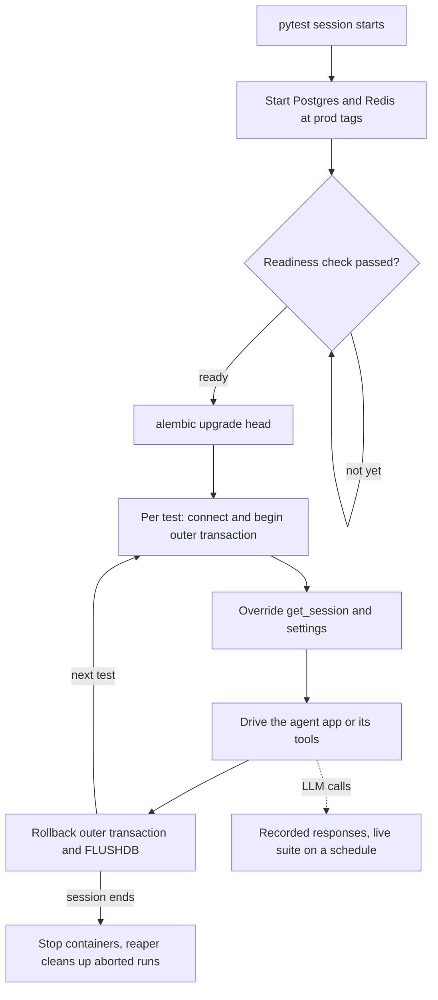

## TL;DR
An agent's retrieval, memory and caching run on real Postgres, pgvector and Redis, so test them against
disposable containers with per-test rollback or cleanup, because fakes cannot prove your SQL, vector
dimensions or TTLs. The LLM is the exception: use recordings.

## For agent builders
- **Why it matters for agents.** The agent's tools are mostly queries: vector search for RAG, rows for
  conversation memory, Redis for caches, locks and rate limits. A fake vector store returns whatever you
  told it, so it never catches a wrong distance operator, a missing tenant filter or a dimension mismatch
  after an embedding-model change.
- **Where it shows up in your stack.** Testcontainers or CI service containers in `conftest.py`, a
  pgvector Postgres image, Alembic migrations, a Redis container, and recorded provider responses for the
  model calls between tool steps.
- **What you control.** Image tags (match production), the isolation strategy per test, which tools get
  real-dependency tests, and how often the live-model contract suite runs.
- **What you can skip.** Container orchestration details. Know session-scoped containers, readiness,
  migrations-not-`create_all`, and the rollback-vs-truncate rule.

## Lab
### Task
Build the integration-test harness for an agent's RAG tool: a migrated database created once per
session, a per-test session bound to an outer transaction that is always rolled back (even when the
handler commits), a fix for a tenant leak in the retrieval query, and a model call replayed from a
recording. Time box: 60-90 minutes.
- **Prerequisites:** the TestClient + pytest-asyncio lesson and the rollback isolation section below.
- **Setup:** `pip install fastapi httpx sqlalchemy pytest`; checked with SQLAlchemy 2.1, FastAPI 0.161,
  httpx 0.28 and Python 3.12.
- **Why SQLite here:** a SQLite file stands in for the pgvector container so the lab runs without
  Docker. Rollback isolation, tenant scoping and recordings behave the same; dialect bugs and the
  `atttypmod` dimension check need the real container from the first example, which you swap into the
  `engine` fixture afterwards.
- **Save** the starter as `lab.py` and the tests as `test_lab.py`, then run `pytest -q`.

### Starter code
```python
"""Lab: integration-test an agent's retrieval tool with per-test rollback and a recorded LLM.
Needs fastapi, httpx and sqlalchemy>=2.0. A SQLite file stands in for the Postgres container so
the lab runs without Docker; the isolation pattern and the SQL are the same on Postgres."""
from contextlib import contextmanager
import httpx
from fastapi import Depends, FastAPI
from sqlalchemy import create_engine, event, text
from sqlalchemy.orm import Session

MIGRATIONS = [   # stands in for `alembic upgrade head`: the schema comes from migrations
    "CREATE TABLE docs (id INTEGER PRIMARY KEY, title TEXT NOT NULL)",
    "CREATE TABLE chunks (id INTEGER PRIMARY KEY, tenant_id TEXT NOT NULL, body TEXT NOT NULL,"
    " e0 REAL, e1 REAL, e2 REAL)",   # a 3-dim embedding; pgvector would use vector(1024)
]

def make_engine(url: str):
    eng = create_engine(url)
    if url.startswith("sqlite"):          # SQLAlchemy's documented recipe for SAVEPOINT on pysqlite
        @event.listens_for(eng, "connect")
        def _connect(dbapi_conn, _):
            dbapi_conn.isolation_level = None
        @event.listens_for(eng, "begin")
        def _begin(conn):
            conn.exec_driver_sql("BEGIN")
    return eng

def migrate(eng) -> None:
    with eng.begin() as conn:
        for ddl in MIGRATIONS:
            conn.exec_driver_sql(ddl)

@contextmanager
def isolated_session(eng):
    # LAB 1: connect, begin an outer transaction that is never committed, bind a
    # Session(bind=conn, join_transaction_mode="create_savepoint") to it, yield the session,
    # then close the session and roll the outer transaction back.
    raise NotImplementedError("lab step 1: isolated_session")
    yield

def get_session():                         # the app's real dependency; tests override it
    raise RuntimeError("no database configured")

app = FastAPI()

@app.post("/docs", status_code=201)
def create_doc(body: dict, s: Session = Depends(get_session)):
    s.execute(text("INSERT INTO docs (title) VALUES (:t)"), {"t": body["title"]})
    s.commit()                             # real handlers commit; the test must still roll back
    return {"ok": True}

def search_chunks(s: Session, tenant: str, qvec: list[float], k: int = 2) -> list[dict]:
    """The agent's retrieval tool: nearest chunks by dot product, for this tenant only."""
    # LAB 2: this query has the bug a fake vector store never catches. Fix it.
    rows = s.execute(text(
        "SELECT body, tenant_id FROM chunks "
        "ORDER BY (e0*:q0 + e1*:q1 + e2*:q2) DESC LIMIT :k"),
        {"q0": qvec[0], "q1": qvec[1], "q2": qvec[2], "k": k}).all()
    return [{"body": b, "tenant": t} for b, t in rows]

def answer(s: Session, http: httpx.Client, tenant: str, q: str, qvec: list[float]) -> str:
    """RAG step: retrieve, then one model call. In tests the model is a recorded response."""
    context = "\n".join(h["body"] for h in search_chunks(s, tenant, qvec))
    r = http.post("/v1/complete", json={"prompt": f"Context:\n{context}\n\nQuestion: {q}"})
    r.raise_for_status()
    return r.json()["text"]

if __name__ == "__main__":
    import os, tempfile
    path = os.path.join(tempfile.mkdtemp(), "lab.db")
    eng = make_engine(f"sqlite:///{path}")
    migrate(eng)
    try:
        for run in (1, 2):
            with isolated_session(eng) as s:
                s.execute(text("INSERT INTO docs (title) VALUES ('Refund policy')"))
                s.commit()
                n = s.execute(text("SELECT count(*) FROM docs")).scalar_one()
                print(f"run {run}: docs inside test={n}")
        with eng.connect() as c:
            print(f"docs after both runs: {c.execute(text('SELECT count(*) FROM docs')).scalar_one()}")
    except NotImplementedError as e:
        print(f"not done yet: {e}")
```

### Expected output
`python lab.py` with a correct solution prints:

```
run 1: docs inside test=1
run 2: docs inside test=1
docs after both runs: 0
```

### Tests
```python
import json
import httpx, pytest
from fastapi.testclient import TestClient
from sqlalchemy import text
import lab

CASSETTE = {   # recorded once from the real provider, replayed on every run
    "/v1/complete": {"status": 200, "json": {"text": "Refunds take 5 days."}},
}

@pytest.fixture(scope="session")
def engine(tmp_path_factory):
    # Real run: PostgresContainer("pgvector/pgvector:pg16") plus alembic upgrade head.
    eng = lab.make_engine(f"sqlite:///{tmp_path_factory.mktemp('db') / 'test.db'}")
    lab.migrate(eng)
    yield eng
    eng.dispose()

@pytest.fixture
def session(engine):
    with lab.isolated_session(engine) as s:
        lab.app.dependency_overrides[lab.get_session] = lambda: s
        yield s
        lab.app.dependency_overrides.clear()

def seed(s):
    for tenant, body, vec in [("t1", "refunds take 5 days", (1, 0, 0)),
                              ("t1", "shipping is free", (0, 1, 0)),
                              ("t2", "t2 secret refund rule", (1, 0, 0))]:
        s.execute(text("INSERT INTO chunks (tenant_id, body, e0, e1, e2) VALUES (:t, :b, :x, :y, :z)"),
                  {"t": tenant, "b": body, "x": vec[0], "y": vec[1], "z": vec[2]})

@pytest.mark.parametrize("run", [1, 2])     # the second run fails if the first one leaked
def test_handler_commit_is_rolled_back(session, run):
    with TestClient(lab.app) as client:
        assert client.post("/docs", json={"title": "Refund policy"}).status_code == 201
    assert session.execute(text("SELECT count(*) FROM docs")).scalar_one() == 1

def test_search_is_nearest_and_tenant_scoped(session):
    seed(session)
    hits = lab.search_chunks(session, "t1", [1.0, 0.0, 0.0], k=2)
    assert hits[0]["body"] == "refunds take 5 days"
    assert {h["tenant"] for h in hits} == {"t1"}

def test_answer_replays_recording_and_sends_only_tenant_context(session):
    seed(session)
    sent = []
    def replay(request: httpx.Request) -> httpx.Response:
        sent.append(json.loads(request.content))
        rec = CASSETTE[request.url.path]
        return httpx.Response(rec["status"], json=rec["json"])
    with httpx.Client(base_url="http://llm.test", transport=httpx.MockTransport(replay)) as http:
        out = lab.answer(session, http, "t1", "How long do refunds take?", [1.0, 0.0, 0.0])
    assert out == "Refunds take 5 days."
    assert "t2 secret" not in sent[0]["prompt"]          # no cross-tenant leak into the model
```

On the starter all four error in the `session` fixture with `NotImplementedError`. With only LAB 1
done, the two retrieval tests fail on the `t2` chunk; a correct solution passes all four.

### Failure scenarios
- **Bind the session without an outer transaction.** `test_handler_commit_is_rolled_back[2]` fails with
  a count of 2: the handler's `commit()` persisted, so test order now matters. Debug by counting rows
  directly on a fresh `engine.connect()` after a test.
- **Leave the tenant filter out.** The `t2` chunk scores as high as the `t1` one, so it lands in the
  hits and in the prompt sent to the model; this is the leak a fake store hides. Debug by printing the
  `tenant` of every hit.
- **Replace the recording with a real provider call.** The suite becomes slow, billed and
  non-deterministic; block outbound network in CI so such a test fails at once.
- **Read the seeded rows from a second connection,** as a background worker would, with its own
  `engine.connect()`. It sees none of them, because they are uncommitted: the case where rollback
  isolation stops working and you switch to truncation.

### Submission
- `lab.py` with both lab steps done, and `test_lab.py` unchanged.
- A `pytest -q` run showing 4 passed, plus `python lab.py` matching the expected output.
- The same suite run against a pgvector container (swap the `engine` fixture as in the first example),
  or a note on what blocked it.
- A one-paragraph note: which of your agent's tools need a real-dependency test, and which isolation
  strategy each needs.
- Evaluation: every test leaves the database empty, no hit or prompt contains another tenant's data, and
  no test calls a live model.

## Why it exists
- **AI services lean on infrastructure with real semantics.** Postgres with JSONB queries and row locks,
  pgvector with its distance operators and index types, Redis with expiries and atomic `SET NX`, an
  object store for uploads, a queue for background jobs.
- **Fakes test your model of the dependency, not the dependency.** The bugs that reach production live in
  the gap: a query that works on SQLite and fails on Postgres, an ORM model that disagrees with the
  migration, an `ON CONFLICT` clause that never fires, a vector column declared with 1536 dimensions
  while the new embedding model returns 1024, a Redis key that never expires because the TTL was set on
  the wrong call.
- **SQLite "because it is close enough" fails.** It hides dialect differences and has no pgvector.
- **A shared staging database fails too.** Tests depend on each other's data and on whoever else is using
  it, so they flake and cannot run in parallel.
- **What you want:** the real engine, private to the test run, in a known state for every test, and gone
  afterward. Containers make that cheap enough to do on every pull request.

## How it works
### Provision real dependencies per test run
- **Same image and major version as production** (for example a pgvector-enabled Postgres image and the
  same Redis major version), *because* version drift is one of the bugs you are trying to catch.
- **Two common ways to start them:**

| Approach | How | Suits |
|---|---|---|
| **Testcontainers** | Starts containers from inside pytest fixtures, tears them down at session end | `pytest` alone locally and in CI, given a Docker daemon |
| **Compose or CI service containers** | Start dependencies before pytest, pass connection URLs in environment variables | CI systems that already manage services |

- **Scope the container to the test session,** *because* starting Postgres takes seconds and doing it per
  test makes the suite unusably slow.
- **Wait for readiness.** A running container is not yet a ready database. Testcontainers waits on a
  readiness check (a log line or an open port) before handing back the URL; with Compose you need a
  healthcheck and `depends_on` a healthy service, *because* otherwise the first tests fail with
  connection refused on a cold CI runner and pass on a warm laptop.
- **The reaper.** Testcontainers starts a small reaper container that removes your containers if the test
  process is killed, so aborted runs do not leak databases.
- **Parallel workers.** Under `pytest-xdist` each worker is a separate process with its own session
  fixtures, so either accept one container set per worker or share one container and give each worker
  its own database.

### Bring the schema up the real way
- **Run your migrations** (for example `alembic upgrade head`) against the fresh database rather than
  `metadata.create_all()`, *because* the migration chain is what production runs, and a suite that never
  applies it will not notice a broken or missing migration, such as the one adding the vector index.

### Isolate each test
Every test must start from a known state. Options, in order of speed:
1. **Transaction rollback.** Open a connection, begin a transaction, bind the app's session to it, run the
   test, roll back. Nothing persists.
   - If the code under test calls `session.commit()` on that bound session, SQLAlchemy 2.0's
     `join_transaction_mode="create_savepoint"` turns those commits into savepoint releases so the outer
     rollback still wins.
   - It does not work for code that commits on separate connections or relies on committed data being
     visible to other connections, such as a background worker that embeds uploaded documents.
2. **Truncate after each test.** Slower, but works when the app commits or uses several connections.
3. **Per-test database or schema.** Strongest isolation; use when tests run in parallel workers.
- **For Redis,** use a dedicated logical database or a per-test key prefix and `FLUSHDB` between tests.

### Wire the app to the real dependencies
- **Override settings or dependencies** that provide connection URLs, so the app builds its engine, Redis
  client and httpx client against the containers.
- **Drive it through `TestClient` or `ASGITransport`** as usual.
- **The app code under test is unchanged,** *because* the seam is configuration, not mocks.

### The LLM is a different kind of dependency
- **Keep real provider calls out of the main suite:** they are slow, cost money, are rate-limited and are
  not deterministic.
- **Record and replay:** record real responses once and replay them (cassette-style recording at the
  httpx layer), or run a self-hosted small model in a container when you need a live endpoint.
- **A small, separately scheduled contract suite** hits the real provider to catch API and schema drift.
- **Agent quality is a third suite.** Whether the model picks the right tool is an eval question, run on
  a dataset with scoring, not an integration test with a pass or fail assertion.

## Diagram
Expensive work happens once per session (pgvector Postgres and Redis containers at production tags,
readiness, migrations); each test only points the app at them, opens and rolls back a transaction, and the
LLM stays outside the loop as recordings.



## Examples
### Postgres with pgvector, real migrations, per-test rollback
A session-scoped pgvector Postgres container, migrations applied once, and a per-test session bound to an
outer transaction that is always rolled back, injected into a sync app through its `get_session`
dependency.

```python
import pytest
from fastapi.testclient import TestClient
from sqlalchemy import create_engine, text
from sqlalchemy.engine import make_url
from sqlalchemy.orm import Session
from testcontainers.postgres import PostgresContainer
from alembic import command
from alembic.config import Config
from app.main import app, get_session                     # the app's real session dependency

@pytest.fixture(scope="session")
def engine():
    with PostgresContainer("pgvector/pgvector:pg16") as pg:   # match prod image and major version
        url = make_url(pg.get_connection_url()).set(drivername="postgresql+psycopg")
        cfg = Config("alembic.ini")
        cfg.set_main_option("sqlalchemy.url", url.render_as_string(hide_password=False))
        command.upgrade(cfg, "head")                         # schema via real migrations
        eng = create_engine(url)
        yield eng
        eng.dispose()

@pytest.fixture
def session(engine):
    with engine.connect() as conn:
        outer = conn.begin()                                 # never committed
        s = Session(bind=conn, join_transaction_mode="create_savepoint")
        app.dependency_overrides[get_session] = lambda: s    # app's commits become savepoints
        yield s
        app.dependency_overrides.clear()
        s.close()
        outer.rollback()                                     # next test sees an empty schema

def test_create_doc_commits_inside_rollback(session):
    with TestClient(app) as client:
        r = client.post("/docs", json={"title": "Refund policy"})  # handler calls commit()
    assert r.status_code == 201
    assert session.execute(text("SELECT count(*) FROM docs")).scalar_one() == 1

def test_vector_dimension_matches_model(session):
    dim = session.execute(text("SELECT atttypmod FROM pg_attribute WHERE "
        "attrelid = 'chunks'::regclass AND attname = 'embedding'")).scalar_one()
    assert dim == 1024      # fails the build if the migration and embedding model disagree
```

Trace it:
1. **First test:** the endpoint's `commit()` releases a savepoint, so the row is visible to the test's
   assertion on the same connection.
2. **Teardown:** `outer.rollback()` discards it, so the next test starts from the migrated, empty schema
   without truncating anything.
3. **Second test:** an assertion a fake can never make. It reads the schema the real migration produced
   (for pgvector, `atttypmod` holds the declared dimension).
- **Async apps:** use the same structure with `AsyncEngine`, `AsyncConnection` and `AsyncSession`, driven
  through `ASGITransport` so the app and the fixtures share one event loop.

### The agent's retrieval tool against real pgvector
Reuses the `session` fixture above. The test seeds chunks for two tenants and asserts the RAG tool returns
the nearest chunk for the caller's tenant only. `search_chunks` stands for the tool function the agent
calls; the table columns are this app's own.

```python
from sqlalchemy import text
from app.tools import search_chunks          # the agent's retrieval tool (code under test)

def vec(hot: int, dim: int = 1024) -> str:   # one-hot test vector in pgvector text form
    v = [0.0] * dim; v[hot] = 1.0
    return "[" + ",".join(map(str, v)) + "]"

def test_search_is_nearest_and_tenant_scoped(session):
    rows = [("t1", "refunds take 5 days", 0), ("t1", "shipping is free", 1),
            ("t2", "t2 secret refund rule", 0)]
    for tenant, body, hot in rows:
        session.execute(text("INSERT INTO chunks (tenant_id, body, embedding) "
                             "VALUES (:t, :b, CAST(:e AS vector))"),
                        {"t": tenant, "b": body, "e": vec(hot)})
    hits = search_chunks(session, tenant="t1", query_vec=vec(0), k=2)
    assert hits[0]["body"] == "refunds take 5 days"            # real distance operator ordering
    assert all("t2" not in h["body"] for h in hits)            # no cross-tenant leak into the agent
```

- **What a fake would miss:** the wrong distance operator, a forgotten `tenant_id` filter, or a cast that
  only fails on a real `vector` column.

### Redis container: real TTL and `SET NX` semantics
A Redis container fixture has the same shape: point the app at it by overriding settings, and flush its
database between tests. These tests catch the "TTL set on the wrong call" bug and a broken lock, both of
which an agent's tool cache depends on.

```python
import pytest, redis
from testcontainers.redis import RedisContainer

@pytest.fixture(scope="session")
def redis_url():
    with RedisContainer("redis:7") as rc:                  # match the production major version
        yield f"redis://{rc.get_container_host_ip()}:{rc.get_exposed_port(6379)}/0"

@pytest.fixture
def r(redis_url):
    client = redis.Redis.from_url(redis_url)
    yield client
    client.flushdb()                                        # isolate tests
    client.close()

def cache_put(r, key, value, ttl):                          # code under test (normally imported)
    r.set(key, value, ex=ttl)

def test_cache_put_sets_expiry(r):
    cache_put(r, "llm:v1:t1:abc", b"answer", ttl=60)
    assert 0 < r.ttl("llm:v1:t1:abc") <= 60                 # -1 would mean "never expires"

def test_lock_is_exclusive(r):
    assert r.set("lock:k", "a", nx=True, px=30000)
    assert r.set("lock:k", "b", nx=True, px=30000) is None  # second taker is refused
```

### Choosing the isolation strategy
| Code under test | Rollback | Truncate | Per-test database |
|---|---|---|---|
| One session, commits on it | Yes (savepoints) | Yes | Yes |
| Commits on separate connections | No | Yes | Yes |
| A worker reads rows the endpoint wrote (async ingestion for RAG) | No | Yes | Yes |
| Parallel `pytest-xdist` workers on one database | Mostly, but same-key inserts can block across workers | No: a truncate wipes other workers' data | Yes |

- **Why rollback mostly survives parallelism:** each test's rows stay uncommitted and invisible to other
  workers, but two workers inserting the same unique key wait on each other's locks, so a per-worker
  database is the safe default once you parallelise.

## Production patterns
- **Compose healthchecks gate the test job.** When CI starts dependencies with Compose, give Postgres a
  healthcheck such as `pg_isready` and make the test service `depends_on` it with
  `condition: service_healthy`. Monitor first-test connection-refused failures on cold runners.
- **Pin images to production tags.** Keep the container tags in one place shared with deployment config
  (for example `pgvector/pgvector:pg16`), and bump both together. Monitor bugs that reproduce only in
  production or only in CI, the sign of drift.
- **Schema assertions as tests.** For invariants a fake can never check (vector dimension, required
  indexes, extensions installed), query the catalog as in the `atttypmod` test above. Monitor these
  failing on migration pull requests, which is exactly where you want them to fail.
- **Real-dependency tests per agent tool.** Give every tool that touches a database or cache (retrieval,
  memory read and write, ticket lookup) at least one test against the containers, including tenant
  scoping. Monitor which tools have none; those are where cross-tenant leaks hide.
- **Recorded provider responses with a scheduled live suite.** Replay recorded httpx responses in the main
  suite, and run a small live contract suite on a schedule against the real provider. Monitor the live
  suite's failures as early warning of API and schema drift.
- **Per-worker databases under xdist.** When parallelising, read the worker id pytest-xdist exposes
  (the `worker_id` fixture) and create one database per worker on a shared container. Monitor suite
  runtime and cross-test flakes.

## Trade-offs
- **Realism vs speed.** Real dependencies catch dialect, migration and semantic bugs that fakes cannot, at
  the cost of seconds of startup and a Docker requirement; keep unit tests for fast inner-loop feedback.
- **Rollback speed vs coverage.** Transaction rollback is the fastest isolation, but breaks when code
  under test commits on its own connections; switch to truncation or per-test databases then.
- **Session-scoped containers vs global state.** They make suites fast, but a test that mutates global
  state (extensions, roles, server settings) can poison every later test; isolate those in their own
  session.
- **Recorded LLM responses vs drift.** Recordings make tests deterministic and free, but go stale when the
  provider changes its format; a scheduled live contract suite is what catches that drift.

## Pitfalls
- **Testing against SQLite while production runs Postgres.** The suite passes and production fails on
  JSONB operators, row locking (`SELECT ... FOR UPDATE`), Postgres-specific `ON CONFLICT` behaviour or
  pgvector, which SQLite either lacks or implements differently. Fix: a Postgres container at the
  production image tag.
- **Creating tables with `create_all()` instead of running migrations.** A missing or broken migration
  ships, and the symptom is the first deploy failing on `alembic upgrade`.
- **Testing retrieval only with a fake vector store.** Symptom: the agent cites another tenant's document
  or irrelevant chunks in production while every test passes. Fix: a pgvector container test per
  retrieval tool, with two tenants seeded.
- **No per-test isolation.** Tests pass alone and fail together, or depend on execution order. Fix: pick
  rollback, truncation or a per-test database from the table above.
- **A different image or major version from production,** such as the latest Postgres image. Symptom: a
  bug that reproduces only in production or only in CI.
- **Calling the real LLM in every integration test.** The suite becomes slow, flaky on rate limits and
  expensive, and failures are non-deterministic.

## When to use
- **Use for** every code path whose correctness depends on the semantics of a real dependency: SQL and
  migrations, vector search queries behind RAG tools, agent memory tables, Redis-based caching, locks and
  rate limits, upload storage and queue handoffs.
- **Keep them** fewer than unit tests, run them on every pull request, and keep the live-LLM contract
  suite separate and scheduled.
- **Measure** suite runtime, flake rate and which production incidents the suite would have caught.
- **Interviews:** explaining why SQLite is not a Postgres test double and how you isolate tests is the
  expected depth.

## Role lens
- **Engineer:** Builds session-scoped container fixtures, migration-based schema setup, per-test
  rollback, and overrides that point the app at the containers.
- **Architect:** Defines the test pyramid for the service: what runs against fakes, what against real
  dependencies, and how live-provider contract tests gate releases.
- **FDE:** Reproduces a customer's database version and extensions in a container to debug a failure
  that only happens on their infrastructure, then keeps it as a regression test.

## Check yourself
**Q:** Your integration tests pass with per-test transaction rollback, but a new endpoint that
enqueues a background job and lets a worker read the row fails in the test: the worker sees nothing.
Why, and what do you change?
**A:** With rollback isolation the endpoint's write lives inside an uncommitted transaction on the
test's connection. The worker uses its own connection, and Postgres never shows one transaction's
uncommitted writes to another (there are no dirty reads at any isolation level), so the row looks absent. This is exactly the
case rollback cannot cover. For this test, let the code commit and isolate by truncating tables
afterward or using a per-test database, and run the worker against the same real database. Keep
rollback for the many tests that stay on one connection, because it is much faster.

## Interview questions
### Why not run integration tests against SQLite or a shared staging database?
- **SQLite hides dialect differences:** JSONB operators, `SELECT ... FOR UPDATE`, Postgres-specific
  `ON CONFLICT` behaviour and pgvector are missing or behave differently, so the suite passes and production fails.
- **A shared staging database couples tests** to each other's data and to other users, so they flake and
  cannot run in parallel.
- **A disposable container** gives the real engine, private to the run, in a known state, gone afterward.

### How would you test that your agent's RAG tool never returns another tenant's documents?
- **Run it against real pgvector,** not a fake store, with migrations applied, because the bug lives in the
  real query: a missing `tenant_id` filter or a join that drops it.
- **Seed two tenants with near-identical chunks,** so the other tenant's chunk would win on distance if the
  filter were missing, then assert every hit belongs to the caller.
- **Make it a required check** on changes to retrieval code and migrations, alongside the dimension test.

### The first few integration tests fail with connection refused on CI but pass on laptops. How do you fix it?
- **A running container is not a ready database.** On a cold CI runner Postgres is still starting when the
  first test connects; on a warm laptop it is already up.
- **With Testcontainers,** rely on its readiness wait (a log line or an open port) before using the URL.
- **With Compose,** add a healthcheck such as `pg_isready` and make the test service `depends_on` it with
  `condition: service_healthy`.

### The team switches to an embedding model that returns 1024 dimensions. How would your tests catch a mismatch before deploy?
- **The bug:** the vector column was declared with 1536 dimensions, so inserts fail in production, and a
  fake repository would happily accept any list of floats.
- **Build the schema with real migrations** against a pgvector container, then assert on the catalog: for
  pgvector, `atttypmod` in `pg_attribute` holds the declared dimension.
- **Make it a required check on migration pull requests,** so the build fails where the model and
  migration disagree, not on the first deploy.

### How do you keep the LLM provider in your agent's test strategy without making the suite slow and flaky?
- **Keep real calls out of the main suite,** because they are slow, billed, rate-limited and not
  deterministic; replay recorded responses at the httpx layer between real tool steps.
- **Run a small live contract suite on a schedule** to catch provider API and schema drift, since recordings
  go stale when the provider changes its format.
- **Judge agent quality in evals,** a scored dataset run separately, because tool choice is a rate, not a
  pass or fail assertion.

### How would you parallelise a slow integration suite with pytest-xdist?
- **Each xdist worker is a separate process** with its own session fixtures, so session-scoped containers
  multiply unless you plan for it.
- **Option one:** one container set per worker, simple but heavier on CI memory and startup time.
- **Option two:** one shared container with a database per worker, named from the `worker_id` fixture;
  monitor runtime and cross-test flakes after the switch.

## Quiz
### Q: Why are database migrations, rather than `metadata.create_all()`, the better way to build the test schema?
- [ ] `create_all()` does not work against containerised Postgres
- [x] Migrations are what production runs, so the tests catch broken or missing migrations
- [ ] Migrations are faster than `create_all()`
- [ ] `create_all()` cannot create indexes
> The schema in production comes from the migration chain. Building tests from ORM metadata can hide a
> migration that is missing, out of order or inconsistent with the models until the first deploy.

### Q: Which dependency is usually best kept out of the main integration suite and handled with recordings or a separate scheduled suite?
- [ ] Postgres with pgvector
- [ ] Redis
- [x] The hosted LLM provider
- [ ] The object store used for uploads
> Real provider calls are slow, billed, rate-limited and non-deterministic. Databases and caches are
> cheap to run in containers and deterministic, so they belong in the main suite.

### Q: Per-test transaction rollback fails to isolate which kind of test?
- [ ] Tests that only read data
- [ ] Tests that insert rows through the ORM
- [ ] Tests that run vector similarity queries
- [x] Tests where the code under test commits on, or reads from, separate connections
> Rollback works because everything happens in one uncommitted transaction on one connection. Commits on
> the bound session can be absorbed with savepoints, but other connections escape that boundary and never
> see the uncommitted rows, so truncation or per-test databases are needed instead.

## Use cases & projects
### Use cases
- **RAG retrieval tools.** Tests against real pgvector catch a wrong distance operator, a missing tenant
  filter or a vector dimension mismatch after an embedding-model change.
- **Conversation memory.** Real Postgres proves the memory writes, JSONB queries and upserts the agent
  relies on behave as they will in production.
- **Caches, locks and rate limits.** A real Redis container proves keys expire and `SET NX` locks are
  atomic, which a dict-based fake cannot.
- **Migration safety.** Running Alembic migrations in the test container catches an ORM model that
  disagrees with the schema before an agent tool hits it in production.

### Mini project
**Integration-test an agent's retrieval tool (2-3 hours).**
- **Goal:** prove a RAG search tool returns the right, tenant-scoped chunks on real Postgres with pgvector.
- **Steps:** start a session-scoped pgvector Postgres container (Testcontainers or a CI service container)
  with an image tag matching production; run Alembic migrations; seed two tenants' chunks with small
  fixed vectors; isolate each test with rollback; call the tool through the API with the model call
  replaced by a recorded response.
- **Done when:** tests pass for nearest-neighbour order, tenant isolation and a rejected wrong-dimension
  insert, and the suite runs on every pull request.
