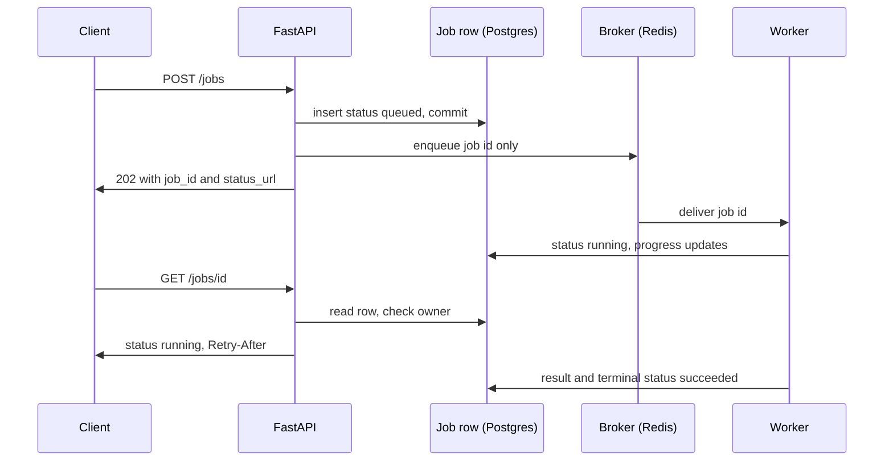

## TL;DR
Long agent runs, batch evals and ingestion belong on a job queue: persist a job row, answer `202 Accepted`
with a job id, let a worker run it and a status endpoint report it. Celery is sync-first, ARQ
asyncio-native; both need idempotent jobs.

## For agent builders
- **Why it matters for agents.** A research agent that loops for five minutes, a nightly eval over 500
  test cases, or ingesting a corpus for RAG cannot live inside an HTTP request. The job row, not the
  connection, keeps the run alive across timeouts, retries and deploys.
- **Where it shows up in your stack.** Celery or ARQ workers next to your FastAPI agent API, a job table
  in Postgres, and the provider rate limit that sets worker concurrency. Workflow engines take over when
  runs need step-level checkpoints.
- **What you control.** Commit-then-enqueue, idempotent job and tool bodies (a redelivered agent job must
  not send the email twice), retry classification for 429s, per-step progress, and concurrency per queue.
- **What you can skip.** Broker internals (AMQP details, Redis data structures). Know at-least-once
  delivery, visibility timeouts and late acks; that covers most agent-job incidents.

## Why it exists
- **Intermediaries cut long requests.** Connections that run or idle too long are dropped, commonly after
  tens of seconds by default (vendor-dependent), so a five-minute corpus summarisation never returns.
- **Clients retry on timeout.** The work runs twice, and the second run races the first.
- **Deploys, crashes and scale-downs kill in-flight work** with nothing to say it existed.
- **AI makes it worse.** One job can mean thousands of model calls at real cost, bounded by provider rate
  limits rather than your CPUs.
- **The naive fixes fail.** `BackgroundTasks` runs after the response in the same process and vanishes
  with it; huge timeouts hide the symptom and still lose work on restart. The fix splits "accept" from
  "do": the job record, not the HTTP connection, is the source of truth, and each half scales and fails
  independently. (The backend-fundamentals lesson on durable workers covers leases, acknowledgements and
  visibility timeouts; this is the FastAPI-facing shape.)

## How it works
### The contract between API and client
1. **`POST /jobs`.** Validate input fully, because this is the last moment you can return a 4xx.
   - Insert a job row in your own database (`id`, `owner`, `status=queued`, `created_at`, the idempotency
     key if the client sent one).
   - Enqueue a message with the job id and small parameters, never the payload; a 50 MB document goes to
     object storage and the message carries its key.
   - Return `202` with `{"job_id": ..., "status_url": ...}` and a `Location` header.
2. **`GET /jobs/{id}`.** Check the caller owns the job (answer 404, not 403, so ids cannot be probed).
   - Return `status` (`queued`, `running`, `succeeded`, `failed`, `cancelled`), `progress`, `result` or a
     `result_url`, a sanitised `error`, and timestamps.
   - Add `Retry-After` so well-behaved clients back off.
3. **Worker.** Claims a job, writes `running` with its worker id and start time, works with progress
   updates, then writes the result and a terminal status. Terminal states are immutable.
4. **Optional push.** An SSE endpoint that tails the job row, or a webhook on completion.

### Why your own row, not the broker's result backend
- **Result backends are ephemeral** (TTL-bound), carry no ownership or audit metadata, and couple your
  API to the queue library.
- **The row absorbs a classic race.** Write the row and commit *before* enqueueing; if the enqueue fails,
  a sweeper re-enqueues rows stuck in `queued`. Enqueueing first can produce a worker that finds no row.
- **The outbox pattern** makes this airtight when you need it.

### Celery
The mature, sync-first, multi-broker option.
- **Tasks and enqueueing.** Plain functions decorated with `@app.task`; `task.delay(...)` or
  `apply_async(args, countdown=..., queue=...)` enqueues to RabbitMQ, Redis or SQS.
- **Prefork pool by default.** One OS process per concurrency slot, which suits CPU-bound and sync code.
- **Reliability is opt-in.** By default a message is acknowledged when received, so a worker crash loses
  it; set `acks_late=True` and `task_reject_on_worker_lost=True` for at-least-once.
- **Redis `visibility_timeout`.** An unacknowledged message is redelivered after it, and it defaults to
  one hour, so any longer job runs twice unless you raise it.
- **Retries and limits.** `autoretry_for`, `retry_backoff`, `max_retries` and `self.retry()`;
  `soft_time_limit` and `time_limit` bound runaway tasks.
- **No native asyncio task body.** Calling an async SDK means `asyncio.run(...)` inside the task, or the
  sync client.
- **Ecosystem.** Beat schedules periodic jobs, Flower monitors, and canvas primitives (chains, groups,
  chords) express fan-out such as "embed every chunk, then build the index".

### ARQ
A small asyncio-native queue on Redis.
- **Tasks** are `async def` functions taking a `ctx` dict first.
- **`WorkerSettings`** lists `functions`, `redis_settings`, `max_jobs` (concurrent jobs per worker
  process), `job_timeout`, `max_tries`, `keep_result`, and `on_startup`/`on_shutdown` hooks that put
  shared clients (an `httpx` client, a database pool) into `ctx`.
- **Free deduplication.** `await pool.enqueue_job("name", *args, _job_id=...)` does not enqueue a job id
  that already exists.
- **IO-bound shape.** One process holds `max_jobs` concurrent coroutines, so it keeps many LLM calls in
  flight, exactly the shape of AI work.
- **Narrow retries.** Raising `arq.Retry(defer=seconds)`, a job interrupted by worker shutdown, or a job
  whose worker died (picked up once its in-progress marker expires) gets another try, up to `max_tries`;
  any other exception marks the job failed.
- **So classify errors yourself.** Transient ones (a provider 429 or 5xx, a network timeout) become
  `Retry` with a growing `defer`; permanent ones (bad input, a deleted document) fail immediately.
- **Small by design.** Redis-only; named queues exist, but no canvas workflows, priorities or RabbitMQ.

### Choosing
| Pick | When |
|---|---|
| Celery | the organisation already runs it; you need RabbitMQ, multiple queues with priorities, Beat schedules or canvas workflows; jobs are CPU-bound |
| ARQ | the codebase is asyncio, Redis is already present, jobs are IO-bound model calls, a small operational surface matters |
| Workflow engine | multi-step agent runs that need checkpoints and resumption (see the durable workflow lesson) |

Either way delivery is at-least-once, so the body must be idempotent:
- **Check the job's status before acting.**
- **Write results with upserts keyed by job id.**
- **Pass idempotency keys to external calls.**

### Running an agent loop as a job
A tool-calling agent is a job with many steps, and at-least-once delivery applies to every one of them.
1. **Checkpoint after every step.** Append the step (model output, tool call, tool result) to a run-steps
   table keyed by job id and step number, so a redelivered job reloads the transcript and continues.
2. **Make side-effecting tools idempotent.** Derive an idempotency key from job id plus step number and
   pass it to the external API, or record "tool done" before acting on a retry.
3. **Report progress as steps.** `progress` becomes "step 4 of at most 15" plus the latest tool name, which
   the status route or an SSE stream shows.
4. **Check a cancel flag between steps.** A `cancelled` status written by `POST /jobs/{id}/cancel` stops
   the loop at the next step boundary.
5. **Bound the run.** A step budget and the job timeout stop a looping agent from spending forever.

### Backpressure and capacity
- **Queue depth is the backpressure signal.** Export it and cap in-flight jobs per tenant.
- **Reject early.** Return `429` or `503` when depth × average duration exceeds what you promised.
- **Separate queues** for cheap interactive and expensive batch jobs, so one never starves the other.
- **Size worker concurrency by provider rate limits and memory, not CPU.**

## Diagram
The job row is the source of truth: it is committed before the enqueue, the worker updates it, and the
status route only ever reads it.



## Examples
### FastAPI contract with an ARQ worker
The job row is committed before enqueueing, the status endpoint hides other users' jobs, and the worker
checks status first: a redelivered job is a no-op, a retry skips documents already summarised, and only
transient provider errors are retried.
- **Placeholders:** `db` is your async data-access layer, `TransientLLMError` is however your client
  signals a 429, 5xx or timeout, and `ctx["llm"]` is a shared client your `on_startup` hook (not shown)
  puts into `ctx`.

```python
import uuid
from fastapi import FastAPI, HTTPException, Request, Response
from pydantic import BaseModel

app = FastAPI()                       # lifespan creates app.state.arq = await create_pool(RedisSettings())

class Req(BaseModel):
    user_id: str
    corpus_id: str

@app.post("/jobs/summaries", status_code=202)
async def create(body: Req, request: Request, response: Response):
    job_id = str(uuid.uuid4())
    await db.create_job(job_id, owner=body.user_id, status="queued")        # commit BEFORE enqueue
    await request.app.state.arq.enqueue_job("summarize_corpus", job_id, body.corpus_id, _job_id=job_id)
    response.headers["Location"] = f"/jobs/{job_id}"
    return {"job_id": job_id, "status_url": f"/jobs/{job_id}"}

@app.get("/jobs/{job_id}")
async def status(job_id: str, user_id: str, response: Response):      # user_id: from your auth dependency in real code
    job = await db.get_job(job_id)
    if job is None or job.owner != user_id:
        raise HTTPException(404)                                            # 404, not 403: don't leak ids
    if job.status in ("queued", "running"):
        response.headers["Retry-After"] = "5"
    return {"status": job.status, "progress": job.progress, "result_url": job.result_url, "error": job.error}

# worker.py  — run with:  arq worker.WorkerSettings
from arq import Retry
from arq.connections import RedisSettings

async def summarize_corpus(ctx, job_id: str, corpus_id: str):
    if await db.job_status(job_id) == "succeeded":                          # at-least-once: redelivery is a no-op
        return
    await db.set_status(job_id, "running")
    try:
        docs = await db.docs(corpus_id)
        for i, doc in enumerate(docs, 1):
            if await db.has_summary(doc.id):                                 # resume: don't pay twice
                continue
            await db.upsert_summary(doc.id, await ctx["llm"].summarize(doc))   # idempotent write per doc
            await db.set_progress(job_id, i, len(docs))
        await db.set_status(job_id, "succeeded", result_url=f"/corpora/{corpus_id}/summaries")
    except TransientLLMError as exc:                                         # 429/5xx/timeout from the provider
        if ctx["job_try"] < 3:                                               # keep in step with max_tries
            raise Retry(defer=ctx["job_try"] * 30)                           # back off longer on each try
        await db.set_status(job_id, "failed", error=type(exc).__name__); raise   # out of tries: row must not stay "running"
    except Exception as exc:
        await db.set_status(job_id, "failed", error=type(exc).__name__); raise   # ARQ records failure; only arq.Retry re-runs

class WorkerSettings:
    functions = [summarize_corpus]
    redis_settings = RedisSettings()
    max_jobs, job_timeout, max_tries = 10, 1800, 3   # concurrency bound by LLM rate limits, not CPU
```

### The same job on Celery, configured for at-least-once
Celery's defaults favour throughput over durability; these settings flip that. All are standard Celery
configuration keys and task options.

```python
import asyncio
from celery import Celery

app = Celery("ai", broker="redis://localhost:6379/0")
app.conf.update(
    task_acks_late=True,                    # ack after the task finishes, not on receipt
    task_reject_on_worker_lost=True,        # OOM-killed worker -> message is redelivered
    worker_prefetch_multiplier=1,           # don't let one worker hoard long jobs
    broker_transport_options={"visibility_timeout": 4 * 3600},  # > longest job, or it runs twice
)

@app.task(bind=True, autoretry_for=(TransientLLMError,), retry_backoff=True, max_retries=5,
          soft_time_limit=1500, time_limit=1800)
def summarize_corpus(self, job_id: str, corpus_id: str):
    # Celery task bodies are sync: drive the async implementation explicitly.
    asyncio.run(summarize_corpus_async(job_id, corpus_id))   # same idempotent body as the ARQ version
```

### A long agent run as a checkpointed ARQ job
Each step is persisted before the next starts, so a redelivered job resumes at the last finished step
and a side-effecting tool sees the same idempotency key on a retry. `ctx["agent"]` and `db` are
placeholders for your agent step function and data layer.

```python
MAX_STEPS = 15

async def run_agent_job(ctx, job_id: str):
    job = await db.get_job(job_id)
    if job.status in ("succeeded", "failed", "cancelled"):              # terminal states are immutable
        return
    await db.set_status(job_id, "running")
    steps = await db.load_steps(job_id)                                  # resume: transcript so far
    while len(steps) < MAX_STEPS:
        if await db.job_status(job_id) == "cancelled":                   # cancel checked at step boundary
            return
        n = len(steps) + 1
        step = await ctx["agent"].next_step(job.input, steps)            # one model call
        if step.tool_call:
            step.tool_result = await ctx["agent"].call_tool(
                step.tool_call, idempotency_key=f"{job_id}:{n}")         # same key on redelivery
        await db.append_step(job_id, n, step)                            # upsert on (job_id, n)
        await db.set_progress(job_id, n, MAX_STEPS)
        steps.append(step)
        if step.final_answer:
            await db.set_status(job_id, "succeeded", result=step.final_answer)
            return
    await db.set_status(job_id, "failed", error="step budget exhausted")
```

### Worked scenario: sizing workers against a provider rate limit
Illustrative numbers: 1,000 documents, one model call per document, a provider limit of 600 requests per
minute, ~4 s per call.

| Quantity | Calculation | Result |
|---|---|---|
| Allowed call rate | 600 / 60 s | 10 calls/s |
| In-flight calls to hit that rate | 10 calls/s × 4 s | ~40 concurrent |
| ARQ processes at `max_jobs = 10` (one call each) | 40 / 10 | 4 workers |
| Fastest possible corpus time | 1,000 / 10 calls/s | ~100 s |
| Double to 8 workers | 8 × 10 = 80 in flight, still 10 calls/s allowed | only more 429s and retries |

More workers past the rate limit add retries, not throughput; CPU never enters the sum.

- **The same arithmetic holds for agent jobs.** An agent job makes one model call per step, so 40 agent
  jobs in flight each waiting ~4 s per step saturate the same 600-per-minute limit; size `max_jobs` by
  calls in flight, not by job count.

## Production patterns
- **Checkpoint agent steps, not just jobs.** Agent teams persist every step (model output, tool call,
  tool result) keyed by job id and step number, and key side-effecting tool calls on the same pair, so a
  redelivery resumes instead of repeating actions. Monitor steps re-executed per job and duplicate tool
  calls by idempotency key.
- **Commit-then-enqueue plus a sweeper.** For every job type, commit the row before enqueueing, and run a
  periodic sweep (Celery Beat, or ARQ `cron_jobs`) that re-enqueues rows stuck in `queued` and fails
  `running` rows whose heartbeat is stale. Monitor the count of stuck rows each sweep finds.
- **Late acks and a long visibility timeout on Celery.** Set `task_acks_late=True`,
  `task_reject_on_worker_lost=True` and a Redis `visibility_timeout` above the longest job. Monitor the
  duplicate-delivery rate (same job id started twice).
- **Classify retries explicitly.** Map provider 429/5xx/timeouts to `arq.Retry(defer=...)` or Celery's
  `autoretry_for`, permanent errors to immediate `failed`. Monitor retries per job and the share of jobs
  that exhaust `max_tries`.
- **Separate queues per cost class.** Route interactive jobs and batch ingestion to different queues with
  their own workers (Celery `queue=` on `apply_async`; separate ARQ `queue_name` per worker), so a corpus
  import cannot starve a user-facing job. Monitor time-in-queue per queue.
- **Status route as a cheap read.** Serve `GET /jobs/{id}` from the job row with `Retry-After`, owner
  checks and 404 for others' jobs; add SSE or webhooks once polling dominates. Monitor polls per job and
  status-route share of total QPS.

## Trade-offs
- **Durability and scaling vs operational weight.** Workers scale horizontally and jobs survive restarts,
  but you add a second deployable, a broker and a serialisation boundary; for millisecond follow-ups that
  can be lost, `BackgroundTasks` is cheaper.
- **At-least-once vs duplicates.** No job is lost, but every job can run twice, so idempotency is a
  requirement. The flip is at-most-once (Celery's default early ack), acceptable only for work you would
  rather drop than repeat.
- **Polling simplicity vs load.** A status endpoint is simple and stateless, but at scale it becomes your
  highest-QPS route; once clients number in the thousands, push via SSE or webhooks pays for itself.
- **Celery breadth vs ARQ fit.** Celery's brokers, routing, Beat and canvas cost sync task bodies and
  more configuration; ARQ's asyncio model fits LLM IO but stops at Redis and a minimal feature set (no
  canvas, no priorities, retries only on explicit `Retry`).

## Pitfalls
- **Restarting an agent job from step 1 on redelivery.** Symptom: after a worker crash the customer gets
  the same email twice and model spend for that run doubles. Fix: checkpoint steps and pass idempotency
  keys to side-effecting tools.
- **Enqueueing before the job row is committed.** Symptom: workers log "job not found" and retry until
  the row appears, or never.
- **Stuffing documents into the message.** Symptom: Redis memory spikes and slow enqueues. Fix: pass
  object-storage keys.
- **Keeping Celery's default early acknowledgement.** Symptom: jobs stuck in `running` forever after a
  worker is OOM-killed.
- **A Redis `visibility_timeout` shorter than the longest job.** Symptom: the same job id twice in worker
  logs and doubled model spend.
- **Serving status from the broker's result backend.** Symptom: finished jobs look unknown once the
  result TTL passes (Celery reports an expired id as `PENDING`; its `result_expires` defaults to one day,
  ARQ's `keep_result` to one hour).
- **No ownership check on the status route.** Symptom: a security finding that job ids, often sequential,
  expose other tenants' results.
- **Clients polling in tight loops.** Symptom: the status endpoint dominates request volume. Fix: send
  `Retry-After` and document a backoff.
- **Letting a retried job overwrite a terminal state.** Symptom: a job flips from `succeeded` back to
  `running`, confusing every dashboard.

## When to use
- **Use when** work outlives a reasonable HTTP timeout, must survive restarts, needs retries, or should be
  throttled against provider rate limits independently of API traffic: corpus ingestion and embedding,
  batch evaluation runs over agent test sets, scheduled re-summarisation, long or scheduled agent runs.
- **Avoid when** it is an interactive agent turn of a few seconds (stream instead) or sub-second
  follow-ups.
- **Measure** queue depth, time-in-queue, job duration percentiles, retry and duplicate rates, and status
  polls per job.
- **Interviews:** draw the 202-plus-status contract, explain why the job row beats the result backend, and
  say what at-least-once forces on job bodies.

## Role lens
- **Engineer:** Writes idempotent task bodies, the enqueue-after-commit path, and the status route
  with ownership checks and `Retry-After`, and wires shared clients into worker startup hooks.
- **Architect:** Chooses Celery versus ARQ versus a workflow engine, defines queue separation, per-tenant
  limits and backpressure policy, and decides where job state lives.
- **FDE:** Migrates a customer's "run it in a background task" prototype to a queue when deploys start
  losing jobs, and tunes worker concurrency against their provider rate limits.

## Check yourself
**Q:** A worker crashes halfway through summarising 1,000 documents. Walk through what happens with
Celery at default settings, with `acks_late=True`, and what your job code must do in each case.
**A:** At default settings Celery acknowledges the message on receipt, so after the crash the broker
considers it done: the job row stays `running` forever, about 500 summaries are missing, and nobody
retries.
A sweeper that marks stale `running` jobs as failed is the minimum mitigation. With `acks_late=True`
(and `task_reject_on_worker_lost`) the unacknowledged message is redelivered, after the visibility
timeout on Redis or SQS or as soon as the worker's connection drops on RabbitMQ, so the job runs again
from the start on another worker. For that to be correct, the task must be idempotent:
check the job status first, skip documents that already have a summary (upsert keyed by document id),
and update progress monotonically, so the second run does only the remaining ~500 and marks success. In both
cases the row, not the broker, is what the status endpoint and the on-call engineer read.

## Interview questions
### Why split long AI work into a 202 response plus a durable worker?
- **HTTP connections are the wrong source of truth.** Intermediaries cut long requests after tens of
  seconds, clients retry on timeout, and deploys kill in-flight work with no record of it.
- **A committed job row survives all three.** The API accepts and returns a job id, workers do the work
  and scale independently, and the status endpoint reads the row.

### Workers log "job not found" a few times a day. What is the bug and the fix?
- **Enqueue before commit.** The worker picked up the message before the API's transaction committed the
  job row.
- **Fix:** commit the row first, then enqueue; if the enqueue fails, a sweeper re-enqueues rows stuck in
  `queued`, or use the outbox pattern when it must be airtight.

### Celery or ARQ for a service that fans out thousands of LLM calls?
- **ARQ fits IO-bound async work.** One process holds `max_jobs` concurrent coroutines, so many model
  calls stay in flight, and the codebase stays asyncio.
- **Celery wins on breadth:** RabbitMQ or SQS brokers, priorities, Beat schedules, canvas chains and
  chords, and prefork processes for CPU-bound work, at the cost of sync task bodies.
- **Either way delivery is at-least-once,** so the job body must be idempotent.

### An agent job ran twice: the same job id appears twice in worker logs, model spend doubled and a customer got two emails. What happened?
- **A redelivery.** With Celery on Redis, an unacknowledged message is redelivered after
  `visibility_timeout`, which defaults to one hour, so any longer job runs twice.
- **Fix the setting and the body:** raise the timeout above the longest job, and make the task check
  status first and upsert results keyed by job or document id so a rerun only does the remaining work.
- **Fix the tools too:** checkpoint agent steps and pass job id plus step number as the idempotency key
  to the email tool, so a resumed run cannot repeat a side effect.

### How do you size worker concurrency for a job type that calls a rate-limited model provider?
- **The provider limit is the ceiling, not CPU.** Concurrency times calls per second per job must stay
  under the rate limit; more workers past it only add 429s and retries.
- **Watch queue depth and time-in-queue,** and reject early with `429` or `503` when depth × average
  duration exceeds the promised turnaround.

### When would you move agent runs from a job queue to a durable workflow engine?
- **When steps need first-class checkpoints and resumption.** A queue retries whole jobs, so you hand-roll
  step tables and idempotency keys; a workflow engine records each step and replays from the last one.
- **When runs wait on humans or timers.** Approvals that take hours or days fit workflow waits better
  than a worker holding a job.
- **Stay on the queue** while runs are minutes long, single-shot, and the step table stays simple.

## Quiz
### Q: Why does the API return 202 with a job id instead of holding the connection until the work finishes?
- [ ] Because FastAPI cannot keep a connection open for more than thirty seconds
- [x] Because intermediaries cut long connections, clients retry and duplicate work, and in-flight work dies with the process, whereas a persisted job survives all three
- [ ] Because 202 responses are cached by browsers
- [ ] Because workers cannot write HTTP responses
> The job record plus a status endpoint decouples completion from the connection. The connection can
> drop, the client can retry safely, and the worker can be restarted without losing the job.

### Q: Why must a job function check the job's status before doing its work?
- [ ] To update the job's `started_at` timestamp
- [ ] Because ARQ requires it for the result to be stored
- [x] Because delivery is at-least-once, so the same job can be redelivered after a crash or timeout and must be a no-op if already done
- [ ] To obtain a lock on the Redis key
> Both Celery with late acks and ARQ redeliver jobs whose worker died. Reading the status first and
> using idempotent writes turns a duplicate delivery into a harmless resume rather than double work.

### Q: Which situation most favours ARQ over Celery?
- [ ] The team needs RabbitMQ with priority queues and Beat schedules
- [x] An asyncio codebase on Redis whose jobs are mostly concurrent IO-bound model calls
- [ ] Jobs are CPU-bound image preprocessing that must use every core
- [ ] The organisation already runs Celery for other services
> ARQ's async task bodies let one process keep many model calls in flight. Celery's prefork pool and
> broker breadth are the better fit for CPU-bound work, RabbitMQ features, and existing Celery estates.

## Use cases & projects
### Use cases
- **Long research agents.** A run that loops for minutes is a job: the client gets `202 Accepted` with a
  job id and polls or subscribes for step progress.
- **Batch evals.** A nightly run over hundreds of test cases fans out as jobs, with worker concurrency set
  by the provider rate limit.
- **RAG ingestion.** Chunking and embedding a corpus runs on workers so uploads return at once and retries
  do not duplicate chunks.
- **Agents with side effects.** Idempotent job and tool bodies stop a redelivered job from sending the
  same email or charge twice.

### Mini project
**Agent job with a status endpoint (2-3 hours).**
- **Goal:** move a slow agent run off the request path with ARQ (or Celery) and a job row you own.
- **Steps:** create a jobs table; in the POST route, commit the job row, then enqueue, then return 202
  with the job id; in the worker, check the job's status before running, write per-step progress, and
  mark success or failure; add a GET status endpoint; make the fake tool record an idempotency key.
- **Done when:** a client can submit, poll progress to completion and see a failure reported cleanly;
  killing the worker mid-run and restarting it finishes the job without running the side-effecting tool
  twice.
