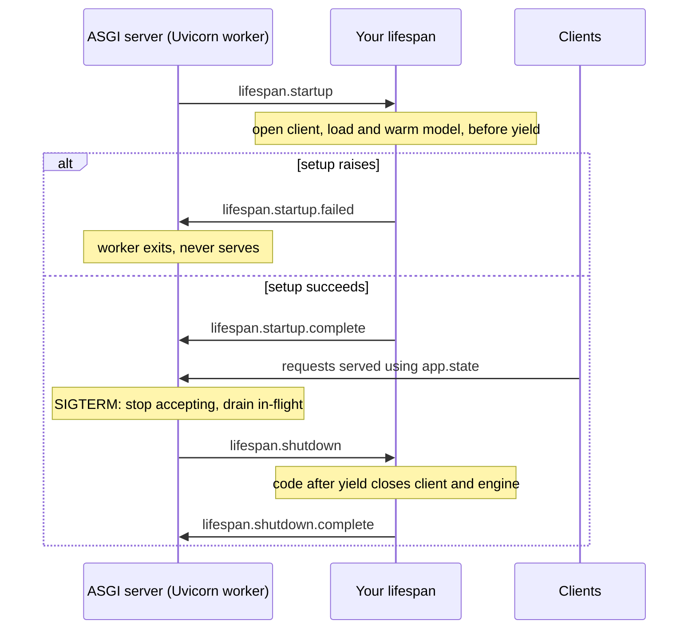

## TL;DR
`lifespan` is an async context manager passed to `FastAPI(lifespan=...)`: code before `yield` runs once
per worker before serving, code after it at shutdown. Load models, provider clients and DB engines there,
because they are expensive, shared and need a guaranteed close.

## Why it exists
- **Some objects are slow to build and meant to be shared.** A tokenizer and model that take seconds and
  gigabytes to load, an `httpx.AsyncClient` or provider SDK client whose value is its pool of warm TLS
  connections, a database engine, a vector index loaded from disk.
- **Per request pays the full cost every call.** A model reload per request is seconds of latency and a
  copy of the weights per concurrent call; a fresh client per call means a new TCP and TLS handshake every
  time, with sockets piling up under load.
- **Import time loses control.** Every `import app` (tests, Alembic migrations, a CLI script, the OpenAPI
  generator) loads a model. There is no running event loop for `await`-based setup, loop-bound objects (an
  asyncpg pool, an `aiohttp` session) fail with "attached to a different loop" errors when run on another
  loop, and there is no hook to close clients or flush buffers at exit.
- **Lazily on first request is no better.** It hides the cost inside a user's request, races when two
  first requests arrive together, and lets a worker report healthy before it can actually serve.
- **What is needed:** a hook that runs once per process, runs *before* the server reports the app as
  started, and is paired with a teardown guaranteed to run at shutdown. The ASGI spec provides exactly that
  as the lifespan protocol; FastAPI's `lifespan` parameter is the idiomatic way to write it.

## How it works
### The protocol underneath
1. **Worker starts.** The ASGI server (Uvicorn, Hypercorn) opens a special connection with
   `scope["type"] == "lifespan"` and sends `lifespan.startup`.
2. **Setup runs.** Starlette, which FastAPI builds on, enters your context manager and runs everything up
   to `yield`.
3. **Ready.** It replies `lifespan.startup.complete`; only then does the server treat the app as ready.
4. **Or fail fast.** If the code before `yield` raises, Starlette replies `lifespan.startup.failed` and the
   server exits instead of serving a half-initialised app.
5. **Shutdown signal** (for example SIGTERM): the server stops accepting new connections and waits for
   in-flight requests to finish. Uvicorn waits indefinitely unless `--timeout-graceful-shutdown` bounds it.
6. **Teardown.** The server sends `lifespan.shutdown`, and the code after `yield` runs.

- **Fail-fast is the property you want.** A missing API key or a corrupt weights file stops the deploy
  instead of producing a fleet of workers that 500 on every request.
- **Teardown normally happens after requests have drained**, which is why closing the shared client
  there is safe.
- **Teardown is best-effort.** A forced exit (a second Ctrl+C or signal) skips the lifespan shutdown, so
  anything that must survive a crash, such as usage records, should be written as you go, not flushed only
  at shutdown.

### Writing it
```
@asynccontextmanager
async def lifespan(app):     # setup ... yield ... teardown
```

- **The context-manager shape pairs setup and teardown in one function**, *because* the client you open on
  line 3 is visibly closed on line 9, and both can share local variables.
- **It replaces the older decorators** `@app.on_event("startup")` / `("shutdown")`, which FastAPI documents
  as deprecated.
- **Do not mix the two:** if you pass `lifespan=`, those event handlers are not called.

### Where the objects go
| Option | How | Note |
|---|---|---|
| 1. **`app.state`** | assign `app.state.model = ...` in lifespan, read `request.app.state.model` in a dependency | simple and explicit |
| 2. **Lifespan state** | `yield {"model": model}`; Starlette makes a shallow copy of that dict available as `request.state` on every request | shallow: per-request reassignment does not leak, but mutating a shared object does, exactly as with `app.state` |

- **Either way, reach the objects through a dependency**, not directly, *because* a dependency is the seam
  tests use to substitute a fake model or client via `dependency_overrides`.

### Robust teardown
- **The failure:** startup creates three resources and the third raises, so code after `yield` never runs
  and the first two leak.
- **The fix:** wrap acquisition in `contextlib.AsyncExitStack` (or `try/finally`). Each resource registers
  its own close as it is created.
- **The stack unwinds whatever was built**, in reverse order, on failure or at shutdown.

### Per worker, not per deployment
- **Lifespan runs once *per worker process*.** With four Uvicorn workers you get four model copies, four
  connection pools and four engines.
- **Size with that multiplication in mind**, for both the DB pool and GPU memory.
- **When the per-worker copy no longer fits**, the model belongs in a dedicated inference server and
  lifespan just builds a client to it.

### The `--preload` shortcut and its sharp edges
- **The idea:** load the model once in a Gunicorn master with `--preload` and let forked workers share
  pages copy-on-write. This is outside lifespan entirely.
- **Edge one:** CPython's reference counting writes to object headers, so "shared" pages get copied
  gradually.
- **Edge two:** CUDA cannot be re-initialised in a forked child, so a GPU model initialised in the master
  is unusable in the workers.

### Blocking work during startup
- **`from_pretrained`-style loaders are synchronous.** During startup no requests are being served, so a
  blocking load mostly just delays readiness.
- **Still offload it:** `await asyncio.to_thread(load)` keeps the loop responsive (for example to signals)
  and costs nothing.
- **Warm up before `yield`.** Run a small warm-up inference so lazy allocations and kernel selection happen
  at startup rather than on the first user's request.

### Things that do not run lifespan
| Situation | Lifespan runs? |
|---|---|
| sub-application attached with `app.mount` | no: Starlette runs the lifespan of the root app only |
| `TestClient(app)` | only when used as `with TestClient(app) as client:` |
| `httpx.AsyncClient(transport=ASGITransport(app))` | not at all; use a helper such as the `asgi-lifespan` package's `LifespanManager` |

- **Forgetting this** is the usual reason a test sees `AttributeError: 'State' object has no attribute 'model'`.

## Diagram
One worker's whole life: nothing is served until setup finishes, a failed setup exits the worker, and
teardown runs only after in-flight requests drain.



## Examples
### Embedding service: load once, warm up, close everything
An embedding service that loads a sentence-transformer model once, builds one shared HTTP client for a
reranking provider, warms the model, and closes everything at shutdown even if startup fails halfway.

- **`RERANK_URL` and `RERANK_KEY` come from the environment**, so a missing key fails startup.
- **Run with `uvicorn app:app --workers 2`** and the model is loaded twice, once per worker, before either
  accepts a request.
- **With `with TestClient(app) as c:`** the same lifespan runs in the test.

```python
import asyncio, os
from contextlib import AsyncExitStack, asynccontextmanager
from typing import Annotated
import httpx
from fastapi import Depends, FastAPI, Request
from pydantic import BaseModel, Field
from sentence_transformers import SentenceTransformer

@asynccontextmanager
async def lifespan(app: FastAPI):
    async with AsyncExitStack() as stack:
        key = os.environ["RERANK_KEY"]              # KeyError here -> startup.failed, worker exits
        app.state.http = await stack.enter_async_context(
            httpx.AsyncClient(base_url=os.environ["RERANK_URL"],
                              headers={"Authorization": f"Bearer {key}"}, timeout=10.0))
        model = await asyncio.to_thread(SentenceTransformer, "all-MiniLM-L6-v2")
        await asyncio.to_thread(model.encode, ["warm-up"])   # pay first-call costs now
        app.state.model = model
        yield                                        # serve traffic
    # leaving the stack closed the client (also on a failed startup)

app = FastAPI(lifespan=lifespan)

def get_model(request: Request) -> SentenceTransformer:
    return request.app.state.model                   # override this in tests

class EmbedIn(BaseModel):
    texts: list[str] = Field(min_length=1, max_length=256)   # empty list would break .shape[1]

@app.post("/embed")
async def embed(body: EmbedIn, model: Annotated[SentenceTransformer, Depends(get_model)]):
    vectors = await asyncio.to_thread(model.encode, body.texts)   # CPU/GPU work off the loop
    return {"dim": int(vectors.shape[1]), "count": len(body.texts)}
```

### Runnable: an exit stack unwinds a half-finished startup
Pure asyncio, no server. Startup opens two resources and fails on the third; the stack closes what was
opened, in reverse order, and the error propagates the way Starlette turns it into a failed startup.

```python
import asyncio
from contextlib import AsyncExitStack, asynccontextmanager

class Resource:                                   # stand-in for a client or engine
    def __init__(self, name): self.name = name
    async def __aenter__(self):
        print("open ", self.name)
        return self
    async def __aexit__(self, *exc):
        print("close", self.name)

async def load_model():
    raise RuntimeError("corrupt weights file")    # third startup step fails

@asynccontextmanager
async def lifespan(app: dict):
    async with AsyncExitStack() as stack:
        app["http"] = await stack.enter_async_context(Resource("http client"))
        app["db"] = await stack.enter_async_context(Resource("db engine"))
        app["model"] = await load_model()         # raises: stack unwinds db, then http
        yield

async def main():
    app = {}
    try:
        async with lifespan(app):
            print("serving")                      # never reached
    except RuntimeError as e:
        print("startup failed:", e)               # Starlette would send lifespan.startup.failed

asyncio.run(main())
# open  http client
# open  db engine
# close db engine
# close http client
# startup failed: corrupt weights file
```

### Worked scenario: the import-time model from Check yourself, moved into lifespan
A 3 GB model, four Uvicorn workers, provider calls from every endpoint.

| Concern | Import time or per endpoint | In lifespan |
|---|---|---|
| `pytest` collection, Alembic migrations | each `import main` loads 3 GB | nothing loads on import |
| provider call | new TCP and TLS handshake per request | warm pooled connections reused |
| memory with four workers | 4 × 3 GB = 12 GB of weights | still 12 GB: lifespan is per worker |
| pod rollout | probes can fire mid-load | startup probe sized to the measured load time |

- **The memory row is the one lifespan does not fix**; past a couple of workers, a model server wins.

## Production patterns
- **Startup probe sized to the load.** Use whenever lifespan loads weights: give the orchestrator a startup
  probe (in Kubernetes, `startupProbe` with `failureThreshold` × `periodSeconds` above the measured load
  time) and keep the liveness check cheap. Monitor startup duration per worker and restart counts during
  rollouts.
- **Bounded, ordered shutdown.** Use on every deployed service: set `--timeout-graceful-shutdown` so
  draining cannot hang forever, and give the platform's termination grace period more time than that so
  teardown after `yield` actually runs. Monitor requests cut off at shutdown.
- **Fail fast on required config, degrade on optional.** Use when startup touches several systems: read
  required keys with `os.environ["..."]` so a missing one fails startup, but wrap a truly optional
  resource (a cache) so failure stores `None` and requests degrade. Alert on startup failures, and on
  degraded mode separately.
- **Warm up before `yield`.** Use for any local model: run one small inference in lifespan so kernel
  selection and lazy allocations happen at startup. Monitor first-request latency versus steady-state
  latency; a gap means initialisation still escapes lifespan.
- **Tests that run the real lifespan.** Use in every suite: a pytest fixture that yields from
  `with TestClient(app) as client:`, or `LifespanManager` from `asgi-lifespan` for async clients, with
  `dependency_overrides` for the expensive pieces.
- **Write as you go, not at shutdown.** Use for usage records, audit rows and metrics buffers: flush per
  request or on a short timer, because a forced exit skips teardown.

## Trade-offs
- **Fast requests vs slow startup.** Loading in lifespan makes every request fast and predictable, but
  startup now takes as long as the model load; for large weights this flips orchestration from "readiness
  is instant" to needing a startup probe with a generous budget.
- **Crashed deploys vs blocked deploys.** Fail-fast startup turns misconfiguration into a crashed deploy
  instead of silent 500s, but a flaky optional dependency at boot (a cache that is briefly down) now blocks
  the whole service; make truly optional resources degrade at request time instead.
- **Reuse vs multiplication.** One shared client or model per worker maximises reuse, but multiplies by
  the worker count; once N copies of the weights exceed host memory, a separate model server beats more
  workers.
- **`app.state` vs lifespan state.** `app.state` is explicit and easy to read, while lifespan state via
  `yield {...}` is rebuilt on each lifespan run and can be described with a `TypedDict`; the choice
  matters little until several apps share a process or tests start the same app repeatedly and need fresh
  state each time.

## Pitfalls
- **Using `TestClient(app)` without `with`, or an `httpx` ASGI transport, in tests.** Symptom: handlers
  fail with `'State' object has no attribute ...` only in the test suite.
- **Putting teardown after `yield` without `AsyncExitStack` or `try/finally`.** Symptom: when one startup
  step fails, the earlier clients or pools are never closed and warnings about unclosed connections appear
  in logs.
- **Adding `@app.on_event("startup")` handlers to an app that already passes `lifespan=`.** Symptom: that
  startup code silently never runs.
- **Defining lifespan on a sub-application mounted with `app.mount`.** Symptom: the mounted app's model or
  client is never created and its routes fail while the root app's routes work.
- **Pointing a liveness probe at the app during a long model load.** Symptom: the orchestrator kills the
  container mid-load in a restart loop, because the worker has not finished startup and is not answering
  yet.
- **Storing per-request data on objects created in lifespan.** Symptom: intermittent cross-user leaks under
  concurrent load, because those objects are shared by every in-flight request.

## When to use
- **Use lifespan** for anything expensive to create, safe to share across concurrent requests, and needing
  a clean close: model weights and tokenizers, provider and HTTP clients, DB engines, Redis pools, vector
  indexes, parsed settings.
- **Avoid it for per-request state** (sessions, users, budgets); those belong in yield dependencies.
- **Measure:** time from process start to startup complete, memory per worker after load, and first-request
  latency versus steady state; a slow first request means some initialisation still escapes lifespan.
- **Code review:** any `Client(...)`, `create_engine(...)` or `from_pretrained(...)` inside a handler or at
  module top level is a signal to move it here.
- **Interviews:** expect "where do you load the model and why not at import or per request?".

## Role lens
- **Engineer:** Writes the lifespan with an `AsyncExitStack`, loads and warms the model before `yield`,
  exposes resources through dependencies, and runs tests inside `with TestClient(app)`.
- **Architect:** Decides what may live in a worker's lifespan versus a dedicated model server, from
  per-worker memory multiplied by worker count and from acceptable startup time.
- **FDE:** Diagnoses a customer deployment stuck in a restart loop or with slow first requests by
  checking probe timing against model load time and finding initialisation hidden in handlers.

## Check yourself
**Q:** A team loads a 3 GB model at module import in `main.py` and creates an `httpx.AsyncClient`
inside each endpoint. Their pytest suite takes minutes to start, Alembic migrations need a GPU box, and
the provider calls are slower than expected. They also see Kubernetes restarting new pods during
rollout. What is going on and what should change?
**A:** Import-time loading runs on every `import main`, so tests, migrations and any tool that imports
the app pay the model load; it also gives no shutdown hook. The per-endpoint client discards its pool
after each call, so every provider request pays a fresh TCP and TLS handshake. Move both into a
lifespan: create the client once (closed via `AsyncExitStack` at shutdown) and load and warm the model
before `yield`, exposing each through a dependency so tests can override them. The restarts are likely
probes firing before startup completes; add a startup probe sized to the load time and keep liveness
cheap. Also budget memory for one model copy per worker.

## Interview questions
### What does the lifespan hook guarantee that a module-level global does not?
- **Timing:** setup runs once per worker *before* the server accepts traffic, because the server waits
  for `lifespan.startup.complete`; a global runs on every import, including tests and migrations.
- **Fail-fast:** an exception before `yield` becomes `lifespan.startup.failed` and the worker exits,
  instead of a fleet of workers that 500 on every request.
- **Teardown:** code after `yield` runs at shutdown after in-flight requests drain, so the shared client
  can be closed safely; a global has no such hook.

### New pods restart in a loop during rollout, but only for the service that loads a large model. Debug it.
- **Compare probe timing with load time.** If liveness or readiness checks start before startup completes,
  the worker is not answering yet and the orchestrator kills it mid-load.
- **Fix:** add a startup probe whose budget exceeds the measured load time, and keep liveness cheap.
- **Confirm** with startup duration per worker; also check memory, since each worker loads its own copy
  and an OOM kill looks like the same restart loop.

### Would you use Gunicorn `--preload` to share one model across workers?
- **Tempting, but it sits outside lifespan** and relies on copy-on-write after fork.
- **Reference counting dirties the pages**, so CPython gradually copies the "shared" memory anyway.
- **CUDA cannot be re-initialised in a forked child**, so a GPU model loaded in the master is unusable in
  the workers. Prefer a dedicated model server when per-worker copies do not fit.

### A test fails with `'State' object has no attribute 'model'` but production works. Why?
- **Lifespan did not run in the test.** `TestClient(app)` runs it only inside a `with` block, and an
  `httpx` client with `ASGITransport` never runs it.
- **Fix:** use `with TestClient(app) as client:` in a fixture, or wrap the app in `LifespanManager` from
  `asgi-lifespan` for async tests.
- **Also check mounts:** a sub-application attached with `app.mount` never runs its own lifespan.

### How do you make shutdown reliable for a streaming service with usage accounting?
- **Bound the drain:** Uvicorn waits indefinitely for in-flight requests unless
  `--timeout-graceful-shutdown` is set, so long streams can hold shutdown open.
- **Order the timeouts:** give the platform's grace period more time than the drain, so the code after
  `yield` gets to close clients.
- **Do not rely on teardown for data:** a forced exit skips it, so write usage records as you go.

## Quiz
### Q: When does the code after `yield` in a FastAPI lifespan run?
- [ ] After every request completes, to release per-request resources
- [ ] Immediately after startup, before the first request is served
- [x] Once per worker at shutdown, after the server sends the ASGI `lifespan.shutdown` event
- [ ] Only if startup raised an exception
> The lifespan context manager spans the worker's whole life: setup before `yield`, serving during it,
> teardown after it at shutdown. Per-request cleanup belongs in yield dependencies, not in lifespan.

### Q: A test uses `client = TestClient(app)` and gets `'State' object has no attribute 'model'`. Why?
- [ ] `app.state` is cleared between requests by Starlette
- [x] Lifespan only runs when TestClient is used as a context manager, so the model was never loaded
- [ ] TestClient runs a separate worker process with its own state
- [ ] Lifespan state is unavailable in synchronous tests
> `TestClient` triggers the lifespan startup and shutdown events only inside a `with` block. Without it
> the app serves requests without running startup, so nothing was attached to `app.state`.

### Q: Startup creates an HTTP client, then a DB engine, then fails loading the model. What prevents the client and engine from leaking?
- [ ] Python's garbage collector closes them when the worker exits
- [ ] Putting the close calls after `yield` in the lifespan function
- [x] Registering each resource on an `AsyncExitStack` (or `try/finally`) as it is created
- [ ] Using `@app.on_event("shutdown")` alongside the lifespan
> Code after `yield` never runs when startup fails before reaching it. An exit stack unwinds only what
> was actually acquired, in reverse order, on both failure and normal shutdown; on_event handlers are
> ignored when lifespan is set.
