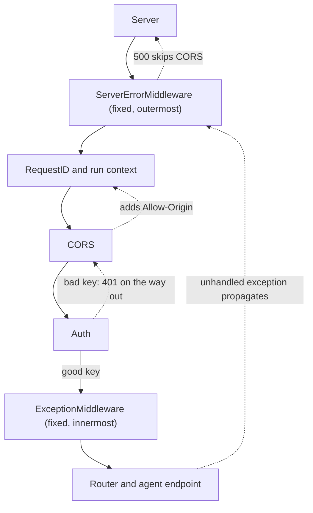

## TL;DR
An agent API wraps every run in middleware: request IDs, CORS, auth, tracing, limits. It is a stack of
nested ASGI apps; `app.add_middleware()` inserts at the *outside*, so the last added runs first, which
decides whether runs are traced and errors are readable.

## For agent builders
- **Why it matters for agents.** One agent run produces dozens of log lines, LLM calls and tool calls.
  If the request-ID or trace layer sits in the wrong place, those lines cannot be stitched into one run,
  and a browser chat UI sees "CORS error" instead of the real 401 or 500.
- **Where it shows up in your stack.** `FastAPI(middleware=[...])`, Starlette's `CORSMiddleware`,
  OpenTelemetry instrumentation, the tracing hooks that send agent spans to LangSmith, Langfuse or a
  similar backend, and any gateway in front of your agent service.
- **What you control.** The order of layers, whether streaming-route layers are pure ASGI (so step and
  token events are not buffered), and which concerns are middleware versus route dependencies.
- **What you can skip.** Starlette's internals beyond the two fixed layers. Know "last added is
  outermost" and where `ServerErrorMiddleware` and `ExceptionMiddleware` sit; that answers most bugs.

## Lab
### Task
Fix the middleware stack of an agent API so a browser chat UI can read every failure and every log
line of a run carries its run ID. The starter works for a happy-path request, which is exactly why the
bug ships: a missing key and a crashing tool both look like "CORS error" in the browser.

Time box: 45 minutes. Prerequisites: the ASGI lifecycle lesson and this lesson's How it works.
- **Task 1:** reorder the layers to RunID, CORS, ErrorEnvelope, Auth (outermost first).
- **Task 2:** make `ErrorEnvelope` turn an unhandled exception into a JSON 500 that carries the run ID,
  but only if the response has not started.

### Starter code
Save as `lab_mw.py`. It runs as given and prints the broken behaviour. Checked with FastAPI 0.161.1,
Starlette 1.9.0, httpx 0.28.1 and Python 3.13 (Starlette 1.9 prints a deprecation warning about the
test client's httpx transport; it is harmless here).

```python
import contextvars, uuid
from fastapi import FastAPI
from fastapi.testclient import TestClient
from starlette.middleware.cors import CORSMiddleware

run_id_var = contextvars.ContextVar("run_id", default="-")
LOG: list[str] = []                                   # what your log pipeline would receive
ORIGIN = "https://chat.example.com"

class RunID:                                          # pure ASGI: tags the run, streaming-safe
    def __init__(self, app): self.app = app
    async def __call__(self, scope, receive, send):
        if scope["type"] != "http":
            return await self.app(scope, receive, send)
        rid = uuid.uuid4().hex[:12]
        token = run_id_var.set(rid)
        async def send_with_id(msg):
            if msg["type"] == "http.response.start":
                msg = {**msg, "headers": [*msg.get("headers", []), (b"x-run-id", rid.encode())]}
            await send(msg)
        try:
            await self.app(scope, receive, send_with_id)
        finally:
            run_id_var.reset(token)

class Auth:                                           # pure ASGI: rejects runs without a key
    def __init__(self, app): self.app = app
    async def __call__(self, scope, receive, send):
        if scope["type"] == "http" and scope["method"] != "OPTIONS":
            if b"x-api-key" not in dict(scope["headers"]):
                LOG.append(f"auth rejected run_id={run_id_var.get()}")
                await send({"type": "http.response.start", "status": 401,
                            "headers": [(b"content-type", b"application/json")]})
                await send({"type": "http.response.body", "body": b'{"detail":"missing key"}'})
                return
        await self.app(scope, receive, send)

class ErrorEnvelope:                                  # pure ASGI: crashes become JSON the UI can read
    def __init__(self, app): self.app = app
    async def __call__(self, scope, receive, send):
        # TASK 2: catch exceptions from the inner app. If http.response.start was not sent yet, send a
        # 500 with body {"error": "internal", "run_id": <current run id>}; otherwise re-raise.
        await self.app(scope, receive, send)

app = FastAPI()
# TASK 1: this reads top to bottom but add_middleware puts each new layer OUTSIDE the previous one.
# Make the order (outermost first) RunID, CORS, ErrorEnvelope, Auth.
app.add_middleware(RunID)
app.add_middleware(CORSMiddleware, allow_origins=[ORIGIN], allow_methods=["POST"], allow_headers=["*"])
app.add_middleware(ErrorEnvelope)
app.add_middleware(Auth)

@app.post("/agent/run")
async def run(body: dict):
    LOG.append(f"tool=search run_id={run_id_var.get()}")
    if body.get("task") == "crash":
        raise RuntimeError("tool returned garbage")
    return {"answer": "42"}

def demo():
    c = TestClient(app, raise_server_exceptions=False)
    h = {"Origin": ORIGIN}
    for name, headers, body in [("no key", h, {"task": "x"}), ("good", {**h, "x-api-key": "k"}, {"task": "x"}),
                                ("crash", {**h, "x-api-key": "k"}, {"task": "crash"})]:
        r = c.post("/agent/run", headers=headers, json=body)
        print(f"{name:7} {r.status_code} cors={'access-control-allow-origin' in r.headers} "
              f"run_id={'x-run-id' in r.headers} type={r.headers.get('content-type')}")
    print("log run ids tagged:", all("run_id=-" not in line for line in LOG))

if __name__ == "__main__":
    demo()
```

### Expected output
`python lab_mw.py` after both tasks. The starter prints `cors=False run_id=False` on the first and third
lines, a `text/plain` 500, and `False` on the last line.

```
no key  401 cors=True run_id=True type=application/json
good    200 cors=True run_id=True type=application/json
crash   500 cors=True run_id=True type=application/json
log run ids tagged: True
```

### Tests
Save as `test_lab_mw.py` and run `pytest -q`. On the starter three fail on assertions (no CORS header
on the 401, an untagged auth log line, a plain-text 500 without CORS); the happy-path test passes both
before and after, as a regression guard.

```python
from fastapi.testclient import TestClient
import lab_mw as lab

c = TestClient(lab.app, raise_server_exceptions=False)
H = {"Origin": lab.ORIGIN}

def setup_function():
    lab.LOG.clear()

def test_401_reaches_the_browser_with_cors_and_run_id():
    r = c.post("/agent/run", headers=H, json={"task": "x"})
    assert r.status_code == 401
    assert r.headers.get("access-control-allow-origin") == lab.ORIGIN
    assert "x-run-id" in r.headers

def test_auth_log_line_is_tagged_with_the_run_id():
    c.post("/agent/run", headers=H, json={"task": "x"})
    assert lab.LOG and "run_id=-" not in lab.LOG[0], lab.LOG

def test_crash_is_a_json_500_the_chat_ui_can_read():
    r = c.post("/agent/run", headers={**H, "x-api-key": "k"}, json={"task": "crash"})
    assert r.status_code == 500
    assert r.headers.get("access-control-allow-origin") == lab.ORIGIN
    assert r.json() == {"error": "internal", "run_id": r.headers["x-run-id"]}

def test_good_run_is_untouched():
    r = c.post("/agent/run", headers={**H, "x-api-key": "k"}, json={"task": "x"})
    assert r.status_code == 200 and r.json() == {"answer": "42"}
    assert lab.LOG == [f"tool=search run_id={r.headers['x-run-id']}"]
```

### Failure scenarios
- **Put ErrorEnvelope outside CORS.** Observe: the crash test fails on the missing
  `access-control-allow-origin` header although the body is correct JSON. Debug: print
  `app.user_middleware` (outermost first) and walk the 500 outward; only layers outside the one that
  sends it can add headers.
- **Swallow errors after the stream started.** Drop the "response already started" check, then make the
  route a `StreamingResponse` that yields one step event and raises. Observe: the test client shows a
  200 with body `step 0`; the late 500 is lost because the status was already on the wire. Debug: track
  a `started` flag in a wrapped `send` and re-raise when it is set.
- **Raise `HTTPException(401)` from Auth.** Observe: the 401 test gets a 500, because only
  `ExceptionMiddleware`, innermost around the router, converts `HTTPException` into a response. Debug:
  read the traceback's layer names; middleware must send its own rejection messages.

### Submission
- **Code:** `lab_mw.py` with the order fixed by the `middleware=[...]` list or reversed
  `add_middleware` calls, plus a one-line comment stating the outermost-first order.
- **Test run:** `pytest -q` showing 4 passed.
- **Trace:** the demo output, matching Expected output.
- **Short note (5-8 lines):** why a crash 500 skips CORS when only `ServerErrorMiddleware` handles it,
  and where you would add a tracing layer.
- **Evaluation:** tests pass and the error envelope never sends a second start message.

## Why it exists
- **Cross-cutting concerns need one chain.** Request IDs, auth, CORS, compression, timing, tracing and
  body-size limits do not belong in every endpoint, so every request passes through a shared chain.
- **The concerns depend on each other.** A request-ID layer must run before anything that logs, or early
  log lines have no ID. CORS must wrap auth, or the browser gets a 401 with no
  `Access-Control-Allow-Origin` and reports an opaque "CORS error" instead of "unauthorized".
- **Limits and tracing have positions too.** A body-size limit must run before anything reads the body.
  A tracing span should open before auth so rejected requests are still traced.
- **"Independent filters" is the wrong model.** Middleware is nested function calls: each layer gets the
  request from the layer outside it and the response from the layer inside it. Inner headers added on the
  way out are visible to outer layers; outer values set on the way in are visible to inner layers; nothing
  flows the other way.
- **Ordering is semantics, not style.** Exceptions propagate outward through the layers, and a layer
  that returns early (a 401, a 413) short-circuits everything inside it.
- **FastAPI adds two surprises.** `add_middleware` inserts each new layer on the outside, the opposite of
  top-to-bottom reading, and two framework-owned layers sit at fixed positions. Most "my middleware does
  not see X" bugs come from these two facts.

## How it works
### The stack is built once
- Starlette keeps `user_middleware` as a list.
- On the first request it builds
  `ServerErrorMiddleware(user_mw_0(user_mw_1(... ExceptionMiddleware(Router))))`: the first element of the
  list is the outermost user layer.
- The stack is built lazily and then frozen, so adding middleware after the app has started raises an
  error in current Starlette. Configure everything before the first request.

### Tracing one request through the onion
With a `middleware=` list of `[RequestID, CORS, Auth]`, a `POST /chat` with a bad key runs:

```
in : ServerError -> RequestID (sets id) -> CORS -> Auth (rejects: sends 401 itself)
out: Auth's 401 -> CORS (adds Allow-Origin) -> RequestID (adds x-request-id) -> ServerError -> wire
     ExceptionMiddleware, Router and the endpoint never run
```

- A good request goes all the way in to the endpoint (where the agent loop runs) and back out through the
  same layers in reverse.
- Each layer runs code at two moments, before and after it calls the inner app, so "first in" is always
  "last out".

### Two ways to add, two orderings
| How you register | Resulting order |
|---|---|
| `app.add_middleware(M)` | inserts `M` at index 0 of `user_middleware`; each call pushes the new layer to the *outside*, so with three calls the bottom one is outermost and sees the request first |
| `FastAPI(middleware=[Middleware(A), Middleware(B)])` | keeps list order: A is outermost, B inside it |
| `@app.middleware("http")` | sugar for `add_middleware(BaseHTTPMiddleware, dispatch=fn)`, so last defined is outermost |

### The two fixed layers
- **`ServerErrorMiddleware` is always outermost.** It catches any exception that escaped everything
  else, returns a 500 (or the handler you registered for `500` / `Exception`), then re-raises so the
  server logs it.
- **So crash responses skip CORS.** *Because* it is outside your middleware, a 500 it generates never
  passes back through `CORSMiddleware`: a browser sees a CORS failure, not a 500. A handler registered
  for `Exception` or status `500` is installed *on* `ServerErrorMiddleware`, so it is outside CORS too.
- **`ExceptionMiddleware` is always innermost**, directly around the router. It converts
  `HTTPException` and anything with a registered handler into a normal response.
- **So your layers see 404s as responses.** *Because* it is inside your middleware, a 404 or a 422
  reaches your layers as an ordinary response with a status code, not as an exception.
- **Only unhandled exceptions travel through your layers as exceptions**, which is why a timing or
  logging middleware must use `try/finally` rather than code placed after `await call_next(request)`.

### Request path and response path
- **Two shapes.** A layer is either `async def __call__(self, scope, receive, send)` (pure ASGI) or
  `async def dispatch(self, request, call_next)` (`BaseHTTPMiddleware`).
- **On the way in** it may read or mutate the scope (set `scope["state"]["request_id"]`), reject early,
  or wrap `receive` to count body bytes.
- **On the way out** it may wrap `send` to inject headers on `http.response.start`, time the response,
  or observe the status.
- **Short-circuit.** A layer that returns before calling the next one skips the rest.

### Why pure ASGI middleware is preferred for streaming
- `BaseHTTPMiddleware` runs the downstream app in a separate task and exposes the response as a
  streaming body. Convenient, but:
  - context variables set downstream are not visible to the middleware afterwards;
  - the extra task adds overhead per request;
  - it has a history of interfering with streaming and background tasks.
- For token streaming, agent step events and trace propagation, write pure ASGI middleware that wraps
  `send`; it adds no task and passes `more_body` chunks through untouched.

### A sane default order for an agent API, outermost first
1. **Request ID / trace context**, so every later log line, LLM span and tool span has it.
2. **CORS**, so every response, including auth rejections and preflight answers, gets its headers.
3. **Body-size limits and timeouts**, to reject before spending anything (huge pasted documents, uploads).
4. **Authentication**, which needs the trace and produces a principal for inner layers.
5. **Timing and metrics**, inside auth if you want handler time, outside it if you want total time.
6. **Compression**, kept away from token streams, since buffering for gzip delays each chunk.

With `add_middleware`, add these in *reverse*; with the `middleware=` list, in this order.

## Diagram
Follow a request inward from the server and its response back outward: auth short-circuits with a 401
that still passes back through CORS, while a crash caught by `ServerErrorMiddleware` never does.



## Examples
### Run-ID middleware that tags every LLM and tool call in an agent run
A pure ASGI layer outermost sets a contextvar, so code deep inside the agent loop (tool wrappers, LLM
client hooks, loggers) can tag every line with the run ID without passing it through every function. It
wraps `send` without buffering, so SSE step events still stream.

```python
import contextvars, uuid, logging
from fastapi import FastAPI
from fastapi.responses import StreamingResponse
from starlette.middleware import Middleware

run_id_var = contextvars.ContextVar("run_id", default="-")
log = logging.getLogger("agent")

class RunContext:                                  # pure ASGI: same task, contextvar visible inside
    def __init__(self, app): self.app = app
    async def __call__(self, scope, receive, send):
        if scope["type"] != "http":
            return await self.app(scope, receive, send)
        rid = uuid.uuid4().hex[:12]
        token = run_id_var.set(rid)
        async def send_with_id(msg):
            if msg["type"] == "http.response.start":
                msg = {**msg, "headers": [*msg.get("headers", []), (b"x-run-id", rid.encode())]}
            await send(msg)                        # every more_body chunk passes straight through
        try:
            await self.app(scope, receive, send_with_id)
        finally:
            run_id_var.reset(token)

async def call_tool(name: str, args: dict) -> dict:
    log.info("tool=%s run_id=%s", name, run_id_var.get())   # tagged without plumbing
    return {"ok": True}

app = FastAPI(middleware=[Middleware(RunContext)])          # outermost: everything inside is tagged

@app.post("/agent/run")
async def run(body: dict):
    async def events():
        for step in range(3):
            await call_tool("search", {"q": body.get("task", "")})
            yield f"data: step {step} run {run_id_var.get()}\n\n"
    return StreamingResponse(events(), media_type="text/event-stream")
```

### Explicit order with the constructor list
A pure ASGI request-ID layer sits outermost, CORS wraps everything else, and a timing layer uses
`try/finally` so exceptions are timed too. The 401 raised in the endpoint is turned into a response by
`ExceptionMiddleware`, then picks up CORS headers and the request ID on its way out.

```python
import time, uuid
from fastapi import FastAPI, HTTPException, Request
from starlette.middleware import Middleware
from starlette.middleware.cors import CORSMiddleware
from starlette.middleware.base import BaseHTTPMiddleware

class RequestID:                                   # pure ASGI: no extra task, streaming-safe
    def __init__(self, app): self.app = app
    async def __call__(self, scope, receive, send):
        if scope["type"] != "http":
            return await self.app(scope, receive, send)
        rid = uuid.uuid4().hex[:12]
        scope.setdefault("state", {})["request_id"] = rid
        async def send_with_id(msg):
            if msg["type"] == "http.response.start":
                msg = {**msg, "headers": [*msg.get("headers", []), (b"x-request-id", rid.encode())]}
            await send(msg)
        await self.app(scope, receive, send_with_id)

class Timing(BaseHTTPMiddleware):
    async def dispatch(self, request, call_next):
        t0 = time.perf_counter()
        try:
            return await call_next(request)        # 4xx from HTTPException arrive here as responses
        finally:                                   # unhandled exceptions pass through as exceptions
            ms = (time.perf_counter() - t0) * 1000
            print(request.state.request_id, request.url.path, f"{ms:.1f}ms")

app = FastAPI(middleware=[                         # list order: first is outermost
    Middleware(RequestID),
    Middleware(CORSMiddleware, allow_origins=["https://app.example.com"],
               allow_methods=["POST"], allow_headers=["*"]),   # default allow_methods is GET only
    Middleware(Timing),
])

@app.post("/chat")
async def chat(request: Request, body: dict):
    if "x-api-key" not in request.headers:
        raise HTTPException(401, "missing key")    # still gets CORS headers: CORS is outside
    return {"request_id": request.state.request_id, "reply": "..."}
```

### Contract tests that pin the order
CORS-order bugs show up only in a browser (curl ignores CORS headers), so encode the expectations as
tests against the app above.

```python
from fastapi.testclient import TestClient

client = TestClient(app)
ORIGIN = {"Origin": "https://app.example.com"}

def test_401_carries_cors_and_request_id():
    r = client.post("/chat", json={}, headers=ORIGIN)          # no x-api-key
    assert r.status_code == 401
    assert r.headers["access-control-allow-origin"] == "https://app.example.com"
    assert "x-request-id" in r.headers

def test_preflight_is_answered_by_cors():
    r = client.options("/chat", headers={**ORIGIN, "Access-Control-Request-Method": "POST"})
    assert r.status_code == 200
```

### Worked scenario: three `add_middleware` calls, read top to bottom
A file calls `add_middleware(RequestID)`, then `add_middleware(Auth)`, then `add_middleware(GZip)`,
expecting the request ID to exist before auth runs.

| After call | `user_middleware` (outermost first) |
|---|---|
| `add_middleware(RequestID)` | RequestID |
| `add_middleware(Auth)` | Auth, RequestID |
| `add_middleware(GZip)` | GZip, Auth, RequestID |

- **Auth runs before the ID exists.** Its "rejected key" log lines have no request ID, and its 401
  never passes back through RequestID, so the response carries no `x-request-id` either.
- **GZip wraps everything, token streams included**, where compression buffering can delay chunks: the
  agent UI shows nothing until several steps have finished.
- **Fix:** use the list form in the intended order (RequestID, then Auth, then GZip), and keep
  compression off streaming routes.

## Production patterns
- **Run context outermost, propagated by contextvar.** Use on every agent service: a pure ASGI layer sets
  the run or trace ID first, and tool wrappers, LLM client hooks and loggers read it. Monitor the share of
  log lines and spans without a run ID; it should be zero for agent routes.
- **Declare the stack in one list.** Use for every service: pass `FastAPI(middleware=[...])` in
  outermost-first order so reviewers read execution order directly. There is nothing to monitor at runtime;
  enforce in code review that `add_middleware` is not mixed in elsewhere.
- **Pin order with contract tests.** Use whenever CORS, auth or timing middleware exist: one test sends a
  bad key with an `Origin` header and asserts `access-control-allow-origin`, another raises in an
  endpoint and asserts the timing log line. Run them in CI on every Starlette upgrade.
- **Catch crashes inside CORS.** Use when the browser chat UI must read error bodies: add a small pure
  ASGI layer just inside `CORSMiddleware` that catches exceptions, logs them and sends its own 500. Monitor
  the rate of those 500s, since they no longer surface as server tracebacks unless you log them.
- **Pure ASGI for streaming and tracing layers.** Use on token-streaming and agent-step routes and
  wherever contextvars carry trace IDs: implement `__call__(scope, receive, send)` and wrap `send` instead
  of `BaseHTTPMiddleware`. Monitor time to first token through the full stack versus at the endpoint.
- **Route-specific concerns as dependencies.** Use when only some routes need auth, quotas or a per-user
  token budget: attach `dependencies=[Depends(...)]` on the router, where `HTTPException` works and the
  scheme shows in OpenAPI. Keep middleware for things that must see raw ASGI events.

## Trade-offs
- **Outer placement vs measuring handler time.** Outer layers see every request including ones later
  rejected, which is right for CORS and trace IDs but wrong for metrics meant to measure handler time;
  the choice flips with what the number is for.
- **`BaseHTTPMiddleware` convenience vs streaming safety.** Quick to write with a Request/Response API,
  but the extra task per request, contextvar isolation and streaming interactions push you to pure ASGI
  once you stream tokens or propagate trace context.
- **Early rejection vs logging context.** Size limits and auth outermost save work on bad requests, but
  anything outside the request-ID layer logs without an ID; so the ID layer stays outermost even though it
  does "work" for traffic that is about to be rejected.
- **Global middleware vs route dependencies.** Middleware is global per app; concerns needed on only some
  routes are cheaper as router-level dependencies. The trade flips back when the concern must see raw ASGI
  events (body bytes, response chunks) that dependencies cannot.

## Pitfalls
- **Adding CORS before (hence inside) an auth middleware that returns 401 directly.** Symptom: the browser
  console shows a CORS error on failed logins and preflight OPTIONS requests fail, while curl works.
- **Measuring or logging after `await call_next(request)` without `try/finally`.** Symptom: requests that
  end in unhandled exceptions vanish from timing logs and metrics, so error latency is invisible.
- **Expecting CORS headers on 500 responses.** `ServerErrorMiddleware` is outside everything, so its
  response skips `CORSMiddleware`, and so does an `@app.exception_handler(Exception)` handler, which
  Starlette attaches to that same layer. Symptom: the front end cannot read crash bodies. Fix: a small
  middleware inside CORS that catches exceptions and returns the 500 itself, or handlers for specific
  exception classes, which `ExceptionMiddleware` runs inside the stack.
- **Draining the request body in a pure ASGI middleware without replaying `http.request` events.** Older
  Starlette had the same problem inside `BaseHTTPMiddleware`; current releases replay the body. Symptom:
  endpoints hang or receive an empty body only when request logging is enabled.
- **Raising `HTTPException(401)` from inside a middleware.** Middleware sits *outside*
  `ExceptionMiddleware`, so no handler converts it and it reaches `ServerErrorMiddleware`. Symptom: bad
  keys produce 500s with a traceback. Fix: return `JSONResponse(status_code=401, ...)`, or do auth in a
  dependency, where `HTTPException` works.
- **Assuming file order of `add_middleware` calls is execution order.** Symptom: a request-ID middleware
  "added first" produces IDs that the auth middleware's log lines never contain.

## When to use
- **Use middleware** for concerns that must touch every request at the ASGI level: request IDs, run
  context, CORS, compression, body limits, tracing, global timing.
- **Use dependencies instead** when the concern is per-route, needs typed parameters, or should appear in
  OpenAPI (auth schemes, per-user agent quotas).
- **Decide order** by listing the request path from the edge inwards and asking, per layer, "what must
  already exist when this runs, and who must see its output on the way back?"
- **Measure:** verify empirically with a test that triggers a 401 and asserts the CORS header, and a test
  that raises in an endpoint and asserts the timing log line.
- **Interviews:** "which middleware runs first with `add_middleware`?" and "why does my 500 have no CORS
  headers?"; the mechanism above answers both.

## Role lens
- **Engineer:** Assembles the stack with the constructor list so order is explicit, writes pure ASGI
  middleware for streaming routes, and tests the 401-with-CORS case.
- **Architect:** Owns which concerns are global middleware versus route dependencies versus the gateway,
  and where trace context is first created across services.
- **FDE:** Untangles a customer's "CORS error" that is really an auth or crash problem, by tracing where
  in the stack the response was produced.

## Check yourself
**Q:** A team calls `add_middleware` three times in this order: `CORSMiddleware`, an API-key middleware
that returns 401 directly, then a `BaseHTTPMiddleware` that logs method, path, status and latency after
`call_next`. Users report CORS errors on bad keys and the latency log never shows 500s. Explain both
and fix the order.
**A:** `add_middleware` inserts on the outside, so the logging layer is outermost, then API-key, then
CORS innermost. A bad key is rejected by the API-key layer before the request reaches CORS, so the 401
has no `Access-Control-Allow-Origin` and the browser reports a CORS failure; preflight OPTIONS requests
fail the same way because CORS never gets to answer them. The logger misses 500s because an unhandled
exception propagates through `call_next` as an exception, skipping the code after it. Fix: add
middleware in reverse of the desired outer-to-inner order (or use the `middleware=` list): logging
outermost, CORS next, API-key inside CORS; and wrap `call_next` in `try/finally` so exceptions are
timed. Note that 500s produced by `ServerErrorMiddleware` still lack CORS headers, even with an
`Exception` handler registered, because that handler runs on `ServerErrorMiddleware`; catch exceptions
in a layer inside CORS if the browser must read crash responses.

## Interview questions
### Why is middleware order a correctness question rather than a style question?
- **Because middleware is nested calls, not independent filters.** Each layer sees the request from the
  layer outside it and the response from the layer inside it, so "first in" is always "last out".
- **Early returns short-circuit everything inside.** A 401 or 413 from one layer means inner layers and
  the endpoint never run, and only outer layers can add headers to that response.
- **Exceptions propagate outward**, so whether a layer observes a failure depends on where it sits
  relative to `ExceptionMiddleware` and `ServerErrorMiddleware`.

### Your agent traces show LLM calls and tool calls that cannot be linked to a run. Where do you look?
- **Order first.** The layer that creates the run or trace ID must be outermost, before auth, limits and
  any logging layer, or early spans and rejected runs have no ID.
- **Then propagation.** A `BaseHTTPMiddleware` runs downstream code in a separate task, so a contextvar
  set downstream (say, a span the tracer opens in the endpoint) never propagates back up to the
  middleware's after-response log or span; set the ID in a pure ASGI layer that awaits the app in the
  same task.
- **Verify:** count spans and log lines without a run ID per route; for agent routes it should be zero.

### Your front end cannot read the body of 500 responses, but 401s work fine. What is going on?
- **The 500 is produced outside CORS.** `ServerErrorMiddleware` is always outermost, so its response never
  passes back through `CORSMiddleware`, and the browser reports a CORS failure.
- **An `Exception` handler does not help**, because Starlette installs it on that same outermost layer.
- **Fix:** add a small pure ASGI layer just inside CORS that catches exceptions, logs them and sends its
  own 500, or register handlers for specific exception classes, which `ExceptionMiddleware` runs inside
  the stack.

### When would you choose a dependency over a middleware for a cross-cutting concern?
- **Per-route concerns:** auth or quotas on some routes only are cheaper as
  `dependencies=[Depends(...)]` on a router, and the auth scheme then appears in OpenAPI.
- **Typed inputs and `HTTPException`:** dependencies get typed parameters and their `HTTPException`s are
  converted by `ExceptionMiddleware`; raised inside middleware the same exception becomes a 500.
- **Keep middleware** for things that must see raw ASGI events: body bytes, response chunks, every
  request including 404s.

### Why can `BaseHTTPMiddleware` hurt a token-streaming agent endpoint, and what do you use instead?
- **It runs the downstream app in a separate task** and exposes the response as a streaming body, which
  adds per-request overhead and hides context variables set downstream from the middleware.
- **It has a history of interfering with streaming and background tasks.**
- **Use pure ASGI middleware** that implements `__call__(scope, receive, send)` and wraps `send`, passing
  each `more_body` chunk through untouched; verify by comparing time to first token at the endpoint and
  through the full stack.

### How do you stop a middleware-order regression from reaching production?
- **Declare the stack once** with `FastAPI(middleware=[...])` in outermost-first order, so the file reads
  in execution order, and ban scattered `add_middleware` calls in review.
- **Pin it with contract tests:** a bad key plus an `Origin` header must return 401 with
  `access-control-allow-origin` and `x-request-id`; an OPTIONS preflight must return 200.
- **Rerun them on every Starlette or FastAPI upgrade**, because the stack is framework-built and order
  bugs such as a missing CORS header show up in a browser, not in curl.

## Quiz
### Q: With three `app.add_middleware()` calls A, B, C in that order, which runs first on an incoming request?
- [ ] A, because it was registered first
- [ ] B, because Starlette balances the stack
- [x] C, because each call inserts at the outside of the stack
- [ ] They run concurrently in separate tasks
> `add_middleware` inserts at index 0 of the user middleware list, and index 0 is the outermost layer,
> so the last added middleware sees the request first and the response last.

### Q: Why does a 404 from `HTTPException` reach your middleware as a response, while a `KeyError` reaches it as an exception?
- [ ] Middleware only sees exceptions that subclass `Exception`
- [x] `ExceptionMiddleware` sits inside your middleware and converts handled exceptions to responses; unhandled ones propagate outward
- [ ] `HTTPException` is raised inside a background task
- [ ] The router catches all exceptions and returns them as JSON
> Starlette places `ExceptionMiddleware` innermost, so `HTTPException` and registered handlers produce
> responses before your layers see them; anything unhandled travels through your layers to the
> outermost `ServerErrorMiddleware`.

### Q: Which placement guarantees that 401 responses from your auth layer carry CORS headers?
- [ ] Put auth outside CORS so it rejects before CORS does any work
- [x] Put CORS outside auth so the 401 passes back through it on the way out
- [ ] Order does not matter because CORS headers are added by the browser
- [ ] Register both with `@app.middleware("http")` so they share a task
> Headers are added on the response path by layers outside the one that produced the response; CORS
> must therefore wrap auth, which also lets CORS answer preflight requests before auth rejects them.

## Use cases & projects
### Use cases
- **Stitching one agent run into one trace.** A request-ID or tracing layer on the outside tags every LLM
  call, tool call and log line of a run, so a slow or wrong answer can be replayed step by step.
- **Browser chat UIs that show real errors.** CORS wrapping auth means an expired token surfaces as a 401
  the UI can handle, not an opaque "CORS error".
- **Protecting a paid agent endpoint.** Body-size limits and rate limits placed before anything reads the
  body stop oversized prompts and abusive clients before any tokens are spent.
- **Keeping streamed steps unbuffered.** Pure ASGI middleware on streaming routes lets step and token
  events reach the user as they happen.

### Mini project
**Order the middleware stack of an agent API (1-2 hours).**
- **Goal:** prove with logs that layer order decides tracing, CORS behaviour and streaming.
- **Steps:** build a small FastAPI agent route that streams three fake steps; add request-ID, CORS and a
  simple bearer-token auth layer; log the request ID on every step; send a browser-style request with an
  `Origin` header and a bad token, then swap the CORS and auth order and repeat.
- **Done when:** you have a short table of both orders showing which response carried
  `Access-Control-Allow-Origin`, whether every step log had the request ID, and whether stream events
  arrived one by one.
