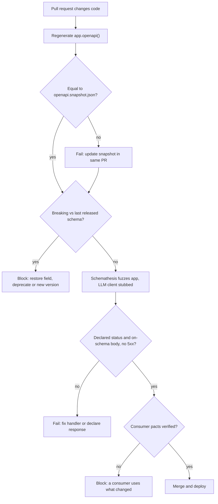

## TL;DR
Contract testing treats the generated schema as a promise: a CI snapshot diff fails on breaking changes,
and schema-driven tests (Schemathesis) check responses match the schema. Unit tests check what you meant;
contract tests check what clients were told.

## Why it exists
- **Unit tests move with the code.** The same people change both: rename `usage.total_tokens` to
  `usage.tokens`, update the test, everything is green, and every client reading `total_tokens` breaks in
  production. No provider test encodes what consumers depend on.
- **AI response shapes change constantly.** They grow (tool calls, reasoning content, citations), enums
  gain values (`finish_reason`), and fields move as prompt pipelines are refactored.
- **Accuracy is not stability.** FastAPI's schema updates itself silently with each change, so it
  documents the break rather than preventing it.
- **Naive defences miss it.** A reviewer reading a 3,000-line `openapi.json` diff misses that a field
  became required; hand-written "golden response" tests cover only the payloads someone thought of.
- **What contract testing buys.** The schema becomes an explicit, versioned artifact, the machine
  classifies changes as breaking or not, and the implementation is fuzzed against its own declared contract.

## How it works
### Layer 1: schema snapshot and diff
1. **Snapshot.** Export `app.openapi()` to a committed file such as `openapi.snapshot.json`.
2. **Compare in CI.** Regenerate and compare with the snapshot. Any difference fails the build until the
   snapshot is updated in the same pull request, which forces the change to be visible in review.
3. **Classify against the last *released* schema**, not just the previous commit, with a breaking-change
   tool (oasdiff and openapi-diff are common choices).

**The one principle (asymmetric):** a server may *accept more* (a looser request schema) and *promise
more* (extra response fields, tighter guarantees) than before, but never accept less or promise less.

| Change | Direction | Verdict |
|---|---|---|
| New required field; narrowed type or enum; tighter constraint (`max_length` from 4096 to 1024) | request | breaking |
| Removing an optional field clients send | request | breaking (sneaky, see below) |
| Removed field; field becomes nullable or optional; changed type | response | breaking |
| New optional request field | request | usually safe |
| New response field | response | usually safe, if clients ignore unknown fields ("tolerant reader") |
| New value in a response enum | response | ambiguous: treat as breaking for public APIs |

- **Why removing an optional request field is sneaky.** With Pydantic's default `extra="ignore"` the
  request still succeeds and the field is silently dropped. The client believes it set `temperature` when
  it did not, which is worse than a 422.
- **Why a new enum value is ambiguous.** It is additive, but a client that `switch`es exhaustively over
  `finish_reason` hits an unhandled case.

### Layer 2: does the implementation honour the schema
- **A stable schema can still be violated.** A handler returns `None` where the schema says string, or a
  validation edge case produces a 500 that was never documented.
- **Schema-driven testing** reads the OpenAPI document and generates many requests per operation: valid,
  boundary and deliberately invalid inputs, in the spirit of property-based testing.
- **For each response it checks:** the status code is one the schema declares, the body validates against
  the declared response schema, and the server did not return a 500.
- **Where it runs.** Schemathesis runs in-process against the ASGI app, or over HTTP against a deployment.

### Layer 3: consumer-driven contracts
- **Layers 1 and 2 protect what the provider *declared*.**
- **Consumer-driven contracts** (Pact is the usual tool) record what each consumer actually *uses*, such
  as "the web app reads `choices[0].message.content`", and replay those expectations against the provider
  in CI.
- **The question only this answers:** is the field you want to remove used by anyone?

### Why AI endpoints need special handling
- **Fuzzed inputs must not reach the real model**, because thousands of fuzzed requests would cost money
  and make results nondeterministic.
- **Override the LLM client dependency** with a fake that returns schema-valid outputs, so the test
  exercises routing, validation and serialization, which is where contract bugs live.

## Diagram
Follow a pull request through the three layers: the schema diff asks whether the promise changed, the
fuzzer asks whether the code keeps it, and pacts ask whether anyone relies on it.



## Examples
### CI test file with both layers
A snapshot test that fails on any schema change, and a Schemathesis test that fuzzes the app with the
model provider stubbed out.

```python
# tests/test_contract.py
import json, pathlib
import schemathesis
from app.main import create_app
from app.deps import get_llm_client

SNAPSHOT = pathlib.Path(__file__).parent / "openapi.snapshot.json"

class FakeLLM:                                   # schema-valid, free, deterministic
    async def complete(self, messages, model):
        return {"content": "ok", "finish_reason": "stop",
                "usage": {"prompt_tokens": 3, "completion_tokens": 1, "total_tokens": 4}}

app = create_app()
app.dependency_overrides[get_llm_client] = lambda: FakeLLM()

def test_schema_matches_snapshot():
    current = app.openapi()
    expected = json.loads(SNAPSHOT.read_text())
    assert current == expected, (
        "OpenAPI changed. Run `python scripts/export_openapi.py`, commit the snapshot, "
        "and check the breaking-change report in CI.")

# Schemathesis 4.x entry point; 3.x used schemathesis.from_asgi(...)
schema = schemathesis.openapi.from_asgi("/openapi.json", app)

@schema.parametrize()
def test_api_honours_schema(case):
    case.call_and_validate()   # fails on 5xx, undocumented status codes, or bodies off-schema
```

On a pull request that renamed `usage.total_tokens`:
1. The snapshot test fails (visible).
2. The diff tool flags a removed response property (breaking).
3. The reviewer must restore the field, add it alongside the new name with a deprecation, or cut a new
   version.

### A tiny breaking-change classifier (runnable, stdlib only)
Not a replacement for oasdiff, but it shows the asymmetric rule as code. Requests must not accept less;
responses must not promise less.

```python
def fields(schema, model):
    s = schema["components"]["schemas"][model]
    return set(s.get("properties", {})), set(s.get("required", []))

def breaking(old, new, requests, responses):
    out = []
    for m in requests:                                   # server must not accept less
        (op, oreq), (np_, nreq) = fields(old, m), fields(new, m)
        out += [f"{m}: new required request field '{f}'" for f in sorted(nreq - oreq)]
        out += [f"{m}: request field '{f}' removed (silently ignored)" for f in sorted(op - np_)]
    for m in responses:                                  # server must not promise less
        (op, oreq), (np_, nreq) = fields(old, m), fields(new, m)
        out += [f"{m}: response field '{f}' removed" for f in sorted(op - np_)]
        out += [f"{m}: response field '{f}' no longer required" for f in sorted((oreq - nreq) & np_)]
    return out

old = {"components": {"schemas": {
    "ChatIn": {"properties": {"messages": {}, "temperature": {}}, "required": ["messages"]},
    "Usage": {"properties": {"prompt_tokens": {}, "total_tokens": {}},
              "required": ["prompt_tokens", "total_tokens"]}}}}
new = {"components": {"schemas": {
    "ChatIn": {"properties": {"messages": {}, "tenant_id": {}}, "required": ["messages", "tenant_id"]},
    "Usage": {"properties": {"prompt_tokens": {}, "tokens": {}}, "required": ["prompt_tokens", "tokens"]}}}}

for line in breaking(old, new, requests=["ChatIn"], responses=["Usage"]):
    print(line)
# ChatIn: new required request field 'tenant_id'
# ChatIn: request field 'temperature' removed (silently ignored)
# Usage: response field 'total_tokens' removed
```

### Worked scenario: one change split across two pull requests
| Pull request | Diff vs previous commit | Diff vs last release |
|---|---|---|
| PR 1: add `usage.tokens` | additive, passes | additive, passes |
| PR 2: remove `usage.total_tokens` "cleanup" | flagged only if someone reads it | removed response field: breaking |
| Combined effect at release | looked like two harmless changes | a rename every client feels |

Diffing against the last released schema catches the cumulative break, which is why Layer 1 step 3
insists on it.

## Production patterns
- **Snapshot plus release baseline.** Keep `openapi.snapshot.json` for "something changed" and store the
  schema of each release (a git tag or a published artifact) as the baseline for the breaking-change
  report, for example `oasdiff breaking released.json current.json` in CI. Monitor: breaking changes caught
  before release.
- **Stub the model, keep the wiring.** Override the LLM client with `app.dependency_overrides` in the
  contract suite, as above, and never put real provider keys in that CI job. Monitor: provider spend from
  CI, which should be zero.
- **Shallow fuzz on PRs, deep fuzz nightly.** Cap generated examples per operation on pull requests (for
  example with Hypothesis `settings(max_examples=...)` on the test) and run full depth on a schedule
  against staging. Monitor: suite duration and 500s found per run.
- **Document auth errors once.** Declare 401 and 403 via router-level `responses` so the fuzzer stops
  reporting them as undocumented, and make the custom validation handler's envelope match the declared
  422 schema. Monitor: the count of "undocumented status code" findings, trending to zero.
- **Pacts for many consumers.** When several teams consume the API, have each publish Pact expectations
  and verify them in the provider pipeline before deploy. Monitor: consumers with unverified pacts, and
  fields no pact uses (safe removal candidates).

## Trade-offs
- **Strict equality vs noise.** Strict snapshot equality catches every change, but it also fails on
  harmless description edits; that noise is acceptable only because updating the snapshot is a
  one-command, reviewed step.
- **Fuzz coverage vs CI time.** Schema fuzzing finds 500s and off-schema responses nobody wrote tests
  for, but it lengthens CI; when the suite gets slow, cap examples per operation on pull requests and run
  the full depth nightly.
- **Consumer knowledge vs upkeep.** Consumer-driven contracts tell you who uses a field, but every
  consumer team must publish and maintain pacts; for one internal consumer, the schema diff alone is
  usually enough.
- **Strict enums vs evolution speed.** Treating additive enum values as breaking protects strict clients,
  but it slows evolution; flip to "additive is safe" only when you document that clients must handle
  unknown values.

## Pitfalls
- **Diffing against the previous commit instead of the last released schema.** Symptom: a breaking change
  split across two harmless-looking pull requests that each pass review.
- **Letting fuzzed requests hit the real model provider.** Symptom: a surprise bill, rate-limit errors and
  flaky contract tests that fail differently on every run.
- **Regenerating a red snapshot without reading the diff.** Symptom: a breaking change reaches clients
  with a green, "reviewed" pipeline behind it.
- **Custom error envelope, default 422 schema.** A custom `RequestValidationError` handler returns your
  own envelope while the schema still advertises FastAPI's automatic 422 `HTTPValidationError`. Symptom:
  the fuzzer flags a schema-conformance failure on nearly every invalid-input case.
- **Ignoring undocumented status codes the fuzzer reports**, such as 401s or 403s raised by an auth
  dependency (FastAPI documents its own 422 automatically, but not these) or 500s on empty lists. Symptom:
  client SDKs that throw on responses their types say cannot happen.

## When to use
- **Snapshot test:** as soon as any client you do not deploy with (a front end in another repo, a
  customer, a generated SDK, an agent importing tools) depends on the API. It costs minutes and catches
  the most expensive class of mistake.
- **Schema fuzzing:** when the API has many operations or complex request models, since that is where
  unvalidated edge cases hide.
- **Consumer-driven contracts:** when several teams consume the API and you need to know whether removing
  something is safe.
- **Measure:** breaking changes caught before release, and 500s found per run.
- **Interviews:** distinguishing "the schema is accurate" from "the schema is stable" is the key insight.

## Role lens
- **Engineer:** Maintains the snapshot test, stubs the LLM dependency for fuzzing, and fixes the 500s and
  off-schema responses the generated tests surface.
- **Architect:** Defines what counts as breaking, the deprecation window, and when a change forces a new
  API version, then makes CI enforce those rules.
- **FDE:** Pins the customer's integration to a released schema version and runs the contract suite
  before upgrading their deployment, so upgrades do not break their systems.

## Check yourself
**Q:** A pull request adds `"content_filter"` as a new possible value of `finish_reason` in the chat
response and adds a new required `tenant_id` request field. CI's snapshot test fails. How do you classify
each change, and what would you do?
**A:** The required `tenant_id` is unambiguously breaking: every existing client request now fails
validation with a 422. I would make it optional with a sensible default (derive tenant from the API key),
or ship it in a new version. The enum addition is additive, so tolerant clients are fine, but any client
that handles `finish_reason` exhaustively will hit an unknown case; for a public API I would treat it as
breaking unless the docs already require clients to handle unknown values, and announce it. Either way the
snapshot gets updated in the same pull request so reviewers see the diff, and the breaking-change report is
run against the last released schema, not the previous commit.

## Interview questions
### What does a contract test catch that a unit test does not?
- **Unit tests move with the code:** the same author renames `usage.total_tokens` and updates the test, so
  everything stays green while every client breaks.
- **Contract tests pin what clients were told:** the committed schema snapshot fails on any change, and a
  breaking-change classifier says whether that change accepts less or promises less.

### You must rename a response field that customers read. How do you ship it without breaking them?
- **Expand first:** add the new field alongside the old one, both populated, and mark the old one
  deprecated in the schema.
- **Then wait out a deprecation window**, using consumer pacts or access patterns to see who still reads
  the old field.
- **Contract last:** remove it in a release whose breaking-change report you accept on purpose, or in a
  new API version. Diff against the last release so the two steps cannot slip through as harmless PRs.

### Why stub the LLM client in a contract suite, and what do you lose?
- **Why:** thousands of fuzzed requests against a real provider cost money, hit rate limits and make
  results nondeterministic.
- **What still gets tested:** routing, validation and serialization, which is where contract bugs live.
- **What you lose:** coverage of real model output shapes, so keep a small separate test that parses
  recorded real responses through the same response models.

### The Schemathesis job now takes 25 minutes on every pull request. What do you change?
- **Split depth by trigger:** cap generated examples per operation on pull requests and run full depth
  nightly against staging, so pull request feedback stays fast while the deep search still runs daily.
- **Remove noise:** declare 401, 403 and the real 422 envelope so findings are real bugs, not
  undocumented auth errors.
- **Track** suite duration and 500s found per run to tune the cap.

### When is a schema diff enough, and when do you need consumer-driven contracts?
- **Schema diff is enough** for one internal consumer, because you can check its usage directly.
- **Add Pact when several teams consume the API**, because only recorded consumer expectations answer
  whether removing a field is safe.
- **The cost:** every consumer team must publish and maintain pacts, and unverified pacts must block
  deploys or the system decays.

## Quiz
### Q: Which change is breaking for existing clients of a response schema?
- [ ] Adding a new optional field to the response body
- [ ] Adding a description to an existing field
- [x] Making a previously always-present response field optional
- [ ] Adding a new endpoint under the same tag
> Clients written against the old schema assume the field is present, so making it optional means they can
> receive bodies without it and fail. New optional fields and new endpoints are additive and safe.

### Q: What does schema-driven fuzzing (such as Schemathesis) catch that a schema snapshot diff does not?
- [ ] A field that was renamed between releases
- [x] Handlers that return 500s or bodies that violate the schema they themselves declare
- [ ] Which consumers depend on a given field
- [ ] Description changes that confuse client developers
> A snapshot diff compares schema versions; it cannot see runtime behaviour. Fuzzing calls the app and checks
> responses against the declared schema. Knowing which consumers use a field needs consumer-driven contracts.

### Q: Why should fuzzed contract tests override the LLM client dependency with a fake?
- [ ] The OpenAPI schema cannot describe model outputs
- [ ] Schemathesis refuses to call endpoints that make outbound requests
- [x] Real calls cost money, hit rate limits and are nondeterministic, while contract bugs live in validation and serialization
- [ ] FastAPI dependencies are disabled during contract tests
> Fuzzers send many requests per operation; real model calls would be expensive and flaky. A schema-valid fake
> isolates what the contract test is about: routing, validation and response serialization.
