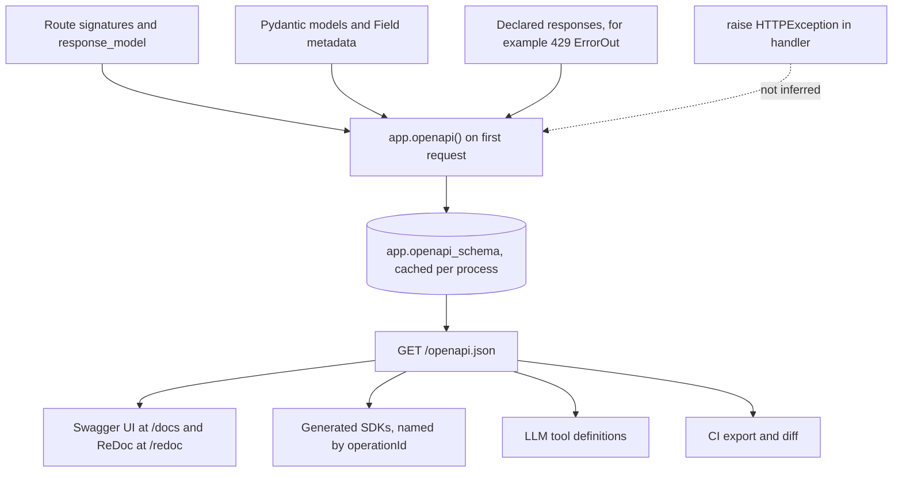

## TL;DR
FastAPI derives an OpenAPI document from route signatures and Pydantic models, serves it at
`/openapi.json`, and renders it at `/docs` (Swagger UI) and `/redoc`. Built from the validating types, it
cannot drift, so it reliably feeds SDKs, contract tests and LLM tool definitions.

## Why it exists
- **Every API has a contract anyway.** Field names, types, which fields are required, which status codes
  mean what. Without a machine-readable one, front-end teams read your handlers, customers
  reverse-engineer payloads, and a hand-written SDK breaks the day you rename a field.
- **Hand-maintained specs drift.** A YAML file in a docs repo is a second source of truth that drifts
  within weeks, because nothing fails when the code changes and the YAML does not.
- **Code-first makes the contract a by-product.** The type hints that parse and validate a request also
  generate the schema, so if the handler accepts a field, the schema documents it.
- **AI payloads raise the stakes.** Chat and completion payloads are nested (messages, tool calls, content
  parts) and change often as providers add features.
- **Agents read it as tools.** Tool definitions are increasingly generated from OpenAPI, so a vague
  description or a missing enum directly degrades the model's ability to call you correctly.

## How it works
### Generation
1. **First request.** On the first request to `/openapi.json`, FastAPI calls `app.openapi()`.
2. **Walk the routes.** For each path operation it collects path, method, parameters (path, query,
   header, cookie with types and defaults), the request body model and the response model.
3. **Build schemas.** Pydantic generates JSON Schema per model; shared models go under
   `components/schemas` with `$ref` pointers.
4. **Cache.** The result is stored on `app.openapi_schema`, so it is generated once per process. Recent
   FastAPI versions emit OpenAPI 3.1, which aligns with JSON Schema.

- **Lazy generation hides breakage.** A bug in a custom `app.openapi` override, or a type the generator
  cannot handle, does not stop startup; it surfaces as a 500 on `/openapi.json` the first time someone
  opens the docs.
- **Fix:** call `app.openapi()` in a test, which turns that into a CI failure instead.

### What feeds it
- **Models and fields.** `Field(description=..., examples=[...])`, constraints such as `ge`, `max_length`
  and `Literal`/`Enum` types all appear in the schema. Client generators and LLMs read these.
- **Operation metadata.** `summary`, `description` (or the docstring), `tags` (which group operations in
  the UI), `operation_id`, `deprecated=True` and `include_in_schema=False`.
- **Success response.** `response_model` defines the 200 body.
- **Error responses must be declared.** `responses={404: {"model": ErrorOut}}` documents errors the
  handler raises. FastAPI cannot infer them from `raise HTTPException`, because exceptions are not part of
  a signature, so undocumented error shapes are the most common gap.
- **The one automatic error is 422** (`HTTPValidationError`), added to every operation with parameters or
  a body, because FastAPI itself produces it. A custom `RequestValidationError` handler with a different
  envelope makes that schema wrong unless you override it.
- **App metadata.** `FastAPI(title=..., version=..., openapi_url=..., docs_url=..., redoc_url=...)`;
  setting a URL to `None` disables that endpoint.

### Operation IDs
- **Generated clients name methods after `operationId`.**
- **The default is noisy.** It concatenates function name, path and method:
  `complete_v1_chat_completions_post`.
- **Pass `generate_unique_id_function`** (for example, tag plus function name) for stable, readable SDK
  methods. Renaming a Python function then becomes a visible SDK change rather than an accident.

### Input versus output schemas
- A model can serialize differently from how it validates (defaults, computed fields).
- With Pydantic v2, FastAPI can emit separate `Model-Input` and `Model-Output` schemas when they differ, so
  a field optional on input but always present on output is described honestly on both sides.

### What it describes poorly
| Interface | OpenAPI support |
|---|---|
| Request/response pairs | first-class |
| SSE token stream, OpenAPI 3.0 and 3.1 (what FastAPI emits) | declare `text/event-stream` as content type; per-event shape only in prose or a separate model |
| SSE / JSON Lines, OpenAPI 3.2 (2025) | `itemSchema` for sequential media types; generator and framework support still uneven, check your toolchain |
| WebSocket protocols | outside OpenAPI altogether; AsyncAPI is the usual alternative |

- **Customising beyond this** means overriding `app.openapi` to post-process the dict: powerful, but now
  hand-maintained.

## Diagram
The same signatures and models that validate requests feed one cached schema, and every consumer reads
that schema; note that raised errors only reach it if you declare them in `responses`.



## Examples
### A schema built for SDKs and LLM tools
An embeddings endpoint with described fields, a constrained enum, a documented error and a stable
operation id.

```python
from typing import Literal
from fastapi import FastAPI
from fastapi.responses import JSONResponse
from fastapi.routing import APIRoute
from pydantic import BaseModel, Field

def op_id(route: APIRoute) -> str:
    return f"{route.tags[0]}_{route.name}" if route.tags else route.name

app = FastAPI(title="retrieval-api", version="1.4.0", generate_unique_id_function=op_id)

class EmbedIn(BaseModel):
    texts: list[str] = Field(min_length=1, max_length=256,
                             description="Texts to embed; each is truncated to the model's limit.")
    model: Literal["small", "large"] = Field("small", description="Embedding size tier.")

class EmbedOut(BaseModel):
    vectors: list[list[float]]
    model: str
    dimensions: int

class ErrorOut(BaseModel):
    code: str
    message: str

@app.post("/v1/embeddings", tags=["embeddings"], response_model=EmbedOut,
          responses={429: {"model": ErrorOut, "description": "Tenant quota exceeded"}},
          summary="Embed a batch of texts")
async def create(body: EmbedIn) -> EmbedOut:
    if len(body.texts) > 200:                  # stand-in for a real per-tenant quota check
        err = ErrorOut(code="quota_exceeded", message="Tenant quota exceeded")
        return JSONResponse(status_code=429, content=err.model_dump())
    return EmbedOut(vectors=[[0.0] * 8 for _ in body.texts], model=body.model, dimensions=8)

schema = app.openapi()
print(schema["paths"]["/v1/embeddings"]["post"]["operationId"])   # embeddings_create
print(schema["components"]["schemas"]["EmbedIn"]["properties"]["model"]["enum"])  # ['small', 'large']
```

- **SDK method** is `embeddings_create`; **`model`** is an enum a client or LLM can pick from.
- **The 429 shape is documented** even though FastAPI cannot infer it from the handler.
- **The body really is an `ErrorOut`.** A plain `raise HTTPException(429, detail="quota")` would send
  `{"detail": "quota"}`, so the declared model would be a lie unless a custom exception handler produces
  the `code`/`message` envelope.

### CI step: export and diff the schema
Treat `/openapi.json` as a committed artifact. This script writes it, or with `--check` fails when the
committed copy is stale, so every pull request shows its contract change in the diff.

```python
# scripts/export_openapi.py
import json, sys
from pathlib import Path
from app.main import create_app

path = Path("openapi.json")
current = json.dumps(create_app().openapi(), indent=2, sort_keys=True) + "\n"

if "--check" in sys.argv:
    if not path.exists() or path.read_text() != current:
        sys.exit("openapi.json is stale: run python scripts/export_openapi.py and commit it")
    print("openapi.json is up to date")
else:
    path.write_text(current)
```

### Production snippet: docs off in prod, self-hosted assets for air-gapped sites
```python
from fastapi import FastAPI
from fastapi.openapi.docs import get_swagger_ui_html
from fastapi.staticfiles import StaticFiles

IS_PROD = False            # read from settings in real code

app = FastAPI(docs_url=None, redoc_url=None, openapi_url=None if IS_PROD else "/openapi.json")
# ./static must exist (StaticFiles raises at startup otherwise) and hold swagger-ui-bundle.js, swagger-ui.css
app.mount("/static", StaticFiles(directory="static"), name="static")

if not IS_PROD:
    @app.get("/docs", include_in_schema=False)
    async def docs():
        return get_swagger_ui_html(openapi_url="/openapi.json", title="API docs",
                                   swagger_js_url="/static/swagger-ui-bundle.js",
                                   swagger_css_url="/static/swagger-ui.css")
```

## Production patterns
- **Schema as a committed artifact.** Export `openapi.json` in CI with the script above and fail on drift;
  reviewers then see contract changes in the pull request. Monitor: removed fields or narrowed types in
  the diff, which are breaking for clients.
- **Stable operation IDs from day one.** Set `generate_unique_id_function` before the first SDK ships,
  because changing it later renames every generated method. Monitor: operation-id changes in the schema
  diff.
- **Declare the error envelope once per group.** Routers accept `responses`, so put
  `responses={429: {"model": ErrorOut}, 404: {"model": ErrorOut}}` on the router and pair it with a
  custom exception handler that really emits that body. Monitor: client-side deserialisation errors.
- **Environment-gated docs.** Pass `docs_url=None`, `redoc_url=None` and, for internet-facing services,
  `openapi_url=None` in production, or serve them behind auth. Monitor: unauthenticated hits on `/docs`
  and `/openapi.json` in access logs.
- **Self-hosted Swagger assets for customer networks.** Disable the default docs and serve
  `get_swagger_ui_html(...)` with local `swagger_js_url` and `swagger_css_url`, as above. Monitor: a
  smoke test that loads `/docs` inside the customer environment.
- **Curate what agents see.** Mark admin and debug routes `include_in_schema=False` (or publish a separate
  filtered schema) so they do not become agent tools. Monitor: the operation count and size of the schema
  you hand to tool importers, since each description costs prompt tokens.

## Trade-offs
- **Code-first vs design-first.** Code-first schemas never drift from validation, but the API design is
  only as deliberate as the type hints; when several teams must agree on a contract before code exists,
  design-first YAML wins.
- **Public `/docs` vs attack surface.** It speeds up partner integration, but it also maps your attack
  surface for anyone; for internet-facing services disable it in production or put it behind auth.
- **Rich descriptions vs token cost.** Descriptions and examples make SDKs and agent tool definitions
  better, but they lengthen the schema; when an LLM consumes it as tools, every description costs prompt
  tokens on each call.
- **Custom `app.openapi` vs drift.** Overriding it lets you add vendor extensions or SSE event docs, but
  the override becomes hand-maintained code that can drift exactly like the YAML you were avoiding.

## Pitfalls
- **Undeclared errors.** Raising `HTTPException(404)` or a custom error without listing it in
  `responses`. Symptom: client SDKs that crash or return untyped blobs on errors the docs never mentioned.
- **No response model.** Returning a dict without `response_model` or a return annotation. Symptom: an
  empty response schema and a generated client whose return type is `Any`.
- **Default operation IDs.** Symptom: SDK method names like `complete_v1_chat_completions_post` that
  change whenever a path is edited, breaking downstream code on a refactor.
- **Declared model, plain exception.** Declaring `responses={...: {"model": ErrorOut}}` while the handler
  raises a plain `HTTPException`. Symptom: clients deserialise errors into `ErrorOut` and fail, because the
  real body is `{"detail": ...}`.
- **Streaming endpoint documented as JSON.** Symptom: generated clients wait for a complete JSON body and
  hang or fail to parse an event stream.
- **Assuming `/docs` works anywhere the API works.** Swagger UI and ReDoc load JavaScript and CSS from a
  public CDN by default, so in an air-gapped customer network the docs page is blank while
  `/openapi.json` loads fine. Fix: self-host the assets and pass their URLs to the docs page helpers.

## When to use
The schema is free; the decision is how much to invest in it.
- **Invest heavily** (descriptions, enums, error responses, stable operation IDs) when external clients,
  generated SDKs or agents consume the API.
- **Invest lightly** for a single internal caller.
- **Decide explicitly** whether `/docs` is reachable in production.
- **Treat `/openapi.json` as an artifact:** export it in CI, diff it on every pull request and use it for
  contract tests.
- **Interviews:** FastAPI's docs are derived from validation types, which is why they stay accurate; error
  responses and streams are the parts you must add.

## Role lens
- **Engineer:** Writes field descriptions, constrains types with `Literal` and bounds, declares error
  `responses`, and sets an operation-id function so generated clients are stable.
- **Architect:** Decides code-first versus design-first, whether the schema is a published contract with
  versioning rules, and whether docs are exposed per environment.
- **FDE:** Hands the customer's integration team the OpenAPI URL or a generated SDK, and turns the schema
  into tool definitions for the customer's agent platform.

## Check yourself
**Q:** A customer's agent framework imports your OpenAPI document as tools, and the model keeps calling
`/v1/search` with invalid `filter` values and ignoring a 429 retry hint. What would you change in the
FastAPI code, and why does it help?
**A:** The model only sees what the schema says, so I would tighten the schema. Replace a free-form
`filter: str` with a `Literal` or enum of allowed values, or a structured model, and add field
descriptions with an example, because the tool definition is generated from exactly those fields. Declare
the 429 response with a typed error model that includes a `retry_after_seconds` field so the framework can
surface it. Give the operation a clear `summary` and stable `operation_id`, since that becomes the tool
name. I would also keep descriptions short, because they are sent as prompt tokens each call, and verify
the change by exporting the schema and diffing it.

## Interview questions
### How does FastAPI produce its OpenAPI document, and why does it stay accurate?
- **Generation:** on the first request to `/openapi.json`, `app.openapi()` walks every route, collects
  parameters, body and response models, and asks Pydantic for JSON Schema; the result is cached on
  `app.openapi_schema`.
- **Accuracy:** it is built from the same type hints that validate requests, so a field the handler
  accepts is a field the schema documents.

### A generated SDK crashes on error responses. What is likely wrong and how do you fix it?
- **Likely cause:** errors are undeclared, or declared with a model the handler does not really send.
  FastAPI cannot infer errors from `raise HTTPException`, and a plain one sends `{"detail": ...}`.
- **Fix:** declare `responses={404: {"model": ErrorOut}}` (once per router where possible) and add a
  custom exception handler that really emits the `ErrorOut` envelope.
- **Guard:** a contract test that validates real error bodies against the declared schema.

### Would you expose /docs in production?
- **For internet-facing services, usually not:** it maps your attack surface, so set `docs_url=None`,
  `redoc_url=None` and often `openapi_url=None`, or put them behind auth.
- **For partner or internal APIs, often yes,** because it speeds integration; then gate it by environment
  and watch unauthenticated hits in access logs.
- **Air-gapped customers** need self-hosted Swagger assets, because the default page loads them from a
  public CDN.

### Why do operation IDs matter, and when should you set them?
- **Generated clients and agent tools are named after `operationId`.** The default, such as
  `complete_v1_chat_completions_post`, changes whenever a path changes.
- **Set `generate_unique_id_function` before the first SDK ships**, because changing it later renames every
  generated method.
- **Then watch operation-id changes in the committed schema diff**, treating them as SDK-breaking.

### An agent platform imports your schema as tools and the prompt is getting expensive. What do you do?
- **Every description is prompt tokens on every call,** so the size of the imported schema is a running
  cost, not a one-off.
- **Trim the surface:** mark admin and debug routes `include_in_schema=False`, or publish a separate
  filtered schema for tool import.
- **Keep descriptions short but precise:** enums and `Literal` types carry more signal per token than long
  prose, and monitor operation count and schema size over time.

## Quiz
### Q: Why does FastAPI's OpenAPI document tend to stay accurate as the code changes?
- [ ] FastAPI re-reads the docstrings of every module at startup and validates them
- [x] It is generated from the same type hints and Pydantic models that validate requests
- [ ] A CI hook in FastAPI rejects commits where the schema and code differ
- [ ] Swagger UI inspects live traffic and updates the schema
> The schema is derived from the signatures that also parse and validate requests, so changing a model
> changes both at once. Nothing checks docstrings; prose descriptions can still go stale.

### Q: A handler raises `HTTPException(status_code=409)` but clients' generated SDKs do not know about it. Why?
- [ ] FastAPI only documents status codes below 400
- [ ] The exception must subclass `ValueError` to be documented
- [x] Raised exceptions are not part of the function signature, so they must be declared in `responses`
- [ ] Generated SDKs ignore all non-200 responses by design
> FastAPI can infer the success schema from `response_model` or the return annotation, but it cannot see
> which exceptions a body might raise. Declaring `responses={409: {"model": ...}}` adds them to the schema.

### Q: What is the main reason to set `generate_unique_id_function`?
- [ ] It is required for Swagger UI to render endpoints
- [ ] It speeds up schema generation for large apps
- [x] Generated clients name methods after operation IDs, so readable, stable IDs give a stable SDK
- [ ] It prevents two routes from sharing the same path
> Default IDs combine the function name, path and method, so they are long and change when paths change.
> A custom function keyed on tag and name keeps SDK method names readable and stable across refactors.
