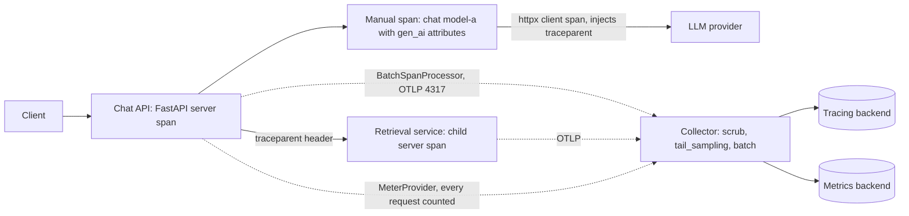

## TL;DR
OpenTelemetry (OTel) is a vendor-neutral API, SDK and protocol for traces, metrics and logs. In FastAPI:
an OTLP-exporting tracer provider, auto-instrumented app and clients, and manual spans around LLM and
retrieval steps give one cross-service trace per request, for any backend.

## Why it exists
- **Slow requests hide their cause.** A 9-second chat request might spend it in the provider, a vector
  search, a re-ranker, a database lock, or three retries of an agent's tool call.
- **Logs show events, not causality.** They do not show the tree of who called whom and how long each part
  took, especially across services (gateway, retrieval service, model server). Without it, latency
  debugging is guesswork.
- **Vendor APM agents lock you in.** Switching vendors means re-instrumenting every service, and libraries
  cannot ship instrumentation for every vendor.
- **Hand-rolled timing logs** do not propagate across process boundaries and cannot be assembled into a
  tree.
- **OTel separates the concerns.** Code and libraries call a stable API, the SDK decides sampling and
  batching, and an exporter speaks OTLP to a collector or backend, so the backend is a deployment choice,
  not a code change. Many LLM observability tools now accept OTLP too.

## How it works
### Data model
| Concept | What it is |
|---|---|
| **trace** | a tree of spans sharing a trace id |
| **span** | name, start and end time, parent, status, attributes (key-value pairs) |
| **tracer** | creates spans; obtained from the global tracer provider |
| **tracer provider** | owns the resource, the sampler and the span processors |
| **resource** | attributes describing the service, such as `service.name` and `deployment.environment` |
| **`BatchSpanProcessor`** | queues finished spans and exports them on a background thread, because synchronous export would add network latency to every request |

### Propagation
1. **Inject.** The instrumented httpx client adds a W3C `traceparent` header carrying the trace id and the
   current span id.
2. **Extract.** The receiving service's FastAPI instrumentation reads it and makes its server span a child,
   which is how one trace spans many services.
3. **In process.** The current span lives in a `contextvars`-based context, so async code keeps correct
   parentage across `await`s.

### Auto versus manual instrumentation
- **Auto: server spans.** `FastAPIInstrumentor.instrument_app(app)` wraps the ASGI app in middleware that
  creates a server span per request, named after the route template, with HTTP method and status.
- **Auto: client spans.** Library instrumentors (`HTTPXClientInstrumentor`, `SQLAlchemyInstrumentor`,
  Redis) add them. The `opentelemetry-instrument` command applies installed instrumentors without code
  changes.
- **Manual: AI meaning.** Auto-instrumentation sees an HTTP POST to the provider, not a chat completion on a
  specific model with 812 input tokens. Wrap model calls, retrieval, reranking and tool execution in your
  own spans and set attributes.
- **GenAI semantic conventions** define names such as `gen_ai.request.model` and
  `gen_ai.usage.input_tokens`; they are still marked as in development, so pin the version you follow.
- **Errors for free.** `start_as_current_span` records an exception raised inside it as a span event and
  sets the span status to error by default, so a failed provider call shows up red without extra code.

### Sampling
- **Recording every span of every request is expensive at volume.**
- **Head sampling:** `ParentBased(TraceIdRatioBased(0.1))` keeps about 10% of new traces and follows the
  caller's decision for propagated ones, so a trace is never half-sampled across services.
- **Tail sampling** (keep all errors and slow traces) happens in the collector, because only after a trace
  ends do you know whether it was interesting.

### The collector
- **Export to a collector, not straight to a vendor.** Conventionally port 4317 for gRPC, 4318 for HTTP,
  running as a sidecar, a node agent or a central gateway.
- **A pipeline of receivers, processors and exporters.** It batches and retries, can delete or hash
  attributes (a last line of defence against prompt text leaking into telemetry), performs tail sampling,
  and fans out to one or several backends.
- **Why there:** changing backends or sampling policy becomes a config change to one deployment, not a
  redeploy of every service.

### Metrics and logs
- **Traces are sampled, so they are the wrong source for totals.** Request counts, latency histograms and
  token usage belong in metrics.
- **Metrics pipeline:** a `MeterProvider` with a periodic exporting reader aggregates in process and exports
  every interval; every request is counted regardless of trace sampling.
- **GenAI metrics:** the conventions define `gen_ai.client.token.usage` and
  `gen_ai.client.operation.duration`.
- **Logs: correlation is the cheap win.** Put the current span's trace id (32 hex characters) and span id
  on every log record, with the stdlib `LoggingInstrumentor` or a structlog processor that reads
  `trace.get_current_span().get_span_context()`, so a log line links straight to its trace.

### Process model
- **Threads do not survive `fork`**, and SDK state created before a fork is not safe to inherit.
- **Partial fix in the SDK.** Recent releases register an at-fork hook that restarts the batch span
  processor's worker thread in the child.
- **Still unsafe:** the OTLP gRPC exporter's channel is not fork-safe, and metric readers have the same
  problem.
- **Official guidance stands:** with Gunicorn `--preload` or any pre-fork server, initialise the tracer
  provider in each worker (a `post_fork` hook or lifespan), not in the master.

## Diagram
Follow one trace id: the `traceparent` header stitches services into one tree, spans leave each process
in batches, and the collector scrubs and tail-samples before any backend sees them.



## Examples
### Per-worker init, auto-instrumentation and a manual LLM span
```python
from contextlib import asynccontextmanager
import httpx
from fastapi import FastAPI
from opentelemetry import trace
from opentelemetry.sdk.resources import Resource
from opentelemetry.sdk.trace import TracerProvider
from opentelemetry.sdk.trace.export import BatchSpanProcessor
from opentelemetry.exporter.otlp.proto.grpc.trace_exporter import OTLPSpanExporter
from opentelemetry.instrumentation.fastapi import FastAPIInstrumentor
from opentelemetry.instrumentation.httpx import HTTPXClientInstrumentor

@asynccontextmanager
async def lifespan(app: FastAPI):
    provider = TracerProvider(resource=Resource.create({"service.name": "chat-api"}))
    provider.add_span_processor(BatchSpanProcessor(OTLPSpanExporter()))  # OTEL_EXPORTER_OTLP_ENDPOINT
    trace.set_tracer_provider(provider)
    HTTPXClientInstrumentor().instrument()
    app.state.http = httpx.AsyncClient(base_url="https://llm.example.internal", timeout=60)
    yield
    await app.state.http.aclose()
    provider.shutdown()                       # flushes queued spans; skipped if the pod is SIGKILLed

app = FastAPI(lifespan=lifespan)
FastAPIInstrumentor.instrument_app(app)       # wraps the ASGI app; set OTEL_PYTHON_FASTAPI_EXCLUDED_URLS for probes
tracer = trace.get_tracer("chat-api")

@app.post("/v1/chat")
async def chat(body: dict):
    with tracer.start_as_current_span("chat model-a") as span:
        span.set_attribute("gen_ai.operation.name", "chat")
        span.set_attribute("gen_ai.request.model", "model-a")
        r = await app.state.http.post("/v1/chat/completions", json=body)   # child client span
        usage = r.json().get("usage", {})
        span.set_attribute("gen_ai.usage.input_tokens", usage.get("prompt_tokens", 0))
        span.set_attribute("gen_ai.usage.output_tokens", usage.get("completion_tokens", 0))
        return r.json()
```

- **Resulting trace:** `POST /v1/chat` (server) → `chat model-a` (manual) → `POST` (httpx client), with the
  provider's latency and token counts on the spans.
- **Streaming caveat:** start the model span inside the generator; a span ended when the handler returns
  closes before the first token is streamed.

### Collector pipeline: scrub prompts, keep errors and slow traces
A collector config (the `tail_sampling` processor ships in the collector's contrib distribution). Tail
sampling only sees what the app exported, so the app's own sampler must keep everything (or a high ratio)
for this to work, and all spans of a trace must reach the same collector instance.

```yaml
receivers:
  otlp:
    protocols:
      grpc: {endpoint: 0.0.0.0:4317}
      http: {endpoint: 0.0.0.0:4318}
processors:
  attributes/scrub:
    actions:
      - {key: gen_ai.prompt, action: delete}
      - {key: gen_ai.completion, action: delete}
      - {key: enduser.id, action: hash}
  tail_sampling:
    decision_wait: 10s
    policies:
      - {name: errors, type: status_code, status_code: {status_codes: [ERROR]}}
      - {name: slow, type: latency, latency: {threshold_ms: 5000}}
      - {name: baseline, type: probabilistic, probabilistic: {sampling_percentage: 10}}
  batch: {}
exporters:
  otlp:
    endpoint: tracing-backend.internal:4317
service:
  pipelines:
    traces:
      receivers: [otlp]
      processors: [attributes/scrub, tail_sampling, batch]
      exporters: [otlp]
```

### Worked scenario: why totals from traces lie
| Source | Calls counted per 1,000,000 real calls | Use for |
|---|---|---|
| Traces, head sampling at 10% | about 100,000 | latency breakdowns, examples of slow or failed requests |
| Traces, tail sampling (errors + slow + 10%) | biased toward failures and slow calls | debugging, never totals |
| Metrics (`gen_ai.client.token.usage` histogram) | 1,000,000 | spend, counts, SLOs |

Token spend computed from head-sampled traces comes out at roughly a tenth of the provider's bill, and
drifts whenever someone changes the sampling ratio.

## Production patterns
- **Init per worker, not in the master.** Build the tracer and meter providers in lifespan, or in
  Gunicorn's `post_fork(server, worker)` hook in `gunicorn.conf.py`, never at import with `--preload`.
  Monitor: exported spans per worker; a worker exporting zero is a fork problem.
- **Exclude probes and noise.** Pass `excluded_urls` to `FastAPIInstrumentor.instrument_app` or set
  `OTEL_PYTHON_FASTAPI_EXCLUDED_URLS` (for example `livez,readyz`). Monitor: span volume by route; probes
  should not appear.
- **Configure with standard environment variables.** Set `OTEL_SERVICE_NAME`,
  `OTEL_EXPORTER_OTLP_ENDPOINT` and `OTEL_TRACES_SAMPLER` per environment instead of hard-coding them, so
  the same image runs everywhere. Monitor: traces arriving with a missing or default service name.
- **Totals from metrics, examples from traces.** Record token usage with a histogram named
  `gen_ai.client.token.usage` (split by input and output) through a `MeterProvider` and
  `PeriodicExportingMetricReader`, and reconcile it daily against the provider's bill. Monitor: the gap
  between metric totals and billing.
- **Scrub in the collector as the last line.** Keep content out of spans in code, and also delete or hash
  sensitive attributes in the collector's `attributes` processor, as above. Monitor: a periodic backend
  query for spans carrying prompt-like attributes.
- **Trace id in every log line.** Add the 32-hex trace id to structured logs so on-call can jump from a log
  to its trace. Monitor: the share of request logs that carry a trace id.

## Trade-offs
- **Vendor neutrality vs configuration surface.** You change backends by changing an exporter endpoint,
  but OTel's surface (providers, processors, samplers, collectors) is larger than a single vendor agent.
- **Auto-instrumentation breadth vs meaning.** It gives broad coverage in minutes but records generic HTTP
  spans; the AI-specific meaning (model, tokens, prompt version) only exists if you add manual spans.
- **Head sampling cost vs rare errors.** A low ratio keeps cost bounded but drops most rare errors; flip to
  collector tail sampling when you need every failed or slow trace.
- **Content in spans vs exposure.** Prompts and completions as span attributes or events help quality
  debugging, but traces are often retained and shared more widely than logs, so default to metadata only.

## Pitfalls
- **Provider initialised before a pre-fork server forks workers.** Symptom: a service that works but
  exports no spans from workers, or only intermittently, with gRPC errors or hangs.
- **LLM span ended before a `StreamingResponse` finishes.** Symptom: model spans lasting a few milliseconds
  while the server span lasts the full 30 seconds of streaming.
- **Double instrumentation.** Calling `instrument_app` and also adding the instrumentation middleware
  manually, or instrumenting twice on reload. Symptom: duplicated nested server spans for every request.
- **Health probes left instrumented.** Symptom: traces dominated by `/livez` every few seconds per pod and a
  tracing bill driven by probes.
- **Token spend or request counts from traces under head sampling.** Symptom: totals roughly the sampling
  ratio of the provider's bill (about a tenth at 10%), or drifting as sampling changes.
- **User ids or raw prompts in span names instead of attributes.** Symptom: an explosion of unique span
  names that breaks grouping and latency aggregation in the backend.

## When to use
- **Use when:** a request touches more than one slow dependency or more than one service, which describes
  almost every RAG or agent backend.
- **Start with:** auto-instrumentation for FastAPI and your HTTP and DB clients, then manual spans for
  model calls, retrieval and tool execution.
- **Export to a collector** so sampling and routing stay out of application code.
- **Correlate:** add the trace id to structured logs.
- **Measure:** span coverage of p95 latency, so that unexplained time between spans shrinks.
- **Interviews:** explain propagation via `traceparent` and why manual spans are needed for LLM semantics.

## Role lens
- **Engineer:** Initialises the SDK per worker, instruments FastAPI and clients, writes manual spans with
  GenAI attributes, and keeps spans open for the whole stream.
- **Architect:** Chooses the collector topology, sampling policy, attribute conventions and backend, and
  decides what content may ever appear in telemetry.
- **FDE:** Points the exporter at the customer's existing collector or APM, often in a restricted network,
  so the service's traces appear in tools their operators already use.

## Check yourself
**Q:** Traces for your agent API show a 12-second server span with only 3 seconds covered by child spans
(two provider calls and one vector search). How do you find the missing 9 seconds?
**A:** Uncovered time is work that happens outside any instrumented span, so I would list what the handler
does between those calls: prompt assembly, tokenisation, JSON parsing, tool execution, retries with backoff
sleeps, or a client that is not instrumented (a sync SDK running in a thread, a gRPC client, a Redis call).
I would add manual spans around each agent step and tool call and instrument missing clients. If gaps remain
with no code there, it points to event-loop blocking: the loop could not resume awaiting tasks, so check loop
lag and look for synchronous calls in async handlers. I would also check the stream case: if the response
streams, part of that time is token streaming that a manual span closed early.

## Interview questions
### What is OpenTelemetry and why use it instead of a vendor APM agent?
- **Definition:** a vendor-neutral API, SDK and wire protocol (OTLP) for traces, metrics and logs; code and
  libraries call the stable API, the SDK samples and batches, an exporter ships the data.
- **Why:** the backend becomes a deployment choice, not a code change, so switching vendors means changing
  an exporter endpoint or collector config instead of re-instrumenting every service.

### Your Gunicorn service with --preload exports no spans from its workers. What is wrong?
- **The provider was created in the master before fork.** Threads do not survive `fork`, and the OTLP gRPC
  exporter's channel is not fork-safe, so workers inherit broken exporter state.
- **Fix:** build the tracer and meter providers per worker, in lifespan or Gunicorn's
  `post_fork(server, worker)` hook, never at import.
- **Verify** with exported spans per worker; one exporting zero is the fork problem.

### Head sampling or tail sampling for an LLM API?
- **Head sampling** with `ParentBased(TraceIdRatioBased(0.1))` is cheap and keeps traces whole across
  services, but drops about 90% of rare errors.
- **Tail sampling in the collector** keeps every error and slow trace because it decides after the trace
  ends, but the app must export everything (or a high ratio) and all spans of a trace must reach the same
  collector instance.
- **Common mix:** keep errors, slow traces and a probabilistic baseline in the collector.

### Finance wants daily token spend. Why not compute it from traces?
- **Traces are sampled:** at 10% head sampling, spend from traces comes out at roughly a tenth of the bill,
  and drifts whenever someone changes the ratio; tail sampling biases it toward failures.
- **Use metrics:** a `gen_ai.client.token.usage` histogram through a `MeterProvider` counts every call
  regardless of trace sampling.
- **Then reconcile** metric totals daily against the provider's billing.

### Why are manual spans still needed when auto-instrumentation is on?
- **Auto-instrumentation sees transport, not meaning:** an HTTP POST to the provider, not a chat call on a
  specific model with 812 input tokens.
- **Manual spans add AI semantics:** wrap model calls, retrieval, reranking and tool execution, and set
  GenAI attributes such as `gen_ai.request.model` and `gen_ai.usage.input_tokens`.
- **For streams,** start the span inside the generator so it covers the whole stream.

## Quiz
### Q: How does a downstream service's span become a child of the caller's span?
- [ ] Both services write to the same database table of span ids
- [x] The instrumented client injects a `traceparent` header that the server instrumentation extracts
- [ ] The collector matches spans by timestamp after export
- [ ] FastAPI shares its context object across processes through shared memory
> W3C Trace Context carries the trace id and parent span id in a header. The receiving instrumentation
> starts its server span with that parent, so spans from many services assemble into one trace.

### Q: Why add manual spans around LLM calls when httpx is already auto-instrumented?
- [ ] Auto-instrumented spans are not exported by default
- [ ] httpx instrumentation only records failed requests
- [x] Generic HTTP spans lack model, token and prompt attributes, and miss steps that are not HTTP calls
- [ ] Manual spans make the provider call faster
> The client span shows a POST and its duration. Model name, token usage, retries and non-HTTP steps
> like reranking or tool execution only appear if you create spans and set attributes yourself.

### Q: Spans export from a local run but not from production behind Gunicorn with `--preload`. What is the likely cause?
- [ ] The OTLP exporter is incompatible with Uvicorn workers
- [x] The tracer provider and its exporter were initialised in the master process before fork
- [ ] Gunicorn strips the `traceparent` header
- [ ] Sampling is always disabled under Gunicorn
> Workers inherit SDK state created before fork: an export thread that did not survive it (older SDKs) or
> a gRPC exporter channel that is not fork-safe, so spans are not sent. Initialise per worker in `post_fork` or lifespan.
