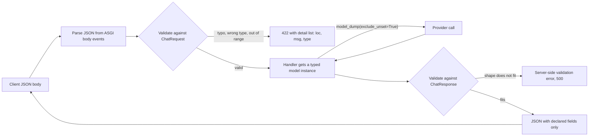

## TL;DR
FastAPI endpoints declare request and response bodies as Pydantic models. Bad input is rejected with a
422 naming the field, and output is filtered to declared fields, so bad prompts never cost money and
internal fields never leak.

## Why it exists
- **AI payloads are rich and nested.** Messages with roles, optional tool definitions, sampling
  parameters, tenant metadata in; rich output back. A raw dict needs a hand-written check per field: is
  `messages` a list, does each item have `role` and `content`, is `temperature` in the provider's range
  (0–2 for OpenAI-style APIs, 0–1 for Anthropic's), is `max_tokens` an integer.
- **Skipped checks fail late and expensively.** The provider rejects the call after a network round trip,
  or accepts a nonsense value and returns garbage, or a typo like `"temprature"` silently falls back to
  the default and nobody notices for a month.
- **Output leaks are worse.** Handlers return whatever dict they built, so a refactor that adds
  `raw_provider_response` or `cost_usd` to an internal object leaks straight to the customer.
- **Hand-rolled or external schemas drift.** Hand validation is unenforced, undocumented and
  inconsistent: three routes validate `messages` three ways, OpenAPI says nothing, clients learn by trial.
  A separate schema file enforces shape but lives outside the code and drifts.
- **Models put the contract next to the handler.** They are Python classes with types the IDE and mypy
  understand, and generate JSON Schema for OpenAPI automatically. Validation runs before the handler
  *because* it should only see valid data, and after it *because* the output contract must hold on every
  code path.

## How it works
### Inbound: body → model → handler
1. **Pick sources at registration.** FastAPI decides each parameter's source once, when the route is
   registered:
   - a name in the path template is a path parameter;
   - a `BaseModel` annotation is the body;
   - other plain scalars are query parameters;
   - `Header()`, `Cookie()`, `Body()` override the default.
2. **Parse at request time.** It reads the ASGI body events, parses JSON and validates it against the model.
3. **Coerce and check.**
   - `"0.7"` becomes `0.7` for a `float` field under Pydantic's default lax mode;
   - missing required fields and wrong types produce errors;
   - `Field(ge=0, le=2)` enforces ranges; `Literal["user", "assistant", "system"]` restricts enumerations;
   - `max_length` bounds lists and strings;
   - `@field_validator` / `@model_validator` express cross-field rules such as "either `prompt` or
     `messages`, not both".
4. **On failure:** FastAPI raises `RequestValidationError` and returns HTTP 422 with a `detail` list.
   Each entry has `loc` (the path to the field, such as `["body", "messages", 1, "role"]`), `msg` and
   `type`, so clients fix the exact field without reading server logs.
5. **On success:** the handler receives a typed model instance, not a dict.

### Body nesting
| Declaration | Expected JSON |
|---|---|
| a single body model | the JSON object *is* the model: `{"messages": [...]}` |
| two body models, or `Body(embed=True)` | each nested under its parameter name |

Getting this wrong is a classic source of 422s for clients that send the right fields at the wrong
nesting level.

### Extra fields
- **Ignored by default.** For AI parameters that is dangerous: a misspelt `max_tokens` silently disappears.
- **Fix:** request models usually set `model_config = ConfigDict(extra="forbid")`, turning typos into
  422s with an `extra_forbidden` error.

### Outbound: return value → response model → JSON
- **Declared via** `response_model=` or the return annotation.
- **Validated and serialised through it:** only declared fields are emitted, and alias and `exclude_none`
  options apply.
- **Wrong shapes fail on the server.** A return value that does not fit raises a server-side validation
  error instead of shipping a wrong shape.
- **It is what OpenAPI shows clients.** The `response_model` lesson covers the options; this one is about
  designing the pair.

### Design rules that matter for AI APIs
- **Separate models per direction.** `ChatRequest` and `ChatResponse` evolve independently; sharing one
  class forces every field to be optional and leaks internals. Internal objects (provider payloads, DB
  rows) get their own models that never reach a route signature.
- **Discriminated unions for message content.** A `content` that is text or a list of parts (text, image
  URL, tool result) is a `Union` with `Field(discriminator="type")`, so validation picks the branch from
  `type` and errors point at the right branch instead of listing all of them.
- **Bound everything that costs money.** `max_tokens: int = Field(default=1024, ge=1, le=8192)`,
  `messages: list[Message] = Field(min_length=1, max_length=200)`, and a model validator capping total
  characters, so prompt-size limits are enforced at the contract, not discovered as provider errors or
  surprise bills.
- **Forward only what the client set.** Build the provider payload with
  `req.model_dump(exclude_unset=True)` (plus your own fixed fields), so an omitted parameter falls back to
  the provider's default, not your model's. Pydantic tracks which fields were explicitly provided, which
  makes this exact.
- **Version by model, not by flag.** A breaking change gets a new request model on a new route; additive
  optional fields with defaults are backward compatible.
- **Strict where coercion would hide bugs.** Strict mode (`ConfigDict(strict=True)` or `Strict*` types)
  stops `"1"` being accepted as `1` when a client sending strings is itself the bug.

### Why validation lives in the framework, not the handler
- **Dependencies see validated data too**, such as a token-budget check or a tenant quota, because
  validation runs before the handler.
- **No code path can forget response validation**, because the framework runs it.
- **It is cheap.** Pydantic's validation core is compiled, so typical chat payloads validate in well
  under a millisecond, negligible next to a model call.

## Diagram
Validation brackets the handler on both sides: bad input becomes a 422 before any provider money is
spent, and the response model filters what the handler returns before it reaches the client.



## Examples
### Chat endpoint with a strict, bounded contract
A forbidding request model, bounded sampling parameters, a discriminated content union, a cross-field
rule and a separate response model that exposes usage but not cost. Sending
`{"messages": [{"role": "user", "content": "hi"}], "temprature": 0.1}` returns a 422 whose `loc` is
`["body", "temprature"]` and whose `type` is `extra_forbidden`.

```python
from typing import Annotated, Literal, Union
from fastapi import FastAPI
from pydantic import BaseModel, ConfigDict, Field, model_validator

class TextPart(BaseModel):
    type: Literal["text"]
    text: str = Field(max_length=50_000)

class ImagePart(BaseModel):
    type: Literal["image_url"]
    url: str

Part = Annotated[Union[TextPart, ImagePart], Field(discriminator="type")]

class Message(BaseModel):
    model_config = ConfigDict(extra="forbid")
    role: Literal["system", "user", "assistant"]
    content: Union[str, list[Part]]

class ChatRequest(BaseModel):
    model_config = ConfigDict(extra="forbid")          # "temprature" -> 422, not silently ignored
    messages: list[Message] = Field(min_length=1, max_length=200)
    temperature: float = Field(default=0.7, ge=0, le=2)    # range is provider-specific
    max_tokens: int = Field(default=1024, ge=1, le=8192)
    stream: bool = False

    @model_validator(mode="after")
    def first_message_not_assistant(self):
        if self.messages[0].role == "assistant":
            raise ValueError("conversation must start with a system or user message")
        return self

class Usage(BaseModel):
    prompt_tokens: int
    completion_tokens: int

class ChatResponse(BaseModel):
    id: str
    content: str
    usage: Usage                                         # cost_usd and provider payload stay internal

app = FastAPI()

@app.post("/v1/chat", response_model=ChatResponse)
async def chat(req: ChatRequest) -> ChatResponse:
    # ... call the model here; stubbed ...
    return ChatResponse(id="msg_1", content="hi", usage=Usage(prompt_tokens=12, completion_tokens=1))
```

### Runnable: what the 422 is made of, and forwarding only set fields
Pydantic only, no server. The errors FastAPI turns into a 422 `detail` list come from
`ValidationError.errors()`; FastAPI prefixes each `loc` with `"body"`.

```python
from pydantic import BaseModel, ConfigDict, Field, ValidationError

class Params(BaseModel):
    model_config = ConfigDict(extra="forbid")
    temperature: float = Field(default=0.7, ge=0, le=2)
    max_tokens: int = Field(default=1024, ge=1, le=8192)
    top_p: float | None = Field(default=None, ge=0, le=1)

# 1. What a 422 is built from: one entry per bad field, with its path.
try:
    Params.model_validate({"temprature": 0.1, "max_tokens": 100_000})
except ValidationError as e:
    for err in e.errors():
        print(err["loc"], err["type"])
# ('max_tokens',) less_than_equal
# ('temprature',) extra_forbidden

# 2. Lax mode coerces a numeric string; the result is a float.
print(Params.model_validate({"temperature": "0.2"}).temperature)    # 0.2

# 3. Forward only what the client set, so provider defaults apply to the rest.
p = Params.model_validate({"top_p": 0.9})
print(p.model_dump())                     # {'temperature': 0.7, 'max_tokens': 1024, 'top_p': 0.9}
print(p.model_dump(exclude_unset=True))   # {'top_p': 0.9}
```

## Production patterns
- **Forbid extras on every request model.** Use on anything that controls model behaviour or cost: put
  `ConfigDict(extra="forbid")` on a shared base class your request models inherit. Monitor the 422 rate
  by `loc` and `type`; a spike after a client release points at a schema mismatch.
- **Log 422s without hiding them.** Use when client teams integrate against you: register a
  `RequestValidationError` handler that logs `exc.errors()` with the route and client ID, then delegates
  to `fastapi.exception_handlers.request_validation_exception_handler` so clients still get the standard
  `detail` list. Monitor top failing fields per client.
- **Snapshot the OpenAPI schema in CI.** Use for any public API: dump `app.openapi()` to a committed file
  and fail the build on an unreviewed diff. Breaking changes (removed fields, tightened bounds) then show
  up in review rather than in client errors.
- **Build responses from internal objects explicitly.** Use when handlers work with ORM rows or provider
  payloads: convert with `ChatResponse.model_validate(obj, from_attributes=True)` or construct the response
  field by field. Add a contract test asserting internal keys (`cost_usd`, `system_prompt`) are absent.
- **Forward with `exclude_unset`.** Use in provider proxies: send `req.model_dump(exclude_unset=True)`
  merged with your fixed fields, so client-omitted parameters keep provider defaults. Monitor
  per-parameter usage to decide which provider features to expose next.

## Trade-offs
- **Strict contracts vs pass-through speed.** They catch client errors early and document themselves, but
  every provider feature you pass through needs a model change; the trade flips toward a permissive
  pass-through field when you proxy a fast-moving provider API.
- **`extra="forbid"` vs additive client changes.** Typos become 422s, protecting money and correctness,
  but additive client changes fail against older servers; relax it only on fields explicitly designed as
  open bags.
- **Validation CPU vs safety.** Validating every request and response costs CPU on the loop; negligible
  for chat payloads, it flips to noticeable for responses carrying thousands of embedding vectors, where
  returning a raw `Response` can be justified.
- **More classes vs coupling.** Separate request, response and internal models triple the class count,
  but a single shared model couples the API to storage and leaks fields the moment someone adds one.

## Pitfalls
- **Leaving `extra` at its default.** Relying on clients to spell parameters correctly. Symptom: a
  parameter "has no effect" for weeks because it never reached the provider.
- **One model for the DB row, the request and the response.** Symptom: a new internal column
  (`cost_usd`, `system_prompt`) appears in API output after an unrelated change.
- **Returning the provider's raw response dict.** Symptom: your API's shape changes when the provider's
  does, and provider metadata reaches customers.
- **Unbounded `max_tokens` and message lists.** Symptom: a single request produces an outsized provider
  bill or a timeout, and the 422 that should have stopped it never fires.
- **Catching `RequestValidationError` and returning a generic "bad request".** Symptom: client teams
  cannot tell which field was wrong, and support tickets replace self-service fixes.

## When to use
- **Always:** every JSON endpoint gets a request model and a response model; the question is how strict
  and how many.
- **Use `extra="forbid"` and ranged `Field`s** for anything that controls model behaviour or cost.
- **Use discriminated unions** when a field can take several shapes.
- **Split input, output and internal models from day one**, because splitting them later is a breaking
  change.
- **Measure:** the 422 rate per field as a product metric; a spike after a client release points at a
  schema mismatch.
- **Interviews:** design the chat request model out loud, including bounds and the 422 payload, and
  explain why the response model is not the same class.

## Role lens
- **Engineer:** Writes the models with bounds and validators, keeps internal and external models apart,
  and reads 422 `loc` paths to debug client integrations quickly.
- **Architect:** Treats request and response models as the public API contract, owning its versioning
  policy and which provider features are exposed or hidden.
- **FDE:** Maps a customer's existing message format onto the request model with a discriminated union
  or an adapter, and uses the 422 output to speed up their integration.

## Check yourself
**Q:** Your chat endpoint proxies to a hosted model. A customer complains that setting `"top_p": 0.1`
changes nothing, and separately a security review finds the `system_prompt` your service injects
appears in API responses. Diagnose both using request and response models.
**A:** The `top_p` symptom means the request model does not declare the field and allows extra fields
by default, so Pydantic discards it silently and the provider never sees it; either add
`top_p: float | None = Field(default=None, ge=0, le=1)` (optional, so existing clients keep
working) and forward it when set, or set `extra="forbid"` so unknown fields return a
422 that tells the customer the parameter is unsupported. The leak means the response model is either
missing or the same class as the internal object that carries the injected prompt; define a dedicated
`ChatResponse` with only the public fields and declare it on the route, so FastAPI filters the output
and OpenAPI documents exactly what clients receive. Add a contract test asserting `system_prompt` is
absent from the serialised response.

## Interview questions
### Why validate requests with Pydantic models instead of checking a dict in the handler?
- **One declared contract.** The model sits next to the handler, is understood by the IDE and mypy, and
  generates the JSON Schema that OpenAPI shows clients, so it cannot drift like hand checks or a separate
  schema file.
- **Bad input fails before it costs money.** Ranges, enumerations and lengths are enforced before the
  provider call, and the 422 `detail` names the exact field through `loc`.
- **Dependencies see validated data too**, and validation is cheap: well under a millisecond for typical
  chat payloads.

### Design the request model for a chat endpoint that proxies a hosted LLM. What do you bound and why?
- **Messages:** `list[Message]` with `min_length=1, max_length=200`, roles as
  `Literal["system", "user", "assistant"]`, and content as a discriminated union of text and image parts.
- **Sampling and cost:** `temperature` with `ge`/`le` matching the provider's range,
  `max_tokens: int = Field(default=1024, ge=1, le=8192)`, plus a model validator capping total
  characters.
- **Typos:** `ConfigDict(extra="forbid")` so a misspelt parameter is a 422, and forward with
  `model_dump(exclude_unset=True)` so omitted fields keep provider defaults.

### A client integration gets 422s even though it sends every required field. What would you check first?
- **Read `loc`.** If it points at the top-level field, the nesting is probably wrong: one body model
  expects the object itself, while two body models or `Body(embed=True)` nest each under its parameter
  name.
- **Then check strictness:** strict mode rejects `"1"` for an `int`, and `extra="forbid"` rejects any
  field the client sends that the model does not declare.
- **Then cross-field validators**, whose errors carry the model-level `loc` rather than one field.

### When would you relax `extra="forbid"` or skip response validation?
- **Relax extras** only on fields designed as open bags, such as a pass-through for a fast-moving provider
  API, because every new provider feature otherwise needs a model change.
- **Skip response validation** when responses carry thousands of embedding vectors and validation CPU on
  the loop becomes noticeable; returning a raw `Response` is then justified.
- **Keep both by default**, because typos protect money and the response allow-list protects internals.

### How do you evolve a public request model without breaking existing clients?
- **Additive and optional is safe:** new fields with defaults are backward compatible.
- **Breaking changes get a new model on a new route** instead of a flag inside the old model.
- **Catch accidents in CI** by snapshotting `app.openapi()` and failing the build on an unreviewed diff,
  and watch the 422 rate per `loc` after each client release.

## Quiz
### Q: A client sends `{"messages": [...], "temprature": 0.2}` to an endpoint whose request model does not set `extra`. What happens?
- [ ] A 422 lists `temprature` as an unknown field
- [x] The request succeeds and the misspelt field is silently dropped
- [ ] The value is assigned to `temperature` by fuzzy matching
- [ ] The handler receives it in a `model_extra` dict and must handle it
> Pydantic's default is to ignore extra fields, so the typo disappears; `ConfigDict(extra="forbid")`
> makes it a 422 with an `extra_forbidden` error pointing at the field.

### Q: Why should the response model be a different class from the request model and from internal objects?
- [ ] Pydantic cannot validate the same class in both directions
- [x] So output fields are an explicit allow-list and internal additions cannot leak to clients
- [ ] Because FastAPI requires unique class names per route
- [ ] To reduce JSON size by removing type information
> Response filtering only protects you if the response model lists exactly the public fields; reusing
> an internal class means every new internal attribute becomes public by default.

### Q: What does the `loc` entry `["body", "messages", 1, "role"]` in a 422 response tell the client?
- [ ] The request had one too many messages
- [ ] The second message is missing entirely
- [x] The `role` field of the second message (index 1) failed validation
- [ ] The body must be sent as form data, not JSON
> `loc` is the path from the request source down to the offending value, so clients can fix the precise
> field instead of guessing from a generic error message.
