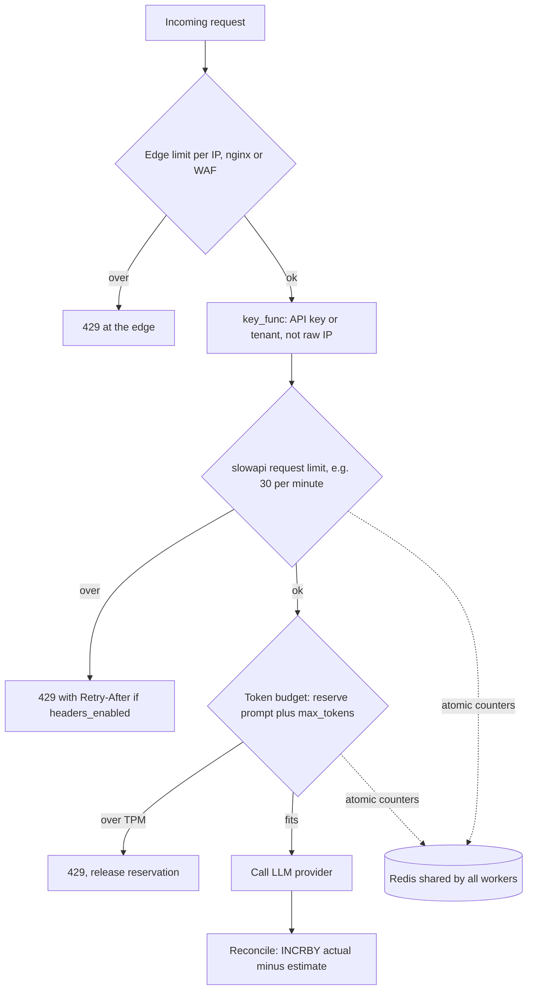

## TL;DR
One agent request fans out into many paid LLM and tool calls, so limits must cap runs and tokens per
caller, not just HTTP requests. slowapi gives FastAPI decorator limits like `"10/minute"` in memory or
Redis, returning 429; build token budgets beside it.

## For agent builders
- **Why it matters for agents.** A single `POST /runs` can trigger 10-30 model calls and as many tool
  calls, so "30 requests per minute" says nothing about spend. One looping agent can drain the shared
  provider quota for every tenant.
- **Where it shows up in your stack.** slowapi or a gateway in front of your agent API, a Redis-backed
  token budget per tenant, the provider's own RPM/TPM limits your agent hits mid-run, and third-party
  tool APIs with their own quotas.
- **What you control.** Admission per run (runs per minute and concurrent runs per tenant), a token budget
  reserved per model step, and how the loop reacts to an upstream 429: wait for `Retry-After` inside the
  run budget, or stop and report.
- **What you can skip.** Choosing between fine-grained window algorithms on day one; a fixed window for
  run admission plus a token budget covers most agent products.

## Lab
### Task
Cap both how many agent runs a customer starts and how many tokens those runs burn. You key slowapi's
admission limit by API key instead of IP, make its 429 carry `Retry-After`, and build the per-step
reserve-and-reconcile token budget so a long run pauses at the step that would overspend.
- **Time box:** 60-90 minutes.
- **Prerequisites:** API keys / OAuth2 / JWT, concurrency limits, and this lesson's "Limits for agent
  runs".
- **Runs offline:** in-memory storage (`memory://`) and a fake model whose prompt grows 2k tokens per
  step; an injectable clock replaces waiting a real minute.
- **Needs:** `fastapi`, `httpx`, `slowapi`, `pytest`; checked with slowapi 0.1.10 (limits 5.8.0) on
  FastAPI 0.115.6 and 0.161.1, Python 3.12.

### Starter code
```python
# limits_lab.py: run admission per API key (slowapi) plus a per-step token budget for an agent
import hashlib, time
from fastapi import FastAPI, Request, Response
from fastapi.testclient import TestClient
from slowapi import Limiter, _rate_limit_exceeded_handler
from slowapi.errors import RateLimitExceeded
from slowapi.util import get_remote_address

TENANT_TPM = 40_000           # tokens per minute per tenant
MAX_TOKENS = 1_024            # max_tokens per model step
MAX_STEPS = 12

def caller(request: Request) -> str:
    """Limiter key for this request."""
    # YOUR CODE: key by a hash of the X-API-Key header (fall back to the IP when it is absent)
    return get_remote_address(request)

class TokenBudget:
    """Fixed one-minute windows of reserved tokens per tenant (Redis INCRBY in production)."""
    def __init__(self, tpm: int, clock=time.time):
        self.tpm, self.clock, self.used = tpm, clock, {}
    def _key(self, tenant: str):
        return (tenant, int(self.clock() // 60))
    def reserve(self, tenant: str, est: int) -> bool:
        # YOUR CODE: add est to this window; if that exceeds tpm, release it and return False
        return True
    def reconcile(self, tenant: str, est: int, actual: int) -> None:
        # YOUR CODE: correct this window by (actual - est) once the provider reports usage
        pass

def fake_llm(step: int) -> dict:
    """A model step: the transcript grows ~2k tokens per step; replies use 500 fewer than reserved."""
    prompt = 6_000 + 2_000 * step
    return {"prompt_tokens": prompt, "usage": prompt + MAX_TOKENS - 500, "tool_calls": [{"name": "search"}]}

def run_agent(budget: TokenBudget, tenant: str) -> dict:
    for step in range(MAX_STEPS):
        est = 6_000 + 2_000 * step + MAX_TOKENS       # prompt so far plus max_tokens
        # YOUR CODE: reserve est before the call; return {"status": "paused", "step": step} if refused
        reply = fake_llm(step)
        # YOUR CODE: reconcile with reply["usage"]
    return {"status": "stopped", "reason": "step cap"}

def build_app(budget: TokenBudget | None = None) -> FastAPI:
    # YOUR CODE: make 429s carry Retry-After (slowapi only sends it when asked to)
    limiter = Limiter(key_func=caller, storage_uri="memory://")
    app = FastAPI()
    app.state.limiter = limiter
    app.add_exception_handler(RateLimitExceeded, _rate_limit_exceeded_handler)
    budget = budget or TokenBudget(TENANT_TPM)

    @app.post("/v1/agent/runs")
    @limiter.limit("3/minute")                        # runs, not model calls
    async def start_run(request: Request, response: Response):
        return run_agent(budget, caller(request))
    return app

if __name__ == "__main__":
    c = TestClient(build_app())
    codes = [c.post("/v1/agent/runs", headers={"X-API-Key": "sk_a"}).status_code for _ in range(4)]
    other = c.post("/v1/agent/runs", headers={"X-API-Key": "sk_b"})
    last = c.post("/v1/agent/runs", headers={"X-API-Key": "sk_a"})
    print("key A:", codes, "| key B:", other.status_code, "| Retry-After:", last.headers.get("retry-after"))
    print("run:", run_agent(TokenBudget(TENANT_TPM), "t_1"))
```

As given it prints `key B: 429 | Retry-After: None` (every test client shares one IP bucket) and
`run: {'status': 'stopped', 'reason': 'step cap'}`, because nothing counts tokens.

### Expected output
```
key A: [200, 200, 200, 429] | key B: 200 | Retry-After: 60
run: {'status': 'paused', 'step': 4}
```

`Retry-After` is the seconds until the window resets, so it can read 59 on a slow machine.

### Tests
```python
# test_limits_lab.py: run with `pytest -q`
from fastapi.testclient import TestClient
from limits_lab import TENANT_TPM, TokenBudget, build_app, run_agent

def post(c, key):
    return c.post("/v1/agent/runs", headers={"X-API-Key": key})

def test_admission_is_per_api_key():
    c = TestClient(build_app())
    assert [post(c, "sk_a").status_code for _ in range(4)] == [200, 200, 200, 429]
    assert post(c, "sk_b").status_code == 200          # another customer is unaffected

def test_429_tells_the_client_when_to_come_back():
    c = TestClient(build_app())
    for _ in range(3):
        post(c, "sk_a")
    r = post(c, "sk_a")
    assert r.status_code == 429 and int(r.headers["retry-after"]) > 0

def test_rejected_reservation_is_released():
    b = TokenBudget(40_000, clock=lambda: 0)
    assert b.reserve("t", 30_000) is True
    assert b.reserve("t", 15_000) is False
    assert b.reserve("t", 10_000) is True               # the 15k was not left behind

def test_window_resets_each_minute():
    now = [0.0]
    b = TokenBudget(40_000, clock=lambda: now[0])
    assert b.reserve("t", 40_000) and not b.reserve("t", 1)
    now[0] = 60.0
    assert b.reserve("t", 1)

def test_run_pauses_at_the_step_that_would_overspend():
    # reserved 7,024 + 9,024 + 11,024 + 13,024 = 40,096 > 40,000 without reconciling;
    # reconciling 500 tokens back per step lets step 3 fit, so the run pauses at step 4
    assert run_agent(TokenBudget(TENANT_TPM, clock=lambda: 0), "t_1") == {"status": "paused", "step": 4}
```

All five fail on the starter: shared IP bucket, no `Retry-After` header, and a budget that never says no.

### Failure scenarios
- **Inject a missing reconcile.** The run pauses at step 3 instead of 4: reservations of 7,024 +
  9,024 + 11,024 + 13,024 reach 40,096. Debug by logging reserved minus actual per step; a constant
  positive gap means estimates are never corrected.
- **Inject a missing release:** keep the rejected `est` in the window. `test_rejected_reservation` fails
  and later small steps are refused too. Print the window's total after each refusal.
- **Inject `headers_enabled=True` but drop `response: Response`** from the endpoint. Every call becomes
  a 500 with slowapi's "parameter `response` must be an instance of starlette.responses.Response".
- **Key on any header value:** send ten random `X-API-Key` values. All get 200, because each mints a
  fresh bucket. Count distinct limiter keys per minute; production keys on the validated principal.

### Submission
- **Your `limits_lab.py`** with `caller`, `TokenBudget` and the budgeted `run_agent` done.
- **A `pytest -q` run** showing 5 passed.
- **The script's printed output**, matching the expected lines.
- **A short note** on what changes with 4 uvicorn workers (move both counters to Redis, make
  reserve atomic) and how you would set tenant TPM so the sum fits the provider quota.
- **Evaluated on:** green tests, released rejections, reconciled usage, and admission keyed by credential.

## Why it exists
- **Upstream capacity is fixed.** The provider grants your organisation a requests-per-minute and
  tokens-per-minute quota, or your own GPUs decode only so many tokens per second.
- **Demand is not.** A retry loop with no backoff, a leaked API key, a batch job started at full speed,
  or a scraper on a free tier can each consume the whole budget. Without per-caller limits, the
  provider's 429s land on *everyone*, and the bill lands on you.
- **"Limit concurrency globally" isn't fair.** It protects the server, but one tenant fills every slot.
- **"Let the provider rate-limit us" limits in the wrong place.** The provider sees one organisation, not
  your hundred customers, so its throttling fails random users rather than the one causing the load.
- **What you need:** a limit *per caller identity*, enforced *before* the expensive call, shared across
  every worker, with an answer the client can act on (429 plus `Retry-After`) instead of a timeout.

## How it works
### What slowapi does
slowapi is a FastAPI/Starlette port of Flask-Limiter. It wraps the `limits` library, which does the
counting, and adds FastAPI glue.

1. **Create** a `Limiter(key_func=..., storage_uri=..., strategy=...)` and put it on `app.state.limiter`.
2. **Register** a handler for `RateLimitExceeded`; the handler turns it into a 429.
3. **Decorate** routes with `@limiter.limit("20/minute")`. A decorated endpoint must accept a
   `request: Request` parameter, because slowapi reads the key from it.
4. **Optional defaults:** set default limits for every route on the `Limiter` and apply them through
   `SlowAPIMiddleware`.

Per request, slowapi computes `key_func(request)`, builds a counter key from the key, the route and the
limit, increments it in storage, and raises `RateLimitExceeded` when the count is over the limit.

### The key function decides fairness
- **The default `get_remote_address` uses the socket peer's IP.** Behind a load balancer that is the
  balancer's IP, so every user shares one bucket, unless uvicorn trusts the balancer.
- **Uvicorn's `--proxy-headers` is on by default**, but it rewrites the client address from
  `X-Forwarded-For` only when the connection comes from an address in `--forwarded-allow-ips`, which
  defaults to 127.0.0.1.
- **Set it to the balancer's range**, never `*` on a port the internet can reach directly, or anyone can
  forge the header.
- **For an authenticated AI API, key by API key or tenant instead.** IPs are shared by whole offices
  (NAT) and rotated by attackers.

### Storage decides correctness
- **The default in-memory storage is per process.** With four uvicorn workers each keeps its own
  counters, so the effective limit is four times what you wrote, and it resets on deploy.
- **Use `storage_uri= "redis://..."`** so every worker and replica increments the same counter. `limits`
  relies on Redis's atomic operations, so concurrent increments don't race.

### Algorithms (strategy)
| Strategy | How it counts | Cost | Weakness |
|---|---|---|---|
| **Fixed window** (default) | one counter per calendar window | cheap: one key, one increment | full limit at 12:00:59 and again at 12:01:00: up to 2x the limit in a two-second burst |
| **Moving window** | a timestamp per hit, counted over the trailing window | memory and work grow with the limit | none on accuracy: it is exact |
| **Sliding-window counter** (recent `limits` versions) | two fixed-window counters weighted by overlap | two counters | assumes last window's hits were spread evenly; nearly exact |
| **Token bucket / GCRA** (often in gateways) | bucket of capacity *b* refilling at rate *r* | one value per key | each check is a read-modify-write, so it must be atomic in shared storage |

```
sliding window:  count ≈ previous × (1 − elapsed / window) + current
token bucket:    tokens = min(b, tokens + r × Δt)   on each arrival; admit if cost fits
```

- **Sliding-window worked number:** twenty seconds into a minute, with 90 hits last minute and 30 so
  far, the estimate is 90 × 2/3 + 30 = 90.
- **Token bucket suits chat traffic:** it allows bursts up to *b* and a sustained rate of *r*, and the
  cost can be a token estimate rather than 1, which makes it a natural fit for TPM.
- **GCRA** is the same policy stored as a single "theoretical arrival time" per key instead of a count.

### Telling the client when to come back
- **A 429 is only useful if the client knows how long to wait.**
- **Headers are opt-in.** slowapi emits `Retry-After` and the `X-RateLimit-Limit / -Remaining / -Reset`
  headers only when the limiter is created with `headers_enabled=True`. Without it, even the default 429
  handler sends no `Retry-After`, and SDKs fall back to their own guesses.
- **Dict-returning endpoints need `response: Response`.** With headers enabled, a decorated endpoint
  that returns a plain dict must accept that parameter so slowapi has somewhere to inject them.

### When the counter store fails
Every limited request now depends on Redis. If Redis is unreachable you must choose:

| Choice | Effect |
|---|---|
| Fail closed | reject everything: an outage caused by your limiter |
| Fail open | serve unlimited, exposing spend |
| Per-process fallback | limits get looser by the worker count, but never disappear |

slowapi exposes this as options (`swallow_errors`, and an in-memory fallback that keeps per-process
limits while Redis is down). For a paid LLM route, per-process fallback is usually the right middle.

### Requests are not tokens
- **"60 requests/minute" treats unequal requests the same.** A 50-token classification and a 100k-token
  document summary count alike, but the second costs 2,000 times as much.
- **Providers limit both RPM and TPM, so you should too.**
- **Reserve, then reconcile.** *Reserve* an estimate before calling (prompt tokens counted with the
  tokenizer plus `max_tokens`), reject if it exceeds the remaining budget, then *reconcile* with the
  actual usage the provider returns.
- **Build it as a dependency.** slowapi's decorator runs before the handler and doesn't know the cost, so
  token budgets are usually a small custom dependency on the same Redis.

### Limits for agent runs
An agent route is one HTTP request that becomes many upstream calls, so limits live at three levels:

| Level | What to limit | Where it runs |
|---|---|---|
| **Run admission** | runs started per minute, concurrent runs per tenant | slowapi on `POST /runs`, or a Redis counter |
| **Per model step** | tokens reserved before each LLM call against the tenant's TPM | a budget check inside the loop, same Redis |
| **Per tool** | calls to a third-party API that has its own quota | a bucket per tool key inside the tool executor |

- **Check the budget at every step, not only at admission.** A run admitted with budget left can still
  spend 200k tokens over 20 steps; the in-loop check stops it at the step that would overspend.
- **Upstream 429s are expected mid-run.** Honour the provider's `Retry-After` if it fits the remaining run
  deadline; otherwise end the step with an error the model or the user can see, instead of a tight retry.
- **A rejected tool call is an observation.** Return "rate limited, retry after 20 s" as the tool result
  so the model can pick another tool or answer, rather than crashing the run.

### Alternatives
- **Edge limits** (nginx `limit_req`, Envoy, an API gateway, a cloud WAF) run before Python and are
  cheaper per rejected request, but rarely know tenant or token cost.
- **`fastapi-limiter`** offers a dependency-style alternative, so limits sit next to your other `Depends`.
- **Common combination:** a coarse edge limit (IP, DDoS) plus slowapi or custom limits per tenant in the app.

## Diagram
Where each limit sits on an LLM request (for an agent, the token check repeats at every model step):
cheap coarse checks first, then per-caller request and token budgets in shared Redis, all before the
paid upstream call.

This is the intended order; with the decorator in the example below, the token dependency actually runs
first (see the ordering detail).



## Examples
### Per-key request limits plus a tokens-per-minute budget
Per-API-key request limits with slowapi, plus a token-per-minute budget as a dependency.

```python
import hashlib, time
from fastapi import Depends, FastAPI, HTTPException, Request, Response
from slowapi import Limiter, _rate_limit_exceeded_handler
from slowapi.errors import RateLimitExceeded
from slowapi.middleware import SlowAPIMiddleware
from slowapi.util import get_remote_address
import redis.asyncio as redis

def caller(request: Request) -> str:            # key by credential, not IP
    # production: key on the *validated* principal; a raw header lets random keys mint new buckets
    key = request.headers.get("x-api-key")
    return hashlib.sha256(key.encode()).hexdigest()[:16] if key else get_remote_address(request)

limiter = Limiter(key_func=caller, storage_uri="redis://redis:6379",
                  default_limits=["600/hour"], headers_enabled=True)   # emit Retry-After
app = FastAPI()
app.state.limiter = limiter
app.add_exception_handler(RateLimitExceeded, _rate_limit_exceeded_handler)
app.add_middleware(SlowAPIMiddleware)            # applies default_limits
r = redis.Redis(host="redis")
TPM = 40_000                                      # tokens per minute per caller

async def token_budget(request: Request) -> int:
    body = await request.json()                   # cached; the endpoint still parses it
    est = len(str(body.get("messages", ""))) // 4 + body.get("max_tokens", 512)  # rough estimate
    key = f"tpm:{caller(request)}:{int(time.time() // 60)}"
    used = await r.incrby(key, est)
    await r.expire(key, 120)
    if used > TPM:
        await r.decrby(key, est)                  # release the rejected reservation
        raise HTTPException(429, "token budget exceeded",
                            headers={"Retry-After": str(60 - int(time.time()) % 60)})
    return est

@app.post("/v1/chat")
@limiter.limit("30/minute")
async def chat(request: Request, response: Response, body: dict,
               est: int = Depends(token_budget)):
    # after the call: await r.incrby(key, actual_tokens - est) to reconcile
    return {"reply": "..."}
```

| Caller | Traffic in one minute window | Outcome |
|---|---|---|
| A | 30 short requests, about 600 tokens each (18k total) | request 31 gets slowapi's 429 |
| B | 3 requests, each estimated at about 15k tokens (document plus `max_tokens`) | the third pushes the reservation to about 45k, over 40k: 429 with `Retry-After`, and its 15k is released |

- **The request limit alone would have let caller B through.**
- **Ordering detail:** FastAPI resolves `Depends` before it calls the endpoint, and slowapi's decorator
  checks inside the endpoint wrapper, so request 31 has already reserved its tokens when slowapi rejects
  it. Stash the reservation on `request.state` and release it in the `RateLimitExceeded` handler, or run
  both checks as dependencies in a fixed order.

### Agent run: admission limit plus a per-step token budget
Run admission uses slowapi; every model step inside the loop reserves tokens on the same Redis. `llm`
and `estimate_tokens` are your own functions; `r` and `caller` are from the example above.

```python
TENANT_TPM = 200_000

async def reserve(tenant: str, est: int) -> bool:
    key = f"tpm:{tenant}:{int(time.time() // 60)}"
    used = await r.incrby(key, est)
    await r.expire(key, 120)
    if used > TENANT_TPM:
        await r.decrby(key, est)                       # release: this step will not run
        return False
    return True

@app.post("/v1/agent/runs")
@limiter.limit("5/minute")                             # runs, not model calls
async def start_run(request: Request, response: Response, body: dict):
    tenant, messages = caller(request), body["messages"]
    for step in range(12):
        est = estimate_tokens(messages) + 1024         # prompt so far plus max_tokens for this step
        if not await reserve(tenant, est):
            return {"status": "paused", "reason": "token budget", "step": step}
        reply, usage = await llm(messages, max_tokens=1024)
        await r.incrby(f"tpm:{tenant}:{int(time.time() // 60)}", usage["total"] - est)  # reconcile
        messages.append(reply)
        if not reply.get("tool_calls"):
            return {"status": "done", "answer": reply["content"]}
        # ... run tools, append results ...
    return {"status": "stopped", "reason": "step cap"}
```

Illustrative numbers: the transcript grows, so each step reserves more than the last.

| Step | Prompt tokens | Reserved (prompt + 1,024) | Tenant total this minute |
|---|---|---|---|
| 1 | 6,000 | 7,024 | 7,024 |
| 5 | 14,000 | 15,024 | ~55k |
| 10 | 24,000 | 25,024 | ~160k |
| 12 | 28,000 | 29,024 | would reach ~216k: over 200k, reservation released, run paused |

Assumes ~2k tokens added per step, actual usage equal to each reservation (reconciling a shorter reply
lowers the total), and all steps within one minute window. Five runs per minute passed slowapi;
one run alone exhausted the tenant's minute of tokens.

### Token bucket with token cost (runnable, pure Python)
The same 40,000-tokens-per-minute budget as a bucket, so bursts are allowed and refill is continuous
instead of resetting on the minute.

```python
class TokenBucket:
    """Capacity b, refill r per second; cost can be LLM tokens instead of 1."""
    def __init__(self, b: float, r: float):
        self.b, self.r, self.tokens, self.t = b, r, b, 0.0

    def allow(self, now: float, cost: float = 1) -> bool:
        self.tokens = min(self.b, self.tokens + self.r * (now - self.t))   # refill since last arrival
        self.t = now
        if self.tokens >= cost:
            self.tokens -= cost
            return True
        return False

def sliding_estimate(prev: int, cur: int, elapsed: float, window: float = 60) -> float:
    return prev * (1 - elapsed / window) + cur

# A tenant gets 40,000 tokens per minute with bursts up to 40,000.
tpm = TokenBucket(b=40_000, r=40_000 / 60)
calls = [(0, 15_000), (1, 15_000), (2, 15_000), (20, 15_000)]   # (second, estimated tokens)
for t, cost in calls:
    print(t, cost, tpm.allow(t, cost), round(tpm.tokens))
# 0 15000 True 25000
# 1 15000 True 10667
# 2 15000 False 11333      third burst call rejected: only ~11k left
# 20 15000 True 8333       18 s of refill (~12k) let it through

print(sliding_estimate(prev=90, cur=30, elapsed=20))   # 90.0, the lesson's worked number
```

In production the bucket state lives in Redis and is updated atomically (a Lua script), for the same
reason counters do: every worker must see one value.

## Production patterns
- **Shared Redis counters from day one** — as soon as you run more than one worker. Set
  `storage_uri="redis://..."` on the `Limiter` and load-test with the real worker count. Monitor
  admitted requests per key per minute against the configured limit; a ratio near the worker count
  means storage is per process.
- **Key on the validated principal** — on every authenticated route. Make `key_func` read the tenant or
  key ID that your auth dependency stored on `request.state`, not a raw header, so random keys cannot
  mint fresh buckets. Monitor distinct limiter keys per minute; a spike signals key spraying.
- **Tiered limit strings** — when plans differ. Pass a callable to `@limiter.limit(...)` that returns the
  caller's tier string (slowapi accepts a callable limit value) such as `"30/minute"` for free and
  `"300/minute"` for paid. Monitor 429s per tier to tune plans.
- **Reserve-and-reconcile token budgets** — on every LLM route. Reserve `prompt_tokens + max_tokens`
  before the call, then `INCRBY` the difference using the provider's returned usage. Monitor estimate
  error (reserved minus actual), because a large bias rejects good traffic or overspends.
- **Tenant limits that sum under the upstream quota** — when many tenants share one provider org. Keep
  the sum of tenant TPM limits at or below the organisation's TPM, or add a global bucket checked after
  the tenant one. Monitor upstream provider 429s; they should be near zero if your limiter rejects first.
- **Run-level admission plus in-loop budgets for agents** — on every agent route. Limit runs started and
  concurrent runs per tenant at the route, and reserve tokens before each model step inside the loop, so
  a long run pauses at the step that would overspend. Monitor tokens per run (p50, p95) and runs paused by
  budget, alongside nginx `limit_req` or WAF rejects at the edge for per-IP floods.

## Trade-offs
- **In-memory vs Redis storage.** In-memory needs no infrastructure and adds no latency, but is only
  correct with a single process. With several workers or replicas Redis is required, adding a network
  round trip and a dependency whose outage you must decide to fail open or closed on.
- **Fixed vs moving or sliding windows.** Fixed windows are cheapest but allow boundary bursts of up to
  2x. Moving or sliding windows smooth this at more storage cost, which matters when your upstream quota
  is itself enforced tightly.
- **IP vs credential keys.** Keying by IP works for anonymous endpoints but punishes shared NATs and is
  easy to evade. Keying by API key or tenant is fair and harder to evade, but requires authentication to
  run first.
- **Pause vs fail a run over budget.** Pausing (return status and step, resume later) keeps the agent's
  work, but needs persisted run state and a resume path. Failing is simple but wastes every token already
  spent. Pausing wins once runs are long or expensive.
- **App vs edge limits.** App-level limits know tenant and token cost but spend Python cycles on each
  rejected request. Edge limits are cheaper under attack but coarser. Use both when abuse volume is high.

## Pitfalls
- **Multiple workers with in-memory storage.** Symptom: load tests show the limit exceeded by roughly the
  worker count, and limits reset at every deploy.
- **`get_remote_address` behind a proxy without proxy headers.** Symptom: all traffic shares one bucket,
  so legitimate users get 429s whenever anyone is busy.
- **No `request: Request` parameter on a decorated endpoint.** Symptom: an exception at startup or on the
  first call complaining that no request argument was found.
- **Limiting only requests on an LLM endpoint.** Symptom: a tenant within its RPM limit blows through the
  provider's TPM quota and causes upstream 429s for everyone.
- **429 without `Retry-After`, or CORS inside the limiter.** No header is slowapi's default unless
  `headers_enabled=True`. Symptom: clients retry instantly in a tight loop, or browsers report a CORS
  error instead of the 429.
- **Limiting agent runs only at the door.** Symptom: run admission rates look healthy while a few runs
  with 20+ steps consume most of the tenant's TPM. Fix: reserve tokens per model step inside the loop.
- **Tight retries on upstream 429 inside the loop.** Symptom: provider 429 counts spike with each incident
  and runs fail anyway. Fix: honour `Retry-After` within the run deadline, otherwise stop the step.
- **Tenant limits set independently of the upstream quota.** Symptom: every tenant is within its own
  limit while the provider still returns 429s at peak, because the limits sum to more than the
  organisation's TPM.

## When to use
- **Use when** an endpoint triggers paid or scarce work: chat, embeddings, document ingestion, agent runs.
  Put per-caller limits on every one.
- **Use slowapi for** quick, declarative request-rate limits inside a FastAPI app with Redis-backed
  counters and tier-based strings. Add a token or cost budget alongside it for LLM routes.
- **Reach elsewhere for** gateway limits against anonymous abuse and volumetric attacks, and concurrency
  limits when the scarce resource is in-flight work rather than rate.
- **Measure:** 429 counts per tenant, upstream provider 429s, and spend per key. A healthy setup shows
  your limiter rejecting before the provider does.
- **Interviews:** compare fixed window with token bucket and explain why RPM alone is insufficient for LLMs.

## Role lens
- **Engineer:** Wires slowapi with a Redis store and a credential-based key function, adds the token
  budget dependency, and returns 429 with `Retry-After` that the SDK honours.
- **Architect:** Sets the quota model (tiers, RPM and TPM per tenant, burst allowances), decides edge
  versus app enforcement, and keeps the sum of tenant limits within upstream quota.
- **FDE:** Tunes limits for a customer's batch backfill, for example a temporary higher tier or an
  off-peak window, so the migration doesn't trip limits or starve other tenants.

## Check yourself
**Q:** You set `@limiter.limit("100/minute")` and run 8 uvicorn workers behind an ALB. A customer
reports they can make about 800 requests per minute, while a different customer behind a corporate NAT
says they're throttled at low volume. Explain both and the fix.
**A:** Two independent bugs. First, storage is in memory, so each of the 8 worker processes counts
separately and a client spread across them gets up to 8x the limit. Pointing `storage_uri` at Redis
makes all workers share one atomic counter. Second, the key function is IP-based and either sees the
ALB's address (if proxy headers aren't trusted) or the NAT's single public IP, so many people share
one bucket. Key by API key or tenant, and if IPs are needed, put the ALB's range in uvicorn's
`--forwarded-allow-ips` (proxy headers are honoured by default, but only from trusted addresses). For LLM routes, add a tokens-per-minute budget.

## Interview questions
### Why rate-limit per caller in your own service instead of relying on the provider's 429s?
- **The provider sees one organisation**, not your hundred customers, so its throttling fails random users
  instead of the one causing the load.
- **Your limit runs before the paid call**, keyed by API key or tenant and shared across workers, and
  answers with a 429 plus `Retry-After` the client can act on.
- **Healthy sign:** your limiter rejects before the provider ever does.

### Compare fixed window, sliding window and token bucket. Which would you pick for a chat API?
- **Fixed window** is one counter per calendar window: cheap, but allows up to 2x the limit in a burst
  across the boundary.
- **Sliding-window counter** weights the previous window by overlap (`previous × (1 − elapsed / window) +
  current`), nearly exact for two counters.
- **Token bucket** allows bursts up to *b* and a sustained rate *r*, and its cost can be a token estimate,
  which makes it the natural fit for TPM on chat traffic.

### How would you rate-limit an agent API where one request makes a dozen model calls?
- **Limit runs, not just requests**: runs started per minute and concurrent runs per tenant at the route.
- **Reserve tokens per model step** inside the loop against the tenant's TPM, because the transcript grows
  and later steps cost more than early ones.
- **Treat upstream 429s as normal**: wait for `Retry-After` within the run deadline, otherwise pause the
  run or return an error the model or user can act on.

### How would you build a tokens-per-minute budget, given that you don't know the cost until the call finishes?
- **Reserve an estimate up front**: prompt tokens counted with the tokenizer plus `max_tokens`, and reject
  if it exceeds the remaining budget.
- **Reconcile afterwards** with the usage the provider returns, adding or releasing the difference.
- **Build it as a dependency on the same Redis**, because slowapi's decorator doesn't know the cost, and
  release the reservation when a later check rejects the request.

### Every tenant is under its own limit, yet the provider still returns 429s at peak. Why?
- **The tenant limits sum to more than the organisation's upstream TPM**, so all tenants can be within
  their limits at once while the shared quota is exhausted.
- **Fix:** keep the sum of tenant limits at or below the upstream quota, or add a global bucket checked
  after the tenant one.

## Quiz
### Q: Why can a fixed-window limit of 100/minute admit about 200 requests in two seconds?
- [ ] Redis increments are not atomic
- [x] The client can use the full allowance at the end of one window and again at the start of the next
- [ ] slowapi double-counts requests that fail
- [ ] Fixed windows reset every 30 seconds
> A fixed window counts per calendar minute, so 100 requests at 12:00:59 and 100 at 12:01:00 both
> pass. Moving or sliding windows count over the trailing interval and close this boundary burst.

### Q: A service runs four uvicorn workers with slowapi's default storage. What is the effective per-client limit?
- [ ] Exactly the configured limit
- [ ] A quarter of the configured limit
- [x] Up to four times the configured limit, since each process keeps its own counters
- [ ] Unlimited, because in-memory storage is disabled with multiple workers
> In-memory counters live per process. Requests spread across workers each see a fresh counter, so the
> limit multiplies. Shared Redis storage is needed for correct limits across workers and replicas.

### Q: Why is a request-per-minute limit alone weak protection for an LLM endpoint?
- [ ] Providers do not rate-limit by tokens
- [ ] Request counting is too slow to compute
- [x] Request cost varies by orders of magnitude with prompt and output length, so RPM does not bound spend or upstream TPM
- [ ] slowapi cannot return 429 for POST requests
> A long-document request can cost thousands of times a short one. Budgeting estimated and actual
> tokens per caller bounds both spend and provider quota, which a pure request count cannot do.

## Use cases & projects
### Use cases
- **Multi-tenant agent platforms.** Runs per minute and concurrent runs per tenant stop one customer's
  looping agent from draining the shared provider quota.
- **Spend control on paid models.** A Redis-backed token budget reserved per model step caps cost per
  tenant, which a request count alone cannot do.
- **Agents hitting upstream 429s.** The loop waits for `Retry-After` when it fits the run budget, and
  otherwise stops and reports, instead of hammering the provider.
- **Free tiers and public demos.** Per-key or per-IP limits with slowapi keep an open agent endpoint from
  being scripted into an unpaid compute pool.

### Mini project
**Admission plus token budgets for an agent API (2-3 hours).**
- **Goal:** cap both how many runs a tenant starts and how many tokens those runs consume.
- **Steps:** put a slowapi limit with Redis storage on `POST /runs`; add a per-tenant token bucket in
  Redis that reserves an estimate before each model step and settles the actual usage after; run a fake
  agent loop for two tenants, one of them aggressive.
- **Done when:** the aggressive tenant receives 429s with `Retry-After` or a budget-exhausted stop, the
  other tenant's runs are unaffected, and limits hold across several uvicorn workers.
