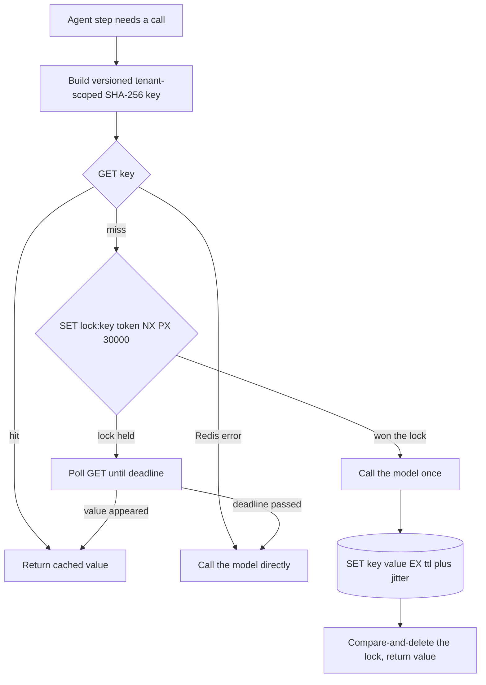

## TL;DR
Agents repeat expensive calls: the same embedding, retrieval or tool lookup across steps, retries and
users. A Redis cache keyed on a hash of everything that changes the answer, with a TTL, cuts agent
spend and step latency safely.

## For agent builders
- **Why it matters for agents.** One agent run makes many model, embedding and tool calls, and a retried
  or replayed run repeats most of them. A shared cache turns those repeats into millisecond reads, so a
  10-step loop costs less and finishes sooner.
- **Where it shows up in your stack.** A `redis.asyncio` client created in the FastAPI lifespan, wrapped
  around embedding calls in the RAG step, around pure tool functions (lookups, search, fetch) and, for
  temperature-0 subtasks such as routing or extraction, around the model call itself.
- **What you control.** The key (model, prompt version, tool schema, tenant, index version), the TTL per
  data class, stampede protection, eviction policy and the fail-open path when Redis is down.
- **What you can skip.** Redis internals and clustering. Know cache-aside, the key recipe, `SET NX` locks
  and `maxmemory` policies; that is enough to cache an agent backend safely.

## Why it exists
- **Model calls are slow and billed.** A hosted model, embedding API or reranker takes hundreds of
  milliseconds to tens of seconds and is billed per token, and a production FastAPI service runs several
  worker processes, often on several hosts, behind a load balancer.
- **Much of an agent's traffic repeats exactly.** The same FAQ question, the same document embedded on
  every re-index, the same classification prompt over the same ticket, the same tool lookup inside an
  agent loop that retries.
- **A module-level dict or `functools.lru_cache` fails three ways.** It is per process, so with eight
  workers the hit rate is split across eight cold caches and a deploy wipes all of them. It shares the
  app's heap, so an unbounded cache is a memory leak ending in an OOM kill. And `lru_cache` on an
  `async def` caches the coroutine object, not its result, so the second await fails.
- **The provider's prompt cache is a different thing.** It discounts the prefix of a prompt (the agent's
  system prompt and tool schemas), but you still pay for and wait on the generated output.
- **Redis solves sharing and bounding, not correctness.** One store all workers see, with per-key expiry,
  a memory ceiling, an eviction policy and sub-millisecond reads on a local network. Correctness is
  entirely about the key.

## How it works
### Cache-aside, step by step
1. **Build the key** from everything that determines the output: model ID, prompt template version, the
   rendered messages, sampling parameters, tool schema, and the tenant if data is tenant-scoped.
   Serialise canonically (sorted JSON keys, no whitespace variance) and hash with SHA-256, *because* raw
   prompts are long and keys should be bounded, and canonical serialisation makes semantically identical
   requests collide on purpose.
2. **Read** with `GET`. On a hit, deserialise and return. Record a hit metric.
3. **On a miss**, call the model or tool, then `SET key value EX ttl`. The TTL is the staleness contract:
   it bounds how long a wrong or outdated answer can survive, *because* nobody reliably remembers to
   invalidate model outputs when a prompt or a source document changes.
4. **Namespace and version** keys, for example `llm:v3:{tenant}:{sha}`. Bumping `v3` to `v4` when the
   prompt or model changes invalidates everything at once without a scan, *because* old keys simply stop
   being read and age out under TTL.

### Is it worth it? The arithmetic
With hit rate *h*, a Redis round trip *t_r* and a model call *t_m*, mean latency is roughly:

```
mean_latency ≈ h·t_r + (1 − h)·(t_r + t_m + t_r)
```

- **A miss pays three things:** the failed `GET`, the call and the `SET` (the `SET` can be fired without
  awaiting it).
- **Latency wins at almost any hit rate,** *because* *t_r* is around a millisecond on a local network and
  *t_m* is hundreds of milliseconds or more. In an agent the saving multiplies by steps per run.
- **Spend saving** is simply *h* × calls × price per call.
- **The real cost is memory:** `entries × (key + value + per-key overhead)`, and value encoding dominates.
- **Encoding matters.** A 1,536-dimension float32 embedding is 6,144 bytes as raw bytes, but several times
  larger as a JSON list of Python floats, so a cache sized for one encoding overflows with the other.
- **Measure *h* per namespace before growing memory.** A namespace with a 2% hit rate is mostly paying to
  store keys nobody reads.

### What is safe to cache in an agent
| Workload | Cache it? | Why |
|---|---|---|
| Embeddings (RAG ingest and query) | Yes | Same model and text give the same vector |
| Classification and extraction at temperature 0 | Yes | Near-deterministic |
| Retrieval results for a fixed index version | Yes | Key includes the index version |
| Tool lookups | Yes | Usually pure functions of their inputs |
| Tools with side effects (send, write, pay) | No | A hit would skip the action |
| Creative generation, temperature above 0 | Product decision | Every user gets the same "random" answer |

- **Temperature 0 is not bit-for-bit deterministic** on most hosted models, so a cache *imposes*
  consistency rather than preserving it, which is often what you want for agent routing and evals.

### Wiring it into FastAPI
- **One client, created in the lifespan.** Create one `redis.asyncio` client, store it on `app.state`,
  and hand it to endpoints and tool functions through a dependency.
- **The client owns a connection pool,** *because* opening a TCP connection per request is slower than
  the cache read it serves.
- **Use the asyncio client, not the sync one,** *because* a sync call inside `async def` blocks the event
  loop for every request on that worker, including every streaming agent session.

### Stampede protection
When a hot key expires, every concurrent request misses at once and all of them call the model: a cache
stampede that can multiply provider spend and trip rate limits. Defences, cheapest first:
1. **Jitter TTLs** with random extra seconds so keys do not expire together.
2. **Single-flight inside one worker:** an in-process map of key → pending future collapses concurrent
   misses, which removes most duplicates for free.
3. **A short lock across workers:** one request recomputes while others wait, using
   `SET lock:key token NX PX 30000`.
4. **Serve stale while one request refreshes.**

The lock needs three details to be correct, plus one rule that keeps it available:
- **`NX` makes the take atomic,** *because* check-then-set in two commands lets two workers both see "no
  lock".
- **The expiry** means a crashed holder cannot block forever.
- **Release is compare-and-delete:** delete the lock only if it still holds *your* random token (a small
  Lua script), *because* a holder slower than the lock's expiry would otherwise delete the next holder's
  lock and re-open the stampede.
- **Availability rule: losers poll, then fall through.** They poll `GET` for the value with a short sleep
  up to a deadline, then call the model themselves, *because* a lock that makes waiters fail when the
  holder dies trades a cost problem for an availability one.

### Memory and eviction
- **Set `maxmemory` and an eviction policy.**
- **Pure cache:** `allkeys-lru` (or `allkeys-lfu`) lets Redis drop cold keys when full.
- **Shared with state that must not vanish** (rate-limit counters, sessions, agent conversation memory):
  use `volatile-*` policies, which only evict keys that have a TTL, or better, a separate instance,
  *because* a cache filling up should never evict state that something else relies on.

### Failure mode
- **Redis is optional on the read path.** On a connection error or timeout, log, count, and fall through
  to the model or tool. A cache outage should cost money and latency, not agent availability.

## Diagram
Follow one agent step's call through cache-aside: a hit returns in about a millisecond, a miss takes the
lock (or waits for the holder), calls the model and stores with a jittered TTL, and a Redis error falls
through.



## Examples
### Cache-aside wrapper for an embedding call
The RAG step of an agent embeds queries and chunks. A canonical key, TTL jitter and fail-open reads.
`embed_remote` stands in for the real provider call.

```python
import hashlib, json, random
import redis.asyncio as redis
from redis.exceptions import RedisError
from fastapi import Depends, FastAPI, Request
from contextlib import asynccontextmanager

@asynccontextmanager
async def lifespan(app: FastAPI):
    app.state.redis = redis.from_url("redis://localhost:6379/0", socket_timeout=0.2)
    yield
    await app.state.redis.aclose()          # close() on older redis-py releases

app = FastAPI(lifespan=lifespan)

def get_redis(request: Request) -> redis.Redis:
    return request.app.state.redis

def cache_key(model: str, text: str, tenant: str) -> str:
    payload = json.dumps({"m": model, "t": text}, sort_keys=True, separators=(",", ":"))
    return f"emb:v2:{tenant}:{hashlib.sha256(payload.encode()).hexdigest()}"

async def embed_cached(r: redis.Redis, model: str, text: str, tenant: str) -> list[float]:
    key = cache_key(model, text, tenant)
    try:
        if (hit := await r.get(key)) is not None:
            return json.loads(hit)
    except RedisError:
        pass                                   # fail open: cache down means slower, not broken
    vec = await embed_remote(model, text)      # the expensive call
    ttl = 7 * 86400 + random.randint(0, 3600)  # jitter spreads expiries
    try:
        await r.set(key, json.dumps(vec), ex=ttl)
    except RedisError:
        pass
    return vec

@app.post("/embed")   # in production take tenant from auth, never from the request body
async def embed(body: dict, r: redis.Redis = Depends(get_redis)):
    return {"vector": await embed_cached(r, "text-embedding-x", body["text"], body["tenant"])}
```

- **Re-index saving:** re-indexing 100,000 chunks where 90% are unchanged now pays for roughly 10,000
  embedding calls instead of 100,000.
- **Provided** the unchanged chunks' entries are still within their seven-day TTL and have not been
  evicted; the exact saving depends on how much content really changes and how often you re-index.

### Stampede lock with a safe release
One worker recomputes a hot key; the others poll briefly, then fall through. The release only deletes a
lock that still holds this worker's token. The same helper wraps a slow, popular agent tool.

```python
import asyncio, secrets

RELEASE = """
if redis.call('get', KEYS[1]) == ARGV[1] then
  return redis.call('del', KEYS[1])
end
return 0
"""

async def get_or_compute(r, key: str, compute, ttl: int, wait_s: float = 5.0):
    if (hit := await r.get(key)) is not None:
        return hit
    token = secrets.token_hex(16)
    if await r.set(f"lock:{key}", token, nx=True, px=30000):   # atomic take with expiry
        try:
            value = await compute()
            await r.set(key, value, ex=ttl)
            return value
        finally:
            await r.eval(RELEASE, 1, f"lock:{key}", token)      # compare-and-delete
    deadline = asyncio.get_running_loop().time() + wait_s
    while asyncio.get_running_loop().time() < deadline:        # losers poll for the value
        await asyncio.sleep(0.05)
        if (hit := await r.get(key)) is not None:
            return hit
    return await compute()                                     # holder died or is slow: fall through
```

- **Values are strings or bytes.** `compute()` must return something Redis can store, and a hit comes
  back as bytes unless the client was built with `decode_responses=True`, so serialise and decode
  consistently on both paths.
- **Redis errors are not caught here,** to keep the lock logic readable; in production wrap these calls
  fail-open as in the first example.

### Caching a read-only agent tool
Only pure, read-only tools are cached; the key carries the tool name, its schema version and the tenant.
For a retrieval tool such as `search_docs`, also put the index version in `args` (or the prefix), so a
re-index changes the key. Like the lock example, it omits the fail-open `try` for brevity.

```python
import hashlib, json

CACHEABLE = {"search_docs": 3600, "get_product": 600}   # tool name -> TTL in seconds

def tool_key(tenant: str, name: str, schema_v: int, args: dict) -> str:
    blob = json.dumps({"n": name, "v": schema_v, "a": args}, sort_keys=True, separators=(",", ":"))
    return f"tool:v1:{tenant}:{hashlib.sha256(blob.encode()).hexdigest()}"

async def run_tool(r, tenant: str, name: str, schema_v: int, args: dict, impl):
    if name not in CACHEABLE:                 # send_email, create_ticket: never cached
        return await impl(**args)
    key = tool_key(tenant, name, schema_v, args)
    hit = await r.get(key)
    if hit is not None:
        return json.loads(hit)
    result = await impl(**args)
    if not result.get("error"):               # never cache failures
        await r.set(key, json.dumps(result), ex=CACHEABLE[name])
    return result
```

### Worked numbers: is the cache worth it?
Illustrative inputs: *t_r* = 1 ms, *t_m* = 800 ms, 1,000,000 calls a month.

| Hit rate *h* | Mean latency | Model calls paid |
|---|---|---|
| 0 (no cache) | 800 ms | 1,000,000 |
| 0.3 | 0.3·1 + 0.7·802 ≈ 562 ms | 700,000 |
| 0.6 | 0.6·1 + 0.4·802 ≈ 321 ms | 400,000 |

- **The miss penalty is ~2 ms** on an 800 ms call, which is why even modest hit rates pay off.
- **Per agent run** the same arithmetic applies to each step: a run with 10 cacheable calls at a 0.6 hit
  rate saves about 6 × 800 ms ≈ 4.8 s of serial waiting (illustrative, assuming the calls are sequential).

## Production patterns
- **Versioned namespaces per data class.** When prompts, models, tool schemas or indexes change, keep the
  version in the key prefix (`llm:v3:{tenant}:{sha}`) and bump it in the same deploy as the change.
  Monitor the hit rate of the new namespace climbing back up after a bump.
- **Fail-open client with tight timeouts.** Give the client short read and connect timeouts
  (`socket_timeout=0.2` as in the example, plus `socket_connect_timeout`, a separate setting that falls
  back to `socket_timeout` when unset in redis-py, so set it explicitly) and catch `RedisError`, so a slow
  or unreachable Redis degrades to a miss. Monitor cache error counts and p99 cache latency alongside agent step latency.
- **Dedicated cache instance with an LRU policy.** When the cache would share Redis with sessions, agent
  memory or rate limits, give it its own instance with `maxmemory` set and `maxmemory-policy allkeys-lru`.
  Monitor `evicted_keys` and `used_memory` from `INFO`.
- **Hit-rate metrics per namespace.** Count hits and misses in the app, labelled by namespace (embeddings,
  retrieval, each tool), rather than relying only on Redis's global `keyspace_hits` and `keyspace_misses`.
  Drop or shorten TTLs for namespaces stuck near a 2% hit rate.
- **Never cache failures or side effects.** Store only successful, complete responses (check the finish
  reason or status before `SET`), so a transient provider or tool error is not replayed for the full TTL,
  and keep an allow-list of read-only tools. Monitor cached-value size outliers, which often reveal
  truncated outputs.
- **Pin eval runs with the cache.** Agent teams often run regression evals with model calls cached, so
  reruns after a non-model change are cheap and deterministic, then bump the namespace to force fresh calls
  when the model or prompt changes.

## Trade-offs
- **Shared cache vs in-process LRU.** Redis raises hit rate across all workers and survives deploys, but
  adds a network hop and a dependency; for tiny, process-local, rarely-changing data an in-process LRU
  is faster and simpler.
- **Long vs short TTLs.** Long TTLs maximise savings and stability but extend how long a stale or wrong
  answer is served; short TTLs flip the balance when sources, prompts or tool backends change often.
- **Exact-match vs semantic keys.** Exact-match keys are always correct when the key is complete, but
  miss paraphrases; semantic (embedding-similarity) caching catches paraphrases at the risk of returning
  a near-miss answer to an agent that then acts on it.
- **Caching sampled generations.** Caching temperature-above-zero output cuts cost but removes variety
  users may expect; it pays off for FAQ-style traffic and backfires for creative or personalised output.
- **One Redis vs several.** One instance for cache, limits and sessions is cheaper to run, but under
  memory pressure eviction can remove non-cache state; separate instances cost more and fail
  independently.

## Pitfalls
- **Tenant or user missing from the key on tenant-scoped data.** Symptom: one customer sees an answer
  generated from another customer's documents, which is a data leak, not a bug. Fix: tenant in every key.
- **Model ID or prompt version missing from the key.** Symptom: a prompt fix appears to do nothing, and
  old outputs persist after a deploy until TTLs expire. Fix: version the key.
- **Caching a tool with side effects.** Symptom: the agent reports an email sent or a ticket created, but
  nothing happened because the call was a cache hit. Fix: cache only an explicit allow-list of read-only
  tools.
- **Sync `redis` client inside `async def`.** Symptom: p99 latency climbs for every endpoint on the
  worker, because each cache call blocks the event loop. Fix: use `redis.asyncio`.
- **No `maxmemory` or no TTL on cache keys.** Symptom: Redis memory grows until the host OOMs or, with
  `noeviction`, writes start failing with errors the app treats as outages.
- **Caching error responses or truncated generations.** Symptom: a transient provider failure is
  replayed to every user for the full TTL. Fix: store only complete, successful results.
- **Releasing a stampede lock with a plain `DEL`.** Symptom: under slow model calls, bursts of duplicate
  provider calls for the same key despite the lock, because holders delete each other's locks. Fix:
  compare-and-delete with your token.

## When to use
- **Use when** the same expensive, deterministic-enough call repeats across users, workers or agent
  steps: embeddings, temperature-0 classification and extraction, retrieval results, slow read-only tool
  lookups.
- **Avoid when** it would paper over a missing database index, for personalised or creative generations,
  for tools with side effects, or where serving a stale answer is a correctness or compliance problem.
- **Measure** hit rate, latency on hit versus miss, provider spend before and after, and Redis memory and
  evictions.
- **Interviews:** expect to design the key, choose the TTL, explain stampede protection and say what
  happens when Redis is down.

## Role lens
- **Engineer:** Writes the canonical key builder, the async cache-aside wrapper, the lifespan-managed
  client and the fail-open error handling, and adds hit-rate metrics.
- **Architect:** Decides what may be cached, the staleness contract per data class, tenant isolation in
  keys, and whether cache shares an instance with rate limits and sessions.
- **FDE:** Finds the repeated calls in a customer's traffic, estimates savings from real logs, and checks
  that their compliance rules allow storing model outputs and for how long.

## Check yourself
**Q:** After adding a Redis cache to a support-bot endpoint, spend drops 40% but a customer reports
that answers ignore a policy document updated yesterday. What went wrong and how do you fix it
without losing the savings?
**A:** The key captures the question and prompt but not the state of the retrieved sources, so a
cached answer built from the old document is still valid under its TTL. Fixes: include the index or
document-set version in the key (or a hash of the retrieved chunk IDs and their versions), so a
re-index changes the key; bump the key namespace on source updates; or shorten TTL for data classes
that change often. I would cache retrieval and generation separately, keyed on their own inputs, and
add a hit metric per namespace to confirm savings survive.

## Interview questions
### Why not just use functools.lru_cache or a module-level dict for LLM responses?
- **It is per process.** With eight workers the hit rate splits across eight cold caches, and every deploy
  or restart empties all of them.
- **It shares the app heap,** so an unbounded cache grows until the worker is OOM-killed.
- **On `async def` it caches the coroutine object, not the result,** so the second await of the same key
  fails. Redis gives one shared, bounded store with per-key TTLs that every worker sees.

### Which of your agent's calls would you cache, and which would you never cache?
- **Cache the pure ones:** query and chunk embeddings, retrieval results keyed on the index version,
  temperature-0 routing or extraction calls, and read-only tools such as document search or product lookup.
- **Never cache side effects:** sending email, creating tickets or charging cards, because a hit would make
  the agent believe an action happened that did not.
- **Key on the tool schema version and tenant,** so a changed tool contract or another customer's data
  never returns a stale or foreign result.

### How would you design the cache key for a temperature-0 extraction endpoint serving many tenants?
- **Include everything that changes the output:** model ID, prompt template version, rendered messages,
  sampling parameters, tool schema and the tenant ID, because a missing tenant is a cross-customer leak.
- **Serialise canonically** (sorted JSON keys, fixed separators) and hash with SHA-256 so keys stay bounded
  and identical requests collide on purpose.
- **Prefix with a namespace version** such as `llm:v3:{tenant}:{sha}`, and bump it with the prompt or model
  change so old entries stop being read and age out under TTL.

### Spend on a hot endpoint spikes every hour on the hour. What is happening and how do you fix it?
- **Likely a cache stampede:** many hot keys were written together with the same TTL, expire together,
  and every concurrent request misses and calls the model at once.
- **Cheapest fix first:** add random jitter to TTLs, then collapse concurrent misses per worker with a
  single-flight map of key to pending future.
- **Across workers:** a short `SET lock:key token NX PX 30000` lock with compare-and-delete release, with
  losers polling and then falling through, or serve stale while one request refreshes.

### When would you choose not to cache model outputs at all?
- **Personalised or creative generations,** because every user would get the same "random" answer and
  variety is part of the product.
- **When staleness is a correctness or compliance problem,** for example answers that must reflect a policy
  updated minutes ago, or when the customer's rules forbid storing model outputs.
- **When the real problem is elsewhere,** such as a missing database index, or when a namespace's measured
  hit rate stays near 2% and you are paying to store keys nobody reads.

### Redis goes down during peak agent traffic. What should your FastAPI service do, and what do you monitor?
- **Fail open:** short read and connect timeouts (`socket_timeout=0.2` in the example, plus
  `socket_connect_timeout` so reconnect attempts to a dead host do not hang) and a caught `RedisError` turn
  every cache call into a miss, so users see slower agent runs, not errors.
- **Expect the cost to move to the provider:** at a 60% hit rate, model calls rise from 400,000 to 1,000,000
  a month in the worked numbers above, which can trip provider rate limits.
- **Monitor** cache error counts, p99 cache latency, hit rate per namespace, provider spend and, on the
  Redis side, `used_memory` and `evicted_keys`.

## Quiz
### Q: Why is `functools.lru_cache` a poor choice for caching LLM calls in a multi-worker FastAPI service?
- [ ] It cannot hash strings longer than a few kilobytes
- [x] Each worker process has its own cache, so hit rate is split across workers and lost on every restart
- [ ] It is not thread-safe, so concurrent requests corrupt it
- [ ] It always evicts the most recently used entry first
> `lru_cache` lives in one process's memory, so N workers keep N cold copies and a deploy empties all of
> them. It also caches coroutine objects on `async def`, not results. Redis gives one shared, bounded store.

### Q: A hot cached key expires and 200 concurrent requests all call the model at once. What is the most direct fix?
- [ ] Switch the eviction policy to `noeviction`
- [ ] Remove the TTL so the key never expires
- [x] Let one request recompute under a short `SET NX` lock while others wait or serve the stale value, and jitter TTLs
- [ ] Increase the Redis connection pool size
> This is a cache stampede. A single-flight lock or stale-while-revalidate collapses 200 misses into one
> model call; jitter prevents many keys expiring together. Removing TTLs trades it for unbounded staleness.

### Q: Which item is least important to include in the cache key for a temperature-0 extraction endpoint?
- [ ] The model ID
- [ ] The prompt template version
- [ ] The tenant ID when inputs are tenant-scoped documents
- [x] The request's arrival timestamp
> The key must contain everything that changes the output. Model, prompt version and tenant all do;
> the arrival timestamp does not, and including it would make every key unique and the hit rate zero.

## Use cases & projects
### Use cases
- **RAG agents re-embedding the same text.** Caching embeddings keyed on model and text hash means a
  re-index or a repeated user question skips the embedding API entirely.
- **Tool lookups inside agent loops.** Pure tools such as product search or an internal docs fetch are
  called again on retries and replays; a short-TTL cache returns the earlier result in milliseconds.
- **Deterministic sub-steps.** Temperature-0 routing, classification or extraction prompts over the same
  input can be cached on model, prompt version and input, cutting cost on the agent's cheapest-to-reuse calls.
- **Multi-worker agent backends.** One Redis shared by every worker and host keeps the hit rate from being
  split across per-process caches that a deploy would wipe.

### Mini project
**Cache an agent's embedding and tool calls (2-3 hours).**
- **Goal:** cut the cost and latency of a small RAG agent by caching embeddings and one pure tool in Redis.
- **Steps:** build a FastAPI agent endpoint with a fake or real embedding call and one lookup tool; create
  a `redis.asyncio` client in the lifespan; add cache-aside with a key built from model, prompt version,
  tenant and an input hash, a TTL per data class, a `SET NX` lock against stampedes, and a fail-open path
  when Redis is unreachable; log hits and misses.
- **Done when:** a replayed run shows cache hits for every repeated call in the logs, stopping Redis
  leaves the agent working (slower, not failing), and a test proves two tenants never share a key.
