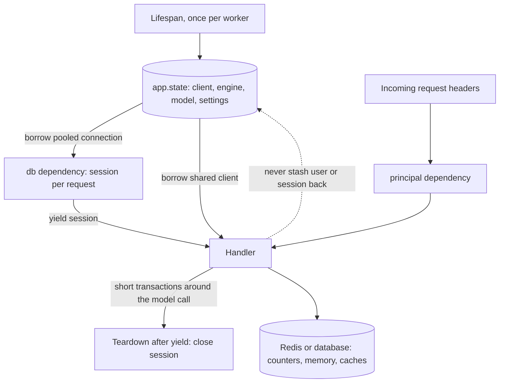

## TL;DR
An agent service mixes three scopes: shared clients and agent definitions (once per worker), per-run
state like messages, budget and principal (per request), and conversation memory (external store). Wrong
one way wastes sockets; the other leaks users' data.

## For agent builders
- **Why it matters for agents.** Agents are stateful: message history, scratchpad, tool results, spend.
  Put that state on a shared agent object and two users' runs interleave on the event loop and read each
  other's history. Build the LLM client per run instead and every step pays a fresh TLS handshake.
- **Where it shows up in your stack.** Lifespan and `app.state` for the provider client, vector index and
  a compiled agent graph; `yield` dependencies for the principal, DB session and per-run budget; a
  checkpointer or memory store (Postgres, Redis) keyed by a thread or session ID for memory across turns.
- **What you control.** Which objects are built once, which are built per run, keeping agent classes
  stateless (state passed in and returned, never kept on `self`), and how long DB transactions stay open
  across 5-30 s LLM calls.
- **What you can skip.** SQLAlchemy pool internals beyond the defaults below. Know the two questions per
  object and the one-way flow from application to request scope.

## Decision case
### Scenario
A retailer's support team is moving its prototype support agent to production. The prototype keeps one
agent object, with its message history, on `app.state`, and holds a DB session open for each run. All
figures below are illustrative planning numbers, not measurements.

- **Shape of a run:** load the customer's profile and conversation, then 4 agent steps of about 6 s each
  (LLM call plus tool call), then write the reply: about 24 s per run.
- **Scale:** 2 pods × 4 Uvicorn workers = 8 workers. Peak 6 runs/s, so 6 × 24 = 144 runs in flight,
  18 per worker.
- **Multi-turn:** follow-up messages arrive minutes later and the load balancer sends them to any worker.
- **Constraints:**
  - **Privacy:** one customer's messages must never reach another customer's prompt.
  - **Infrastructure:** Postgres only; no new datastore this quarter.
  - **Database:** this service's connection budget is 200.
  - **Delivery:** deploys roll daily while runs are in flight; three Python developers who know
    SQLAlchemy; three weeks to launch.

### Options
| Option | How it works | Privacy | DB connections at peak | Multi-turn and deploys |
|---|---|---|---|---|
| A. Stateful agent on `app.state`, sticky sessions | one agent per worker keeps `messages` on `self`; memory lives in the worker | fails: concurrent runs interleave at each `await` and share history | none | follow-ups on another worker, or after a deploy, lose all context |
| B. Request-scoped session, one transaction per run | `yield` dependency opens a session; the transaction spans read, 4 steps and write | passes | 18 per worker needed, 15 per worker by default (`pool_size=5`, `max_overflow=10`): ceiling 15 ÷ 24 s = 0.625 runs/s per worker, 5 runs/s in total, below the 6 runs/s peak | memory in Postgres survives; queued runs fail after `pool_timeout` (30 s) |
| C. Stateless agent in lifespan, run state per request, checkpoints in Postgres | shared clients and agent definition built once; messages and budget created per run; a checkpoint row keyed by `thread_id`, written in short transactions | passes | about 6 short transactions × 5 ms = 30 ms per run, so 6 × 0.03 = 0.18 connections busy on average | any worker resumes any thread; a run cut by a deploy resumes from its last step |
| D. Like C, memory in Redis | same scoping; checkpoints in Redis | passes | Postgres only for profile and reply | works, but adds a datastore the constraints rule out |

### Decision
Choose **C**.
- **Privacy:** it is the only option that meets privacy and uses only Postgres, because run state never
  lives on a shared object and memory is keyed by `thread_id`.
- **Database:** connection use stops scaling with LLM latency. B needs 144 connections at peak (18 per
  worker × 8); raising the pool to 20 per worker fits the 200 budget at 160, but leaves no headroom for
  slower models or a third pod.
- **Delivery:** it fits the team: SQLAlchemy sessions they know, plus a checkpoint table.
- **What would change it:** a Redis cluster already run by the platform team (choose D for lower
  checkpoint latency), or a single-worker internal tool with no follow-ups (a request-scoped B is
  simpler and well under its ceiling there).

### Trade-offs accepted
- **Read and write are no longer one transaction.** Two tabs can post follow-ups to the same thread
  at once. Mitigation: a `version` column checked on every checkpoint write; watch conflict counts.
- **One extra write per step.** It adds a few milliseconds per step. Watch p95 step latency against
  the LLM's own latency.
- **Checkpoint rows grow with every conversation.** Mitigation: a retention job. Watch table size and
  the age of the oldest row.
- **Shared clients are duplicated per worker.** Eight workers each hold their own HTTP and DB pools.
  Watch new connections per second (should be near zero) and pool checkout wait.

### Review rubric
- **Scale arithmetic shown:** in-flight runs from rate × duration, per-worker load, and the pool ceiling
  of any option that holds a connection across LLM calls.
- **Every object assigned a scope:** client, agent definition, run state, session, memory, with the
  reason (cost, concurrency safety, identity).
- **Privacy argued from interleaving at `await`:** not from "it worked in testing".
- **Constraints decide the choice:** options that break a hard constraint are excluded explicitly.
- **Decision reversal stated:** at least one concrete condition that would change the choice.
- **Each trade-off has a metric:** something a dashboard or alert can show.

## Why it exists
- **Mistake one: building shareable things per request.** `httpx.AsyncClient()` inside the handler,
  `from_pretrained(...)` inside a dependency, a new engine per call. A fresh client means a new TCP and TLS
  handshake per provider call (tens to hundreds of milliseconds, as an illustrative order of magnitude),
  no connection reuse, and file descriptors piling up under load.
- **A fresh model load is worse:** seconds of latency and a copy of the weights per concurrent request
  until memory runs out.
- **Mistake two, the mirror image: sharing per-request state.** A module-level `current_user`, one DB
  session reused across requests, a global list as a scratch buffer. Requests interleave on the event
  loop, so one reads another's user, commits another's half-finished transaction or returns another's
  documents. Intermittent, load-only, and real data leaks.
- **Blanket rules fail both ways.** "Make everything global for speed" produces mistake two; "make
  everything fresh for safety" produces mistake one. The decision must be made per object.
- **FastAPI gives one mechanism per scope:** lifespan plus `app.state` for application scope, `Depends`
  with `yield` for request scope, and the worker process as the boundary of "application".

## How it works
### The two questions per object
| Question | If yes |
|---|---|
| Is it expensive, or stateful across requests (a pool, a cache, loaded weights)? | candidate for application scope |
| Is it safe to use from many concurrent requests at once? | application scope is allowed |
| Does it carry per-request identity or a transaction, or is it unsafe for concurrent use? | request scope |
| Must it be shared across workers or survive a restart? | external store (Redis, the database) |

Expensive and concurrency-safe → application scope. Carries identity or a transaction, or unsafe →
request scope.

### Application scope: once per worker
1. **Built before traffic.** The lifespan context manager runs before the worker accepts traffic.
2. **Stored on `app.state`** (or yielded as lifespan state and read from `request.state`): the provider
   client, the engine, the loaded model, the tokenizer, parsed settings.
3. **Closed at shutdown** by the lifespan's exit code.

- **"Application" means the worker process.** With four Uvicorn workers there are four clients, four
  engines and four copies of the model, each with its own memory.
- **Nothing is shared across processes.** Cross-process state (rate counters, caches, session stores)
  belongs in Redis or the database.

### What "safe for concurrent use" means
- **Designed for it:** `httpx.AsyncClient`, SQLAlchemy's engine and async pool, provider SDK clients.
- **Safe but serialised:** a loaded PyTorch model in eval mode can serve concurrent forward passes, but
  the GPU serialises the work, so a concurrency limit belongs next to it.
- **Not safe:** a raw SQLAlchemy `Session` is not safe to share and does not belong in application scope.

| How the shared object is called | What concurrency it sees |
|---|---|
| from `async def` code, no `await` in the middle of a mutation | coroutines interleave only at `await`, so it is effectively single-threaded |
| from `def` endpoints or `run_in_threadpool` | real threads touch it at the same time |

- **Some objects are fine in the first row and not the second.** Hugging Face fast tokenizers, for
  example, have been reported to raise "Already borrowed" when one instance is called from several threads
  at once. Check which kind of concurrency each shared object will actually see.

### Request scope: once per request, torn down with it
- **Mechanism:** a dependency with `yield` builds the object, hands it to the handler and cleans up
  afterwards.
- **What lives here:** a DB session and its transaction (commit on success, roll back on exception), the
  authenticated principal, the tenant's resolved configuration, a per-request token budget, the trace
  span, the request ID.
- **One instance per request.** FastAPI's per-request dependency cache guarantees one request sees one
  instance even when several dependencies ask for it, which is how a handler and its auth dependency
  share a single transaction.

### Request scope is not the same as unit of work
- **CRUD requests last milliseconds**, so "one session per request" and "one transaction per unit of
  work" coincide.
- **AI requests include a 5–30 s model call**, and a session that has run a query holds a pooled
  connection until its transaction ends.
- **Hold it across the provider call and pool size, not the provider, sets your concurrency.**

| SQLAlchemy default | Value | Consequence at 15 s per call |
|---|---|---|
| `pool_size=5` plus `max_overflow=10` | 15 connections per worker | 15 ÷ 15 s = 1 request/s per worker |
| `pool_timeout` | 30 s by default | request 16 waits up to 30 s, then fails |

- **Fix:** keep the session request-scoped but the transactions short: read, commit (returning the
  connection), call the model, then write in a second short transaction.

### Scopes in between
- **Neither global nor per request:** a client per tenant (different API key or region), a per-model
  tokenizer, a compiled prompt template.
- **Treat them as application scope keyed by tenant or model:** a bounded dict built in lifespan, or
  lazily behind an `asyncio.Lock`, so two first requests do not build the same client twice.
- **Conversation memory is not in-process at all.** It spans many requests and many workers, so it
  belongs in Redis or the database.

### Scoping an agent service
| Object | Scope | Because |
|---|---|---|
| LLM provider client, embedding client, vector index handle | application (lifespan) | expensive, pooled, concurrency-safe |
| Compiled agent graph or agent definition (prompt, tool schemas) | application, if it holds no run state | a definition is reusable; the run's state is passed in per call |
| Run state: messages, scratchpad, step count, spend | request (or the run) | carries one user's identity and data |
| Principal, permitted toolset, DB session, trace span | request (`yield` dependency) | identity, transactions, teardown |
| Conversation memory and checkpoints across turns | external store keyed by thread or session ID | spans requests and workers, survives restarts |

### The hand-off between scopes
- **Request objects are derived from application objects:**
  - the session comes from the engine's pool;
  - the per-request "view" of the client is the shared client plus per-request headers;
  - the retrieval handle is the shared index plus the tenant's namespace.
- **The dependency borrows from `app.state` and returns something cheap.**
- **Resources flow one way, application → request, never back.** A request must not stash its session or
  its user on `app.state`.

### Why the process is the boundary
- **Within one process**, the event loop interleaves requests, so application scope means "shared by
  concurrent requests" and must be concurrency-safe.
- **Across processes** nothing is shared, so application scope also means "duplicated per worker" and must
  be affordable N times.
- **Both facts have one cause:** Uvicorn workers are independent processes with independent loops.

### Context variables
- **For code that cannot take parameters** (logging formatters, deep library calls), `contextvars` give
  request-scoped storage without globals.
- **Set once, read anywhere in that task:** set the request ID in a middleware or dependency, read it
  anywhere in that task.
- **Each request's task sees its own value**, which is exactly the isolation a module global cannot give.

## Diagram
Resources flow one way: lifespan builds the shared objects once per worker, dependencies derive cheap
request-scoped handles from them, and anything that must span workers lives outside the process.



## Examples
### Runnable: a shared agent object leaks history between users
Pure asyncio, no server. The bad agent keeps `messages` on `self` and is created once at startup, as
application-scoped objects are. Two users' runs overlap at the LLM `await` and each sees the other's
messages. The good agent is stateless: the run's state is created per call and passed through.

```python
import asyncio

class StatefulAgent:                                    # BAD as a singleton: run state on self
    def __init__(self): self.messages = []
    async def run(self, user: str, task: str) -> list[str]:
        self.messages.append(f"{user}: {task}")
        await asyncio.sleep(0.1)                        # LLM call: other runs interleave here
        return list(self.messages)                      # what goes into the next prompt

class StatelessAgent:                                   # GOOD: definition shared, state per run
    async def run(self, user: str, task: str) -> list[str]:
        messages = [f"{user}: {task}"]                  # run state lives in this call only
        await asyncio.sleep(0.1)
        return messages

async def main():
    for agent in (StatefulAgent(), StatelessAgent()):   # each built once, like lifespan objects
        a, b = await asyncio.gather(agent.run("alice", "my salary?"), agent.run("bob", "hi"))
        print(type(agent).__name__, "bob's prompt:", b)

asyncio.run(main())
# StatefulAgent bob's prompt: ['alice: my salary?', 'bob: hi']
# StatelessAgent bob's prompt: ['bob: hi']
```

### Worked scenario: a chat agent that holds a DB transaction across every step
One worker, SQLAlchemy defaults (15 connections). The agent loads the user's profile, then runs 4 steps
of ~6 s each before writing the result, all in one transaction (illustrative timings).

| Design | Connection held per run | Ceiling per worker |
|---|---|---|
| one transaction from profile read to final write | about 24 s | 15 ÷ 24 s ≈ 0.6 runs/s |
| commit after the read, short write per step or at the end | milliseconds per transaction | set by the provider and HTTP pool, not the DB |

Same fix as below: keep the session request-scoped, but keep every transaction short.

### Lifespan plus request-scoped dependencies
Lifespan creates the application-scoped objects; dependencies derive request-scoped ones; the handler
mixes them without ever creating a client or sharing a session.

- **Commit before the model call** so its pooled connection is not held for the 10–30 s the provider
  takes.
- **`expire_on_commit=False`** is what lets `doc.text` still be read after that commit.
- **`Document` and `Summary`** are ORM classes defined elsewhere.

```python
from contextlib import asynccontextmanager
from typing import Annotated
import httpx
from fastapi import Depends, FastAPI, Header, Request
from sqlalchemy.ext.asyncio import AsyncSession, async_sessionmaker, create_async_engine

@asynccontextmanager
async def lifespan(app: FastAPI):
    app.state.http = httpx.AsyncClient(base_url="https://api.example.com", timeout=30)  # pool shared
    app.state.engine = create_async_engine("postgresql+asyncpg://user:pw@db/app", pool_size=10)
    app.state.sessions = async_sessionmaker(app.state.engine, expire_on_commit=False)
    yield
    await app.state.http.aclose()            # application scope ends with the worker
    await app.state.engine.dispose()

app = FastAPI(lifespan=lifespan)

async def db(request: Request):              # request scope: one session per request
    async with request.app.state.sessions() as session:
        yield session                         # closing it rolls back anything uncommitted

def principal(x_api_key: Annotated[str, Header()]) -> str:
    return x_api_key.split("-")[0]           # request scope: derived from this request's headers

@app.post("/summarise")
async def summarise(doc_id: int, request: Request,
                    session: Annotated[AsyncSession, Depends(db)],
                    who: Annotated[str, Depends(principal)]):
    http = request.app.state.http             # borrow the shared client; never httpx.AsyncClient() here
    doc = await session.get(Document, doc_id)  # checks out a pooled connection
    await session.commit()                     # short read transaction: connection back to the pool
    r = await http.post("/v1/complete", json={"text": doc.text}, headers={"x-tenant": who})
    session.add(Summary(doc_id=doc_id, text=r.json()["text"], by=who))
    await session.commit()                     # second short transaction for the write
    return {"ok": True}
```

### Runnable: a module global leaks across requests, a context variable does not
Pure asyncio, no server. Two "requests" for different tenants overlap on one loop; each awaits a fake
provider call between setting and reading its tenant.

```python
import asyncio, contextvars

current_tenant = None                                   # BAD: module global, shared by all requests
tenant_var = contextvars.ContextVar("tenant")           # GOOD: one value per request task

async def handle_global(tenant: str, delay: float) -> str:
    global current_tenant
    current_tenant = tenant                             # "middleware" sets it
    await asyncio.sleep(delay)                          # provider call: the loop runs other requests
    return f"{tenant} retrieved docs for {current_tenant}"

async def handle_ctx(tenant: str, delay: float) -> str:
    tenant_var.set(tenant)                              # set inside this request's task
    await asyncio.sleep(delay)
    return f"{tenant} retrieved docs for {tenant_var.get()}"

async def main():
    for handler in (handle_global, handle_ctx):
        results = await asyncio.gather(handler("acme", 0.2), handler("globex", 0.1))
        print(handler.__name__, results)

asyncio.run(main())
# handle_global ['acme retrieved docs for globex', 'globex retrieved docs for globex']
# handle_ctx ['acme retrieved docs for acme', 'globex retrieved docs for globex']
```

- **Why it works:** `asyncio.gather` wraps each coroutine in its own task, and each task runs in a copy
  of the context, so `tenant_var.set` in one request is invisible to the other.

### Worked scenario: one transaction across the model call
One worker, SQLAlchemy defaults (15 connections), a 15 s provider call, traffic rising to 3 requests/s.

| Design | Connection held per request | Ceiling per worker | At 3 requests/s |
|---|---|---|---|
| one transaction from read to write | about 15 s | 15 ÷ 15 s = 1 request/s | queue grows; request 16 waits up to `pool_timeout` (30 s), then `TimeoutError` |
| commit after read, second short write | milliseconds per transaction | set by the provider and HTTP pool, not the DB | DB pool barely used |

- **What the dashboards show:** database idle, provider under quota, requests failing with
  `QueuePool limit ... reached`.
- **Trade-off of the fix:** read and write are no longer atomic, so add a version check on the write if
  the document can change meanwhile.

## Production patterns
- **Stateless agent definitions, state passed per run.** Use for every agent service: build the agent or
  graph once in lifespan with no run state on it, create run state per request, and load or save memory
  through a checkpointer keyed by thread or session ID. Add a concurrency test that runs two users at
  once and asserts neither prompt contains the other's messages.
- **One shared client per upstream, with explicit limits.** Use for every provider and internal API:
  build `httpx.AsyncClient(timeout=..., limits=httpx.Limits(max_connections=...))` in lifespan, close it
  with `aclose()` at shutdown, and expose it through a one-line dependency. Monitor new connections per
  second on the client; a steady stream means something builds clients per request.
- **Short transactions around slow calls.** Use whenever a request awaits a model: commit after reads,
  call the provider, write in a second transaction, with `expire_on_commit=False` on the session factory.
  Size `pool_size` and `max_overflow` per worker and monitor checked-out connections and pool wait time.
- **Request ID in a context variable.** Use for log correlation: a middleware sets a
  `contextvars.ContextVar` per request and a `logging.Filter` copies it onto every record. Remember that
  values set inside a thread-pool call or a separate task do not flow back to the caller.
- **Bounded per-tenant client cache.** Use when tenants need different keys or regions: a dict keyed by
  tenant, filled lazily under an `asyncio.Lock`, with a size cap and `aclose()` on evicted clients. Monitor
  cache size and evictions.
- **Concurrency limit beside a shared model.** Use when a loaded model serves concurrent requests: guard
  calls with an `asyncio.Semaphore` or `anyio.CapacityLimiter` created in lifespan. Monitor queue wait
  and memory per worker; past a couple of workers, move the model to a separate server.
- **Cross-worker state in an external store.** Use for rate limits, caches and conversation memory: keep
  counters in Redis (for example `INCR` with an expiry) rather than on `app.state`, so a limit of 100 does
  not silently become 400 across four workers.

## Trade-offs
- **Amortised setup vs per-worker duplication.** Application scope spreads expensive setup across all
  requests, but everything in it is duplicated per worker; past a couple of workers the memory of a
  loaded model forces a separate model server.
- **Isolation vs construction cost.** Request scope guarantees isolation and clean teardown at the cost of
  per-request construction; it flips to a problem only when the object is expensive, which is the signal
  to move construction to lifespan and keep only a cheap handle per request.
- **One place for pool limits vs blast radius.** Sharing a concurrency-safe client gives connection reuse
  and pool limits in one place, but one bad setting (a tiny pool, a global timeout) now affects every
  endpoint at once.
- **Free pool connections vs atomicity.** Splitting a request into short transactions around the model
  call frees pool connections, but the read and the write are no longer atomic; when the write must match
  what was read (a document edited meanwhile), add a version check on the write rather than holding the
  transaction open.
- **No context threading vs predictability.** `contextvars` remove the need to thread request context
  through signatures, but values set inside a thread-pool call or a separate task do not flow back, so the
  mechanism is only as predictable as the task structure around it.

## Pitfalls
- **Creating `httpx.AsyncClient()` or a provider SDK client per request.** Symptom: elevated provider
  latency from handshakes, "too many open files" under load, and no benefit from keep-alive.
- **Loading a model in a dependency or on first request.** Symptom: a multi-second first call per worker,
  memory growing with concurrency, and OOM kills once several workers run.
- **Storing the current user or request-specific data on `app.state` or a module global.** Symptom:
  intermittent wrong-user responses that reproduce only under concurrent load.
- **Holding a DB transaction open across the model call.** Symptom: the database is idle and the provider
  is under quota, yet requests queue and fail with SQLAlchemy `QueuePool limit ... reached` /
  `TimeoutError` once concurrency passes the pool size.
- **Keeping conversation history on a shared agent instance.** Symptom: under concurrent load a user's
  answer mentions someone else's question, and the agent "forgets" context when a follow-up lands on
  another worker. Fix: per-run state in the call, memory in an external store keyed by session ID.
- **Sharing one DB session across requests.** Symptom: "session already in a transaction" errors and
  commits that contain other requests' changes.
- **Expecting an in-process cache or counter on `app.state` to be global.** Symptom: rate limits enforced
  per worker, so a limit of 100 becomes 400 with four workers.

## When to use
- **Write the decision down per object:** cost to create, whether it is safe for concurrent use, whether
  it carries per-request identity.
- **Lifespan:** clients, engines, models, indexes and settings.
- **Dependencies:** sessions, principals, budgets, spans and IDs.
- **External store:** anything that must be shared across workers or survive a restart.
- **Measure:** connection reuse (new connections per second on the provider client), time-to-first-request
  per worker, and memory per worker; each points at a scoping mistake when it is wrong.
- **Interviews and review:** "where would you create the OpenAI client and why not in the endpoint?", and
  in code review every time a `Client()` call appears inside a function that runs per request.

## Role lens
- **Engineer:** Builds clients, engines and models in lifespan, derives sessions and principals in
  yield dependencies, and never instantiates a client inside a handler.
- **Architect:** Sets the worker-versus-model-server boundary from per-worker memory, and decides which
  state must leave the process for Redis or the database.
- **FDE:** Finds the per-request client or the shared session in a customer's codebase when they report
  handshake latency or cross-tenant data appearing in responses.

## Check yourself
**Q:** A multi-tenant RAG service shows two symptoms after scaling to four workers: provider latency
rose noticeably per call, and a customer once saw another tenant's document titles. The code creates
an `AsyncClient` in each handler and keeps the current tenant in a module-level variable set by a
middleware. Explain each symptom and the fix.
**A:** The latency is the handshake cost of a new client per request: no pooled connections are
reused, so every provider call pays TCP and TLS setup; move the client to lifespan on `app.state` and
borrow it from a dependency. The leak is a request-scoped value held in application scope: the
middleware sets a module global that every concurrent request in the worker reads, so when request B's
middleware runs while request A awaits the provider, A's retrieval uses B's tenant. Replace the global
with a dependency that resolves the tenant from the request (or a `contextvar` set per request) and
pass it into the retrieval call. Both are the same mistake in opposite directions: an expensive
shareable thing was made per request, and a per-request thing was made shared.

## Interview questions
### How do you decide whether an object should be application-scoped or request-scoped?
- **Ask two questions:** is it expensive or stateful across requests (a pool, a cache, loaded weights),
  and is it safe to use from many concurrent requests at once?
- **Expensive and concurrency-safe → lifespan and `app.state`**: clients, engines, models, settings.
- **Carries identity or a transaction, or unsafe → a `yield` dependency**: sessions, principals, budgets,
  spans. Anything shared across workers goes to Redis or the database.

### Where does each piece of an agent's state live in a multi-worker FastAPI service?
- **Application scope (lifespan):** the LLM client, embedding client, vector index handle and a
  stateless agent or graph definition, because they are expensive and safe to share.
- **Request scope:** the principal, permitted tools, run messages, budget and DB session, because they
  carry one user's identity and data.
- **External store:** conversation memory and checkpoints keyed by thread or session ID, because the
  next turn may land on another worker or after a restart.

### The database is idle and the provider is under quota, yet requests time out with `QueuePool limit ... reached`. Debug it.
- **Suspect a transaction held across the model call.** A session that has run a query keeps its pooled
  connection until the transaction ends, so a 15 s provider call holds one of 15 default connections.
- **Do the arithmetic:** 15 connections ÷ 15 s = 1 request/s per worker, and request 16 waits up to
  `pool_timeout` (30 s) before failing.
- **Fix:** commit after the read, call the model, write in a second short transaction, with
  `expire_on_commit=False` so loaded attributes stay readable.

### Each tenant's agent must call the LLM with that tenant's own provider API key. Where does that client live?
- **Application scope, keyed by tenant:** a bounded dict of clients, not a new client per request, which
  would pay a handshake every call.
- **Build lazily behind an `asyncio.Lock`** so two first requests for the same tenant do not create two
  clients, and close evicted clients with `aclose()`.
- **The request-scoped part is only the lookup**: a dependency resolves the tenant and returns that
  tenant's shared client.

### A loaded model is concurrency-safe in your async code. Why might it still break, and what does sharing cost?
- **Threads change the answer.** Coroutines interleave only at `await`, but from `def` endpoints or
  `run_in_threadpool` real threads call it at once; Hugging Face fast tokenizers have been reported to
  raise "Already borrowed" in that case.
- **The GPU serialises forward passes**, so put a concurrency limit next to the shared model.
- **Memory multiplies by workers:** four Uvicorn workers hold four copies, which is what pushes large
  models to a dedicated server.

### When would you use `contextvars` instead of passing request context as a parameter?
- **When the code cannot take parameters**, such as logging formatters or deep library calls that need
  the request ID.
- **Isolation comes from tasks:** each request's task sees its own value, unlike a module global.
- **Limit:** values set inside a thread-pool call or a separate task do not flow back, so for business
  data (tenant, user) an explicit dependency is easier to reason about and test.

## Quiz
### Q: Which object belongs in request scope rather than application scope?
- [ ] The tokenizer used for counting prompt tokens
- [ ] The `httpx.AsyncClient` used to call the model provider
- [x] The database session and its transaction for the current call
- [ ] The parsed settings object with provider keys and limits
> A session carries a transaction and is not safe for concurrent use, so each request needs its own,
> derived from the application-scoped engine and torn down after the handler finishes.

### Q: With `uvicorn --workers 4`, what does "application-scoped" imply for a loaded model?
- [ ] One copy shared by all workers through shared memory
- [x] Four independent copies, one per worker process, each loaded in that worker's lifespan
- [ ] One copy in the master and lazy copies on first request
- [ ] The model is reloaded whenever a worker restarts a request
> Workers are separate processes with separate event loops and app instances; application scope means
> once per process, which is why large models usually move to a dedicated server.

### Q: Why is keeping the current user in a module-level variable a bug in an async FastAPI service?
- [ ] Module globals are read-only in async code
- [ ] FastAPI resets module globals between requests
- [x] Concurrent requests interleave on the loop and overwrite each other's value
- [ ] Module globals are not visible from dependencies
> Request-scoped identity stored in application scope is shared by every in-flight request in the
> process; a dependency or a context variable keeps it isolated per request.

## Use cases & projects
### Use cases
- **One compiled agent, many users.** The agent graph and provider client are built once per worker, while
  each run gets its own messages, budget and principal.
- **Memory across turns.** Conversation history lives in a checkpointer or memory store keyed by a thread
  ID, so any worker can continue the conversation.
- **Short DB transactions around long LLM calls.** Opening a session only for reads and writes, not
  across a 5-30 s model call, keeps the connection pool from draining.
- **Auditing for cross-user leaks.** Reviewing which objects hold state on `self` or at module level is
  how teams find intermittent "saw another user's answer" bugs.

### Mini project
**Reproduce and fix a cross-user state leak (1-2 hours).**
- **Goal:** show that per-run state on a shared agent object leaks between concurrent users, then fix it.
- **Steps:** build an agent class that stores `messages` on `self` and is created once in lifespan; run
  20 concurrent requests from different fake users with a fake LLM that awaits a short random delay and
  echoes the history; count responses that contain another user's message; refactor so state is passed in
  and returned, and keep the client application-scoped.
- **Done when:** the leak count drops from non-zero to zero, and the client is still created once per
  worker (checked with a log line or counter).
