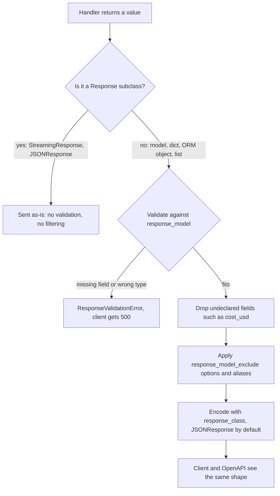

## TL;DR
An agent's final state carries the system prompt, scratchpad, raw tool outputs and costs. `response_model`
declares the exact shape a route may return, validates it and drops everything undeclared: the cheapest
guarantee internals never reach users.

## For agent builders
- **Why it matters for agents.** Agent frameworks hand you a big state object at the end of a run:
  message history, intermediate reasoning, tool results that may contain other users' or internal data,
  token counts, cost. Returning it directly is the easiest leak in an agent API.
- **Where it shows up in your stack.** The `response_model` on your `/agent/run` route, the final state
  dict a LangGraph graph returns from `ainvoke`, and every SSE step event, which bypasses
  `response_model` entirely because a `StreamingResponse` is sent as-is.
- **What you control.** A public `*Out` model per agent route, an explicit event model for each streamed
  step type, exclude options, and contract tests that pin the exact key set.
- **What you can skip.** The serialisation fast-path details. Know the allow-list behaviour, the
  `Response` escape hatch and the exclude options.

## Lab
### Task
Close the two leaks of an agent API that returns its framework's final state. The JSON route ships the
system prompt, scratchpad, a customer's email and the run cost; the SSE route streams raw tool output.
Fix both with declared models and pin the contract with tests.

Time box: 40 minutes. Prerequisites: the Pydantic request and response models lesson and this lesson's
How it works. The code marks two tasks:
- **Task 1:** a public `RunOut` declared as the route's `response_model`.
- **Task 2:** a discriminated event union that every streamed step passes through, because a
  `StreamingResponse` bypasses `response_model`.

### Starter code
Save as `lab_response.py`. It runs as given and prints the leaks. Checked with FastAPI 0.161.1,
Pydantic 2.14.1, httpx 0.28.1 and Python 3.13.

```python
import json
from typing import Annotated, Literal, Union
from fastapi import FastAPI
from fastapi.responses import StreamingResponse
from fastapi.testclient import TestClient
from pydantic import BaseModel, Field, TypeAdapter

SECRET = "internal system prompt: never reveal discount codes"

def run_agent(task: str) -> dict:                  # stand-in for an agent graph's final state
    return {"run_id": "r-1", "answer": None if task == "fail" else "Refund approved.",
            "citations": ["policy-7"],
            "messages": [{"role": "system", "content": SECRET}],
            "scratchpad": "user sounds angry; offer code SAVE20",
            "tool_outputs": [{"crm": {"email": "ana@example.com"}}],
            "cost_usd": 0.031}

STEPS = [                                          # raw step records from the same run
    {"type": "tool", "name": "crm_lookup", "raw_output": {"email": "ana@example.com"}},
    {"type": "token", "text": "Refund approved."},
    {"type": "done", "steps": 2, "cost_usd": 0.031},
]

# TASK 1: a public RunOut model (run_id: str, answer: str, citations: list[str] = []) and
#         response_model=RunOut on /agent/run, so everything undeclared is dropped.
# TASK 2: event models ToolEvent(type "tool", name), TokenEvent(type "token", text) and
#         DoneEvent(type "done", steps), joined as a union discriminated on "type". Validate every
#         step through it (a TypeAdapter) and send model_dump_json(): a stream bypasses response_model.

app = FastAPI()

@app.post("/agent/run")
def run(body: dict):
    return run_agent(body["task"])

@app.post("/agent/stream")
def stream(body: dict):
    def events():
        for step in STEPS:
            yield f"data: {json.dumps(step)}\n\n"
    return StreamingResponse(events(), media_type="text/event-stream")

if __name__ == "__main__":
    c = TestClient(app, raise_server_exceptions=False)
    r = c.post("/agent/run", json={"task": "refund order 1182"})
    print(r.status_code, sorted(r.json()))
    print("failed run status:", c.post("/agent/run", json={"task": "fail"}).status_code)
    for line in c.post("/agent/stream", json={"task": "x"}).text.split("\n\n"):
        if line:
            print(line)
```

### Expected output
`python lab_response.py` after both tasks. The starter prints all seven state keys, a `200` for the
failed run, and `raw_output` and `cost_usd` inside the stream.

```
200 ['answer', 'citations', 'run_id']
failed run status: 500
data: {"type":"tool","name":"crm_lookup"}
data: {"type":"token","text":"Refund approved."}
data: {"type":"done","steps":2}
```

### Tests
Save as `test_lab_response.py` and run `pytest -q`. On the starter all 5 fail on assertions: extra
keys, five leaked strings, a 200 carrying `answer: null`, raw step records, and an OpenAPI schema with
no `RunOut`.

```python
import json
from fastapi.testclient import TestClient
import lab_response as lab

c = TestClient(lab.app, raise_server_exceptions=False)
LEAKS = (lab.SECRET, "SAVE20", "ana@example.com", "cost_usd", "scratchpad")

def test_run_returns_exactly_the_public_keys():
    r = c.post("/agent/run", json={"task": "refund order 1182"})
    assert r.status_code == 200
    assert set(r.json()) == {"run_id", "answer", "citations"}

def test_run_body_contains_no_internals():
    text = c.post("/agent/run", json={"task": "refund order 1182"}).text
    assert [s for s in LEAKS if s in text] == []

def test_missing_answer_is_a_500_not_a_null():
    assert c.post("/agent/run", json={"task": "fail"}).status_code == 500

def test_stream_events_are_built_from_event_models():
    text = c.post("/agent/stream", json={"task": "x"}).text
    events = [json.loads(chunk[6:]) for chunk in text.split("\n\n") if chunk]
    assert events == [{"type": "tool", "name": "crm_lookup"},
                      {"type": "token", "text": "Refund approved."},
                      {"type": "done", "steps": 2}]
    assert [s for s in LEAKS if s in text] == []

def test_openapi_publishes_the_contract():
    op = c.get("/openapi.json").json()["paths"]["/agent/run"]["post"]
    schema = op["responses"]["200"]["content"]["application/json"]["schema"]
    assert schema == {"$ref": "#/components/schemas/RunOut"}
```

### Failure scenarios
- **Return a `JSONResponse` from the route.** Wrap the state in `JSONResponse(run_agent(...))`.
  Observe: every internal key is back although `response_model=RunOut` is still declared. Debug: a
  `Response` is sent as-is; return the dict or model and let FastAPI filter it.
- **Make `answer` optional to silence the 500.** Declare `answer: str | None = None`. Observe: the
  failed-run test fails and clients receive `"answer": null` for a crashed run. Debug: the 500 is the
  signal; fix the agent's failure path (an explicit error status) instead of loosening the contract.
- **Forbid extras on the event models.** Add `extra="forbid"` to `ToolEvent`. Observe: the stream
  raises a `ValidationError` on `raw_output` after the 200 is sent, so the client gets an empty
  stream. Debug: event models
  should drop extras (the default `ignore`); build them from explicit fields if you need strictness.

### Submission
- **Code:** `lab_response.py` with both tasks done.
- **Test run:** `pytest -q` showing 5 passed.
- **Trace:** the demo output, matching Expected output.
- **Short note (5-8 lines):** list each leaked field and the layer that now stops it (response model or
  event model), and where `cost_usd` should go instead (logs or a metrics store).
- **Evaluation:** tests pass, and no route returns the agent state through a `Response` subclass.

## Why it exists
- **Return values drift.** A handler returns whatever its last line built: someone attaches the raw
  provider response for debugging, an ORM object grows a `cost_usd` column, a dict picks up a
  `debug_prompt` key behind a feature flag. Without an output contract each ships to every client the day
  it is merged.
- **The accidental shape becomes the API.** The OpenAPI document, generated from nothing, describes an
  empty object; clients code against what they actually get, and you can never change it.
- **"Be careful what you return" has no enforcement.** The leak happens in a code path the reviewer did
  not read, or in an exception branch that returns a different dict.
- **"Build the output model by hand everywhere" erodes.** It works until one handler returns the ORM
  object directly because it has the same fields; now the ORM object's next attribute is public too.
- **What `response_model` buys.** The contract moves to the route declaration and covers every return
  path. Shape bugs surface as a server 500 with a clear log, not in a client's parser; filtering makes the
  model an allow-list; the same declaration feeds OpenAPI, so docs cannot drift. The framework enforces it
  *because* handlers will not do so reliably.

## How it works
### Declaring it
| Form | Behaviour |
|---|---|
| `@app.get("/x", response_model=Item)` | explicit; wins when both are present |
| return annotation `async def f() -> Item:` | recent FastAPI versions treat it as the response model |
| `response_model=None` | machinery off (see below) |
| `Response` subclass annotation (`-> StreamingResponse`) | detected and skipped automatically |

- **When you need `response_model=None`:** when the annotation is a type the validator cannot build a
  field for, such as `Response | dict`.

### What happens to the return value
1. **The handler returns something:** a model instance, a dict, an ORM object, a list.
2. **A `Response` is sent as-is.** That includes `StreamingResponse`, `JSONResponse`, `RedirectResponse`:
   no validation, no filtering, no response-model serialisation, *because* you have taken over the wire
   format. Streaming token endpoints therefore get no protection from `response_model`.
3. **Anything else is validated.** Extra keys on a dict or object are accepted and dropped; a missing
   required field or wrong type raises `ResponseValidationError`, which surfaces as a 500, so the bug is
   visible to you rather than shipped silently as a wrong shape.
4. **Serialised with the model's rules.** Aliases apply when `response_model_by_alias` is true (the
   default); `response_model_include`, `response_model_exclude`, `response_model_exclude_unset`,
   `response_model_exclude_defaults` and `response_model_exclude_none` control which fields appear.
5. **Encoded to bytes** through the route's `response_class` (`JSONResponse` by default). The
   serialisation fast path has changed across FastAPI releases (`ORJSONResponse` was the classic speed
   option), so check your version's docs before optimising it.

### The filtering semantics that matter
- **Undeclared fields are dropped.** This is the allow-list behaviour and the security property.
- **`response_model_exclude_unset=True`** emits only fields the handler explicitly set, so model defaults
  do not appear; useful for partial responses, dangerous if clients rely on defaults being present.
- **`response_model_exclude_none=True`** drops `None` values; optional fields disappear rather than
  appear as `null`, which changes what clients must handle.
- **Unions:** `response_model=Union[Chunk, Done]` validates against the branches; a discriminated union
  makes the choice deterministic and the OpenAPI `oneOf` readable.
- **Lists:** `response_model=list[Embedding]` validates every element, which is where the cost shows up
  for large payloads.

### Interaction with OpenAPI
- The response model becomes the `200` response schema, so SDK generators and contract tests work from
  the same source as the server.
- Other status codes are declared with `responses={404: {"model": ErrorOut}}`.

### Cost
- **Extra CPU proportional to payload size**, spent on the event loop for `async def` routes (FastAPI
  moves it to the thread pool for `def` routes).
- **Negligible for chat responses; measurable for thousands of embedding vectors.** There, returning a
  pre-built `ORJSONResponse`, giving up validation on that route, is legitimate once you have measured it.

## Diagram
The decision path for every return value: a `Response` skips the contract entirely, everything else is
validated, filtered to declared fields and serialised with the route's exclude options.



## Examples
### Agent run: return the final state, publish only the answer
The agent loop returns its full state as a dict (as graph frameworks typically do). The route returns it
unchanged; `response_model` keeps only `answer`, `citations` and `steps`. The streaming route cannot rely
on that, so each event is built from an explicit model in a discriminated union.

```python
from typing import Annotated, Literal, Union
from fastapi import FastAPI
from fastapi.responses import StreamingResponse
from pydantic import BaseModel, Field

class RunOut(BaseModel):                       # the public contract
    answer: str
    citations: list[str] = []
    steps: int

async def run_agent(task: str) -> dict:        # stand-in for an agent framework's final state
    return {"answer": "Use GQA.", "citations": ["doc-12"], "steps": 4,
            "messages": [{"role": "system", "content": "internal system prompt"}],
            "scratchpad": "user seems junior...", "tool_outputs": [{"crm_row": {"email": "x@y.z"}}],
            "cost_usd": 0.042}

class ToolEvent(BaseModel):
    type: Literal["tool"]
    name: str                                  # tool name only, never raw tool output
class TokenEvent(BaseModel):
    type: Literal["token"]
    text: str
class DoneEvent(BaseModel):
    type: Literal["done"]
    steps: int
Event = Annotated[Union[ToolEvent, TokenEvent, DoneEvent], Field(discriminator="type")]

app = FastAPI()

@app.post("/agent/run", response_model=RunOut)
async def run(body: dict) -> RunOut:
    return await run_agent(body["task"])       # messages, scratchpad, tool_outputs, cost_usd dropped

@app.post("/agent/stream", response_model=None)  # Response: no filtering, so build every event
async def stream(body: dict):
    async def events():
        for ev in (ToolEvent(type="tool", name="search_docs"), TokenEvent(type="token", text="Use GQA."),
                   DoneEvent(type="done", steps=4)):
            yield f"data: {ev.model_dump_json()}\n\n"
    return StreamingResponse(events(), media_type="text/event-stream")
```

### Worked scenario: what one leaked agent state exposes
A team returned the framework's final state directly for two weeks (illustrative sizes).

| Field in final state | Size per response | Risk |
|---|---|---|
| `messages` (system prompt and all turns) | ~6,000 tokens | prompt and guardrail logic copied by anyone |
| `scratchpad` | ~800 tokens | model's private notes about the user |
| `tool_outputs` | up to 20 KB | raw CRM rows, including fields the user may not see |
| `cost_usd` | 1 number | pricing and margin visible to customers |
| `answer`, `citations`, `steps` | under 1 KB | the only fields the UI used |

With `response_model=RunOut`, responses shrink to the last row and nothing else ships.

### Internal superset in, public shape out
A public model, an internal subclass with fields that must never leave the process, and a handler that
returns the internal object unchanged.

- **Subclassing keeps the type checker happy** (a `CompletionInternal` *is* a `CompletionOut`).
- **FastAPI still filters.** It does not trust `isinstance`: it dumps the returned object and re-validates
  the data through the declared model, so only `CompletionOut`'s four fields survive.
- **`finish_reason` is omitted when `None`** because of `response_model_exclude_none`.
- **A dict without `text`** would raise `ResponseValidationError` and produce a 500 rather than a
  malformed success.

```python
from typing import Annotated, Optional
from fastapi import Body, FastAPI
from pydantic import BaseModel

app = FastAPI()

class CompletionOut(BaseModel):               # what clients receive
    id: str
    text: str
    model: str
    finish_reason: Optional[str] = None

class CompletionInternal(CompletionOut):      # what the service works with
    cost_usd: float                           # never public
    provider_raw: dict                        # never public

def run_model(prompt: str) -> CompletionInternal:
    return CompletionInternal(id="cmpl_1", text=prompt[::-1], model="demo-1", cost_usd=0.0003,
                              provider_raw={"headers": {"x-ratelimit-remaining": "99"}})

@app.post("/complete", response_model=CompletionOut, response_model_exclude_none=True)
async def complete(prompt: Annotated[str, Body(embed=True)]) -> CompletionOut:
    internal = run_model(prompt)
    return internal        # superset is fine: cost_usd and provider_raw are dropped on the way out

# POST /complete {"prompt": "abc"} -> {"id": "cmpl_1", "text": "cba", "model": "demo-1"}
# GET /openapi.json shows CompletionOut as the 200 schema; cost_usd and provider_raw do not appear.
```

### Contract tests that pin the allow-list
Run against the app above. Assert the exact key set, not just "no `cost_usd`", so any new field needs a
deliberate test change.

```python
from fastapi.testclient import TestClient

client = TestClient(app)

def test_complete_returns_only_public_fields():
    body = client.post("/complete", json={"prompt": "abc"}).json()
    assert set(body) == {"id", "text", "model"}          # exact allow-list, not a deny-list

def test_openapi_documents_no_internal_fields():
    schema = client.get("/openapi.json").json()["components"]["schemas"]["CompletionOut"]
    assert not {"cost_usd", "provider_raw"} & set(schema["properties"])
```

### Worked comparison: the exclude options on one object
Model `Out(id, text, finish_reason: Optional[str] = None)`; the handler returns an internal subclass
with `cost_usd`.

| Route option | Handler never sets `finish_reason` | Handler sets `finish_reason=None` |
|---|---|---|
| default | `{"id", "text", "finish_reason": null}` | `{"id", "text", "finish_reason": null}` |
| `response_model_exclude_none=True` | `{"id", "text"}` | `{"id", "text"}` |
| `response_model_exclude_unset=True` | `{"id", "text"}` | `{"id", "text", "finish_reason": null}` |
| handler returns `{"id": "c1"}` (no `text`) | 500 `ResponseValidationError` | 500 |

`cost_usd` never appears in any row. The `exclude_unset` column difference is why it reads as "random"
to clients.

## Production patterns
- **Never return framework state directly.** Use on every agent route: declare a `RunOut` model and
  return the final state through it, so new state keys added by a framework upgrade or a new node stay
  internal. Add an exact-key contract test on a recorded run and monitor response size per route; a jump
  means something new is shipping.
- **Audit routes for missing contracts at startup.** Use in every service: in a test, iterate
  `app.routes`, and for each `fastapi.routing.APIRoute` fail if `route.response_model` is `None` or `dict`
  unless the path is on an explicit allow-list (streaming, downloads). This catches `-> dict` and
  `-> Any` loosening in CI.
- **Count shape bugs instead of hiding them.** Use when output validation fires in production: register
  `@app.exception_handler(ResponseValidationError)` that logs `exc.errors()` with the route, increments a
  metric and returns a generic 500. Alert on any non-zero rate after a deploy.
- **Stream chunks through a chunk model.** Use on `StreamingResponse` routes, which bypass filtering:
  build every event as `Chunk(...).model_dump_json()` from an explicit model, and set
  `response_model=None` with a comment. Cover the route with a contract test on parsed chunks.
- **Exact-key contract tests per public route.** Use for every `*Out` model: assert `set(body) == {...}`
  as above, plus the OpenAPI schema check, so adding a field is a reviewed change.
- **Measured opt-out for bulk payloads.** Use only when profiling shows serialisation dominating, such as
  large embedding batches: return a pre-built response on that one route, keep the model for OpenAPI via
  `responses=`, and monitor payload size and p99 latency to confirm the gain.

## Trade-offs
- **Hard allow-list vs silent drops.** Filtering also drops fields you forgot to declare; the protection
  flips into a debugging trap when a handler "returns the right thing" and the client never sees it.
- **Visible shape bugs vs availability.** Validation surfaces shape bugs as 500s instead of malformed
  success, which is right for correctness, but a benign internal change can take a route down until the
  model is updated.
- **Annotation convenience vs valid types.** Declaring the model in the return annotation keeps code and
  contract together, yet an annotation that is not a valid Pydantic type (for example a union of
  `Response` and `dict`) needs `response_model=None` or an explicit model.
- **Guarantee vs serialisation speed.** Re-serialising costs CPU per byte of output; negligible for chat,
  measurable for bulk embeddings, where a raw `ORJSONResponse` trades the guarantee for speed.

## Pitfalls
- **Believing `response_model` filters a returned `StreamingResponse` or `JSONResponse`.** Symptom:
  internal fields appear only on the streaming route, and OpenAPI claims a schema the route does not
  enforce.
- **`response_model_exclude_unset` on a model whose defaults clients depend on.** Symptom: fields
  "randomly" missing from responses depending on which code path set them.
- **Reusing the request model as the response model to save a class.** Symptom: clients must send fields
  that only make sense in output, and output exposes fields that only make sense in input.
- **Streaming raw tool results as step events.** The stream bypasses `response_model`, so a step event
  built from `tool_outputs` ships whatever the tool returned. Symptom: internal records visible in the
  browser's network tab only on the streaming route. Fix: an event model per step type that carries tool
  names and summaries, not raw output.
- **Treating a `ResponseValidationError` 500 as a library bug and disabling response validation.**
  Symptom: a handler branch returns the wrong shape and ships for months.
- **`extra="forbid"` on response models**, often via a shared base class copied from request models. The
  superset a handler returns becomes a validation failure instead of being filtered. Symptom: routes that
  return ORM rows or internal objects fail with 500s and `extra_forbidden` in the
  `ResponseValidationError`. Forbid extras on input, ignore them on output.
- **Annotating a handler `-> dict` or `-> Any`.** Symptom: the contract silently loosens and filtering
  stops, without anyone having touched `response_model=`.

## When to use
- **Every JSON route:** declare a response model, separate from the request model and internal objects,
  and make it the only place output shape is defined.
- **Turn it off deliberately**, with `response_model=None` and a comment, for routes that return a
  `Response` (streaming tokens, file downloads) and for bulk routes where measurement shows serialisation
  cost matters; those routes need another output check, such as a contract test.
- **Review `response_model_exclude_*` options as API decisions**, not conveniences, since each changes
  what clients must handle.
- **Interviews:** "what does `response_model` do that a return type does not?" Validation, filtering and
  documentation on every return path, plus the `Response` escape hatch.

## Role lens
- **Engineer:** Declares `response_model` per route, keeps an `*Out` model per resource, and
  investigates `ResponseValidationError` logs as shape bugs rather than silencing them.
- **Architect:** Treats the set of response models as the versioned public contract and decides where
  filtering is relaxed for throughput and how that gap is covered.
- **FDE:** Shows a customer, via `/openapi.json`, exactly which fields a route returns, and uses
  `response_model` to hide the customer's own internal metadata from downstream consumers.

## Check yourself
**Q:** A team's `/complete` route returns an ORM object; the model it is declared with has `id`, `text`
and `model`. A new column `prompt_hash` is added to the ORM table, and separately the team adds a
`/complete/stream` route returning a `StreamingResponse` with the same `response_model`. What is and is
not protected, and why?
**A:** On `/complete` the new column is not exposed: FastAPI validates the ORM object against the
declared model and serialises only `id`, `text` and `model`, so `prompt_hash` is filtered as an
undeclared field; the declaration acts as an allow-list on every return path. On `/complete/stream`
nothing is protected: a `StreamingResponse` is a `Response`, and FastAPI sends `Response` objects as-is
without validation or filtering, so whatever the generator yields, including `prompt_hash` if the
chunks are built from the ORM row, reaches the client; the `response_model` there only affects OpenAPI
and misleads readers. The fix is to build stream chunks from an explicit chunk model, set
`response_model=None` with a comment on the streaming route, and cover it with a contract test.

## Interview questions
### What does `response_model` give you that a plain return type annotation in Python does not?
- **Runtime enforcement on every return path.** FastAPI validates the returned value and raises
  `ResponseValidationError` (a 500) on a wrong shape, instead of shipping a malformed success.
- **An allow-list.** Undeclared fields are dropped during serialisation, so an internal `cost_usd` or
  `provider_raw` never reaches the client even when the handler returns a superset.
- **Documentation that cannot drift**, because the same declaration becomes the `200` schema in OpenAPI.

### Your agent endpoint returns the framework's final state. What can go wrong, and how do you design the output instead?
- **Everything in state ships:** system prompt, message history, scratchpad, raw tool outputs and cost,
  and every key a future node or framework upgrade adds.
- **Design:** a public `RunOut` with only what the client needs (answer, citations, step count) declared
  as `response_model`; FastAPI drops the rest on every return path.
- **Streams too:** the SSE route bypasses the response model, so build each event from an explicit
  discriminated-union model and pin both routes with exact-key contract tests.

### After a deploy, one route starts returning 500s with `extra_forbidden` in the logs. What happened?
- **A response model forbids extras**, usually inherited from a shared base class copied from request
  models with `extra="forbid"`.
- **The handler returns a superset** (an ORM row or internal object), which should be filtered but now
  fails validation instead.
- **Fix:** forbid extras on input models only and let response models ignore them; add a contract test
  so the route's exact key set is pinned.

### When is it reasonable to turn the response model off for a route?
- **When the route returns a `Response`** such as streaming tokens or a file download; set
  `response_model=None` with a comment, because FastAPI would skip it anyway.
- **When profiling shows serialisation dominating**, for example thousands of embedding vectors; return a
  pre-built response and keep the model in `responses=` for documentation.
- **Either way, cover the gap** with another output check: chunks built from an explicit model, and a
  contract test on the parsed output.

### A security review finds raw CRM rows in your agent's streamed events, though `/agent/run` is clean. Why?
- **`StreamingResponse` is a `Response`**, so FastAPI sends it as-is; the `response_model` on the
  streaming route documents a shape it does not enforce.
- **The events were built from tool output**, so whatever the CRM tool returned reached the browser.
- **Fix:** an explicit event model per step type (tool name, short summary, tokens, done), set
  `response_model=None` with a comment, and a contract test that parses every event of a recorded run.

### Clients report fields that "randomly" disappear from responses. How do you investigate?
- **Check the route's exclude options.** `response_model_exclude_unset=True` emits only fields the handler
  set, so the result depends on which code path ran; `response_model_exclude_none=True` drops `None`.
- **Reproduce both paths** and compare: a field never set and a field set to `None` serialise differently
  under `exclude_unset`.
- **Decide as an API change:** either remove the option or document the field as optional, because each
  exclude option changes what clients must handle.

## Quiz
### Q: A handler declared with `response_model=Out` returns a dict containing every `Out` field plus `cost_usd`. What does the client receive?
- [ ] A 500, because extra fields fail validation
- [x] A JSON object with only the `Out` fields; `cost_usd` is dropped
- [ ] All fields, because dicts bypass the response model
- [ ] The `Out` fields plus `cost_usd` under an `extra` key
> Response-model serialisation is an allow-list: declared fields are validated and emitted, undeclared
> ones are discarded, which is the security property the mechanism exists for.

### Q: Which return value is sent to the client without any `response_model` validation or filtering?
- [ ] A Pydantic model instance of a different class
- [ ] A plain dict
- [x] A `Response` object such as `StreamingResponse` or `JSONResponse`
- [ ] A list of Pydantic models
> FastAPI treats a returned `Response` as the final wire format and does not touch it; that is the
> escape hatch for streaming and custom encodings, and also the point where the contract stops applying.

### Q: What is the effect of `response_model_exclude_unset=True`?
- [ ] Fields with `None` values are omitted
- [x] Only fields the handler explicitly set are emitted; model defaults are left out
- [ ] Required fields may be omitted without a validation error
- [ ] The response skips validation to save CPU
> `exclude_unset` serialises just the fields that were set on the returned object, which suits partial
> responses but surprises clients that expect default-valued fields to be present.

## Use cases & projects
### Use cases
- **Returning only the answer from a big agent state.** A public output model turns a final state with
  history, scratchpad and costs into answer, sources and run ID.
- **Hiding other tenants' data in tool results.** Raw tool output can hold records the user should not
  see; dropping it from the response closes that leak path.
- **Stable contracts for agent clients.** A declared model keeps the OpenAPI document accurate, so UIs
  and other agents can generate clients that do not break when internal state grows.
- **Guarding streamed events too.** Because `StreamingResponse` bypasses `response_model`, an explicit
  event model per step type keeps the same allow-list on SSE output.

### Mini project
**Plug the leaks in an agent endpoint (1-2 hours).**
- **Goal:** make it impossible for internal agent state to reach clients, on both the JSON and streaming
  paths.
- **Steps:** build a route that returns a fake agent final state containing `system_prompt`,
  `scratchpad`, `tool_outputs` and `cost_usd`; observe the leak; add a `RunOut` `response_model`; add a
  streaming variant and serialise each event through its own event model; write a contract test that pins
  the exact key set of both.
- **Done when:** the contract tests pass, and adding a new field to the internal state does not change
  either response.
