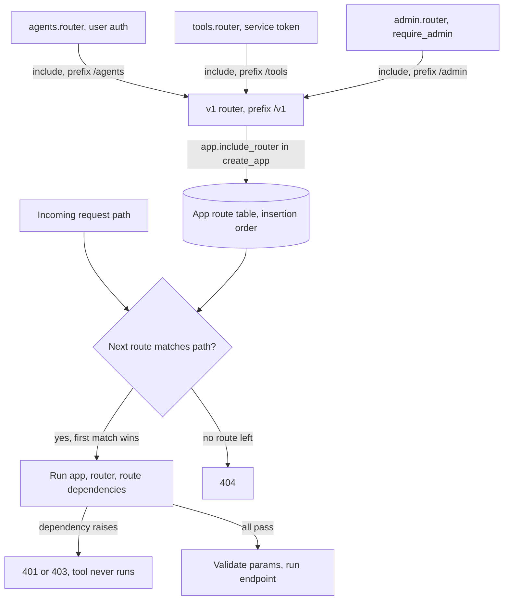

## TL;DR
An agent service grows fast: runs, tool endpoints, eval hooks, prompt admin. An `APIRouter` groups
each surface in its own module, attached with `include_router(prefix=..., tags=..., dependencies=...)`,
so auth applies once per group and the app still has one route table and one OpenAPI document.

## For agent builders
- **Why it matters for agents.** An agent backend exposes very different audiences from one process: end
  users starting runs, the agent itself calling internal tool endpoints, an eval harness replaying traces,
  and operators swapping prompt versions. Routers keep each audience behind its own prefix and guard.
- **Where it shows up in your stack.** The FastAPI service that wraps your LangGraph, OpenAI Agents SDK or
  hand-rolled tool loop; tool servers whose endpoints become agent tools via their OpenAPI schema; and
  internal admin APIs for prompts and tool registries.
- **What you control.** The prefix layout (`/v1/agents`, `/tools`, `/internal/eval`), which dependency
  guards each group (user auth, service token, admin), and the order in which routers are included.
- **What you can skip.** Starlette's routing internals. Know that inclusion copies routes, that first
  match wins, and that middleware cannot be scoped to a router.

## Lab
### Task
Harden a small agent service whose tool routes are guarded one decorator at a time: the newest tool,
`send_email`, ships with no guard at all, and a parameterised admin route shadows `/prompts/active`.

You will move the auth checks onto the routers, fix the route order, and write the CI route audit that
stops this from happening again. Time box: 45-60 minutes.
- **Prerequisites:** Dependency injection (Depends), HTTPException handling, and this lesson's
  How it works.
- **Setup:** Python 3.12 with `pip install fastapi httpx pytest` (checked on FastAPI 0.161,
  Starlette 1.9). Save the starter as `lab_routers.py` and the tests as `test_lab_routers.py`.
- **Done:** `python lab_routers.py` prints the expected output and `pytest -q` passes.

### Starter code
```python
"""Lab: guard every tool route once, at the router level (checked on FastAPI 0.161, Python 3.12)."""
from fastapi import APIRouter, Depends, FastAPI, Header, HTTPException
from fastapi.testclient import TestClient

SERVICE_TOKEN, ADMIN_KEY = "svc-test", "admin-test"     # test values; load from settings in real code


async def require_service_token(x_service_token: str = Header(default="")):
    if x_service_token != SERVICE_TOKEN:
        raise HTTPException(status_code=403, detail="agent runtime only")


async def require_admin(x_api_key: str = Header(default="")):
    if x_api_key != ADMIN_KEY:
        raise HTTPException(status_code=403, detail="admin only")


# LAB 1: guards sit on each decorator and the newest tool forgot its guard.
#        Move each guard onto its router: APIRouter(..., dependencies=[...]).
tools = APIRouter(tags=["tools"])
admin = APIRouter(tags=["admin"])


@tools.post("/refund", dependencies=[Depends(require_service_token)])
async def refund(order_id: str) -> dict:
    return {"ok": True, "order_id": order_id}


@tools.post("/send_email")                              # added in week 3, no guard
async def send_email(to: str) -> dict:
    return {"sent": True, "to": to}


# LAB 2: the parameterised route shadows the literal one. Fix it.
@admin.get("/prompts/{version}", dependencies=[Depends(require_admin)])
async def get_prompt(version: str) -> dict:
    return {"version": version}


@admin.get("/prompts/active", dependencies=[Depends(require_admin)])
async def active_prompt() -> dict:
    return {"version": "v14"}


def create_app() -> FastAPI:
    v1 = APIRouter(prefix="/v1")
    v1.include_router(tools, prefix="/tools")
    v1.include_router(admin, prefix="/admin", include_in_schema=False)
    app = FastAPI(title="agent-api")
    app.include_router(v1)
    return app


GUARDS = {"/v1/tools": require_service_token, "/v1/admin": require_admin}


def audit_routes(app: FastAPI, guards: dict) -> list[str]:
    """LAB 3: for every APIRoute under a prefix in `guards` whose dependencies lack that guard,
    return 'METHOD path missing guard_name'. Sorted; [] when everything is guarded."""
    raise NotImplementedError


if __name__ == "__main__":
    app = create_app()
    c = TestClient(app)
    print("send_email without token:", c.post("/v1/tools/send_email", params={"to": "a@b.c"}).status_code)
    print("active prompt:", c.get("/v1/admin/prompts/active", headers={"x-api-key": ADMIN_KEY}).json())
    print("audit:", audit_routes(app, GUARDS))
```

As given, it prints `send_email without token: 200` and `active prompt: {'version': 'active'}`, then
raises `NotImplementedError`: both bugs are live.

### Expected output
```
send_email without token: 403
active prompt: {'version': 'v14'}
audit: []
```

### Tests
```python
from fastapi.testclient import TestClient
import lab_routers as lab


def test_every_tool_route_needs_the_service_token():
    c = TestClient(lab.create_app())
    assert c.post("/v1/tools/send_email", params={"to": "a@b.c"}).status_code == 403
    assert c.post("/v1/tools/refund", params={"order_id": "o1"}).status_code == 403
    ok = c.post("/v1/tools/send_email", params={"to": "a@b.c"},
                headers={"x-service-token": lab.SERVICE_TOKEN})
    assert ok.status_code == 200


def test_guards_live_on_the_routers():
    assert any(d.dependency is lab.require_service_token for d in lab.tools.dependencies)
    assert any(d.dependency is lab.require_admin for d in lab.admin.dependencies)


def test_literal_route_wins():
    r = TestClient(lab.create_app()).get("/v1/admin/prompts/active", headers={"x-api-key": lab.ADMIN_KEY})
    assert r.json() == {"version": "v14"}


def test_audit_catches_a_route_added_outside_the_router():
    app = lab.create_app()
    assert lab.audit_routes(app, lab.GUARDS) == []

    @app.post("/v1/tools/delete_account")          # a new tool registered straight on the app
    async def delete_account() -> dict:
        return {}

    assert lab.audit_routes(app, lab.GUARDS) == [
        "POST /v1/tools/delete_account missing require_service_token"]


def test_admin_routes_stay_out_of_the_tool_schema():
    paths = lab.create_app().openapi()["paths"]
    assert paths and not any(p.startswith("/v1/admin") for p in paths)
```

On the starter, four tests fail: `send_email` answers 200, the routers carry no dependencies, the
literal route returns `"active"`, and the audit raises `NotImplementedError`. The schema test already
passes; it guards against a regression while you refactor. Starlette 1.x may print a deprecation warning
about `httpx` in the test client; it does not affect the results.

### Failure scenarios
- **Inject: register a tool on `tools` after `create_app()` has run**, as a plugin imported late would.
  Observe: a 404 for a route that is in the file. Debug: print `[(r.path, r.methods) for r in app.routes]`
  and note that inclusion copied the router's list at that moment.
- **Inject: put `prefix="/tools"` on both `APIRouter(...)` and `include_router(...)`.** Observe: every
  tool test gets 404 while the audit still passes, because the doubled routes are still guarded. Debug:
  dump the route table, find `/v1/tools/tools/...`, and snapshot the expected paths in CI.
- **Inject: write the audit to compare dependency names as strings.** Observe: it passes even when a
  look-alike `require_service_token` from another module is used. Debug: compare the callables
  (`d.call is guard`), as in the CI example above.

### Submission
- The fixed `lab_routers.py`, with each guard declared exactly once, on its router.
- A `pytest -q` run showing 5 passed.
- The output of `python lab_routers.py`, matching the expected output.
- Proof the audit bites: the failing test output after you delete one router-level dependency.
- A two-sentence note: why the route order matters, and why the audit compares callables, not names.

## Why it exists
- **Single-file services outgrow themselves.** One `main.py` with `@app.post("/chat")` soon holds chat,
  completions, embeddings, document upload, retrieval debugging, tool endpoints the agent calls, an admin
  surface for prompt versions and a `/v2` of the chat API.
- **Everything on `app` causes circular imports.** Every module must import `app` (the app imports
  routes, the routes import the app), and no feature can be tested in isolation.
- **Repeating settings per decorator leaves holes.** Writing `"/v1/admin"` and `Depends(require_admin)`
  on every route works until someone forgets the dependency once. That is an authorization hole no
  happy-path test catches, because nothing is broken. For an agent, a forgotten guard on a tool route
  means anyone can trigger the action the tool performs.
- **Separate mounted apps split the API.** Each mounted app has its own OpenAPI document, exception
  handlers and additional middleware stack, so clients and generated SDKs see several APIs instead of one.
- **Routers are the middle ground.** Modular declaration, cross-cutting settings applied once per group,
  and a single merged application at runtime.

## How it works
### Declaration and inclusion
1. **Declare.** Create `router = APIRouter()` in a feature module and decorate with `@router.post(...)`
   exactly as with `@app`. Nothing is served yet: a router is only a list of route definitions.
2. **Include.** `app.include_router(router, prefix="/v1/chat", tags=["chat"])` walks that list and adds
   each route to the app's route table: prefix prepended, tags merged, extra dependencies or `responses`
   attached.
3. **Include last.** Inclusion copies routes at that moment, so routes added to a router *after* it was
   included are not served. Define everything first, include last (usually in an app factory). This bites
   agent teams that register tools from plugins imported after startup.

### What a router can carry
- **Settable in two places, and they stack.** `prefix`, `tags`, `dependencies`, `responses`,
  `default_response_class`, `deprecated` and `include_in_schema` go on `APIRouter(...)` or on
  `include_router(...)`.
- **Dependencies are the important one.** `dependencies=[Depends(require_api_key)]` runs for every route
  in the group, before the endpoint, so authorization is a property of the group, not of each author's
  memory.
- **Resolution order.** App-level dependencies, then router dependencies (outer router first, then
  nested), then the route's own.
- **Values in a `dependencies=[...]` list are discarded**, because there is no parameter to bind them to.
  They exist for side effects (raise 401, record a rate-limit hit).
- **Need the value too?** Declare the same dependency as a handler parameter, such as the current user
  whose tenant scopes the agent's retrieval. FastAPI caches each dependency once per request, so it still
  runs once.
- **`include_in_schema` shapes what an agent sees.** If tools are generated from your OpenAPI document,
  setting it to false on internal routers keeps them out of the tool list.

### Nesting
- A router can include another: `v1.include_router(chat.router, prefix="/chat")` then
  `app.include_router(v1, prefix="/v1")`.
- This is how versioning is usually organised: each version is a router built from feature routers, so
  `/v2/chat` can reuse the embeddings router unchanged while replacing the chat one, for example when a new
  agent graph changes the run schema but retrieval stays the same.

### What a router cannot carry
- **Middleware and exception handlers belong to the app**, because Starlette applies them to the whole
  ASGI stack. There is no `router.add_middleware`.
- **Per-group wrapping behaviour** (timing, a request-size check) becomes a router dependency, or a
  separate sub-application via `app.mount`, accepting its own docs and handlers.
- **Direction of isolation.** The parent app's middleware still wraps a mounted sub-app (it sits outside
  the routing step); the sub-app's own middleware applies only to requests under its mount path.

| Need | Router (`include_router`) | Mounted sub-app (`app.mount`) |
|---|---|---|
| Shared auth per group | yes, via `dependencies` | yes, its own |
| Own middleware | no | yes |
| Own exception handlers | no | yes |
| OpenAPI document | merged into one | separate |

### Matching order
- **First match wins.** The route table is checked in insertion order, and path matching happens before
  parameter validation.
- **The classic bug.** `/models/{model_id}` declared before `/models/latest` captures `latest` as an id,
  then fails validation (422) or looks up a model called "latest". The agent version is
  `/agents/{agent_id}` shadowing `/agents/default`.
- **Order is behaviour.** Literal paths must be registered before parameterised siblings, including
  across routers, so the order of `include_router` calls is part of your API.
- **Second defence: a Starlette path convertor.** `/models/{model_id:int}` only matches digits, so
  `latest` fails the *match*, not validation, and routing moves on to the next route instead of
  returning 422.

## Diagram
Feature routers are copied into one route table at include time; at request time the table is scanned in
insertion order and the first path match runs its stacked dependencies before the agent code runs.



## Examples
### Agent service split into user, tool and admin routers
Users start runs; the agent loop calls tool endpoints with a service token; operators manage prompts.
Each group is guarded once at the router level.

```python
# app/main.py: the agents, tools and admin routers would each live in app/routers/; one file for brevity
from fastapi import APIRouter, Depends, FastAPI, Header, HTTPException
from pydantic import BaseModel

async def require_user(authorization: str = Header()):
    if not authorization.startswith("Bearer "):
        raise HTTPException(status_code=401, detail="login required")

async def require_service_token(x_service_token: str = Header()):
    if x_service_token != "token-from-settings":       # illustrative; load from settings
        raise HTTPException(status_code=403, detail="agent runtime only")

async def require_admin(x_api_key: str = Header()):
    if x_api_key != "admin-key-from-settings":         # illustrative; load from settings
        raise HTTPException(status_code=403, detail="admin only")

agents = APIRouter(tags=["agents"], dependencies=[Depends(require_user)])
tools = APIRouter(tags=["tools"], dependencies=[Depends(require_service_token)])
admin = APIRouter(tags=["admin"], dependencies=[Depends(require_admin)], include_in_schema=False)

class RunIn(BaseModel):
    goal: str

@agents.post("/{agent_id}/runs", status_code=202)
async def start_run(agent_id: str, body: RunIn) -> dict:
    return {"run_id": "r_123", "agent_id": agent_id}   # hand off to the agent loop

class RefundIn(BaseModel):
    order_id: str
    amount_cents: int

@tools.post("/refund")                                  # an action tool: guard matters most here
async def refund(body: RefundIn) -> dict:
    return {"ok": True, "order_id": body.order_id}

@admin.get("/prompts/active")                           # literal path first
async def active_prompt() -> dict:
    return {"version": "v14"}

@admin.get("/prompts/{version}")                        # parameterised sibling second
async def get_prompt(version: str) -> dict:
    return {"version": version}

def create_app() -> FastAPI:
    v1 = APIRouter(prefix="/v1")
    v1.include_router(agents, prefix="/agents")
    v1.include_router(tools, prefix="/tools")
    v1.include_router(admin, prefix="/admin")
    app = FastAPI(title="agent-api")
    app.include_router(v1)                              # include after all routes are declared
    return app
```

- `POST /v1/agents/{agent_id}/runs` needs a user token, just as `POST /v1/chat/completions` would in a
  plain chat service; `POST /v1/tools/refund` only accepts the agent
  runtime's service token, so a user cannot call the refund tool directly.
- Every `/v1/admin/...` route requires the header without any admin endpoint mentioning it, and the admin
  group stays out of the OpenAPI document that tool generators read.
- Swapping the two prompt routes would make `/v1/admin/prompts/active` return version `"active"`, a bug
  that only shows up when someone calls the literal path.

### CI test: no tool or admin route without its guard
A route-table audit that fails the build if any route under a protected prefix lacks its dependency, plus
a behaviour check with the test client.

```python
from fastapi.routing import APIRoute
from fastapi.testclient import TestClient
from app.main import create_app, require_admin, require_service_token

GUARDS = {"/v1/admin": require_admin, "/v1/tools": require_service_token}

def test_every_protected_route_is_guarded():
    app = create_app()
    for route in app.routes:
        if not isinstance(route, APIRoute):
            continue
        for prefix, guard in GUARDS.items():
            if route.path.startswith(prefix):
                calls = {d.call for d in route.dependant.dependencies}
                assert guard in calls, f"{route.path} is missing {guard.__name__}"

def test_admin_rejects_missing_key():
    client = TestClient(create_app())
    assert client.get("/v1/admin/prompts/active").status_code == 422   # header is required
    r = client.get("/v1/admin/prompts/active", headers={"x-api-key": "wrong"})
    assert r.status_code == 403
```

### Worked trace: how prefixes compose
| Declared on | Value | Resulting path |
|---|---|---|
| `v1 = APIRouter(prefix="/v1")` | `/v1` | |
| `v1.include_router(admin.router, prefix="/admin")` | `/admin` | |
| `@router.get("/prompts/active")` | `/prompts/active` | `/v1/admin/prompts/active` |
| Mistake: `APIRouter(prefix="/chat")` **and** `prefix="/chat"` on include | `/chat` twice | `/v1/chat/chat/completions` |

### Worked scenario: a tool route that slipped past auth
An illustrative incident timeline for an agent team that put guards on each route instead of the router.

| Step | What happened |
|---|---|
| Week 1 | 6 tool routes, each with `Depends(require_service_token)` on the decorator |
| Week 3 | a 7th tool, `/tools/send_email`, is added without the dependency; happy-path tests pass |
| Week 4 | a user who read the OpenAPI document calls it directly, outside any agent run |
| Fix | move the guard to `APIRouter(dependencies=[...])`, add the route audit, make it fail once on purpose |

## Production patterns
- **One router per audience, not per file.** Agent teams keep `agents` (end users), `tools` (agent
  runtime only), `internal/eval` (eval harness) and `admin` (operators) as separate routers, each with
  exactly one guard dependency. Monitor: 401 and 403 counts per router prefix; a non-zero rate on `tools`
  from user tokens means someone is calling tools directly.
- **App factory with an explicit router list.** Build the app in `create_app()` that includes every
  router in one visible list, so tests construct the same app with `app.dependency_overrides` set (for
  example a fake LLM client). Monitor: a CI snapshot of the route table (method and path) that shows added
  or removed routes in every diff.
- **Route-table audit in CI.** Walk `app.routes` and assert every route under a protected prefix carries
  the auth dependency, as in the test above. Monitor: the test must fail on purpose once when you add it,
  to prove it checks something.
- **Versions composed from feature routers.** `v1` and `v2` routers include the same unchanged feature
  routers and swap only what changed (say, a new run schema from a new agent graph); pass
  `deprecated=True` on the old version's `include_router` so OpenAPI flags it. Monitor: request counts per
  version prefix, labelled by route template, before removal.
- **Typed path convertors for ids.** Use `{model_id:int}` (or literal-first ordering) wherever a
  collection has named members like `latest` or `default`. Monitor: 422 rates per route; a spike on one
  parameterised route usually means a shadowed literal.
- **Mount, not include, for foreign apps.** Metrics endpoints, Gradio demos, an MCP server's ASGI app or
  anything needing its own middleware go in via `app.mount`, for example `app.mount("/metrics",
  make_asgi_app())` with `prometheus_client`. Monitor: that the parent's auth middleware does or does not
  wrap it, as intended.

## Trade-offs
- **Group security vs per-request cost.** Router-level dependencies make security a group property, but
  they run on every route in the group, so an expensive dependency (a DB lookup) becomes a per-request tax
  for routes that never needed it. In a tool loop that calls 20 tool routes per run, that tax is paid 20
  times.
- **One merged app vs one middleware stack.** You get one OpenAPI document and one SDK, but also one
  middleware stack; when a group genuinely needs different middleware, a mounted sub-app is the better
  tool despite split docs.
- **Prefix versioning vs duplication.** Versioning by router prefix is cheap and visible, but it
  duplicates handlers when versions diverge slightly; once differences are small and many, version inside
  the schema or handler instead.
- **Small modules vs scattered logic.** Splitting by feature keeps modules small, but too many tiny
  routers scatter related logic and make the inclusion order (and thus matching) harder to reason about.
- **Tools in the agent service vs a separate tool server.** Same-process tool routers are simple and
  fast, but every tool shares the agent service's blast radius and deploy cadence; split out once tools
  have different owners or scaling needs.

## Pitfalls
- **Parameterised path before a literal sibling.** Symptom: a 422 or a "not found" for a route that
  clearly exists, such as `/models/latest`. Fix: register literals first or use a path convertor.
- **Adding routes after `include_router` ran** (for example from a tool plugin imported later). Symptom:
  a 404 locally that disappears when import order changes, or an agent whose tool call 404s. Fix: include
  everything in the app factory.
- **Auth dependency on individual routes instead of the router.** Symptom: a newly added endpoint (often a
  new tool) is reachable without credentials and passes every test that only checks the happy path. Fix:
  router-level `dependencies` plus a route audit.
- **Doubled prefixes.** Setting `prefix="/chat"` on both the router and `include_router` serves routes at
  `/chat/chat/...` and breaks client calls. Fix: put each prefix in exactly one place.
- **Expecting `@router.exception_handler` or router middleware to exist.** Handlers and middleware must
  be registered on the app, so per-router error formatting silently does not happen. An agent that
  expects tool errors in a specific JSON shape then gets the app-wide default instead.
- **Internal routes leaking into generated tools.** Symptom: the agent "discovers" admin or eval
  endpoints because tools were generated from the full OpenAPI document. Fix: `include_in_schema=False`
  on those routers, or generate tools only from the tools router's tag.

## When to use
- **Use when:** a service has more than one feature area or more than one audience (public API, agent
  tool calls, internal admin, eval harness).
- **Organise:** by feature and audience, not by HTTP verb, and assemble everything in an app factory so
  tests can build the app with overridden dependencies.
- **Put on routers:** authentication, tenant resolution and rate-limit dependencies, so they cannot be
  forgotten.
- **Use `app.mount` instead when:** a group needs its own middleware, its own docs, or is a different
  framework entirely (a Gradio demo, a metrics app).
- **Code review:** check inclusion order and literal-before-parameter paths.
- **Interviews:** routers are the vocabulary for "how would you structure a FastAPI service".

## Role lens
- **Engineer:** Splits endpoints into feature routers, attaches auth and tenant dependencies at router
  level, and writes an app factory that tests can call with dependency overrides.
- **Architect:** Decides the URL and versioning scheme, which groups share one app versus become mounted
  sub-apps or separate services, and where authorization boundaries sit.
- **FDE:** Adds a customer-specific router (an integration webhook or a tenant admin view) behind its own
  prefix and dependency without forking or destabilising the core service.

## Check yourself
**Q:** Your team wants the `/internal/eval` endpoints to use a different authentication scheme and to log
full request bodies, while the public API must never log bodies. How do you structure this, and why is a
router alone not enough?
**A:** Authentication can be a router-level dependency, so the eval router gets `Depends(require_service_token)`
and the public router gets its API-key dependency; that part routers handle well. Body logging is
different: it wraps the request, which is middleware territory, and middleware is app-wide, so a router
cannot scope it. Options are a router dependency that reads and logs the body only for that group
(acceptable for small bodies), or mounting the eval surface as a separate sub-app with its own logging
middleware, accepting separate OpenAPI docs. Given the privacy stakes, I would mount it, or move it to a
separate internal service, so the public stack cannot accidentally inherit body logging.

## Interview questions
### What is an APIRouter and why not just decorate everything on the app?
- **Definition:** a router is a list of route definitions declared in a feature module; `include_router`
  copies them into the app's single route table with a prefix, tags and dependencies applied.
- **Why:** it avoids circular imports on `app`, lets each feature be tested alone, and applies auth once
  per group while still producing one app and one OpenAPI document.

### How would you structure the API of a service that runs agents and also hosts the tools they call?
- **Split by audience:** an `agents` router for end users starting and reading runs, a `tools` router only
  the agent runtime can call (service token), and `admin` and `internal/eval` routers for operators and
  the eval harness.
- **One guard per router** via `dependencies=[...]`, plus a CI audit that walks `app.routes`, so a new tool
  cannot ship unguarded.
- **Keep internal groups out of the schema** with `include_in_schema=False` if tools are generated from
  OpenAPI, so the model never sees admin endpoints.

### A client reports that GET /v1/models/latest returns 422 but the route exists. How do you debug it?
- **Suspect matching order first:** routes are matched in insertion order and path matching precedes
  validation, so a parameterised `/models/{model_id}` registered earlier captures `latest`.
- **Confirm:** print `[(r.path, r.methods) for r in app.routes]` and check which route sits first,
  including across `include_router` calls.
- **Fix:** register the literal first, or use `{model_id:int}` so `latest` fails the match and routing
  moves on.

### When would you mount a sub-application instead of including a router?
- **Mount when the group needs its own middleware or exception handlers**, because routers cannot carry
  either; both belong to the app's ASGI stack.
- **Also mount** foreign ASGI apps such as a Prometheus metrics app or a Gradio demo.
- **The cost:** a separate OpenAPI document and SDK surface, so prefer a router whenever a dependency can
  express the per-group behaviour.

### How do you guarantee nobody ships an admin endpoint or an agent tool without the auth check?
- **Put the guard on the router:** `dependencies=[Depends(require_admin)]` covers every current and future
  route in the group, so a new endpoint cannot forget it.
- **Back it with a CI audit:** walk `app.routes`, and for each `APIRoute` under the admin or tools prefix
  assert the guard appears in `route.dependant.dependencies`.
- **Prove the test works:** make it fail once on purpose when you add it.

### Your router-level dependency does a database lookup and your agent makes 20 tool calls per run. What does that cost?
- **It runs on every route in the group**, including routes that never use its result, so it becomes a
  per-request tax of one query, here 20 queries per agent run.
- **Options:** move it to only the routes that need it, cache the lookup, or split the group into two
  routers so cheap routes skip it.
- **If a handler also needs the value**, declare it as a parameter too; FastAPI caches it once per
  request, so it still runs only once.

## Quiz
### Q: Why does `GET /v1/models/latest` return 422 in a service that defines both `/v1/models/latest` and `/v1/models/{model_id}` with `model_id: int`?
- [ ] `latest` is a reserved word in FastAPI path parameters
- [x] `/v1/models/{model_id}` was registered first and matched before the literal route was tried
- [ ] The router prefix was applied twice so the literal route lives elsewhere
- [ ] Routers sort routes alphabetically, putting `{model_id}` ahead of `latest`
> Routes are matched in insertion order and path matching precedes validation, so the parameterised route
> captures `latest` and then fails integer validation. Registering the literal path first fixes it.

### Q: You need every admin endpoint to require an admin token. What is the most robust approach?
- [ ] Add `Depends(require_admin)` to each admin route decorator
- [ ] Add an app-wide middleware that checks paths starting with `/admin`
- [x] Set `dependencies=[Depends(require_admin)]` on the admin router or its `include_router` call
- [ ] Check the token inside each handler's body before doing work
> A router-level dependency applies to every current and future route in the group, so a new endpoint
> cannot forget it. Path-prefix middleware works but duplicates routing logic and is easy to desynchronise.

### Q: What is the main consequence of using `app.mount("/eval", eval_app)` instead of `include_router`?
- [ ] Mounted apps cannot use Pydantic models
- [ ] Mounted routes are slower because each request is proxied over HTTP
- [x] The mounted app has its own middleware, exception handlers and OpenAPI document
- [ ] Mounted apps share the parent's dependencies automatically
> Mounting attaches a separate ASGI application in-process, so it is isolated: its own docs, handlers and
> middleware (the parent's middleware still wraps it). That is the point when you need isolation, and the
> cost when you wanted one merged API. There is no HTTP proxying, and dependencies are not inherited.

## Use cases & projects
### Use cases
- **Agent backends with several audiences.** End users start runs under `/v1/agents`, the agent loop
  calls internal tools under `/tools`, and operators manage prompt versions under an admin prefix, each
  behind its own guard declared once.
- **Tool servers for agents.** A service whose routes become agent tools keeps each tool family in its
  own router and tag, so imported tool lists stay grouped and readable.
- **Eval and replay surfaces.** An `/internal/eval` router lets an eval harness replay recorded agent
  traces against the live service without exposing those routes to end users.
- **Versioned agent APIs.** A `/v2` runs router can ship a new run payload while `/v1` keeps serving
  older clients from the same process.

### Mini project
**Split a single-file agent service into guarded routers (1-2 hours).**
- **Goal:** turn a `main.py` holding run, tool and admin routes into three routers, with auth applied
  once per group and no route left unguarded.
- **Steps:** create `runs`, `tools` and `admin` modules, each with an `APIRouter`; attach them with
  `include_router` using a prefix, a tag and a group dependency (user auth, service token, admin); add a
  test that walks `app.routes` and fails if any route under `/tools` or the admin prefix lacks its guard.
- **Done when:** `/docs` shows the three tagged groups, a wrong credential gets 401 or 403 on every guarded
  route (a missing required header gets 422, as in the test above), and the route-walk test fails when you
  delete one router-level dependency.

### Major project
This lesson feeds the module Capstone (see the module guide): the document question-answering service
there is built on versioned routers, with upload, job status, chat and health surfaces each in their own
router.
