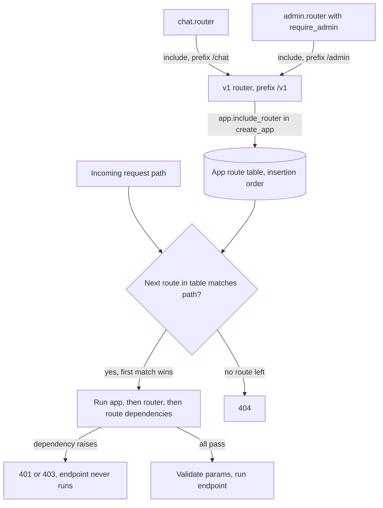

## TL;DR
An `APIRouter` groups path operations in their own module, attached with
`include_router(prefix=..., tags=..., dependencies=...)`. It splits a growing AI service by feature,
version and audience while still producing one app, one route table and one OpenAPI document.

## Why it exists
- **Single-file services outgrow themselves.** One `main.py` with `@app.post("/chat")` soon holds chat,
  completions, embeddings, document upload, retrieval debugging, an admin surface for prompt versions and
  a `/v2` of the chat API.
- **Everything on `app` causes circular imports.** Every module must import `app` (the app imports
  routes, the routes import the app), and no feature can be tested in isolation.
- **Repeating settings per decorator leaves holes.** Writing `"/v1/admin"` and `Depends(require_admin)`
  on every route works until someone forgets the dependency once. That is an authorization hole no
  happy-path test catches, because nothing is broken.
- **Separate mounted apps split the API.** Each mounted app has its own OpenAPI document, exception
  handlers and additional middleware stack, so clients and generated SDKs see several APIs instead of one.
- **Routers are the middle ground.** Modular declaration, cross-cutting settings applied once per group,
  and a single merged application at runtime.

## How it works
### Declaration and inclusion
1. **Declare.** Create `router = APIRouter()` in a feature module and decorate with `@router.post(...)`
   exactly as with `@app`. Nothing is served yet: a router is only a list of route definitions.
2. **Include.** `app.include_router(router, prefix="/v1/chat", tags=["chat"])` walks that list and adds
   each route to the app's route table: prefix prepended, tags merged, extra dependencies or `responses`
   attached.
3. **Include last.** Inclusion copies routes at that moment, so routes added to a router *after* it was
   included are not served. Define everything first, include last (usually in an app factory).

### What a router can carry
- **Settable in two places, and they stack.** `prefix`, `tags`, `dependencies`, `responses`,
  `default_response_class`, `deprecated` and `include_in_schema` go on `APIRouter(...)` or on
  `include_router(...)`.
- **Dependencies are the important one.** `dependencies=[Depends(require_api_key)]` runs for every route
  in the group, before the endpoint, so authorization is a property of the group, not of each author's
  memory.
- **Resolution order.** App-level dependencies, then router dependencies (outer router first, then
  nested), then the route's own.
- **Values in a `dependencies=[...]` list are discarded**, because there is no parameter to bind them to.
  They exist for side effects (raise 401, record a rate-limit hit).
- **Need the value too?** Declare the same dependency as a handler parameter, such as the current user.
  FastAPI caches each dependency once per request, so it still runs once.

### Nesting
- A router can include another: `v1.include_router(chat.router, prefix="/chat")` then
  `app.include_router(v1, prefix="/v1")`.
- This is how versioning is usually organised: each version is a router built from feature routers, so
  `/v2/chat` can reuse the embeddings router unchanged while replacing the chat one.

### What a router cannot carry
- **Middleware and exception handlers belong to the app**, because Starlette applies them to the whole
  ASGI stack. There is no `router.add_middleware`.
- **Per-group wrapping behaviour** (timing, a request-size check) becomes a router dependency, or a
  separate sub-application via `app.mount`, accepting its own docs and handlers.
- **Direction of isolation.** The parent app's middleware still wraps a mounted sub-app (it sits outside
  the routing step); the sub-app's own middleware applies only to requests under its mount path.

| Need | Router (`include_router`) | Mounted sub-app (`app.mount`) |
|---|---|---|
| Shared auth per group | yes, via `dependencies` | yes, its own |
| Own middleware | no | yes |
| Own exception handlers | no | yes |
| OpenAPI document | merged into one | separate |

### Matching order
- **First match wins.** The route table is checked in insertion order, and path matching happens before
  parameter validation.
- **The classic bug.** `/models/{model_id}` declared before `/models/latest` captures `latest` as an id,
  then fails validation (422) or looks up a model called "latest".
- **Order is behaviour.** Literal paths must be registered before parameterised siblings, including
  across routers, so the order of `include_router` calls is part of your API.
- **Second defence: a Starlette path convertor.** `/models/{model_id:int}` only matches digits, so
  `latest` fails the *match*, not validation, and routing moves on to the next route instead of
  returning 422.

## Diagram
Feature routers are copied into one route table at include time; at request time the table is scanned in
insertion order and the first path match runs its stacked dependencies.



## Examples
### Feature routers with a protected admin group
A small AI service split into feature routers, with versioning by prefix and an admin group protected
once at the router level.

```python
# app/routers/chat.py
from fastapi import APIRouter
from pydantic import BaseModel

router = APIRouter(tags=["chat"])

class ChatIn(BaseModel):
    messages: list[dict]
    model: str = "default"

@router.post("/completions")
async def complete(body: ChatIn) -> dict:
    return {"model": body.model, "content": "..."}

# app/routers/admin.py
from fastapi import APIRouter, Depends, Header, HTTPException

async def require_admin(x_api_key: str = Header()):
    if x_api_key != "admin-key-from-settings":      # illustrative; load from settings in real code
        raise HTTPException(status_code=403, detail="admin only")

router = APIRouter(tags=["admin"], dependencies=[Depends(require_admin)])

@router.get("/prompts/active")          # literal path first
async def active_prompt() -> dict:
    return {"version": "v14"}

@router.get("/prompts/{version}")       # parameterised sibling second
async def get_prompt(version: str) -> dict:
    return {"version": version}

# app/main.py
from fastapi import APIRouter, FastAPI
from app.routers import admin, chat

def create_app() -> FastAPI:
    v1 = APIRouter(prefix="/v1")
    v1.include_router(chat.router, prefix="/chat")
    v1.include_router(admin.router, prefix="/admin")
    app = FastAPI(title="assistant-api")
    app.include_router(v1)              # include after all routes are declared
    return app
```

- `POST /v1/chat/completions` is public.
- Every `/v1/admin/...` route requires the header without any admin endpoint mentioning it.
- Swapping the two prompt routes would make `/v1/admin/prompts/active` return version `"active"`, a bug
  that only shows up when someone calls the literal path.

### CI test: no admin route without the guard
A route-table audit that fails the build if any route under the admin prefix lacks `require_admin`,
plus a behaviour check with the test client.

```python
from fastapi.routing import APIRoute
from fastapi.testclient import TestClient
from app.main import create_app
from app.routers.admin import require_admin

def test_every_admin_route_is_guarded():
    app = create_app()
    for route in app.routes:
        if isinstance(route, APIRoute) and route.path.startswith("/v1/admin"):
            calls = {d.call for d in route.dependant.dependencies}
            assert require_admin in calls, f"{route.path} is missing require_admin"

def test_admin_rejects_missing_key():
    client = TestClient(create_app())
    assert client.get("/v1/admin/prompts/active").status_code == 422   # header is required
    r = client.get("/v1/admin/prompts/active", headers={"x-api-key": "wrong"})
    assert r.status_code == 403
```

### Worked trace: how prefixes compose
| Declared on | Value | Resulting path |
|---|---|---|
| `v1 = APIRouter(prefix="/v1")` | `/v1` | |
| `v1.include_router(admin.router, prefix="/admin")` | `/admin` | |
| `@router.get("/prompts/active")` | `/prompts/active` | `/v1/admin/prompts/active` |
| Mistake: `APIRouter(prefix="/chat")` **and** `prefix="/chat"` on include | `/chat` twice | `/v1/chat/chat/completions` |

## Production patterns
- **App factory with an explicit router list.** Build the app in `create_app()` that includes every
  router in one visible list, so tests construct the same app with `app.dependency_overrides` set.
  Monitor: a CI snapshot of the route table (method and path) that shows added or removed routes in
  every diff.
- **Route-table audit in CI.** Walk `app.routes` and assert every route under a protected prefix carries
  the auth dependency, as in the test above. Monitor: the test must fail on purpose once when you add it,
  to prove it checks something.
- **Versions composed from feature routers.** `v1` and `v2` routers include the same unchanged feature
  routers and swap only what changed; pass `deprecated=True` on the old version's `include_router` so
  OpenAPI flags it. Monitor: request counts per version prefix, labelled by route template, before removal.
- **Typed path convertors for ids.** Use `{model_id:int}` (or literal-first ordering) wherever a
  collection has named members like `latest`. Monitor: 422 rates per route; a spike on one parameterised
  route usually means a shadowed literal.
- **Mount, not include, for foreign apps.** Metrics endpoints, Gradio demos or anything needing its own
  middleware go in via `app.mount`, for example `app.mount("/metrics", make_asgi_app())` with
  `prometheus_client`. Monitor: that the parent's auth middleware does or does not wrap it, as intended.

## Trade-offs
- **Group security vs per-request cost.** Router-level dependencies make security a group property, but
  they run on every route in the group, so an expensive dependency (a DB lookup) becomes a per-request tax
  for routes that never needed it.
- **One merged app vs one middleware stack.** You get one OpenAPI document and one SDK, but also one
  middleware stack; when a group genuinely needs different middleware, a mounted sub-app is the better
  tool despite split docs.
- **Prefix versioning vs duplication.** Versioning by router prefix is cheap and visible, but it
  duplicates handlers when versions diverge slightly; once differences are small and many, version inside
  the schema or handler instead.
- **Small modules vs scattered logic.** Splitting by feature keeps modules small, but too many tiny
  routers scatter related logic and make the inclusion order (and thus matching) harder to reason about.

## Pitfalls
- **Parameterised path before a literal sibling.** Symptom: a 422 or a "not found" for a route that
  clearly exists, such as `/models/latest`. Fix: register literals first or use a path convertor.
- **Adding routes after `include_router` ran** (for example from a plugin imported later). Symptom: a
  404 locally that disappears when import order changes. Fix: include everything in the app factory.
- **Auth dependency on individual routes instead of the router.** Symptom: a newly added endpoint is
  reachable without credentials and passes every test that only checks the happy path. Fix: router-level
  `dependencies` plus a route audit.
- **Doubled prefixes.** Setting `prefix="/chat"` on both the router and `include_router` serves routes at
  `/chat/chat/...` and breaks client calls. Fix: put each prefix in exactly one place.
- **Expecting `@router.exception_handler` or router middleware to exist.** Handlers and middleware must
  be registered on the app, so per-router error formatting silently does not happen.

## When to use
- **Use when:** a service has more than one feature area or more than one audience (public API, internal
  admin, eval harness).
- **Organise:** by feature, not by HTTP verb, and assemble everything in an app factory so tests can build
  the app with overridden dependencies.
- **Put on routers:** authentication, tenant resolution and rate-limit dependencies, so they cannot be
  forgotten.
- **Use `app.mount` instead when:** a group needs its own middleware, its own docs, or is a different
  framework entirely (a Gradio demo, a metrics app).
- **Code review:** check inclusion order and literal-before-parameter paths.
- **Interviews:** routers are the vocabulary for "how would you structure a FastAPI service".

## Role lens
- **Engineer:** Splits endpoints into feature routers, attaches auth and tenant dependencies at router
  level, and writes an app factory that tests can call with dependency overrides.
- **Architect:** Decides the URL and versioning scheme, which groups share one app versus become mounted
  sub-apps or separate services, and where authorization boundaries sit.
- **FDE:** Adds a customer-specific router (an integration webhook or a tenant admin view) behind its own
  prefix and dependency without forking or destabilising the core service.

## Check yourself
**Q:** Your team wants the `/internal/eval` endpoints to use a different authentication scheme and to log
full request bodies, while the public API must never log bodies. How do you structure this, and why is a
router alone not enough?
**A:** Authentication can be a router-level dependency, so the eval router gets `Depends(require_service_token)`
and the public router gets its API-key dependency; that part routers handle well. Body logging is
different: it wraps the request, which is middleware territory, and middleware is app-wide, so a router
cannot scope it. Options are a router dependency that reads and logs the body only for that group
(acceptable for small bodies), or mounting the eval surface as a separate sub-app with its own logging
middleware, accepting separate OpenAPI docs. Given the privacy stakes, I would mount it, or move it to a
separate internal service, so the public stack cannot accidentally inherit body logging.

## Interview questions
### What is an APIRouter and why not just decorate everything on the app?
- **Definition:** a router is a list of route definitions declared in a feature module; `include_router`
  copies them into the app's single route table with a prefix, tags and dependencies applied.
- **Why:** it avoids circular imports on `app`, lets each feature be tested alone, and applies auth once
  per group while still producing one app and one OpenAPI document.

### A client reports that GET /v1/models/latest returns 422 but the route exists. How do you debug it?
- **Suspect matching order first:** routes are matched in insertion order and path matching precedes
  validation, so a parameterised `/models/{model_id}` registered earlier captures `latest`.
- **Confirm:** print `[(r.path, r.methods) for r in app.routes]` and check which route sits first,
  including across `include_router` calls.
- **Fix:** register the literal first, or use `{model_id:int}` so `latest` fails the match and routing
  moves on.

### When would you mount a sub-application instead of including a router?
- **Mount when the group needs its own middleware or exception handlers**, because routers cannot carry
  either; both belong to the app's ASGI stack.
- **Also mount** foreign ASGI apps such as a Prometheus metrics app or a Gradio demo.
- **The cost:** a separate OpenAPI document and SDK surface, so prefer a router whenever a dependency can
  express the per-group behaviour.

### How do you guarantee nobody ships an admin endpoint without the auth check?
- **Put the guard on the router:** `dependencies=[Depends(require_admin)]` covers every current and future
  route in the group, so a new endpoint cannot forget it.
- **Back it with a CI audit:** walk `app.routes`, and for each `APIRoute` under the admin prefix assert the
  guard appears in `route.dependant.dependencies`.
- **Prove the test works:** make it fail once on purpose when you add it.

### Your router-level dependency does a database lookup. What does that cost, and what would you change?
- **It runs on every route in the group**, including routes that never use its result, so it becomes a
  per-request tax of one query.
- **Options:** move it to only the routes that need it, cache the lookup, or split the group into two
  routers so cheap routes skip it.
- **If a handler also needs the value**, declare it as a parameter too; FastAPI caches it once per
  request, so it still runs only once.

## Quiz
### Q: Why does `GET /v1/models/latest` return 422 in a service that defines both `/v1/models/latest` and `/v1/models/{model_id}` with `model_id: int`?
- [ ] `latest` is a reserved word in FastAPI path parameters
- [x] `/v1/models/{model_id}` was registered first and matched before the literal route was tried
- [ ] The router prefix was applied twice so the literal route lives elsewhere
- [ ] Routers sort routes alphabetically, putting `{model_id}` ahead of `latest`
> Routes are matched in insertion order and path matching precedes validation, so the parameterised route
> captures `latest` and then fails integer validation. Registering the literal path first fixes it.

### Q: You need every admin endpoint to require an admin token. What is the most robust approach?
- [ ] Add `Depends(require_admin)` to each admin route decorator
- [ ] Add an app-wide middleware that checks paths starting with `/admin`
- [x] Set `dependencies=[Depends(require_admin)]` on the admin router or its `include_router` call
- [ ] Check the token inside each handler's body before doing work
> A router-level dependency applies to every current and future route in the group, so a new endpoint
> cannot forget it. Path-prefix middleware works but duplicates routing logic and is easy to desynchronise.

### Q: What is the main consequence of using `app.mount("/eval", eval_app)` instead of `include_router`?
- [ ] Mounted apps cannot use Pydantic models
- [ ] Mounted routes are slower because each request is proxied over HTTP
- [x] The mounted app has its own middleware, exception handlers and OpenAPI document
- [ ] Mounted apps share the parent's dependencies automatically
> Mounting attaches a separate ASGI application in-process, so it is isolated: its own docs, handlers and
> middleware (the parent's middleware still wraps it). That is the point when you need isolation, and the
> cost when you wanted one merged API. There is no HTTP proxying, and dependencies are not inherited.
