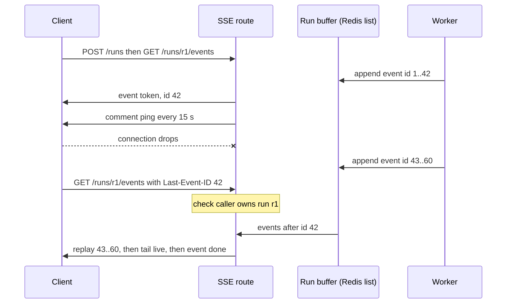

## TL;DR
Server-Sent Events is one-way typed event streaming over a normal `text/event-stream` HTTP response. It is
the default wire format for agent runs: `token`, `tool_call` and `done` events, keepalives through silent
tools, and resumption via `Last-Event-ID`.

## For agent builders
- **Why it matters for agents.** An agent run is a sequence of different events (steps, tool calls,
  tokens, usage, errors), not one text blob. SSE gives each a name, keeps the stream alive through silent
  tool calls and lets a dropped client catch up instead of paying for a second run.
- **Where it shows up in your stack.** Both major vendor APIs stream over SSE, so their SDKs parse it for
  you; your FastAPI agent endpoint re-emits your own vocabulary through `StreamingResponse` or
  `sse-starlette`, and many agent frameworks' streaming helpers emit it too.
- **What you control.** The event vocabulary, the keepalive interval relative to the idle timeouts on the
  path, event ids plus a per-run buffer for resumption, and the explicit `done` that ends a run.
- **What you can skip.** Memorising every vendor's event names; write one adapter and check the vendor
  docs when you build it. `EventSource` internals matter only if you write the frontend.

## Lab
### Task
Build the resumable SSE reader for an agent run: the worker writes events to a per-run buffer, and your
route replays, tails and keeps the stream alive. Time box: 60-90 minutes. Prerequisites:
StreamingResponse and BackgroundTasks (for the strong-reference task pattern).
- **Frame format:** `event:`, `id:` and JSON `data:` lines, then the blank line that dispatches.
- **Keepalive:** a `: ping` comment whenever nothing new arrives for `PING_EVERY` seconds.
- **Resume:** a request carrying `Last-Event-ID` gets only the events after that id, without a second run.
- **Termination and safety:** stop right after `done`; an unknown run id is a 404.

### Starter code
Save as `lab_sse.py`. Needs `pip install fastapi httpx` (checked with FastAPI 0.161.1, Starlette 1.9.0,
httpx 0.28.1, Python 3.12). It runs until the first YOUR CODE path raises `NotImplementedError`.

```python
import asyncio, json, itertools
from fastapi import FastAPI, Header, HTTPException
from fastapi.responses import StreamingResponse
from fastapi.testclient import TestClient

app = FastAPI()
PING_EVERY = 0.1                       # seconds here; 10-20 s in production, below every idle timeout
RUNS: dict[str, list[tuple[int, str, dict]]] = {}     # per-run buffer: (event id, event, data)
_ids, _tasks = itertools.count(1), set()

async def fake_agent(run_id: str) -> None:
    """The worker: runs independently of any HTTP connection and appends to the run's buffer."""
    buf, n = RUNS[run_id], itertools.count(1)
    buf.append((next(n), "tool_call", {"name": "web_search"}))
    await asyncio.sleep(0.35)                          # a silent tool: longer than PING_EVERY
    buf.append((next(n), "tool_result", {"summary": "3 results"}))
    for w in ["SSE ", "frames ", "agent ", "events."]:
        await asyncio.sleep(0.02)
        buf.append((next(n), "token", {"delta": w}))
    buf.append((next(n), "done", {}))

@app.post("/runs")
async def start_run():
    run_id = f"r{next(_ids)}"
    RUNS[run_id] = []
    task = asyncio.create_task(fake_agent(run_id))
    _tasks.add(task); task.add_done_callback(_tasks.discard)   # strong reference
    return {"run_id": run_id}

def sse(event: str, data: dict, id: int) -> str:
    # YOUR CODE 1: format one event (event, id and JSON data fields) ending with the blank line.
    raise NotImplementedError

@app.get("/runs/{run_id}/events")
async def events(run_id: str, last_event_id: int = Header(0)):   # reads the Last-Event-ID header
    # YOUR CODE 2: unknown run id -> 404 (in real code also check the caller owns the run).
    async def stream():
        # YOUR CODE 3: replay buffered events with id > last_event_id, then tail new ones live.
        # YOUR CODE 4: when nothing new arrives for PING_EVERY seconds, yield the comment ": ping\n\n".
        # YOUR CODE 5: stop right after sending the "done" event.
        raise NotImplementedError
        yield
    return StreamingResponse(stream(), media_type="text/event-stream",
                             headers={"Cache-Control": "no-cache", "X-Accel-Buffering": "no"})

def parse_sse(text: str):
    """Minimal WHATWG-style parser: yields (event, data, id); comments are dropped."""
    for block in text.split("\n\n"):
        fields = dict(line.split(": ", 1) for line in block.split("\n") if line and not line.startswith(":"))
        if "data" in fields:
            yield fields.get("event", "message"), json.loads(fields["data"]), int(fields["id"])

if __name__ == "__main__":
    with TestClient(app) as client:                    # one event loop for every request
        run_id = client.post("/runs").json()["run_id"]
        body = client.get(f"/runs/{run_id}/events").text
        print("pings seen:", ": ping" in body)
        for ev in parse_sse(body):
            print(ev)
        resumed = client.get(f"/runs/{run_id}/events", headers={"Last-Event-ID": "5"}).text
        print("resumed:", [ev[2] for ev in parse_sse(resumed)])
```

### Expected output
`python lab_sse.py` with a correct solution prints:

```
pings seen: True
('tool_call', {'name': 'web_search'}, 1)
('tool_result', {'summary': '3 results'}, 2)
('token', {'delta': 'SSE '}, 3)
('token', {'delta': 'frames '}, 4)
('token', {'delta': 'agent '}, 5)
('token', {'delta': 'events.'}, 6)
('done', {}, 7)
resumed: [6, 7]
```

### Tests
Save as `test_lab_sse.py` and run `pytest -q`. On the starter all four fail: `NotImplementedError` from
`sse()`, empty streams, and a 200 for an unknown run.

```python
import pytest
from fastapi.testclient import TestClient
from lab_sse import app, parse_sse, sse

@pytest.fixture
def client():
    with TestClient(app, raise_server_exceptions=False) as c:
        yield c

def test_frame_format():
    assert sse("token", {"delta": "Hi"}, 7) == 'event: token\nid: 7\ndata: {"delta": "Hi"}\n\n'

def test_full_run_streams_typed_events_with_keepalive(client):
    run_id = client.post("/runs").json()["run_id"]
    r = client.get(f"/runs/{run_id}/events")
    assert r.headers["content-type"].startswith("text/event-stream")
    evs = list(parse_sse(r.text))
    assert [e[0] for e in evs] == ["tool_call", "tool_result", "token", "token", "token", "token", "done"]
    assert [e[2] for e in evs] == [1, 2, 3, 4, 5, 6, 7]
    assert "\n: ping\n\n" in r.text or r.text.startswith(": ping\n\n")   # silent tool kept alive

def test_reconnect_with_last_event_id_replays_only_the_gap(client):
    run_id = client.post("/runs").json()["run_id"]
    client.get(f"/runs/{run_id}/events")                       # first reader sees the whole run
    r = client.get(f"/runs/{run_id}/events", headers={"Last-Event-ID": "3"})
    assert [e[2] for e in parse_sse(r.text)] == [4, 5, 6, 7]   # no duplicates, no second run

def test_unknown_run_is_404(client):
    assert client.get("/runs/nope/events").status_code == 404
```

### Failure scenarios
- **End each event with one newline instead of two.** The parser glues fields into one block, so
  events vanish or merge. Debug: print `repr()` of the raw body and look for `\n\n` between events.
- **Remove the keepalive branch.** The ping assertion fails; behind a real proxy the stream would die
  during the 0.35 s tool (60 s in production). Debug: log the gap between consecutive yields.
- **Replay with `>=` instead of `>`.** The resume test sees event 3 twice. Debug: log the incoming
  `Last-Event-ID` and the first id you send back.
- **Use `TestClient(app)` without `with`.** The worker task can die with the per-request event loop,
  and the stream hangs or ends early. Debug: check whether `fake_agent` ever appends `done`.

### Submission
- **Code:** `lab_sse.py` with all five YOUR CODE steps done and `fake_agent` unchanged.
- **Test run:** `pytest -q` showing 4 passed, run three times in a row to show it is not flaky.
- **Trace:** the output of `python lab_sse.py`, matching the expected output.
- **Note (3-5 sentences):** how you would move `RUNS` to a Redis list with a TTL, and where the
  ownership check goes on resume.
- **Evaluated on:** passing tests, no duplicate or missing ids on resume, and pings only during silence.

## Why it exists
- **Bytes are not messages.** `StreamingResponse` gets bytes out early, but a chat client must tell a
  token delta from a tool-call announcement, a usage report or an error, and TCP may split or merge
  whatever the server yielded.
- **Ad-hoc framing repeats.** Every team that starts with raw chunks invents a framing, and every client
  then reimplements the parser slightly differently.
- **WebSockets are the wrong tool for one-way traffic.** An upgrade handshake, a stateful connection
  pinned to one process, no automatic reconnection, no standard way to resume, and infrastructure that
  must understand upgrades. Token streaming is server-to-client; the only client input is the request
  that started it.
- **SSE is plain HTTP with a standard parser.** It is part of the HTML specification, so every browser
  ships `EventSource`; proxies, load balancers and auth middleware already understand the response, and
  HTTP/2 multiplexes many streams over one connection.
- **Two fields beat NDJSON for user-facing streams.** A typed `event:` field lets one stream carry tokens
  and control messages; an `id:` field lets a client that drops mid-answer ask for the rest instead of
  paying for the generation again.

## How it works
### The wire format
```
event: token
data: {"delta": "Hel"}
id: 1

event: token
data: {"delta": "lo"}
id: 2

: keepalive

event: done
data: {"output_tokens": 2}

```
Each line is `field: value`; a blank line dispatches the event.

| Field | Meaning |
|---|---|
| `data:` | the payload; several `data:` lines in one event are joined with newlines |
| `event:` | the type (default `message`) |
| `id:` | sets the client's last-event id |
| `retry:` | how many milliseconds the client waits before reconnecting |
| line starting with `:` | a comment clients discard, so a free keepalive |

- **UTF-8 text only**, so binary payloads must be base64-encoded.
- **Headers:** `Content-Type: text/event-stream`, plus `Cache-Control: no-cache`; behind nginx add
  `X-Accel-Buffering: no`.

### The client side
- **`EventSource` is built into browsers.** It opens a GET, parses events, fires listeners by `event:`
  name, reconnects when the connection drops and sends the `Last-Event-ID` header on reconnect.
- **The browser drives reconnection.** After a drop it waits the `retry:` interval (a few seconds by
  default, browser-dependent) and reissues the GET.
- **Ending for good needs a signal.** The server answers that reconnect with HTTP 204, or the client
  calls `close()`; otherwise a finished run is re-requested forever.
- **Its limits shape chat UIs.** It can only GET, cannot set an `Authorization` header or a body, and
  sends credentials only via cookies.
- **So production frontends use `fetch()`.** A chat prompt is a POST with a JSON body and a bearer token,
  so they parse the stream themselves (a `ReadableStream`, a `TextDecoder` and a line splitter, or a
  small library) and therefore own reconnection logic.
- **Server-side consumers** use `httpx`'s `client.stream("POST", ...)` context manager with
  `aiter_lines()` (`stream=True` is the `requests` spelling, not httpx's); vendor SDKs parse the
  vendor's own SSE for you.

### The server side in FastAPI
- **Minimum:** a `StreamingResponse` whose generator yields correctly formatted strings, with
  `media_type="text/event-stream"`.
- **`sse-starlette`** adds an `EventSourceResponse` that formats dict events, sends periodic ping
  comments and handles client disconnects, removing the most common mistakes.
- **It is an ordinary route.** Dependencies, auth and validation run before the first byte, which is
  exactly when errors can still be reported with a status code.

### Keepalives and intermediaries
- **Idle connections get dropped.** Load balancers and proxies close connections that carry no bytes for
  a configurable idle period, often on the order of a minute by default (vendor-dependent).
- **Agents look idle.** One that spends ninety seconds inside a tool call before the next token is silent.
- **Fix:** send a comment line every 10 to 20 seconds; it resets the timers at no cost to the client.
- **Intermediaries must also not buffer**; see the StreamingResponse lesson.

### HTTP/1.1 connection limits
- **Browsers cap HTTP/1.1 connections per origin** at a small number, around six, and every open
  `EventSource` holds one, so several tabs with live streams can starve the rest of the app.
- **HTTP/2 lifts the limit by multiplexing.** Terminate HTTP/2 at the edge; uvicorn speaking HTTP/1.1
  behind that proxy is fine.

### Resumability
`Last-Event-ID` is only useful if the server can replay:
1. Give each run an id.
2. Assign monotonic event ids.
3. Append every event, as it is produced, to a short-lived buffer (a Redis list with a TTL keyed by run id).
4. On a request carrying `Last-Event-ID`, replay the buffered events after that id, then continue live.

For agent runs that cost real money per attempt, this turns a flaky mobile connection from "re-run the
whole thing" into "catch up".

### Event vocabularies
Vocabularies differ by vendor and by API generation, so check the current docs.

| API | Streaming shape |
|---|---|
| OpenAI Chat Completions | untyped JSON chunks in `data:` lines, ending with a literal `data: [DONE]` |
| OpenAI Responses | named events such as `response.output_text.delta` |
| Anthropic Messages | typed events such as `message_start`, `content_block_delta`, `message_stop` |

Define your own small vocabulary (`token`, `tool_call`, `usage`, `done`, `error`) and translate, so
swapping the model provider never changes the frontend.

### Mapping an agent loop onto events
| Agent loop moment | Your event | Notes |
|---|---|---|
| iteration starts | `step` | include the step number and the step budget |
| model requests a tool | `tool_call` | tool name and safe arguments, never secrets |
| tool returns | `tool_result` | a summary; keep the raw result in agent state |
| answer tokens | `token` | coalesce tiny deltas if event volume hurts |
| run ends | `usage`, then `done` or `error` | `done` is what makes the client call `close()` |

- **One run, one id.** The run id ties the SSE stream to the trace, the replay buffer and the eval record.
- **A human-approval pause is just another event.** An agent waiting for a person to approve a tool call
  emits an `approval_needed` event and goes quiet, so keepalives and resumption matter even more.

## Diagram
A resumable run: the worker writes every event to a per-run buffer, so a reconnect with `Last-Event-ID`
replays the gap instead of starting a second billed generation.



## Examples
### FastAPI SSE endpoint for an agent run, with keepalives
Built directly on `StreamingResponse`:
- **Producer task plus queue.** The agent loop feeds a queue, so the consumer can wait with a timeout
  and emit a keepalive comment during silent tool calls without cancelling the producer.
- **Monotonic ids.** This endpoint does not replay, but those ids are exactly what a resume endpoint (see
  Resumability) would key its buffer on.
- **When the ping fires.** With tokens 0.3 s apart nothing is silent for 15 s, so the ping fires only if
  the model stalls, for instance during the long tool call simulated here (one ping during its 20 s).

```python
import asyncio, json
from fastapi import FastAPI
from fastapi.responses import StreamingResponse
from pydantic import BaseModel

app = FastAPI()

class Ask(BaseModel):
    prompt: str

def sse(event: str, data: dict, id: int) -> str:
    return f"event: {event}\nid: {id}\ndata: {json.dumps(data)}\n\n"   # blank line dispatches

async def agent_loop(prompt: str):                    # stand-in for your loop over an SDK stream
    yield "tool_call", {"name": "web_search", "args": {"q": prompt}}
    await asyncio.sleep(20)                           # a slow tool: 20 s of silence on the wire
    yield "tool_result", {"name": "web_search", "summary": "3 results"}
    for w in "Server-sent events frame the tokens.".split():
        await asyncio.sleep(0.3); yield "token", {"delta": w + " "}

@app.post("/agent/run")
async def run(body: Ask):
    q: asyncio.Queue = asyncio.Queue()

    async def produce():
        try:
            async for event, data in agent_loop(body.prompt):
                await q.put((event, data))
            await q.put(("done", {}))
        except Exception as exc:
            await q.put(("error", {"message": str(exc)}))

    async def events():
        task, n = asyncio.create_task(produce()), 0
        try:
            while True:
                try:
                    event, data = await asyncio.wait_for(q.get(), timeout=15)
                except asyncio.TimeoutError:
                    yield ": ping\n\n"; continue       # keepalive comment; clients ignore it
                n += 1
                yield sse(event, data, n)
                if event in ("done", "error"):
                    break
        finally:
            task.cancel()                              # client gone or stream over: stop generating
    return StreamingResponse(events(), media_type="text/event-stream",
                             headers={"Cache-Control": "no-cache", "X-Accel-Buffering": "no"})
```

### A minimal SSE parser (the rules in 20 lines)
What a `fetch()`-based client or a server-side consumer has to do. Runnable as is; note the final event
is lost because the stream ends without a blank line.

```python
def parse_sse(lines):
    """Yield (event, data, id) from an iterable of decoded lines, per the WHATWG rules."""
    event, data, last_id = "message", [], None
    for line in lines:
        if line == "":                               # blank line dispatches
            if data:
                yield event, "\n".join(data), last_id
            event, data = "message", []
            continue
        if line.startswith(":"):                     # comment: keepalive, ignore
            continue
        field, _, value = line.partition(":")
        value = value[1:] if value.startswith(" ") else value
        if field == "data":
            data.append(value)                       # several data: lines join with "\n"
        elif field == "event":
            event = value
        elif field == "id":
            last_id = value                          # persists; send it back as Last-Event-ID
    # end of stream without a blank line: the pending event is discarded

stream = "event: token\ndata: {\"delta\": \"Hel\"}\nid: 1\n\n: ping\n\ndata: line one\ndata: line two\n\nevent: done\ndata: {}"
for ev in parse_sse(stream.split("\n")):
    print(ev)
# ('token', '{"delta": "Hel"}', '1')
# ('message', 'line one\nline two', '1')      <- the "done" event never dispatches
```

### Worked scenario: an agent run behind a 60-second idle timeout
Illustrative numbers: a corporate proxy with a 60 s idle timeout, an agent that waits ninety seconds on
one tool call.

| Setup | What happens at t = 60 s | Outcome |
|---|---|---|
| No keepalive | proxy sees no bytes, closes the stream | client reconnects; without a buffer, a second billed run |
| `: ping` every 15 s | pings land at t = 45 s and t = 60 s, so the idle timer is never more than 15 s old | stream survives the tool call |
| Ping + per-run buffer | drop on mobile instead, reconnect with `Last-Event-ID: 42` | events 43+ replayed, no second run |

## Production patterns
- **Decouple the agent run from the stream.** Agent teams start the run in a worker (or a background
  task for short runs), write events to the per-run buffer, and make the SSE route a reader of it, so a
  closed tab neither kills a paid run nor starts a second one. Monitor runs completed with no reader
  attached and duplicate runs per user request.
- **Own a small event vocabulary.** For any user-facing stream, translate vendor events into `token`,
  `tool_call`, `usage`, `done`, `error` in one adapter module, so a provider switch is a backend change.
  Monitor parser errors reported by the frontend.
- **Comment keepalive below the shortest idle timeout.** Emit `: ping` every 10 to 20 seconds (or rely on
  `sse-starlette`'s periodic pings) and set the interval below the smallest idle timeout on the path.
  Monitor stream durations clustering at a fixed value, the signature of an idle cut.
- **Resumable runs via a per-run buffer.** For long or expensive runs, generate in a worker, append each
  event to a Redis list keyed by run id (`RPUSH` then `EXPIRE`), and have the SSE route replay with
  `LRANGE` after `Last-Event-ID` before tailing live. Monitor reconnect rate and replay length.
- **Terminate finished runs explicitly.** Send a `done` event the client acts on with `close()`, and
  answer reconnects for completed run ids with 204. Monitor GETs per run id after completion.
- **HTTP/2 at the edge.** Terminate HTTP/2 at the load balancer or CDN so many tabs share one connection,
  keeping HTTP/1.1 to uvicorn. Monitor concurrent streams per client and stalled non-stream requests.

## Trade-offs
- **Plain HTTP vs one direction.** SSE passes through proxies, auth middleware and HTTP/2 multiplexing
  untouched, but an "interrupt generation" button needs a second request plus shared state; once the
  client must talk continuously (voice, collaborative editing) WebSockets win.
- **Trivial text parsers vs binary overhead.** Binary payloads such as audio must be base64-encoded,
  adding about a third to their size; at that point a binary WebSocket frame is cheaper.
- **Free resumability vs a server buffer.** Automatic reconnection with `Last-Event-ID` needs almost no
  client code, but only works if the server buffers events per run; without it a reconnect silently
  restarts and double-bills the generation.
- **`EventSource` vs `fetch()`.** `EventSource` is zero code but GET-only and header-less; parsing with
  `fetch()` gives POST bodies and bearer tokens at the cost of owning reconnection and the parser.

## Pitfalls
- **Forgetting the blank line that ends each event** (a single newline only separates fields). Symptom: a
  client that receives nothing, because a conforming parser discards an undispatched event at end of
  stream, or a hand-rolled parser that glues everything into one malformed event.
- **Raw text with embedded newlines in one `data:` line.** Symptom: events split at the wrong place.
  Fix: JSON-encode the payload, so newlines become `\n`.
- **No keepalive during long tool calls.** Symptom: streams die at a fixed wall-clock interval, often
  exactly the load balancer's idle timeout, only when the agent is "thinking".
- **A buffering proxy or compression middleware on the route.** Symptom: all events arrive in a burst at
  the end, while server logs show they were produced on time.
- **Ending a run by just closing the response under `EventSource`.** The browser treats a closed stream
  as a dropped one, so you get a fresh GET, and possibly a fresh billed generation, every few seconds.
  Fix: send a `done` event the client acts on by calling `close()`, and answer reconnects with 204.
- **Leaking the vendor's event schema to the browser.** Symptom: a model-provider switch breaks the
  frontend parser.
- **Replaying from `Last-Event-ID` without re-checking ownership.** Symptom: one user resumes another
  user's stream by guessing an id. Fix: authorise the run id on every resume.

## When to use
- **Use when** the server pushes and the client only consumes: token streams, agent progress and
  tool-call events, job status updates, live evaluation dashboards.
- **Prefer it over WebSockets by default**, because it keeps the stateless HTTP model; move to WebSockets
  only when the client must send during the stream or needs binary frames.
- **Measure** client-observed time to first event, event counts per run, reconnect rate and the share of
  streams lost to idle timeouts.
- **Interviews:** write the frame format from memory, explain why chat UIs cannot use `EventSource` for
  POST, and describe how `id:` plus a per-run buffer makes a stream resumable.

## Role lens
- **Engineer:** Implements the event vocabulary, the formatter and the keepalive, and makes sure every
  failure after the first byte is emitted as an `error` event rather than a dropped connection.
- **Architect:** Chooses SSE versus WebSockets per route, mandates HTTP/2 at the edge, and defines the
  resumability contract (run ids, event ids, buffer TTL) that clients can rely on.
- **FDE:** Traces a customer's dying streams to an idle timeout on their corporate proxy and fixes it
  with keepalive comments instead of asking their network team for an exception.

## Check yourself
**Q:** A mobile client loses connectivity thirty seconds into a two-minute agent run. Design the server
so the user does not pay for a second run, and explain what the client must do.
**A:** Give each run an id when it starts and assign monotonically increasing `id:` values to every
event. As events are produced, append them to a per-run buffer with a TTL, for example a Redis list,
in the same step that sends them. On reconnect the client sends `Last-Event-ID` (automatically with
`EventSource`, manually with a `fetch`-based client) to a resume endpoint that first checks the caller
owns the run, replays buffered events after that id, then attaches to the live stream. Generation
itself must keep running independently of the HTTP connection, so it belongs in a worker task or job
rather than inside the request's generator, and the response generator becomes a reader of the buffer.

## Interview questions
### What is SSE, and why is it the usual choice for LLM token streams?
- **A text framing over one HTTP response.** `field: value` lines in a `text/event-stream` body, with a
  blank line dispatching each event; `event:` types it and `id:` makes it resumable.
- **It fits one-way traffic.** Tokens flow server to client, so SSE keeps the stateless HTTP model that
  proxies, auth middleware and HTTP/2 already understand, without a WebSocket upgrade.

### Streams die at exactly 60 seconds, but only when the agent is inside a tool call. Debug it.
- **The fixed duration is the clue.** Stream durations clustering at one value point at an idle timeout
  on a load balancer or proxy, which fires only when no bytes flow.
- **Confirm** by correlating cuts with silent phases in server logs and by testing each hop.
- **Fix** with a `: ping` comment every 10 to 20 seconds, below the shortest idle timeout on the path,
  rather than asking for longer timeouts.

### Why do most chat frontends not use the browser's EventSource?
- **It is GET-only and cannot set headers.** A chat prompt needs a POST body and an `Authorization`
  bearer token; `EventSource` sends credentials only via cookies.
- **So they parse with `fetch()`.** A `ReadableStream`, `TextDecoder` and line splitter replace it, and
  the client then owns reconnection and `Last-Event-ID` handling.

### When would you choose WebSockets over SSE?
- **When the client must send during the stream:** voice, collaborative editing, or continuous
  interrupts rather than a single separate cancel request.
- **When payloads are binary.** SSE is UTF-8 only, so audio must be base64-encoded, adding about a third
  to its size.
- **Otherwise stay on SSE,** because it avoids sticky stateful connections and upgrade-aware
  infrastructure.

### A per-run replay buffer sounds expensive. How big does it get, and how do you bound it?
- **Do the arithmetic first.** Illustratively, a 2,000-token answer sent as one event per token at about
  60 bytes per event is roughly 120 KB per run, so 1,000 runs buffered at once is about 120 MB of Redis.
- **Bound it by time.** `EXPIRE` each run's list a few minutes after `done`, because a reconnect only
  ever needs the tail of a live or just-finished run, not history.
- **Shrink the event count if needed.** Coalesce token deltas into small time batches (tens of
  milliseconds) before buffering, which users do not notice, and monitor Redis memory and replay length.

### Your agent pauses for human approval before a risky tool call. How does the SSE stream handle it?
- **Emit a typed pause event.** Send `approval_needed` with the run id and the proposed tool call, then
  keep pinging, because the stream may be silent for minutes while a person decides.
- **Do not hold the run in the request.** Persist the run state, end or idle the stream, and resume the
  agent in a worker when the approval arrives via a separate POST.
- **Resume the stream by event id.** The client reconnects with `Last-Event-ID` and receives the events
  produced after approval from the per-run buffer.

## Quiz
### Q: What does a line beginning with a colon mean in an SSE stream?
- [ ] It begins a multi-line data payload
- [x] It is a comment the client ignores, which makes it a free keepalive to reset idle timers
- [ ] It sets the reconnection delay in milliseconds
- [ ] It terminates the current event
> Comment lines are discarded by every conforming parser, so a periodic `: ping` keeps proxies and
> load balancers from closing a connection that is silent while the model or a tool is working.

### Q: Why do chat frontends usually parse SSE from a fetch() call instead of using EventSource?
- [ ] EventSource cannot parse the `event:` field
- [ ] fetch() reconnects automatically while EventSource does not
- [x] EventSource only issues GET requests without custom headers or a body, but a chat turn is a POST with JSON and a bearer token
- [ ] Browsers limit EventSource to one connection per page
> The built-in API has no way to send a request body or an Authorization header. Fetch-based parsing
> gives POST and headers back, at the cost of implementing reconnection and the line parser yourself.

### Q: What must the server do for Last-Event-ID based resumption to work?
- [ ] Set `retry:` on every event
- [ ] Use WebSockets, because SSE cannot resume
- [x] Assign event ids and buffer each run's events so it can replay those after the id the client last saw
- [ ] Send `Content-Length` so the client knows how much is missing
> Reconnection only carries the last id the client saw; replaying from that point requires the server
> to have kept the events. Without a per-run buffer the reconnect simply starts a new generation.

## Use cases & projects
### Use cases
- **Chat frontends for tool-calling agents.** Named `token`, `tool_call` and `done` events let the UI
  render answer text, tool cards and the end of a run without guessing from raw text.
- **Agents behind strict idle timeouts.** Comment-line keepalives hold the stream open while a slow tool
  (a search, a code run) produces no output.
- **Mobile and flaky networks.** Event ids plus a per-run buffer let a dropped client resume with
  `Last-Event-ID` instead of paying for a second agent run.
- **Re-emitting vendor streams.** One adapter turns a provider's SSE events into your own vocabulary, so
  switching model vendors does not change the frontend.

### Mini project
**Resumable SSE stream for an agent run (2-3 hours).**
- **Goal:** stream an agent run over `text/event-stream` that survives a silent tool call and a client
  reconnect.
- **Steps:** build a FastAPI endpoint that runs a fake agent with a tool that sleeps longer than your
  keepalive interval; emit `token`, `tool_call` and `done` events with increasing ids; send a comment
  keepalive on a timer; store each run's events in a bounded in-memory buffer; on reconnect, replay
  events after the `Last-Event-ID` header value.
- **Done when:** a test client that disconnects mid-run and reconnects receives every event exactly once,
  in order, the stream stays open through the slow tool, and the run ends with an explicit `done`.
