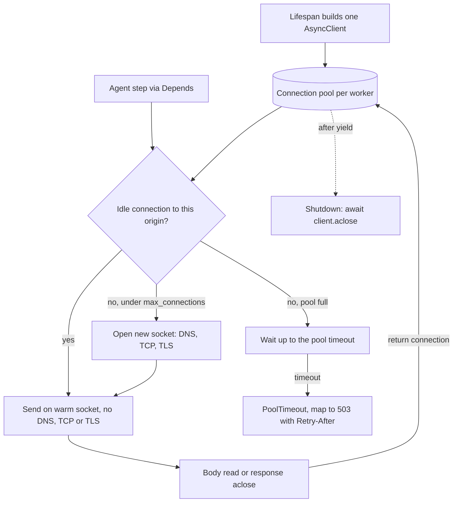

## TL;DR
An agent backend is mostly an HTTP client: model calls, tool APIs, vector stores. A per-request
`httpx.AsyncClient` discards the connection pool, so every step pays DNS, TCP and TLS setup. Build one
client per upstream per worker in the lifespan.

## For agent builders
- **Why it matters for agents.** A single agent run makes many outbound calls in sequence: model, tool,
  model, tool. Each cold connection adds two to three round trips of setup (TCP, TLS 1.3, maybe DNS), so
  at an illustrative 40 ms round trip a 10-call loop spends about a second just on handshakes.
- **Where it shows up in your stack.** The OpenAI and Anthropic SDK clients (built on httpx), your own
  tool calls to search, CRM or internal APIs, vector database HTTP clients, and every `StreamingResponse`
  that relays model tokens to the user.
- **What you control.** One client per upstream per worker, `httpx.Limits` sized from the provider's
  concurrency budget, `httpx.Timeout` per call type (streaming vs non-streaming), and closing streamed
  responses on every path.
- **What you can skip.** httpcore internals and HTTP/2 tuning. Know pooling, the four timeouts and the
  stream-close rule; that covers almost every agent outage this causes.

## Lab
### Task
Fix an agent backend's model client: replace the per-request `AsyncClient` with one lifespan client
injected through a dependency, map pool exhaustion to a fast 503, and write a streaming relay that
returns its connection to the pool on success, on an upstream error status and when the upstream
drops mid-stream. Time box: 45-60 minutes.
- **Prerequisites:** the lifespan, dependency injection and StreamingResponse lessons.
- **Setup:** `pip install fastapi httpx pytest`; checked with FastAPI 0.161, Starlette 1.9, httpx 0.28
  and Python 3.12. `httpx.MockTransport` stands in for the provider, and `TrackedStream` counts
  `aclose()` calls, which is the moment a real pooled connection is released.
- **Save** the starter as `lab.py` and the tests as `test_lab.py`, then run `pytest -q`.

### Starter code
```python
"""Lab: one shared httpx.AsyncClient per worker for an agent's model upstream.
Needs fastapi and httpx. httpx.MockTransport stands in for the provider, so no network is used."""
from contextlib import asynccontextmanager
import httpx
from fastapi import Depends, FastAPI, HTTPException, Request
from fastapi.responses import StreamingResponse

CREATED: list[httpx.AsyncClient] = []          # every client ever built, so tests can count them

def make_client(transport: httpx.AsyncBaseTransport) -> httpx.AsyncClient:
    c = httpx.AsyncClient(base_url="http://llm.test", transport=transport,
                          limits=httpx.Limits(max_connections=16),
                          timeout=httpx.Timeout(connect=3.0, read=60.0, write=10.0, pool=2.0))
    CREATED.append(c)
    return c

def build_app(transport: httpx.AsyncBaseTransport) -> FastAPI:
    @asynccontextmanager
    async def lifespan(app: FastAPI):
        # LAB 1: build ONE client with make_client(transport), store it on app.state.http,
        # and close it with aclose() after the yield.
        yield

    app = FastAPI(lifespan=lifespan)

    def get_http(request: Request) -> httpx.AsyncClient:
        # LAB 1 (cont.): return the lifespan client.
        raise NotImplementedError("lab step 1: get_http")

    @app.post("/complete")
    async def complete(body: dict):
        # BUG to fix in LAB 2: a fresh client (and pool) per request. Use Depends(get_http),
        # and map httpx.PoolTimeout to 503 with a Retry-After: 2 header.
        async with make_client(transport) as http:
            r = await http.post("/v1/complete", json=body)
            r.raise_for_status()
            return r.json()

    @app.post("/stream")
    async def stream(body: dict, http: httpx.AsyncClient = Depends(get_http)):
        # LAB 3: send POST /v1/stream with stream=True. If status >= 400, aclose() the response
        # and raise HTTPException(502). Otherwise relay r.aiter_raw() in a generator that
        # aclose()s the upstream response in a finally block.
        raise NotImplementedError("lab step 3: stream relay")

    return app

class TrackedStream(httpx.AsyncByteStream):
    """Upstream body that counts how often it was closed (a connection returned to the pool)."""
    closed = 0
    def __init__(self, chunks: list[bytes]): self.chunks = chunks
    async def __aiter__(self):
        for c in self.chunks:
            if c == b"DROP":
                raise httpx.ReadError("upstream dropped mid-stream")
            yield c
    async def aclose(self):
        TrackedStream.closed += 1

def fake_provider(request: httpx.Request) -> httpx.Response:
    body = request.read()
    if b"busy" in body:
        raise httpx.PoolTimeout("no free connection", request=request)
    if request.url.path == "/v1/stream":
        chunks = [b"data: Hel", b"DROP"] if b"drop" in body else [b"data: Hel", b"lo\n\n"]
        status = 500 if b"fail" in body else 200
        return httpx.Response(status, stream=TrackedStream(chunks))
    return httpx.Response(200, json={"text": "ok"})

if __name__ == "__main__":
    from fastapi.testclient import TestClient
    app = build_app(httpx.MockTransport(fake_provider))
    try:
        with TestClient(app) as client:
            for _ in range(3):
                client.post("/complete", json={"q": "hi"})
            print(f"clients built for 3 calls: {len(CREATED)}")
            r = client.post("/complete", json={"q": "busy"})
            print(f"pool exhausted: {r.status_code} Retry-After={r.headers.get('retry-after')}")
            r = client.post("/stream", json={"q": "hi"})
            print(f"stream: {r.text!r}, upstream closes={TrackedStream.closed}")
            r = client.post("/stream", json={"q": "fail"})
            print(f"upstream 500: {r.status_code}, upstream closes={TrackedStream.closed}")
        print(f"closed on shutdown: {CREATED[0].is_closed}")
    except (NotImplementedError, httpx.HTTPError) as e:
        print(f"not done yet: {type(e).__name__}: {e}")
```

### Expected output
`python lab.py` with a correct solution prints (stdout; a Starlette deprecation warning about the test
client may also appear on stderr, depending on versions):

```
clients built for 3 calls: 1
pool exhausted: 503 Retry-After=2
stream: 'data: Hello\n\n', upstream closes=1
upstream 500: 502, upstream closes=2
closed on shutdown: True
```

### Tests
```python
import httpx, pytest
from fastapi.testclient import TestClient
import lab

@pytest.fixture
def app():
    lab.CREATED.clear()
    lab.TrackedStream.closed = 0
    return lab.build_app(httpx.MockTransport(lab.fake_provider))

def test_one_client_per_worker_reused_and_closed(app):
    with TestClient(app) as client:
        for _ in range(5):
            assert client.post("/complete", json={"q": "hi"}).json() == {"text": "ok"}
        assert len(lab.CREATED) == 1 and app.state.http is lab.CREATED[0]
        assert not lab.CREATED[0].is_closed
    assert lab.CREATED[0].is_closed                      # aclose() ran after yield

def test_pool_timeout_becomes_fast_503(app):
    with TestClient(app) as client:
        r = client.post("/complete", json={"q": "busy"})
    assert r.status_code == 503 and r.headers["retry-after"] == "2"

def test_stream_relays_and_releases_connection(app):
    with TestClient(app) as client:
        r = client.post("/stream", json={"q": "hi"})
    assert r.status_code == 200 and r.text == "data: Hello\n\n"
    assert lab.TrackedStream.closed == 1

def test_mid_stream_failure_still_releases_connection(app):
    with TestClient(app, raise_server_exceptions=False) as client:
        try:
            client.post("/stream", json={"q": "drop"})
        except httpx.HTTPError:
            pass                                         # the client sees a broken stream
    assert lab.TrackedStream.closed == 1                 # only the relay's finally closes it

def test_upstream_error_releases_connection_before_502(app):
    with TestClient(app) as client:
        r = client.post("/stream", json={"q": "fail"})
    assert r.status_code == 502
    assert lab.TrackedStream.closed == 1
```

On the starter all five fail: five clients built instead of one, a raw `PoolTimeout`, and
`NotImplementedError` from the unfinished `get_http` dependency on both `/stream` tests (the mid-stream
test reports it as 0 closes). A correct solution passes all five.

### Failure scenarios
- **Delete the relay's `finally`.** Only `test_mid_stream_failure_still_releases_connection` fails
  (0 closes). On success httpx closes the response itself once `aiter_raw()` is exhausted, so happy-path
  tests hide the leak; in production it shows as `PoolTimeout` after a burst of dropped streams. Debug by
  counting closes per path.
- **Skip `aclose()` before raising the 502.** The error-path test fails with 0 closes. In a real service
  every upstream 5xx pins a connection until restart; watch connections checked out against
  `max_connections`.
- **Use `TestClient(app)` without `with`.** `get_http` fails with `AttributeError` on `app.state.http`,
  because lifespan never ran. Debug by asserting `app.state.http` exists at the top of the test.
- **Keep the per-request client.** `len(CREATED)` grows by one per call; in a trace each agent step shows
  a fresh connect and TLS span instead of only during warm-up.

### Submission
- `lab.py` with the three lab steps done; `make_client`, `TrackedStream` and `fake_provider` unchanged.
- A `pytest -q` run showing 5 passed and the `python lab.py` output matching the expected block.
- A one-paragraph note naming every upstream your own agent calls and the `Limits` and `Timeout` you
  would give each, with the fleet total `workers × max_connections`.
- Evaluation: one client per app, closed on shutdown, no path through `/stream` that leaves a response
  open, and `PoolTimeout` never surfaces as a 500.

## Why it exists
- **Connection setup is a tax on every cold call.** A request to a hosted LLM over HTTPS starts with a DNS
  lookup, a TCP handshake and a TLS handshake before a byte of the prompt is sent; a reused keep-alive
  connection skips all of it. TCP costs one round trip, TLS 1.3 one more (TLS 1.2 two), plus DNS if not
  cached.
- **It compounds in agent loops.** With an illustrative 40 ms round trip, setup is roughly 80–120 ms
  before the request is sent; ten sequential calls pay it ten times, about a second of pure setup per
  user request. Building a client also builds an SSL context and loads the CA bundle, synchronous CPU
  work on the event loop.
- **`async with httpx.AsyncClient() as c: await c.post(...)` inside the endpoint costs three ways.**
  It is correct in a script, but in a server every request opens fresh connections (the provider sees a
  stream of new TLS sessions); closed connections linger in `TIME_WAIT`, so a host can run short of
  ephemeral ports or file descriptors; and pool limits are recreated per request, so they cap nothing:
  500 concurrent requests open 500 connections.
- **A module-level client at import time has its own trap.** It shares connections, but it is created
  outside any lifecycle, is never closed cleanly, and can end up bound to a different event loop than the
  one serving requests, which shows up as confusing errors in tests.

## How it works
### What the client actually holds
- **A connection pool** (in `httpcore`). Each pooled connection is an open socket to one origin (scheme,
  host, port), already through TLS.
- **On send,** the pool:
  1. hands back an idle connection to that origin if one exists;
  2. otherwise opens a new one if under the limit;
  3. otherwise waits.
- **After the response is read** the connection returns to the pool, *because* HTTP/1.1 keep-alive lets
  one socket carry many sequential requests, such as the steps of one agent run.
- **`max_connections` caps the whole client,** across every origin it talks to, not each origin
  separately.

### Streams hold a connection until closed
- **A connection returns only when the body is fully read or the response is closed.**
- **`await client.post(...)`** reads the body for you.
- **`async with client.stream("POST", ...) as r:`** closes it when the block exits.
- **`client.send(req, stream=True)`** hands you a response you must `await r.aclose()` yourself,
  including on error and cancellation paths.
- **Why it matters most for `StreamingResponse` relays:** a stream abandoned mid-way (the user closed the
  chat tab, an exception in your generator) and never closed keeps its connection checked out. Leak
  `max_connections` of them and every later call waits for a free connection and fails with
  `PoolTimeout`, while the provider is healthy.

### Limits, and why you set them
| `httpx.Limits` knob | Meaning | Default (at the time of writing) |
|---|---|---|
| `max_connections` | Total open sockets | 100 |
| `max_keepalive_connections` | Idle sockets kept warm | 20 |
| `keepalive_expiry` | How long an idle one is kept, in seconds | 5.0 |

- **The defaults are modest,** sized for general use, not for a streaming agent service where each
  in-flight generation pins a connection for tens of seconds.
- **Set `max_connections` from the concurrency you intend per worker,** *because* the pool is then a real
  ceiling: when it is full, callers wait, and that wait is bounded by the pool timeout.

### Timeouts are four numbers
`httpx.Timeout` separates `connect`, `read`, `write` and `pool`; the default is five seconds for each.
- **Too short for non-streaming completions,** which may legitimately take a minute.
- **For streaming, `read` is the maximum gap between chunks,** not total duration.
- **httpx has no overall deadline of its own.** Pair a tight `read` timeout (catches stalled streams) with
  an outer `asyncio.timeout(...)` or `asyncio.wait_for(...)` around the whole call if you need a cap on
  total generation time or on a whole agent step.
- **`pool` is how long to wait for a free connection.** A `PoolTimeout` under load is your signal that
  concurrency exceeds the pool, not that the provider is down.

### Lifecycle
1. Create the client in the lifespan.
2. Store it on `app.state` and expose it through a dependency.
3. Call `await client.aclose()` after `yield`, *because* closing drains the pool and releases sockets
   cleanly on shutdown.
- **"One client" means one per worker.** Each Uvicorn or Gunicorn worker is a separate process with its
  own lifespan, so total connections to a provider are `workers × max_connections`.

### Provider SDKs
- **Same rule:** the official OpenAI and Anthropic Python SDKs are built on httpx and keep their own pool
  per SDK client object, so construct the SDK client once in the lifespan, not per request or per agent
  run.
- **Bring your own client:** both accept an `http_client=` argument if you want to supply a configured
  `httpx.AsyncClient` with your own limits, proxies or transport.

### HTTP/2
- **With the optional `h2` dependency and `http2=True`,** many concurrent requests multiplex over one
  connection per origin, which reduces socket count.
- **But measure it:** a single TCP connection can then become the bottleneck, and providers differ in
  support, so it is not a default. Compare throughput, tail latency and error rates against an HTTP/1.1
  pool under realistic streaming load before switching.

## Diagram
One client lives for the whole worker: the lifespan builds it, every agent step borrows a pooled
connection, and a connection goes back to the pool only when its body is read or the response is closed.



## Examples
### One client per worker, injected as a dependency
Created in the lifespan with explicit limits and timeouts, and reused by every request.

```python
import os
from contextlib import asynccontextmanager
import httpx
from fastapi import Depends, FastAPI, HTTPException, Request

@asynccontextmanager
async def lifespan(app: FastAPI):
    app.state.http = httpx.AsyncClient(
        base_url="https://llm.internal.example",
        limits=httpx.Limits(max_connections=64, max_keepalive_connections=32,
                            keepalive_expiry=30.0),
        timeout=httpx.Timeout(connect=3.0, read=60.0, write=10.0, pool=2.0),
        headers={"Authorization": f"Bearer {os.environ['LLM_TOKEN']}"},
    )
    yield
    await app.state.http.aclose()   # drain the pool on shutdown

app = FastAPI(lifespan=lifespan)

def get_http(request: Request) -> httpx.AsyncClient:
    return request.app.state.http

@app.post("/complete")
async def complete(body: dict, http: httpx.AsyncClient = Depends(get_http)):
    try:
        r = await http.post("/v1/complete", json=body)
        r.raise_for_status()
    except httpx.PoolTimeout:
        # pool exhausted: shed load with a retryable status instead of queueing forever
        raise HTTPException(503, "upstream busy", headers={"Retry-After": "2"})
    return r.json()
```

- **Fleet budget:** with four workers this process group holds at most 4 × 64 = 256 connections to the
  provider.
- **In a load-test trace,** the per-request version shows a TLS handshake on every call; the shared
  version shows them only while the pool warms up.

### An agent with one client per upstream
The model SDK and each tool upstream get their own lifespan-built client, so a slow CRM cannot starve
model calls. The model name and URLs are placeholders.

```python
from contextlib import asynccontextmanager
import httpx
from anthropic import AsyncAnthropic
from fastapi import FastAPI

@asynccontextmanager
async def lifespan(app: FastAPI):
    llm_http = httpx.AsyncClient(limits=httpx.Limits(max_connections=32),
                                 timeout=httpx.Timeout(connect=3.0, read=60.0, write=10.0, pool=2.0))
    app.state.llm = AsyncAnthropic(http_client=llm_http)          # SDK reuses this pool
    app.state.tools = {
        "search": httpx.AsyncClient(base_url="https://search.internal.example",
                                    limits=httpx.Limits(max_connections=16),
                                    timeout=httpx.Timeout(5.0, pool=1.0)),
        "crm": httpx.AsyncClient(base_url="https://crm.internal.example",
                                 limits=httpx.Limits(max_connections=8),
                                 timeout=httpx.Timeout(10.0, pool=1.0)),
    }
    yield
    for c in app.state.tools.values():
        await c.aclose()
    await llm_http.aclose()

async def call_tool(app: FastAPI, name: str, path: str, args: dict) -> dict:
    try:
        r = await app.state.tools[name].post(path, json=args)
        r.raise_for_status()
        return r.json()
    except httpx.PoolTimeout:
        return {"error": f"{name} busy, try again later"}   # the model sees a tool error, not a crash
    except httpx.HTTPError as e:
        return {"error": f"{name} failed: {type(e).__name__}"}
```

- **Tool errors go back to the model as results,** so the agent can retry, pick another tool or tell the
  user, instead of the whole run failing on one upstream.

### Relaying a provider stream without leaking connections
`send(..., stream=True)` keeps the connection checked out until `aclose()`, so the relay closes it in a
`finally` and on the early error path.

```python
from fastapi.responses import StreamingResponse

@app.post("/stream")
async def stream(body: dict, http: httpx.AsyncClient = Depends(get_http)):
    req = http.build_request("POST", "/v1/complete", json={**body, "stream": True})
    r = await http.send(req, stream=True)
    if r.status_code >= 400:
        await r.aclose()                  # error path: release before raising
        raise HTTPException(502, "upstream error")

    async def relay():
        try:
            async for chunk in r.aiter_raw():
                yield chunk
        finally:
            await r.aclose()              # completion, upstream error, or generator closed early

    return StreamingResponse(relay(), media_type=r.headers.get("content-type", "text/event-stream"))
```

- **One gap remains:** a generator's `finally` runs only once the generator has started. If the client
  disconnects before the first chunk is pulled, `relay()` never starts and `r` stays open, so add a
  close-once guard that cleanup outside the generator can also call (see cancellation on client
  disconnect), and alert on connections that stay checked out.

### Worked numbers: setup tax in an agent loop
Illustrative 40 ms round trip, TLS 1.3, ten sequential calls per user request (five model calls and five
tool calls); the range covers DNS cached (0 ms) or not (one round trip).

| Step | Per call | Ten calls |
|---|---|---|
| DNS (only if uncached) | ~0–40 ms | ~0–400 ms |
| TCP handshake | 40 ms | 400 ms |
| TLS 1.3 handshake | 40 ms | 400 ms |
| Fresh client total | ~80–120 ms | ~0.8–1.2 s |
| Shared, warm pool | ~0 ms | ~0 ms |

## Production patterns
- **One client per upstream per worker.** When an agent service calls an LLM, a vector store and internal
  tools, give each its own `AsyncClient` in the lifespan with its own `Limits` and `Timeout`, so a slow
  upstream cannot starve the others. Monitor `PoolTimeout` counts labelled by upstream.
- **Size the pool from the provider budget.** Set `max_connections` to roughly provider concurrency
  limit ÷ (workers × replicas), so `workers × max_connections` stays under it. Monitor 429 rate and
  connection count to each upstream.
- **Fail fast on pool exhaustion.** Keep `pool` short (2 seconds in the example) and map `PoolTimeout` to
  503 with `Retry-After` at the edge, or to a tool error inside the agent loop, instead of letting
  requests queue. Monitor the 503 rate against in-flight requests.
- **Keep-alive shorter than the path's idle timeout.** Set `keepalive_expiry` below the shortest idle
  timeout of any NAT, proxy or load balancer between you and the upstream, so pooled sockets are retired
  before they are silently dropped. Monitor connection-reset errors on first reuse.
- **Configure SDKs through `http_client=`.** Pass a lifespan-built `httpx.AsyncClient` to the OpenAI or
  Anthropic SDK client so proxies, CA bundles and limits live in one place. Monitor connect and TLS
  spans in agent traces, which should only appear during warm-up.

## Trade-offs
- **Shared pool vs contention.** It removes per-call handshake cost and caps sockets, but becomes a
  contention point; if the pool is smaller than real concurrency, requests queue on `PoolTimeout`
  instead of failing fast.
- **More connections vs provider limits.** Larger `max_connections` raises throughput until you hit the
  provider's own concurrency or rate limit, after which extra connections only add 429s; size from the
  provider's limit.
- **One client per upstream vs one for everything.** Separate clients isolate pools and timeouts per
  dependency (LLM, vector store, internal tools); one client is simpler but lets a slow upstream starve
  the others.
- **Long vs short `keepalive_expiry`.** Long expiry keeps connections warm for bursty agent traffic, but
  idle sockets can be silently dropped by NATs or load balancers, so the first reuse fails and must be
  retried; keeping the expiry below the shortest idle timeout on the path flips the trade towards
  shorter values.

## Pitfalls
- **Creating `AsyncClient()` inside the endpoint or tool function.** Symptom: traces show a TLS handshake
  on every agent step and the host accumulates sockets in `TIME_WAIT` under load. Fix: lifespan client.
- **Never closing the client.** Symptom: shutdown logs warnings about unclosed connections and graceful
  restarts leave sockets half-open. Fix: `aclose()` after `yield`.
- **Default five-second timeout on a non-streaming completion.** Symptom: long prompts fail with
  `ReadTimeout` even though the provider would have answered. Fix: set `read` per call type.
- **Client created at import time and reused across test functions.** Symptom: event-loop errors such as
  a future attached to a different loop. Fix: create it in the lifespan.
- **A new OpenAI or Anthropic SDK client per request.** It hides the same per-request pool problem inside
  a library call that looks cheap. Fix: construct once in the lifespan.
- **Streaming with `send(..., stream=True)` and not closing on every path.** Symptom: `PoolTimeout` after
  a burst of cancelled or failed streams, with idle CPU and a healthy upstream, clearing only on restart.
  Fix: `async with client.stream(...)`, or `aclose()` in a `finally` and on every early error path.

## When to use
- **Always,** in any FastAPI service that makes outbound HTTP calls: one client (or one SDK client) per
  upstream per worker, created in the lifespan.
- **Decide the numbers, not whether:** pool size from intended concurrency and the provider's limits,
  timeouts per call type, and whether to separate clients per upstream.
- **Measure** connection count to each upstream, `PoolTimeout` rate, and the share of latency spent in
  connect and TLS in traces.
- **Interviews:** the standard probe for whether a candidate understands application-scoped resources
  and connection reuse.

## Role lens
- **Engineer:** Moves client construction into the lifespan, injects it as a dependency, sets limits
  and per-call timeouts, and handles `PoolTimeout` explicitly.
- **Architect:** Sets the connection budget per upstream across workers and replicas so the fleet
  stays within provider limits and egress constraints.
- **FDE:** Configures proxies, custom CA bundles and egress allow-lists in the customer's network on the
  shared client, once, instead of patching every call site.

## Check yourself
**Q:** A service with 8 workers, each holding a shared client with `max_connections=100`, starts
seeing 429s from its LLM provider whose limit is 200 concurrent requests, plus `PoolTimeout` errors
on one busy worker. Explain both symptoms and what to change.
**A:** The fleet can open 8 × 100 = 800 concurrent connections, four times the provider's 200, so the
provider rejects the excess with 429. Meanwhile load is uneven, so one worker fills its own pool and
callers wait past the pool timeout. The pool limit is per worker and does not see the global budget.
Set per-worker concurrency to about 200 / 8 = 25 via a semaphore or pool size, retry 429s with
backoff, return 503 fast instead of queueing when the pool is full, and use a shared limiter (for
example in Redis) if replicas scale dynamically.

## Interview questions
### Why should a FastAPI service share one httpx AsyncClient instead of creating one per request?
- **The client owns the connection pool.** A per-request client starts empty and is thrown away, so every
  call pays DNS, a TCP handshake and a TLS handshake again, about 80–120 ms at an illustrative 40 ms round trip.
- **Limits only work on a shared pool.** Recreated per request, `max_connections` caps nothing, so 500
  concurrent requests open 500 connections and leave sockets in `TIME_WAIT`.
- **Lifecycle matters too:** create it in the lifespan, close it with `aclose()` after `yield`.

### Your agent's p50 latency is fine but each run spends about a second before the first model token. Where do you look?
- **Look at connect and TLS spans per step.** If every model and tool call shows DNS, TCP and TLS, the
  agent builds a fresh client or SDK client per call or per run.
- **Fix the lifecycle:** build one SDK client and one client per tool upstream in the lifespan and inject
  them, so steps after the first reuse warm sockets.
- **Confirm** handshakes now appear only during warm-up, and that ten sequential calls no longer add
  roughly 0.8–1.2 s of setup.

### A streaming relay starts returning PoolTimeout after a burst of cancelled requests, while the provider is healthy. How do you debug it?
- **Suspect leaked streams.** A response from `client.send(req, stream=True)` keeps its connection checked
  out until `aclose()`, so streams abandoned on disconnect or error never return to the pool.
- **Confirm it:** connection count stays at `max_connections` with idle CPU, and the errors clear only on
  restart.
- **Fix:** use `async with client.stream(...)`, or close in a `finally` inside the generator and on every
  early error path before raising.

### One slow tool API makes your whole agent service time out, including runs that never call it. Why, and how do you isolate it?
- **They probably share one client and pool.** Slow tool calls hold connections, the shared
  `max_connections` fills, and model calls wait on the pool timeout too.
- **Give each upstream its own client** with its own `Limits` and `Timeout`, so the slow tool exhausts only
  its own pool.
- **Return pool and timeout failures to the model as tool errors,** so the agent can carry on, and alert on
  `PoolTimeout` labelled by upstream.

### After quiet periods, the first call to the provider sometimes fails with a connection reset. Why?
- **A pooled idle socket was dropped silently.** A NAT, proxy or load balancer on the path closed it after
  its own idle timeout, but the pool still held it, so the first reuse hit a dead connection.
- **Fix the timing:** set `keepalive_expiry` below the shortest idle timeout on the path, so the pool retires
  sockets before the network does.
- **Then make reuse failures safe:** retry idempotent calls once on a connect or reset error, and watch
  connection-reset counts on first reuse to confirm the fix.

### When would you not use the default httpx timeouts, and how would you set them for streaming?
- **The default is five seconds for each of `connect`, `read`, `write` and `pool`,** which is too short for a
  non-streaming completion that may legitimately take a minute.
- **For streaming, `read` is the maximum gap between chunks,** not total duration, so set it to the longest
  pause you tolerate between tokens.
- **httpx has no overall deadline,** so wrap the call in `asyncio.timeout(...)` or `asyncio.wait_for(...)` if
  total generation time needs a cap. Keep `pool` short so exhaustion fails fast.

## Quiz
### Q: What is the main cost of creating a new `httpx.AsyncClient` inside each request handler?
- [ ] httpx refuses to send more than one request per client
- [x] Each request discards the connection pool and pays DNS, TCP and TLS setup again
- [ ] The client blocks the event loop while it is constructed
- [ ] Response bodies cannot be streamed from a short-lived client
> The pool is what makes keep-alive reuse possible. A per-request client starts empty and is thrown
> away, so every call pays connection setup and pool limits cap nothing across requests. Construction
> does do some synchronous work (building an SSL context), but that is a secondary cost, not the main one.

### Q: Your streaming completions fail with `ReadTimeout` after five seconds even though tokens keep arriving slowly. What is the most likely cause?
- [ ] The pool timeout is too short
- [ ] HTTP/2 is disabled
- [x] The default read timeout is five seconds and the gap between chunks sometimes exceeds it
- [ ] The keep-alive expiry closed the connection mid-stream
> In httpx the read timeout applies to each wait for data. A slow model pause between chunks above five
> seconds trips it. Pool timeout concerns waiting for a free connection, not reading from one.

### Q: In a Gunicorn deployment with 6 Uvicorn workers, each creating one shared client in its lifespan with `max_connections=50`, what is the maximum number of connections to one upstream?
- [ ] 50, because the client is shared
- [ ] 56
- [x] 300, because each worker process has its own client and pool
- [ ] Unlimited, because limits apply per request
> Lifespan runs once per worker process, so there are six independent pools. Shared means shared within
> a process. Fleet-wide budgets need per-worker sizing or a distributed limiter.

## Use cases & projects
### Use cases
- **Multi-step tool-calling agents.** A loop alternating model and tool calls reuses warm keep-alive
  connections, so later steps skip DNS, TCP and TLS setup.
- **Streaming chat relays.** One shared client streams model tokens to many users at once, with the pool
  limits actually capping connections to the provider.
- **Agents calling several internal APIs.** One client per upstream (search, CRM, vector store) gives
  each its own limits and timeouts, so one slow tool cannot starve the others' connections.
- **Serving behind several workers.** Per-worker pools sized from the provider's concurrency budget keep
  the fleet inside its quota.

### Mini project
**Measure connection reuse in an agent loop (1-2 hours).**
- **Goal:** show the latency difference between a per-request client and a lifespan client across a
  10-call agent loop.
- **Steps:** write a FastAPI endpoint that makes ten sequential calls to an HTTPS upstream (a mock tool
  API or a cheap model endpoint); implement it once with `async with httpx.AsyncClient()` per request
  and once with one client created in the lifespan and stored on `app.state`; set `httpx.Limits` and
  `httpx.Timeout` explicitly; time each call.
- **Done when:** you have a per-call latency table showing the first call paying setup and later calls
  not, in the shared version only, and the client is closed cleanly on shutdown.
