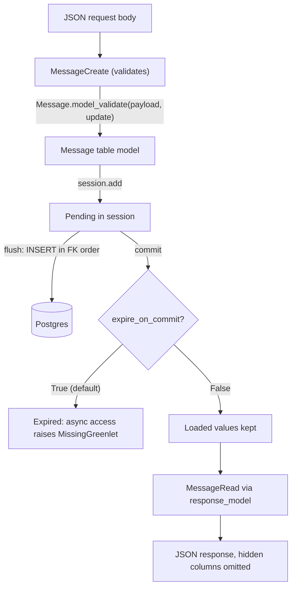

## TL;DR
Agents persist runs, messages, tool calls, memories and embeddings; SQLAlchemy is how Python stores them.
Core builds parameterised SQL (safe for agent tools), the ORM maps classes to tables, and SQLModel makes
one class both table and Pydantic schema.

## For agent builders
- **Why it matters for agents.** Agent state is relational: conversations, messages with JSON tool-call
  payloads, run steps, long-term memories, RAG chunks with vectors, eval results. How you load it decides
  context-building latency, and how you query it decides whether a DB tool is safe to hand to a model.
- **Where it shows up in your stack.** The models behind your FastAPI agent API, the `Vector(dim)` column
  from the `pgvector` package for retrieval, DB-backed tools built on Core `select()`, and Alembic
  migrations generated from the same metadata.
- **What you control.** Loading strategies when you build the model's context, the Create/Read/table
  split, bulk paths for RAG ingestion, and bound parameters (never f-strings) for anything a model
  supplies.
- **What you can skip.** Advanced mapping (polymorphism, hybrid properties) until your domain needs it,
  and the legacy `Query` API.

## Why it exists
- **AI backends carry a lot of relational state.** Conversations and messages with JSON tool-call
  payloads, jobs and their progress, documents and chunks with embeddings, evaluation runs and scores.
- **Hand-written SQL gets three things wrong.** Interpolated values invite injection; a column list
  repeated in a Pydantic model, an INSERT and a SELECT drifts out of sync; and loading related rows
  (every message of every conversation) becomes a loop of queries nobody notices until the table is large.
- **SQLAlchemy answers all three.** Core's expression language compiles to parameterised SQL for
  whichever dialect you run; the ORM adds relationships, loading strategies and a unit of work that
  orders INSERTs and UPDATEs by foreign-key dependency. Its declarative models also feed Alembic, so
  schema changes are generated from code rather than typed twice.
- **SQLModel removes FastAPI's duplication.** FastAPI already forces a Pydantic model per request and
  response; a class that is both a Pydantic model and a SQLAlchemy declarative model keeps validation,
  OpenAPI docs and the table definition in one place.
- **The naive alternative rebuilds a worse ORM.** Plain Pydantic plus raw asyncpg works and is fast, but
  you give up autogenerated migrations, relationship loading and the identity map.

## How it works
### Core versus ORM
| Layer | Pieces |
|---|---|
| Core | `Table`, `select()`, `insert()`, `update()`, and an `Engine` whose connections execute compiled statements with bound parameters |
| ORM | a `DeclarativeBase` subclass with `id: Mapped[int] = mapped_column(primary_key=True)` style attributes, and a `Session` holding an identity map (one Python object per row per session) and a unit of work |

Session lifecycle:
1. `session.add()` registers an object.
2. `flush()` emits SQL in dependency order.
3. `commit()` flushes, commits and by default *expires* every loaded instance, so the next attribute
   access reloads from the database.

### Unit-of-work surprises
- **Autoflush.** Before a query runs, pending changes are flushed so the query sees them, so a `select()`
  can raise an `IntegrityError` that really belongs to an earlier `add()`.
- **Identity map.** One session holds one object per primary key: `session.get()` for an already-loaded
  row skips the database entirely.
- **Stale reads in long sessions.** Even a fresh `select()` that hits the database hands back the existing
  object without overwriting its loaded attributes (unless you ask for `populate_existing`), so a
  long-lived session serves stale data while a short per-request session does not.
- **Expiry in async code.** The default `expire_on_commit=True` makes the post-commit reload implicit IO,
  which raises `MissingGreenlet`, so async sessions are created with `expire_on_commit=False`.

### Querying and loading
- **2.0 style:** `session.execute(select(Message).where(...))` returns rows; `session.scalars(...)`
  returns objects. The legacy `session.query()` still works but is not where new features land.
- **Lazy loading is the default**, which is the N+1 problem waiting to happen.

| Strategy | SQL issued |
|---|---|
| lazy (default) | one query per relationship access |
| `selectinload()` | one extra `IN (...)` query per relationship |
| `joinedload()` | folded into a JOIN |
| `raiseload()` | none; accidental lazy loads become errors during tests |

- **Column types for AI data:** JSON columns store tool calls and metadata; the `pgvector` package adds a
  `Vector(dim)` column type for embeddings.

### What SQLModel adds
- **One class, two roles.** `class Message(SQLModel, table=True)` declares fields with ordinary
  annotations; each is a Pydantic field *and* a column.
- **Column options.** `Field(primary_key=True, index=True, foreign_key="conversation.id")` covers the
  common ones.
- **Escape hatch.** `Field(sa_column=Column(JSON))` hands over a full SQLAlchemy column; it cannot be
  combined with `primary_key`, `index` or `foreign_key`, which then go on the `Column` itself.
- **Relationships:** `Relationship(back_populates=...)`.
- **Schemas without tables.** A `SQLModel` subclass *without* `table=True` is a pure Pydantic schema.
  Idiom: a shared base with common fields, a table model adding `id` and timestamps, and `Create`/`Read`
  schemas that add or omit fields for the API.
- **Sessions.** `sqlmodel.Session` and the async session in `sqlmodel.ext.asyncio.session` are SQLAlchemy
  sessions plus a `session.exec(select(...))` method that returns typed scalars directly.
- **Alembic works unchanged**, because its metadata *is* SQLAlchemy metadata.

Two documented sharp edges:
- **Table models do not run Pydantic validation when instantiated.** Validate through a non-table schema
  and convert with `Message.model_validate(payload, update={...})`.
- **SQLModel tracks SQLAlchemy with some lag.** A feature missing from its surface is usually reachable
  through `sa_column` or `sa_relationship` rather than absent.

### Modelling agent state
| Table | Typical columns | Loading note |
|---|---|---|
| conversation / run | id, user, status, step budget | one row per run |
| message / step | role, content, `tool_calls` JSON, step number | load all of a run with `selectinload` when building context |
| memory | user, text, embedding `Vector(dim)`, source run | query by similarity, filter by user first |
| chunk | document, text, embedding | bulk-insert during ingestion, never one `add()` per row |
| eval result | run id, grader, score | written by eval jobs, read by dashboards |

- **Context building is a read path.** Rebuilding an agent's transcript every turn touches messages and
  their tool calls, so an N+1 here adds latency to every single agent step.
- **Model-supplied values are untrusted input.** A DB tool must compile model arguments into bound
  parameters with `select().where(...)`, run under a read-only role, and cap rows, because the arguments
  come from model output that a prompt injection can steer.

### Choosing between them
| Choose | When |
|---|---|
| SQLModel | API payload and row look alike, and the project is small enough that one set of classes is a feature |
| Plain SQLAlchemy 2.0 | storage and API shapes differ (denormalised read models, columns the client must never see); advanced mapping (hybrid properties, polymorphism, composite types); the team already knows it |
| Core `insert()` or driver bulk copy | hot paths such as bulk-inserting a million chunks, a list of dicts inside the same engine |

## Diagram
One write through the Create/table/Read split: validation happens on the non-table schema, the unit of
work emits SQL at flush, and the Read schema decides what leaves the API.



## Examples
### SQLModel conversations and messages with the table/schema split
Two sync endpoints. Sync endpoints run on the thread pool, which is fine for CRUD; the async session is
a drop-in for the pattern in the async database lesson.

```python
from datetime import datetime, timezone
from typing import Optional
from fastapi import Depends, FastAPI
from sqlalchemy import JSON, Column
from sqlmodel import Field, Relationship, Session, SQLModel, create_engine, select

class Conversation(SQLModel, table=True):
    id: Optional[int] = Field(default=None, primary_key=True)
    user_id: str = Field(index=True)
    messages: list["Message"] = Relationship(back_populates="conversation")

class MessageBase(SQLModel):                        # fields the API and the table agree on
    role: str
    content: str
    tool_calls: Optional[dict] = Field(default=None, sa_column=Column(JSON))

class Message(MessageBase, table=True):
    id: Optional[int] = Field(default=None, primary_key=True)
    conversation_id: int = Field(foreign_key="conversation.id", index=True)
    created_at: datetime = Field(default_factory=lambda: datetime.now(timezone.utc))
    conversation: Conversation = Relationship(back_populates="messages")

class MessageCreate(MessageBase): pass               # clients may not set id or timestamps
class MessageRead(MessageBase):
    id: int
    created_at: datetime

engine = create_engine("postgresql+psycopg://app:pw@db/app", pool_pre_ping=True)
app = FastAPI()

def get_session():
    with Session(engine) as session:
        yield session

@app.post("/conversations/{conv_id}/messages", response_model=MessageRead)
def add_message(conv_id: int, body: MessageCreate, session: Session = Depends(get_session)):
    msg = Message.model_validate(body, update={"conversation_id": conv_id})   # validated via the schema
    session.add(msg); session.commit(); session.refresh(msg)
    return msg

@app.get("/conversations/{conv_id}/messages", response_model=list[MessageRead])
def list_messages(conv_id: int, session: Session = Depends(get_session)):
    stmt = select(Message).where(Message.conversation_id == conv_id).order_by(Message.id)
    return session.exec(stmt).all()
```

### Counting the N+1 and fixing it (plain SQLAlchemy 2.0)
Self-contained against in-memory SQLite: a statement counter shows 51 queries for 50 conversations with
lazy loading, and 2 with `selectinload`.

```python
from sqlalchemy import ForeignKey, create_engine, event, select
from sqlalchemy.orm import (DeclarativeBase, Mapped, Session, mapped_column, raiseload,
                            relationship, selectinload)

class Base(DeclarativeBase): pass

class Conversation(Base):
    __tablename__ = "conversation"
    id: Mapped[int] = mapped_column(primary_key=True)
    messages: Mapped[list["Message"]] = relationship(back_populates="conversation")

class Message(Base):
    __tablename__ = "message"
    id: Mapped[int] = mapped_column(primary_key=True)
    conversation_id: Mapped[int] = mapped_column(ForeignKey("conversation.id"), index=True)
    content: Mapped[str]
    conversation: Mapped[Conversation] = relationship(back_populates="messages")

engine = create_engine("sqlite://")
Base.metadata.create_all(engine)
with Session(engine) as s:
    s.add_all([Conversation(messages=[Message(content=f"m{i}.{j}") for j in range(3)])
               for i in range(50)])
    s.commit()

statements = 0
@event.listens_for(engine, "before_cursor_execute")
def _count(*args):
    global statements; statements += 1

def queries_for(*options) -> int:
    global statements
    statements = 0
    with Session(engine) as s:
        for conv in s.scalars(select(Conversation).options(*options)):
            len(conv.messages)                       # what a response serialiser does
    return statements

print(queries_for())                                 # 51: 1 + one lazy load per conversation
print(queries_for(selectinload(Conversation.messages)))  # 2: one SELECT + one IN (...)
# queries_for(raiseload("*")) raises instead of querying: use it in tests to lock the fix in.
```

### A safe DB tool for an agent (Core, bound parameters)
The model picks the arguments; Core turns them into bound parameters, the schema bounds them, and a row
cap keeps the tool result small enough for the context window. Runnable against in-memory SQLite.

```python
from pydantic import BaseModel, Field
from sqlalchemy import Column, Integer, MetaData, String, Table, create_engine, insert, select

meta = MetaData()
orders = Table("orders", meta, Column("id", Integer, primary_key=True),
               Column("customer", String), Column("status", String))
engine = create_engine("sqlite://")
meta.create_all(engine)
with engine.begin() as c:
    c.execute(insert(orders), [{"customer": "acme", "status": "shipped"},
                               {"customer": "acme", "status": "pending"}])

class FindOrders(BaseModel):                       # the tool's JSON schema, shown to the model
    customer: str = Field(max_length=64)
    status: str | None = Field(default=None, pattern="^(pending|shipped|cancelled)$")

def find_orders(args: dict) -> list[dict]:
    a = FindOrders.model_validate(args)            # reject malformed model output
    stmt = select(orders.c.id, orders.c.status).where(orders.c.customer == a.customer)
    if a.status:
        stmt = stmt.where(orders.c.status == a.status)
    with engine.connect() as c:                    # in production: a read-only DB role
        return [dict(r._mapping) for r in c.execute(stmt.limit(20))]   # cap rows for the context

print(find_orders({"customer": "acme"}))
print(find_orders({"customer": "acme' OR '1'='1"}))   # [] : a bound value, never SQL
```

### Worked scenario: the list endpoint that slowed down in production
Illustrative timings, 1 ms per round trip to the database.

| Environment | Conversations | Queries (lazy) | Queries (`selectinload`) | DB time (lazy → fixed) |
|---|---|---|---|---|
| Development | 5 | 6 | 2 | ~6 ms → ~2 ms |
| Production | 500 | 501 | 2 | ~501 ms → ~2 ms plus row transfer |

Same response body, same code path; only the loading strategy changed.
- **The agent version is worse.** If each agent step rebuilds its context by lazily loading a run's 40
  steps and their tool calls (illustrative), that is 41 round trips per step, repeated every step of the
  run; `selectinload` makes it 2.

## Production patterns
- **Typed, parameterised DB tools instead of free-form SQL.** Agent teams expose narrow tools (find
  orders, get account) whose Pydantic argument schema compiles to Core `select()` with bound parameters,
  run them under a read-only role, and cap rows. Monitor rejected tool arguments and rows returned per
  call.
- **Lock loading strategies in tests.** On list and detail endpoints, declare `selectinload`/`joinedload`
  explicitly and run tests with `raiseload("*")` (or `lazy="raise"` on relationships) so a new lazy access
  fails CI. Monitor statements per request in tracing; alert when a route's count grows with data.
- **Separate Create, Read and table classes.** For every entity exposed over HTTP, accept `XCreate`,
  return `XRead` via `response_model`, and convert with `model_validate(..., update=...)`, so server-owned
  fields and hidden columns never cross the boundary. Review new columns against the Read schema.
- **Bulk paths bypass the unit of work.** For chunk and embedding ingestion, use
  `session.execute(insert(Chunk), rows)` with a list of dicts in batches, or the driver's `COPY`, inside
  the same engine. Monitor rows per second and transaction duration per batch.
- **Make JSON mutations visible.** Either reassign the whole value (`msg.tool_calls = {**msg.tool_calls,
  "x": 1}`) or declare the column with `MutableDict.as_mutable(JSON)` from `sqlalchemy.ext.mutable`.
  Monitor with a test that mutates, commits and re-reads.
- **Index every foreign key.** Set `index=True` on each foreign-key field (`Field(foreign_key=...,
  index=True)` or `mapped_column(ForeignKey(...), index=True)`), because Postgres does not create them.
  Monitor `seq_scan` counts in `pg_stat_user_tables` for child tables.

## Trade-offs
- **Unit of work vs per-object overhead.** The identity map and unit of work remove whole classes of bugs,
  but once ingestion reaches thousands of chunks per batch, Core `insert()` with a list of dicts (or the
  2.0 ORM bulk form `session.execute(insert(Chunk), rows)`) and driver-level `COPY` are typically several
  times faster than adding objects one by one; measure on your own data.
- **One class per entity vs coupling.** SQLModel removes duplication but couples the API contract to the
  table; once a client must not see a column or a response needs a computed shape, you are back to
  separate schemas and have lost the benefit.
- **Lazy simplicity vs query count.** Lazy loading makes simple code simple, but each relationship access
  is a query; explicit `selectinload` is more typing and the only way the query count stays flat as data
  grows.
- **Typed 2.0 models vs legacy `Query`.** Typed models give IDE and type-checker support, but mixing them
  with legacy `Query` code (still supported, labelled legacy rather than deprecated) leaves two idioms
  with different return shapes and weaker typing on the legacy half; migrate module by module.

## Pitfalls
- **Interpolating model output into SQL text.** Symptom: an agent's DB tool returns rows from other
  customers, or errors on quotes, after a prompt injection or an odd user name. Fix: bound parameters via
  Core, a validated argument schema, and a read-only role.
- **`expire_on_commit` left at its default in async sessions.** Symptom: `MissingGreenlet` on the first
  attribute read after `commit()`.
- **Lazy relationship access inside a loop.** Symptom: one query plus one per row in the SQL log, and a
  list endpoint whose latency grows linearly with conversation length.
- **Using the table model as the request body.** Symptom: clients setting `id` or `created_at`, and
  inputs that bypass validation because table models skip it.
- **A module-level session shared across requests.** Symptom: cross-request data leaks and "Session is
  already flushing" or stale-object errors under concurrency.
- **Mutating a JSON column in place (`msg.tool_calls["x"] = 1`).** Symptom: a commit that writes nothing,
  because SQLAlchemy only detects reassignment unless the column uses a mutable wrapper.
- **Foreign-key columns without an index.** Symptom: a sequential scan on every "messages for
  conversation" query, since Postgres does not index foreign keys automatically.

## When to use
- **Use SQLAlchemy** whenever a FastAPI service owns relational data, which is most of them.
- **Choose SQLModel** for small to medium services whose API and storage shapes align and whose team
  wants one set of models; **plain SQLAlchemy 2.0** when the domain or mapping gets complex.
- **Measure** query counts per request (the N+1 detector), time in session, and bulk-insert throughput.
- **Day to day:** define the Create/Read/table split, choose loading strategies, keep models and
  migrations in step.
- **Interviews:** explain identity map and unit of work, why `expire_on_commit` matters in async code,
  and what SQLModel actually is underneath.

## Role lens
- **Engineer:** Defines models and schemas, picks loading strategies per endpoint, and knows when to
  drop to Core or the driver for bulk writes of chunks and embeddings.
- **Architect:** Decides SQLModel versus plain SQLAlchemy for the codebase, sets the rule that API
  schemas and table models are separate classes, and owns the data model that migrations evolve.
- **FDE:** Reads a customer's existing SQLAlchemy models to wire an AI feature into their schema
  without breaking their migrations or their ORM conventions.

## Check yourself
**Q:** A list endpoint returning conversations with their messages is fast in development and takes
seconds in production. What is happening and how do you fix it without changing the response?
**A:** Almost certainly N+1 loading: the query fetches the conversations, and then the response
serialiser touches `conversation.messages` for each one, which lazily issues one query per
conversation. In development there are five conversations; in production there are five hundred, so
the endpoint runs five hundred and one queries. Confirm by logging SQL or counting statements in a
test. Fix it by adding `options(selectinload(Conversation.messages))` to the select, which loads all
messages in one extra `IN` query, or `joinedload` if the result set is small. In async code eager
loading is also effectively required, because the implicit lazy load raises `MissingGreenlet` (the
explicit `await conv.awaitable_attrs.messages` from `AsyncAttrs` avoids the error but is still one
query per conversation). Add `raiseload` in tests so the regression cannot return.

## Interview questions
### What are the identity map and unit of work in a SQLAlchemy Session, and why do they matter?
- **Identity map:** one Python object per primary key per session, so `session.get()` for a loaded row
  skips the database and two lookups return the same object.
- **Unit of work:** changes are collected and flushed in foreign-key dependency order, so you never
  hand-order INSERTs and UPDATEs.
- **Why it matters:** a long-lived session can serve stale objects and autoflush can surface an
  `IntegrityError` on a later `select()`, so keep sessions per request.

### When would you choose plain SQLAlchemy 2.0 over SQLModel?
- **When storage and API shapes diverge:** denormalised read models or columns the client must never see
  remove SQLModel's one-class benefit.
- **When mapping gets advanced:** hybrid properties, polymorphism or composite types, since SQLModel
  tracks SQLAlchemy with some lag and you end up in `sa_column` and `sa_relationship` anyway.

### A commit after msg.tool_calls["x"] = 1 writes nothing. Why, and how do you fix it?
- **In-place JSON mutation is not detected;** SQLAlchemy only tracks reassignment of the attribute.
- **Fix:** reassign the whole value, or declare the column with `MutableDict.as_mutable(JSON)` from
  `sqlalchemy.ext.mutable`, and add a test that mutates, commits and re-reads.

### How would you ingest a million embedding chunks for your agent's RAG index efficiently?
- **Skip per-object adds.** Use `session.execute(insert(Chunk), rows)` with a list of dicts in batches,
  or the driver's `COPY`, which are typically several times faster; measure on your own data.
- **Keep it in the same engine and transaction discipline,** and watch rows per second and transaction
  duration per batch.
- **Index foreign keys yourself,** because Postgres does not, or every per-document chunk lookup becomes
  a sequential scan.

### Why do clients sometimes manage to set id or created_at on a SQLModel service?
- **The table model is used as the request body.** Table models also skip Pydantic validation when
  instantiated.
- **Fix:** accept a non-table `XCreate` schema, convert with `model_validate(..., update={...})` for
  server-owned fields, and return `XRead` via `response_model`.

### You want your agent to answer questions from the orders database. How do you give it access safely?
- **Narrow tools, not raw SQL.** Expose a few typed tools whose Pydantic argument schemas compile to Core
  `select()` with bound parameters, so model output can never become SQL text.
- **Limit blast radius:** a read-only database role, row caps sized for the context window, and tenant
  filters applied by the tool, never chosen by the model.
- **Measure** rejected arguments and rows per call, and keep eval cases for injection attempts.

## Quiz
### Q: What is the one thing SQLModel adds on top of SQLAlchemy?
- [ ] A faster asynchronous driver for PostgreSQL
- [x] Classes that are simultaneously Pydantic models and SQLAlchemy declarative models, so one definition serves validation, docs and the table
- [ ] Automatic schema migrations without Alembic
- [ ] A query cache shared across requests
> SQLModel is a thin layer that merges the two class systems. Its sessions, engine, metadata and
> migrations are all SQLAlchemy's; what it buys is the removal of duplicated field definitions.

### Q: Why define a separate MessageCreate schema instead of accepting the Message table model as the request body?
- [ ] FastAPI cannot generate OpenAPI docs from table models
- [ ] Table models cannot be used with `response_model`
- [x] Clients could set server-owned fields such as id and timestamps, and table models skip Pydantic validation on instantiation
- [ ] Table models are not JSON-serialisable
> The non-table schema is where validation happens and where the client-facing contract lives. The
> table model is converted from it with `model_validate(..., update=...)` once the server adds its fields.

### Q: In an async session with the default expire_on_commit, what happens when you read an attribute after commit()?
- [ ] The cached value from before the commit is returned
- [ ] The attribute is None until refresh() is called
- [x] The ORM tries to reload the row synchronously and raises MissingGreenlet
- [ ] The read is converted into an awaitable automatically
> Commit expires loaded instances so the next access reloads. That reload is implicit IO the async
> bridge cannot perform, which is why async sessions set `expire_on_commit=False` or call `refresh()`.
