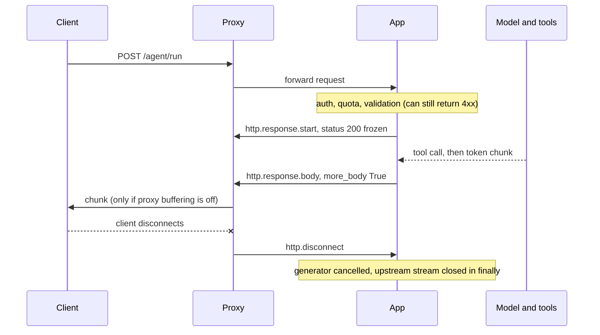

## TL;DR
An agent run takes many seconds of model calls and tool calls; `StreamingResponse` sends each token or
step event as it exists, so users see progress at once. Status and headers freeze at the first byte, so
mid-run errors go in-band and nothing may buffer.

## For agent builders
- **Why it matters for agents.** A tool-calling loop can take tens of seconds end to end. Without
  streaming the user stares at a spinner and the load balancer's idle timeout may kill the run; with it
  they see "searching...", tool results and answer tokens as they happen.
- **Where it shows up in your stack.** Every agent HTTP endpoint you write in FastAPI: your own loop over
  a vendor SDK's async stream, or a framework's streaming iterator (LangGraph, the OpenAI Agents SDK and
  similar expose one) re-emitted as NDJSON or SSE through `StreamingResponse`.
- **What you control.** The event protocol (typed step, tool, delta, done and error records), validation
  before the first byte, cancelling the upstream model and tools on disconnect, and buffering on every hop.
- **What you can skip.** HTTP/2 framing details and chunked-encoding byte formats. Know the ASGI message
  order, the frozen-headers rule and the proxy buffering trap; that is enough to ship and debug agent streams.

## Why it exists
- **The default path buffers.** The handler returns a value, FastAPI serialises it, Starlette sets
  `Content-Length` and writes the body in one go. Right for a 2 KB JSON answer, wrong for anything
  produced incrementally.
- **Users see nothing until the end.** A 600-token answer at roughly 40 tokens per second (illustrative;
  it varies by model and load) exists in full only after about 15 seconds. People judge responsiveness by
  the first visible change.
- **Infrastructure timeouts trip.** Reverse proxies and load balancers commonly ship with request or idle
  timeouts in the tens of seconds, so long answers die with a 502 or 504 while the model is still working.
- **Memory scales with concurrency.** Every in-flight request holds its whole output. Negligible for a few
  KB of chat text; for a row-by-row CSV export or proxied file it is constant memory versus hundreds of
  megabytes per request.
- **The naive fixes fail.** Raising timeouts does nothing for first-token latency and still ties up a
  connection. Polling adds a round trip per poll and latency equal to the poll interval. WebSockets solve
  two-way traffic and bring a stateful connection. Returning a generator from a normal endpoint fails,
  because FastAPI tries to serialise it as JSON. `StreamingResponse` is the explicit opt-out.

## How it works
### What you hand over
`StreamingResponse(content, status_code=200, headers=None, media_type=None, background=None)`:
- **`content`** is any iterable or async iterable yielding `bytes` or `str`; strings are encoded with the
  response's charset, UTF-8 by default.
- **It is Starlette's class**, re-exported by FastAPI from `fastapi.responses`.
- **No validation or encoding.** Because you construct the response yourself, `response_model` validation
  and FastAPI's JSON encoding are bypassed: what you yield is what goes on the wire.

### What happens at the ASGI layer
| Response type | Messages sent |
|---|---|
| Normal | one `http.response.start` (status, headers), then one `http.response.body` with `more_body: False` |
| Streaming | the start message, one `http.response.body` with `more_body: True` per chunk, then an empty body with `more_body: False` |

```
send {"type": "http.response.start", "status": 200, "headers": [...]}   # status frozen here
send {"type": "http.response.body", "body": b'{"delta":"Str"}\n', "more_body": True}
send {"type": "http.response.body", "body": b'{"delta":"eam"}\n', "more_body": True}
...                                                                     # one per yield
send {"type": "http.response.body", "body": b"", "more_body": False}     # end of response
```

- **No `Content-Length` up front**, so over HTTP/1.1 uvicorn uses `Transfer-Encoding: chunked`.
- **Behind a proxy that terminates HTTP/2**, the chunks become DATA frames.
- **Do not set `Content-Length` yourself** unless you really know it, because the chunked framing above
  depends on its absence and a wrong length truncates or hangs the client.

### Sync versus async iterators
| Content | How Starlette drives it | Cost |
|---|---|---|
| Plain generator | `iterate_in_threadpool`: each `next()` runs on a worker thread so it cannot block the loop | a thread hop per chunk, plus a slot in the shared pool (anyio's default limiter is 40 tokens) while each `next()` runs |
| `async def` generator | awaited directly on the loop | none extra; right for an async SDK stream or an `httpx` streaming response |

- **Slow sync sources starve the pool.** A blocking source that mostly waits for the next token holds a
  slot for most of the stream's life, so a few dozen slow streams can starve every other sync endpoint
  and dependency.
- **Never mix them.** Calling a blocking SDK inside an async generator blocks every other request for the
  duration of each call.

### Flow control
1. Each `await send(chunk)` returns only when the server has accepted the chunk.
2. Uvicorn pauses writers when the transport's buffer passes its high-water mark.
3. So a slow client eventually stalls the generator: natural backpressure.
4. **Caveat:** it engages only after OS and server buffers fill. A stalled client can still hold tens of
   kilobytes of generated text and, more importantly, an upstream model stream that keeps billing tokens.

### Disconnects
- **The server delivers `http.disconnect`** when the client goes away.
- **Recent Starlette cancels the generator.** It runs the generator in a task group next to a listener for
  that event, so an `async for` over the model stream receives `CancelledError` and can propagate the
  cancellation upstream.
- **Do not rely on it alone.** The exact behaviour has changed across Starlette releases, so also check
  `await request.is_disconnected()` inside the loop and put cleanup in `try/finally`.
- **It is economic.** Tokens generated after the user closed the tab are pure cost.

### Headers are frozen at the first chunk
- **Status and headers go out before the first body chunk.** A later generator exception cannot become a
  500; the client sees a truncated body and, with chunked encoding, a missing terminating chunk that most
  clients report as a protocol error.
- **Fail early.** Do authentication, quota checks, input validation, ideally even the first model call,
  *before* returning the `StreamingResponse`.
- **Fail in-band after that.** Signal failures during the stream with a typed chunk.

### Framing
TCP does not preserve your `yield` boundaries: a client may get two chunks glued together or one split,
even mid multi-byte character. Raw text is fine only if the client treats the body as one growing string.
For anything structured, pick a framing and set `media_type` to match:

| Framing | `media_type` |
|---|---|
| Newline-delimited JSON | `application/x-ndjson` |
| Server-Sent Events (own lesson) | `text/event-stream` |
| Length-prefixed binary | your binary type |

### Middleware and proxies
Any component that waits for the whole body destroys the benefit.
- **nginx buffers proxied responses by default** (`proxy_buffering on`); send `X-Accel-Buffering: no` or
  turn buffering off for the route.
- **Some CDNs and API gateways buffer too.**
- **Compression middleware** can delay small chunks while it fills a compression window.
- **Test with `curl -N` against the real ingress**, not just uvicorn on localhost.

### Streaming an agent loop
An agent response is not one token stream but several phases: model thinks, model asks for a tool, tool
runs (often silently), model reads the result, model answers. Stream all of them as typed records:

| Record | When it is emitted | What the UI does |
|---|---|---|
| `{"type": "step", ...}` | a new loop iteration starts | shows "step 2 of at most 8" |
| `{"type": "tool_call", ...}` | the model requested a tool | shows "searching orders..." |
| `{"type": "tool_result", ...}` | the tool returned (summary only) | collapses the spinner |
| `{"type": "delta", ...}` | answer tokens arrive | appends text |
| `{"type": "done"}` / `{"type": "error"}` | the run ends | final state, retry button |

- **Tool phases are the silent ones.** A slow search or SQL tool emits nothing, so this is where idle
  timeouts fire and where heartbeats matter most.
- **Do not stream raw tool output.** It may hold data the user should not see; send a summary record and
  keep the full result in the agent's state.
- **Streamed text cannot be retracted.** If an output guardrail runs after generation, either buffer the
  final answer behind it or stream it and send a typed retraction the UI honours.

## Diagram
Validation happens before the start message; after it, status is frozen and every failure, including a
failed tool call mid-run, must travel in-band as a body chunk.



## Examples
### NDJSON token stream with early validation
Validation runs before the response object exists, the loop stops when the client has gone, and a
failure after the first byte becomes a typed error line instead of a truncated body.

```python
import asyncio, json
from contextlib import aclosing                           # Python 3.10+
from fastapi import FastAPI, HTTPException, Request
from fastapi.responses import StreamingResponse
from pydantic import BaseModel

app = FastAPI()

class Ask(BaseModel):
    prompt: str

async def model_stream(prompt: str):
    # Stand-in for your SDK's async streaming iterator; both major vendor SDKs expose one.
    for word in "Streaming keeps the user reading while the model is still decoding.".split():
        await asyncio.sleep(0.05)
        yield word + " "

@app.post("/answer")
async def answer(body: Ask, request: Request):
    if len(body.prompt) > 8000:
        raise HTTPException(413, "prompt too long")      # fail BEFORE any byte of the stream is sent

    async def ndjson():
        try:
            # aclosing() closes the upstream stream deterministically when we stop early
            async with aclosing(model_stream(body.prompt)) as stream:
                async for piece in stream:
                    if await request.is_disconnected():
                        return                            # stop paying for tokens nobody will read
                    yield json.dumps({"delta": piece}) + "\n"
            yield json.dumps({"done": True}) + "\n"
        except Exception as exc:                          # headers are gone: signal the error in-band
            yield json.dumps({"error": type(exc).__name__}) + "\n"

    return StreamingResponse(ndjson(), media_type="application/x-ndjson",
                             headers={"Cache-Control": "no-cache", "X-Accel-Buffering": "no"})

# Check it really streams through your ingress, not just locally:
#   curl -N -X POST http://localhost:8000/answer -H 'content-type: application/json' -d '{"prompt":"hi"}'
```

### A client that survives framing
The consumer side: `httpx` reads the body as it arrives and `aiter_lines()` re-splits on newlines, so
glued or split chunks still yield whole NDJSON records.

```python
import asyncio, json
import httpx

async def consume(prompt: str) -> str:
    text = []
    async with httpx.AsyncClient(timeout=None) as client:
        async with client.stream("POST", "http://localhost:8000/answer",
                                 json={"prompt": prompt}) as r:
            r.raise_for_status()                    # only pre-stream failures (e.g. 413) land here
            async for line in r.aiter_lines():      # buffers until "\n", so TCP boundaries do not matter
                if not line:
                    continue
                msg = json.loads(line)
                if "error" in msg:
                    raise RuntimeError(f"stream failed mid-way: {msg['error']}")
                if msg.get("done"):
                    return "".join(text)
                text.append(msg["delta"])
    raise RuntimeError("stream ended without a done record")  # truncation detected in-band

print(asyncio.run(consume("hi")))
```

### Worked scenario: buffered vs streamed answer
The 600-token answer at ~40 tokens/s from above (illustrative figures), behind a load balancer with an
illustrative 60-second idle timeout.

| Metric | Buffered `JSONResponse` | `StreamingResponse` |
|---|---|---|
| Time to first visible text | ~15 s (whole answer) | the model's TTFT |
| Bytes idle on the connection | ~15 s of silence | a chunk every ~25 ms |
| 3,000-token answer (~75 s) | idle timeout fires, 504 | keeps flowing |
| Server-side duration | ~15 s | ~15 s (unchanged) |
| Capacity planning unit | requests per second | concurrent open streams |

## Production patterns
- **Peek the first chunk before committing headers.** When upstream errors (auth, rate limit, bad model
  name) usually surface on the first read, call `first = await anext(stream)` before returning the
  response, so they become real 4xx/5xx statuses. Then yield `first` and the rest. Monitor the share of
  errors that arrive in-band versus as status codes.
- **Disable buffering per streaming route.** Send `X-Accel-Buffering: no` from the app, or set
  `proxy_buffering off;` in the nginx `location` for the route, and exclude it from compression. Monitor
  client-side time to first byte through the real ingress, not localhost.
- **Heartbeat during silent phases.** When a tool call or retrieval step can go quiet longer than the
  load balancer's idle timeout, yield a small keepalive record (for example `{"ping": true}`) on a timer
  well below that timeout. Monitor 504 rate and stream duration percentiles.
- **Cancel upstream on disconnect.** Wrap the SDK stream in `aclosing()`, check
  `await request.is_disconnected()` per chunk and release resources in `finally`. Monitor the fraction
  of streams cancelled and tokens billed after disconnect.
- **Cap concurrent streams, not request rate.** Bound open streams per worker (uvicorn's
  `--limit-concurrency` returns 503 beyond the limit) and size workers by expected concurrent streams.
  Monitor an open-streams gauge and thread-pool saturation if any sync generators remain.

## Trade-offs
- **Lower first-token latency vs longer-held connections.** Latency drops to the model's own TTFT, but
  total server time per request does not shrink and the connection stays open for the whole generation,
  so size capacity by concurrent streams rather than requests per second.
- **Constant memory vs no `Content-Length`.** You stop buffering whole bodies, but clients cannot show a
  percentage or detect truncation by length, and CDNs either buffer or skip such responses. For small,
  cacheable payloads a plain `JSONResponse` is better.
- **Partial output vs protocol burden.** In-band error chunks let the client keep partial output, but
  every consumer must parse a protocol instead of checking a status code. For third-party integrators
  expecting REST semantics, offer a non-streaming variant too.
- **No rewrite vs thread hops.** A sync generator works without rewriting a blocking source, but every
  chunk costs a thread hop: fine for reading a file in 64 KB blocks, wasteful for thousands of token-sized
  chunks per second.

## Pitfalls
- **Raising `HTTPException` inside the generator.** Symptom: client-side "incomplete chunked encoding" or
  a truncated body while the server log shows an exception after a 200 was sent. Fix: validate before
  returning, and emit typed error chunks after.
- **A buffering proxy on the path.** Symptom: streams fine with uvicorn locally but arrives as one burst
  at the end in production, often followed by gateway timeouts on long answers. Fix: disable buffering
  per route and test each hop with `curl -N`.
- **Using a request-scoped `yield` dependency (a DB session) inside the generator.** Its teardown can run
  before the generator body executes, and the timing has changed across FastAPI versions. Symptom:
  "session is closed" errors that appear only after an upgrade. Fix: open the resource inside the generator.
- **Assuming one `yield` equals one client read.** Symptom: tokens glued together, or a split multi-byte
  character that decodes as garbage. Fix: use a framing (NDJSON, SSE) and a line-aware client.
- **Calling a blocking SDK inside an `async def` generator, awaiting nothing.** Symptom: every other
  request, including health checks, stalls while one stream is produced. Fix: use the async SDK or a
  sync generator.

## When to use
- **Use when** output is produced incrementally and the consumer benefits from seeing it early: LLM token
  streams, long agent runs that emit progress, large exports generated row by row, proxying an upstream
  streaming API.
- **Avoid when** responses are small, a CDN should cache them, or the work must survive a disconnect (use
  a job queue instead).
- **Measure** time to first byte at the client, bytes in flight per connection, and the fraction of
  streams cancelled by disconnects.
- **Interviews:** the ASGI message sequence, why headers are frozen, how disconnects and backpressure
  reach the generator, and what breaks at the proxy layer.

## Role lens
- **Engineer:** Writes async generators that wrap the model SDK's stream, frames chunks as NDJSON or
  SSE, validates before the first byte and checks for disconnects inside the loop.
- **Architect:** Decides which routes stream, sets ingress and load-balancer buffering and timeout
  policy for them, and sizes capacity by concurrent open streams instead of request rate.
- **FDE:** Diagnoses the customer's "it works in staging but not behind our gateway" by walking the
  path from uvicorn through nginx, API gateway and CDN looking for the buffer.

## Check yourself
**Q:** A streaming chat endpoint works locally, but in production tokens arrive in a single burst
when the answer finishes, and answers longer than about a minute fail with a 504. Diagnose it.
**A:** Both symptoms point at an intermediary that buffers the response. The burst means something is
collecting chunks until the body completes: nginx `proxy_buffering`, an API gateway or CDN, or a
compression layer. Because no bytes reach the load balancer while it buffers, the balancer's idle
timeout fires on long answers and returns 504. Confirm with `curl -N` against each hop in turn, then
disable buffering for the route (`X-Accel-Buffering: no` or `proxy_buffering off`), exclude the route
from compression, and raise the idle timeout only as a last resort. Also check that the endpoint is
not accidentally setting `Content-Length`, and add periodic keepalive chunks for silent phases.

## Interview questions
### What does StreamingResponse change compared with returning a dict from a FastAPI endpoint?
- **The body is sent per chunk.** Instead of one serialised body with a `Content-Length`, Starlette sends
  one `http.response.body` message with `more_body: True` per yielded item, so the user sees the first
  token after the model's TTFT instead of the full generation time.
- **You lose FastAPI's help.** `response_model` validation and JSON encoding are bypassed, so you own the
  framing (NDJSON or SSE) and the error protocol.

### An upstream model call fails after 200 tokens were streamed. What does the client see, and how would you design for it?
- **The status is already 200.** Headers were frozen at the first chunk, so raising now only truncates the
  body; the client sees an incomplete chunked response.
- **Design an in-band protocol.** Catch exceptions in the generator and yield a typed error record, end
  successful streams with an explicit done record, and treat a stream with neither as truncated.
- **Move common failures earlier.** Validate and peek the first upstream chunk before returning the
  response, so auth and rate-limit errors still become real status codes.

### When would you not stream a response?
- **Small or cacheable payloads.** A 2 KB JSON answer gains nothing, and CDNs buffer or skip responses
  without a `Content-Length`.
- **Work that must survive a disconnect.** A closed tab cancels the generator, so long jobs belong in a
  job queue with a status endpoint.
- **REST-only integrators.** Third parties that expect a status code per outcome need a non-streaming
  variant.

### How do you size a service that streams 600-token answers at about 40 tokens per second?
- **Each stream holds a connection for about 15 seconds** (illustrative figures), so the capacity unit is
  concurrent open streams, not requests per second.
- **By Little's law,** open streams equal arrival rate times duration: 20 requests per second times 15 s
  is about 300 concurrent streams to plan for.
- **Then cap and watch.** Bound concurrency per worker, alert on an open-streams gauge, and keep sync
  generators out so the thread pool cannot become the hidden limit.

### Why can a sync generator hurt unrelated endpoints?
- **Each `next()` runs in the shared thread pool** via `iterate_in_threadpool`, and anyio's default
  limiter is 40 tokens.
- **A slow source holds a slot while it waits for the next token,** so a few dozen slow streams exhaust
  the pool and every sync endpoint and dependency queues behind them. Use an async generator over the
  async SDK instead.

## Quiz
### Q: Why can a StreamingResponse not change its status code to 500 when the generator fails halfway?
- [ ] Starlette only allows status changes for JSONResponse
- [x] Status and headers are sent in the `http.response.start` message before the first chunk, so they cannot be revised
- [ ] Chunked transfer encoding does not support status codes
- [ ] The event loop has already moved on to the next request
> The ASGI protocol emits the start message once, before any body bytes. After that, only body chunks
> can follow, which is why mid-stream failures must be signalled in-band as a typed chunk.

### Q: What is the main reason to prefer an async generator over a sync generator as the content?
- [ ] Sync generators cannot yield bytes
- [ ] Async generators automatically set Content-Length
- [x] Each item from a sync generator is pulled on a thread-pool thread, costing a hop per chunk and a limited pool slot while each pull waits
- [ ] Sync generators bypass disconnect detection entirely
> Starlette wraps sync iterators with `iterate_in_threadpool` to keep the loop unblocked. That is
> correct but expensive for thousands of small chunks and it consumes a limited thread pool.

### Q: A client disconnects in the middle of a token stream. What should the endpoint be designed to do?
- [ ] Nothing; the server automatically returns the unused tokens to the model provider
- [ ] Retry the request so the client receives the full answer on reconnect
- [x] Detect the disconnect, stop iterating, and cancel the upstream model call so no further tokens are generated or billed
- [ ] Switch the response to a BackgroundTask so generation completes anyway
> Tokens generated after the client left are pure cost. Starlette cancels the generator on disconnect
> in recent versions, and checking `request.is_disconnected()` with cleanup in `finally` makes that
> behaviour explicit and version-independent.
