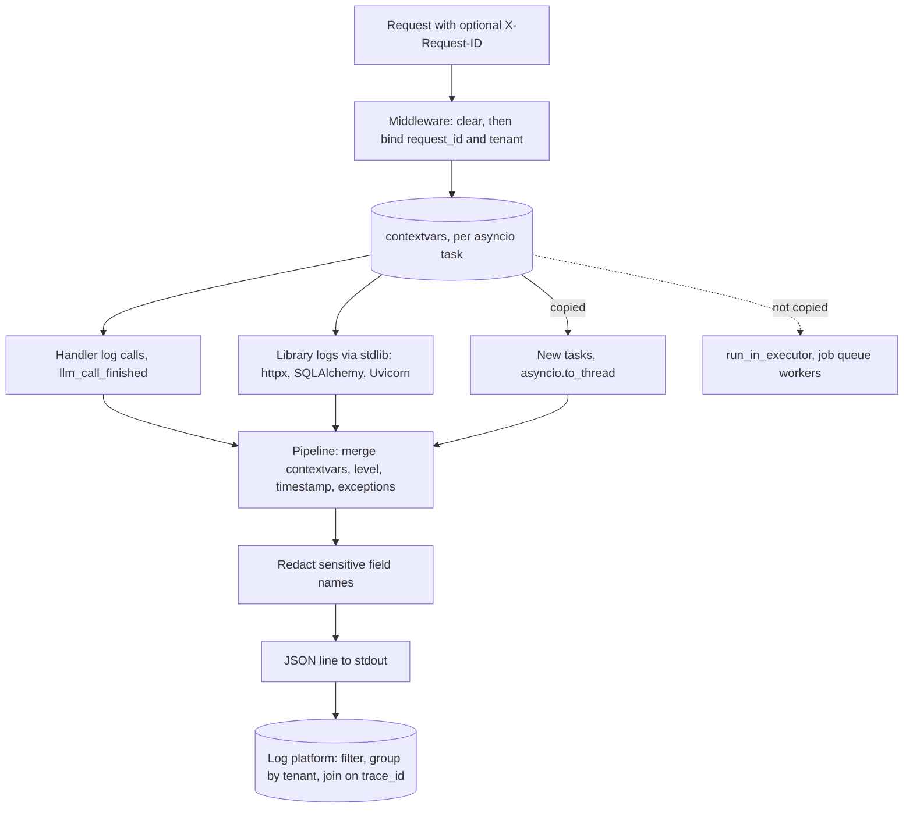

## TL;DR
Structured logging emits each event as one JSON object with named fields (`request_id`, `tenant`,
`model`, `prompt_tokens`, `latency_ms`). Middleware binds request context into `contextvars`, so every
line carries it, making logs filterable, joinable to traces and summable into per-tenant cost.

## Why it exists
- **Sentences do not scale.** `INFO: chat done for acme in 2.3s using gpt-x (812 tokens)` is readable once.
  Answering "which tenant's p95 doubled after the prompt change?" needs a regex per message format, which
  breaks the day someone rewords the sentence.
- **Concurrency interleaves lines.** An async worker handles hundreds of requests at once; without a
  request identifier on every line you cannot reconstruct any single request.
- **AI requests carry numbers you will sum.** Model, prompt version, input and output tokens, time to
  first token, finish reason, retries, cache hits, tool calls. Log platforms group fields well and prose
  badly.
- **Threading ids by hand fails.** Passing a `request_id` argument into every function pollutes every
  signature and still misses library logs.
- **Structured logging plus context propagation** puts consistent fields on every line without threading
  them through the code.

## How it works
### Events, not sentences
- **A call is an event name plus fields:** `log.info("llm_call_finished", model=m,
  prompt_tokens=812, completion_tokens=240, latency_ms=2310)`.
- **The message is a stable identifier** you can count; variable data lives in fields with stable names and
  types.
- **Rendering happens last.** A renderer serialises to JSON at the end of the pipeline, so developers can
  still get coloured key-value output locally from the same calls.

### Request context with contextvars
1. **Task-local values.** Python's `contextvars` give each asyncio task its own view of a variable, and a
   task copies the current context when it is created.
2. **Bind at the top.** A middleware generates or accepts a `request_id` (from an incoming `X-Request-ID`
   header, or the trace id if tracing is on) and binds it with tenant and route.
3. **Clear first.** It clears stale values at the start of each request (structlog's recommended pattern).
4. **Inherit everywhere.** Every log call during that request, in any function or library going through
   the same pipeline, gets those fields without receiving them as arguments. structlog does this with
   `bind_contextvars` and the `merge_contextvars` processor.

### The pipeline
```
merge contextvars → add log level → ISO timestamp → exceptions as structured fields → JSON
```
- **Route stdlib `logging` through the same pipeline** (structlog's `ProcessorFormatter`, with
  `merge_contextvars` in its pre-chain), so third-party loggers (httpx, SQLAlchemy, Uvicorn errors) come out
  as JSON with the same fields rather than as stray plain-text lines.

### Where context does not follow
| Path | Context copied? |
|---|---|
| new asyncio tasks, `asyncio.to_thread`, Starlette's `run_in_threadpool` | yes |
| `loop.run_in_executor`, raw `ThreadPoolExecutor.submit` | no |
| a job queue worker (Celery, ARQ) | no: pass `request_id` in the payload and bind it on arrival |

- **Stdlib handlers write synchronously.** At high volume a slow sink stalls the event loop, which is why
  busy services put a `QueueHandler` in front so the actual I/O happens on a listener thread.

### What to log for LLM calls
- **One event per model call** with: model and provider, prompt template id and version, input and output
  tokens, latency and time to first token, finish reason, retry count, cache hit, and the error class on
  failure.
- **Log the *shape* of content by default, not the content:** lengths, hashes, counts of messages and tool
  calls.
- **Why:** prompts and completions routinely contain personal data and secrets pasted by users. If you
  need them for debugging, use an explicit, sampled, access-controlled path with retention limits, and
  redact before writing.

### Access logs
- Uvicorn's access logger prints its own plain-text line per request.
- Common pattern: disable it (`--no-access-log`) and emit one structured `request_finished` event from the
  middleware, with status, route template (not the raw path, to avoid high-cardinality ids) and duration.

## Diagram
Context is bound once in middleware and merged into every event by the pipeline; the dotted edge marks
where it is silently lost unless you carry it yourself.



## Examples
### JSON logs, request context and one event per LLM call
```python
import time, uuid, logging, structlog
from fastapi import FastAPI, Request

structlog.configure(processors=[
    structlog.contextvars.merge_contextvars,
    structlog.processors.add_log_level,
    structlog.processors.TimeStamper(fmt="iso"),
    structlog.processors.format_exc_info,
    structlog.processors.JSONRenderer(),
])
log = structlog.get_logger()
app = FastAPI()

@app.middleware("http")
async def bind_request_context(request: Request, call_next):
    structlog.contextvars.clear_contextvars()
    rid = request.headers.get("x-request-id") or uuid.uuid4().hex
    structlog.contextvars.bind_contextvars(request_id=rid,
                                           tenant=request.headers.get("x-tenant", "unknown"))
    start, status = time.perf_counter(), 500     # 500 is what the client gets if call_next raises
    try:
        response = await call_next(request)
        status = response.status_code
        response.headers["x-request-id"] = rid
        return response
    except Exception:
        log.exception("request_failed")            # traceback as a structured field
        raise
    finally:
        route = request.scope.get("route")         # set by the router during call_next
        log.info("request_finished", status=status, route=getattr(route, "path", "unmatched"),
                 duration_ms=round((time.perf_counter() - start) * 1000))

@app.post("/v1/chat")
async def chat(body: dict):
    usage = {"prompt_tokens": 812, "completion_tokens": 240}       # from the provider response
    log.info("llm_call_finished", model="model-a", prompt_version="support-v14",
             finish_reason="stop", latency_ms=2310, **usage,      # measured around the real call
             prompt_chars=sum(len(m.get("content", "")) for m in body.get("messages", [])))
    return {"content": "..."}
```

- **One request yields lines like**
  `{"request_id": "9f2c...", "tenant": "acme", "model": "model-a", "prompt_tokens": 812, "event": "llm_call_finished", ...}`.
- **Cost per tenant is a one-liner:** group `llm_call_finished` by `tenant` and sum tokens in any log
  platform.
- **The `try/finally` matters.** Without it, a handler that raises skips `request_finished`, so the
  requests you most need (the 500s) are exactly the ones missing from the logs.
- **Streaming caveat.** For a `StreamingResponse`, `request_finished` fires when headers are sent, so log
  stream completion and token counts from inside the generator instead.

### One pipeline for stdlib, Uvicorn and a redaction safety net
Library and Uvicorn error logs go through the same processors, and any field with a sensitive name is
masked before rendering.

```python
import logging, os, structlog

SENSITIVE = {"prompt", "messages", "completion", "api_key", "authorization"}

def redact(logger, method_name, event_dict):
    for key in SENSITIVE & event_dict.keys():
        event_dict[key] = "[redacted]"
    return event_dict

shared = [structlog.contextvars.merge_contextvars,
          structlog.stdlib.add_log_level,
          structlog.processors.TimeStamper(fmt="iso")]

structlog.configure(processors=shared + [structlog.stdlib.ProcessorFormatter.wrap_for_formatter],
                    logger_factory=structlog.stdlib.LoggerFactory())

renderer = (structlog.dev.ConsoleRenderer() if os.getenv("LOG_FORMAT") == "console"
            else structlog.processors.JSONRenderer())
formatter = structlog.stdlib.ProcessorFormatter(
    foreign_pre_chain=shared,                       # for httpx, SQLAlchemy, Uvicorn records
    processors=[structlog.stdlib.ProcessorFormatter.remove_processors_meta,
                redact, structlog.processors.format_exc_info, renderer])

handler = logging.StreamHandler()
handler.setFormatter(formatter)
root = logging.getLogger()
root.handlers = [handler]
root.setLevel(logging.INFO)                         # setLevel, not .level =, so cached levels reset
for name in ("uvicorn", "uvicorn.error"):           # Uvicorn ships its own handlers; reroute them
    logging.getLogger(name).handlers = []
    logging.getLogger(name).propagate = True
```

- **Run with `--no-access-log`** so the middleware's `request_finished` replaces Uvicorn's text access line.
- **Mind the order.** Uvicorn applies its own logging config before it imports your app, so running this at
  import time under the CLI wins. If you call `uvicorn.run(...)` after configuring, pass `log_config=None`
  or Uvicorn reinstalls its own plain-text handlers on its loggers.

## Production patterns
- **One schema, one pipeline.** Route structlog and stdlib through `ProcessorFormatter` as above and pick
  console or JSON rendering from one setting. Monitor: the log shipper's parse-failure count, which should
  be zero.
- **Route templates, not raw paths.** Log `request.scope["route"].path` (for example `/v1/docs/{doc_id}`)
  and keep user or document ids as plain fields, never index keys. Monitor: distinct values of `route` per
  day; growth means raw paths leaked in.
- **Redaction as a safety net, metadata as the default.** Log lengths, hashes and counts; add a redaction
  processor for sensitive field names; send sampled content only to a separate, access-controlled store.
  Monitor: a scheduled log search for secret-like patterns such as provider key prefixes.
- **Queue in front of slow sinks.** Put a `logging.handlers.QueueHandler` on the root logger and let a
  `QueueListener` own the real handler. Set the `ProcessorFormatter` on the `QueueHandler`, so rendering
  and contextvars merging happen on the request's thread; the listener's handler writes `%(message)s`.
  Monitor: event-loop lag under log bursts.
- **`trace_id` on every line.** Add a processor that reads the current span with
  `trace.get_current_span().get_span_context()` and writes `format(ctx.trace_id, "032x")`. Monitor: the
  share of request lines carrying a `trace_id`.
- **Context across the queue.** Put `request_id` and tenant in every job payload and call
  `bind_contextvars` first thing in the worker. Monitor: worker log lines with no `request_id`.

## Trade-offs
- **Queryable JSON vs terminal readability.** JSON lines are trivially queryable but harder to read raw;
  use a console renderer locally and JSON in deployed environments, driven by one setting.
- **Rich fields vs backend cost.** High-cardinality fields (raw paths, user ids as label keys) inflate cost
  in some log backends; keep them as fields, not index keys, when the bill flips.
- **Prompt logging vs data exposure.** Logging prompts and completions makes quality debugging possible,
  but creates a copy of sensitive data with weaker controls; default to metadata and opt in to content per
  tenant with redaction.
- **Granularity vs aggregate cost.** Logs are cheap per event but expensive in aggregate at token
  granularity; one event per LLM call is usually right, and per-token logging belongs only in short-lived
  debugging.

## Pitfalls
- **f-strings in the message.** Symptom: thousands of unique "messages" and dashboards that cannot group
  or count events.
- **Library loggers on the default plain-text handler.** Symptom: mixed JSON and text lines that the log
  shipper fails to parse, often dropping exactly the error lines you need.
- **Not clearing contextvars per request, or binding in a long-lived task.** Symptom: lines carrying the
  previous request's `request_id` or tenant, which misattributes incidents and costs.
- **Full prompts logged by default.** Symptom: personal data or API keys showing up in a log search months
  later, outside any retention or access policy.
- **Offloading with `run_in_executor` or a background job without carrying context.** Symptom: lines from
  that work with no `request_id` or tenant, so they cannot be joined to the request.
- **Raw path instead of route template.** Symptom: per-path aggregations with one row per document id and a
  log index that grows without bound.

## When to use
- **Use in any service** that runs in more than one process or handles concurrent requests, which is every
  FastAPI deployment.
- **Start with:** a request-context middleware, one `request_finished` event and one `llm_call_finished`
  event with token and latency fields; those answer most production questions.
- **Add `trace_id`** to logs once tracing exists, so a log line links to its trace.
- **Pick the signal:** logs for discrete events and audit facts, metrics for things you graph
  continuously, traces for latency breakdowns across services.
- **Interviews:** request correlation via contextvars and a clear stance on logging prompt content.

## Role lens
- **Engineer:** Configures structlog and stdlib logging into one JSON pipeline, writes the context
  middleware, and emits consistent fields for every model call.
- **Architect:** Sets the logging schema and field names across services, the policy on prompt content and
  retention, and what goes to logs versus metrics versus traces.
- **FDE:** Wires the service's JSON logs into the customer's SIEM or log platform, mapping fields and
  honouring their data-residency and redaction rules.

## Check yourself
**Q:** Finance asks for daily token spend per tenant and per feature, and security says prompts must never
appear in logs. Using only logging, how would you deliver this, and what would you check before trusting
the numbers?
**A:** Emit exactly one `llm_call_finished` event per provider call with fields `tenant`, `feature` (route
template or an explicit tag), `model`, `prompt_tokens`, `completion_tokens` and `retry_count`, with
tenant bound by middleware through contextvars so every call inherits it. Content is represented only by
lengths or hashes, and a redaction processor drops any field named like `prompt` or `messages` as a safety
net. Spend is then a group-by on tenant and feature multiplied by per-model prices. Before trusting it, I
would reconcile totals against the provider's billing for a day, confirm retries and streamed calls are
each logged once with final usage, and check that sampling is off for this event, since sampled cost
logs undercount.

## Interview questions
### What is structured logging and why is it worth the setup in an AI service?
- **Definition:** each log call is a stable event name plus typed fields, rendered as one JSON object,
  instead of a formatted sentence.
- **Why it pays off:** the platform can filter and group by `tenant`, `model` or `prompt_version` and sum
  `prompt_tokens`, with no regex that breaks the day someone rewords a message.

### Some log lines from one request have no request_id. How do you find out why?
- **Check how that code was scheduled:** `loop.run_in_executor`, raw `ThreadPoolExecutor.submit` and job
  queue workers do not copy contextvars, while new tasks, `asyncio.to_thread` and `run_in_threadpool` do.
- **Check the handler path:** library loggers on their own plain-text handler skip `merge_contextvars`, so
  route them through `ProcessorFormatter` with it in the pre-chain.
- **Fix the gap:** use a context-copying call, or pass `request_id` in the job payload and bind it first.

### Would you log prompts and completions in production?
- **Not by default:** they routinely contain personal data and secrets, and a log store usually has weaker access
  controls and retention than the product database.
- **Log the shape instead:** lengths, hashes, counts of messages and tool calls, plus model and token
  fields.
- **If you need content,** use an explicit, sampled, access-controlled path with retention limits, redact
  before writing, and keep a redaction processor as a safety net.

### Logging at high volume starts to raise p99 latency. What is happening and what do you change?
- **Stdlib handlers write synchronously,** so a slow sink blocks the event loop on every log call.
- **Put a `QueueHandler` in front** with a `QueueListener` owning the real handler, so I/O happens on a
  listener thread; keep the `ProcessorFormatter` on the `QueueHandler` so contextvars merge on the request's
  thread.
- **Also cut volume:** one event per LLM call, never per token, and watch event-loop lag under bursts.

### How do you tie a log line to its distributed trace?
- **Add a processor** that reads `trace.get_current_span().get_span_context()` and writes the trace id as
  32 hex characters with `format(ctx.trace_id, "032x")`.
- **Optionally reuse it as `request_id`,** so one id works across logs, traces and the `x-request-id`
  response header.
- **Monitor** the share of request lines carrying a `trace_id` to catch paths where the span is missing.

## Quiz
### Q: Why do request fields bound with `contextvars` appear on log lines from deep inside library calls?
- [ ] structlog patches every library to accept a `request_id` argument
- [x] Each asyncio task carries its own context, which the logging pipeline merges into every event
- [ ] FastAPI injects the request object into all function calls automatically
- [ ] Uvicorn prefixes each output line with the connection id
> Context variables are task-local and copied when tasks are created, so a value bound in middleware is
> visible to any code running for that request, and `merge_contextvars` adds it to each event.

### Q: What is the best default for logging LLM prompt content in production?
- [ ] Log full prompts and completions at INFO for every request
- [ ] Never log anything about the prompt
- [x] Log metadata such as template version, token counts and lengths, with content only via sampled, redacted, access-controlled paths
- [ ] Log prompts only when the response status is 200
> Metadata answers cost and latency questions without copying sensitive data. Logging nothing loses
> debuggability; logging everything creates an uncontrolled store of personal data and secrets.

### Q: Why do teams often disable Uvicorn's access log and log requests from middleware instead?
- [ ] Uvicorn's access log blocks the event loop on every request
- [ ] The access log cannot be written to stdout
- [x] The middleware can emit one structured event with request context, route template and duration
- [ ] Access logs are required to be disabled for HTTP/2
> Uvicorn's line is plain text without your bound fields. A middleware event carries `request_id`, tenant
> and route template in the same JSON schema as everything else, so it can be joined and aggregated.
