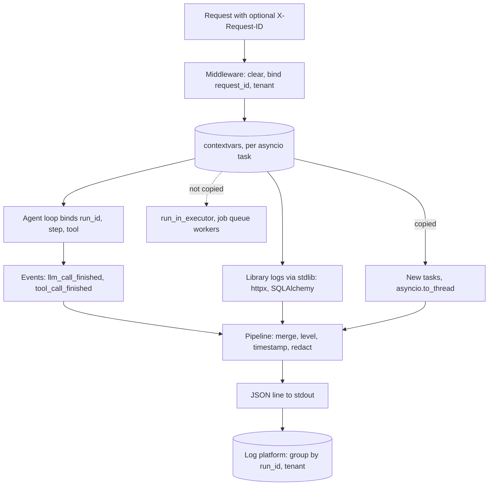

## TL;DR
Structured logging emits each event as one JSON object with named fields (`request_id`, `tenant`,
`model`, `prompt_tokens`, `latency_ms`, and for agents `run_id`, `step`, `tool`). Context bound in
`contextvars` lands on every line, so runs are filterable, joinable to traces and summable into cost.

## For agent builders
- **Why it matters for agents.** One agent run is dozens of events across model calls, tool calls,
  retries and maybe a job worker. Without `run_id` and `step` on every line you cannot answer "why did
  this run loop 14 times?" or "which tool failed?", and per-run cost cannot be summed.
- **Where it shows up in your stack.** structlog (or stdlib `logging` with a JSON formatter) in the
  FastAPI service and the agent worker, a request middleware that binds `request_id` and tenant, and
  binding calls inside the agent loop for `run_id`, `step` and `tool`.
- **What you control.** The event names and field schema (`llm_call_finished`, `tool_call_finished`,
  `agent_run_finished`), what content may be logged (by default, only its shape), and how context crosses
  into threads and queues.
- **What you can skip.** Logging framework internals and handler zoo. One pipeline, one schema, JSON to
  stdout is enough; tracing tools (Langfuse, LangSmith, OpenTelemetry) cover the span view.

## Lab
### Task
A support agent's logs cannot answer "which tool failed in run r1?": no line carries `run_id`, `step`
or `tool`, a sync CRM client logs from a thread pool with no context at all, and the raw tool arguments
put a customer's email into the logs.

Fix the pipeline and the loop so every line is attributable and
only the shape of content is logged.

Time box: 45-60 minutes.
- **Prerequisites:** Middleware ordering, Async endpoints, and this lesson's "Request context with
  contextvars" and "Where context does not follow".
- **Setup:** Python 3.12 with `pip install structlog pytest` (checked on structlog 26.1). The model and
  tools are local fakes. Save the starter as `lab_logs.py` and the tests as `test_lab_logs.py`.
- **Constraint:** keep the tools synchronous; fix how they are called, not the tools.

### Starter code
```python
"""Lab: run, step and tool on every agent log line, and no content (structlog 26.1, Python 3.12)."""
import asyncio, hashlib, io, json, time
import structlog

SENSITIVE = {"prompt", "messages", "arguments", "api_key"}


def configure(stream) -> None:
    """LAB 1: JSON lines to `stream`. Add, in order: merge contextvars, log level, a processor that
    replaces any SENSITIVE key's value with "[redacted]", then the JSON renderer."""
    structlog.configure(
        processors=[structlog.processors.add_log_level, structlog.processors.JSONRenderer()],
        logger_factory=structlog.PrintLoggerFactory(file=stream),
        cache_logger_on_first_use=False,
    )


log = structlog.get_logger()


class FakeLLM:                                       # scripted model replies
    def __init__(self):
        self.replies = iter([
            {"model": "model-a", "usage": (812, 40), "tool_calls": [
                {"name": "lookup_order", "args": {"order": "42", "email": "ana@example.com"}},
                {"name": "search_kb", "args": {"query": "refund window"}}]},
            {"model": "model-a", "usage": (1020, 85), "text": "Your refund is on its way."},
        ])

    async def complete(self):
        return next(self.replies)


class FakeTools:                                     # sync clients, as many SDKs still are
    def lookup_order(self, order, email):
        time.sleep(0.01)
        log.info("crm_request", rows=1)              # a library log line from inside the tool
        return {"order": order, "status": "refunded"}

    def search_kb(self, query):
        raise TimeoutError("kb timed out")


def arg_shape(args: dict) -> dict:
    blob = json.dumps(args, sort_keys=True).encode()
    return {"arg_keys": sorted(args), "arg_hash": hashlib.sha256(blob).hexdigest()[:12]}


async def call_sync_tool(fn, args):
    # LAB 3: run_in_executor does not copy contextvars, so crm_request loses its context here.
    loop = asyncio.get_running_loop()
    return await loop.run_in_executor(None, lambda: fn(**args))


async def run_agent(run_id: str, llm, tools, max_steps: int = 5):
    # LAB 2: bind run_id for the whole run, step per iteration and tool per call
    #        (structlog.contextvars.bound_contextvars), and log arg_shape(...) instead of the arguments.
    for step in range(1, max_steps + 1):
        reply = await llm.complete()
        log.info("llm_call_finished", model=reply["model"],
                 prompt_tokens=reply["usage"][0], completion_tokens=reply["usage"][1])
        if "text" in reply:
            log.info("agent_run_finished", stop_reason="done", steps=step)
            return reply["text"]
        for call in reply["tool_calls"]:
            outcome = "ok"
            try:
                await call_sync_tool(getattr(tools, call["name"]), call["args"])
            except Exception:
                outcome = "error"
            log.info("tool_call_finished", outcome=outcome, arguments=call["args"])
    log.warning("agent_run_finished", stop_reason="max_steps", steps=max_steps)


if __name__ == "__main__":
    buf = io.StringIO()
    configure(buf)
    asyncio.run(run_agent("r1", FakeLLM(), FakeTools()))
    for line in buf.getvalue().splitlines():
        e = json.loads(line)
        print(e["event"], *(f"{k}={e.get(k, '-')}" for k in ("run_id", "step", "tool", "outcome")))
    print("content leaked:", "ana@example.com" in buf.getvalue())
```

As given, every line prints `run_id=- step=- tool=-` and the last line is `content leaked: True`.

### Expected output
```
llm_call_finished run_id=r1 step=1 tool=- outcome=-
crm_request run_id=r1 step=1 tool=lookup_order outcome=-
tool_call_finished run_id=r1 step=1 tool=lookup_order outcome=ok
tool_call_finished run_id=r1 step=1 tool=search_kb outcome=error
llm_call_finished run_id=r1 step=2 tool=- outcome=-
agent_run_finished run_id=r1 step=2 tool=- outcome=-
content leaked: False
```

### Tests
```python
import asyncio, io, json
import lab_logs as lab


def run():
    buf = io.StringIO()
    lab.configure(buf)
    asyncio.run(lab.run_agent("r1", lab.FakeLLM(), lab.FakeTools()))
    return buf.getvalue(), [json.loads(line) for line in buf.getvalue().splitlines()]


def by_event(events, name):
    return [e for e in events if e["event"] == name]


def test_every_line_carries_the_run_and_a_level():
    _, events = run()
    assert len(events) == 6
    assert all(e.get("run_id") == "r1" and e.get("level") for e in events)


def test_tool_lines_know_their_step_and_tool_even_from_a_thread():
    _, events = run()
    crm = by_event(events, "crm_request")
    assert crm and crm[0]["step"] == 1 and crm[0]["tool"] == "lookup_order"
    tools = by_event(events, "tool_call_finished")
    assert [(e["tool"], e["outcome"]) for e in tools] == [("lookup_order", "ok"), ("search_kb", "error")]


def test_tool_context_does_not_leak_into_the_next_step():
    _, events = run()
    second = by_event(events, "llm_call_finished")[1]
    assert second["step"] == 2 and "tool" not in second


def test_shape_not_content():
    text, events = run()
    assert "ana@example.com" not in text
    first = by_event(events, "tool_call_finished")[0]
    assert first["arg_keys"] == ["email", "order"] and len(first["arg_hash"]) == 12


def test_redaction_is_a_safety_net_for_any_logger_call():
    buf = io.StringIO()
    lab.configure(buf)
    lab.log.info("debug_dump", prompt="my card is 4111", api_key="sk-test")
    e = json.loads(buf.getvalue())
    assert e["prompt"] == "[redacted]" and e["api_key"] == "[redacted]"
```

All five fail on the starter: no `run_id` or `step` on any line, the email appears in the
`tool_call_finished` line, and nothing is redacted.

### Failure scenarios
- **Inject: keep `run_in_executor` but fix everything else.** Observe: only `crm_request` loses
  `run_id`, `step` and `tool`, which in production looks like an orphan CRM line nobody can attribute.
  Debug: compare which paths copy context (table above); switch to `asyncio.to_thread`.
- **Inject: use `bind_contextvars(tool=...)` without unbinding.** Observe: step 2's
  `llm_call_finished` claims `tool=search_kb`. Debug: the leak test fails; use the
  `bound_contextvars` context manager so values reset when the block exits.
- **Inject: put the redact processor after `JSONRenderer`.** Observe: a crash or nothing redacted,
  because the renderer has already turned the event into a string. Debug: print the processor list;
  the renderer must be last.

### Submission
- The fixed `lab_logs.py` and a `pytest -q` run showing 5 passed.
- Your output of `python lab_logs.py`.
- One log-platform query (in the syntax you use) that finds runs where the same `arg_hash` repeats more
  than 3 times, as in the looping-agent scenario.
- A short note: one field you would add to `tool_call_finished` for your own agent, and why it is safe
  to log.

## Why it exists
- **Sentences do not scale.** `INFO: chat done for acme in 2.3s using gpt-x (812 tokens)` is readable once.
  Answering "which tenant's p95 doubled after the prompt change?" needs a regex per message format, which
  breaks the day someone rewords the sentence.
- **Concurrency interleaves lines.** An async worker handles hundreds of requests at once; without a
  request identifier on every line you cannot reconstruct any single request, or any single agent run.
- **AI requests carry numbers you will sum.** Model, prompt version, input and output tokens, time to
  first token, finish reason, retries, cache hits, tool calls. Log platforms group fields well and prose
  badly.
- **Threading ids by hand fails.** Passing a `request_id` argument into every function pollutes every
  signature and still misses library logs.
- **Structured logging plus context propagation** puts consistent fields on every line without threading
  them through the code.

## How it works
### Events, not sentences
- **A call is an event name plus fields:** `log.info("llm_call_finished", model=m,
  prompt_tokens=812, completion_tokens=240, latency_ms=2310)`.
- **The message is a stable identifier** you can count; variable data lives in fields with stable names and
  types.
- **Rendering happens last.** A renderer serialises to JSON at the end of the pipeline, so developers can
  still get coloured key-value output locally from the same calls.

### Request context with contextvars
1. **Task-local values.** Python's `contextvars` give each asyncio task its own view of a variable, and a
   task copies the current context when it is created.
2. **Bind at the top.** A middleware generates or accepts a `request_id` (from an incoming `X-Request-ID`
   header, or the trace id if tracing is on) and binds it with tenant and route.
3. **Clear first.** It clears stale values at the start of each request (structlog's recommended pattern).
4. **Inherit everywhere.** Every log call during that request, in any function or library going through
   the same pipeline, gets those fields without receiving them as arguments. structlog does this with
   `bind_contextvars` and the `merge_contextvars` processor.
5. **Bind again inside the agent loop.** `run_id` once per run, then `step` and `tool` per iteration, so
   every model, tool and library line carries where in the run it happened.

### The pipeline
```
merge contextvars → add log level → ISO timestamp → exceptions as structured fields → JSON
```
- **Route stdlib `logging` through the same pipeline** (structlog's `ProcessorFormatter`, with
  `merge_contextvars` in its pre-chain), so third-party loggers (httpx, SQLAlchemy, Uvicorn errors) come out
  as JSON with the same fields rather than as stray plain-text lines.

### Where context does not follow
| Path | Context copied? |
|---|---|
| new asyncio tasks, `asyncio.to_thread`, Starlette's `run_in_threadpool` | yes |
| `loop.run_in_executor`, raw `ThreadPoolExecutor.submit` | no |
| a job queue worker (Celery, ARQ) | no: pass `request_id` in the payload and bind it on arrival |

- **Agents hit both gaps.** Parallel tool calls via a thread pool and runs handed to a queue worker lose
  `run_id` unless you carry it.
- **Stdlib handlers write synchronously.** At high volume a slow sink stalls the event loop, which is why
  busy services put a `QueueHandler` in front so the actual I/O happens on a listener thread.

### What to log for LLM and tool calls
- **One event per model call** with: model and provider, prompt template id and version, input and output
  tokens, latency and time to first token, finish reason, retry count, cache hit, and the error class on
  failure.
- **One event per tool call** with: tool name, argument shape (keys and a hash, not values), outcome
  (`ok`, `error`, `timeout`, `rejected` by validation), result size, latency and retry count.
- **One event per run end** with: run id, step count, stop reason (`done`, `max_steps`, `error`,
  `interrupted`), and summed tokens.
- **Log the *shape* of content by default, not the content:** lengths, hashes, counts of messages and tool
  calls.
- **Why:** prompts and completions routinely contain personal data and secrets pasted by users, and tool
  results often contain customer records. If you need them for debugging, use an explicit, sampled,
  access-controlled path with retention limits, and redact before writing.

### Access logs
- Uvicorn's access logger prints its own plain-text line per request.
- Common pattern: disable it (`--no-access-log`) and emit one structured `request_finished` event from the
  middleware, with status, route template (not the raw path, to avoid high-cardinality ids) and duration.

## Diagram
Context is bound once in middleware and again per agent step, then merged into every event; the dotted
edge marks where it is silently lost unless you carry it yourself.



## Examples
### Agent scenario: run, step and tool context on every line
The loop binds `run_id` for the whole run and `step` and `tool` per iteration with structlog's
`bound_contextvars` context manager, so the provider client's and httpx's logs inherit them too.

```python
import hashlib, json, time, structlog

log = structlog.get_logger()

def arg_shape(args: dict) -> dict:
    blob = json.dumps(args, sort_keys=True).encode()
    return {"arg_keys": sorted(args), "arg_hash": hashlib.sha256(blob).hexdigest()[:12]}

async def run_agent(run_id: str, messages: list, llm, tools, max_steps: int = 20):
    totals = {"prompt_tokens": 0, "completion_tokens": 0}
    with structlog.contextvars.bound_contextvars(run_id=run_id):
        for step in range(1, max_steps + 1):
            with structlog.contextvars.bound_contextvars(step=step):
                t0 = time.perf_counter()
                reply = await llm.complete(messages, tools=tools.schemas())
                totals["prompt_tokens"] += reply.usage.prompt_tokens
                totals["completion_tokens"] += reply.usage.completion_tokens
                log.info("llm_call_finished", model=reply.model, finish_reason=reply.finish_reason,
                         prompt_tokens=reply.usage.prompt_tokens,
                         completion_tokens=reply.usage.completion_tokens,
                         latency_ms=round((time.perf_counter() - t0) * 1000),
                         tool_calls=len(reply.tool_calls))
                if not reply.tool_calls:
                    log.info("agent_run_finished", stop_reason="done", steps=step, **totals)
                    return reply.text
                messages.append(reply.message)
                for call in reply.tool_calls:
                    with structlog.contextvars.bound_contextvars(tool=call.name):
                        t1, outcome = time.perf_counter(), "ok"
                        try:
                            result = await tools.call(call.name, call.arguments)
                        except Exception as e:
                            outcome, result = "error", f"error: {type(e).__name__}"
                        log.info("tool_call_finished", outcome=outcome, result_chars=len(str(result)),
                                 latency_ms=round((time.perf_counter() - t1) * 1000),
                                 **arg_shape(call.arguments))
                        messages.append({"role": "tool", "tool_call_id": call.id, "content": str(result)})
        log.warning("agent_run_finished", stop_reason="max_steps", steps=max_steps, **totals)
```

- **`llm` and `tools` are your own interfaces;** the fields and binding pattern are the point.
- **Arguments are logged as keys plus a hash,** so you can see the model repeating an identical call
  without copying customer data into logs.

### Worked scenario: finding a looping agent from logs alone
Illustrative numbers from one day of `agent_run_finished` and `tool_call_finished` events.

| Query (group by fields) | Result | What it says |
|---|---|---|
| runs by `stop_reason` | 9,400 `done`, 610 `max_steps`, 90 `error` | about 6% of runs hit the 20-step cap |
| `max_steps` runs: summed tokens vs `done` runs | ~38,000 vs ~7,000 tokens per run | capped runs cost about 5x as much |
| `tool_call_finished` in capped runs, by `tool` and `arg_hash` | `search_orders` with one `arg_hash` repeated 14 times per run | the model retries an identical call |
| same calls by `outcome` | `ok` with `result_chars` = 2 | the tool returns `[]` and the model keeps asking |

- **Fix:** make the tool return an explicit "no orders found for that customer" message, and add a
  repeated-identical-call guard in the loop.
- **Verify** with the same queries the next day: `max_steps` share and tokens per run should both fall.

### JSON logs, request context and one event per LLM call
```python
import time, uuid, logging, structlog
from fastapi import FastAPI, Request

structlog.configure(processors=[
    structlog.contextvars.merge_contextvars,
    structlog.processors.add_log_level,
    structlog.processors.TimeStamper(fmt="iso"),
    structlog.processors.format_exc_info,
    structlog.processors.JSONRenderer(),
])
log = structlog.get_logger()
app = FastAPI()

@app.middleware("http")
async def bind_request_context(request: Request, call_next):
    structlog.contextvars.clear_contextvars()
    rid = request.headers.get("x-request-id") or uuid.uuid4().hex
    structlog.contextvars.bind_contextvars(request_id=rid,
                                           tenant=request.headers.get("x-tenant", "unknown"))
    start, status = time.perf_counter(), 500     # 500 is what the client gets if call_next raises
    try:
        response = await call_next(request)
        status = response.status_code
        response.headers["x-request-id"] = rid
        return response
    except Exception:
        log.exception("request_failed")            # traceback as a structured field
        raise
    finally:
        route = request.scope.get("route")         # set by the router during call_next
        log.info("request_finished", status=status, route=getattr(route, "path", "unmatched"),
                 duration_ms=round((time.perf_counter() - start) * 1000))

@app.post("/v1/chat")
async def chat(body: dict):
    usage = {"prompt_tokens": 812, "completion_tokens": 240}       # from the provider response
    log.info("llm_call_finished", model="model-a", prompt_version="support-v14",
             finish_reason="stop", latency_ms=2310, **usage,      # measured around the real call
             prompt_chars=sum(len(m.get("content", "")) for m in body.get("messages", [])))
    return {"content": "..."}
```

- **One request yields lines like**
  `{"request_id": "9f2c...", "tenant": "acme", "model": "model-a", "prompt_tokens": 812, "event": "llm_call_finished", ...}`.
- **Cost per tenant is a one-liner:** group `llm_call_finished` by `tenant` and sum tokens in any log
  platform.
- **The `try/finally` matters.** Without it, a handler that raises skips `request_finished`, so the
  requests you most need (the 500s) are exactly the ones missing from the logs.
- **Streaming caveat.** For a `StreamingResponse`, `request_finished` fires when headers are sent, so log
  stream completion and token counts from inside the generator instead.

### One pipeline for stdlib, Uvicorn and a redaction safety net
Library and Uvicorn error logs go through the same processors, and any field with a sensitive name is
masked before rendering.

```python
import logging, os, structlog

SENSITIVE = {"prompt", "messages", "completion", "api_key", "authorization"}

def redact(logger, method_name, event_dict):
    for key in SENSITIVE & event_dict.keys():
        event_dict[key] = "[redacted]"
    return event_dict

shared = [structlog.contextvars.merge_contextvars,
          structlog.stdlib.add_log_level,
          structlog.processors.TimeStamper(fmt="iso")]

structlog.configure(processors=shared + [structlog.stdlib.ProcessorFormatter.wrap_for_formatter],
                    logger_factory=structlog.stdlib.LoggerFactory())

renderer = (structlog.dev.ConsoleRenderer() if os.getenv("LOG_FORMAT") == "console"
            else structlog.processors.JSONRenderer())
formatter = structlog.stdlib.ProcessorFormatter(
    foreign_pre_chain=shared,                       # for httpx, SQLAlchemy, Uvicorn records
    processors=[structlog.stdlib.ProcessorFormatter.remove_processors_meta,
                redact, structlog.processors.format_exc_info, renderer])

handler = logging.StreamHandler()
handler.setFormatter(formatter)
root = logging.getLogger()
root.handlers = [handler]
root.setLevel(logging.INFO)                         # setLevel, not .level =, so cached levels reset
for name in ("uvicorn", "uvicorn.error"):           # Uvicorn ships its own handlers; reroute them
    logging.getLogger(name).handlers = []
    logging.getLogger(name).propagate = True
```

- **Run with `--no-access-log`** so the middleware's `request_finished` replaces Uvicorn's text access line.
- **Mind the order.** Uvicorn applies its own logging config before it imports your app, so running this at
  import time under the CLI wins. If you call `uvicorn.run(...)` after configuring, pass `log_config=None`
  or Uvicorn reinstalls its own plain-text handlers on its loggers.

## Production patterns
- **A fixed agent event schema.** Agent teams agree on `llm_call_finished`, `tool_call_finished` and
  `agent_run_finished` with the same field names across services and workers, so dashboards for step
  count, stop reason and tool error rate work everywhere. Monitor: the share of runs ending in
  `max_steps` or `error`, and tokens per run.
- **One schema, one pipeline.** Route structlog and stdlib through `ProcessorFormatter` as above and pick
  console or JSON rendering from one setting. Monitor: the log shipper's parse-failure count, which should
  be zero.
- **Route templates, not raw paths.** Log `request.scope["route"].path` (for example `/v1/docs/{doc_id}`)
  and keep user, run or document ids as plain fields, never index keys. Monitor: distinct values of
  `route` per day; growth means raw paths leaked in.
- **Redaction as a safety net, metadata as the default.** Log lengths, hashes and counts; add a redaction
  processor for sensitive field names; send sampled content only to a separate, access-controlled store.
  Monitor: a scheduled log search for secret-like patterns such as provider key prefixes.
- **Queue in front of slow sinks, `trace_id` on every line.** Put a `logging.handlers.QueueHandler` on the
  root logger with the `ProcessorFormatter` on it (rendering and contextvars merging stay on the request's
  thread) and a `QueueListener` writing `%(message)s`; add a processor that reads
  `trace.get_current_span().get_span_context()` and writes `format(ctx.trace_id, "032x")`. Monitor:
  event-loop lag under log bursts, and the share of lines with a `trace_id`.
- **Context across the queue.** Put `request_id`, `run_id` and tenant in every job payload and call
  `bind_contextvars` first thing in the worker. Monitor: worker log lines with no `request_id` or `run_id`.

## Trade-offs
- **Queryable JSON vs terminal readability.** JSON lines are trivially queryable but harder to read raw;
  use a console renderer locally and JSON in deployed environments, driven by one setting.
- **Rich fields vs backend cost.** High-cardinality fields (raw paths, user ids as label keys) inflate cost
  in some log backends; keep them as fields, not index keys, when the bill flips.
- **Prompt logging vs data exposure.** Logging prompts and completions makes quality debugging possible,
  but creates a copy of sensitive data with weaker controls; default to metadata and opt in to content per
  tenant with redaction.
- **Granularity vs aggregate cost.** Logs are cheap per event but expensive in aggregate at token
  granularity; one event per LLM call is usually right, and per-token logging belongs only in short-lived
  debugging.
- **Logs vs an agent tracing tool.** Logs are cheap, already shipped and good for counting and cost; a
  tracing tool shows the run as a tree with inputs and outputs. Most teams keep both, joined by `run_id`
  or `trace_id`, and keep content only in the tool with stronger access control.

## Pitfalls
- **f-strings in the message.** Symptom: thousands of unique "messages" and dashboards that cannot group
  or count events.
- **Library loggers on the default plain-text handler.** Symptom: mixed JSON and text lines that the log
  shipper fails to parse, often dropping exactly the error lines you need.
- **Not clearing contextvars per request, or binding in a long-lived task.** Symptom: lines carrying the
  previous request's `request_id` or tenant, which misattributes incidents and costs.
- **Full prompts logged by default.** Symptom: personal data or API keys showing up in a log search months
  later, outside any retention or access policy.
- **Tool arguments and results logged verbatim.** Symptom: customer records from a CRM tool sitting in the
  log index. Fix: log keys, hashes and sizes; keep content in an access-controlled trace store.
- **Offloading with `run_in_executor` or a background job without carrying context.** Symptom: lines from
  that work with no `request_id` or tenant, so they cannot be joined to the request.
- **Raw path instead of route template.** Symptom: per-path aggregations with one row per document id and a
  log index that grows without bound.

## When to use
- **Use in any service** that runs in more than one process or handles concurrent requests, which is every
  FastAPI deployment.
- **Start with:** a request-context middleware, one `request_finished` event and one `llm_call_finished`
  event with token and latency fields; those answer most production questions. Agents add
  `tool_call_finished` and `agent_run_finished`.
- **Add `trace_id`** to logs once tracing exists, so a log line links to its trace.
- **Pick the signal:** logs for discrete events and audit facts, metrics for things you graph
  continuously, traces for latency breakdowns across services.
- **Interviews:** request correlation via contextvars and a clear stance on logging prompt content.

## Role lens
- **Engineer:** Configures structlog and stdlib logging into one JSON pipeline, writes the context
  middleware, and emits consistent fields for every model call.
- **Architect:** Sets the logging schema and field names across services, the policy on prompt content and
  retention, and what goes to logs versus metrics versus traces.
- **FDE:** Wires the service's JSON logs into the customer's SIEM or log platform, mapping fields and
  honouring their data-residency and redaction rules.

## Check yourself
**Q:** Finance asks for daily token spend per tenant and per feature, and security says prompts must never
appear in logs. Using only logging, how would you deliver this, and what would you check before trusting
the numbers?
**A:** Emit exactly one `llm_call_finished` event per provider call with fields `tenant`, `feature` (route
template or an explicit tag), `model`, `prompt_tokens`, `completion_tokens` and `retry_count`, with
tenant bound by middleware through contextvars so every call inherits it. Content is represented only by
lengths or hashes, and a redaction processor drops any field named like `prompt` or `messages` as a safety
net. Spend is then a group-by on tenant and feature multiplied by per-model prices. Before trusting it, I
would reconcile totals against the provider's billing for a day, confirm retries and streamed calls are
each logged once with final usage, and check that sampling is off for this event, since sampled cost
logs undercount.

## Interview questions
### What is structured logging and why is it worth the setup in an AI service?
- **Definition:** each log call is a stable event name plus typed fields, rendered as one JSON object,
  instead of a formatted sentence.
- **Why it pays off:** the platform can filter and group by `tenant`, `model` or `prompt_version` and sum
  `prompt_tokens`, with no regex that breaks the day someone rewords a message.

### What would you log for an agent so on-call can debug a bad run without a tracing UI?
- **Context on every line:** `run_id`, `step` and `tool` bound through contextvars inside the loop, on top
  of `request_id` and tenant from middleware.
- **Three events:** `llm_call_finished` (model, tokens, finish reason, tool-call count),
  `tool_call_finished` (tool, outcome, argument keys and hash, result size, latency) and
  `agent_run_finished` (stop reason, steps, summed tokens).
- **No raw content:** shapes and hashes still reveal loops (the same `arg_hash` repeated) and empty tool
  results, without copying customer data.

### Some log lines from one request have no request_id. How do you find out why?
- **Check how that code was scheduled:** `loop.run_in_executor`, raw `ThreadPoolExecutor.submit` and job
  queue workers do not copy contextvars, while new tasks, `asyncio.to_thread` and `run_in_threadpool` do.
- **Check the handler path:** library loggers on their own plain-text handler skip `merge_contextvars`, so
  route them through `ProcessorFormatter` with it in the pre-chain.
- **Fix the gap:** use a context-copying call, or pass `request_id` in the job payload and bind it first.

### Would you log prompts and completions in production?
- **Not by default:** they routinely contain personal data and secrets, and a log store usually has weaker access
  controls and retention than the product database.
- **Log the shape instead:** lengths, hashes, counts of messages and tool calls, plus model and token
  fields.
- **If you need content,** use an explicit, sampled, access-controlled path with retention limits, redact
  before writing, and keep a redaction processor as a safety net.

### Logging at high volume starts to raise p99 latency. What is happening and what do you change?
- **Stdlib handlers write synchronously,** so a slow sink blocks the event loop on every log call.
- **Put a `QueueHandler` in front** with a `QueueListener` owning the real handler, so I/O happens on a
  listener thread; keep the `ProcessorFormatter` on the `QueueHandler` so contextvars merge on the request's
  thread.
- **Also cut volume:** one event per LLM call, never per token, and watch event-loop lag under bursts.

### How do you tie a log line to its distributed trace?
- **Add a processor** that reads `trace.get_current_span().get_span_context()` and writes the trace id as
  32 hex characters with `format(ctx.trace_id, "032x")`.
- **Optionally reuse it as `request_id`,** so one id works across logs, traces and the `x-request-id`
  response header.
- **Monitor** the share of request lines carrying a `trace_id` to catch paths where the span is missing.

## Quiz
### Q: Why do request fields bound with `contextvars` appear on log lines from deep inside library calls?
- [ ] structlog patches every library to accept a `request_id` argument
- [x] Each asyncio task carries its own context, which the logging pipeline merges into every event
- [ ] FastAPI injects the request object into all function calls automatically
- [ ] Uvicorn prefixes each output line with the connection id
> Context variables are task-local and copied when tasks are created, so a value bound in middleware is
> visible to any code running for that request, and `merge_contextvars` adds it to each event.

### Q: What is the best default for logging LLM prompt content in production?
- [ ] Log full prompts and completions at INFO for every request
- [ ] Never log anything about the prompt
- [x] Log metadata such as template version, token counts and lengths, with content only via sampled, redacted, access-controlled paths
- [ ] Log prompts only when the response status is 200
> Metadata answers cost and latency questions without copying sensitive data. Logging nothing loses
> debuggability; logging everything creates an uncontrolled store of personal data and secrets.

### Q: Why do teams often disable Uvicorn's access log and log requests from middleware instead?
- [ ] Uvicorn's access log blocks the event loop on every request
- [ ] The access log cannot be written to stdout
- [x] The middleware can emit one structured event with request context, route template and duration
- [ ] Access logs are required to be disabled for HTTP/2
> Uvicorn's line is plain text without your bound fields. A middleware event carries `request_id`, tenant
> and route template in the same JSON schema as everything else, so it can be joined and aggregated.

## Use cases & projects
### Use cases
- **Debugging a looping agent.** Filtering by `run_id` and ordering by `step` shows which tool kept
  failing and why the run looped.
- **Per-run and per-tenant cost.** Summing `prompt_tokens` and completion tokens from `llm_call_finished`
  events gives cost per run, per tenant and per model.
- **Tool reliability reports.** `tool_call_finished` events with `tool`, `outcome` and `latency_ms` rank tools
  by error rate and latency.
- **Joining logs to traces.** A trace id on each line links the JSON events to the span tree in your
  tracing tool.

### Mini project
**Make one agent run fully reconstructable from logs (1-2 hours).**
- **Goal:** answer "what did run X do, and what did it cost?" from logs alone.
- **Steps:** add structlog with a JSON renderer to a FastAPI agent stub; bind `request_id` and tenant in a
  middleware with `contextvars`; bind `run_id`, `step` and `tool` inside the loop; emit
  `llm_call_finished`, `tool_call_finished` and `agent_run_finished` events with token counts and
  `latency_ms`; run 10 runs with fake tools, one of which fails randomly.
- **Done when:** a single `jq` command lists every step of one run in order, and another sums tokens per
  run, with no prompt text in any line.

### Major project
This lesson feeds the module Capstone (see the module guide), where every log line for a request must
carry the same request id and tenant as its trace.
