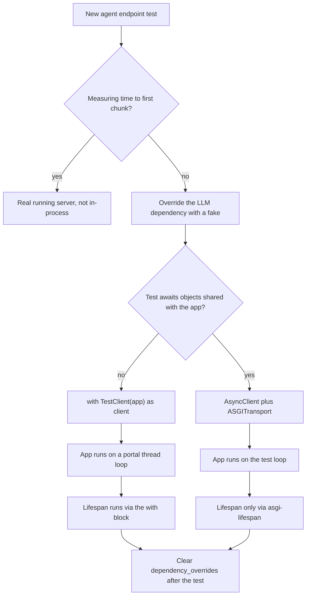

## TL;DR
Test an agent endpoint in-process with a scripted fake LLM: `TestClient` for synchronous tests,
`httpx.AsyncClient` with `ASGITransport` for `async def` tests. You prove the tool loop, error mapping and
streaming without paying for or waiting on a model.

## For agent builders
- **Why it matters for agents.** Most agent bugs are in your code, not the model: a tool result never
  appended, a loop that does not stop, a provider error turned into a 500, a malformed final stream event.
  A fake LLM that returns scripted tool calls reproduces each one deterministically in milliseconds.
- **Where it shows up in your stack.** `app.dependency_overrides` swapping the LLM client and tool
  registry, `TestClient` for request and streaming tests, `ASGITransport` plus pytest-asyncio when the
  test awaits shared async state such as an agent memory store.
- **What you control.** The seam (inject the model and tools through `Depends`), the scripted responses,
  which loop each test runs on, and when to clear overrides.
- **What you can skip.** anyio portal internals. Know the lifespan-under-`with` rule, the one-loop rule
  and the exact-callable override rule; that prevents almost every agent-test flake.

## Why it exists
- **The behaviour worth testing is mostly not the model.** Request validation, auth, how a provider error
  becomes a status code, whether a streaming endpoint emits a well-formed final event, whether a cached
  path skips the model, whether the agent loop executes a tool call and stops.
- **Starting Uvicorn and sending real HTTP is the wrong tool.** It is slow, needs free ports and makes
  failures hard to debug.
- **Calling the endpoint function directly skips what breaks.** Dependency resolution, Pydantic
  validation, middleware, exception handlers and response serialisation never run.
- **An in-process client gives the full HTTP path with none of the network.** The complication is the
  event loop: a normal pytest test is synchronous and has no loop, your app is async, and a test that
  awaits things (seeding an async database, inspecting an async fake) needs a loop of its own.
- **Objects created on one loop cannot safely be used on another.** `TestClient` hides the loop,
  pytest-asyncio gives you one, and mixing them carelessly produces the most common async-testing errors.

## How it works
### TestClient
`fastapi.testclient.TestClient` is Starlette's test client, built on httpx's request API.
1. `client.post(...)` converts the request into ASGI messages.
2. It runs your app through an anyio portal: a separate thread with its own event loop.
3. Your test stays synchronous, *because* the portal blocks until the app has produced the response.

Two details matter:
- **Lifespan runs only under `with`.** Startup and shutdown run only when the client is used as a context
  manager (`with TestClient(app) as client:`), *because* constructing the client alone does not start the
  app. Without it, anything created in the lifespan (a shared httpx client, a Redis pool, the agent's tool
  registry) is missing and endpoints fail with `AttributeError` on `app.state`.
- **Streaming works.** Consume streaming endpoints with `client.stream(...)` and `iter_lines()`, which is
  how you assert an agent's token and tool-call events arrive in order.

### httpx.AsyncClient + ASGITransport
- **Construct** `httpx.AsyncClient(transport=httpx.ASGITransport(app=app), base_url="http://test")`.
- **Same loop as the test,** so the test can await other async code before and after, such as reading
  what the agent wrote to an async memory store.
- **No lifespan.** `ASGITransport` does not run lifespan events, so wrap the app with a lifespan manager
  (for example the `asgi-lifespan` package) or enter the app's lifespan yourself.

### pytest-asyncio
- **pytest does not run coroutines by itself;** pytest-asyncio provides the loop.
- **Two modes:** mark tests with `@pytest.mark.asyncio` (strict mode, the default), or set
  `asyncio_mode = "auto"` so every `async def` test and fixture is handled.
- **Async fixtures** use `@pytest_asyncio.fixture` in strict mode.
- **Fresh loop per test by default,** *because* isolation beats speed.
- **Session-scoped async fixtures** (a database engine, a container client) must share a loop with the
  tests that use them, which recent versions express with a `loop_scope` argument. The loop-scope API has
  changed across releases, so follow the docs for your installed version.
- **Alternative:** AnyIO's own pytest plugin (`@pytest.mark.anyio`) when the codebase already uses AnyIO.

### Replacing the model
| Code calls the model through | Replace it with |
|---|---|
| A dependency | `app.dependency_overrides[get_llm] = lambda: FakeLLM()` |
| httpx directly | `httpx.MockTransport` or the `respx` library, which intercept at the transport |

- **Override at the dependency boundary,** *because* that is where the app already expects an injectable
  object.
- **Script the fake for agents.** Give it a list of responses (a tool call, then a final answer) and
  record every prompt it receives, so the test can assert the tool result was appended before the second
  model call.
- **Clear overrides after each test,** or one test's fake leaks into the next.
- **The key is the exact callable in `Depends(...)`.** FastAPI looks up each dependency function in
  `dependency_overrides` while resolving the request. Overriding a lookalike silently does nothing and
  the real client runs: a wrapper, a re-import of a different function, or a dependency produced by a
  factory call such as `Depends(make_llm("gpt"))`, which creates a new closure at import time.

### Exceptions surface differently in tests
- **Unhandled exceptions are re-raised into the test** by default (`raise_server_exceptions=True`),
  instead of becoming a 500, *because* a traceback is more useful than a status code while debugging.
- **`ASGITransport` behaves the same** through `raise_app_exceptions`.
- **Handled exceptions still become responses:** `HTTPException` and registered exception handlers.
- **To assert what a client actually sees** when something unhandled breaks, construct the client with
  `raise_server_exceptions=False`; otherwise the test fails with the exception rather than checking the
  status.

## Diagram
The decision is about event loops: a synchronous test lets `TestClient` run the app on its own portal
loop, while a test that awaits must keep the app on the test's loop through `ASGITransport` (under
pytest-asyncio). Streaming latency needs a real server either way.



## Examples
### A fake LLM, tested sync and async
A fake LLM via dependency override, tested once synchronously with `TestClient` and once asynchronously
with `ASGITransport`. Requires `pytest-asyncio`.

```python
import httpx, pytest
from fastapi import Depends, FastAPI
from fastapi.testclient import TestClient

class LLM:
    async def complete(self, prompt: str) -> str: raise NotImplementedError

def get_llm() -> LLM: return LLM()

app = FastAPI()

@app.post("/summarise")
async def summarise(body: dict, llm: LLM = Depends(get_llm)):
    if not body.get("text"):
        return {"summary": ""}
    return {"summary": await llm.complete(f"Summarise: {body['text']}")}

class FakeLLM(LLM):
    def __init__(self): self.prompts: list[str] = []
    async def complete(self, prompt: str) -> str:
        self.prompts.append(prompt); return "short version"

@pytest.fixture
def fake():
    f = FakeLLM(); app.dependency_overrides[get_llm] = lambda: f
    yield f
    app.dependency_overrides.clear()          # never leak overrides between tests

def test_sync(fake):
    with TestClient(app) as client:          # context manager runs lifespan
        r = client.post("/summarise", json={"text": "long doc"})
    assert r.json() == {"summary": "short version"} and len(fake.prompts) == 1

@pytest.mark.asyncio
async def test_async_skips_model_on_empty(fake):
    transport = httpx.ASGITransport(app=app)
    async with httpx.AsyncClient(transport=transport, base_url="http://test") as c:
        r = await c.post("/summarise", json={"text": ""})
    assert r.json() == {"summary": ""} and fake.prompts == []
```

- **Cost:** both tests exercise routing, dependency injection and serialisation, run in milliseconds and
  cost nothing.
- **The sync test proves** the request reached the fake exactly once through the override.
- **The async test proves a negative:** the empty-input branch never touched the model, which no amount
  of mocking the HTTP layer would show as clearly.
- **Real-model behaviour** belongs in a separate, smaller suite.

### Testing an agent's tool loop with a scripted fake
The fake returns a tool call on the first turn and a final answer on the second. The test asserts the
tool ran once, its result reached the model, and the loop stopped. The message shapes are this app's own,
not a provider's.

```python
from fastapi import Depends, FastAPI
from fastapi.testclient import TestClient

agent_app = FastAPI()

def get_agent_llm(): raise NotImplementedError        # real client injected in production
def get_tools(): raise NotImplementedError

@agent_app.post("/agent")
async def run_agent(body: dict, llm=Depends(get_agent_llm), tools=Depends(get_tools)):
    messages = [{"role": "user", "content": body["q"]}]
    for _ in range(5):                                # hard step cap
        out = await llm.step(messages)
        if out["type"] == "final":
            return {"answer": out["text"], "steps": len(messages)}
        result = await tools[out["name"]](**out["args"])
        messages += [{"role": "assistant", "tool": out["name"]},
                     {"role": "tool", "content": result}]
    return {"answer": None, "error": "step_limit"}

class ScriptedLLM:
    def __init__(self, script): self.script, self.seen = list(script), []
    async def step(self, messages):
        self.seen.append(list(messages)); return self.script.pop(0)

def test_tool_result_reaches_model_and_loop_stops():
    calls = []
    async def weather(city): calls.append(city); return "18C"
    llm = ScriptedLLM([{"type": "tool", "name": "weather", "args": {"city": "Oslo"}},
                       {"type": "final", "text": "It is 18C in Oslo."}])
    agent_app.dependency_overrides[get_agent_llm] = lambda: llm
    agent_app.dependency_overrides[get_tools] = lambda: {"weather": weather}
    try:
        with TestClient(agent_app) as client:
            r = client.post("/agent", json={"q": "Weather in Oslo?"})
        assert r.json()["answer"] == "It is 18C in Oslo." and calls == ["Oslo"]
        assert llm.seen[1][-1] == {"role": "tool", "content": "18C"}   # appended before turn 2
    finally:
        agent_app.dependency_overrides.clear()
```

- **Add a second script** that only ever returns tool calls and assert `error == "step_limit"`, which
  proves the runaway-loop guard works without spending a token.

### Failure paths: mapped errors and unhandled bugs
The same fake pattern extends to failures. A `FailingLLM` raises your provider-error type, and the test
asserts the endpoint maps it to, say, 502 with your error body. Builds on the first app above.

```python
from fastapi import Request
from fastapi.responses import JSONResponse

class ProviderError(Exception): ...

@app.exception_handler(ProviderError)
async def provider_error(request: Request, exc: ProviderError):
    return JSONResponse({"error": "upstream_failed"}, status_code=502)

class FailingLLM(LLM):
    async def complete(self, prompt: str) -> str: raise ProviderError("rate limited")

class BuggyLLM(LLM):
    async def complete(self, prompt: str) -> str: raise KeyError("bug")

def test_provider_error_maps_to_502():
    app.dependency_overrides[get_llm] = lambda: FailingLLM()
    try:
        with TestClient(app) as client:                      # handled: a normal response
            r = client.post("/summarise", json={"text": "x"})
        assert r.status_code == 502 and r.json() == {"error": "upstream_failed"}
    finally:
        app.dependency_overrides.clear()

def test_unhandled_bug_is_500_for_clients():
    app.dependency_overrides[get_llm] = lambda: BuggyLLM()
    try:
        with TestClient(app, raise_server_exceptions=False) as client:   # see the status
            r = client.post("/summarise", json={"text": "x"})
        assert r.status_code == 500
    finally:
        app.dependency_overrides.clear()
```

### Which client for which test
| Test needs | Use | Lifespan |
|---|---|---|
| Validation, auth, error mapping, response shape | `TestClient` | `with TestClient(app)` |
| Agent tool loop with a scripted fake | `TestClient` | `with TestClient(app)` |
| Streaming format | `TestClient` with `client.stream(...)` | `with TestClient(app)` |
| Await an async fixture shared with the app | `AsyncClient` + `ASGITransport` | lifespan manager |
| Time to first chunk | A real running server | real startup |

## Production patterns
- **One `conftest.py` client fixture per style.** When a suite grows past a handful of files, define a
  sync `client` fixture (`with TestClient(app) as c: yield c`) and an async one, so no test constructs
  clients by hand and forgets lifespan. Monitor suite runtime per fixture.
- **Scripted-fake regression tests for agent incidents.** When an agent misbehaves in production, copy
  the model outputs from the trace into a scripted fake and add a test that replays them, so the loop,
  parsing or tool bug stays fixed. Monitor how many incidents ship with a replay test.
- **Async client with lifespan via `asgi-lifespan`.** When async tests need lifespan-created state, wrap
  the app: `async with LifespanManager(app) as m:` then build the `AsyncClient` on
  `ASGITransport(app=m.app)`. Monitor "attached to a different loop" errors, which mean a fixture's loop
  scope does not match.
- **Autouse override cleanup.** Add an `autouse=True` fixture that yields and then calls
  `app.dependency_overrides.clear()`, so order-dependent passes disappear. Detect leaks by running the
  suite in random order (for example with the `pytest-randomly` plugin).
- **Transport-level fakes for raw httpx calls.** When code calls a provider through httpx rather than an
  injectable dependency, give the shared client an `httpx.MockTransport(handler)` in tests, or use
  `respx`, and return recorded provider payloads, including error bodies. Monitor that no test needs
  network by running the suite with outbound network blocked in CI.
- **A separate, small real-model suite.** Keep fakes for the fast suite and mark real-provider tests with
  a custom marker (for example `@pytest.mark.live`) run on a schedule, not per commit; agent quality
  belongs in evals, not here. Monitor its cost per run and its flake rate.

## Trade-offs
- **`TestClient` simplicity vs loop isolation.** It keeps tests synchronous and simple, but runs the app on
  a different loop in another thread, so it breaks as soon as the test shares async objects with the app;
  then use `ASGITransport`.
- **`ASGITransport` one-loop power vs setup.** It runs everything on one loop and allows awaiting in the
  test, at the cost of async fixtures, a pytest plugin and manual lifespan handling.
- **Fakes vs realism.** Overriding dependencies with fakes gives fast, deterministic tests of your agent
  logic, but proves nothing about whether the real model picks the right tool, which needs evals,
  contract or integration tests.
- **Function vs session loop scope.** Function-scoped event loops isolate tests well; session-scoped loops
  make expensive async fixtures reusable, but state leaks between tests become possible and must be
  cleaned up explicitly.

## Pitfalls
- **`TestClient(app)` without `with`.** Lifespan never runs, and endpoints fail with `AttributeError` on
  `app.state` resources that exist in production.
- **`TestClient` inside an `async def` test that also created an async engine or client.** Symptom:
  "attached to a different loop" or a hang, because two loops share one object.
- **Forgetting to clear `app.dependency_overrides`.** Symptom: a later test passes or fails depending on
  test order.
- **Overriding a different function object from the one in `Depends(...)`.** Symptom: a test that passes
  slowly, needs network, or fails with an authentication error from the real provider. Fix: override the
  exact function object, and block outbound network in CI so the mistake fails fast.
- **A fake that always returns the final answer.** Symptom: the tool-calling branch of the agent loop has
  no coverage and breaks in production first. Fix: script at least one tool call, one tool error and one
  step-limit run.
- **Expecting a 500 from an unhandled error with default `TestClient` settings.** The test errors with the
  app's exception instead of seeing the status code. Fix: `raise_server_exceptions=False`.
- **Missing the asyncio marker in strict mode.** The coroutine is never awaited; depending on the pytest
  version the test is skipped with a warning or fails, but its assertions never run.
- **Asserting on time-to-first-chunk through an in-process transport.** Buffering differs from a real
  server and proxy, so streaming latency must be measured against a running server.

## When to use
- **Use `TestClient` as the default** for agent endpoint tests: validation, auth, error mapping, the tool
  loop, response shape and streaming format, with the model replaced by a fake.
- **Switch to `AsyncClient` plus `ASGITransport`** under pytest-asyncio when the test must await other
  async work or share async fixtures with the app.
- **Neither replaces** integration tests against real databases or a recorded provider, agent evals, nor
  load tests against a real server.
- **Measure** suite runtime and flakiness.
- **Interviews:** expect questions on lifespan in tests, dependency overrides, and why loop mismatches
  happen.

## Role lens
- **Engineer:** Writes a fixture layer with fake LLM, overrides and clients, and chooses sync or async
  tests per case without mixing loops.
- **Architect:** Requires that every external dependency enters through an overridable seam, so the
  test strategy does not depend on monkeypatching module globals.
- **FDE:** Adds a regression test reproducing a customer's failing request with a fake that returns
  the exact provider response that caused it, before shipping the fix.

## Check yourself
**Q:** An async test seeds data through an async SQLAlchemy engine fixture, then calls the API with
`TestClient`, and fails intermittently with "Future attached to a different loop". Why, and what is
the fix?
**A:** The engine fixture created its connection pool on pytest-asyncio's event loop. `TestClient`
runs the app on a different loop in a portal thread, so when the endpoint uses the same engine it
awaits futures that belong to the test's loop. The fix is to keep everything on one loop: use
`httpx.AsyncClient` with `ASGITransport` inside the async test, run the lifespan with a manager, and
make the engine fixture's loop scope match the tests that use it. Alternatively, keep the test fully
synchronous and let the app create its own engine in the lifespan.

## Interview questions
### Why test a FastAPI app through an in-process client instead of calling endpoint functions directly?
- **Calling the function skips what breaks:** dependency resolution, Pydantic validation, middleware,
  exception handlers and response serialisation never run.
- **Starting Uvicorn is the other extreme:** slow, needs free ports and makes failures hard to debug.
- **An in-process client** sends ASGI messages straight into the app, so you get the full HTTP path in
  milliseconds with no network.

### How would you test an agent endpoint's tool-calling loop without calling a real model?
- **Inject the model and tools through dependencies,** then override them with a scripted fake LLM that
  returns a tool call, then a final answer, and a fake tool that records its arguments.
- **Assert the mechanics:** the tool ran once with the right arguments, its result was appended before the
  second model call, and the loop stopped on the final answer.
- **Add scripts for the bad paths:** a tool error the agent must handle and an endless tool-call script that
  must hit the step limit.

### A test overrides get_llm with a fake, but the suite is slow and fails with an auth error from the real provider. What happened?
- **The override key is not the callable in `Depends(...)`.** FastAPI looks up each dependency function
  in `dependency_overrides`, so overriding a wrapper or a re-imported lookalike silently does nothing.
- **A common cause is a factory** such as `Depends(make_llm("gpt"))`, which creates a new closure at import
  time that the test cannot reference.
- **Fix:** override the exact function object, or refactor the factory into a named dependency, and block
  outbound network in CI so this fails fast.

### When would you pick TestClient over AsyncClient with ASGITransport, and what does each cost?
- **`TestClient` by default:** tests stay synchronous and lifespan runs under `with`, but the app runs on a
  different loop in a portal thread.
- **`ASGITransport` when the test awaits** async fixtures shared with the app, because one loop avoids
  "attached to a different loop" errors.
- **Its cost:** a pytest plugin, async fixtures and manual lifespan handling, since `ASGITransport` does
  not run lifespan events.

### An agent bug was reported from production. How do you turn the trace into a regression test?
- **Copy the model outputs from the trace** (tool calls and final text, in order) into a scripted fake, and
  the tool results into fake tools, so the run replays deterministically.
- **Assert what went wrong is now right:** for example the malformed tool arguments are rejected with a
  tool error, or the loop stops instead of repeating.
- **Keep it in the fast suite,** because it costs no tokens; judging whether the model now chooses better
  belongs in the eval set.

### How do you test that an unhandled bug in an endpoint returns 500 to clients?
- **By default the exception is re-raised into the test** (`raise_server_exceptions=True`), so the test
  errors with the traceback instead of seeing a status code.
- **Construct the client with `raise_server_exceptions=False`** and assert `status_code == 500`;
  `ASGITransport` has the equivalent `raise_app_exceptions`.
- **Handled errors need no flag:** an `HTTPException` or a registered handler mapping `ProviderError` to 502
  is a normal response.

## Quiz
### Q: Why do endpoints that read `app.state.http` fail with `AttributeError` in a test using `client = TestClient(app)`?
- [ ] `TestClient` strips `app.state` for isolation
- [x] Lifespan startup only runs when `TestClient` is used as a context manager
- [ ] `app.state` is only populated under Uvicorn
- [ ] Dependency overrides reset `app.state`
> Startup code in the lifespan is triggered by entering `with TestClient(app)`. Without it, nothing
> set during startup exists. Overrides affect dependencies, not state set at startup.

### Q: When is `httpx.AsyncClient(transport=ASGITransport(app=app))` the better choice over `TestClient`?
- [ ] When the endpoint is declared with `def` instead of `async def`
- [ ] When you need lifespan events to run automatically
- [x] When the test itself must await async fixtures or objects shared with the app on the same loop
- [ ] When you want to test against a real network socket
> `ASGITransport` runs requests on the test's own loop, so shared async resources work. It does not run
> lifespan automatically, and neither client uses a real socket.

### Q: What is the cleanest way to stop tests from calling a paid LLM provider?
- [ ] Set the API key environment variable to an empty string
- [ ] Monkeypatch the `requests` library globally
- [x] Override the dependency that provides the LLM client with a fake via `app.dependency_overrides`
- [ ] Mark all LLM tests as expected failures
> The dependency is the seam the app already uses, so overriding it swaps the real client for a
> controllable fake. An empty key just makes calls fail, and patching another library misses httpx.
