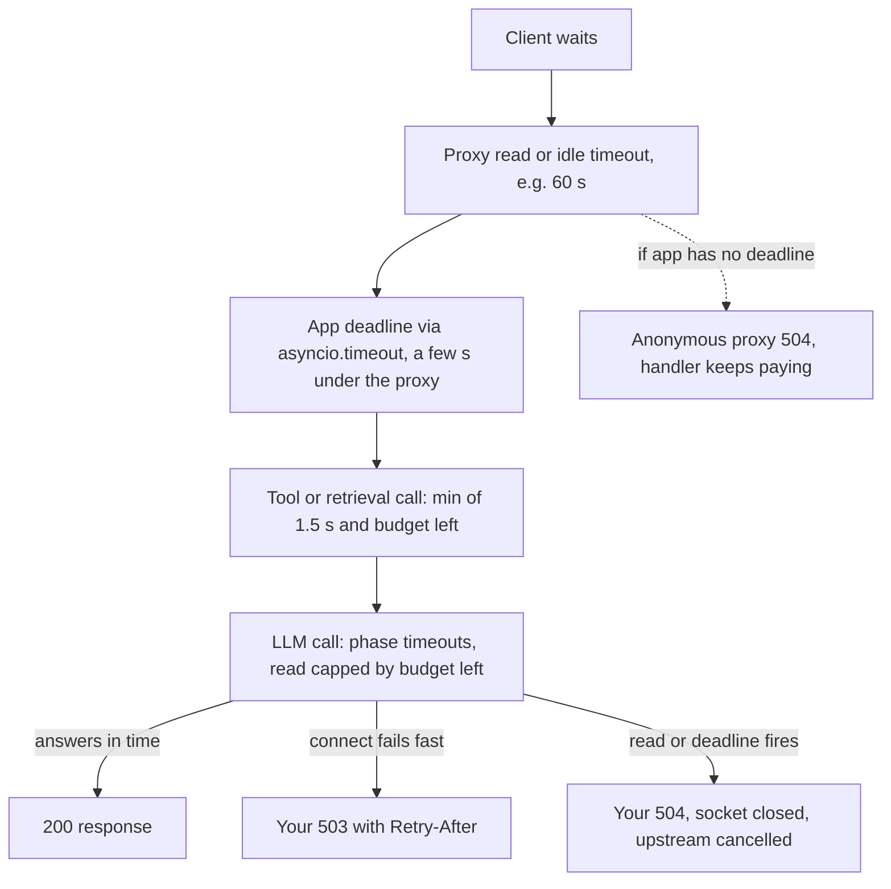

## TL;DR
An agent run chains many LLM and tool calls, and FastAPI and uvicorn impose no per-request time limit,
so one stalled step holds a connection and concurrency slot indefinitely. Timeouts turn hangs into
known errors: phase timeouts per call, one run deadline, innermost first.

## For agent builders
- **Why it matters for agents.** One agent request is 5-20 sequential model and tool calls, so a single
  stalled step stalls the whole run, and per-call waits add up. Without a run deadline, a looping agent
  keeps paying for tokens long after the user's proxy has returned a 504.
- **Where it shows up in your stack.** `httpx.Timeout` on the shared client your tools use, the `timeout`
  and `max_retries` arguments of provider SDKs, `asyncio.timeout` around the agent loop and each tool,
  plus the proxy in front of FastAPI.
- **What you control.** A wall-clock budget for the run, a step cap, a per-tool limit that is the minimum
  of its own number and the budget left, and what the model sees when a tool times out (an error result,
  not a crashed run).
- **What you can skip.** Tuning uvicorn keep-alive or gunicorn worker timeouts; they do not bound request
  duration, so they rarely explain an agent hang.

## Lab
### Task
Fix an agent loop that hangs when one tool stalls and never stops when the model loops. You add a run
deadline, a step cap and per-tool limits capped by the budget left, so a slow tool becomes an
observation the model routes around.
- **Time box:** 45-60 minutes.
- **Prerequisites:** async endpoints, shared httpx AsyncClient, and this lesson's "Budgets for an agent
  loop".
- **Runs offline:** a scripted fake model and two fake tools, scaled to seconds so tests are fast.
- **Needs:** Python 3.11+ (for `asyncio.timeout`) and `pytest`; checked with Python 3.12 and pytest 9.1.

### Starter code
```python
# agent_budget.py: put a time budget on a tool-calling agent loop (Python 3.11+, no network)
import asyncio, json, time

RUN_BUDGET = 2.0          # seconds for the whole run; pretend the proxy gives up at 2.5 s
TOOL_TIMEOUT = 0.5        # per-tool limit before the budget is taken into account
FINAL_TURN_RESERVE = 0.3  # keep this much for the model's final answer
MAX_STEPS = 4             # model turns per run

class RunTimeout(Exception):
    """The whole run overran RUN_BUDGET; the route maps this to its own 504."""

# ---- fakes: a scripted model and two tools ----
def scripted_llm(script, turn_s=0.05):
    state = {"i": 0}
    async def llm(messages, timeout):
        await asyncio.sleep(turn_s)                         # one model turn
        reply = script[min(state["i"], len(script) - 1)]    # last turn repeats forever
        state["i"] += 1
        return dict(reply)
    return llm

async def search(q):                  # this provider has stalled
    await asyncio.sleep(5.0)
    return {"hits": [q]}

async def fetch_doc(doc_id):
    await asyncio.sleep(0.05)
    return {"doc": doc_id, "text": "refund window is 30 days"}

TOOLS = {"search": search, "fetch_doc": fetch_doc}

def call(i, name, **args):
    return {"id": f"c{i}", "name": name, "args": args}

HAPPY = [                             # search stalls, the model falls back to fetch_doc
    {"role": "assistant", "tool_calls": [call(1, "search", q="refund policy")]},
    {"role": "assistant", "tool_calls": [call(2, "fetch_doc", doc_id="kb-7")]},
    {"role": "assistant", "content": "Refunds are accepted for 30 days."},
]
LOOPING = [{"role": "assistant", "tool_calls": [call(9, "fetch_doc", doc_id="kb-7")]}]

# ---- the code under test ----
async def run_tool(name: str, args: dict, limit: float) -> dict:
    """Run one tool; on timeout return {"error": "<name> timed out after <limit>s"}, never raise."""
    # YOUR CODE: bound the call with asyncio.timeout(limit) and turn TimeoutError into data
    return await TOOLS[name](**args)

async def run_agent(llm, messages: list) -> str:
    """Return the final answer, or "stopped: step limit reached"; raise RunTimeout past RUN_BUDGET."""
    # YOUR CODE: a run deadline around the loop, a step cap, and per-tool limits of
    # min(TOOL_TIMEOUT, budget left - FINAL_TURN_RESERVE); skip tools when the reserve is reached
    while True:
        reply = await llm(messages, timeout=None)
        messages.append(reply)
        if not reply.get("tool_calls"):
            return reply["content"]
        for c in reply["tool_calls"]:
            result = await run_tool(c["name"], c["args"], limit=TOOL_TIMEOUT)
            messages.append({"role": "tool", "tool_call_id": c["id"], "content": json.dumps(result)})

async def guarded(coro, s=3.0):     # lab harness only: stops a run that would hang
    try:
        return await asyncio.wait_for(coro, s)
    except TimeoutError:
        return f"GUARD: still running after {s}s"

if __name__ == "__main__":
    msgs, t0 = [], time.monotonic()
    answer = asyncio.run(guarded(run_agent(scripted_llm(HAPPY), msgs)))
    print("happy:", answer, "| under budget:", time.monotonic() - t0 < RUN_BUDGET)
    print("tool results:", [m["content"] for m in msgs if m["role"] == "tool"])
    msgs = []
    print("looping:", asyncio.run(guarded(run_agent(scripted_llm(LOOPING), msgs))),
          "| model turns:", sum(m["role"] == "assistant" for m in msgs))
```

As given, both runs end at the harness guard (`GUARD: still running after 3.0s`), because nothing
bounds the stalled `search` or the looping model.

### Expected output
```
happy: Refunds are accepted for 30 days. | under budget: True
tool results: ['{"error": "search timed out after 0.5s"}', '{"doc": "kb-7", "text": "refund window is 30 days"}']
looping: stopped: step limit reached | model turns: 4
```

### Tests
```python
# test_agent_budget.py: run with `pytest -q`
import asyncio, time
import pytest
from agent_budget import (HAPPY, LOOPING, MAX_STEPS, RUN_BUDGET, RunTimeout,
                          run_agent, run_tool, scripted_llm)

def run(coro, guard=3.0):                    # a hang fails the test instead of blocking it
    return asyncio.run(asyncio.wait_for(coro, guard))

def test_tool_timeout_is_an_observation():
    t0 = time.monotonic()
    out = run(run_tool("search", {"q": "x"}, limit=0.2))
    assert out == {"error": "search timed out after 0.2s"}
    assert time.monotonic() - t0 < 0.4

def test_run_survives_a_stalled_tool_and_answers_in_budget():
    msgs, t0 = [], time.monotonic()
    assert run(run_agent(scripted_llm(HAPPY), msgs)) == "Refunds are accepted for 30 days."
    assert time.monotonic() - t0 < RUN_BUDGET
    assert "timed out" in msgs[1]["content"]          # the model saw the timeout as data

def test_step_cap_stops_a_looping_model():
    msgs = []
    assert run(run_agent(scripted_llm(LOOPING), msgs)) == "stopped: step limit reached"
    assert sum(m["role"] == "assistant" for m in msgs) == MAX_STEPS

def test_run_deadline_fires_before_the_proxy():
    t0 = time.monotonic()
    with pytest.raises(RunTimeout):
        run(run_agent(scripted_llm(LOOPING, turn_s=0.8), []))   # slow model turns
    assert time.monotonic() - t0 < RUN_BUDGET + 0.2
```

On the starter all four fail with the guard's `TimeoutError`: the stalled tool and the endless loop
both outlive 3 s.

### Failure scenarios
- **Inject a swallowed cancellation:** make `search` catch `BaseException` around its sleep and sleep
  again. The per-tool limit seems not to work and the happy run ends in `RunTimeout` at 2.0 s. Debug by
  printing the exception type in that handler; it is `CancelledError`, which must be re-raised.
- **Inject a blind retry:** have `run_tool` call the tool a second time after a timeout, with the same
  limit. At `turn_s=0.05` the run still answers (about 1.2 s), but at `turn_s=0.45` it raises
  `RunTimeout`, while the correct version answers in about 1.9 s. Log `left()` before each tool call to
  see the retry eat the final turn's reserve.
- **Remove the step cap.** The deadline test still passes but the looping run ends in `RunTimeout`
  instead of a clean stop. Count assistant turns in the transcript to spot it.

### Submission
- **Your `agent_budget.py`** with both functions implemented and no edits to the fakes or tests.
- **A `pytest -q` run** showing 4 passed in under 5 seconds.
- **The script's printed output**, matching the expected lines.
- **A short note (3-5 sentences)** on how you would map `RunTimeout` to your own 504 in a FastAPI route
  and what you would log.
- **Evaluated on:** all tests green, no swallowed `CancelledError`, and per-tool limits derived from
  the remaining budget rather than a constant.

## Why it exists
- **An LLM endpoint is mostly waiting.** On the model provider, the vector store, a tool's API. Most
  calls finish in a second or two, some take ten times longer, and a few never finish because a TCP
  connection silently died or a provider queue stalled.
- **Stuck requests hold resources.** With no timeout, each keeps its socket, its coroutine and any
  semaphore or pool slot. Under load the slots run out, healthy requests queue behind dead ones, and one
  slow dependency becomes a full outage: the classic cascading failure.
- **"The load balancer has a 60-second timeout" protects the client, not you.** When the proxy returns
  504, your handler keeps running and keeps paying for tokens nobody will read.
- **"Use the SDK default" is often worse.** LLM SDKs ship generous defaults (several minutes is common;
  check yours) because long generations are legitimate, far longer than any user will wait.
- **"One big timeout around everything" is too blunt.** It can't tell a provider that won't accept the
  connection (retry elsewhere right away) from one that is mid-stream (maybe keep waiting). You need
  several timeouts with different jobs that agree with each other.

## How it works
### The layers, outside in
| # | Layer | What it bounds |
|---|---|---|
| 1 | **Client / browser** | how long the caller waits before giving up |
| 2 | **Load balancer / reverse proxy** | idle or read timeout (AWS ALB defaults to 60 s idle; nginx `proxy_read_timeout` defaults to 60 s) |
| 3 | **ASGI server** | uvicorn's `--timeout-keep-alive` closes idle keep-alive connections; `--timeout-graceful-shutdown` bounds draining |
| 4 | **Application deadline** | one budget for the whole request, via `asyncio.timeout()` (Python 3.11+) or `asyncio.wait_for` |
| 5 | **Per-call timeouts** | each outbound HTTP client, database driver and queue call |

- **Proxy "idle" means no bytes.** A stream that pauses longer than the idle timeout gets cut.
- **The ASGI server does not limit request duration.** Neither uvicorn setting caps how long a request
  may run. Gunicorn's `--timeout` is a worker-liveness check, not a request deadline, and with async
  workers it doesn't fire just because one request is slow.
- **Inner timeouts must be shorter than outer ones.** If the proxy gives up at 60 s and your handler at
  90 s, your error handling never runs: the user sees a generic proxy 504 and your coroutine keeps
  working for nobody.
- **Set your deadline a few seconds under the proxy's**, so you fail with your own error body and log line.

### Phase timeouts in httpx
`httpx.Timeout` has four independent limits, because each failure mode needs its own:

| Phase | Bounds | Guidance |
|---|---|---|
| **connect** | TCP and TLS handshake | keep it short (a few seconds): a host that won't connect is down, and failing fast lets you retry or fall back |
| **read** | longest wait for *the next chunk* of bytes, not the whole response | for a stream it is the max gap between tokens: catches a stall, allows a long stream |
| **write** | sending the request body | matters for big prompts or uploads |
| **pool** | waiting for a free connection from the client's pool | when it fires, the cause is your own concurrency, not the provider |

- **Defaults are 5 s for all four.** Too short for a non-streamed completion that thinks for 20 s.
- **No httpx setting caps total duration**, because read is per chunk. That is the application
  deadline's job.

### Deadlines and cancellation
1. `async with asyncio.timeout(t):` cancels the current task when `t` elapses.
2. That raises `CancelledError` at whatever `await` the task is parked on, and converts it into
   `TimeoutError` as it leaves the `async with`.
3. Cancellation propagates into httpx, which closes the connection. For a plain HTTP completion call,
   closing the connection is usually the only stop signal you can send.

- **Whether generation stops is provider-specific.** Whether the provider halts on disconnect, and
  whether tokens generated before the close are billed, depends on the provider. Self-hosted servers such
  as vLLM abort on disconnect; some hosted APIs offer an explicit cancel only for background or batch jobs.
- **Never swallow `CancelledError` inside the block**, or the timeout silently stops working.
- **A deadline is a budget.** Compute the time left before each step (`deadline - loop.time()`) and give
  each call the minimum of its own limit and what remains, so a retry can't overrun the request.

### Timeouts and retries
- **A timeout means *you* stopped waiting.** It does not tell you whether the server did the work: a
  non-streamed completion that timed out on read may have finished and been billed.
- **Retry only idempotent calls**, or calls that carry an idempotency key, and only within the
  remaining deadline, with backoff.
- **Watch for retries you did not write.** Provider SDKs often retry internally (the OpenAI and
  Anthropic Python SDKs default to two retries, with a timeout measured in minutes; check the version
  you run).
- **Worst case for one call** is roughly `(retries + 1) × per-attempt timeout + total backoff`. Either
  pass the SDK a timeout derived from the remaining budget and `max_retries=0` and retry yourself, or
  make sure that product still fits.

### Streaming needs three limits, not one
1. **Time to first token.** The provider accepted the request but is queueing or thinking. Bound it by
   timing the wait for the first chunk (an `asyncio.timeout` around the first `anext`), because the right
   number (seconds) is very different from the inter-token gap (sub-second normally).
2. **Gap between chunks.** httpx's `read` timeout, which catches a stalled stream.
3. **Total duration.** An application deadline, because neither of the above caps it.

- **After the 200, a timeout cannot become a 504.** Once your own `StreamingResponse` has sent its 200,
  the timeout must be emitted as an in-band error event and the stream closed.
- **So do the cheap-to-fail work first.** Everything that can time out cheaply (retrieval, opening the
  upstream stream) should happen before the response starts.

### The timeouts people forget
- **Postgres:** a `statement_timeout` (or the driver's command timeout), so a bad query plan can't hold
  a pool connection for minutes. Set it per connection (asyncpg accepts it through `server_settings`, and
  `command_timeout` bounds the client side), so a SQL tool an agent calls cannot outlive the run. Monitor
  pool wait time and statements cancelled by timeout.
- **Redis:** a socket timeout on the client.
- **Pools and semaphores:** a timeout on acquiring a pool connection or a semaphore slot.
- **Queues:** a deadline on queue `get` calls.
- **Service-to-service:** pass the remaining budget along so the downstream service doesn't start work
  its caller has already abandoned. gRPC does this natively with deadlines; over HTTP a header carrying
  the remaining milliseconds works, relative so that clock skew between hosts doesn't matter.

### Budgets for an agent loop
An agent request is a loop, so it needs limits a single call does not:

| Limit | Bounds | Why |
|---|---|---|
| **Run deadline** | wall clock for the whole loop | the proxy and the user wait for the run, not for one call |
| **Step cap** | number of model turns | a model that keeps calling tools never trips a per-call timeout |
| **Per-tool timeout** | one tool execution, `min(tool limit, budget left)` | a slow tool must not eat the model's last turn |
| **Model-call timeout** | one LLM turn, capped by budget left | the final answer needs time too |

- **A tool timeout is data for the model.** Catch it inside the loop and append an error tool result
  ("search timed out after 5 s"), so the model can retry, pick another tool or answer with what it has.
- **A run deadline is the backstop.** When it fires, return a partial answer or your own 504 with the
  step reached, and log the trace so you can see which step ate the budget.
- **Reserve time for the last turn.** Stop starting new tool calls when the budget left is below a
  typical final model call, or the run times out one step before it would have answered.
- **Long runs belong in a job.** If a run legitimately needs minutes, return 202 with a run id and stream
  or poll progress, instead of stretching every proxy timeout.

## Diagram
Follow one agent request inward: each layer's limit is shorter than the one outside it, and every tool
or model call in the loop takes the smaller of its own limit and the budget left.



## Examples
### Chat endpoint with an 8-second budget behind a 10-second proxy
The budget is split between retrieval and generation.

```python
import asyncio, httpx
from contextlib import asynccontextmanager
from fastapi import FastAPI, HTTPException, Request

REQUEST_BUDGET = 8.0          # proxy read timeout is 10 s; we must fail first

@asynccontextmanager
async def lifespan(app: FastAPI):
    async with httpx.AsyncClient(
            timeout=httpx.Timeout(connect=2.0, read=6.0, write=5.0, pool=1.0)) as c:
        app.state.http = c
        yield

app = FastAPI(lifespan=lifespan)

def remaining(deadline: float) -> float:
    return max(0.0, deadline - asyncio.get_running_loop().time())

@app.post("/chat")
async def chat(req: Request, body: dict):
    loop = asyncio.get_running_loop()
    deadline = loop.time() + REQUEST_BUDGET
    http: httpx.AsyncClient = req.app.state.http
    try:
        async with asyncio.timeout(REQUEST_BUDGET):
            docs = await http.post("http://search/q", json=body,
                                   timeout=min(1.5, remaining(deadline)))
            # generation gets whatever retrieval left over
            r = await http.post("http://llm/v1/chat", json={"docs": docs.json(), **body},
                                timeout=httpx.Timeout(remaining(deadline), connect=2.0))
            r.raise_for_status()
            return r.json()
    except (TimeoutError, httpx.TimeoutException):
        raise HTTPException(504, "upstream model did not answer in time")
    except httpx.ConnectError:
        raise HTTPException(503, "model provider unreachable", headers={"Retry-After": "5"})
```

| Moment | What happens |
|---|---|
| 0.4 s | retrieval returns; the generation call is built with about 7.6 s on read, write and pool (connect stays at 2 s) |
| 8 s | whichever fires first (httpx's 7.6 s read timeout or the outer `asyncio.timeout`) ends the call and closes the socket |
| ~8 s | both paths map to *your* 504 with a clear message |
| 10 s | the proxy would have returned an anonymous 504; you answered two seconds earlier |

The outer deadline is the backstop: it also covers time spent in code between calls, which no per-call
timeout sees.

### Read is a gap limit, the deadline is a total limit (runnable, no network)
A fake stream sends a token every 0.3 s. A per-chunk limit (like httpx `read`) never trips; only the
total deadline stops it. Requires Python 3.11+.

```python
import asyncio

class StreamStalled(Exception):
    pass

async def fake_stream(gap: float, n: int):
    for i in range(n):
        await asyncio.sleep(gap)                  # provider sends one token every `gap` s
        yield f"tok{i}"

async def with_gap_limit(stream, gap_limit: float):
    it = stream.__aiter__()
    while True:
        try:
            yield await asyncio.wait_for(anext(it), gap_limit)   # per-chunk cap, like httpx read
        except StopAsyncIteration:
            return
        except TimeoutError:
            raise StreamStalled(f"no chunk for {gap_limit}s") from None

async def consume(gap_limit: float, total: float) -> str:
    got = 0
    try:
        async with asyncio.timeout(total):        # total cap: the application deadline
            async for _ in with_gap_limit(fake_stream(gap=0.3, n=100), gap_limit):
                got += 1
        return f"finished: {got} chunks"
    except StreamStalled as e:
        return f"stalled after {got} chunks ({e})"
    except TimeoutError:
        return f"deadline hit after {got} chunks"

print(asyncio.run(consume(gap_limit=1.0, total=2.0)))  # deadline hit after 6 chunks
print(asyncio.run(consume(gap_limit=0.1, total=2.0)))  # stalled after 0 chunks (no chunk for 0.1s)
```

### Agent loop with a run budget, a step cap and per-tool timeouts
`llm` and `tools` are your own async callables; the point is where the limits sit. Requires Python 3.11+.

```python
import asyncio, json

RUN_BUDGET = 25.0      # proxy read timeout is 30 s
TOOL_TIMEOUT = 5.0
FINAL_TURN_RESERVE = 4.0
MAX_STEPS = 8

async def run_agent(llm, tools: dict, messages: list) -> str:
    loop = asyncio.get_running_loop()
    deadline = loop.time() + RUN_BUDGET
    left = lambda: max(0.0, deadline - loop.time())
    async with asyncio.timeout(RUN_BUDGET):              # backstop for the whole run
        for step in range(MAX_STEPS):
            reply = await llm(messages, timeout=left())   # model turn capped by budget left
            messages.append(reply)
            if not reply.get("tool_calls"):
                return reply["content"]
            for call in reply["tool_calls"]:
                if left() < FINAL_TURN_RESERVE:            # keep time for the answer
                    result = {"error": "budget exhausted, answer with what you have"}
                else:
                    limit = min(TOOL_TIMEOUT, left() - FINAL_TURN_RESERVE)
                    try:
                        async with asyncio.timeout(limit):
                            result = await tools[call["name"]](**call["args"])
                    except TimeoutError:                   # tool timeout becomes data for the model
                        result = {"error": f"{call['name']} timed out after {limit:.1f}s"}
                messages.append({"role": "tool", "tool_call_id": call["id"],
                                 "content": json.dumps(result)})
    return "stopped: step limit reached"
# The route maps a TimeoutError escaping run_agent to its own 504 (or a partial answer) and logs the step.
```

Illustrative timeline for one run:

| Elapsed | Event | Budget left |
|---|---|---|
| 2.1 s | model turn 1 asks for `search` | 22.9 s |
| 7.1 s | `search` hits its 5 s limit, error result appended | 17.9 s |
| 9.0 s | model turn 2 asks for `fetch_doc` instead | 16.0 s |
| 10.2 s | `fetch_doc` returns | 14.8 s |
| 13.5 s | model turn 3 answers | 11.5 s spare, user got an answer |

Without the tool limit, the stalled `search` would have held the run until the proxy's 30 s 504.

### Worked scenario: the hidden retry multiplier
Illustrative numbers for one call during a provider incident, using the worst-case formula above.

| Setup | Per-attempt timeout | Attempts | Backoff total | Worst case |
|---|---|---|---|---|
| Your loop (2 retries) around an SDK that also retries 2 times | 20 s | 3 × 3 = 9 | ~3 s | ~183 s |
| SDK with `max_retries=0`, your loop with 2 retries | 20 s | 3 | ~1.5 s | ~61.5 s |
| Same, but each attempt gets `min(20, remaining)` from an 8 s budget | ≤ 8 s total | as many as fit | inside budget | 8 s |

Only the last row respects a request deadline; the first also sends three times the upstream requests
of the second.

## Production patterns
- **Run deadline under the proxy** — for every agent route. Set the run budget a few seconds below the
  proxy read or idle timeout (for example 27 s under a 30 s proxy) with `asyncio.timeout` around the
  whole loop, plus a step cap. Monitor proxy-generated 504s versus app 504s; any proxy 504 means the
  ordering is wrong.
- **Tool timeouts returned to the model** — for every tool the agent can call. Wrap each tool in
  `asyncio.timeout(min(limit, budget left))` and append an error tool result on timeout instead of
  raising. Monitor timeouts per tool name and how often the run still finishes after one.
- **SDK calls driven by the remaining budget** — whenever you call a provider SDK. Pass the remaining
  seconds as the SDK's `timeout` and `max_retries=0`, then retry yourself only while budget remains.
  Monitor upstream request count divided by your request count; it should stay near 1 outside incidents.
- **Phase-labelled timeout metrics** — on every dependency. Count `httpx.ConnectTimeout`,
  `httpx.ReadTimeout`, `httpx.WriteTimeout` and `httpx.PoolTimeout` separately per dependency, because a
  pool timeout points at your concurrency while a connect timeout points at the provider. Alert on
  rising rates.
- **Streaming-aware proxy settings** — for SSE or chunked routes. Raise the proxy read or idle timeout
  only on streaming routes, disable buffering there (nginx `proxy_buffering off`), and send periodic SSE
  comment lines (`: ping`) so idle timers see bytes. Monitor streams ending without a final event.
- **Budget propagation to tools and sub-agents** — for internal fan-out. Send remaining milliseconds in a
  request header of your choosing and have the tool service or sub-agent start its own deadline from it.
  Monitor downstream work started after the caller's deadline.

## Trade-offs
- **Short vs long timeouts.** Short ones free capacity quickly and surface outages early, but cut off
  legitimately slow requests. The trade flips toward longer limits for long-form generation or reasoning
  models, where a slow answer is normal and should be streamed.
- **Single deadline vs phase timeouts.** One overall deadline is simple and always honoured, but can't
  tell "can't connect" from "slow to answer". Add phase timeouts once you retry or fall back between
  providers.
- **Retry vs duplicate cost.** Retrying after a timeout raises success rates on transient stalls, but can
  double cost and side effects when the first attempt actually finished, so it only pays off with
  idempotent calls.
- **Tight tool timeouts vs agent success rate.** Short per-tool limits keep the run inside its budget and
  let the model route around a slow tool, but a limit below the tool's normal p99 makes the agent fail or
  retry tasks that would have succeeded. Set each limit from that tool's measured latency.
- **Streaming vs operational complexity.** Streaming keeps a long total time while catching stalls with
  a short read timeout, at the cost of proxy configuration (idle timeouts, buffering) and error handling
  after the 200 is sent.

## Pitfalls
- **Relying on the load balancer's timeout as yours.** Symptom: proxy-generated 504s with no matching
  error in your logs, while provider bills show completions that finished after the client had gone.
- **Treating httpx's `read` as a total limit.** Symptom: a streamed response trickles a token every few
  seconds and runs for minutes, well past what you thought your limit was.
- **Swallowing `CancelledError`.** A bare `except:`, `except BaseException`, or `except CancelledError`
  without re-raising inside a timed block. (Since Python 3.8 it derives from `BaseException`, so plain
  `except Exception` does not catch it.) Symptom: `asyncio.timeout` "doesn't work"; requests overrun the
  deadline and finish late.
- **A fresh `httpx.AsyncClient` per request with default timeouts.** Symptom: 5-second `ReadTimeout`
  errors on longer completions, plus connection churn in TLS-handshake latency.
- **Retrying without checking the remaining budget.** Symptom: a p99 latency that is a multiple of the
  configured timeout.
- **Your retry loop around an SDK that still retries internally.** Symptom: upstream request counts
  several times your own during a provider incident, and latencies clustered at multiples of the SDK
  timeout.
- **Letting a tool timeout crash the agent run.** Symptom: one slow tool turns into a 500 for the whole
  request, though the model could have answered without it. Fix: catch the timeout per tool and append an
  error tool result.
- **No step cap on the loop.** Symptom: runs that end only at the proxy's timeout, with traces showing
  the model calling the same tool again and again. Fix: a step cap plus a run deadline.
- **Timing out the HTTP call but not the database.** Symptom: pool-exhaustion errors on unrelated
  endpoints while slow queries hold connections far past any request deadline.

## When to use
- **Always.** Every outbound call in a FastAPI service needs explicit timeouts, and every request needs a
  deadline shorter than whatever sits in front of it.
- **Agent loops especially.** Every agent route needs a run deadline, a step cap and per-tool limits,
  because loops multiply every missing timeout by the number of steps.
- **Write the layer chain down** (client, CDN, proxy, app deadline, per-call) with the number for each,
  and check that the numbers shrink as you go inward.
- **Pick numbers from measured latency:** a per-call timeout a bit above that dependency's observed p99,
  and a request budget from the user experience you promised.
- **Measure:** timeout counts per dependency as a metric, because a rising rate is often the first sign
  of a provider incident.
- **Interviews:** explain why read is not total, why inner timeouts must be shorter, and why a timeout
  makes retries dangerous without idempotency.

## Role lens
- **Engineer:** Configures `httpx.Timeout` phases on the shared client, wraps request work in
  `asyncio.timeout`, threads remaining budget into each call, and maps timeouts to 504.
- **Architect:** Owns the end-to-end timeout budget across CDN, gateway, services and providers, and
  decides which paths stream versus fail fast.
- **FDE:** Finds the customer's corporate proxy or API gateway cutting streams at its own idle timeout
  and negotiates the setting or adds keep-alive events.

## Check yourself
**Q:** Your chat endpoint sits behind a proxy with a 60 s read timeout. Users report occasional generic
504 pages, your logs show nothing, but token spend keeps rising. What is going on and how do you fix it?
**A:** The proxy gives up first. Your handler has no deadline, so it keeps waiting on the provider after
the proxy has returned its own 504. The client is gone, but the generation completes and gets billed,
and because your code never failed, nothing is logged. The fix is a request deadline a few seconds
under 60 s using `asyncio.timeout`, which cancels the upstream call and closes its socket. Map it to
your own 504 with a log line and a metric. Add per-call phase timeouts so connect failures fail in
seconds. Detect client disconnects too. For long answers, stream so the proxy sees bytes, and keep
retries within the remaining budget.

## Interview questions
### What does `asyncio.timeout` actually do when it fires, and how can it silently stop working?
- **It cancels the current task.** `CancelledError` is raised at whatever `await` the task is parked on,
  and is converted into `TimeoutError` as it leaves the `async with` block.
- **Cancellation reaches httpx, which closes the socket.** For a plain completion call that is usually
  the only stop signal you can send; whether generation halts and is billed depends on the provider.
- **It breaks if code inside swallows `CancelledError`**, for example a broad `except BaseException`, so
  the request overruns the deadline and finishes late.

### Explain the four httpx timeout phases and which one catches a stalled stream.
- **connect** bounds the TCP and TLS handshake, **write** bounds sending the body, **pool** bounds
  waiting for a free connection, and **read** bounds the wait for the next chunk.
- **A stalled stream trips `read`**, because no chunk arrives within the gap limit.
- **A slow-but-steady stream trips none of them**, because read is per chunk; only an application
  deadline caps total duration.

### Design the time budgets for a tool-calling agent behind a 30-second proxy.
- **Run deadline first:** about 27 s with `asyncio.timeout` around the loop, plus a step cap, so the app
  always fails before the proxy and can log which step ate the budget.
- **Per call:** each tool gets `min(its limit, budget left)` and each model turn is capped by the budget
  left, keeping a reserve for the final answer.
- **On a tool timeout**, append an error tool result so the model can retry or answer without it; move
  runs that need minutes to a background job with a run id.

### p99 latency on your agent endpoint is three times your configured timeout during a provider incident. How do you debug it?
- **Suspect stacked retries.** Compare upstream request counts with your own request count; a ratio well
  above 1 means your loop and the SDK's internal retries are multiplying.
- **Check the budget logic.** Worst case is roughly `(retries + 1) × per-attempt timeout + total
  backoff`; if retries don't use `min(limit, remaining)`, they overrun the deadline.
- **Fix:** set the SDK's `max_retries=0`, pass it the remaining budget as `timeout`, and retry yourself
  only while budget remains.

### When would you choose a long timeout instead of failing fast?
- **For long-form generation or reasoning models**, where a slow answer is normal and the user expects to
  wait; stream it so the proxy sees bytes and a short read timeout still catches stalls.
- **Not for connect**, because a host that won't accept a connection is down; keep connect at a few
  seconds and fail over.
- **The cost** is capacity held per request, so pair long limits with a concurrency cap.

### How do you handle a timeout that fires after a streaming response has already sent its 200?
- **You cannot change the status any more**, because status and headers went out with the first byte.
- **Emit an in-band error event** with a code and close the stream, and record a stream-outcome metric
  separate from HTTP status.
- **Move cheap-to-fail work first** (retrieval, opening the upstream stream, time to first token) so most
  timeouts still map to a real 504.

## Quiz
### Q: An httpx client has `read=10`. A streamed completion sends one token every 3 s for 4 minutes. What happens?
- [ ] It fails after 10 s because the total read time exceeds the limit
- [x] It completes, because the read timeout bounds the gap between chunks, not the total
- [ ] It fails with a pool timeout once the stream passes 10 s
- [ ] It completes only if the write timeout is also raised
> httpx's read timeout applies to each individual read. A chunk every 3 s never exceeds 10 s, so the
> stream runs for minutes. Capping total duration needs an application deadline such as asyncio.timeout.

### Q: The proxy's timeout is 30 s. Which application deadline is best?
- [ ] 60 s, so the application never cuts off a request the proxy would allow
- [ ] 30 s, exactly matching the proxy
- [x] About 27 s, so the application fails first with its own error and cancels upstream work
- [ ] None; the proxy timeout already bounds the request
> Inner limits must be shorter than outer ones. A few seconds of margin lets your handler cancel the
> upstream call, log, and return a meaningful error before the proxy returns its own anonymous 504.

### Q: Why is blindly retrying a non-streamed LLM call after a read timeout risky?
- [ ] Retries are always rejected by LLM providers
- [ ] The read timeout leaves the connection pool permanently exhausted
- [x] The first attempt may have completed and been billed, so the retry can duplicate cost and side effects
- [ ] Retrying resets the asyncio event loop
> A timeout only means the client stopped waiting. The server may have finished the work, so retries
> need idempotency (keys or naturally idempotent operations) and must fit inside the remaining deadline.

## Use cases & projects
### Use cases
- **Chat agents behind a load balancer.** The run deadline sits a few seconds under the proxy timeout, so
  the user gets a clean error event instead of a silent 504 while the agent keeps spending.
- **Tool-calling agents with slow third-party APIs.** Each tool gets its own limit, capped by the budget
  left, and a timeout comes back to the model as an error result it can work around.
- **Streaming assistants.** A read (gap) timeout catches a stalled token stream, while a total deadline
  stops a stream that trickles forever.
- **Background research agents.** Long runs get a generous wall-clock budget plus a step cap, so a looping
  agent ends with a report of what it finished rather than an open-ended bill.

### Mini project
**Put a time budget on a tool-calling agent (1-2 hours).**
- **Goal:** show that one slow tool cannot hang the run or blow past the proxy limit.
- **Steps:** build a small FastAPI agent endpoint with two fake tools, one of which sometimes sleeps far
  longer than expected; wrap the loop in `asyncio.timeout` for the run budget and each tool in the
  minimum of its own limit and the budget left; return a timed-out tool to the model as an error result.
- **Done when:** a load test with the slow tool shows every request finishing under the run budget, the
  logs record which step timed out, and the trace shows the model reacting to the timeout result.
