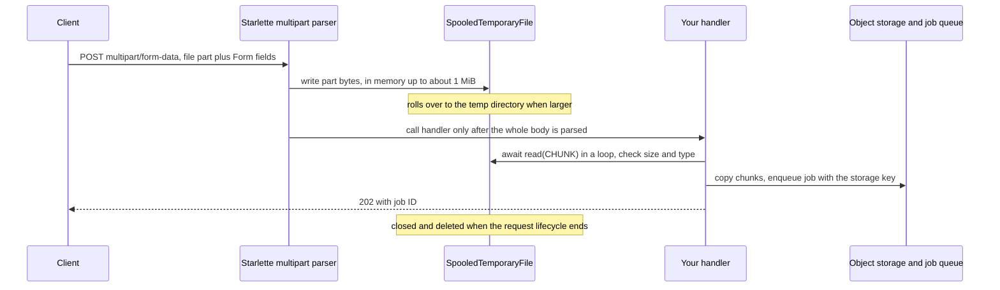

## TL;DR
When users attach PDFs, images or audio to an agent chat, `UploadFile` receives them: a spooled
multipart temp file, in memory while small and on disk when large. Persist it, hand the agent a storage
key, and add your own safety checks.

## For agent builders
- **Why it matters for agents.** Attachments are how users give agents documents to read, screenshots to
  look at and recordings to transcribe. The agent run and its tools outlive the upload request, so the
  file must be in durable storage before the run starts.
- **Where it shows up in your stack.** The `POST /chat` or `POST /documents` route of your agent API,
  the RAG ingestion job that parses and embeds the file, and tools like `read_document(key)` or a vision
  call that loads the bytes by key.
- **What you control.** `UploadFile` versus `bytes = File()`, chunked copy to object storage, content
  hashing for dedup, and passing a key (never the `UploadFile` object) into the agent's run context.
- **What you can skip.** Multipart parsing internals; know that the whole body is parsed before your
  handler runs, and that the temp file dies with the request.

## Why it exists
- **Files arrive as multipart.** Browsers and HTTP clients send a body split into parts by a boundary
  string, each part with its own headers (`Content-Disposition` with field name and filename,
  `Content-Type`) and raw bytes.
- **JSON is a poor carrier.** It can't carry binary data efficiently, and base64 inflates it by a third.
  So an AI service that ingests documents, screenshots or voice notes must parse multipart.
- **`bytes = File()` holds the whole part in memory.** Fine for a 2 KB avatar. For a 300 MB audio file it
  means 300 MB per concurrent request held until the handler ends; ten simultaneous uploads can OOM-kill
  a pod.
- **Reading `request.stream()` yourself** avoids the memory cost but means writing your own multipart parser.
- **`UploadFile` sits in between.** Starlette's parser streams each file part into a
  `SpooledTemporaryFile`, which stays in memory below a threshold (1 MiB in current Starlette) and rolls
  over to disk above it: a file-like object with metadata, bounded memory, and no parser to write.

## How it works
### Declaring it
| Need | Declaration |
|---|---|
| one required file field named `file` | `async def ingest(file: UploadFile)` |
| several files | `files: list[UploadFile]` |
| optional file | `UploadFile | None = None` |
| regular form fields | `Form()`, e.g. `title: str = Form()` |

- **Multipart support requires the `python-multipart` package.** FastAPI raises an error at startup that
  names it if it is missing.

### What you get
| Attribute / method | Meaning |
|---|---|
| `filename` | the name the *client* supplied; untrusted and can contain path separators |
| `content_type` | the part's declared MIME type; also untrusted |
| `size` | bytes received (on recent Starlette versions) |
| `headers` | the part's headers |
| `file` | the underlying `SpooledTemporaryFile`, a synchronous file object |
| `await read(n)`, `await write(data)`, `await seek(offset)`, `await close()` | async wrappers that run the sync file operation in a thread pool when the data is on disk, so a disk read never blocks the event loop |

### async def or def
The handler type decides which API is safe:
- **`async def`: use the awaited methods.** Touching `file.file` directly does blocking disk I/O on the
  event loop.
- **Plain `def`: use the sync object.** FastAPI already runs your code in a thread pool, so
  `shutil.copyfileobj(upload.file, dest)` copies a spooled file in bounded-size chunks without any `await`.
- **When `def` is simpler:** everything it does with the file (hashing, local copies, a sync storage SDK)
  is blocking anyway. The cost is one thread-pool slot per in-flight upload, and that pool is small by
  default.

### When the bytes arrive
The whole multipart body is parsed **before** your handler runs. By the time your code sees
`UploadFile`, the upload is complete and sitting in memory or a temp file. Two consequences:
1. **A size check inside the handler protects downstream steps** (parsing, storage) but not the upload
   itself, so caps belong in middleware or at the proxy.
2. **Temp files use the container's temp directory**, which on many platforms is small or memory-backed,
   so large uploads can fill it.

### Lifetime
- **An `UploadFile` is request-scoped.** FastAPI closes it, and the temp file is deleted, when the
  request's lifecycle ends.
- **Exactly when has changed between releases.** Some FastAPI versions close upload files as soon as the
  endpoint returns, *before* `BackgroundTasks` run, so a task that reads the object hits "I/O operation on
  closed file". Current versions close them only after the response and its background tasks finish.
- **Don't depend on either.** A thread or task that outlives the request, a job queue, or a worker in
  another process can never use the object safely.
- **So:** read the bytes, or copy to durable storage, inside the handler, and pass a path or object key onward.

### JSON plus files
- **A request is either JSON or multipart, not both.**
- **Metadata options:** `Form()` fields, or one form field containing a JSON string that you validate with
  a Pydantic model's `model_validate_json`.
- **Since FastAPI 0.113** you can also bind a Pydantic model to the form fields themselves
  (`meta: Annotated[Meta, Form()]`), which suits flat options.

### Attachments in an agent run
1. **The chat route receives message plus files** as multipart: the message in a `Form()` field, the
   files as `list[UploadFile]`.
2. **The handler persists each file** to object storage under a generated key and records it against the
   conversation, with its hash, size and sniffed type.
3. **The agent gets references, not bytes.** The run context lists `{key, name, type}`; the system prompt
   or a tool description tells the model it can call `read_document(key)`.
4. **Tools load by key.** A document tool returns parsed text (from the ingestion job's output), a vision
   tool loads the image bytes and sends them to the model provider.

- **Why references:** a 20 MB PDF inlined into the prompt costs tokens on every step; a key costs a few
  tokens, and the model reads only the pages it asks for.
- **Base64 again at the provider.** Images sent to a vision model usually travel base64-encoded in JSON,
  so they grow by a third on that hop; resize before sending.

### Alternatives
| Option | Use when |
|---|---|
| `bytes = File()` | small, bounded files |
| raw body via `request.stream()` | single-file `application/octet-stream` uploads; avoids multipart and temp files and pipes bytes straight to object storage |
| presigned direct-to-storage uploads | large files; takes them off your API altogether |

## Diagram
The key timing point: Starlette receives and spools the entire multipart body before your handler
runs, and the temp file dies with the request, so only a storage key may travel onward to the ingestion
job or the agent run that reads the attachment.



## Examples
### Audio upload plus metadata, copied in chunks, handed to a job
Copies the file to storage without loading it whole, and hands a key to a transcription job.

```python
import hashlib, uuid
from pydantic import BaseModel
from fastapi import FastAPI, Form, HTTPException, UploadFile

app = FastAPI()
CHUNK = 1 << 20                       # 1 MiB
MAX = 200 * (1 << 20)                 # downstream cap; edge/middleware caps the upload itself

class Meta(BaseModel):
    language: str = "en"
    diarize: bool = False

@app.post("/v1/transcriptions", status_code=202)
async def transcribe(audio: UploadFile, meta: str = Form("{}")):
    m = Meta.model_validate_json(meta)
    if not (audio.content_type or "").startswith("audio/"):
        raise HTTPException(415, "audio file required")     # also sniff magic bytes in practice
    key = f"uploads/{uuid.uuid4()}"                          # never reuse audio.filename as a path
    digest, total = hashlib.sha256(), 0
    with open(f"/data/{key.split('/')[1]}", "wb") as out:    # stand-in for object storage
        while chunk := await audio.read(CHUNK):
            total += len(chunk)
            if total > MAX:
                raise HTTPException(413, "audio too large")
            digest.update(chunk)
            out.write(chunk)
    # enqueue(transcribe_job, key=key, lang=m.language)       # pass the key, not the UploadFile
    return {"job_id": key, "bytes": total, "sha256": digest.hexdigest(),
            "original_name": audio.filename}
```

A client sends it with `curl -F "audio=@call.m4a;type=audio/mp4" -F 'meta={"language":"de"}'`.

### Chat message with attachments that starts an agent run
Files are persisted in the handler; the run receives keys. `store_upload` and `start_agent_run` are
your own functions (object storage put, and enqueueing the run).

```python
import hashlib, uuid
from fastapi import FastAPI, Form, HTTPException, UploadFile

app = FastAPI()
CHUNK, MAX_FILE = 1 << 20, 50 * (1 << 20)

async def persist(f: UploadFile) -> dict:
    key, digest, size, chunks = f"att/{uuid.uuid4()}", hashlib.sha256(), 0, []
    while chunk := await f.read(CHUNK):
        size += len(chunk)
        if size > MAX_FILE:
            raise HTTPException(413, f"{f.filename} too large")
        digest.update(chunk); chunks.append(chunk)       # real code streams to a multipart upload
    await store_upload(key, b"".join(chunks))
    return {"key": key, "name": f.filename, "type": f.content_type,
            "bytes": size, "sha256": digest.hexdigest()}

@app.post("/v1/chat", status_code=202)
async def chat(message: str = Form(), files: list[UploadFile] | None = None):
    attachments = [await persist(f) for f in files or []]  # durable before the run starts
    run_id = await start_agent_run(message=message, attachments=attachments)  # keys, not objects
    return {"run_id": run_id, "attachments": [a["key"] for a in attachments]}
```

| Attachment | Inline into the prompt | Pass a key, agent calls `read_document` |
|---|---|---|
| 40-page PDF, ~20k tokens of text | ~20k tokens re-sent on every one of 8 steps: ~160k | ~30 tokens per step for the reference, plus the pages actually read once |
| 4 MB screenshot | ~5.3 MB of base64 in every request that carries it | loaded once by a vision tool, resized first |

Illustrative numbers; prefix caching on the provider side can reduce the inline cost but not remove it.

### Worked trace: the bytes of a 150 MiB recording
| Stage | Where the bytes are | Peak memory for the part |
|---|---|---|
| request still arriving | Starlette's parser writes the part into a `SpooledTemporaryFile`; after the first 1 MiB it rolls over to the temp directory | around a megabyte, while 150 MiB lands on temp disk |
| handler starts (only now) | copies the file in 150 one-MiB reads to the destination | around a megabyte |
| after the copy | written to disk twice (temp file and destination) | — |
| same request with `bytes = File()` | all 150 MiB in a single `bytes` object for the life of the handler | 150 MiB |

- **The double write** is the cost a presigned direct upload avoids.
- **The SHA-256** lets you deduplicate repeat uploads.
- **The real file write uses a sync `open`**, which in production should be async object-storage I/O or
  run in a thread.

### Several files in a plain `def` handler (runnable with TestClient)
Requires `fastapi`, `httpx` and `python-multipart`. Shows `list[UploadFile]`, `Form` fields, the sync
copy, and that the client's filename arrives untouched.

```python
import os, shutil, tempfile, uuid
from fastapi import FastAPI, Form, UploadFile
from fastapi.testclient import TestClient

app = FastAPI()
STORE = tempfile.mkdtemp()                     # stand-in for durable object storage

@app.post("/v1/batch", status_code=202)
def batch(files: list[UploadFile], language: str = Form("en"),
          diarize: bool = Form(False)):        # plain def: FastAPI runs it in a thread pool
    out = []
    for f in files:
        key = uuid.uuid4().hex                 # generated name; f.filename is only metadata
        with open(os.path.join(STORE, key), "wb") as dest:
            shutil.copyfileobj(f.file, dest)   # sync copy in bounded chunks, no await needed
        out.append({"key": key[:8], "name": f.filename, "size": f.size, "type": f.content_type})
    return {"language": language, "diarize": diarize, "files": out}

c = TestClient(app)
r = c.post("/v1/batch",
           files=[("files", ("a.wav", b"\0" * (3 << 20), "audio/wav")),   # 3 MiB: spooled to disk
                  ("files", ("../b.wav", b"RIFF", "audio/wav"))],          # hostile name, kept as text
           data={"language": "de", "diarize": "true"})
print(r.status_code, r.json()["diarize"], [(f["name"], f["size"]) for f in r.json()["files"]])
# 202 True [('a.wav', 3145728), ('../b.wav', 4)]
print(c.post("/v1/batch", json={"language": "de"}).status_code)   # 422: JSON is not multipart
shutil.rmtree(STORE)
```

## Production patterns
- **Temp space on a sized volume** — whenever uploads exceed a few megabytes. Point `TMPDIR` (which
  Python's `tempfile`, and so the spooled files, honour) at a disk-backed volume, for example a Kubernetes
  `emptyDir` with a `sizeLimit`. Monitor temp-disk usage per pod and evictions for ephemeral storage.
- **Persist in the handler, pass a key** — for every upload that feeds async work. Copy to object storage
  inside the request (`await asyncio.to_thread(s3.upload_fileobj, upload.file, bucket, key)` with boto3),
  then enqueue the key. Monitor jobs that fail to find their object.
- **Content-hash deduplication** — for RAG corpora where users re-upload the same files. Hash while
  copying, look up the SHA-256 per tenant, and skip re-parsing and re-embedding on a hit. Monitor
  dedup hit rate and embedding spend saved.
- **Raw-stream route for single large files** — for audio or video from trusted clients. Accept
  `application/octet-stream` and `async for chunk in request.stream()` straight into a multipart
  object-storage upload, skipping the temp file. Monitor upload throughput and incomplete uploads.
- **Attachments as keys in the agent's run context** — for every agent chat that accepts files. Persist
  before starting the run, list `{key, name, type}` in the run context, and expose `read_document(key)`
  or a vision tool that loads by key and checks the caller's tenant. Monitor tokens per step for runs
  with attachments; a jump means someone inlined file content.
- **Upload concurrency budget** — when `def` handlers do the copying. Size the thread pool and worker
  memory for peak concurrent uploads, and cap concurrent uploads per tenant. Monitor thread-pool
  saturation, upload latency and worker memory.

## Trade-offs
- **`UploadFile` vs `bytes = File()`.** `UploadFile` bounds memory by spooling to disk but costs a
  temp-file write and read. For tiny files `bytes = File()` is simpler and just as good; the choice flips
  at roughly "could many of these in parallel hurt memory?"
- **Multipart vs raw streaming or presigned uploads.** Multipart is universally supported by browsers and
  HTTP tools, but forces the whole body through your API process before your code runs. Raw streaming or
  presigned uploads win once files are large or uploads are frequent.
- **Many files per request vs one.** `list[UploadFile]` is convenient for "upload a folder", but one bad
  file fails the whole request. Per-file requests or per-file job status give clearer partial failures.
- **Inline attachment vs key plus tool.** Inlining a small file's text into the first prompt saves a
  tool round trip and works with any model, but every later step re-sends it. A key plus a read tool
  keeps steps cheap at the cost of one extra model turn; it flips once files exceed a few thousand tokens.
- **Validating in the handler vs before it.** In-handler checks are easy to write, but the bytes have
  already been received. They protect downstream systems, not the API's own memory, disk and bandwidth.

## Pitfalls
- **`bytes = File()` for large media.** Symptom: worker memory climbs with concurrent uploads until pods
  are OOM-killed under modest load.
- **Passing the `UploadFile` to a background task or another thread.** Symptom: "I/O operation on closed
  file" errors only in the background job, or code that works until a FastAPI upgrade changes when upload
  files are closed, or until the work moves to a queue.
- **Handing the `UploadFile` to the agent run.** Symptom: the first tool call that reads the attachment
  fails with a closed-file error, or works locally and fails once runs move to a worker. Fix: persist in
  the handler and pass keys.
- **Writing to disk at `audio.filename`.** Symptom: files land outside the intended directory or
  overwrite each other, a path-traversal vulnerability.
- **Sync `audio.file.read()` on a large spooled file in an `async def` handler.** Symptom: the event loop
  stalls and other requests' latency spikes during uploads.
- **Forgetting `seek(0)` after sniffing the first bytes.** Symptom: stored files miss their first few
  bytes and fail to open.
- **A Pydantic JSON body next to an `UploadFile`.** Symptom: a 422 complaining about the body, because
  the request is multipart, not JSON.

## When to use
- **Use `UploadFile` for** any user-facing upload of documents, images or audio that might be larger than
  a few megabytes or arrive in parallel.
- **Use `bytes = File()` only for** small, capped payloads.
- **Switch to raw `request.stream()` or presigned uploads for** large media, high upload volume, or bytes
  going straight to object storage without a temp file.
- **Pair it with** size limits outside the handler and content checks inside it, and pass storage keys
  rather than file objects to async work, including agent runs and their tools.
- **Measure:** temp-disk usage, upload latency and worker memory.
- **Interviews:** know the spooled-file behaviour and that parsing completes before the handler runs.

## Role lens
- **Engineer:** Declares `UploadFile` with `Form` metadata, streams it to storage in chunks with async
  reads, and passes storage keys to ingestion or transcription jobs.
- **Architect:** Decides whether files flow through the API at all or go direct to object storage, and
  sizes temp volumes and worker memory for peak concurrent uploads.
- **FDE:** Gets a customer's scanner or call-recording system to post multipart correctly, often
  fixing missing filenames, wrong content types or proxy body limits on their side.

## Check yourself
**Q:** You check `if audio.size > 100_000_000: raise HTTPException(413)` at the top of the handler, yet a
1 GB upload still fills the pod's temp disk and slows other requests. Why, and what should change?
**A:** By the time the handler runs, Starlette has already parsed the whole multipart body and spooled
the 1 GB file to a temporary file. The check rejects the request after the bandwidth, disk and parsing
work have been spent. It protects downstream steps but not the upload itself. The cap must come before
parsing: `client_max_body_size` or the gateway limit at the edge, plus ASGI middleware that rejects on
`Content-Length` and counts streamed bytes to stop chunked uploads. For genuinely large media, use
presigned uploads straight to object storage, so the API only receives a key. Make sure temp space is
on a properly sized volume.

## Interview questions
### What is `UploadFile`, and why prefer it over `bytes = File()` for documents and audio?
- **It wraps a `SpooledTemporaryFile`** filled by Starlette's multipart parser: in memory below a
  threshold (1 MiB in current Starlette), on disk above it, with `filename`, `content_type` and async
  `read`/`seek`.
- **`bytes = File()` holds the whole part in RAM** until the handler ends, so ten concurrent 300 MB uploads
  can OOM-kill a pod.
- **Neither one validates** size, type or filename; that is your job.

### An agent run or ingestion job that reads an attachment fails with "I/O operation on closed file". What happened and how do you fix it?
- **The `UploadFile` was passed to the run or job.** It is request-scoped, and some FastAPI versions close
  it when the endpoint returns, before `BackgroundTasks` run; an agent run outlives the request anyway.
- **Fix:** inside the handler, copy the bytes to durable storage (or read them), then pass a path or
  object key to the job.
- **That also makes it queue-safe**, since an object in one process can never reach a worker in another.

### Users attach PDFs and screenshots to an agent chat. How does the file get from the request to the agent's tools?
- **Persist in the handler**: copy each `UploadFile` in chunks to object storage under a generated key,
  with hash, size and sniffed type, before the run starts.
- **Give the run references**: `{key, name, type}` in the run context, and tools like
  `read_document(key)` or a vision tool that load by key and check the tenant.
- **Why not inline**: file text re-sent on every step multiplies tokens, and the `UploadFile` is gone
  once the request ends.

### Should an upload handler be `async def` or plain `def`?
- **`async def`** with awaited `read`/`seek`, which run disk operations in a thread pool so the event loop
  never blocks; never touch `file.file` directly there.
- **Plain `def`** when everything else is blocking anyway (hashing, a sync storage SDK):
  `shutil.copyfileobj(upload.file, dest)` is fine because FastAPI runs the handler in a thread pool.
- **The cost of `def`** is one thread-pool slot per in-flight upload, and that pool is small by default.

### Pods are evicted during upload peaks even though memory looks fine. What do you check?
- **Temp disk.** Spooled files above the threshold land in the container's temp directory, which may be
  small or memory-backed, and a large file is written twice (temp plus destination).
- **Fix:** point `TMPDIR` at a sized volume, cap upload size before parsing, and move large media to
  presigned or raw-stream uploads that skip the temp file.

### How do you send a file and structured options in one request?
- **Multipart only**, because a request body has one encoding: the file as `UploadFile`, options as
  `Form()` fields.
- **For nested options**, send one form field holding a JSON string and validate it with
  `model_validate_json`; since FastAPI 0.113 flat options can bind to a Pydantic model with `Form()`.

## Quiz
### Q: What does `UploadFile` do with a large file part that `bytes = File()` does not?
- [ ] It compresses the file in memory
- [x] It spools the part to a temporary file once it passes a size threshold, keeping memory bounded
- [ ] It streams the file to the handler before the rest of the body arrives
- [ ] It validates the file type with magic bytes
> UploadFile wraps a SpooledTemporaryFile that rolls over to disk, so memory stays small. bytes = File()
> materialises the whole part in RAM. Neither validates type or streams to the handler early.

### Q: Why should a handler persist an upload and pass a storage key to follow-up work, rather than pass the `UploadFile` object?
- [ ] Background tasks cannot perform file I/O
- [ ] An `UploadFile` is always empty once the handler has returned
- [x] The object wraps a request-scoped temp file that FastAPI closes and deletes when the request lifecycle ends, sometimes before BackgroundTasks run
- [ ] Background tasks run before the multipart body is parsed
> The temp file belongs to the request. Depending on the FastAPI version it may already be closed when a
> background task runs, and it can never reach a queue worker or survive a crash. A path or object key can.

### Q: A client needs to send a PDF together with structured options. What is the correct FastAPI approach?
- [ ] Declare a Pydantic model body and an UploadFile in the same handler as JSON
- [ ] Base64-encode the PDF inside a JSON body and use UploadFile anyway
- [x] Send multipart with the file plus Form fields (or one JSON-string form field validated by Pydantic)
- [ ] Send the PDF in a header and the options in the body
> A request body has one encoding. Files require multipart, so metadata must travel as form fields, and
> a JSON-string field validated with model_validate_json keeps it structured and typed.

## Use cases & projects
### Use cases
- **Chat agents with attachments.** A `POST /chat` route takes a message plus files, copies them to object
  storage in chunks and starts the run with storage keys.
- **Document Q&A and RAG ingestion.** `POST /documents` persists the file, returns a job id, and a
  background job parses, chunks and embeds it.
- **Voice and meeting agents.** Large audio recordings spool to disk, not memory, and a transcription job
  loads them by key after the request ends.
- **Vision steps over screenshots.** A tool like `read_document(key)` or a vision call loads image bytes by
  key, so the agent can revisit them at any step.

### Mini project
**Attachments that outlive the request (1-2 hours).**
- **Goal:** a chat endpoint where the agent can read an uploaded PDF several steps after the upload
  request has returned.
- **Steps:** accept a message and files as multipart with `UploadFile` and a JSON-string form field;
  copy each file in chunks to local or object storage while hashing it; start a background agent run with
  the keys; give the agent a `read_document(key)` tool.
- **Done when:** the agent quotes the PDF in a later step, a duplicate upload is recognised by its hash,
  and passing the `UploadFile` object instead of a key reproduces the closed-file error in a test.
