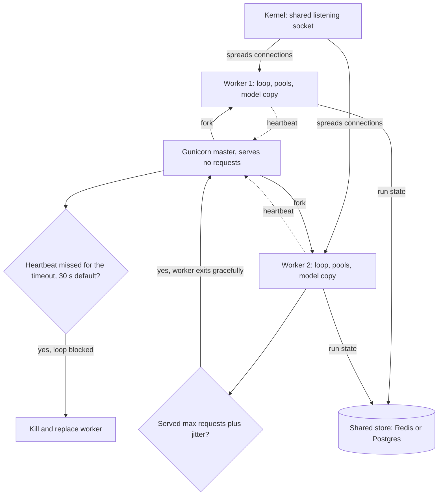

## TL;DR
Uvicorn runs the event loop your agent service awaits LLM calls on; Gunicorn supervises several Uvicorn
workers. Workers are separate processes, so each holds its own model copy and in-memory run state: size
by memory, and keep agent state out of process.

## For agent builders
- **Why it matters for agents.** An agent run is a long chain of awaits (model call, tool call, model
  call), so one event loop can hold hundreds of concurrent runs cheaply. What breaks is everything
  per-process: a local reranker loaded once per worker, an in-memory checkpointer or run registry that
  the next request for the same run never sees, and blocking tool code that freezes every run on a worker.
- **Where it shows up in your stack.** The run command of the FastAPI service hosting your LangGraph,
  OpenAI Agents SDK or custom loop, the Dockerfile `CMD`, a `gunicorn.conf.py`, and the pod spec.
- **What you control.** Worker count, `--timeout`, `--graceful-timeout`, `--max-requests`, whether to
  `--preload`, the HTTP pool size per worker, and where run state lives (a database or Redis, not a dict).
- **What you can skip.** Gunicorn's other worker classes and the internals of the pre-fork model. Know the
  four flags in the table below and the memory formula.

## Lab
### Task
Your agent service moved to a bigger reranker and its pods started dying under load, deploys cut runs
off, and a sync PDF tool gets workers killed.

Write a linter that reads a Gunicorn config the way
Gunicorn does (its own defaults, your overrides) and checks it against the measured agent workload.
Then fix the config until the linter is clean.

Time box: 45-60 minutes.
- **Prerequisites:** Async endpoints, Lifespan (load model / client once), and this lesson's flag table
  and sizing steps.
- **Setup:** Python 3.12 with `pip install gunicorn pytest` (checked on gunicorn 26.2; nothing is
  started, so it runs on macOS, Linux or in CI). Save the starter as `lab_workers.py` and the tests as
  `test_lab_workers.py`.
- **Rule:** read every value through `effective(...)`, never hard-code a default you remember.

### Starter code
```python
"""Lab: lint a Gunicorn config against the agent workload (checked on gunicorn 26.2, Python 3.12)."""
from gunicorn.config import Config

# Measured on staging (illustrative): bigger reranker, research-agent runs, one sync PDF tool.
WORKLOAD = {
    "pod_mib": 8192, "headroom_mib": 1638, "rss_mib": 2662,   # per-worker RSS including the model
    "longest_request_s": 53.5,                                # 10 x 4 s model + 9 x 1.5 s tools
    "longest_blocking_s": 40,                                 # sync PDF parse on the event loop
    "uses_gpu": False,
}

BROKEN = {"workers": 4, "worker_class": "uvicorn.workers.UvicornWorker", "max_requests": 5000}

FIXED = dict(BROKEN)   # LAB 2: change only what the linter needs, keeping as many workers as memory allows


def effective(overrides: dict) -> Config:
    """Gunicorn's own defaults with our overrides on top (timeout 30, graceful_timeout 30, ...)."""
    cfg = Config()
    for key, value in overrides.items():
        cfg.set(key, value)
    return cfg


def lint(overrides: dict, workload: dict) -> list[str]:
    """LAB 1: return problems as '<setting>: <why>' in this order, skipping those that do not apply:
    workers (RSS x workers above pod_mib - headroom_mib; say 'max N'), graceful_timeout (below the
    longest request), timeout (below the longest blocking call), max_requests (set without
    max_requests_jitter), worker_class (deprecated uvicorn.workers path), preload_app (with a GPU)."""
    cfg = effective(overrides)
    raise NotImplementedError


if __name__ == "__main__":
    cfg = effective({})
    print("defaults:", cfg.workers, cfg.timeout, cfg.graceful_timeout, cfg.max_requests_jitter)
    for problem in lint(BROKEN, WORKLOAD):
        print(problem)
    print("fixed:", lint(FIXED, WORKLOAD))
```

As given, it prints `defaults: 1 30 30 0` (straight from Gunicorn) and then raises
`NotImplementedError`.

### Expected output
The setting names before each colon, their order, `max 2` and `fixed: []` are exact; the wording after
the colon is yours.

```
defaults: 1 30 30 0
workers: 4 x 2662 MiB = 10648 MiB exceeds the 6554 MiB budget, max 2
graceful_timeout: 30 s is shorter than the longest request (53.5 s)
timeout: 30 s is shorter than the longest blocking call (40 s)
max_requests: 5000 without max_requests_jitter restarts workers together
worker_class: uvicorn.workers is deprecated, use uvicorn_worker.UvicornWorker
fixed: []
```

### Tests
```python
import lab_workers as lab


def settings(problems):
    return [p.split(":")[0] for p in problems]


def test_broken_config_reports_each_problem_in_order():
    problems = lab.lint(lab.BROKEN, lab.WORKLOAD)
    assert settings(problems) == ["workers", "graceful_timeout", "timeout", "max_requests", "worker_class"]
    assert "max 2" in problems[0]                      # (8192 - 1638) // 2662


def test_defaults_come_from_gunicorn_not_from_memory():
    assert settings(lab.lint({}, lab.WORKLOAD)) == ["graceful_timeout", "timeout"]


def test_gpu_preload_is_flagged():
    gpu = dict(lab.WORKLOAD, uses_gpu=True, longest_request_s=1, longest_blocking_s=0)
    assert settings(lab.lint({"preload_app": True}, gpu)) == ["preload_app"]
    assert lab.lint({"preload_app": True}, dict(gpu, uses_gpu=False)) == []


def test_fixed_config_is_clean_and_keeps_two_workers():
    assert lab.lint(lab.FIXED, lab.WORKLOAD) == []
    assert lab.FIXED["workers"] == 2
    assert lab.FIXED["max_requests"] == 5000          # keep the leak cure, add jitter
```

All four fail on the starter with `NotImplementedError`. The memory budget is 8192 − 1638 = 6554 MiB, so
4 workers need 10,648 MiB and only 2 fit (5,324 MiB).

### Failure scenarios
- **Inject: compare `cfg.worker_class` instead of `cfg.worker_class_str`.** Observe: the import of the
  Gunicorn imports the class, so the check never matches a string, or `RuntimeError` is raised when the
  `uvicorn-worker` package is not installed. Debug: print both attributes; the `_str` form is the
  configured dotted path.
- **Inject: pass the fixed config to a real `gunicorn` with `--timeout 60` but keep the PDF parse on the
  loop.** Observe: no more worker kills, yet every agent run on that worker stalls for 40 s. Debug: log
  event-loop lag; the real fix is `run_in_threadpool` or a process pool, then lower `timeout` again.
- **Inject: keep run state in a module-level dict with `workers: 2`.** Observe: "approve tool call" for a
  run started on the other worker returns 404 roughly half the time. Debug: log `os.getpid()` per request;
  move run state to Redis or the database.

### Submission
- `lab_workers.py` with `lint` and `FIXED`, and a `pytest -q` run showing 4 passed.
- Your output of `python lab_workers.py`.
- The equivalent `gunicorn.conf.py` (or command line) for `FIXED`, as you would put in the Dockerfile.
- A short note: which problem the linter cannot fix (the blocking tool) and what you would change in
  the code instead.

## Why it exists
- **FastAPI is a framework, not a server.** Something must open the socket, parse HTTP, speak ASGI to your
  app and run the asyncio event loop. Uvicorn does that.
- **One process is great for I/O.** A single Uvicorn process handles thousands of concurrent connections
  while handlers mostly await I/O, exactly the shape of an LLM gateway or agent runner: a request waits
  seconds for a provider using almost no CPU.
- **Limit 1: one core of Python.** On the standard CPython build the global interpreter lock means one
  process executes Python bytecode on one core at a time. The experimental free-threaded builds from
  Python 3.13 relax this, but most AI library stacks still assume the GIL. CPU work (tokenizing,
  JSON-heavy post-processing, local embedding inference, PDF parsing in a document tool) saturates one
  core and stalls the event loop for everyone.
- **Limit 2: a single point of failure.** If the process crashes, segfaults in a native library or leaks
  memory until killed, the service is down, along with every agent run it was holding.
- **N workers fix both, but need a supervisor** to fork them, restart the ones that die, recycle leakers
  and pass signals through. Gunicorn was built for that role; in containers it is often handed to the
  orchestrator instead.

## How it works
### Uvicorn alone
- **One process:** `uvicorn app.main:app --host 0.0.0.0 --port 8000` runs one process with one event loop.
- **`--workers N`:** a small supervisor spawns N child processes sharing the listening socket; the kernel
  spreads incoming *connections* across them (not perfectly evenly).
- **The unit is the connection, not the request.** Behind a proxy holding a handful of long-lived
  keep-alive connections, most requests can land on one or two workers while the others idle.
- **Consecutive requests for one agent run can hit different workers.** "Start run" and "approve tool
  call" for the same run id are separate requests, so run state must live where every worker can read it.
- **Restarts:** recent Uvicorn versions (0.30 onward) also restart children that die.
- **Per-worker startup:** each child runs lifespan startup independently, so every worker builds its own
  HTTP client pool, DB engine and model.

### Gunicorn with Uvicorn workers
`gunicorn app.main:app -k uvicorn.workers.UvicornWorker -w 4 --bind 0.0.0.0:8000` makes Gunicorn the
master. The master never serves requests: it forks workers, watches a heartbeat from each, and replaces
any that exit.

| Flag | Default | What it does | Watch out |
|---|---|---|---|
| **`--timeout`** | 30 s | kills and replaces a worker that misses its heartbeat that long | async heartbeat runs on the event loop, so a blocking handler (a synchronous model call or tool) gets its worker killed |
| **`--graceful-timeout`** | 30 s | time to finish in-flight requests on shutdown or reload | must cover your longest normal request; a multi-minute agent run rarely fits |
| **`--max-requests` + `--max-requests-jitter`** | 0, off | recycle each worker after a number of requests | blunt but effective cure for slow native-library leaks; jitter stops all workers restarting at once |
| **`--preload`** | off | import the app in the master before forking, sharing read-only pages copy-on-write | refcounting writes erode sharing over time; CUDA must not be initialised before a fork, so preloading a GPU model is a trap |

- **Import path changed.** Since Uvicorn 0.30 the built-in `uvicorn.workers` module is deprecated in
  favour of the separate `uvicorn-worker` package (`-k uvicorn_worker.UvicornWorker`). The old path still
  works in many versions but warns, so check which path your pinned versions expect.
- **`--timeout` is not a request timeout for async workers.** It measures heartbeat silence, so a
  10-minute agent run that keeps awaiting is fine; a 40-second blocking tool call is not.

### Sizing
1. **Start from cores, async-style.** Gunicorn's classic `2 × cores + 1` is for synchronous workers that
   block on I/O. An async worker already overlaps I/O, so start near one worker per core and measure.
2. **Check concurrency per worker with Little's law:** requests in flight = arrival rate × time in system.
   At 50 requests/s and 8 s per LLM call, about 400 requests await the provider at once.
3. **Find the real cap.** One event loop holds 400 pending awaits cheaply, so that needs no extra
   workers. The cap is the shared HTTP client's connection pool (httpx defaults to 100 connections);
   beyond it requests queue inside the client and eventually raise pool timeouts.
4. **Apply the constraint that dominates AI workloads:**

```
workers ≤ (container memory − headroom) ÷ (per-worker RSS, including model)
workers per GPU: usually 1, because each process would load its own copy of the weights
```

### In containers
- **Common choice on Kubernetes:** one Uvicorn process per container, scaling by pod count, because the
  orchestrator already restarts dead processes and scales replicas. Per-pod memory and metrics stay simple.
- **Multiple workers per pod** still make sense when pods are large and per-pod overhead (sidecars, memory
  reserved for the model) is significant.
- **Long agent runs change the scaling unit.** When runs last minutes, many teams move the loop into a
  durable worker (a job queue) and keep FastAPI workers for starting runs and streaming their events.

## Diagram
The Gunicorn master serves nothing: it forks workers, watches their heartbeats and replaces any that are
killed or exit (a worker that hits `--max-requests` exits by itself and the master forks a fresh one).

Each worker is a full process with its own event loop, pools, model copy and memory, which is why memory
caps the count and why run state must live outside.



## Examples
### Agent scenario: sizing a worker for concurrent agent runs
An agent service runs research agents. Numbers are illustrative: each run makes 10 model calls of ~4 s
and 9 tool calls of ~1.5 s, so it lasts ~54 s and holds at most one outbound connection at a time.

```python
def agent_runs_in_flight(runs_per_s, model_calls, model_s, tool_calls, tool_s):
    run_seconds = model_calls * model_s + tool_calls * tool_s
    return runs_per_s * run_seconds, run_seconds          # Little's law per run

def plan_agents(runs_per_s, workers, pool_size=100, **run):
    in_flight, run_s = agent_runs_in_flight(runs_per_s, **run)
    per_worker = in_flight / workers
    return {"run_seconds": run_s, "runs_in_flight": in_flight,
            "runs_per_worker": per_worker, "pool_saturated": per_worker > pool_size}

shape = dict(model_calls=10, model_s=4.0, tool_calls=9, tool_s=1.5)
print(plan_agents(2, workers=2, **shape))
# {'run_seconds': 53.5, 'runs_in_flight': 107.0, 'runs_per_worker': 53.5, 'pool_saturated': False}
print(plan_agents(8, workers=2, **shape))
# {'run_seconds': 53.5, 'runs_in_flight': 428.0, 'runs_per_worker': 214.0, 'pool_saturated': True}
```

- **At 2 runs/s, 2 workers are plenty:** ~54 runs per worker are just pending awaits on one loop.
- **At 8 runs/s the pool, not the CPU, saturates:** raise the per-worker pool limit within the
  provider's concurrency allowance, or add replicas. Adding workers to the same pod only helps if
  memory allows.
- **Each run is a ~54 s request**, longer than the 30 s `--graceful-timeout` default, which is why
  deploys interrupt runs unless you drain or make runs durable.

### Worked sizing: API with a local CPU reranker
A FastAPI retrieval service for a RAG agent calls a hosted LLM over HTTP and runs a local cross-encoder
reranker on CPU. Numbers are illustrative. Each pod gets 4 vCPU and 8 GiB.

| Measured per worker after startup | GiB |
|---|---|
| Reranker weights and tokenizer | about 1.1 |
| Python, libraries, connection pools | 0.5 |
| **Total RSS** | **1.6** |

- **Current reranker:** CPU says 4 workers; memory says 4 × 1.6 = 6.4 GiB, leaving 1.6 GiB for request
  buffers and tensor-allocation spikes during reranking. It fits: 4 workers.
- **Bigger reranker, 2.6 GiB per worker:** 4 workers need 10.4 GiB, so the pod is OOM-killed under load.
- **Option A:** resize pods to 2 vCPU and about 6 GiB with 2 workers each and double the replicas
  (2 × 2.6 = 5.2 GiB per pod). Same total CPU and worker count, more memory overall because headroom is
  now reserved per smaller pod.
- **Option B:** move the reranker into a dedicated model server, so API workers shrink to ~0.5 GiB each
  and the reranker loads once.
- **GPU variant:** run one worker per GPU or, better, put the model behind an inference server and keep
  FastAPI as a thin async I/O layer.

Deploy command for the 4-worker case (using the `uvicorn-worker` package), with recycling to contain a
slow leak in a native tokenizer:

```
gunicorn app.main:app -k uvicorn_worker.UvicornWorker -w 4 --bind 0.0.0.0:8000 \
  --timeout 120 --graceful-timeout 60 --max-requests 5000 --max-requests-jitter 500
```

- **Why `--timeout 120`:** a large rerank batch run synchronously can block the loop long enough to miss
  the default 30 s heartbeat.
- **A workaround, not a fix:** while the loop is blocked, every other request on that worker stalls too,
  including every agent run waiting on it.
- **The real fix:** move CPU work off the loop (`run_in_threadpool` works for libraries such as PyTorch
  that release the GIL during heavy ops; pure-Python work needs a process pool), then lower the timeout
  back.

### Sizing calculator (runnable)
Memory caps workers; Little's law tells you whether each worker's HTTP pool will saturate.

```python
def workers_by_memory(pod_mib, rss_mib, headroom_mib):
    return (pod_mib - headroom_mib) // rss_mib          # integers avoid float floor surprises

def in_flight(requests_per_s, seconds_per_request):
    return requests_per_s * seconds_per_request         # Little's law: L = lambda x W

def plan(cores, pod_mib, rss_mib, headroom_mib, rps, latency_s, pool_size=100):
    by_cpu = cores                                      # async workers: start near 1 per core
    by_mem = workers_by_memory(pod_mib, rss_mib, headroom_mib)
    w = max(1, min(by_cpu, by_mem))
    per_worker = in_flight(rps, latency_s) / w
    return {"by_cpu": by_cpu, "by_mem": by_mem, "workers": w,
            "in_flight_per_worker": per_worker,
            "pool_saturated": per_worker > pool_size}

print(plan(4, 8192, 1638, 1638, rps=50, latency_s=8))   # 1.6 GiB workers
# {'by_cpu': 4, 'by_mem': 4, 'workers': 4, 'in_flight_per_worker': 100.0, 'pool_saturated': False}
print(plan(4, 8192, 2662, 1638, rps=50, latency_s=8))   # 2.6 GiB workers
# {'by_cpu': 4, 'by_mem': 2, 'workers': 2, 'in_flight_per_worker': 200.0, 'pool_saturated': True}
```

With the bigger model, memory halves the workers and each worker's 100-connection pool is now
oversubscribed, so either raise the pool limit or add replicas.

## Production patterns
- **Externalise agent run state before adding workers.** Agent teams store checkpoints, pending tool
  approvals and run status in Postgres or Redis (for example a database-backed checkpointer rather than an
  in-memory one), so any worker can resume any run. Monitor: "run not found" errors, which rise with
  worker count when state is still per-process.
- **One process per pod on Kubernetes.** For an I/O-bound gateway or agent API run plain
  `uvicorn app.main:app --host 0.0.0.0 --port 8000` and scale replicas with the autoscaler. Monitor:
  per-pod CPU (one process tops out near one core), event-loop lag and p99 latency.
- **A checked-in `gunicorn.conf.py` on VMs and large pods.** Set `workers`, `worker_class`, `timeout`,
  `graceful_timeout`, `max_requests` and `max_requests_jitter` in one reviewed file instead of ad hoc
  flags. Monitor: worker restarts and `WORKER TIMEOUT` lines in Gunicorn's log.
- **Recycle leaky workers with jitter.** `--max-requests 5000 --max-requests-jitter 500` contains slow
  native leaks without synchronised restarts. Monitor: per-worker RSS over time (sawtooth is expected,
  a rising floor is not) and latency spikes at recycle time.
- **Connection budget across the fleet.** Keep workers × pool size × replicas under the database's and
  provider's connection limits, and create pools in lifespan, never at import. Monitor: open connections
  on the database and pool-timeout errors in the client.
- **Event-loop lag as a first-class metric.** Run a small background task that sleeps a fixed interval and
  records how late it wakes; export the overshoot. Monitor: lag climbing with load is a blocking call
  (often a synchronous tool implementation), not a worker shortage.

## Trade-offs
- **More workers vs duplicated models.** Workers use more cores and survive single-process crashes, but
  each duplicates the model in memory; once weights dominate RSS, a separate model server beats adding
  workers.
- **Gunicorn's controls vs another layer.** Heartbeat kills, worker recycling and graceful reloads come
  with another layer of signals and config; under Kubernetes with one process per pod, plain Uvicorn is
  often simpler and sufficient.
- **`--preload` speed vs fork safety.** It speeds startup and can share memory, but it breaks anything
  that must be created after the fork (CUDA contexts, threads, some client pools), so it flips from helpful
  to harmful with GPU models.
- **`--max-requests` vs cold starts.** Recycling hides leaks cheaply but periodically cold-starts workers;
  if lifespan startup takes tens of seconds, recycling causes visible latency spikes.
- **Runs in the API worker vs a durable job worker.** Running the agent loop inside the request is simple
  and streams naturally, but every restart, recycle or OOM kills in-flight runs; past roughly the length
  of your graceful timeout, a durable worker with resumable checkpoints wins.

## Pitfalls
- **DB pools or HTTP clients at import time with `--preload`.** Symptom: connection errors or hangs in
  workers, because sockets and threads created before fork do not survive it correctly.
- **Synchronous model inference or tool code inside `async def` handlers.** Symptom: Gunicorn logs
  `WORKER TIMEOUT` and kills workers under load, and every in-flight request and agent run on them fails.
- **Sizing workers by CPU count and ignoring per-worker model memory.** Symptom: pods OOM-killed during
  traffic peaks, often reported as mysterious restarts with exit code 137.
- **In-process state, then more workers.** A dict cache, a rate-limit counter or an in-memory agent
  checkpointer per process. Symptom: rate limits N times too generous, cache hit rates that drop as
  workers increase, and "resume run" requests that fail on whichever worker did not start the run.
- **Workers behind a proxy reusing a few keep-alive connections.** Symptom: one worker pinned near 100% CPU
  with high event-loop lag while siblings idle, so p99 barely improves.
- **Ignoring total connections.** Many workers per pod and many pods. Symptom: the database or provider
  rejects connections because workers × pool size × replicas exceeds its limit.

## When to use
- **I/O-bound LLM gateway or agent API on Kubernetes:** start with one Uvicorn process per container and
  scale replicas.
- **VMs or large pods:** use Gunicorn with Uvicorn workers for in-pod supervision, leak recycling and
  heartbeat kills.
- **Size by:** measured RSS and GPU count before CPU.
- **Move CPU-heavy or GPU work out** of the API process (thread pool, process pool or a model server)
  instead of adding workers to hide event-loop blocking.
- **Measure:** per-worker RSS, event-loop lag, worker restarts and connection counts.
- **Interviews:** explaining why worker count is a memory question for AI services is the distinguishing
  answer.

## Role lens
- **Engineer:** Picks the run command, sets timeouts and recycling, keeps blocking calls off the event loop,
  and ensures resources are created per worker in lifespan, not at import.
- **Architect:** Decides whether models live inside API workers or in a separate inference tier, and
  whether scaling happens by workers per host or replicas per cluster.
- **FDE:** Fits the service into the customer's fixed VM or node sizes, choosing worker counts that their
  memory limits and database connection caps actually allow.

## Check yourself
**Q:** A FastAPI service that calls a hosted LLM runs as 1 Uvicorn process per pod. Under load p99 latency
climbs although CPU is at 35% of the pod's 4 cores. A colleague proposes `--workers 4`. Is that the right
fix?
**A:** Possibly, but first find out why one process is slow at 35% pod CPU. One process can use at most
about one core of Python execution, so 35% of four cores could mean that one core is saturated, which more
workers would help. But if the event loop is blocked by a synchronous call (a sync HTTP client, a tokenizer,
JSON over large payloads), more workers only spread the stall. I would check event-loop lag and per-core
usage. If the loop is CPU-bound on legitimate work, adding workers (or replicas) is right, checking that
memory and DB connection limits allow it. If something blocks, fix it with an async client or a thread pool.

## Interview questions
### What is the difference between Uvicorn and Gunicorn, and why would you run both?
- **Uvicorn is the ASGI server:** it opens the socket, parses HTTP and runs the asyncio event loop that
  calls your FastAPI app.
- **Gunicorn is a pre-fork process manager:** its master forks workers, kills those that miss the
  heartbeat for `--timeout`, recycles them after `--max-requests` and passes signals through.
- **Together** (`-k uvicorn_worker.UvicornWorker`) you get async request handling plus in-host
  supervision, useful on VMs and large pods.

### Your agent service works with one worker, but after scaling to four, "resume run" calls randomly fail. Why?
- **Run state was per-process:** an in-memory checkpointer, run registry or pending-approval dict lives in
  the worker that started the run, and the kernel spreads later connections across all four workers.
- **Fix:** move checkpoints, run status and pending tool approvals into a shared store (Postgres or Redis)
  so any worker can resume any run.
- **Do not reach for sticky sessions first:** they break again on worker recycle, restart or deploy.

### How would you choose the worker count when each worker, model included, uses 3 GiB of RSS?
- **Memory first:** workers ≤ (container memory − headroom) ÷ per-worker RSS, so on
  an 8 GiB pod with 1.6 GiB headroom, 6.4 ÷ 3 rounds down to 2 workers.
- **Then CPU:** async workers start near one per core, but memory is the binding limit here.
- **Then concurrency:** Little's law (rate × latency) divided by workers must stay under each worker's
  HTTP pool, or raise the pool or add replicas.
- **If weights dominate RSS**, move the model to a separate model server instead.

### Gunicorn logs WORKER TIMEOUT under load and in-flight agent runs fail. What is happening?
- **The async worker's heartbeat runs on the event loop,** so a blocking call (synchronous inference, a
  sync HTTP client inside a tool) stops the heartbeat and the master kills the worker after `--timeout`,
  30 s by default.
- **Raising `--timeout` is a workaround:** every other request on that worker still stalls while the loop
  is blocked.
- **The fix:** move the work off the loop, with `run_in_threadpool` for GIL-releasing libraries or a
  process pool for pure Python, then lower the timeout again.

### On Kubernetes, when would you not use Gunicorn at all?
- **For an I/O-bound gateway, one Uvicorn process per pod is often simpler**, because the orchestrator
  already restarts dead processes and scales replicas, and per-pod memory and metrics stay easy to read.
- **Keep Gunicorn** when pods are large and per-pod overhead (sidecars, model memory) makes several
  workers per pod cheaper, or when you need `--max-requests` recycling for a native leak.

### Why is --preload risky for a GPU model service?
- **`--preload` imports the app in the master before forking**, sharing read-only pages copy-on-write.
- **CUDA must not be initialised before a fork,** so a model loaded on the GPU in the master breaks the
  children; sockets, threads and some client pools created before fork also misbehave.
- **So:** load GPU models and create pools per worker in lifespan, after the fork, and usually run one
  worker per GPU.

## Quiz
### Q: Why does adding Uvicorn workers help a CPU-bound FastAPI service but barely help a slow I/O-bound one?
- [ ] Workers share one event loop, so they only speed up CPU work
- [x] Each worker is a separate process with its own interpreter lock, while one event loop already overlaps I/O waits
- [ ] Uvicorn disables async I/O when more than one worker is running
- [ ] Workers increase the provider's rate limit for the service
> The interpreter lock limits one process to roughly one core of Python execution, so processes add CPU
> capacity. Async I/O waits already overlap within one loop, so the bottleneck is elsewhere, usually upstream.

### Q: A service loads a 3 GB model in lifespan and runs 4 Gunicorn workers. Roughly how much memory goes to model weights?
- [ ] About 3 GB, because workers share the parent's memory
- [x] About 12 GB, because each worker runs lifespan and loads its own copy
- [ ] About 0.75 GB per worker, because the model is split across workers
- [ ] Nothing until the first request, because models load lazily
> Lifespan runs in each worker process, so each one loads the weights. Copy-on-write sharing from
> `--preload` does not apply to models loaded after fork, and erodes even for preloaded objects.

### Q: Gunicorn logs `WORKER TIMEOUT` and restarts Uvicorn workers during traffic spikes. What is the most likely cause?
- [ ] The client disconnected before the response was complete
- [ ] `--max-requests` is set too low
- [x] A handler is blocking the event loop, so the worker cannot send its heartbeat to the master
- [ ] The provider's API returned 429 responses
> For async workers the heartbeat runs on the event loop. A synchronous model call or CPU-heavy step inside
> an async handler starves it, and after `--timeout` the master kills the worker and its in-flight requests.

## Use cases & projects
### Use cases
- **Hosting an agent runner.** Many concurrent runs that mostly await model and tool calls fit on few
  workers, while CPU-heavy tool steps decide whether you need more.
- **Services with a local model.** A reranker or embedding model loaded per worker sets the memory
  ceiling, so worker count is a memory decision, not a core count.
- **Moving run state out of process.** Workers do not share memory, so checkpoints and run registries move
  to a database or Redis before you scale past one worker.
- **Recycling leaky workers.** `--max-requests` restarts a worker that slowly leaks memory from native
  libraries, at the cost of cutting its in-flight runs unless drained.

### Mini project
**Show the per-worker state trap and fix it (1-2 hours).**
- **Goal:** prove that an in-memory run registry breaks under several workers, then fix it.
- **Steps:** build a FastAPI agent stub with `POST /runs` that stores a run in a dict and
  `GET /runs/{id}` that reads it, both returning `os.getpid()`; run it under Gunicorn with 4 Uvicorn
  workers; fire 50 create-then-read pairs on a fresh connection per request (keep-alive would pin both
  calls to one worker) and count the 404s; move the registry to Redis or SQLite and repeat.
- **Then block the loop:** add `time.sleep(40)` in one handler and watch the default 30 s `--timeout`
  kill that worker.
- **Done when:** you have a before and after count of failed reads (non-zero, then zero) and a log line
  showing the heartbeat timeout killing the blocked worker.

### Major project
This lesson feeds the module Capstone (see the module guide), which asks for a Gunicorn/Uvicorn worker
configuration you can justify and an operations note with worker count and pool sizing arithmetic.
