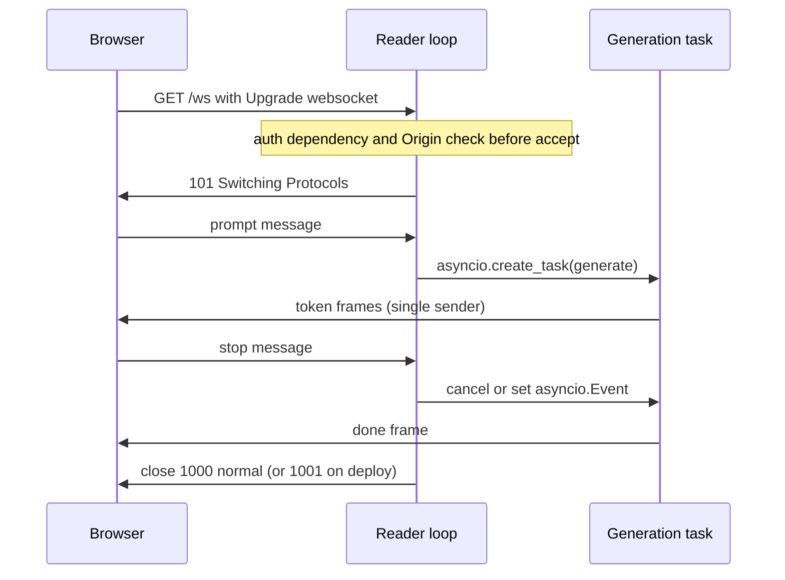

## TL;DR
A WebSocket turns one HTTP connection into a persistent two-way channel. Use it when users talk to a
running agent (stop, steer, approve tools, voice); you pay with pinned per-connection state, hand-rolled
auth and resume. One-way agent streams: use SSE.

## For agent builders
- **Why it matters for agents.** Interactive agents need input while they run: a stop button, a
  correction mid-plan, a yes or no on a risky tool call, a continuous voice stream. On a WebSocket that
  input lands in the very process running the agent loop, with no shared cancel store.
- **Where it shows up in your stack.** FastAPI `@app.websocket` routes for interactive or voice agents,
  realtime speech model APIs that are themselves WebSocket-based, and the ingress, ping and deploy-drain
  settings that keep long agent sessions alive.
- **What you control.** The message protocol (prompt, stop, approve, token, tool_call, done), the reader
  loop plus agent task shape, auth on the handshake, and session ids for reconnect and resume.
- **What you can skip.** Frame-level details beyond close codes and ping/pong. Most text agents that only
  need a stop button are better served by SSE plus a cancel endpoint.

## Lab
### Task
Fix an agent socket whose stop button does nothing: the handler awaits the whole answer before it reads
the next message. Time box: 45-60 minutes. Prerequisites: Async endpoints and the asyncio lesson (tasks
and events).
- **Interruption:** a reader loop plus a generation task, so `stop` ends the answer mid-stream with a
  `stopped` frame.
- **Handshake auth:** a bad token is refused before `accept()` with close code 1008.
- **Cleanup:** a disconnect cancels the generation task, so no tokens stream to nobody.

### Starter code
Save as `lab_ws.py`. Needs `pip install fastapi httpx` (checked with FastAPI 0.161.1, Starlette 1.9.0,
httpx 0.28.1, Python 3.12). It runs as given and shows both bugs.

```python
import asyncio
from fastapi import FastAPI, WebSocket, WebSocketDisconnect, WebSocketException, status
from fastapi.testclient import TestClient

app = FastAPI()
WORDS = [f"w{i}" for i in range(20)]                  # a 20-token answer
TOKEN_DELAY = 0.05                                    # seconds per token (fake model speed)

async def model_stream(prompt: str):                  # stand-in for your SDK's async stream
    for w in WORDS:
        await asyncio.sleep(TOKEN_DELAY)
        yield w

async def run_agent(ws: WebSocket, prompt: str, stop: asyncio.Event) -> None:
    """The generation task: the only sender of token, stopped and done frames."""
    async for piece in model_stream(prompt):
        # YOUR CODE 1: if stop is set, send {"type": "stopped"} and return.
        await ws.send_json({"type": "token", "delta": piece})
    await ws.send_json({"type": "done"})

@app.websocket("/ws/agent")
async def agent(ws: WebSocket, token: str = ""):
    # YOUR CODE 2: reject anything but token == "demo" BEFORE accept, with close code 1008.
    await ws.accept()
    stop = asyncio.Event()
    try:
        while True:
            msg = await ws.receive_json()
            if msg["type"] == "prompt":
                # BUG: awaiting the run here means stop messages are not read until it ends.
                # YOUR CODE 3: start run_agent as a task and keep this loop reading,
                #              so {"type": "stop"} sets the event mid-answer.
                await run_agent(ws, msg["text"], stop)
            elif msg["type"] == "stop":
                stop.set()
    except WebSocketDisconnect:
        pass
    # YOUR CODE 4: in a finally block, cancel the generation task (client gone: stop paying).

if __name__ == "__main__":
    client = TestClient(app)
    with client.websocket_connect("/ws/agent?token=demo") as ws:
        ws.send_json({"type": "prompt", "text": "hi"})
        tokens = [ws.receive_json()["delta"] for _ in range(3)]
        ws.send_json({"type": "stop"})
        while (msg := ws.receive_json())["type"] == "token":
            tokens.append(msg["delta"])
        print(msg["type"], "after", len(tokens), "of", len(WORDS), "tokens")
    try:
        with client.websocket_connect("/ws/agent?token=bad") as ws:
            print("bad token accepted: it should have been refused")
    except WebSocketDisconnect as exc:
        print("bad token closed with", exc.code)
```

The starter prints `done after 20 of 20 tokens` and `bad token accepted: it should have been refused`.

### Expected output
With a correct solution, `python lab_ws.py` prints (the count can be 4 on a very slow machine):

```
stopped after 3 of 20 tokens
bad token closed with 1008
```

### Tests
Save as `test_lab_ws.py` and run `pytest -q`. On the starter the stop test fails (`done` instead of
`stopped`) and the handshake test fails (accepted); the full-answer test passes and guards your fix.

```python
import pytest
from fastapi import WebSocketDisconnect
from fastapi.testclient import TestClient
from lab_ws import WORDS, app

client = TestClient(app)

def collect_after_stop(ws, stop_after: int):
    ws.send_json({"type": "prompt", "text": "hi"})
    tokens = [ws.receive_json()["delta"] for _ in range(stop_after)]
    ws.send_json({"type": "stop"})
    while (msg := ws.receive_json())["type"] == "token":
        tokens.append(msg["delta"])
    return msg["type"], tokens

def test_stop_interrupts_mid_answer():
    with client.websocket_connect("/ws/agent?token=demo") as ws:
        final, tokens = collect_after_stop(ws, 3)
    assert final == "stopped"
    assert len(tokens) < len(WORDS) // 2          # stop landed while tokens were still streaming

def test_full_answer_without_stop_ends_with_done():
    with client.websocket_connect("/ws/agent?token=demo") as ws:
        ws.send_json({"type": "prompt", "text": "hi"})
        msgs = [ws.receive_json() for _ in range(len(WORDS) + 1)]
    assert [m.get("delta") for m in msgs[:-1]] == WORDS and msgs[-1] == {"type": "done"}

def test_bad_token_is_refused_with_policy_violation():
    with pytest.raises(WebSocketDisconnect) as exc:
        with client.websocket_connect("/ws/agent?token=bad"):
            pytest.fail("the handshake was accepted")
    assert exc.value.code == 1008
```

### Failure scenarios
- **Reuse one `asyncio.Event` across prompts.** After the first stop, every later prompt answers
  `stopped` at once. Debug: log `stop.is_set()` when each run starts; create a fresh event per prompt.
- **Send frames from the reader loop as well as the task.** Frames interleave or a send races a close.
  Debug: grep for every `send_` call; only the generation task (or one sender queue) may send.
- **Accept, then check the token.** The client gets a working socket for a moment and the test sees a
  successful handshake. Debug: move the check above `accept()` and raise `WebSocketException`.
- **Forget the `finally` cancel.** Closing the client mid-answer leaves the task running: the model
  keeps generating until the next send into the dead socket raises, and the log shows a token after the
  disconnect plus "Task exception was never retrieved". Debug: log in `model_stream` after the client
  disconnects; with the cancel in place, lines stop at once.

### Submission
- **Code:** `lab_ws.py` with the four YOUR CODE steps done and the protocol unchanged.
- **Test run:** `pytest -q` showing 3 passed.
- **Trace:** the output of `python lab_ws.py`, matching the expected output.
- **Note (3-5 sentences):** why one coroutine cannot both stream and listen, and how an `approve` or
  `deny` message would plug into the same reader loop.
- **Evaluated on:** passing tests, a single sender, a fresh stop event per run, and cleanup on disconnect.

## Why it exists
- **HTTP is request then response.** Once the client has sent its body it cannot say anything else on
  that exchange, and the server cannot push anything the client did not ask for.
- **Interruption breaks it.** A user watching SSE tokens presses stop; over HTTP that is a second request
  the load balancer may route to a different worker, so you need shared state (a Redis pub/sub channel,
  a cancel flag in a store) just to deliver one bit to one coroutine.
- **Continuous two-way media breaks it.** A voice agent receives audio frames every few tens of
  milliseconds while sending synthesized audio back. A request per frame is absurd in overhead and
  ordering; long-polling hacks add latency and complexity without removing either problem.
- **RFC 6455 was designed for this.** One TCP connection, established through an HTTP handshake so it
  passes existing infrastructure, then messages in both directions with a two-to-fourteen-byte frame
  header and no further HTTP ceremony.
- **Both AI needs map directly.** The stop message arrives on the socket the tokens leave on, so it lands
  in the same process with no shared state; audio travels as binary frames without base64. The cost: the
  connection, not the request, is now the unit of state.

## How it works
### The handshake
1. Client sends a GET with `Upgrade: websocket`, `Connection: Upgrade` and a random `Sec-WebSocket-Key`.
2. Server answers `101 Switching Protocols` with `Sec-WebSocket-Accept`, a hash of the key and a fixed
   GUID that proves it understood the upgrade.
3. From then on the bytes are frames, not HTTP.

Because the handshake is a plain GET:
- **No `Authorization` header from browsers.** The JavaScript `WebSocket` API has no header option, so
  auth arrives via a cookie, a short-lived token in the query string (which lands in access logs), or a
  first message after connect that the server must receive before doing any work.
- **CORS does not protect it.** If browsers are clients and cookies carry auth, check the `Origin` header
  yourself, otherwise any site can open a socket to your API with the user's cookies.

### Frames, messages and closes
- **Messages** are text (must be valid UTF-8) or binary.
- **Control frames** carry ping/pong, which servers use to detect dead peers, and close, which carries a code.

| Close code | Meaning |
|---|---|
| 1000 | normal |
| 1001 | going away (server shutting down) |
| 1008 | policy violation (a common choice for auth failures) |
| 1011 | internal error |

| Uvicorn knob | Default | Effect |
|---|---|---|
| `--ws-max-size` | 16 MiB | caps a message |
| `--ws-ping-interval` / `--ws-ping-timeout` | 20 seconds each | how quickly a silent, dead client is dropped |
| `--ws-max-queue` | 32 | bounded incoming-message queue (see Backpressure) |

Uvicorn needs the `websockets` or `wsproto` package for WebSocket support, which `uvicorn[standard]` installs.

### ASGI and FastAPI
1. A WebSocket arrives as a scope of type `websocket`.
2. The app receives `websocket.connect` and answers `websocket.accept`, or `websocket.close` to refuse
   (the server turns that into an HTTP 403 before upgrade).
3. Then `websocket.receive` and `websocket.send` until `websocket.disconnect`.

FastAPI wraps this:
- **Route and calls:** `@app.websocket("/ws")`, a `WebSocket` parameter, `await websocket.accept()`,
  `receive_text/json/bytes`, `send_text/json/bytes`, and `WebSocketDisconnect` when the peer closes.
- **Dependencies work**, as do path and query parameters, cookies and headers.
- **Errors:** `HTTPException` does not fit a connection that is no longer HTTP; raise
  `WebSocketException(code=...)` from a dependency and FastAPI closes with that code.

### Reject before accept, or close after?
| Choice | What the browser sees | Use when |
|---|---|---|
| Close *before* `accept()` | HTTP 403 on the upgrade; the `close` event reports the generic 1006 (abnormal closure), because no WebSocket exists yet | unauthenticated clients should cost nothing |
| Accept, then close with 1008 or a 4000-range application code | the real code | the client needs to know *why*, e.g. to refresh its token instead of retrying blindly |

### Concurrency inside the handler
- **One coroutine cannot do both.** Awaiting `receive_json()` means not producing tokens; iterating the
  model stream means not listening. A sequential loop can never implement interruption.
- **Two activities:** a reader loop for incoming messages, and a generation task from
  `asyncio.create_task` that the reader can signal (an `asyncio.Event`) or cancel.
- **One sender.** Funnel all outgoing sends through one place (the generation task, or a single sender
  task fed by a queue), so two tasks never interleave frames.

### An agent session over one socket
| Client message | What the reader loop does to the agent task |
|---|---|
| `prompt` | starts an agent run as a task (stopping any previous one first) |
| `stop` | sets the stop event; the loop checks it between tokens and between tool calls |
| `steer` | queues a user correction the loop appends to the transcript before its next model call |
| `approve` / `deny` | resolves the future the loop is awaiting before a side-effecting tool call |

- **Cancellation does not undo tools.** A stop that lands mid-tool cancels the coroutine, but an email
  already sent or a payment already submitted stays done. Gate side-effecting tools behind approval or
  make them idempotent.
- **The session is the agent's short-term memory holder.** If the socket's process dies, so does
  in-memory transcript state; persist the transcript per session id so a reconnect can resume.

### Scaling and state
- **The socket lives in one worker process.** Client messages reach it for free, which is the point.
- **Everything else needs fan-out.** A job finishing on a worker machine or a message from another user
  must reach the process holding the socket, usually through Redis pub/sub.
- **Load balancers** must allow upgrades and keep long idle connections; many default to about a minute
  of idle time, so application-level pings matter.
- **Rolling deploys** must close sockets deliberately (code 1001), and clients must reconnect and resume.
  You design the session id and sequence numbers yourself: there is no `Last-Event-ID` equivalent.

### Backpressure
- **Send side:** with uvicorn's implementations, `await websocket.send_text()` waits when the peer reads
  slowly and the write buffer passes its high-water mark, throttling the generation loop, exactly what
  you want.
- **Fire-and-forget sends break this.** Sending from detached tasks removes the coupling and lets memory
  grow without bound.
- **Receive side:** the `websockets`-based implementation keeps a bounded incoming queue
  (`--ws-max-queue`, default 32) and stops reading when it is full, so TCP pushes back on the sender.
  Check your implementation before relying on it.

## Diagram
After the 101 upgrade, a reader loop and an agent generation task run side by side in one process, so a
stop or approval message reaches the agent loop without any shared store.



## Examples
### Interruptible agent socket with tool approval
The agent task streams tokens and pauses for approval before a side-effecting tool, while the reader
loop stays free to receive `stop` or `approve`. Auth is a query token because the browser cannot send
headers on the upgrade.

```python
import asyncio
from fastapi import FastAPI, WebSocket, WebSocketDisconnect, WebSocketException, status

app = FastAPI()

async def model_stream(prompt: str):                 # stand-in for your SDK's async stream
    for w in "Refund issued. A WebSocket lets the user interrupt this sentence midway.".split():
        await asyncio.sleep(0.4); yield w + " "

async def run_agent(ws: WebSocket, prompt: str, stop: asyncio.Event, approvals: dict):
    # 1) the model proposes a side-effecting tool call: ask the human first
    fut = asyncio.get_running_loop().create_future()
    approvals["refund-1"] = fut
    await ws.send_json({"type": "approval_needed", "id": "refund-1", "tool": "issue_refund"})
    try:
        approved = await asyncio.wait_for(fut, timeout=120)
    except asyncio.TimeoutError:
        approved = False                              # no answer in time counts as a deny
    finally:
        approvals.pop("refund-1", None)               # a late approve must not hit a dead future
    if not approved or stop.is_set():                 # denied or stopped: do not run the tool
        await ws.send_json({"type": "done", "note": "refund not issued"}); return
    # 2) run the tool here (idempotency key = run id), then stream, checking stop between tokens
    async for piece in model_stream(prompt):
        if stop.is_set():
            await ws.send_json({"type": "stopped"}); return
        await ws.send_json({"type": "token", "delta": piece})
    await ws.send_json({"type": "done"})

@app.websocket("/ws/agent")
async def agent(ws: WebSocket, token: str):          # ?token=... (short-lived); verify before accept
    if token != "demo":
        raise WebSocketException(code=status.WS_1008_POLICY_VIOLATION)
    await ws.accept()
    stop, task, approvals = asyncio.Event(), None, {}
    try:
        while True:                                   # reader loop: never blocked by the agent
            msg = await ws.receive_json()
            if msg["type"] == "prompt":
                if task and not task.done():
                    stop.set(); task.cancel()          # end the old run, even mid-approval
                    await asyncio.gather(task, return_exceptions=True)
                stop = asyncio.Event()
                task = asyncio.create_task(run_agent(ws, msg["text"], stop, approvals))
            elif msg["type"] in ("approve", "deny") and msg["id"] in approvals:
                approvals.pop(msg["id"]).set_result(msg["type"] == "approve")
            elif msg["type"] == "stop":
                stop.set()
    except WebSocketDisconnect:
        pass
    finally:
        if task:
            task.cancel()                             # client gone: stop paying for tokens
```

### Cross-process delivery with Redis pub/sub
A background worker on another machine finishes a job; the process holding the user's socket must
forward it. The relay feeds the connection's single outgoing queue instead of calling `send` itself.

```python
import asyncio
import redis.asyncio as redis

r = redis.Redis()

async def relay(session_id: str, outbox: asyncio.Queue):
    """Subscribe to this session's channel and hand messages to the one sender task."""
    pubsub = r.pubsub()
    await pubsub.subscribe(f"session:{session_id}")
    try:
        async for msg in pubsub.listen():
            if msg["type"] == "message":            # skip subscribe confirmations
                await outbox.put(msg["data"])        # the sender task does ws.send_bytes / send_text
    finally:
        await pubsub.unsubscribe(f"session:{session_id}")

# In the worker process, wherever the job completes:
#   await r.publish(f"session:{session_id}", b'{"type": "job_done"}')
# Pub/sub is fire-and-forget: if no process is subscribed (socket mid-reconnect), the message is lost,
# so also persist results where the reconnecting client can fetch them.
```

### Worked scenario: how long until a dead client is noticed?
Uvicorn defaults, and an illustrative load balancer with a 60 s idle timeout.

| Event | Time | Mechanism |
|---|---|---|
| Phone loses signal, no TCP close sent | t = 0 | socket looks open to the server |
| Next server ping | within 20 s | `--ws-ping-interval` |
| No pong arrives | up to a further 20 s | `--ws-ping-timeout` |
| Server closes, handler gets `WebSocketDisconnect` | ≤ ~40 s | `finally` cancels the generation task |
| Without pings | quiet socket: until the LB's 60 s idle cut; socket still being written to: until TCP retransmissions give up, often many minutes | model may stream to nobody the whole time |

Pings every 20 s also keep a healthy-but-quiet socket under that 60 s idle timeout.

## Production patterns
- **Persist agent session state outside the socket.** Interactive agent teams write the transcript,
  pending approvals and last sequence number per session id to a database or Redis after every step, so a
  reconnect (or a deploy that closes with 1001) resumes the run instead of losing it. Monitor sessions
  resumed versus restarted after reconnects.
- **Choose the rejection point deliberately.** Verify the token in a dependency and raise
  `WebSocketException(code=status.WS_1008_POLICY_VIOLATION)` before `accept()` for unknown clients; for
  expired tokens, accept and close with a 4000-range code the client maps to "refresh". Monitor 1006
  versus 4xxx closes and reconnect loops.
- **Check `Origin` with cookie auth.** Compare `ws.headers.get("origin")` with an allowlist before
  `accept()`, because CORS does not apply to the upgrade. Monitor rejected origins.
- **Tune pings below the shortest idle timeout.** Keep `--ws-ping-interval` well under the load balancer
  idle timeout and size `--ws-ping-timeout` for mobile networks. Monitor open sockets per process and
  time from last message to disconnect.
- **Drain sockets on deploy.** Track open sockets per process and close each with 1001 when the process
  is told to stop (check which code your server sends if it closes them itself, since that varies by
  implementation); clients reconnect with jittered backoff, sending their session id and last sequence
  number. Bound shutdown with uvicorn's `--timeout-graceful-shutdown`. Monitor reconnect success rate
  during deploys.
- **One sender per connection.** Route generation output, pub/sub relays and heartbeats through one
  `asyncio.Queue` drained by a single task. Monitor queue depth per connection and "Cannot call send"
  errors.
- **Lower `--ws-max-size` for text-only routes.** A 16 MiB default is generous for chat JSON; set it to
  what your largest legitimate message needs. Monitor closes caused by oversize messages.

## Trade-offs
- **Full duplex vs pinned state.** Tiny per-message overhead, but the connection is stateful and pinned to
  a process, so cross-process delivery needs pub/sub; when traffic is one-way, SSE's statelessness is
  worth more than the duplex channel.
- **Binary frames vs DIY framing.** Audio and images travel without base64's roughly one-third size
  overhead, but you must define your own message typing and framing; for JSON-only server-to-client
  protocols that buys nothing over SSE's built-in `event:` and `id:` fields.
- **One handshake vs idle cost.** One long-lived connection avoids a handshake and auth check per
  message, but thousands of idle sockets each hold memory and a slot in load balancers and workers, and
  shutdowns become coordination instead of waiting for in-flight requests.
- **No built-in resume vs arbitrary resume.** You design session ids and sequence numbers, more work than
  SSE's `Last-Event-ID`, but you can resume with arbitrary semantics.

## Pitfalls
- **A sequential handler that awaits `receive` then generates.** Symptom: the stop button only takes
  effect after the answer has finished. Fix: reader loop plus generation task.
- **A long-lived credential in the query string.** Symptom: secrets in access and proxy logs. Fix:
  short-lived upgrade tokens, or auth in the first message.
- **Ingress not configured for upgrades, or a short idle timeout.** Symptom: 400 or 502 on connect, or
  every socket dying after exactly the same number of silent seconds.
- **Raising `HTTPException` in a WebSocket route or dependency.** Symptom: an unhelpful 500 or abrupt
  close instead of a meaningful close code. Fix: `WebSocketException`.
- **Expecting the browser to see your close code when you reject before `accept()`.** Symptom: the client
  only ever sees 1006 and retries in a tight loop instead of refreshing credentials.
- **Sending from several tasks or fire-and-forget `create_task`.** Symptom: messages in an order no single
  task produced (a `done` before the last token),
  `RuntimeError: Cannot call "send" once a close message has been sent`, or memory growth with slow clients.
- **Treating stop as an undo for tool calls.** Symptom: a user presses stop, yet the email or refund the
  agent was executing still happens. Fix: require approval for side-effecting tools, check the stop event
  before (not only during) each tool call, and make tools idempotent.
- **Not cancelling the generation task on `WebSocketDisconnect`.** Symptom: model spend continues after
  users close the tab, visible as a gap between tokens billed and tokens delivered.
- **Skipping the `Origin` check with cookie auth.** Symptom: cross-site WebSocket hijacking found by the
  first security review.

## When to use
- **Use when** the client must send during the server's stream: interrupt or steer a running generation,
  voice and other continuous media, interactive agent sessions where a human approves tool calls mid-run,
  multi-party rooms.
- **Avoid when** the server talks and the client listens, which is most chat products; choose SSE.
- **Measure** connection counts per process, message latency in both directions, time to detect dead
  peers, and reconnect success rate during deploys.
- **Interviews:** why auth is awkward on the handshake, how a handler reads and writes concurrently, and
  what breaks when you scale from one process to many.

## Role lens
- **Engineer:** Writes handlers with a reader loop and a cancellable generation task, chooses close
  codes deliberately, and keeps all sends on one task so frames never interleave.
- **Architect:** Decides which products justify stateful connections, specifies the pub/sub fan-out,
  sticky routing and reconnect contract, and sets ingress timeouts and ping intervals.
- **FDE:** Gets a customer's voice agent through their corporate proxy and load balancer, which usually
  means proving the upgrade is allowed and tuning idle timeouts and pings.

## Check yourself
**Q:** Product wants a stop button for a chat that currently streams over SSE from four uvicorn
workers. Compare adding a cancel endpoint with moving the chat to WebSockets, and say which you pick.
**A:** With SSE the stop becomes a `POST /runs/{id}/cancel` that may land on any of the four workers,
so the generating worker must learn about it through shared state: a cancel flag in Redis checked
between tokens, or a pub/sub channel the generator subscribes to. That is a small amount of code and
keeps the stateless HTTP model, auth and resumability. With WebSockets the stop arrives on the same
socket as the tokens, so cancellation is local, but you take on handshake auth, origin checks,
reconnection and resume, ingress configuration and shutdown handling. For a text chat whose only
client input is stop, I keep SSE and add the Redis-backed cancel, and I move to WebSockets only if the
product also needs voice or continuous client input.

## Interview questions
### What does a WebSocket give you that an HTTP response stream does not?
- **Two-way messages on one connection.** After a GET handshake answered with `101 Switching Protocols`,
  both sides send frames with a two-to-fourteen-byte header and no further HTTP ceremony.
- **So client input lands in the same process.** A stop message or an audio frame arrives on the socket
  the tokens leave on, with no cross-worker shared state.

### How do you authenticate a browser WebSocket, given it cannot send an Authorization header?
- **Pick a carrier:** a cookie, a short-lived upgrade token in the query string (never a long-lived one,
  because it lands in access logs), or a first message the server requires before doing any work.
- **Check `Origin` with cookie auth,** because CORS does not protect the upgrade and any site could open
  a socket with the user's cookies.
- **Decide where to reject:** before `accept()` the browser only sees 1006; after `accept()` a 1008 or
  4000-range code tells the client to refresh its token.

### Users press stop on your agent, but the answer keeps streaming to the end. What is wrong with the handler?
- **It is sequential.** It awaits `receive_json()`, then iterates the model stream, so nothing reads the
  socket while tokens are produced.
- **Fix:** a reader loop plus a generation task from `asyncio.create_task`, cancelled or signalled via an
  `asyncio.Event`, with all sends through one sender so frames never interleave.
- **Also cancel on `WebSocketDisconnect`,** otherwise model spend continues after the tab closes.

### When would you not use WebSockets for an AI chat?
- **When the client only listens,** which is most chat products: SSE keeps stateless HTTP, built-in
  `event:` and `id:` fields and `Last-Event-ID` resume.
- **When the hosting path cannot hold upgraded connections,** for example a gateway without upgrade
  support or a platform with a hard per-request timeout; check WebSocket support on every hop before
  committing, because the fallback is a redesign.
- **When you cannot afford per-connection state:** thousands of idle sockets cost memory and balancer
  slots, and every deploy needs draining and client resume logic.

### What changes when you go from one uvicorn process to many behind a load balancer?
- **The socket is pinned to one process,** so events produced elsewhere (a worker finishing a job,
  another user in a room) need fan-out, usually Redis pub/sub.
- **The ingress must allow upgrades and long idle connections;** many default to about a minute idle, so
  keep `--ws-ping-interval` (default 20 seconds) below it.
- **Deploys become coordination:** close with 1001, and clients reconnect with backoff using a session id
  and sequence number you designed.

### Design human-in-the-loop tool approval for an agent served over a WebSocket.
- **Pause on a future, not a loop.** Before a side-effecting tool the agent task sends `approval_needed`
  with an id and awaits a future that the reader loop resolves on `approve` or `deny`, with a timeout.
- **Make the pause survive disconnects.** Persist the pending approval and transcript by session id, so a
  user who reconnects (or approves from another device) resumes the same run.
- **Check stop before the tool runs,** because cancelling mid-tool cannot undo a side effect.

## Quiz
### Q: Why can a browser not send an Authorization header on the WebSocket handshake?
- [ ] The handshake is encrypted before headers are added
- [x] The JavaScript WebSocket API offers no way to set request headers, so auth must use cookies, a query token or a first message
- [ ] WebSocket servers strip all headers after the upgrade
- [ ] Authorization headers are only valid on POST requests
> The upgrade is a GET the browser issues on your behalf with no header option. This forces the
> cookie, short-lived query token or post-connect auth-message patterns, each with its own trade-off.

### Q: In a FastAPI WebSocket handler, why does supporting interruption require a second task?
- [ ] FastAPI forbids awaiting the model inside a WebSocket route
- [ ] A single coroutine cannot send more than one frame
- [x] One coroutine cannot both await the next incoming message and iterate the model stream at the same time
- [ ] The event loop processes WebSocket frames on a separate thread
> The handler is one coroutine; whatever it is awaiting, it is not doing the other thing. A reader loop
> plus a cancellable generation task is the standard shape, with sends kept on one task.

### Q: What does SSE provide out of the box that WebSockets do not?
- [ ] Binary frames for audio
- [ ] Bidirectional messages on one connection
- [x] Automatic client reconnection that resends the last event id seen
- [ ] A ping/pong mechanism for detecting dead peers
> `EventSource` reconnects by itself and sends `Last-Event-ID`; with WebSockets you design session ids,
> sequence numbers and the reconnect loop. Ping/pong and binary frames are WebSocket features, not SSE.

## Use cases & projects
### Use cases
- **Interruptible agents.** A stop message lands in the same process as the agent loop, so the handler
  cancels the agent task and the model call at once.
- **Human-in-the-loop tool approval.** The agent pauses before a risky tool call, sends an approval
  request and waits for the user's yes or no on the same socket.
- **Voice agents.** Audio flows both ways continuously, and many realtime speech model APIs are
  WebSocket-based themselves, so the server bridges two sockets.
- **Collaborative agent sessions.** Several viewers watch one agent run, with Redis pub/sub delivering
  events to whichever process holds each socket.

### Mini project
**Interruptible agent socket with tool approval (2-3 hours).**
- **Goal:** serve an agent over `@app.websocket` that streams tokens, asks before a risky tool and stops
  on demand.
- **Steps:** authenticate on the handshake (a short-lived token in the query string or first message);
  run a reader loop and a separate agent task; define prompt, stop, approve, token, tool_call and done
  messages; make one fake tool require approval; cancel the agent task on stop or disconnect.
- **Done when:** a test client can start a run, approve or reject the tool call and see the result
  change, press stop mid-answer and receive no further tokens, and an unauthenticated client is
  rejected before any agent work starts.
