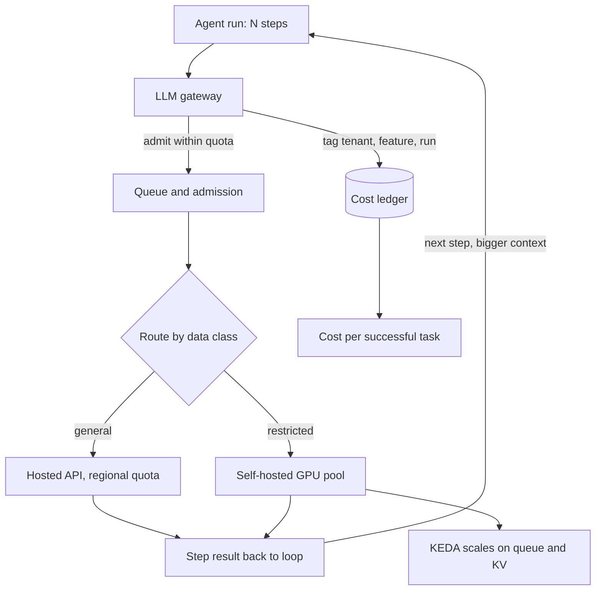

## Overview
This module is about the physical and financial reality under every AI feature: where the model runs,
how much of it you need, and whether the result pays for itself.

For an agent builder that reality is
multiplied. One agent run is 5-50 model calls that re-send a growing transcript, so every number here is
paid once per step, not once per request.

What the module gives you, in the order the ideas build:
- **Hardware.** GPU infrastructure is the stack from card to driver to scheduler. GPU sizing turns a model config into bytes of weights and KV cache. The roofline explains why decode is memory-bandwidth-bound and why "GPU-Util" lies. Card selection asks which constraint binds first: fit, bandwidth or cost per token.
- **Capacity.** Queueing theory and Little's law predict the latency knee. Capacity planning converts token distributions and an SLO into replicas or quota. Latency budgets split one target across every hop. The Universal Scalability Law shows where adding replicas stops helping.
- **Deployment.** Inference clusters, KEDA, serverless GPUs, Ray, shared versus isolated serving, provider quotas, cloud AI platforms, hybrid on-prem and edge.
- **Economics.** Cost models, cost per successful task, allocation by tenant and feature, FinOps, ordered optimization, the quality-latency-cost frontier, break-even and TCO.

Core for agents (you use them directly in every agent you ship): cost-modeling,
unit-economics-per-successful-task, latency-budgets, api-provider-quotas-and-regional-limits,
cost-optimization and quality-latency-cost-optimization. Most agents run on hosted APIs, so these six
decide whether a run finishes, how long it takes and what it costs.

Useful background (you meet it when self-hosting, scaling or pricing agents): the GPU lessons, queueing,
capacity planning, scalability, clusters, KEDA, serverless GPUs, Ray, shared versus isolated serving,
cloud, hybrid and edge placement, allocation, FinOps, break-even and TCO.

What you can build afterwards:
- An agent gateway that meters every step, admits runs within quota and routes by data class and region.
- A sizing and capacity plan that defends a replica count or quota request for an agent model.
- A choice between API, self-hosted, hybrid and edge backed by numbers, and a report of what a successful task costs and who caused the cost.

It matters most for Architects. Engineers need it to run serving and metering, and FDEs need it for
customer sizing and pricing.

## Why it matters
- **Engineer:** You derive KV bytes per token from the model config before an OOM does it for you, read DCGM SM and DRAM activity instead of GPU-Util, scale agent workers and inference replicas on queue depth and KV usage through KEDA rather than CPU, pause an agent run on a 429 instead of crashing it, and emit one tagged cost event per model call so spend reaches the right tenant and feature.
- **Architect:** You turn agent traces (steps per run, token histograms) and a p95 TTFT target into a replica count with headroom below the queueing knee, choose card, region, quota and shared or isolated pools on the binding constraint, and back every build-versus-buy or on-prem decision for the agent's model with a break-even band and a TCO that includes people, evals and exit cost.
- **FDE:** You size a customer's agent deployment from their real document lengths and peak hour, file quota increases weeks before launch, place the endpoint inside their Bedrock, Azure or on-prem perimeter, and show the sponsor cost per successful task against the task's value, so the pricing and ROI conversation rests on their numbers.

## Mental model
Picture one pipe with three gauges and a ledger underneath. Requests enter at the left as tokens, not
calls, and every request has a shape: input length, output length, turns and context. An agent run
sends that shape through the pipe once per step, with the context larger each time.

- **The pipe's width** is set by physical limits. GPU memory decides how many sequences fit at once, memory bandwidth decides how fast each one decodes, and provider quotas cap what a hosted pool will give you.
- **The pipe filling.** Queueing theory says wait time stays flat and then jumps at the knee, so you run below it on purpose and buy headroom. An agent pays that wait on every step.
- **The three gauges** are quality, latency and cost, and every lever moves at least two of them. Batching, quantisation, smaller models, caching, serverless and shared pools all trade one gauge against another.
- **The ledger** divides all spend, including failures, retries and idle capacity, by tasks that succeeded, and assigns each dollar to a tenant and feature.

Infrastructure decisions are sizing the pipe, and economic decisions are reading the ledger. Neither is
right unless both agree.

The loop on the right is why agents stress this module: each step re-enters the gateway with a larger
context. The ledger at the bottom is where cost per successful task, allocation and break-even are read.

## Suggested order
1. cost-modeling — agent-core first: turns request shape (fresh, cached, output and reasoning tokens, plus agent turns) into dollars from logged distributions.
2. unit-economics-per-successful-task — divides the full cost, failures included, by tasks that met the bar, the number every later decision uses.
3. latency-budgets — splits the user-facing target across every hop and step, so you know how much time the model actually gets and when the loop must stop.
4. api-provider-quotas-and-regional-limits — capacity planning on hosted APIs is quota planning, with 429s, headroom and reserved throughput, which is where most agents run.
5. cost-optimization — the ordered list of levers (avoid, shrink, route, buy cheaper, tune), each gated by an eval.
6. quality-latency-cost-optimization — chooses from the Pareto frontier across all three gauges instead of optimizing cost alone.
7. queueing-theory — Little's law and the utilization knee, the reason no capacity plan targets "average load fits".
8. capacity-planning — combines queueing with measured per-replica capacity to turn token demand and an SLO into replicas or quota.
9. scalability — the USL shows where adding replicas stops paying off and which shared resource is to blame.
10. gpu-infrastructure — the layer map (card, host, driver, runtime, scheduler, procurement) that every later hardware lesson plugs into.
11. gpu-sizing — the weights-plus-KV-cache arithmetic that decides card count, precision and promised concurrency.
12. gpu-utilization-and-memory-bandwidth — the roofline explains why decode is bandwidth-bound, which sizing alone does not show.
13. a100-h100-l4-selection — applies fit, bandwidth and cost per token from the previous two lessons to a concrete card choice.
14. inference-clusters — the replica fleet, router and LLM-specific scaling signals that put the capacity plan into practice.
15. keda-autoscaling — the Kubernetes mechanism that scales those replicas on queue depth and to zero, and its cold-start limits.
16. serverless-gpus — the per-second alternative for bursty load, decided by utilization break-even and cold-start tolerance.
17. ray-kuberay — the distributed Python runtime for heterogeneous batch, embedding and multi-node workloads a plain Deployment handles poorly.
18. shared-vs-isolated-model-serving-infrastructure — when one batched pool serves every tenant and when noisy neighbours or contracts force isolation.
19. cloud-ai-architecture — places a managed model endpoint inside a cloud's identity, network and per-region quota perimeter.
20. hybrid-on-prem — routes restricted data to owned GPUs and the rest to hosted APIs, and sizes the fixed pool so it stays busy.
21. edge-ai-deployment — the far end of the placement spectrum, sizing small models to device memory and bandwidth with a cloud fallback.
22. cost-allocation-by-tenant-and-feature — assigns direct and shared spend to whoever caused it, so unit economics exist per tenant.
23. finops — the ongoing inform–optimize–operate practice that keeps metering, allocation and budgets running after the first analysis.
24. break-even-analysis — the API-versus-self-host crossover, driven by utilization and team cost rather than GPU list price.
25. tco — the widest frame, adding people, eval upkeep, forced migrations and exit cost over a fixed horizon to every option.

## Capstone
### Brief
**Use case.** A B2B SaaS company runs a contract-review agent that extracts clauses and flags risks in
uploaded agreements. It runs on a hosted frontier API in one region and costs $48k a month. You are the
architect, and this major project (multi-day, about a week) builds the agent's capacity and cost layer.

Three things have just happened:
- The largest tenant, 40% of volume, now requires EU data residency.
- The provider's tokens-per-minute quota throttled the Monday morning peak twice last month.
- Finance wants to know whether self-hosting an open-weight 70B model would be cheaper.

Use a synthetic request log with realistic input and output token histograms, steps per run, tenant IDs,
timestamps and task outcomes (generate it or use the one provided). Produce a working gateway component
and a decision that holds up under review.

The work in order:
- Size the model on candidate cards, and build the capacity plan and latency budget.
- Model cost per successful task by tenant.
- Compare hosted, self-hosted and hybrid options on break-even and TCO.
- Recommend a serving shape with its scaling and quota plan, and run it through a gateway that the agent loop calls.

### Deliverables
- A working agent gateway in front of the review agent's model calls that tags every call with tenant, feature and run id, emits one cost event per call, admits runs within the regional TPM and RPM quota, pauses a run on a 429 instead of failing it, and routes the EU tenant by data classification.
- A sizing sheet for the 70B candidate showing weights and KV bytes per token derived from the model config, concurrency per card at the p95 context length on L4, A100 and H100 at bf16 and fp8, and the roofline time per output token compared with a measured or published figure.
- A capacity plan that converts the log's peak hour into runs/s, model calls/s, input and output tokens/s and in-flight sequences via Little's law, sets per-replica capacity at the TTFT and TPOT SLO, gives a replica count with headroom justified by queueing, and converts the hosted path into TPM and RPM per region with a quota-increase request.
- A latency budget for the review path (upload, parsing, retrieval, guardrail, model queue and prefill, decode, repeated per agent step) with per-hop p95 allocations, a reserve, and the steps that degrade under deadline pressure.
- A cost model and allocation report giving cost per successful task by tenant and feature, with retries, failed extractions and human review included, shared GPU cost allocated by GPU-seconds, and the unattributed share stated.
- A break-even and TCO comparison of hosted API, self-hosted and hybrid (EU tenant on owned or regional capacity, the rest hosted) over 24 months, with a sensitivity table on utilization, team cost and an API price cut.
- A serving design with an autoscaling configuration (KEDA or equivalent) keyed on queue depth and KV usage, a shared-versus-isolated decision for the large tenant, and a one-page recommendation that names the premium paid for the chosen option.

### Rubric
- Replaying the synthetic Monday peak through the gateway produces no failed agent runs from 429s: throttled runs pause and resume, and every model call appears in the cost ledger with tenant, feature and run id.
- Concurrency per card is derived from bytes per token and free memory after weights, and the engine's KV-block count, or a published figure for the same engine, is within about 20% of the estimate, or the gap is explained.
- The replica count targets a utilization below the queueing knee with the wait-time consequence shown, and plans for peak demand rather than the daily average.
- Every cost figure is per successful task rather than per call, and at least one option that looks cheaper per call is shown to cost more once failures and retries are counted.
- Break-even is reported as a band with the assumption that flips the recommendation named explicitly, and the TCO includes people, eval upkeep and migration or exit cost.
- The autoscaling rule never uses CPU or GPU-Util as its signal, and its threshold comes from a measured per-replica capacity curve.
- The residency requirement is enforced at the gateway by data classification, and the large tenant's isolation decision cites a measured noisy-neighbour effect or a contract term, not preference.
