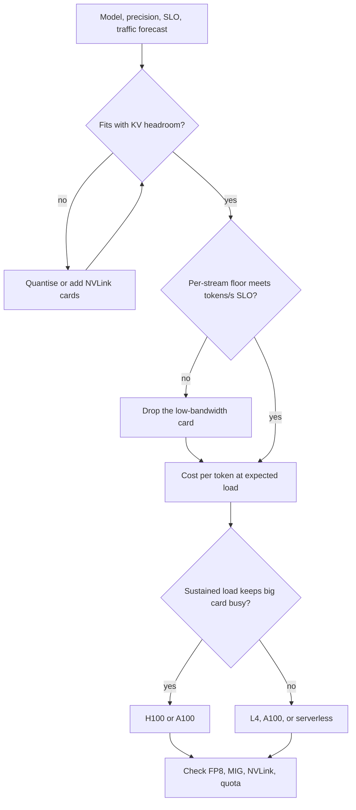

## TL;DR
Pick each agent-stack card by its first binding constraint: fit (long contexts), per-step decode
(bandwidth), then cost per token. L4: cheap 24 GB. A100: 40/80 GB, no FP8. H100:
80 GB, ~3.35 TB/s, FP8, cheapest per token when busy.

## For agent builders
- **Why it matters for agents.** A self-hosted agent stack has several GPU jobs with different
  constraints: the agent model needs bandwidth (many sequential steps) and memory (long transcripts);
  embedders and rerankers need little of either; offline eval judges need cheap throughput.
- **Where it shows up in your stack.** Node pools per card tier, the `nvidia.com/gpu.product` label in
  pod specs, cloud instance families, and the decision of self-hosting versus calling a hosted API.
- **What you control.** Which workload lands on which tier, the precision (fp8 needs H100 or L4), and
  whether small models share a card through MIG.
- **What you can skip.** SM counts and architecture marketing. Memory, bandwidth, price and expected load
  decide it.

## Decision case
### Scenario
A travel company self-hosts an 8B bf16 tool-calling model for a booking agent and must sign a one-year
reservation for its serving cards in one EU region.
- **Demand:** 1,500 tokens/s of agent decode at peak today; the product forecast doubles it to 3,000
  within the year.
- **Step SLO:** a 150-token tool call must decode in 1.5 s, so the step time floor must be at most
  10 ms at the batch you run. Contexts average 4k tokens (about 0.54 GB of KV per sequence).
- **Reliability:** at least two replicas.
- **Region:** H100 quota of 4 cards granted; A100 and L4 freely available.
- **Prices (illustrative, per card-hour):** L4 $0.80, A100 80 GB $2.00, H100 $4.00. Replace with your
  quotes.

Batch per card is the largest batch whose floor, `(16 GB + B × 0.54 GB) ÷ bandwidth`, stays under 10 ms.

### Options
| Option | Batch under 10 ms | Ceiling per card | Cards today (1,500 tok/s) | Cost today | Cards at forecast (3,000) | Cost at forecast |
|---|---|---|---|---|---|---|
| A. L4 | None: ≈ 55 ms at batch 1 | n/a | Fails the step SLO | n/a | n/a | n/a |
| B. A100 80 GB | 7 (9.9 ms) | ≈ 710 tok/s | 3 (71% busy) | $6.00/h | 5 | $10.00/h |
| C. H100 SXM | 32 (9.9 ms) | ≈ 3,230 tok/s | 2, the replica minimum (23% busy) | $8.00/h | 2 | $8.00/h |

### Decision
Choose **C**.
- **Latency gate:** the L4 is out at any price, because bandwidth, not memory, fails it.
- **Cost over the reservation:** B is $2/h cheaper today but $2/h dearer at forecast. The crossover sits
  where the A100 fleet reaches five cards, above about 2,830 tokens/s (4 × 710); the forecast passes it.
- **Headroom:** two H100s carry up to ≈ 6,460 tokens/s, so a forecast miss upward needs no new
  procurement. The A100 fleet already runs at 71% of a bandwidth ceiling real engines do not reach.
- **Future levers:** fp8 on H100 halves weight bytes per step; the A100 has no fp8 tensor cores.
- **Quota:** two cards fit the 4-card grant, leaving two for a failover or canary replica.

**What would change it:**
- **Flat forecast:** B saves about $17,500 a year at these illustrative prices ($2/h × 8,760 h), so
  take B and revisit at renewal.
- **H100 quota withdrawn:** take B.
- **Step SLO loosened to 3 s per tool call:** rerun the batch column, since both cards then hold larger
  batches.

### Trade-offs accepted
- **Paying for idle capacity in year one.** C runs near 23% of its ceiling today; track utilisation
  against the plan monthly.
- **A forecast-dependent choice.** Record the 2,830 tokens/s crossover in the capacity plan and compare
  real peak demand with it each quarter.
- **Concentrated hardware.** Two big cards mean one failure halves capacity; keep the spare quota ready
  and watch per-replica error rates.
- **Benchmarks still owed.** Floors are upper bounds; replay real agent traces at batch 32 before the
  reservation is signed.

### Review rubric
- Applies the gates in order: fit, per-step latency at the batch used, then cost at expected load.
- Derives the batch each card can run under the step SLO instead of assuming one batch for all cards.
- Prices both today's demand and the forecast over the commitment term, and states the crossover.
- Applies the replica minimum and checks regional quota before recommending.
- Labels prices as quotes or illustrative and names the measured value that would flip the choice.

## Why it exists
- **Price and speed differ by an order of magnitude.** Three cards from the same vendor can differ that
  much in price and in decode speed, and the cheapest per hour is frequently the most expensive per
  token, or simply cannot run the model.
- **Picking by hourly price fails.** Teams end up with L4s that cannot hold a 70B model or that deliver
  15 tokens per second to a chat user.
- **Picking by prestige fails too.** An 8B internal tool on an H100 idles 95% of the day. Neither error
  shows up until the bill or the latency complaints arrive.
- **"Buy the newest card" misreads the workload.** Inference is usually bound by memory capacity and
  bandwidth, not by the compute that generation-over-generation marketing emphasises. Cost per token
  depends on how full the card is, which depends on your traffic, not the card.
- **"Buy the cheapest card that fits" confuses fitting with serving.** A card that holds the weights with
  no KV room serves one user; 300 GB/s of bandwidth cannot reach interactive decode on anything beyond a
  few billion parameters. Selection is a short procedure over four numbers — memory, bandwidth, price,
  expected load — plus a feature checklist.

## How it works
### The cards, by the numbers that matter
Rounded figures from NVIDIA's datasheets. Variants differ (A100 40 GB has ~1.55 TB/s, H100 PCIe ~2 TB/s
and lower TFLOPs, H100 NVL 94 GB, H200 141 GB at ~4.8 TB/s), so confirm the exact SKU.

| | L4 | A100 80 GB SXM | H100 80 GB SXM |
|---|---|---|---|
| Architecture | Ada Lovelace | Ampere | Hopper |
| Memory | 24 GB GDDR6 | 80 GB HBM2e | 80 GB HBM3 |
| Bandwidth | ~300 GB/s | ~2.0 TB/s | ~3.35 TB/s |
| Dense bf16 tensor | ~120 TFLOP/s | ~312 TFLOP/s | ~990 TFLOP/s |
| FP8 | yes | no | yes (Transformer Engine) |
| MIG partitions | no | up to 7 | up to 7 |
| Interconnect | PCIe only, no NVLink | NVLink 600 GB/s (SXM) | NVLink 900 GB/s (SXM) |
| Power / form | 72 W, single-slot PCIe | 400 W SXM (PCIe variant 300 W) | up to 700 W SXM (PCIe 350 W) |

- **Bandwidth is the decode column.** The H100 streams weights ~11× faster than the L4 and ~1.7× faster
  than the A100, and single-stream tokens/s follow those ratios almost directly.
- **Memory is the fit column.**
- **FP8 matters** *because* fp8 weights halve the bytes per decode step and double the KV room with far
  less quality loss than int4.
- **The A100 has no fp8 tensor cores.** It falls back to int8 or int4 schemes, or to engine-specific fp8
  *weight-only* kernels that dequantise to bf16 on the fly, which save memory and bandwidth but not compute.
- **MIG** matters for packing many small models onto one card with isolation; the L4 cannot do it, but at
  its price you simply buy more L4s.

### The procedure
1. **Fit.** Weights at your precision plus KV headroom, from the sizing lesson. Anything that does not fit
   ends the discussion. Roughly:
   - an L4 holds an 8B model in bf16 with a few concurrent 4k contexts, or a ~13B model in int4;
   - an 80 GB card holds 8B with hundreds of contexts, 30B-class models in bf16, or 70B in int4;
   - 70B in fp8 or bf16 needs two or four 80 GB cards with NVLink.
2. **Per-stream latency.** Decode step time is at least `bytes per step ÷ bandwidth`. For 8B bf16: ~53 ms
   on L4 (≤19 tokens/s), ~8 ms on A100 (≤125), ~5 ms on H100 (≤200). If the SLO needs 30 tokens/s per
   user, the L4 is out regardless of price.
3. **Cost per token at your load.** Estimate the throughput ceiling at the batch your memory allows,
   multiply by expected utilisation, divide price by it. The expensive card wins when traffic keeps it
   busy; the cheap card wins when traffic is sparse. The examples below run this.
4. **Features.**
   - FP8 (H100, L4) for cheap precision reduction;
   - MIG (A100, H100) for isolated sharing;
   - NVLink (SXM) for tensor parallelism;
   - L4's low power and single-slot size for edge boxes and ordinary servers, and its video encode/decode
     engines for vision pipelines.
5. **Availability and procurement.** Quotas, regions, reservation terms and spot pricing differ by card;
   A100 supply is typically easier than H100, and L4s are widely available in small counts.

Cloud families to look for (check the current catalogue before planning):

| Cloud | A100 | H100 | L4 |
|---|---|---|---|
| AWS | p4d/p4de (A100 40/80 GB) | p5 | g6 |
| GCP | a2 | a3 | g2 |
| Azure | ND A100 v4 | ND H100 v5 | |

### Training versus serving
- **Training and full fine-tuning are compute- and interconnect-bound.** H100's bf16 and fp8 throughput
  and NVLink make it the default; A100 remains cost-effective for smaller runs.
- **The L4 is only sensible for LoRA on small models,** *because* 24 GB and PCIe-only links cap
  everything else.
- **For serving, steps 2 and 3 dominate.** That is why "A100 is obsolete" is wrong for inference: its
  bandwidth is 60% of an H100's at a typically lower price, and for models under 30B it is often the best
  value.

### Neighbours you will see
| Card | Memory | Bandwidth | Where it sits |
|---|---|---|---|
| A10G | 24 GB | ~600 GB/s | Between L4 and A100 in price and bandwidth |
| L40S | 48 GB | ~860 GB/s | Between L4 and A100 in price and bandwidth |
| H200 | more and faster than H100 | | An H100 with more memory, for long contexts |

Newer generations exist and follow the same procedure with their own datasheet numbers.

### Mapping an agent stack onto card tiers
| Agent component | Binding constraint | Usual tier |
|---|---|---|
| Agent (tool-calling) model | Per-step decode × step count, KV room for long transcripts | A100 or H100 80 GB |
| Embedder for RAG | Throughput on short inputs, small weights | L4, or a MIG slice |
| Reranker | Latency per retrieval call, small weights | L4, or a MIG slice |
| Offline eval judge or trace labelling | Cost per token on batch jobs, no latency SLO | Whatever is cheapest per token when fully batched |

- **Run the procedure once per component,** because one card rarely fits all four well.
- **Agent context changes the fit gate:** a session that peaks at 32k tokens on an 8B model needs
  ~4 GB of cache alone, so a 24 GB L4 holds about one such session next to the weights.

## Diagram
The procedure as a decision path, run once per component of the agent stack: each gate can eliminate a
card before price is even considered, and only the survivors are compared on cost per token at your load.



## Examples
### Worked comparison: an 8B chat model at two traffic levels
Illustrative on-demand prices of roughly $0.80 per hour for an L4 and $4.00 per hour for an H100
(ballpark only; prices vary by provider and over time).

**Ceilings** (both are upper bounds):

| | L4 | H100 |
|---|---|---|
| Batch the KV room allows | about eight 4k-token contexts, so batch 8 | about a hundred contexts |
| Bytes per step | 16 GB weights + ~4.3 GB cache | 16 GB + ~54 GB cache |
| Step time | ≈ 68 ms at 300 GB/s | ≈ 21 ms at 3.35 TB/s |
| Aggregate ceiling | ≈ 120 tokens/s | ≈ 4,800 tokens/s |

**Cost per million tokens at full load:**
- **L4:** 120 × 3,600 ≈ 430k tokens per hour, so $0.80 ÷ 0.43M ≈ $1.90 per million.
- **H100:** 4,800 × 3,600 ≈ 17M tokens per hour, $4.00 ÷ 17M ≈ $0.23 per million.
- **So** at full load the H100 is roughly eight times cheaper per token despite costing five times more
  per hour.

**Two scenarios:**

| Scenario | Demand | L4 | H100 | Winner |
|---|---|---|---|---|
| A, internal tool | 0.3 requests/s × 300 output tokens ≈ 90 tokens/s | about 75% of ceiling, $0.80/h | under 2% of ceiling, $4.00/h | L4, five to one; ≤19 tokens/s per user is acceptable internally |
| B, public product | 10 requests/s × 300 tokens = 3,000 tokens/s | 25 L4s, $20/h | one H100 at ~60% of ceiling, $4/h | H100, and users get several times faster per-stream decode |

In scenario B the batch-1 bandwidth ratio is ~11×; at these batch sizes the per-user gap is smaller.

**Where the crossover sits:**
- **Base case.** The crossover is wherever the H100's higher hourly price is covered by the tokens it
  actually serves. One H100 costs the same as five L4s, which together top out near 600 tokens/s, so the
  crossover is roughly 500–600 tokens/s of sustained demand.
- **Redundancy moves it.** A production service needs at least two replicas, and two H100s ($8/h) cost as
  much as ten L4s, pushing the crossover toward ~1,200 tokens/s unless the second replica can be shared
  with other models.
- **Latency can remove the L4 entirely.** L4s at batch 8 deliver ~15 tokens/s per user; if the product SLO
  is higher, the L4 is out at any demand and the comparison is H100 against A100.
- **Bursty demand:** read the serverless lesson before buying either.

### Worked scenario: which card for a 20-step agent on an 8B model?
Each step emits a ~150-token tool call. Batch-1 decode floors from step 2 of the procedure (upper bounds;
prefill and tool time come on top).

| Card | Single-stream ceiling | Decode per step | Decode per 20-step run | 32k-token sessions that fit |
|---|---|---|---|---|
| L4 | ≤19 tokens/s | ≈ 7.9 s | ≈ 160 s | about 1 |
| A100 80 GB | ≤125 tokens/s | ≈ 1.2 s | ≈ 24 s | about 12 |
| H100 80 GB | ≤200 tokens/s | ≈ 0.75 s | ≈ 15 s | about 12 |

- **These are weights-only floors.** Near the end of a run each step also reads the session's KV cache
  (~4 GB at 32k tokens), which adds roughly a quarter to every figure; the ranking does not change.
- **The L4 fails the latency gate for interactive agents** even though the weights fit: almost three
  minutes of decode per run, before any batching slows it further.
- **The L4 still earns its place** in the same stack as the embedder and reranker, where inputs are short
  and the weights are small.
- **A100 versus H100** then comes down to cost per token at your agent traffic, exactly as in the
  comparison above.

### Card planner: cards, cost and utilisation for a demand figure
Reproduces the worked comparison with the bandwidth-bound ceiling and a two-replica minimum. Prices and
batch limits are the illustrative figures above; swap in your own quotes and sizing results.

```python
import math

CARDS = {  # (bandwidth B/s, illustrative $/hour, max concurrent 4k contexts for 8B bf16)
    "L4":   (300e9,  0.80, 8),
    "H100": (3.35e12, 4.00, 100),
}

def ceiling_tps(bw, batch, weights=16e9, ctx=4096, kv_per_token=131072):
    step = (weights + batch * ctx * kv_per_token) / bw     # bandwidth-bound step time
    return batch / step

def plan(card, demand_tps, min_replicas=2):
    bw, price, batch = CARDS[card]
    cap = ceiling_tps(bw, batch)
    n = max(min_replicas, math.ceil(demand_tps / cap))
    per_m = price / (cap * 3600 / 1e6)
    print(f"{card:5s} ceiling={cap:6.0f} tok/s  ${per_m:.2f}/M at full load  "
          f"{n:3d} cards  ${n*price:5.2f}/h  util={demand_tps/(n*cap):4.0%}")

for demand in (90, 3000):          # scenario A, scenario B (tokens/s)
    for card in CARDS:
        plan(card, demand)
# L4    ceiling=   118 tok/s  $1.88/M at full load    2 cards  $ 1.60/h  util= 38%
# H100  ceiling=  4807 tok/s  $0.23/M at full load    2 cards  $ 8.00/h  util=  1%
# L4    ceiling=   118 tok/s  $1.88/M at full load   26 cards  $20.80/h  util= 98%
# H100  ceiling=  4807 tok/s  $0.23/M at full load    2 cards  $ 8.00/h  util= 31%
```

The planner's 26 L4s versus the prose's 25 is rounding (118 versus 120 tokens/s). Running near 98% of a
bandwidth ceiling is not realistic, which strengthens the case for the H100 in scenario B.

## Production patterns
- **One node pool per card tier.** Use when more than one card type serves production. Create a pool per
  card and steer workloads with the `nvidia.com/gpu.product` label from GPU feature discovery, so a
  model cannot silently land on the wrong tier. Monitor pods per tier against the card-tier matrix.
- **Split the agent stack across tiers.** Use when you self-host more than the agent model. Put the
  agent model on 80 GB bandwidth-heavy cards, and embedders and rerankers on L4s or MIG slices, each in
  its own deployment so retrieval load cannot steal decode bandwidth. Monitor step latency broken down by
  component in agent traces.
- **Benchmark the shortlist at real batch and context.** Use before any reservation or purchase. Run the
  engine's serving benchmark with your prompt and output lengths at target concurrency on each candidate,
  and record tokens/s per dollar; for agents, replay real multi-step traces rather than single prompts.
  Monitor measured throughput against the bandwidth ceiling.
- **Reserve the baseline, burst elsewhere.** Use when traffic has a steady floor and peaks. Commit to
  reserved capacity for the floor on the card that is cheapest per token when busy, and absorb peaks with
  on-demand or serverless capacity. Monitor reserved-card utilisation; idle reservations are sunk cost.
- **Pack small models with MIG.** Use for embeddings, rerankers or several small models that need
  isolation on A100 or H100. Expose MIG profiles through the GPU Operator and request them as separate resources.
  Monitor per-instance memory and latency, because each slice gets a fraction of bandwidth.
- **Re-run the selection on a schedule.** Use whenever prices, quotas, models or SLOs change, and at least
  at each budget cycle. Keep the planner inputs in version control next to the capacity plan. Monitor
  actual cost per million tokens against the plan's figure.

## Trade-offs
- **H100 lowest cost per token vs needing load.** It delivers the lowest cost per token and fastest
  decode, but only when load keeps it busy; at low or bursty utilisation its hourly price makes the L4 or
  an API provider cheaper.
- **A100 value vs no FP8.** It is often the best value for sub-30B serving and small training runs, but
  its lack of FP8 forces int8/int4 for memory relief, with the quality evaluation that implies.
- **L4 cheap and available vs bandwidth and size caps.** Low-power and easy to get, yet its 300 GB/s
  bandwidth caps per-stream decode and its 24 GB caps model size, so it flips from "obvious choice" to
  "cannot do it" at roughly 8B–13B.
- **SXM/NVLink vs flexibility.** NVLink makes tensor parallelism efficient for 70B-class models, at the
  cost of buying eight-card blocks; PCIe cards are flexible but make multi-card sharding slow.
- **One card type for the whole agent stack vs per-component tiers.** A single tier simplifies
  scheduling and spares capacity, but puts embedders on expensive bandwidth or the agent model on a card
  too slow for multi-step runs. It flips once the stack has enough load per component to fill a tier.

## Pitfalls
- **Choosing by hourly price alone.** Symptom: a fleet of L4s that cannot meet a per-user tokens/s SLO or
  cannot load the model the product team actually wants. Fix: run fit and latency gates first.
- **Choosing by TFLOPs for an inference workload.** Symptom: paying H100 prices for decode throughput that
  an A100 would have delivered at 60%. Fix: compare on bandwidth and cost per token.
- **Forgetting the A100 has no FP8.** Symptom: a quantisation plan validated on H100 that must be redone
  with int8/int4 kernels and re-evaluated for quality. Fix: validate on the target card.
- **Sizing to the 80 GB figure without KV headroom.** Symptom: a 70B bf16 model that loads on two cards
  and serves one request at a time. Fix: use the sizing arithmetic.
- **Ignoring quota and region availability.** Symptom: an architecture built around H100s that cannot be
  launched where the data must stay. Fix: confirm quota per region before design sign-off.
- **Picking the agent model's card from a single-chat benchmark.** Symptom: a card that "felt fast" in a
  demo makes 20-step runs take minutes. Fix: multiply the per-step decode floor by the step count and
  output length before choosing.

## When to use
- **Run the five-step procedure when:** a new model, SLO or traffic forecast arrives, and re-run it when
  prices or quotas change.
- **Reach for the L4 for:** embeddings, rerankers, vision models, small LLMs and anything with sparse
  traffic; not for an interactive agent's main model beyond a few billion parameters.
- **Reach for the A100 when:** a 7B–30B model needs real concurrency at the best price, or when H100
  quota is unavailable.
- **Reach for the H100 for:** 70B-class serving, fp8, training, or any service whose sustained load would
  keep it busy.
- **Measure:** tokens/s per card against the bandwidth ceiling, and actual utilisation against the plan.
- **Interviews:** expect "which card for X and why"; the strong answer names the binding constraint (fit,
  bandwidth or cost per token) before naming the card.

## Role lens
- **Engineer:** Benchmarks the candidate card at the real batch size and context, confirms fp8 or
  int4 kernels exist for the engine, and reports tokens/s per dollar rather than utilisation.
- **Architect:** Owns the card-tier matrix (which workloads go on L4, A100, H100), the procurement
  mix, and the policy for when a workload must move tiers.
- **FDE:** Maps a customer's available hardware and quotas to what each model can realistically do
  there, and defends the recommendation with fit and bandwidth arithmetic.

## Check yourself
**Q:** A customer runs a 13B model in bf16 for 200 daily-active users and asks whether to buy L4s,
A100s or H100s. Reason it through.
**A:** Fit first: 13B in bf16 is ~26 GB of weights, so the L4 is out unless the model is quantised to
int4 (~7 GB), which needs a quality evaluation. Both 80 GB cards fit it with tens of gigabytes of KV
headroom. Latency next: decode on the A100 is bounded near 26 GB ÷ 2 TB/s ≈ 13 ms per step, around
75 tokens/s per stream, comfortably interactive; the H100 would be ~1.7× faster. Load: 200 daily
users rarely produce more than a handful of concurrent requests even at peak, well inside one A100's
ceiling, so an H100's extra throughput would sit idle. The int4 L4 route also needs its own latency and
KV check: ~7 GB ÷ 300 GB/s ≈ 23 ms per step, under ~40 tokens/s per stream before batching, and if the
13B model uses full multi-head attention rather than GQA its per-token cache is several times larger,
so the remaining ~13 GB holds only a few long contexts. Recommendation: one A100 80 GB (two for redundancy), or an int4 L4 pair if
the quality evaluation passes and budget dominates; revisit if traffic grows past the A100's ceiling
or fp8 becomes necessary.

## Interview questions
### Why is memory bandwidth, not TFLOPs, the first spec to compare for an LLM serving card?
- **Decode streams every weight byte per step,** so the step floor is bytes divided by bandwidth; at small
  batches the arithmetic units mostly wait.
- **Numbers:** 8B bf16 is ~53 ms per step on an L4 at ~300 GB/s, ~8 ms on an A100 at ~2.0 TB/s and ~5 ms
  on an H100 at ~3.35 TB/s.
- **TFLOPs matter** for prefill-heavy and training workloads, which is why the answer depends on the workload.

### An agent platform team wants every workload (agent model, embedder, eval judge) on H100s. When would you push back?
- **Sparse traffic:** an 8B internal tool at 0.3 requests/s keeps an H100 under 2% busy, so its hourly
  price buys idle throughput while an L4 suffices.
- **Small models with real concurrency:** an A100 often gives the best value under 30B, at 60% of the H100's
  bandwidth for a typically lower price.
- **Availability:** H100 quota or region limits can block launch where the data must stay.

### How do you find the traffic level at which an H100 becomes cheaper than a fleet of L4s?
- **Compute each card's ceiling** at the batch its memory allows (about 120 versus 4,800 tokens/s for 8B
  bf16 in the worked example).
- **Equal-cost comparison:** one H100 costs as much as five L4s, which top out near 600 tokens/s, so the
  crossover is roughly 500–600 tokens/s sustained.
- **Then correct it:** two-replica redundancy pushes it toward ~1,200 tokens/s; a per-user tokens/s SLO
  above what an L4 delivers removes the L4 at any demand.

### You validated fp8 serving on H100 but the production region only has A100s. What is your plan?
- **Recognise the gap:** the A100 has no fp8 tensor cores, so the fp8 results do not transfer.
- **Options:** int8 or int4 schemes, or fp8 weight-only kernels that dequantise to bf16 where the engine
  offers them, which save memory and bandwidth but not compute.
- **Re-evaluate** quality and speed on the A100 with the new kernels before committing, and recheck fit
  and KV headroom at the new precision.

### You self-host a RAG agent: an 8B tool-calling model, an embedder and a reranker. Which cards do you pick?
- **Agent model:** an 80 GB A100 or H100, because 20-step runs multiply per-step decode (≈ 7.9 s per
  150-token step on an L4 versus ≈ 0.75 s on an H100) and long transcripts need KV room.
- **Embedder and reranker:** L4s or MIG slices, since weights are small and inputs short.
- **Then cost:** choose A100 versus H100 by cost per token at the agent's sustained load, and keep each
  component in its own deployment.

### Which card would you pick for a 70B model serving a public product, and why?
- **Fit:** 70B needs two or four 80 GB cards in fp8 or bf16, or one 80 GB card in int4 with a quality cost.
- **Interconnect:** tensor parallelism across cards needs NVLink, so SXM H100 or A100 nodes, not PCIe-only
  cards.
- **Load:** a public product with sustained demand keeps H100s busy, where they are cheapest per token,
  and fp8 on H100 gives KV room with less quality loss than int4.

## Quiz
### Q: Which card property most directly determines single-stream decode tokens per second for a given model and precision?
- [ ] Peak bf16 TFLOP/s
- [x] Memory bandwidth
- [ ] Number of streaming multiprocessors
- [ ] PCIe generation
> Each decode step must stream all weights (and the sequence's KV cache) from memory, so the step
> time floor is bytes ÷ bandwidth. TFLOPs matter for prefill and training, and PCIe only affects
> host transfers and multi-card traffic.

### Q: A team validated fp8 serving of a 70B model on H100s and now must deploy on A100s. What changes?
- [ ] Nothing; fp8 checkpoints run on any card with 80 GB
- [ ] The A100 runs fp8 tensor-core matmuls at about half the H100's rate
- [x] The A100 has no fp8 tensor cores, so they need a different quantisation path and must re-evaluate quality and speed
- [ ] They must use the A100 40 GB variant, which supports fp8
> FP8 tensor cores arrived with Hopper and Ada (H100, L4); Ampere lacks them. Memory relief must come
> from int8/int4 schemes, or from fp8 weight-only kernels that dequantise to bf16 where the engine
> offers them; either way the kernels and numerics differ, which invalidates the earlier evaluation.

### Q: An internal tool serves an 8B model at 0.3 requests per second. Why is an L4 usually the better choice than an H100 here?
- [ ] The L4 has higher memory bandwidth for small models
- [ ] The H100 cannot run models smaller than 30B efficiently
- [x] At that load the H100 would sit almost idle, so its higher hourly price buys throughput nobody uses, while the L4's decode speed is adequate
- [ ] The L4 supports MIG and the H100 does not
> Cost per token depends on utilisation. The H100 is far cheaper per token at full load, but at a few
> percent utilisation the hourly price dominates and the L4's lower bandwidth still meets an
> internal tool's latency needs. The L4 does not support MIG.

## Use cases & projects
### Use cases
- **Tiering an agent stack by workload.** The agent model on high-bandwidth cards, embedders and
  rerankers on cheap ones, offline eval judges wherever cost per token is lowest.
- **Long-context agents.** Transcripts that grow every step push the agent model toward 80 GB cards or
  fp8, because fit is the first binding constraint.
- **Low-traffic internal agents.** A small model at a few requests per minute usually belongs on a cheap
  card, since an idle premium card's hourly price dominates cost per token.
- **Re-validating after a hardware move.** Moving an fp8-validated agent model to cards without fp8
  changes numerics, so the agent eval suite must be rerun before cut-over.

### Mini project
**Cost-per-agent-run comparison across card tiers (1-2 hours).**
- **Goal:** pick a card for a self-hosted agent model from cost per completed agent run, not list price.
- **Steps:** define an agent profile (steps per run, input and output tokens per step, runs per hour at
  peak and off-peak); for L4, A100 and H100 write down memory, bandwidth and your cloud's hourly price;
  estimate whether the model and the longest transcript fit, per-step decode time from bytes divided by
  bandwidth, and utilisation at your load; compute cost per run for each card.
- **Done when:** a table shows fit, estimated run latency and cost per run per card at both load levels,
  with a one-paragraph recommendation that names the binding constraint.
