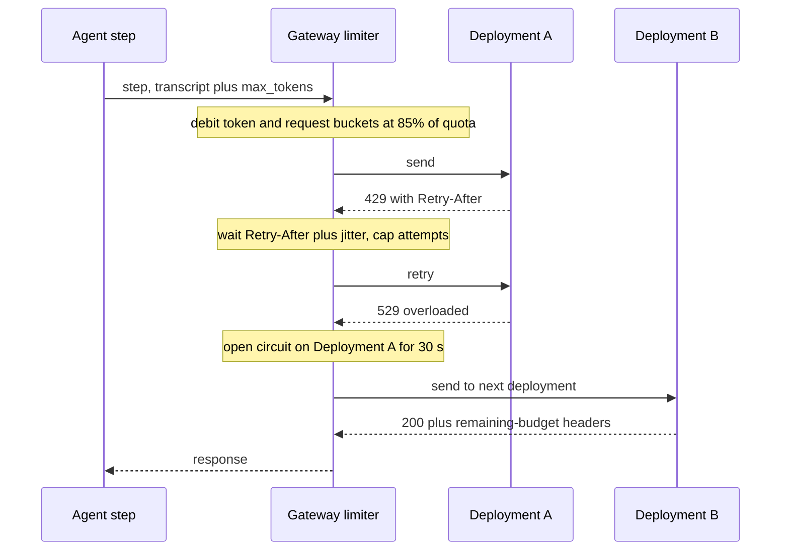

## TL;DR
Every agent step is a hosted-API call counted against requests and tokens per minute, per model, per
region, by tier; a full pool fails you even under quota. Agents hit 429s first: budget per run,
self-limit, checkpoint, spread regions, reserve the base.

## For agent builders
- **Why it matters for agents.** One agent run is 5-50 calls, each charged prompt plus `max_tokens`, with
  the prompt growing every step. A quota that looks huge for chat holds only a few runs per minute, and a
  429 at step 9 must pause the run, not crash it or redo its tools.
- **Where it shows up in your stack.** The 429 and overload errors your agent framework's model client
  raises, its built-in retry settings, `Retry-After` and remaining-budget headers, parallel tool calls and
  sub-agent fan-out, and the provider's batch API for eval sweeps.
- **What you control.** `max_tokens` per step type, transcript size (compaction, caching), how many runs
  and sub-agents you admit at once, retry and checkpoint behaviour, and which agents go to batch.
- **What you can skip.** Each provider's exact limiter algorithm. Know the units, the `max_tokens` trap,
  the binding-ceiling formula and quota versus capacity.

## Why it exists
- **The provider's fleet is finite and shared.** Without limits one customer's spike would degrade every
  other customer, and the provider could not size its fleet. Rate limits are the provider's admission
  control; quotas are the allocation of that control per customer.
- **Each boundary has a reason.** Per model because models have different cost and capacity, per region
  because the fleet is regional, per account or subscription because that is the billing and abuse
  boundary. Tiers rise with spend because payment history is the provider's best signal that a customer
  is real and predictable.
- **"The API is infinite, just retry" fails, first, on retries.** A 429 under sustained demand is not
  transient: retries add load to a limiter already rejecting you, raising latency for every request
  without increasing throughput.
- **Second, the limit is in tokens, including ones never generated.** Several major providers count
  `max_tokens` against the budget at admission, so a team that never set it deliberately can find its
  effective capacity is a fraction of what the quota implies.
- **Third, quotas are regional.** The model may be missing, or have a lower quota, in the only region
  the residency rule allows. A launch has been delayed by a quota ticket more often than by a model's
  quality, so treat quota as a planned resource like GPU memory: measurement, headroom, a growth process.

## How it works
### The units
| Unit | What it caps | When it binds |
|---|---|---|
| **RPM** (requests per minute) | The simplest cap | Workloads with many small requests |
| **TPM** (tokens per minute) | Tokens; some providers count input and output together, others keep separate input-TPM and output-TPM | Usually, for LLM traffic. Long-prompt RAG and long-output generation exhaust different budgets |
| **TPD / RPD** (per day) | A budget rather than a rate | Lower tiers on some providers |
| **Concurrency** | Simultaneous in-flight requests, instead of or in addition to rates | Long generations |

- **Azure OpenAI** allocates TPM per model per region per subscription and you split it across deployments.
- **Bedrock** on-demand quotas are per model per region per account, raised through the service-quotas
  process.
- **Vendor APIs** set limits per organisation per model by usage tier.
- **Vertex** has moved toward dynamically shared quota for some models, where the fixed per-project cap
  gives way to a pool shared across customers.

### How counting works
1. **Token bucket or sliding window.** The budget refills continuously; a request is admitted if the
   bucket holds enough.
2. **Otherwise 429,** usually with a `Retry-After` (or `retry-after-ms`) header saying when to try again.
3. **Output is reserved at admission** on providers that do so: the cost is estimated from prompt length
   plus `max_tokens` (or a default when absent), *because* the provider must reserve capacity before it
   knows the real output length.
4. **Accounting afterwards differs.** Some adjust when the response completes; others count only actual
   output against an output-token limit.
5. **Response headers report the remaining budget,** for example OpenAI's `x-ratelimit-remaining-tokens`
   family and Anthropic's `anthropic-ratelimit-tokens-remaining` family. A gateway can read them to slow
   down before the first 429 rather than after it.

### The max_tokens trap
- **Who documents it:** OpenAI, Azure OpenAI and Bedrock among others document that they count
  `max_tokens` against the token budget at admission.
- **The effect:** a request with `max_tokens=4096` that produces 50 tokens still holds 4,096 tokens of
  budget when admitted. Some providers credit the unused part back when the response completes, others
  do not.
- **Caveat:** the exact rule differs per provider and has changed over time, so read the current docs for
  the one you use.

### The ceiling a quota actually gives you
Every limit converts into a request ceiling, and the lowest one binds:

```
max RPM from TPM  = TPM quota ÷ tokens charged per request
tokens charged    = prompt tokens + max_tokens     (on providers that reserve output)
binding ceiling   = min(RPM quota, max RPM from TPM, concurrency cap ÷ mean seconds per request × 60)
```

| Setting (400k TPM, 1,000-token prompts) | Tokens charged | Ceiling |
|---|---|---|
| `max_tokens=4000` | 5,000 | 80 requests per minute, even if answers average 300 tokens |
| `max_tokens=800` | 1,800 | about 220 per minute, no change to quota or bill |
| Concurrency cap of 50 in flight, 15 seconds per long generation | n/a | at most 200 per minute whatever the token quota says (Little's Law) |

Running this calculation per model per region is the core of quota planning.

### Agent loops multiply every limit
- **The unit of demand is the run, not the request.** A run's token charge is the sum over its steps of
  (prompt so far + `max_tokens`), and the prompt grows with every tool result, so the charge grows roughly
  quadratically with run length.
- **In agents, input usually dominates.** Tightening `max_tokens` still helps, but transcript size
  (compaction, trimming verbose tool results) is the bigger lever on TPM.
- **Fan-out spends concurrency.** Parallel tool calls that each trigger a model call, or a planner spawning
  sub-agents, put many requests in flight at once and hit a concurrency cap before the TPM quota.
- **A failed step is not a failed request.** Steps before it already ran tools with side effects, so the
  recovery unit is "pause the run and resume from its checkpoint", not "retry the whole thing".
- **Admit runs, not just steps.** A gateway that admits a step only when budget exists can still start
  more runs than it can finish, leaving dozens half-done when the budget runs dry; cap concurrent runs per
  agent type as well.

### Quota versus capacity
- **A quota is a promise about *your* admission,** not about the pool's availability.
- **A saturated regional pool fails you under quota:** overload or capacity errors (Anthropic's 529,
  Bedrock's throttling exceptions, Azure 429s on a deployment that is under its TPM).
- **Provisioned or reserved capacity fills this gap.** It buys dedicated throughput that does not compete
  with the pool, which is why it is priced by the hour rather than by the token.

### Regional limits
- **Quotas are per region, which cuts both ways.** If residency allows, spread across several regions or
  Azure deployments and multiply effective quota. If residency names one region, that region's quota is
  the ceiling, and the plan must include lead time for increase requests.
- **Model availability is regional too:** the newest model may reach some regions months after others.
- **Borrowing capacity is a residency decision.** Cross-region inference profiles, global and data-zone
  deployment types and global endpoints borrow capacity from elsewhere; using them is a residency
  decision as much as a capacity one.

### The client-side design
1. **Measure demand in the provider's units.** Peak tokens per minute in and out, peak requests per minute,
   per model, per region, from your own telemetry, with `max_tokens` included in the input-side estimate
   when the provider reserves it.
2. **Limit yourself below the quota.** A gateway-level token bucket at roughly 80–90% of each quota smooths
   bursts, so the provider never sees a storm and the first rejection happens in your queue, where you
   control priority.
3. **Queue with priority and bound the wait.** Interactive traffic ahead of batch; shed or defer when the
   queue exceeds the latency budget rather than letting everything time out.
4. **Retry correctly.** Honour `Retry-After`, add jitter, cap attempts, and open a circuit breaker when the
   failure rate shows the pool is overloaded, since retries cannot create capacity.
5. **Spread and fall back.** Weighted routing across regions, deployments, accounts or providers where
   allowed, with the fallback order chosen by residency and quality constraints.
6. **Mind the terms when spreading across accounts.** It is legitimate when accounts map to real
   organisational boundaries; creating accounts purely to multiply a limit can breach a provider's terms,
   so check them and prefer a quota increase or reserved capacity.
7. **Buy reserved capacity for the base load** and use pay-as-you-go for burst, with batch APIs for
   offline work because they have separate limits and typically a lower price.
8. **Operate the quota.** Alert on remaining-budget headers and 429 rates; file increases before growth,
   not during the incident; keep a table of quota per model per region in the runbook.

## Diagram
One agent step through a gateway that limits itself below quota: a 429 means wait as told, an overload
error means stop sending to that deployment for a while and try another. If every route is exhausted,
the agent runtime checkpoints the run instead of failing it.



## Examples
### Gateway limiter that budgets like the provider
Budgets tokens the way the provider does (reserving `max_tokens`), routes across a pool of deployments,
honours `Retry-After`, and refuses to retry into an overloaded pool. Deployment names and quotas are
placeholders.

```python
import time, random, threading

class TokenBucket:
    def __init__(self, per_minute: int, share: float = 0.85):
        self.cap = per_minute * share; self.tokens = self.cap; self.t = time.time(); self.lock = threading.Lock()
    def take(self, n: int) -> bool:
        with self.lock:
            now = time.time(); self.tokens = min(self.cap, self.tokens + (now - self.t) * self.cap / 60); self.t = now
            if self.tokens >= n: self.tokens -= n; return True
            return False
    def give(self, n: int):                      # refund a reservation that was never sent
        with self.lock: self.tokens = min(self.cap, self.tokens + n)

class Deployment:
    def __init__(self, name, tpm, rpm):
        self.name, self.tpm, self.rpm, self.open_until = name, TokenBucket(tpm), TokenBucket(rpm), 0.0

pool = [Deployment("eu-west-a", tpm=300_000, rpm=1_800), Deployment("eu-west-b", tpm=150_000, rpm=900)]

def pick(need: int):
    for d in random.sample(pool, len(pool)):   # random order spreads load; budget only the one used
        if d.open_until > time.time() or not d.rpm.take(1): continue
        if d.tpm.take(need): return d
        d.rpm.give(1)                          # token budget short: return the request slot
    return None

def call(send, prompt_tokens, max_tokens, attempts=4):
    need = prompt_tokens + max_tokens          # count max_tokens, as the provider does at admission
    for attempt in range(attempts):
        d = pick(need)
        if d is None:
            time.sleep(min(2 ** attempt, 8) * random.uniform(0.5, 1.5)); continue   # wait in our queue
        status, headers, body = send(d.name)
        if status == 200: return body
        if status == 429:                      # our estimate drifted or the pool is busy: back off
            time.sleep(float(headers.get("retry-after", 2 ** attempt)) * random.uniform(1.0, 1.5))
        elif status in (503, 529):             # overloaded: trip this deployment for a while
            d.open_until = time.time() + 30
        else:
            raise RuntimeError(f"{d.name}: {status}")
    raise RuntimeError("quota exhausted: shed or defer this request")
```

- **Admission matches the provider's check:** it admits only when both the request budget and the token
  budget of the chosen deployment have room.
- **It debits only the deployment actually used;** debiting every candidate would silently burn the
  others' budgets.
- **85% of quota** keeps a margin for estimation drift.
- **A production version would also refund** the unused part of `max_tokens` when the response reports
  its real usage, if the provider does the same.

### Which limit binds? A ceiling calculator
Plug in your quotas to see the request ceiling, and notice that fixing one limit exposes the next.

```python
def binding_rpm(tpm, rpm, prompt_tokens, max_tokens, concurrency=None, secs_per_request=None):
    """Requests per minute you can actually get: the lowest of the limits binds."""
    limits = {
        "RPM quota": rpm,
        "TPM quota / tokens charged": tpm / (prompt_tokens + max_tokens),  # providers that reserve output
    }
    if concurrency:
        limits["concurrency cap (Little's Law)"] = concurrency / secs_per_request * 60
    name = min(limits, key=limits.get)
    return name, int(limits[name])

# 400k TPM and 1,000-token prompts; the RPM quota of 10,000 is a placeholder.
print(binding_rpm(400_000, 10_000, 1_000, 4_000))   # ('TPM quota / tokens charged', 80)
print(binding_rpm(400_000, 10_000, 1_000, 800))     # ('TPM quota / tokens charged', 222)
print(binding_rpm(400_000, 10_000, 1_000, 800, concurrency=50, secs_per_request=15))
# ("concurrency cap (Little's Law)", 200): fix max_tokens and the next limit binds
```

### Worked scenario: how many agent runs fit in 400k TPM?
Illustrative. A research agent takes 12 steps per run; prompts average 8k tokens across the run. The
provider reserves `max_tokens` at admission.

| Setting | Charged per step | Per 12-step run | Steps per minute | Runs per minute |
|---|---|---|---|---|
| `max_tokens=4000`, 8k average prompt | 12,000 | 144,000 | ~33 | ~2.8 |
| `max_tokens=800` | 8,800 | 105,600 | ~45 | ~3.8 |
| Plus compaction to a 4k average prompt | 4,800 | 57,600 | ~83 | ~6.9 |

- **Same quota, 2.5x the runs,** and the bigger win came from the transcript, not from `max_tokens`.
- **Compare with chat:** the same 400k TPM served 222 one-shot requests per minute in the calculator above.

### An agent loop that pauses on quota instead of failing
The run keeps its transcript and the results of tools already executed, so a resume never repeats a side
effect. `send` returns status, headers and the parsed reply; `save` persists the run.

```python
import time, random
from dataclasses import dataclass, field

class Throttled(Exception): pass

@dataclass
class Run:
    messages: list
    tool_results: dict = field(default_factory=dict)   # tool_call_id -> result, survives a pause
    done: bool = False

def model_step(send, messages, max_tokens, attempts=3):
    for attempt in range(attempts):
        status, headers, reply = send(messages, max_tokens)
        if status == 200: return reply
        if status == 429:
            time.sleep(float(headers.get("retry-after", 2 ** attempt)) * random.uniform(1.0, 1.5))
        elif status in (503, 529): break          # overloaded: retrying here cannot create capacity
        else: raise RuntimeError(status)
    raise Throttled()

def drive(run: Run, send, tools: dict, save, max_tokens=800, max_steps=20) -> str:
    for _ in range(max_steps):
        try:
            reply = model_step(send, run.messages, max_tokens)
        except Throttled:
            save(run); return "paused"            # a scheduler resumes it when budget returns
        run.messages.append(reply["message"])
        if not reply["tool_calls"]:
            run.done = True; save(run); return "done"
        for call in reply["tool_calls"]:
            if call["id"] not in run.tool_results:          # never re-run a finished tool
                run.tool_results[call["id"]] = tools[call["name"]](**call["args"])
            run.messages.append({"role": "tool", "tool_call_id": call["id"],
                                 "content": str(run.tool_results[call["id"]])})
    save(run); return "step budget exhausted"
```

- **Turn off the SDK's own retries** when wrapping it like this, or the two retry layers multiply into the
  retry storm this lesson warns about.

## Production patterns
- **Budget per run and cap concurrent runs.** Estimate a run's token charge from recorded transcripts
  (steps × average prompt plus `max_tokens`) and cap concurrent runs per agent type so admitted runs can
  finish. Monitor runs paused for quota and median run completion time.
- **Checkpoint and resume on throttling.** Persist the transcript and tool results after every step; on
  exhausted retries, pause the run and let a scheduler resume it. Monitor paused-run age and duplicate
  tool executions, which should be zero.
- **Cap fan-out at the gateway.** Limit in-flight calls per run, counting parallel tool calls and
  sub-agents, so one planner cannot take the whole concurrency cap. Monitor in-flight calls per run at p99.
- **Self-limit below quota.** For every deployment, run a gateway token bucket at 80–90% of TPM and RPM
  (as in the limiter above), so rejections happen in your priority queue. Monitor local queue wait and
  provider 429s, which should stay near zero.
- **Throttle on remaining-budget headers.** Export `x-ratelimit-remaining-tokens` (OpenAI) or
  `anthropic-ratelimit-tokens-remaining` (Anthropic) as a gauge and slow admission as it nears zero.
  Monitor the gauge's minimum per minute alongside 429 counts.
- **Right-size `max_tokens` per endpoint.** Set it from observed output-length percentiles plus a margin,
  not a large default. Monitor the truncation rate: responses ending because they hit the limit
  (`finish_reason` of `length` on OpenAI, `stop_reason` of `max_tokens` on Anthropic).
- **Circuit-break overloaded deployments.** On 503 or 529, stop sending to that deployment for a cooldown
  and fail over within the residency rules. Monitor open circuits per deployment and overload rate while
  under quota.
- **Batch APIs for offline work.** Send agent evaluations, backfills and nightly jobs to the provider's batch API,
  which has separate limits and typically a lower price. Monitor batch turnaround against the job's
  deadline.
- **Quota register in the runbook.** One table of quota, current peak and increase lead time per model per
  region, reviewed before each launch. Monitor peak demand as a share of quota and file increases well
  before it nears the self-limit.

## Trade-offs
- **Pausing runs vs finishing them late.** Checkpointing on throttle protects tools from repeated side
  effects and keeps the pool healthy, but a user waits on a paused run; for interactive agents, admit
  fewer runs up front instead of pausing many mid-flight.
- **Self-limiting vs unused quota.** Limiting below quota prevents 429 storms and lets you prioritise, but
  leaves a slice of paid-for quota unused; the margin should shrink as your token estimates get better.
- **Spreading vs residency and cache benefits.** Spreading across regions or deployments multiplies quota
  and availability, but weakens the residency guarantee and splits prefix-cache and provisioned-capacity
  benefits across endpoints.
- **Reserved capacity vs hourly billing.** It removes 429 and overload risk for the base load, but is billed
  by the hour whether used or not; it pays when steady load fills most of it or an SLO forbids shed traffic.
- **Tight `max_tokens` vs truncation.** A tight value frees quota and lowers reservation waste, but a value
  below what real answers need truncates output; tune it per endpoint from observed output-length
  percentiles.
- **Batch APIs vs turnaround.** They give separate limits and a lower price, but hours of turnaround; they
  flip from useful to useless when a workload is interactive or has a deadline inside the batch window.

## Pitfalls
- **Restarting a throttled agent run from step 1.** Symptom: duplicate emails, tickets or writes from
  tools that already ran, plus a second full token bill. Fix: persist tool results by call id and resume.
- **Stacking the framework's retries on top of the gateway's.** Symptom: one throttled step turns into
  a dozen requests and 429s spread to every agent. Fix: retry in one layer only.
- **Retrying 429s immediately and without a cap.** Symptom: latency rising across every endpoint while
  throughput stays flat, because retries consume the budget that fresh requests need.
- **Leaving `max_tokens` at a large default.** Symptom: hitting TPM at a fraction of the token volume the
  quota suggests, visible as 429s with low measured output tokens.
- **Planning capacity in one region without checking model availability and quota there.** Symptom: a
  launch waiting on a quota-increase ticket.
- **Treating a quota as a capacity guarantee.** Symptom: overload errors during a provider-wide peak while
  your dashboards show you well under quota.
- **Ignoring remaining-budget headers.** Symptom: learning about exhaustion from the first 429 instead of
  throttling smoothly before it.
- **Enabling cross-region or global routing to fix a quota problem on a residency-bound workload.**
  Symptom: an audit finding rather than a runtime error.

## When to use
- **Applies to** every workload on a hosted model API, and first to agents, because they generate the
  most calls and tokens per user action.
- **For a new agent,** measure steps per run and tokens per step in staging before asking for quota.
- **Plan quotas when you choose the model and region,** not at launch: convert peak demand into the
  provider's units, compare with the current allocation per model per region, and file increases with
  weeks of lead time.
- **Day one in the gateway:** a self-limiter, priority queue and correct retry logic.
- **Add later:** spreading across regions or deployments when residency allows and demand exceeds one
  region's quota; reserved capacity when there is a steady base load or an SLO at peak.
- **Measure** 429 and overload rates, remaining budget, queue wait time, and actual versus reserved output
  tokens.
- **Interviews:** expect questions on why retries do not fix sustained 429s and why `max_tokens` affects
  throughput before it affects cost.

## Role lens
- **Engineer:** Implements token-aware limiting, priority queueing and `Retry-After` handling in the
  gateway, tunes `max_tokens` per endpoint and surfaces remaining-budget headers as metrics.
- **Architect:** Decides the region, deployment and provider topology per workload, when to buy
  reserved capacity, and how residency constraints bound the spreading options.
- **FDE:** Audits a customer's quotas per model per region before go-live, drives the increase
  requests early, and explains overload errors that occur while they are under quota.

## Check yourself
**Q:** A team on a hosted API has a quota of 400k TPM for their model in the one region their
residency rule allows. Their load test shows 429s starting at about 120k measured tokens per
minute. Explain what is probably happening and how you would raise effective capacity without
breaking the residency rule.
**A:** The provider reserves `max_tokens` at admission; if requests set `max_tokens` at 4,000 while
real answers average a few hundred tokens, each request reserves far more than it uses, so the
provider's limiter counts the full 400k as consumed while only about 120k tokens are actually
processed (with prompts around 1,300 tokens, each request charges about 5,300 but uses about
1,600, a ratio near 0.3). First, set `max_tokens` from
observed output-length percentiles per endpoint, which can roughly triple effective capacity on
its own. Second, add a gateway token bucket at 85% of quota with a priority queue so interactive
traffic is admitted first and batch work is deferred rather than retried. Third, move offline work
to the batch API, which has separate limits. Fourth, file a quota increase with usage evidence,
and if a peak SLO exists, buy provisioned capacity in the same region for the base load. Spreading
to other regions is off the table because of residency, so the plan is efficiency, prioritisation
and reserved capacity in-region.

## Interview questions
### Why do providers set limits per model, per region and per account, and what does that mean for your plan?
- **Per model** because models differ in cost and capacity, **per region** because the GPU fleet is
  regional, **per account** because that is the billing and abuse boundary.
- **For your plan:** demand must be converted into each provider's units for each model-region pair, and
  the lowest limit in the region you are allowed to use is your real ceiling.
- **Tiers rise with spend,** so a new account may need a growth path before launch, not just a ticket.

### You are under quota but still getting errors at peak. What is going on?
- **Quota is not capacity:** it governs your admission, not whether the shared regional pool has room.
- **Signs:** overload or capacity errors (Anthropic's 529, Bedrock throttling exceptions, Azure 429s on a
  deployment under its TPM) during provider-wide peaks.
- **Response:** circuit-break and fail over where residency allows, and buy reserved capacity for the base
  load if you have a peak SLO.

### How is retry logic in an agent loop different from retrying an ordinary HTTP call?
- **A sustained 429 is not transient,** so blind retries become a retry storm that consumes the budget
  fresh requests need.
- **Do instead:** honour `Retry-After`, add jitter, cap attempts, queue by priority, and shed or defer when
  the wait exceeds the latency budget.
- **Treat overload separately:** open a circuit on a deployment returning 503 or 529, because retries
  cannot create capacity.
- **The run has state:** earlier steps ran tools, so on exhausted retries checkpoint and resume the run
  rather than restarting it, and retry in one layer only.

### Your new research agent hits 429s at a tenth of the traffic your chat product handles on the same quota. Why, and what do you change?
- **Each run is many calls with growing prompts:** 12 steps at 8k average prompt plus `max_tokens=4000`
  charge ~144k tokens, so 400k TPM holds under 3 runs per minute.
- **Cut the charge:** compact the transcript, trim verbose tool results, set `max_tokens` per step type.
- **Then shape demand:** cap concurrent runs and fan-out, move eval sweeps to the batch API, and request
  quota sized from measured tokens per run.

### Your provider caps you at 50 concurrent requests and long generations take 15 seconds. What is your ceiling, and what moves it?
- **Little's Law:** 50 ÷ 15 s × 60 = 200 requests per minute, whatever the token quota says.
- **Shorter requests raise it:** a tighter `max_tokens` or smaller outputs cut seconds per request.
- **Otherwise:** a higher concurrency cap, reserved capacity, or spreading across deployments where
  residency allows.

### When would you not spread traffic across regions or accounts to get more quota?
- **When residency names a region:** cross-region and global routing violate it silently and surface as
  an audit finding.
- **When accounts would exist only to multiply a limit:** that can breach the provider's terms; prefer an
  increase or reserved capacity.
- **When prefix caching or a reservation matters:** spreading splits those benefits across endpoints.

## Quiz
### Q: Why does retrying immediately after a 429 fail to improve throughput under sustained demand?
- [ ] 429 responses are cached by the provider for one minute
- [x] The limiter is already rejecting at the quota, so retries consume budget that new requests need and only add latency
- [ ] Retries are billed at double the token price
- [ ] The provider blocks the account after repeated 429s
> A 429 under sustained load means the budget is exhausted; another request does not add capacity,
> it competes for the same refill. Back off with jitter, honour Retry-After, and prioritise in your
> own queue.

### Q: Why does an overly large `max_tokens` reduce effective throughput on a tokens-per-minute quota?
- [ ] Larger outputs always take longer to generate
- [ ] The provider charges for `max_tokens` whether used or not
- [x] Providers that reserve output count `max_tokens` against the budget at admission, so unused reservation still counts for that minute
- [ ] Requests with large `max_tokens` are routed to a slower pool
> Billing is on actual tokens, but a limiter that reserves before it knows the output length uses
> `max_tokens` (OpenAI, Azure OpenAI and Bedrock document this; check your provider). Setting it from real output-length percentiles recovers the wasted
> budget.

### Q: A residency-bound workload exceeds the quota available in its region. Which option is valid?
- [ ] Enable the provider's global routing so excess traffic is served elsewhere
- [ ] Spread traffic across accounts in several regions
- [x] Improve efficiency, prioritise traffic, use batch APIs for offline work, and request reserved capacity or a quota increase in that region
- [ ] Disable rate limiting in the client so requests are not delayed
> Global or multi-region routing violates residency silently. The in-region toolkit is tighter
> token reservation, prioritisation, separate batch limits, and reserved capacity or increases with
> lead time.

## Use cases & projects
### Use cases
- **Launching a new agent on a hosted API.** Tokens per run from staging transcripts become the quota
  request, filed weeks before launch.
- **Multi-agent and fan-out systems.** Per-run caps on in-flight calls keep a planner and its sub-agents
  from taking the whole concurrency cap.
- **Nightly agent eval sweeps.** Hundreds of eval tasks go to the batch API so they do not drain the
  daytime TPM that interactive agents need.
- **Long-running background agents.** Checkpoint-and-resume lets a run survive a throttled hour without
  repeating tool side effects.

### Mini project
**Make a toy agent survive a quota (2 hours).**
- **Goal:** show that an agent loop behind a token-bucket gateway pauses and resumes cleanly under a tight
  quota without duplicating tool calls.
- **Steps:** build a fake model endpoint that returns 429 with `Retry-After` once a per-minute token budget
  is spent; run ten concurrent 8-step agent runs through the limiter and the pause-and-resume loop above;
  log tokens charged per step, pauses and tool executions.
- **Done when:** all ten runs finish, no tool runs twice for the same call id, and a table shows runs per
  minute before and after cutting `max_tokens` and compacting the transcript.
