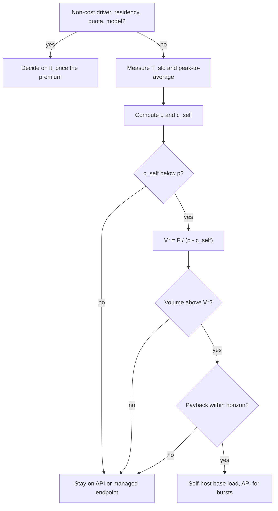

## TL;DR
An agent fleet on a hosted API is variable cost; self-hosting it is mostly fixed GPU and people cost.
Break-even is the monthly token volume where the curves cross, set by achievable utilization and team
cost more than GPU list price.

## For agent builders
- **Why it matters for agents.** Agents multiply tokens: every step re-sends the transcript, so one run
  can be tens of thousands of tokens and the API bill grows with steps times runs. That is when someone
  asks "should we self-host the agent's model?", and this lesson is how to answer with numbers.
- **Where it shows up in your stack.** Your traces (tokens per run, steps per run, input/output split), the
  provider's usage fields and cached-token pricing, a candidate serving engine such as vLLM for an
  open-weight model, and the gateway that would route between the two.
- **What you control.** Steps per run, prompt caching on a stable prefix, which agent steps need a frontier
  model, and which workloads are interactive versus flat (evals, batch backfills, offline agents). Each one
  moves `V`, `p` or `u` in the formulas below.
- **What you can skip.** Building the GPU cluster yourself to "find out". Run the sign test on a
  spreadsheet first; most agent teams stay on an API or a managed open-weight endpoint.

## Why it exists
- **The question arrives with the first five-figure API invoice:** "would it not be cheaper to run this
  ourselves?" The back-of-envelope answer divides a GPU's hourly price by its benchmark tokens per second
  times 3,600, gets a cost per million tokens far below the API's list price, and concludes self-hosting is
  several times cheaper.
- **Wrong assumption 1: the GPU is saturated 24 hours a day.** Real interactive traffic, including users
  waiting on an agent, is diurnal and bursty. You provision for the peak with headroom to protect latency,
  so average utilization is a fraction, and the effective cost per token is the list cost divided by it.
- **Wrong assumption 2: the GPU is the biggest line.** It is only the visible one. Someone has to build and
  run the serving stack, carry the pager, upgrade the model and prove on your agent evals that an
  open-weight model matches the hosted one at tool calling and planning.
- **Wrong assumption 3: the comparison is like for like.** It compares a hosted frontier model against an
  open-weight model, at different quality.
- **"Never self-host, it is a distraction" is equally lazy.** At sustained high volume the fixed cost
  amortizes until the marginal token is nearly free, and data residency, burst rate limits, latency control
  or a model the vendor does not offer can decide it alone.
- **What the analysis buys:** a curve and a sensitivity band in place of both reflexes. Most teams cross
  break-even much later than per-token arithmetic suggests, and an API price cut can push the crossover to
  infinity.

## How it works
### Two cost curves
Write monthly cost as a function of monthly volume *V* in tokens. For an agent, `V = runs × steps per run ×
tokens per step`.

```
Cost_api(V)  = p_in · V_in + p_out · V_out          ≈ p · V   for a stable input/output mix
Cost_self(V) = F + N(V) · G
```

| Symbol | Meaning |
|---|---|
| `p` | blended price per token at *your* mix; output tokens usually cost several times input tokens, so blend per feature, not per company; for agents, cached input tokens lower it further |
| `F` | fixed monthly cost that does not scale with volume: people, platform tooling, eval upkeep |
| `G` | monthly cost of one GPU replica |
| `N(V)` | replicas needed to serve *V*; a step function, because you cannot buy a third of a GPU |

### Replica count comes from the peak, not the average
```
avg_rate  = V / seconds_per_month
peak_rate = avg_rate · peak_to_average · (1 + headroom)
N(V)      = ceil(peak_rate / T_slo)
```

- **`T_slo` is throughput at your latency target.** It is the sustained tokens per second one replica
  delivers on your sequence lengths, not the throughput at maximum batch, because continuous batching
  trades per-request latency for aggregate throughput: the batch size that maximizes tokens per second
  gives a p95 nobody would ship.
- **Measure it for your request *shape*** (typical input and output lengths), not as a generic
  tokens-per-second figure, *because* a prompt token is processed in parallel during prefill and costs far
  less GPU time than an output token generated one at a time in decode. Agent traffic is input-heavy and
  repeats its prefix every step, so replay real agent traces.
- **The API's input/output price ratio is not your GPU's cost ratio,** so blend both sides on the same mix.
- **Peak-to-average comes from your traffic logs.** Headroom covers failover and the fact that a replica
  at 100% load is already past its latency target.

### Utilization is the single most important number
- **Achieved utilization** is `u = avg_rate / (N · T_slo)`, roughly `1 / (peak_to_average · (1 + headroom))`
  once N is large.
- **Interactive traffic** (chat agents, copilots) with a peak-to-average of 2–3 and 20% headroom lands
  around a third.
- **Batch or offline workloads** (nightly eval suites, backfill agents, document-processing pipelines) can
  be scheduled flat and push *u* toward one, which is why self-hosting pays off far earlier for them.

### Effective cost per token and the sign test
```
c_self = G / (T_slo · seconds_per_month · u)
```

1. **Compare `c_self` to `p` before anything else.**
2. **If `c_self > p`** at the utilization you can realistically achieve, there is no break-even at any
   volume: fixed costs only widen the gap.
3. **If `c_self < p`,** the continuous approximation of the crossover is `V* ≈ F / (p − c_self)`; the step
   function makes the real crossover slightly later.
4. **An API price cut attacks the sign test.** Halve `p` and a workload comfortably past break-even can be
   on the wrong side of it permanently. Turning on prompt caching for an agent's stable prefix lowers your
   effective `p` the same way.

### Payback on the switch
- **Moving is a one-off cost `M`:** building the serving path, evaluating and possibly fine-tuning the
  open-weight model (for agents, on tool-calling trajectories), load testing, migrating traffic.
- **Even past break-even,** the switch pays back only after `M / (Cost_api − Cost_self)` months.
- **Compare with the horizon.** Put payback next to the reservation term and the expected life of the
  model choice: a 14-month payback on a decision you expect to revisit within a year is a loss.

### What goes into G and F
| Line | Contents |
|---|---|
| `G` (cloud) | accelerator plus its share of the node (CPU, memory, local disk, network), ingress and load balancing; on-demand vs one- or three-year reserved pricing differs a lot |
| `G` (on-prem) | adds amortized hardware, power, cooling, space and replacement of failed parts |
| `F` | fraction of platform engineers and SREs, on-call rotation, serving-stack upgrades, security and compliance work, observability tooling, recurring eval and fine-tuning work to keep quality parity each time a new open-weight or hosted model appears |

`F` is where most "it would be cheaper" spreadsheets go wrong, because it is the line nobody wants to
write down.

### Quality parity is a cost, not an assumption
- **If the open-weight model scores below the hosted one on your evals,** either pay to close the gap
  (fine-tuning: a one-off cost plus a recurring maintenance line in `F`) or accept lower quality and price
  it through cost per successful task.
- **Agents amplify small gaps.** A slightly worse tool-call accuracy compounds over many steps into failed
  runs, retries and extra steps, which add tokens back to `V`.
- **Either way, compare at equal quality** or convert the gap into money; comparing at unequal quality is
  comparing nothing.

### Sensitivity, not a point
- **Vary utilization** between the batch-flat and interactive-bursty cases.
- **Vary `p`** across list and committed-use pricing, cached-input pricing and a plausible future price cut.
- **Vary `G`** between on-demand and reserved.
- **Vary `V` through the agent design:** fewer steps per run or a compacted transcript cuts volume as
  surely as losing traffic.
- **Time matters.** A reservation locks `G` for its term, while hosted prices have tended to fall and hosted
  models to improve, so a marginal decision today is a bet on the next twelve months of price movement.

### Non-cost factors that can decide it alone
- **The list:** regulated data that cannot leave a region or a building; rate limits and quotas that cap
  bursts during your peak (an agent fan-out can hit them fast); latency control through co-location; a
  specific open-weight or custom fine-tuned model the vendor does not serve; deprecation and lock-in risk.
- **Run the arithmetic anyway,** so the premium being paid for the constraint is known and owned.

### Separate the model choice from the operating model
- **"Hosted API versus self-hosting" bundles two decisions:** which model (proprietary or open-weight) and
  who operates it. They can be unbundled.
- **Per-token open-weight endpoints:** several providers serve open-weight models per token, giving the
  open model's price and portability with no `F` for serving.
- **Provisioned capacity:** some vendors sell dedicated capacity for a fixed fee, giving fixed cost and
  guaranteed throughput without running the stack.
- **Price these as separate rows,** *because* the self-hosting case often rests on the model being cheaper,
  not on operating it yourself, and a managed endpoint captures that saving without the fixed costs.

### The usual answer is hybrid
- **By load:** self-host the predictable base load, where utilization is high and fixed cost amortizes
  well; send bursts and rare high-complexity requests to the API, which prices variable demand well.
- **By agent step:** high-volume simple steps (routing, extraction, classification) on a self-hosted small
  model, planning and frontier-quality steps on the API.
- **Why it wins:** it puts each cost structure on the traffic shape it is built for, at the price of two
  serving paths and two quality baselines.

## Diagram
Follow the decision path: non-cost constraints first, then the sign test, then the crossover volume, then
payback against the commitment horizon.



## Examples
### Break-even calculator with three scenarios
A runnable version of the model above, with every number illustrative. The output shows the curves crossing
and, more importantly, how the crossover moves when one assumption changes.

```python
import math
SEC_MONTH = 30 * 24 * 3600

def api_cost(tokens_m, price_per_m):
    return tokens_m * price_per_m

def self_host_cost(tokens_m, gpu_month, tok_per_s_at_slo, peak_to_avg, headroom, fixed):
    avg_rate = tokens_m * 1e6 / SEC_MONTH                 # tokens/s averaged over the month
    peak_rate = avg_rate * peak_to_avg * (1 + headroom)   # what you must provision for
    replicas = max(1, math.ceil(peak_rate / tok_per_s_at_slo))  # cannot buy 0.3 of a GPU
    return fixed + replicas * gpu_month, replicas

# Illustrative: blended API price $2.00/M tokens; $3,000 per GPU replica-month (reserved);
# 2,000 tok/s per replica at the latency target; $16,000/month of people and tooling.
for label, price, p2a in (("interactive", 2.00, 2.5), ("flat batch", 2.00, 1.2), ("API cut", 1.00, 2.5)):
    print(label)
    for v in (5_000, 20_000, 50_000, 100_000):            # million tokens per month
        api = api_cost(v, price)
        sh, n = self_host_cost(v, 3_000, 2_000, p2a, 0.2, 16_000)
        print(f"  {v:>7}M  api=${api:>8,.0f}  self=${sh:>8,.0f} ({n:>2} GPUs)  {'self' if sh < api else 'api'} wins")
# interactive:  5,000M api=$10,000 self=$25,000 (3)  20,000M api=$40,000 self=$52,000 (12)
#               50,000M api=$100,000 self=$103,000 (29)  100,000M api=$200,000 self=$190,000 (58)
# flat batch:   20,000M api=$40,000 self=$34,000 (6) -> self already wins; 50,000M self=$58,000
# API cut:      100,000M api=$100,000 self=$190,000 (58) -> api wins at every volume shown
```

Read the three blocks together, starting with the sign test:

| Step | Arithmetic | Result |
|---|---|---|
| One replica at full load | 2,000 × 2,592,000 ≈ 5.2 billion tokens a month | `c_self` = $3,000 / 5,184M ≈ $0.58 per million at u = 1 |
| Interactive utilization | u ≈ 1 / (2.5 × 1.2) = 1/3 | `c_self` ≈ $1.74, below the $2 price but only just |
| Interactive crossover | `V* ≈ 16,000 / (2.00 − 1.74)` | ≈ 62 billion tokens a month |
| Flat load | u ≈ 0.69 | `c_self` ≈ $0.83; crossover about 14 billion |
| API price halved | $1.74 is above $1.00 | sign test fails; no volume rescues it |

- **The table agrees with the formula:** self-hosting does not win until somewhere past 50 billion tokens a
  month, an API bill around $100,000.
- **Flat load** lets the same GPUs serve roughly twice the tokens.
- **The GPU price never changed** across the three runs; utilization and the competitor's price did all
  the work.

### Worked scenario: a support agent's monthly volume
Turn agent traces into `V` before touching the calculator. Illustrative inputs: 200,000 runs a month, 8
steps per run, ~12,000 input and ~300 output tokens per step (the transcript is re-sent every step).

| Quantity | Arithmetic | Result |
|---|---|---|
| Tokens per run | 8 × (12,000 + 300) | ≈ 98,400 |
| Tokens per month | 200,000 × 98,400 | ≈ 19.7 billion |
| API cost at $2 blended | 19,680M × $2 | ≈ $39,360 |
| Average rate | 19.7 billion / 2,592,000 s | ≈ 7,600 tokens per second |
| Interactive peak (2.5 × 1.2) | ≈ 22,800 tokens per second | 12 replicas, $36,000 + $16,000 `F` = $52,000 |
| Same agent with 4 steps per run | half the volume, ≈ 9.8 billion | API ≈ $19,680; self-host 6 replicas, $34,000 |

- **Agent design moved the answer more than hardware did.** Halving steps (better planning, fewer retries)
  halves the API bill and leaves self-hosting even further behind.
- **Caching moves `p`.** If prompt caching on the stable prefix brought the effective blended price to $1,
  the interactive `c_self` of $1.74 fails the sign test outright.
- **Measure `T_slo` on this shape.** The mix is ~98% input tokens, so the 2,000 tokens per second
  assumption may be far off in either direction; replay the traces before trusting it.

### Worked scenario: payback on the switch
Same illustrative inputs, plus a one-off migration cost `M` of $140,000 (serving path, evals, load tests,
traffic migration).

| Case at volume | API per month | Self-host per month | Monthly saving | Payback = M / saving |
|---|---|---|---|---|
| Interactive, 100,000M | $200,000 | $190,000 | $10,000 | 14 months |
| Flat batch, 50,000M | $100,000 | $58,000 | $42,000 | about 3.3 months |
| Flat batch, 20,000M | $40,000 | $34,000 | $6,000 | about 23 months |

- **The interactive case is past break-even and still a loss** if the model choice will be revisited
  within a year: the 14-month payback outlives the decision.
- **The flat 50,000M case pays back in just over a quarter,** so the migration cost is recovered well
  before a typical model or reservation decision is revisited. It is not immune: a halved API price makes
  the API $50,000 at this volume against $58,000 self-hosted.
- **Just past break-even is fragile:** a small monthly saving turns a one-off cost into years of payback.

## Production patterns
- **Derive `V` from agent traces, not request counts.** When: before any break-even discussion. How: sum
  input, cached-input and output tokens per run from the provider usage fields, multiply by runs per month
  per agent, and keep the split by step type. Monitor tokens per run weekly; it drifts as tools and
  prompts change.
- **Measure `T_slo` with a shaped load test.** When: before any GPU commitment. How: replay your real
  input/output length mix, including multi-step agent transcripts with a shared prefix, at rising
  concurrency against the candidate server (vLLM ships a serving benchmark), and record the highest
  throughput where p95 TTFT and time per output token still meet the target. Monitor the same latencies in
  production.
- **Derive peak-to-average from logs, not intuition.** When: building `N(V)`. How: take per-minute token
  counts over several weeks and divide a high percentile of the per-minute rate by the mean. Re-check it
  monthly, because launches and new tenants change the shape.
- **Self-host the flat agent workloads first.** When: you do self-host. How: put nightly eval runs, batch
  backfills and offline agents on reserved replicas sized to the overnight floor of the daily curve, and
  serve interactive agents on demand or via the API. Monitor reserved-replica utilization; if it sits low,
  the reservation is too big.
- **Spillover routing in the gateway.** When: running hybrid. How: send traffic to the self-hosted pool
  until queue depth or p95 crosses a threshold, then route the overflow to the hosted API. Monitor the
  spill fraction and the self-hosted utilization together, and run agent evals on both paths.
- **Price a managed open-weight endpoint as a control row.** When: the case rests on a cheaper open model.
  How: run the same agent evals and price the same model per token on a hosting provider. If it captures
  most of the saving, there is no `F` to pay.
- **Keep the calculator live.** When: always after the decision. How: store it in the repo with inputs fed
  from production metrics and re-run it on every provider price change and each quarter. Alert when
  achieved utilization falls below the assumption the decision used.

## Trade-offs
- **Fixed commitments vs variable spend.** Self-hosting wins when load is high and flat and loses when load
  is small or spiky; the flip is governed by achievable utilization, not by GPU price.
- **Reserved pricing vs flexibility.** It cuts `G` substantially but locks a term; if traffic falls, an
  agent redesign halves its steps, or a better hosted model appears, you keep paying for idle capacity.
  Only worth it with confidence in a year or more of demand.
- **Hosted API: frontier quality, zero platform work vs vendor control.** Prices, quotas, regions and
  deprecations are the vendor's decisions; the trade flips when a quota or residency rule blocks you
  outright.
- **Hybrid serving: best cost per traffic shape vs double surface area.** Two serving paths, two eval
  baselines and a routing layer that must keep them consistent, including tool-call formats.
- **Open-weight quality parity vs recurring fine-tuning.** Matching hosted quality often needs fine-tuning;
  that cost is front-loaded and recurs with each base-model generation, which favours the API when model
  turnover is fast.

## Pitfalls
- **Using benchmark peak throughput for capacity.** Symptom: a plan for 20 GPUs becomes 60 once p95 latency
  targets are enforced in load tests. Fix: measure `T_slo`.
- **Omitting people and platform cost.** Symptom: a GPU bill below the API bill and a total cost above it,
  discovered when the headcount request lands. Fix: write `F` down as FTE fractions at loaded cost.
- **Comparing against API list price when committed-use discounts exist.** Symptom: a break-even computed
  against a price nobody at your volume actually pays. Fix: get a committed-use quote and use it as `p`,
  and include cached-input pricing for agent prefixes.
- **Treating the crossover as permanent.** Symptom: a decision that looked right at one price per million
  tokens looks wrong after the next provider price cut. Fix: re-run the sign test on every price change.
- **Ignoring the input/output mix.** Symptom: decode-heavy traffic achieves far less than the measured
  throughput, because decode is bandwidth-bound while the benchmark was prefill-heavy. Fix: load-test
  with your real length mix.
- **Sizing from today's agent loop.** Symptom: GPUs reserved for a 10-step agent that a prompt change cut
  to 5 steps. Fix: treat steps per run as a sensitivity input and reserve only the base load.
- **Framing it as "frontier API versus our own GPUs".** Symptom: a self-hosting project whose whole saving
  came from the cheaper model, which a managed per-token open-weight endpoint would have delivered without
  the platform team.
- **Arguing cost when the real driver is residency or quotas.** Symptom: weeks of spreadsheet debate while
  the compliance blocker that actually decides the question goes unaddressed.

## When to use
- **Use when** monthly API spend becomes material (a useful threshold: it approaches the fully loaded cost
  of one engineer), and again whenever a non-cost driver appears: a residency requirement, a quota ceiling
  during peaks, a vendor deprecation notice.
- **Collect inputs first:** tokens per month by feature or agent with the input/output split, peak-to-average
  from logs, the latency target, throughput per replica at that target on a candidate open-weight model
  with your sequence lengths, the quality delta on your evals, reserved GPU quotes, and a realistic people
  plan.
- **Avoid when** the agent design is still changing weekly: steps per run and tokens per step will move
  `V` more than any infrastructure choice.
- **Output:** a break-even band under sensitivity and a recommendation that names the premium being paid
  for whichever side is chosen.
- **Interviews:** the structural answer is expected: fixed versus variable cost, the utilization-driven
  effective cost per token, the sign test, and the hybrid shape.

## Role lens
- **Engineer:** Measures throughput at the latency target on real sequence lengths, extracts the
  peak-to-average ratio from traffic logs, and keeps the calculator honest with production numbers.
- **Architect:** Owns the decision and its band: sets the utilization assumption, the reservation term, the
  quality-parity requirement and the hybrid split, and records the non-cost drivers that override the arithmetic.
- **FDE:** Rebuilds the break-even with the customer's volumes, their cloud pricing and their compliance
  constraints, and explains why their "GPUs are cheaper" slide omitted the people and utilization lines.

## Check yourself
**Q:** Your API bill is $40,000 a month at a blended $2 per million tokens, so 20 billion tokens a month.
An engineer says one GPU does 2,000 tokens per second, so four GPUs at $3,000 a month, $12,000 in total,
would replace it. What is wrong with that, and what is the right calculation?
**A:** Twenty billion tokens a month is roughly 7,700 tokens per second on average, and four GPUs at
2,000 tokens per second cover that only if they are saturated every second of the month with no headroom.
With a peak-to-average ratio of 2.5 and 20% headroom you must provision about 23,000 tokens per second,
which is twelve replicas, $36,000, before adding the platform engineer, on-call and eval upkeep that make
it about $52,000, above the $40,000 API bill. The 2,000 figure must also be re-measured at the latency
target on your sequence lengths rather than at maximum batch, and the open-weight model must match the
hosted one on your evals or the gap must be priced. Then run the sensitivity: a flat batch workload drops
the replica count to around six and self-hosting wins, while a committed-use API discount to $1.50 per
million makes the API $30,000 and widens its lead. The honest recommendation is to measure peak-to-average
and throughput at SLO first, and to consider a hybrid that self-hosts the flat base load and sends bursts
to the API.

## Interview questions
### Why does utilization matter more than the GPU's hourly price in a break-even analysis?
- **Effective cost per token is `G / (T_slo · seconds_per_month · u)`,** so cost per token scales with
  1/u. Going from u = 1 to u = 1/3 triples it, a bigger swing than typical price gaps between comparable
  GPU offers.
- **Interactive traffic forces low u,** because you provision for the peak with headroom; flat batch work
  can run near full, which is why it crosses break-even far earlier.

### Your agent fleet's API bill doubled and leadership asks whether to self-host. How do you answer?
- **Decompose `V` first:** runs per month times steps per run times tokens per step, from traces. If steps
  or tokens per step grew, fix the agent (caching, compaction, step budgets) before buying GPUs.
- **Then run the sign test** at the effective price after prompt caching and committed-use discounts, with
  utilization from real peak-to-average logs.
- **Check the middle options:** a managed open-weight endpoint, or self-hosting only flat agent workloads
  such as evals and backfills, often captures the saving without a full platform.

### A self-hosted pilot costs three times per token what the spreadsheet promised. How do you debug it?
- **Check how `T_slo` was measured:** a max-batch benchmark overstates throughput at the latency target.
- **Check the request shape:** decode-heavy production traffic delivers far fewer tokens per second than a
  prefill-heavy benchmark.
- **Check utilization:** compare provisioned replicas with average load; peak-to-average and headroom often
  explain most of the gap.
- **Check `F`:** on-call, upgrades and eval work may have been left out of the spreadsheet entirely.

### Which parts of an agent system would you move to self-hosting first, and why?
- **Flat, high-volume, simple work:** nightly eval suites, batch document agents and routing or extraction
  steps on a small model, because utilization can approach one and quality parity is easier to prove.
- **Keep interactive planning on the API:** it is bursty (low u) and most sensitive to frontier quality,
  where a small tool-calling gap compounds into failed runs.
- **Route with a gateway** so either path can take traffic and both are covered by the same agent evals.

### One replica does 2,000 tokens per second at SLO for $3,000 a month, and the API charges $2 per million tokens. What utilization do you need just to pass the sign test?
- **At full load** the replica serves about 5.2 billion tokens a month, so `c_self` ≈ $0.58 per million at
  u = 1.
- **The sign test needs `c_self` < $2,** so u must exceed about 0.58 / 2 ≈ 0.29.
- **Interactive traffic at about 1/3 barely clears it,** so `F` makes the crossover huge (about 62 billion
  tokens a month with $16,000 of fixed cost), and a price cut to $1 would fail the test outright.

### The provider cut prices by half six months after you moved to self-hosting. What now?
- **Re-run the sign test at the new `p`:** if `c_self` is now above it, there is no break-even at any
  volume, and extra traffic will not fix it.
- **Separate sunk from avoidable cost:** the migration cost is spent, but reserved terms, people and
  upgrades still recur, so compare forward-looking cost only.
- **Shrink toward hybrid:** keep only the flattest base load on owned capacity, let reservations lapse at
  term, and route the rest back to the API.

## Quiz
### Q: For a chosen model and serving stack, which parameter most changes the self-hosted cost per token?
- [ ] The GPU's hourly list price
- [x] The utilization actually achieved after provisioning for peak with headroom
- [ ] The maximum-batch throughput in the vendor's published benchmark
- [ ] The network egress price of the cloud region
> Effective cost per token is the replica cost divided by the tokens it actually serves. Provisioning for
> a bursty peak can leave two-thirds or more of the capacity idle, which typically moves the cost per token
> more than price differences between comparable GPU offers; a vendor benchmark changes no real cost, and
> egress is small for text tokens.

### Q: At realistic utilization the self-hosted effective cost per token comes out above the API's price per token. What does that imply?
- [ ] Break-even will be reached at a high enough volume
- [x] There is no break-even at any volume, because the fixed costs only widen the gap
- [ ] Break-even is reached at a low volume
- [ ] More GPUs should be added to lower the cost per token
> If the variable part alone is more expensive than the API, adding fixed costs for people and platform
> makes self-hosting worse at every volume. Only a change in utilization, GPU price or API price can
> restore a crossover.

### Q: Why is a hybrid, self-hosting the base load and sending bursts to the API, so often the cheapest shape?
- [ ] Hosted APIs are always cheaper per token than any self-hosted setup
- [x] Fixed capacity amortizes best on flat, predictable load, while bursts are exactly what per-token pricing handles well
- [ ] It removes the need to evaluate the open-weight model
- [ ] Self-hosted GPUs cannot technically serve bursty traffic
> Each cost structure is matched to the traffic shape it suits: the reserved GPUs run near full
> utilization on the steady base, and the API absorbs the spiky remainder without idle capacity being
> paid for. The price is two serving paths to keep consistent.

## Use cases & projects
### Use cases
- **The first big agent invoice.** A team with a busy support or coding agent decides between the API, a
  managed open-weight endpoint and self-hosting, using the sign test instead of a GPU-price slide.
- **Moving eval and batch agents to owned capacity.** Flat nightly workloads reach high utilization, so
  they are usually the first agent traffic to cross break-even.
- **Hybrid routing per agent step.** Cheap, high-volume steps go to a self-hosted small model while
  planning stays on a frontier API behind one gateway.
- **Re-checking after a price cut or agent redesign.** A provider price change, prompt caching or a cut in
  steps per run triggers a re-run of the calculator before reservations renew.

### Mini project
**Break-even calculator fed by agent traces (1-2 hours).**
- **Goal:** decide, with a sensitivity band, whether one of your agents should stay on a hosted API.
- **Steps:** run a small tool-calling agent on 20-30 tasks and log input, cached-input and output tokens per
  step from the usage fields; scale to an assumed monthly run count; feed `V` into the calculator above with
  interactive and flat peak-to-average values; repeat with half the steps and with a lower effective `p`
  for cached input.
- **Done when:** you have a table of API versus self-host cost across at least four scenarios, the
  utilization needed to pass the sign test, and a one-paragraph recommendation naming the assumption that
  flips it.
