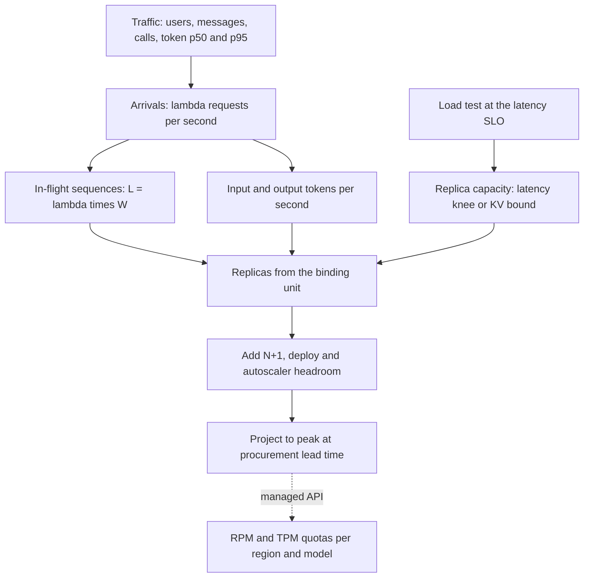

## TL;DR
One LLM request can cost a hundred times another, so plan in three linked units: requests/sec,
input and output tokens/sec, and concurrent sequences. Little's Law links them; a load test at the SLO
gives replica capacity; replicas = peak ÷ capacity, plus headroom.

## Why it exists
- **The web habit breaks.** A classic web service has fairly uniform requests: if one pod handles 500 RPS
  at p99 under 100 ms, ten pods handle about 5,000. Teams carry that habit into LLM serving and it breaks
  in three ways.
- **Cost per request is wildly uneven.** A 200-token classification and a 30,000-token document summary
  are both "one request", yet the second processes 150 times the input tokens (more in attention work,
  which grows faster than linearly with context) and holds GPU memory far longer. An RPS figure says
  nothing about which mix you will get.
- **A request occupies a GPU for seconds, not milliseconds.** Output tokens come one at a time, so a
  500-token answer at 30 ms per token holds a batch slot and its KV cache for 15 seconds. What saturates a
  replica is sequences *in flight at once*, bounded by KV memory and promised per-token latency, not by
  arrivals per second.
- **The limiting units come from different places.** A self-hosted engine runs out of KV memory or decode
  bandwidth; a managed API throttles requests and tokens per minute; your websocket tier and session store
  care about open conversations. A plan in one unit misses the constraint that binds.
- **The naive fixes fail.** Averaging tokens/sec over a day or adding GPUs until the alerts stop either
  under-provisions the peak or pays for idle hardware without knowing which.

## How it works
### 1. Describe the workload as distributions, not averages
Capacity starts from traffic, not hardware. Collect, per use case:

- **Peak concurrent active users** and how often each sends a message.
- **Model calls per message** (an agent may make several).
- **Input tokens per call** (system prompt + history + retrieved context) and **output tokens per call**,
  at p50 and p95.
- **Peak-to-average ratio** of traffic over a day and a week.
- **Why the tails:** a long-context minority can consume most of the KV memory while being a small share
  of requests.

### 2. Convert between the three units
| Unit | Formula | What it sizes |
|---|---|---|
| **Requests/sec (λ)** | active users × messages per user per second × calls per message | Arrivals, RPM quotas |
| **Tokens/sec** | input TPS = λ × mean input tokens; output TPS = λ × mean output tokens | Prefill and decode work, TPM quotas |
| **Concurrent in-flight sequences (L)** | Little's Law: L = λ × W, with W ≈ queue wait + TTFT + output tokens × TPOT (time per output token) | Batch slots and KV memory: the GPUs |
| **Concurrent sessions** | Open conversations, mostly idle; sessions × duty cycle (fraction of wall time a session has a call running) ≈ in-flight sequences | Connection tier, session store, prefix-cache retention |

- **Keep input and output separate** *because* they hit different resources: input is prefill,
  compute-bound and parallel; output is decode, bandwidth-bound and sequential per request. Planning on
  "total tokens" hides which one binds.
- **Little's Law holds for any stable system in steady state,** whatever the arrival or service
  distribution, which is *why* it is the safe bridge between units. It does not tell you queueing delay;
  that is the job of the queueing-theory lesson.

### The circularity: W depends on load
- **TPOT rises as the batch grows,** so more in-flight sequences make each call longer, which makes L
  larger still.
- **Break the loop** by using TPOT and TTFT measured *at the concurrency you plan to run*, not at batch 1.
  An unloaded TPOT undercounts in-flight sequences exactly when it matters.
- **Consistency identity:** a replica running B sequences at TPOT t produces about B ÷ t output tokens per
  second, so in-flight sequences, TPOT and output tokens/sec must agree with each other.

### 3. Measure capacity per replica at the SLO
Per-replica capacity is not a spec-sheet number.

1. **Load-test with a realistic token mix and sweep concurrency.** Throughput rises with batch size while
   per-request TPOT and TTFT degrade.
2. **Find the latency knee.** Usable capacity is the highest concurrency (and its tokens/sec) where p95
   TTFT and p95 TPOT still meet the latency budget, sometimes called goodput.
3. **Cross-check against KV memory:** max sequences ≈ free memory after weights ÷ (KV bytes per token ×
   mean context length).
4. **The lower of the two is the replica's capacity.** Know which one it is, because the fixes differ: more
   memory or a GQA/quantized cache vs. more replicas.

### 4. Size, then add headroom
```
replicas = max( peak in-flight sequences ÷ (per-replica sequence capacity × target utilization),
                peak input tokens/sec ÷ per-replica prefill capacity at that load )   rounded up
         + spares for N+1, rolling deploys and autoscaler lag
```

- **Usually one term dominates,** but a prefill-heavy mix (long RAG contexts, short answers) can be bound by
  prefill while sequence slots sit free.
- **Target utilization sits below 100%** *because* queueing delay grows sharply as utilization approaches
  one.
- **Add spares** for N+1 failure tolerance, rolling deploys and autoscaler lag (GPU nodes and model loading
  can take minutes).
- **Plan over the lead time.** The horizon must be at least as long as your procurement or quota lead time:
  if reserved GPUs take a quarter to arrive and traffic grows 10% a month, today's plan must cover the peak
  expected a quarter from now.
- **For a managed API,** the same numbers become requests-per-minute and tokens-per-minute quotas per
  region and per model. Check whether your provider counts the requested `max_tokens` against the token
  quota at admission, because some do, which makes generous `max_tokens` settings consume quota you never
  use.

## Diagram
Read it top to bottom: traffic becomes three units, a load test turns hardware into a capacity number,
and replicas fall out of peak demand divided by capacity, then grow for headroom and lead time.



## Examples
### A capacity plan in code
```python
import math

def plan(active_users, msgs_per_user_min, calls_per_msg, in_tok, out_tok,
         ttft_s, tpot_s, replica_max_seqs, target_util=0.7, spare=1):
    rps = active_users * msgs_per_user_min / 60 * calls_per_msg     # λ
    in_tps, out_tps = rps * in_tok, rps * out_tok
    w = ttft_s + out_tok * tpot_s                                   # seconds per call
    in_flight = rps * w                                             # Little's Law L = λW
    duty = in_flight / active_users                                 # share of sessions busy
    replicas = math.ceil(in_flight / (replica_max_seqs * target_util)) + spare
    return dict(rps=rps, in_tps=in_tps, out_tps=out_tps, w=w,
                in_flight=in_flight, duty=duty, replicas=replicas)

# Support agent at peak: 1,200 open sessions, one message per user per minute,
# 3 model calls per message, 3,000 input / 250 output tokens per call.
# Load test (illustrative): one replica holds 64 sequences at p95 TPOT <= 30 ms.
print(plan(1200, 1, 3, 3000, 250, ttft_s=0.5, tpot_s=0.03, replica_max_seqs=64))
# {'rps': 60.0, 'in_tps': 180000.0, 'out_tps': 15000.0, 'w': 8.0,
#  'in_flight': 480.0, 'duty': 0.4, 'replicas': 12}
```

- **Reading the result:** 60 calls/sec, each lasting about 8 s (0.5 s TTFT + 250 × 30 ms), means 480
  sequences in flight, so only 40% of the 1,200 sessions are busy at any instant.
- **Replicas:** at 64 sequences per replica, 7.5 replicas would run at 100%; at a 70% target that is 11,
  plus one spare gives 12.

### Worked scenario: cross-checking the plan
Three checks on the same plan; if any disagreed badly, one of the inputs would be wrong.

| Check | Calculation | Verdict |
|---|---|---|
| **Memory** | Llama-3-8B-shaped model (32 layers, 8 KV heads, head dim 128, fp16): 2 × 32 × 8 × 128 × 2 bytes = 128 KiB per token; 64 sequences × 3,250 tokens ≈ 27 GB | Fits beside ~16 GB of weights on an 80 GB GPU |
| **Decode consistency** | 480 sequences over 12 replicas = 40 per replica; 40 ÷ 0.03 s ≈ 1,330 output tokens/sec per replica, about 16,000 across the fleet | Slightly above the 15,000 demanded, because part of each call's 8 s is TTFT rather than decode |
| **Prefill** | 180,000 input tokens/sec across 12 replicas = 15,000 per replica | The load test must confirm it; if the 2,000-token system prompt is shared, prefix caching removes most of that work |

### Worked scenario: planning over the lead time
Same workload, but traffic grows 10% a month and reserved GPUs take a quarter to arrive.

| Step | Calculation | Result |
|---|---|---|
| Growth over the lead time | 1.1 × 1.1 × 1.1 | ≈ 1.33× |
| Peak in-flight sequences in a quarter | 480 × 1.33 | ≈ 639 |
| Replicas for that peak | 639 ÷ (64 × 0.7) = 14.3, rounded up, plus 1 spare | 16 replicas |
| What to order today | 16 − 12 | 4 more replicas, ordered now, not when alerts fire |

## Production patterns
- **Load test with production-shaped prompts.** Replay token-length distributions sampled from production
  (not fixed-length synthetic prompts) and sweep concurrency, recording p95 TTFT and TPOT at each step.
  Monitor where the latency knee and the KV-memory bound fall, and re-run after every model or engine
  change.
- **Reconcile predicted and observed concurrency.** Export the engine's running and waiting request counts
  (vLLM publishes both) and compare them with L = λW from your telemetry. Monitor the gap; a large one means
  W, the token mix or fan-out is mis-measured.
- **Living capacity model.** Keep the plan as a script fed weekly by production histograms of arrivals,
  tokens, TTFT and TPOT, and alert when projected peak at lead time exceeds provisioned capacity. Monitor
  peak-to-average ratio and growth rate.
- **Cap work per call.** Set `max_tokens` and a context cap per route so W and KV bytes per sequence stay
  bounded. Monitor input and output token p95 per route after each release.
- **Headroom as a policy, not a guess.** Fix a target utilization (the example uses 70%) and N+1 per pool,
  and widen headroom where scale-up is slower than the traffic ramp. Monitor queue wait p95 and preemption
  counts.
- **Order on lead time.** File quota increases and reservation requests for the peak expected at now plus
  lead time. Monitor provider throttle counts and remaining quota per region and model.

## Trade-offs
- **Higher target utilization vs queueing delay.** It cuts GPU cost, but queueing delay rises steeply near
  saturation; it flips toward low utilization when traffic is bursty or the TTFT budget is tight.
- **p95 token counts vs means.** Planning to p95 over-provisions on quiet days but protects the tail; means
  are acceptable only when context length is tightly capped.
- **Larger batches vs TPOT.** Larger per-replica batches raise tokens/sec per GPU but lengthen TPOT for
  every user; interactive chat favours smaller batches, offline batch jobs favour the largest batch memory
  allows.
- **Static peak provisioning vs autoscaling.** Static is simple and fast to respond, but wastes money when
  peak-to-average is high; autoscaling saves cost only if scale-up time is shorter than the ramp of your
  traffic.

## Pitfalls
- **Planning in RPS only.** Symptom: a plan that looks fine until one tenant sends long documents and
  KV-cache preemptions spike while RPS is unchanged.
- **Using the engine's peak tokens/sec from a benchmark at huge batch.** Symptom: real interactive traffic
  misses its TPOT SLO at a fraction of that throughput.
- **Forgetting agent fan-out,** counting user messages instead of model calls. Symptom: provider 429s on
  requests-per-minute at a user load the plan said was safe.
- **Sizing to the daily average.** Symptom: queue depth and TTFT climb every weekday morning while the
  dashboard shows modest mean utilization.
- **Load-testing with fixed-length synthetic prompts.** Symptom: a replica that met its SLO in the test
  misses it in production, where the long tail of contexts fills KV memory sooner.
- **Treating open sessions as concurrent load.** Symptom: a GPU fleet several times larger than needed
  because idle conversations were counted as in-flight sequences.

## When to use
- **Do it before** any launch, before signing a reserved-capacity or provisioned-throughput commitment, and
  whenever the traffic mix changes: a new feature with longer context, an agent that adds tool-calling
  steps, a large tenant onboarding.
- **Keep it alive** as a spreadsheet or script fed by production telemetry: arrivals, input and output token
  histograms, TTFT and TPOT percentiles, in-flight sequences, KV-cache utilization and provider throttle
  counts.
- **Managed APIs only?** The plan is shorter but still needed, because quotas are per region and per model
  and raising them can take days.
- **Interviews:** expect "how many GPUs for N users" questions; the strong move is to ask for the token
  distribution and SLO first, then reason through Little's Law and a measured per-replica capacity.

## Role lens
- **Engineer:** Instruments token counts, TTFT, TPOT and in-flight sequences per route, and runs the
  load test that finds the replica's knee at the latency SLO.
- **Architect:** Owns the capacity model, headroom policy and the choice between reserved capacity,
  autoscaling and managed API quotas, including regional failover capacity.
- **FDE:** Turns a customer's "5,000 users" into calls/sec and token mix from their real documents, and
  files quota increase requests in their cloud account before go-live, not after.

## Check yourself
**Q:** Traffic stays at 40 RPS, but after a release p95 TTFT doubles and the engine reports frequent
preemptions. Nothing changed in hardware. What happened, and how do you confirm and fix it?
**A:** RPS is unchanged, so look at the work per request. Likely the release raised input or output
tokens per call: more retrieved chunks, longer history, or a higher `max_tokens`. Longer outputs raise W,
so in-flight sequences L = λW rise even at constant λ; longer contexts raise KV bytes per sequence. Both
push the replica past its memory bound, causing preemption and queueing. Confirm by comparing input and
output token histograms and in-flight sequence counts before and after. Fix by trimming context, capping
output, enabling prefix caching for shared prompts, or adding replicas sized from the new token mix.

## Interview questions
### A product manager asks how many GPUs you need for 5,000 users. What do you ask before answering?
- **Traffic shape:** peak concurrent active users, messages per user per minute, and model calls per message
  (agents fan out).
- **Token distribution:** input and output tokens per call at p50 and p95, because one request can cost a
  hundred times another.
- **The SLO:** p95 TTFT and TPOT targets, since replica capacity is defined at the latency budget.
- **Then reason:** λ, tokens/sec and L = λW, divided by a load-tested per-replica capacity, plus headroom.

### Why is requests per second not enough to plan LLM capacity?
- **Uneven cost:** a 200-token classification and a 30,000-token summary are both one request.
- **Long occupancy:** a 500-token answer at 30 ms per token holds a batch slot and KV cache for 15 seconds,
  so in-flight sequences, not arrivals, saturate a replica.
- **Different limits:** engines run out of KV memory or bandwidth, APIs throttle on RPM and TPM, and session
  tiers care about open conversations.

### A benchmark says one replica does several thousand tokens per second, but production misses its TPOT SLO at a fraction of that. Why?
- **Benchmark batch:** peak tokens/sec is usually measured at a huge batch where TPOT is far above an
  interactive budget.
- **Unrealistic prompts:** fixed-length synthetic prompts miss the long tail of contexts that fills KV
  memory sooner.
- **Fix:** sweep concurrency with production-shaped prompts and take the highest load where p95 TTFT and
  TPOT still pass.

### Why plan for a target utilization below 100%, and how would you choose it?
- **Queueing:** delay grows sharply as utilization approaches one, so a fleet planned at 100% misses its
  TTFT budget at every burst.
- **Choose by burstiness and scale-up time:** bursty traffic or a tight TTFT budget push the target down;
  steady traffic and fast scale-up allow it higher.
- **Spares are separate:** N+1, rolling deploys and autoscaler lag are added on top of the utilization
  target.

### Traffic grows 10% a month and reserved GPUs take a quarter to arrive. How does that change your plan?
- **Plan for the future peak:** over three months 1.1³ ≈ 1.33, so 480 in-flight sequences today become
  about 639.
- **Size for it now:** at 64 sequences per replica and a 70% target that is 15 replicas plus a spare, 16
  instead of today's 12.
- **Order today,** because anything ordered when alerts fire arrives a quarter too late.

## Quiz
### Q: A service receives 20 calls/sec and each call takes 6 s end to end. How many sequences are in flight on average?
- [ ] 20, because concurrency equals arrival rate
- [ ] 3.3, because 20 divided by 6
- [x] 120, by Little's Law L = λW
- [ ] It cannot be estimated without the arrival distribution
> Little's Law gives L = λ × W = 20 × 6 = 120 for any stable system in steady state, whatever the
> distribution. The distribution matters for queueing delay and tails, not for the mean in-flight count.

### Q: Why should a capacity plan keep input and output tokens/sec separate instead of summing them?
- [ ] Providers bill them at the same rate, so splitting adds nothing
- [x] Input tokens drive compute-bound prefill while output tokens drive bandwidth-bound, sequential decode that holds GPU memory longer
- [ ] Output tokens are always fewer, so they can be ignored
- [ ] Input tokens are cached and therefore free after the first request
> The two phases hit different resources. A summary workload is prefill-heavy, a long-generation workload
> is decode-heavy and occupies batch slots longer; summing them hides which constraint binds. Only shared
> prefixes, not all input, benefit from caching.

### Q: A chat product has 10,000 open sessions, but each session has a model call running 5% of the time. What should size the GPU fleet?
- [ ] 10,000 concurrent sequences, since every session might send at once
- [x] About 500 in-flight sequences at peak, plus headroom for bursts and failures
- [ ] The number of sessions divided by the number of GPUs
- [ ] Requests per second alone, since sessions are irrelevant to GPUs
> GPUs are occupied by in-flight sequences, which here are sessions × duty cycle ≈ 500. Open sessions
> still size connections and session storage, and the plan adds headroom because peaks exceed averages.
